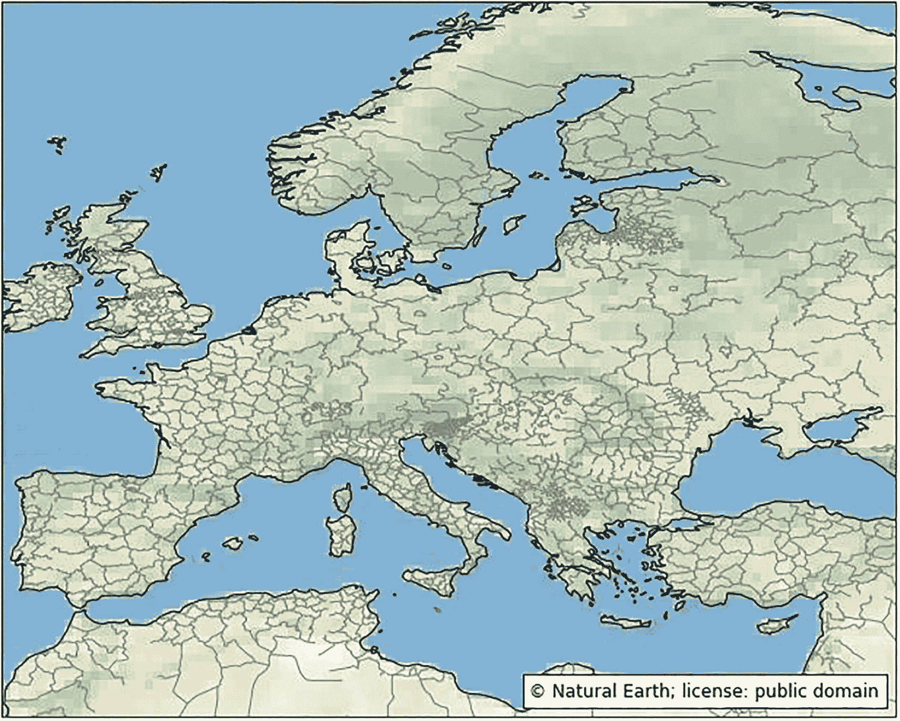
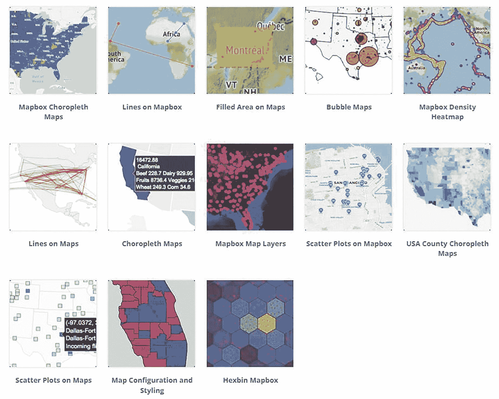
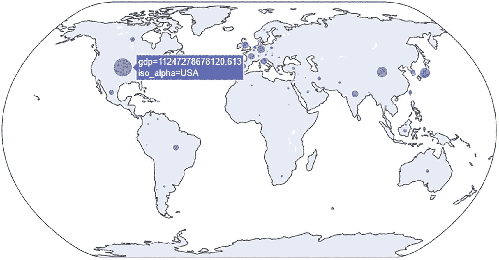
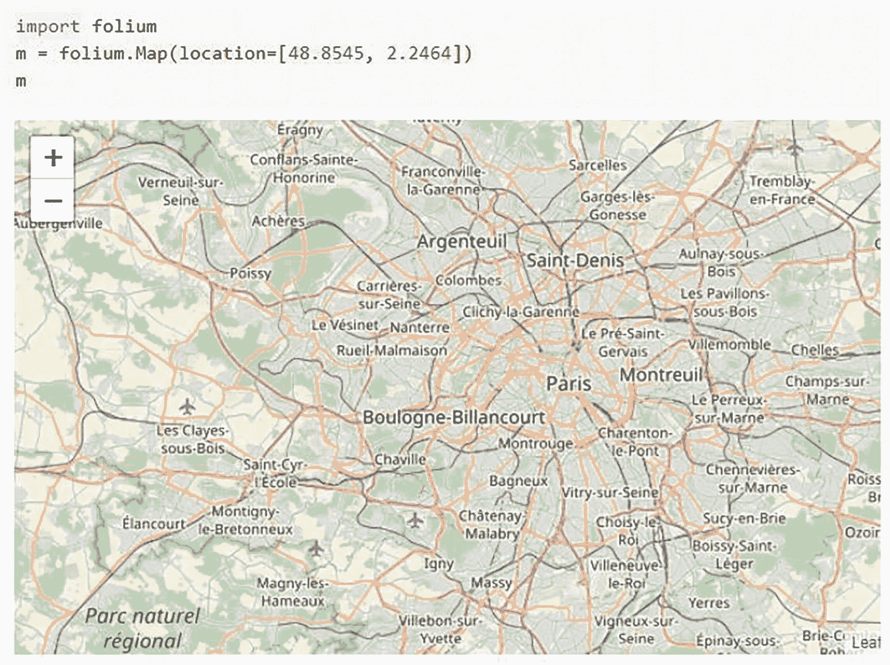
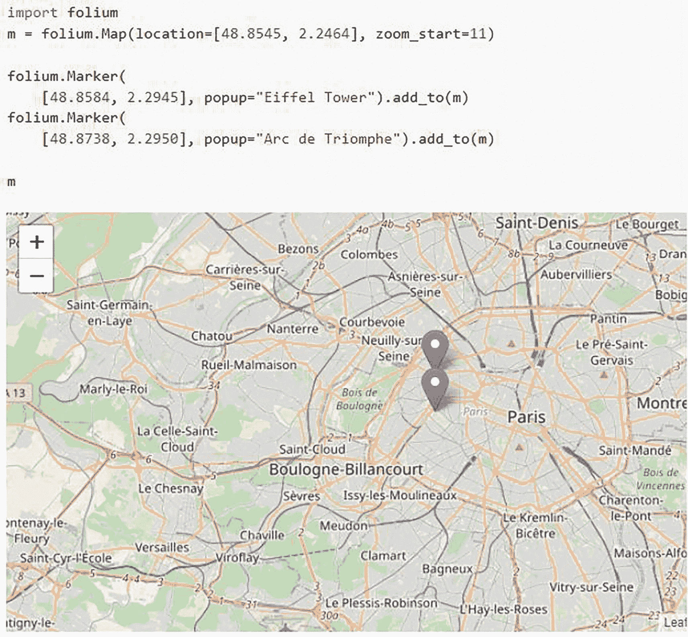

# 添加版权信息
text = AnchoredText('\u00A9 Natural Earth; license: public domain',loc=4, prop={'size': 12}, frameon=True)
ax.add_artist(text)
plt.show()
代码块 4-10
创建 Cartopy 图

这个 Cartopy 入门示例生成的地图如图 4-10 所示。



一张 CartoPy 地图的图像，区域被线条划分，并散布着岛屿。

图 4-10

Cartopy 地图。图片来源：作者 数据来源：Natural Earth，通过 Cartopy 提供，公共领域


### 关于使用 Cartopy 绘制地图的总结

现在你已经看到了 Cartopy 的示例，不妨将 geopandas + matplotlib 的绘图技术与 Cartopy 技术进行一下比较。

在使用 geopandas 时，重点似乎在于数据本身。生成的图表相当实用，并且因其 matplotlib 语法而具有巨大优势。另一方面，Cartopy 是一个真正为制图而生的库。它没有用于存储数据的方法或最佳实践。

如果你对制图功能特别感兴趣，你可能会更喜欢 Cartopy，因为它能让你做很多事情。另一方面，它管理起来稍微不那么容易，并且与使用 geopandas 相比，你需要自己承担更多繁重的工作。

从美学角度来看最终结果，我认为没有明显的赢家。两种方法可能都能获得相似的结果。使用这两种方法制作出美观的地图都需要付出努力，但对于获取信息丰富的地图来说，它们都表现出色。

## 使用 Plotly 制作地图

现在，是时候转向一个能让你制作出更美观可视化的制图库了。一个可以实现这一点的库是 Plotly。Plotly 是 Python 中一个著名的数据可视化库，它也有一个非常完善的制图组件。

我强烈建议你查看 Plotly 地图画廊（图 4-11），这是开始制作地图的绝佳资源。他们的图表画廊位于 [`https://plotly.com/python/maps/`](https://plotly.com/python/maps/)，其中包含大量不同类型图表的代码示例，包括：



十三张不同地图的图像，在特定区域上带有绘图或线条。第 1 行和第 2 行有五张带有标签的图像，第 3 行有三张带有标签的图像。

图 4-11

Plotly 图表画廊截图 (plotly.com/python/maps)

*   分级统计图
*   气泡图
*   热力图
*   散点图
*   以及更多

为了很好地掌握 Plotly 的语法，让我们基于其图表画廊中著名的图表，快速浏览一个简短的 Plotly 示例。在这个示例中，你将看到 Plotly 如何仅通过添加一些额外的功能，就能轻松制作出美观的地图。

你可以使用代码块 4-11 中的代码来获取一个包含某些城市数据的 Plotly express 示例数据集。

```
import plotly.express as px
data = px.data.gapminder().query("year==2002")
data.head()
代码块 4-11
使用 Plotly 绘制地图
```

数据框前五行内容告诉我们有哪些类型的变量。例如，你有每个国家每年的预期寿命、人口和 GDP。在前面的查询中应用的对 2002 年的过滤，使得我们每个城市只有一个数据点；否则，绘图会更加困难。

让我们创建一个名为 `gdp` 的新变量来绘制图表。这个变量可以使用代码块 4-12 来计算。

```
data['gdp'] = data['gdpPercap'] * data['pop']
data.head()
代码块 4-12
添加一个新变量 gdpPerCap
```

现在，让我们使用代码块 4-13 制作一个气泡图，其中每个国家的图标根据新创建的变量 `gdp` 而变大或变小。

```
fig = px.scatter_geo(data, locations="iso_alpha", size="gdp", projection="natural earth")
fig.show()
代码块 4-13
添加变量 gdp
```

即使使用这样相当简单的代码，你也会得到一个看起来相当有趣的图表，如图 4-12 所示。



一张世界地图，由不同大小的点组成，绘制在不同的区域或国家上。一个大致绘制在北美区域的点带有标签。

图 4-12

使用 Plotly 绘制的地图。图片来源：作者 数据来源：Plotly 数据 gapminder。源数据是来自世界银行（通过 gapminder.org）的免费数据，采用 CC-BY 许可。

每个国家都有一个代表其 GDP 的气泡，各大洲颜色不同，背景是著名的自然地球底图。你可以将鼠标悬停在数据点上以查看关于每个点的更多信息。

### 关于使用 Plotly 绘制地图的总结

你可能已经自己得出了结论，Plotly 的真正价值在于其简单性。这个库非常适合制作美观的地图，而无需长时间深入思考你可能遇到的许多复杂问题。我邀请你查看 Plotly 中的更多示例，以了解其他强大的功能，并尝试他们画廊中的一些示例代码。


## 使用 Folium 制作地图

在本系列关于使用 Python 制作地图的第四部分也是最后一部分中，你将朝着更优的美学效果再进一步。Folium 是一个 Python 库，它与一个名为 Leaflet.js 的 JavaScript 库集成。

Folium 允许你创建交互式地图，其结果几乎会让你感觉像是在使用谷歌地图或类似的软件。所有这些只需几行代码即可实现，而生成这些交互式地图的所有复杂工作都隐藏在 Folium 和 Leaflet.js 背后。

Folium 拥有详尽的文档，其中包含大量示例和快速入门教程（[`https://python-visualization.github.io/folium/quickstart.html#Getting-Started`](https://python-visualization.github.io/folium/quickstart.html%2523Getting-Started)）。为了让您感受使用 Folium 所能获得的结果类型，我们将快速浏览一些精彩的示例。让我们从简单地创建一张地图开始，然后逐步添加特定参数以创建更出色的结果。

使用代码块 4-14 中的语法，你将自动创建一张巴黎地区的地图。这是一行代码，仅包含巴黎的坐标，它直接展示了 Folium 库的强大功能。

```
import folium
m = folium.Map(location=[48.8545, 2.2464])
m
代码块 4-14
使用 Folium 进行地图绘制
```

你将在笔记本中获得一张交互式地图。它看起来如图 4-13 所示。



一段代码：import folium, m 等于 folium 点 map, 左括号, location 等于, 左括号 48.8545, 2.2464, 右括号, 左括号, m。代码下方是一张法国城市和地区的地图图像。

图 4-13

使用 Folium 制作的地图。作者提供的图像。此衍生作品基于 OpenStreetMap 的地图数据源。地图数据源：OpenStreetMap 贡献者。底层数据遵循开放数据库许可证。地图（衍生作品）受本书版权保护。[*https://wiki.osmfoundation.org/wiki/Licence/Licence_and_Legal_FAQ#What_is_the_licence,_how_can_I_use_it?*](https://wiki.osmfoundation.org/wiki/Licence/Licence_and_Legal_FAQ%2523What_is_the_licence,_how_can_I_use_it?)

现在，有趣的是，这张地图不包含你的任何数据。它看起来像是一张充满了复杂点、多边形、标签等内容的地图，并且在软件的底层深处确实如此。Folium 作为可视化层的强大之处在于，你完全无需担心这一点。你所有的“背景数据”都将对用户保持干净地隐藏。你可以想象，如果使用巴黎地区实际的多边形、线和点来创建，这将非常复杂。

让我们更进一步，向这个底图添加一些数据。我们将添加两个标记（Folium 术语中的点数据）：一个用于埃菲尔铁塔，一个用于凯旋门。

代码块 4-15 中的代码显示了相对于之前代码的一些新增内容。首先，它添加了一个 `zoom_start`。这基本上告诉你在初始化地图时要显示多少缩放级别。如果你尝试过第一个示例，你会发现你可以缩小到在地图上看到整个世界，也可以放大到看到非常详细的地图。它确实非常完整。然而，对于特定的用例，你可能希望专注于特定的区域或地带，设置 `zoom_start` 将帮助你的用户识别他们需要查看的内容。

其次，地图上添加了两个标记。它们使用 `.add_to` 方法非常直观地添加到地图上。一旦添加到地图，你只需像之前一样显示地图，它们就会出现。你可以指定一个弹出窗口，以便在悬停在标记上时看到附加信息。使用 HTML 标记，你可以在此处创建整段信息，如果你愿意的话。

由于标记是点几何数据，它们只需要 x 和 y 坐标即可在地图上定位。当然，这些坐标必须位于正确的坐标系中，但这与你之前见过的任何内容并无不同。

```
import folium
m = folium.Map(location=[48.8545, 2.2464], zoom_start=11)
folium.Marker(
[48.8584, 2.2945], popup="埃菲尔铁塔").add_to(m)
folium.Marker(
[48.8738, 2.2950], popup="凯旋门").add_to(m)
m
代码块 4-15
向 Folium 地图添加项目
```

如果你在笔记本中工作，你将能够看到交互式地图出现，如图 4-14 所示。它有两个标记，分别用于显示埃菲尔铁塔和凯旋门，正如我们开始所做的那样。



一个包含五行代码的 import folium 代码。代码下方是一张法国城市和地区的地图图像，巴黎市内有两个标记位置。

图 4-14

改进后的 Folium 地图。作者提供的图像。此衍生作品基于 OpenStreetMap 的地图数据源。地图数据源：OpenStreetMap 贡献者。底层数据遵循开放数据库许可证。地图（衍生作品）受本书版权保护。[`https://wiki.osmfoundation.org/wiki/Licence/Licence_and_Legal_FAQ#What_is_the_licence,_how_can_I_use_it?`](https://wiki.osmfoundation.org/wiki/Licence/Licence_and_Legal_FAQ%2523What_is_the_licence,_how_can_I_use_it?)

有关使用 Folium 绘制地图的更多详细信息，我强烈建议你阅读文档。网上还有更多的文档，以及示例地图和包含不同数据类型的示例。

### 关于使用 Folium 进行地图绘制的总结

如果你正在寻找制作交互式、用户友好、美观的地图，你将在 Folium 中发现一个出色的工具。如果你希望通过底图获得地理空间上下文，而无需获取任何关于这些背景数据的数据，那么其内置的背景地图可能是一个强大的优势。

Folium 允许你用少量数据创建漂亮的交互式地图，因此非常适合以可视化为导向的用例。对于科学地图以及更具分析和数学目的的地图，其缺点可能是背景地图会分散人们对分析试图展示内容的注意力。在这种情况下，不那么花哨的地图可能是更好的选择。


## 关键要点

1.  Python 中有许多地图绘制库，每个库都有其特定的优缺点。

2.  将 geopandas 与 matplotlib 结合使用，可能是用 Python 制作地图最简单、最直观的方法。这种方法允许你以类似 pandas 的直观方式在 geopandas 中处理数据框，并使用熟悉的 matplotlib 绘图语法。要获得美观的地图可能需要花费一些功夫。

3.  Cartopy 是一个替代方案，它更侧重于实际的地图绘制部分，而非数据处理。它是一个非常专业的制图库，对不同几何形状、不同坐标系等有很好的支持。

4.  Plotly 是一个可视化库，因此它较少关注地理空间功能。但它确实提供了强大的可视化选项列表，并且可以创建美观且能有效传达信息的地图。

5.  Folium 是创建交互式地图的绝佳库。即使只用少量代码，你也能创建出高质量、用户体验类似于谷歌地图等的地图。内置的背景地图让你即使在需要展示的数据很少时，也能制作出有用的地图。

6.  了解了这些多种地图绘制方法后，最重要的收获是：地图是为特定目的而创建的。它们要么试图客观地呈现某些数据，要么试图传达某种信息。它们也可以是为了美观而制作。在选择用 Python 制作地图的方法时，你应该选择最能服务于你目的的库和方法。这始终取决于你的具体用例。

