# 5. 裁剪与相交

在前四章中，你已经了解了处理地理数据的基础知识。在第一章中，你了解了什么是地理数据、如何表示它，以及使用地理数据的工具概览。之后，第 2 章更深入地介绍了坐标系和投影，为你提供了一个可以使用坐标的框架。

第 3 章向你展示了如何使用一种地理数据类型或形状来实际表示地理数据。第 4 章则向你介绍了创建地图的方法。

至此，你应该对地理数据有了一个总体概念，并开始理解可以用它做什么——无论是在一般的理论意义上，还是通过已提供的 Python 示例在实际意义上。

现在介绍部分已经完成，本书的剩余部分将服务于两个主要目标。在接下来的四章中，我们将重点介绍地理数据处理中的四种标准操作。这里的目标是展示如何使用 Python 完成那些通常在更专业的 GIS 工具和系统中已经实现的任务。当使用 Python 进行 GIS 工作时，在你的个人工具包中拥有这些类型的地理数据处理标准任务至关重要。

使用机器学习的高级用例在 GIS 工具中实现得较少，而 Python 作为地理数据处理工具的绝佳选择，正是因为其易于获得这些功能。这些用例将在本书的最后几章中介绍。

将要介绍的标准操作包括：

*   裁剪与相交

*   缓冲区分析

*   合并与融合

*   擦除

第一个标准操作——裁剪与相交，将在本章中介绍。让我们先给出裁剪操作的一般定义，并在 Python 中做一个示例。然后，我们将对相交操作进行同样的操作。

## 什么是裁剪？

在地理处理中，裁剪操作使用一个输入图层和一个指定的边界图层，来切出输入图层的一部分。被切出的部分会被保留以供后续使用，其余部分通常会被丢弃。

裁剪操作就像一个饼干模具，你的饼干面团就是输入图层，而饼干形状的部分被切出来。

### 裁剪的示意图示例

让我们用一个更直观的例子来阐明这个定义。想象一下，你正在处理一个公共公园的地理数据。你可以从互联网上获取大量公共数据，但当然，任何公共数据都不太可能恰好符合你公园的大小：它通常规模要大得多。

为了更方便地处理数据，你可以使用裁剪操作将所有数据缩小到更小的范围，只保留与你的公园相关的数据。图 5-1 中的示意图展示了这是如何工作的。

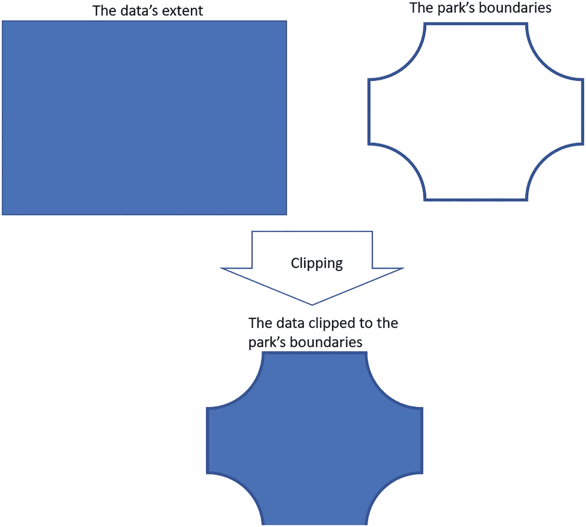

裁剪操作概览的示意图。左上角的一个矩形被标记为“数据范围”，右上角的一个八边形被标记为“公园边界”，在上述图形下方，有一个标有“裁剪”的箭头，连接到另一个标有“裁剪到公园边界的数据”的八边形。

图 5-1

裁剪操作示意图。图片由作者提供

### 裁剪在实践中会发生什么？

正如你现在所理解的，任何地图信息都只是数据。让我们试着理解在执行裁剪操作时数据会发生什么变化。

在实践中，裁剪操作可能产生多种效果，具体取决于输入数据。如果你处理的是栅格数据，裁剪操作将简单地移除栅格中未被选中的像素，并保留仍然相关的像素。前面的示意图展示了栅格数据会发生的情况。你可以认为输入数据由大量像素组成。在输出中，不相关的像素已被删除。

对于点数据也是如此：一些点会被选中，另一些则不会。就数据而言，这意味着删除那些不被保留的数据行。图 5-2 中的示意图展示了这种情况。

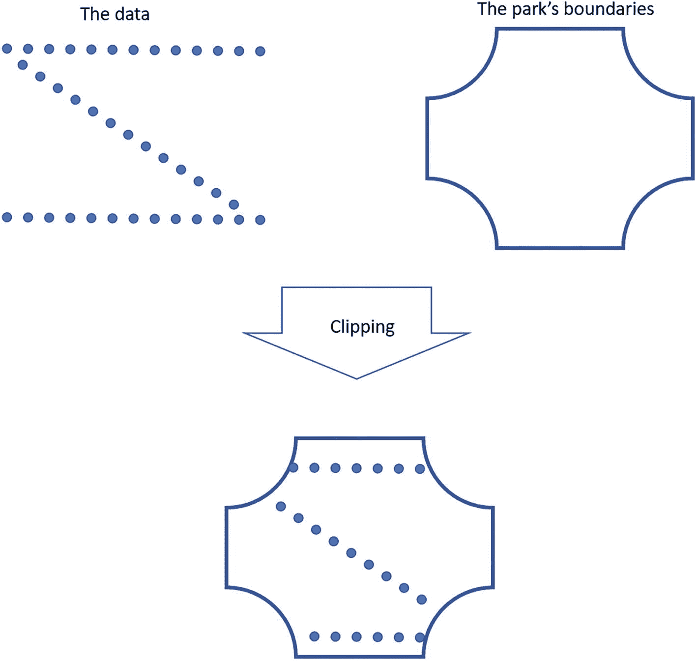

裁剪点的示意图。左上角是一个由小圆圈连接而成的大 Z 形图形，右上角是一个标有“公园边界”的八边形，在上述图形下方是一个标有“裁剪”的箭头，再下方是另一个八边形，内部有一个由连接圆圈构成的大 Z 形图形。

图 5-2

裁剪点的示意图。图片由作者提供

当裁剪线数据集时，情况会变得更加复杂，因为线可能从裁剪边界内部开始，并在边界外部结束。在这种情况下，必须保留边界内的线段部分，但必须移除边界外的部分。结果是，一些数据行将被完全移除（完全在范围外的线），而另一些数据行将被修改（部分在范围外的线）。通过图 5-3 中更详细的示意图，这一点会更清晰。在这个示意图中，数据是线数据；例如，想象一个道路网络。裁剪区域是一个多边形。

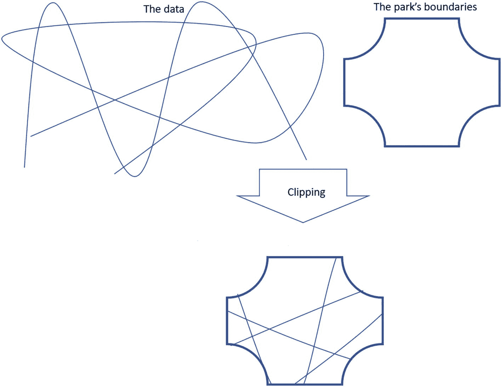

裁剪线的示意图。左上角是向不同方向移动的重叠线条，右上角是一个标有“公园边界”的八边形，下方是一个标有“裁剪”的箭头，再下方是一个内部有相交线条的八边形。

图 5-3

裁剪线的示意图。图片由作者提供

在接下来的部分中，你将通过在 Python 中应用裁剪操作，看到这一理论更实际的应用。


### Python 中的裁剪操作

在本示例中，你将看到如何在 Python 中应用裁剪操作。所使用的数据集是我专门为本次练习生成的，它包含两个要素：

*   一条覆盖塞纳河（法国巴黎的一条著名河流，也流经法国大部分地区）部分区域的线
*   一个覆盖巴黎市中心的多边形

本练习的目标是将塞纳河裁剪到巴黎市中心区域。这是裁剪操作一个非常实际的应用。毕竟，河流通常是跨国界的对象，并且经常显示在地图上。在处理更局部的地图时，你很可能会遇到需要将河流（或其他线状要素，如高速公路、铁路线等）裁剪到更局部范围的情况。

让我们从导入并打开数据集开始。你可以在 GitHub 仓库中找到这些数据。对于执行此代码，我建议使用 Kaggle 笔记本或本地环境，因为 Colab 在撰写本文时对裁剪函数存在一些问题。

你可以像在前几章中学到的那样，使用 `geopandas` 导入数据。执行此操作的代码如代码块 5-1 所示。

```
import geopandas as gpd
import fiona
gpd.io.file.fiona.drvsupport.supported_drivers['KML'] = 'rw'
data = gpd.read_file('ParisSeineData.kml')
print(data)
代码块 5-1
导入数据
```

数据如图 5-4 所示。

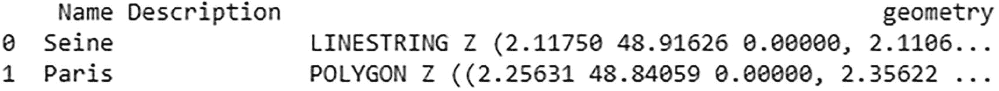

数据集的表格。列标题为名称、描述和几何。行条目为塞纳河、LINESTRING Z 以及巴黎、POLYGON Z。

图 5-4

数据集。作者提供的图片

我们可以快速使用 geopandas 内置的绘图函数来获取这些数据的图形。当然，你在前面的章节中已经看到了更高级的绘图选项，但这里的目标只是快速了解我们拥有的数据。这在代码块 5-2 中完成。

```
data.plot()
代码块 5-2
绘制数据
```

使用此绘图方法时，你将看到图 5-5 中的地图，它清晰地包含了两个要素：作为线的塞纳河和作为多边形的巴黎市中心。

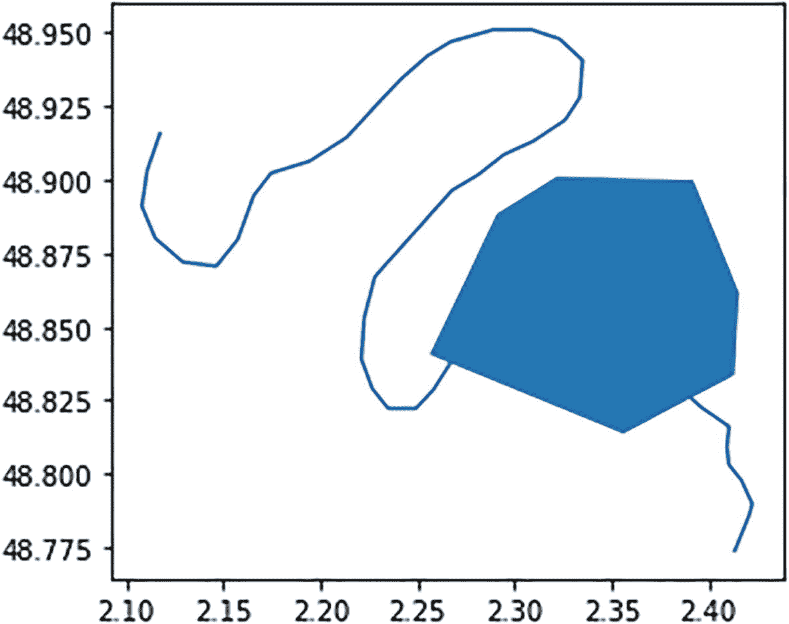

裁剪操作绘图结果的图表。绘制了一个七边形，两侧有两条相连的曲线。纵轴值从 48.775 到 48.950，增量为 0.25。横轴值从 2.10 到 2.40，增量为 0.5。

图 5-5

代码块 5-2 产生的绘图。作者提供的图片

现在，正如本示例引言所述，目标是仅保留塞纳河线对象，但将其裁剪到巴黎河流的大小。第一步是将我们的数据对象拆分为两个独立的对象。这样，我们将得到一个包含塞纳河的地理数据框和另一个包含巴黎多边形的地理数据框。这将更易于处理。你可以使用代码块 5-3 中的代码提取塞纳河。

```
seine = data.iloc[0:1,:]
seine.plot()
代码块 5-3
提取塞纳河数据
```

你可以在生成的绘图（图 5-6）中验证操作是否成功。

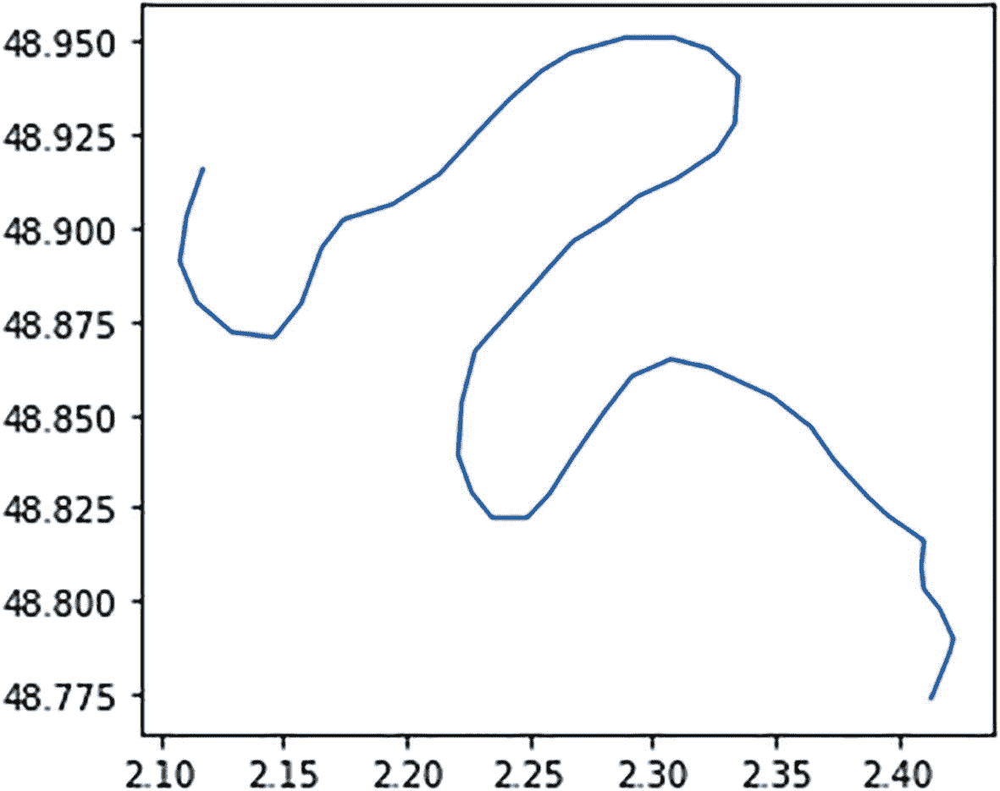

裁剪操作绘图结果的图表。图表上绘制了一条长线，在 2.30 处有一个峰值，在 2.15 和 2.25 处有两个低谷，起点为 (2.13, 48.920)，终点为 (2.40, 48.775)。数值为近似值。

图 5-6

代码块 5-3 产生的绘图。作者提供的图片

现在，我们使用代码块 5-4 中的代码对巴黎多边形执行相同操作。

```
paris = data.iloc[1:2,:]
paris.plot()
代码块 5-4
提取巴黎数据
```

你将获得一个包含巴黎多边形的绘图，以验证一切正常。如图 5-7 所示。

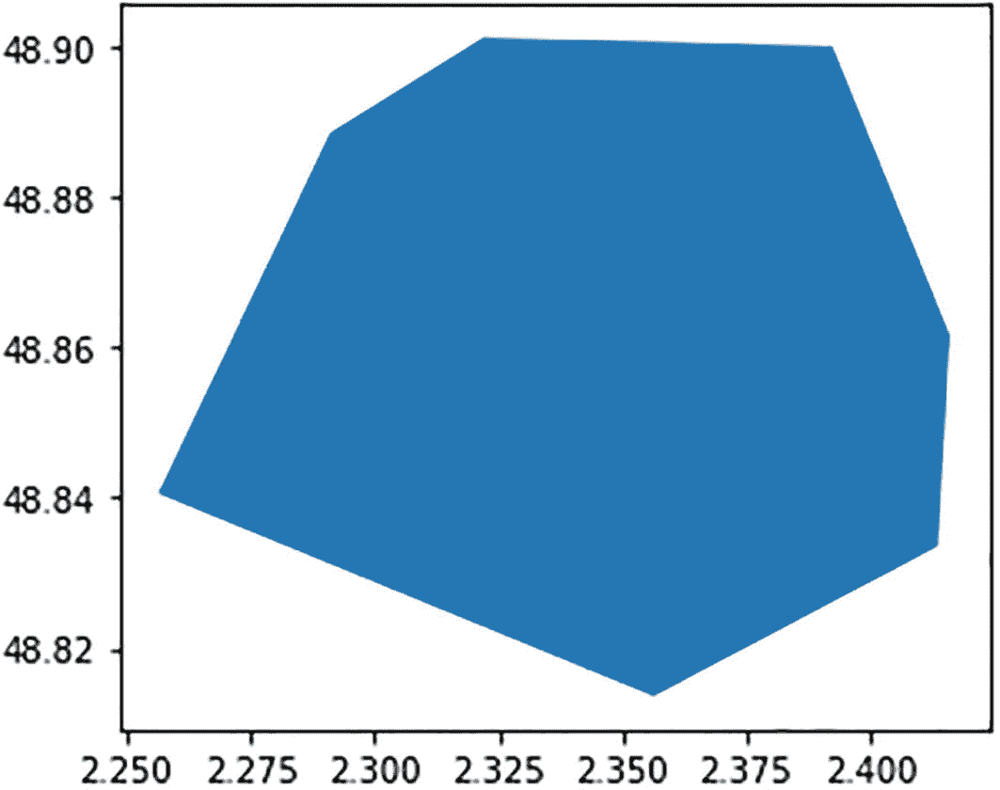

代码块 5-4 绘图结果的图表。图表上绘制了一个七边形图形。纵轴值从 48.82 到 48.90，增量为 0.2。横轴值从 2.250 到 2.400，增量为 0.025。

图 5-7

代码块 5-4 产生的绘图。作者提供的图片

现在到了更有趣的部分：使用巴黎多边形作为裁剪工具来裁剪塞纳河。使用 geopandas 执行此操作的代码如代码块 5-5 所示。

```
paris_seine = seine.clip(paris)
paris_seine
代码块 5-5
将塞纳河裁剪到巴黎区域
```

你将获得塞纳河数据集的新版本，如图 5-8 所示。

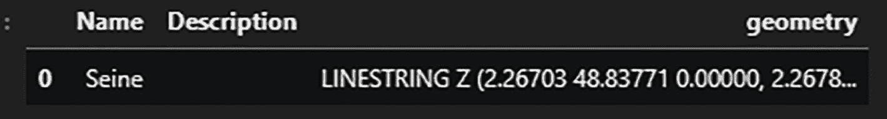

裁剪后的数据集图像。表头为名称、描述和几何。行条目为 0、塞纳河、LINESTRING Z 和坐标。

图 5-8

裁剪后的数据集。作者提供的图片

你可以使用代码块 5-6 中的代码绘制此版本，以查看它仅包含巴黎市中心区域内的塞纳河部分。

```
paris_seine.plot()
代码块 5-6
绘制裁剪后的数据
```

你将看到图 5-9 中的结果。

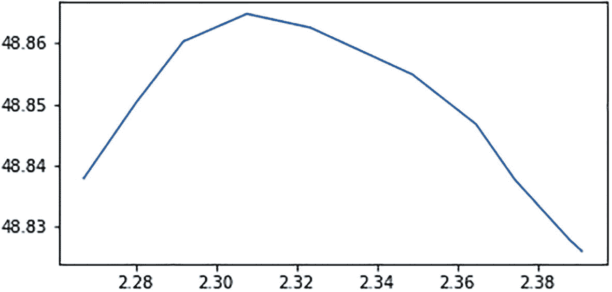

裁剪到巴黎多边形的塞纳河线图。起点在 48.84，向上移动达到峰值 48.86，然后沿斜坡向下移动，直到终点在 48.83 和 2.38 处。数值为近似值。

图 5-9

裁剪到巴黎多边形的塞纳河。作者提供的图片

这个结果表明练习的目标已经达成。我们成功导入了塞纳河和巴黎多边形，并缩小了塞纳河线数据的范围，使其适合巴黎内部。

你可以想象，这可以应用于高速公路、铁路线、其他河流以及你想在巴黎地图上使用的其他线状数据，但这些数据可能仅适用于更大的范围。裁剪操作相当简单，但对此非常有用，它允许你从工作环境中移除无用的数据。


## 什么是相交？

我们将要探讨的第二个操作是相交。如果你了解集合论，这部分内容会相对简单。如果不了解，我们先来介绍一下集合论。

在数学中，集合是独特对象的集合。集合定义了许多标准操作，这些操作在解决各种不同问题时通常很有用，地理数据问题就是其中之一。

举个例子，我们可以想象两个集合，A 和 B：

*   集合 A 包含三个城市：纽约、拉斯维加斯和墨西哥城。
*   集合 B 也包含三个城市：阿姆斯特丹、纽约和巴黎。

通常应用于集合的标准操作有几种：

*   并集：两个集合中的所有元素
*   交集：两个集合中都存在的元素
*   差集：存在于一个集合但不存在于另一个集合中的元素（非对称）
*   对称差集：存在于 A 但不存在于 B，或存在于 B 但不存在于 A 中的元素

使用前面给出的示例集合，我们会得到以下结果：

*   A 和 B 的并集：纽约、拉斯维加斯、墨西哥城、阿姆斯特丹、巴黎
*   A 和 B 的交集：纽约
*   A 与 B 的差集：拉斯维加斯、墨西哥城
*   B 与 A 的差集：阿姆斯特丹、巴黎
*   对称差集：拉斯维加斯、墨西哥城、阿姆斯特丹、巴黎

图 5-10 中的图表展示了这些结果是如何产生的。

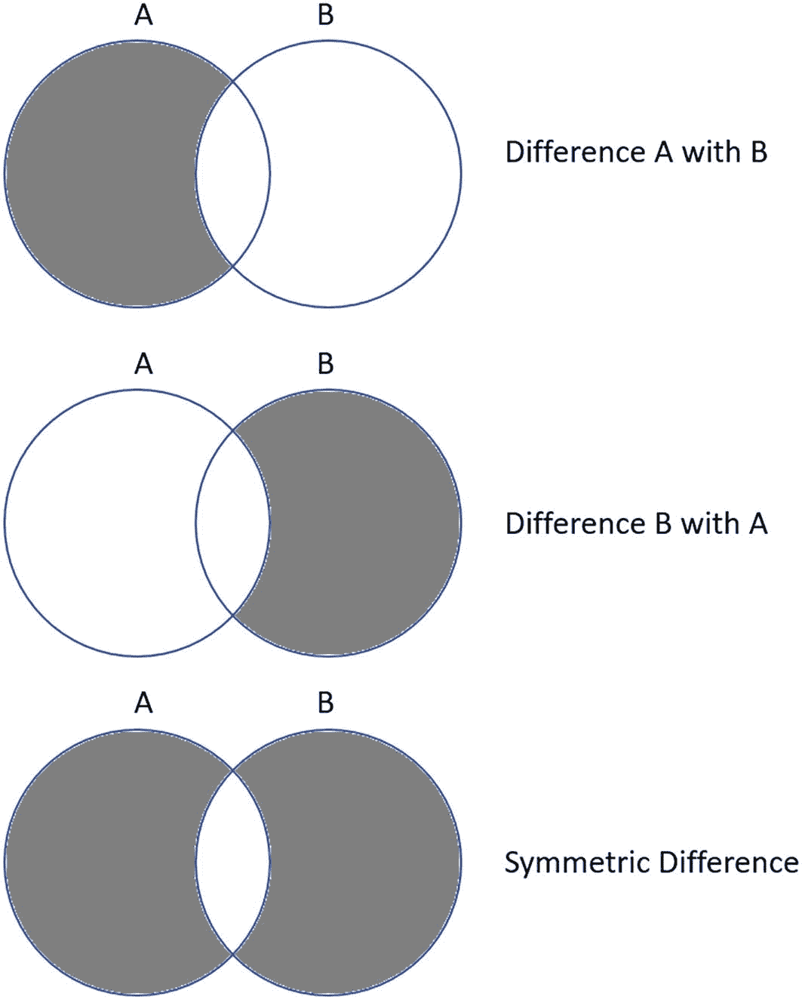

更多集合操作的三个维恩图。从上到下，第一个维恩图表示 A 与 B 的差集。第二个维恩图表示 B 与 A 的差集。第三个图表示 A 和 B 的对称差集。

图 5-10
第二部分：更多集合操作。图片由作者提供

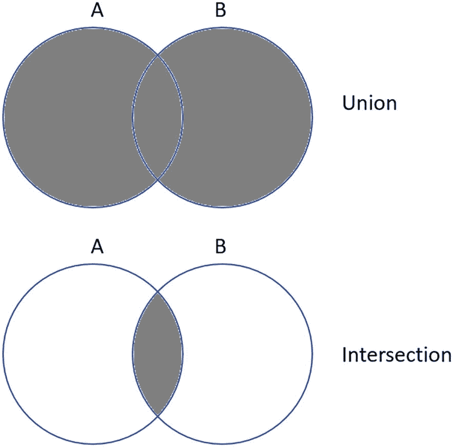

集合操作的两个维恩图。上方，表示 A 和 B 的并集。下方，表示 A 和 B 的交集。

图 5-10
第一部分：集合操作。图片由作者提供

在本章的第一部分，你已经了解到过滤是地理数据中一项重要的基本操作。集合论对地理数据很有用，因为它为所有这些过滤操作提供了一种通用语言。

我们将相交与裁剪放在同一章中介绍，是因为它们相对相似且经常被混淆。这使我们能够看清它们确切的异同点。

### 实际执行相交操作时会发生什么？

集合论中的相交操作接收两个输入集合，并只保留两个集合中都存在的那些元素。在地理数据处理中也是如此。假设你的集合现在是地理数据集，我们使用地理位置数据作为对象的标识符。两个对象的相交将保留两个数据集的所有要素（列），但只保留两个数据集中都存在的那些数据点。

举个例子，假设我们再次使用塞纳河数据，这次我们使用巴黎周边的主干道（环城大道）来识别应该能找到桥梁或隧道的地点。例如，如果我们还没有关于桥梁和隧道的数据，并且想要自动识别所有应该能找到桥梁或隧道的位置，这可能会很有用。

两者的相交将使我们能够同时保留道路数据和河流数据集的信息，同时将数据缩减到存在交叉点的位置。

当然，这可以推广到许多需要两个数据集相交的问题中。

### 地理数据相交的概念性示例

现在让我们看一些相交操作如何应用于地理数据的例子。请记住，在栅格数据中，没有对象，只有像素，因此使用集合论仅对矢量数据有用。你现在将看到一些不同矢量数据类型的示例，以及相交操作如何应用于它们。

让我们从考虑点与点相交时会发生什么开始。由于点没有宽度和长度，只有一个位置，我们能做的唯一相交就是识别一个数据集中的点是否与另一个数据集中的点重叠。如果重叠，我们可以认为这些重叠的点属于交集。图 5-11 中的示意图展示了这一点。

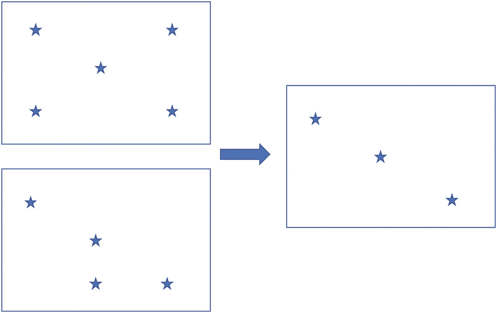

相交的示意图。从左到右，一个矩形内嵌有五个星号在上方，另一个矩形内嵌有四个星号在下方。一个箭头连接到右侧的矩形，该矩形内嵌有三个对齐的星号。

图 5-11
相交的示意图。图片由作者提供

这基本上只是过滤掉了一些点，结果形状仍然是点。现在让我们看看将其应用于两个线数据集时会发生什么。

线数据集的工作方式不同。当两条线在完全相同的位置有一部分时，两条线相交的结果可能是一条线。通常，两条线更可能在交叉点相交或在某点接触。在这种情况下，两条线的相交结果是一个点。因此，结果通常是与输入不同的形状。这在图 5-12 的示意图中展示。

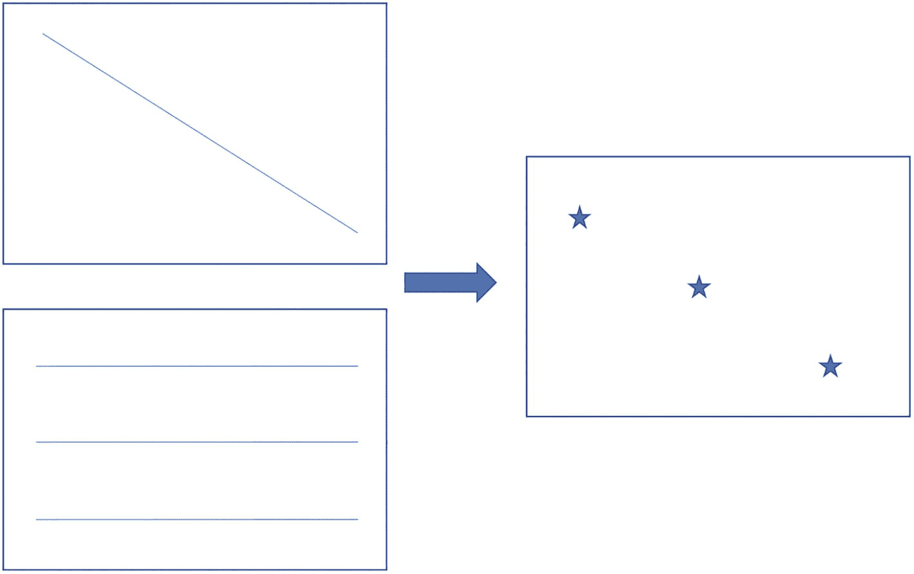

线相交的示意图。从左到右，上方是一个矩形，内嵌一条从一个角到另一个角的斜线。下方是一个矩形，内嵌三条水平线。一个箭头连接到右侧的矩形，该矩形内嵌三个沿对角线排列的星号。

图 5-12
线相交的示意图。图片由作者提供

这些线相交于三个点，结果数据集只显示这三个点。现在让我们看看多边形相交时会发生什么。

从概念上讲，由于多边形有表面，我们认为两个多边形的交集是它们共有的表面。因此，结果将是它们共享的表面，这是一个表面，因此也必须是多边形。图 5-13 中的示意图展示了这是如何工作的。

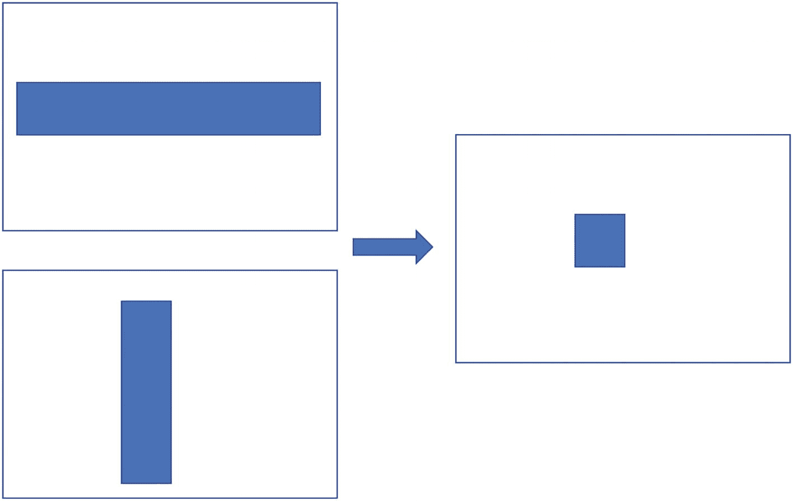

多边形相交的示意图。从左到右，上方是一个矩形，内嵌一个小的水平矩形。下方是一个矩形，内嵌一个垂直矩形。一个箭头连接到右侧的矩形，该矩形内嵌一个正方形。

图 5-13
多边形相交。图片由作者提供

结果基本上就是一个或多个较小的多边形。在下一节中，你将看到如何在 Python 中应用此操作。


## Python 中的相交操作

现在，我们开始处理本章前面描述的例子。我们使用包含巴黎环城大道和塞纳河的数据集，并利用两者的相交来识别塞纳河与巴黎环城大道的交叉位置。

你可以使用代码块 5-7 中的代码来导入数据并打印数据集。

```
gpd.io.file.fiona.drvsupport.supported_drivers['KML'] = 'rw'
data = gpd.read_file('ParisSeineData_example2_v2.kml')
data.head()
代码块 5-7
导入并打印数据
```

你将观察到图 5-14 中的数据。

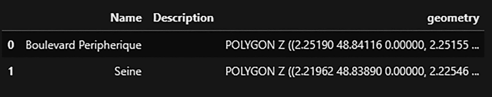

一个数据表。列标题为名称、描述和几何图形。行条目为 Boulevard Peripherique 和 Seine 及其 Polygon Z。

图 5-14

数据。作者提供的图片

这里有两个多边形，一个名为 Seine，另一个名为 Boulevard Périphérique。让我们使用代码块 5-8 创建一个图表，看看这些数据实际的样子。我们可以使用 `cmap` 来指定一个颜色映射表并获得不同的颜色。你可以查阅 matplotlib 文档以了解颜色映射表的概览；有很多可供选择。

```
data.plot(cmap='tab10')
代码块 5-8
使用颜色映射表绘制数据
```

你将得到图 5-15 所示的结果。

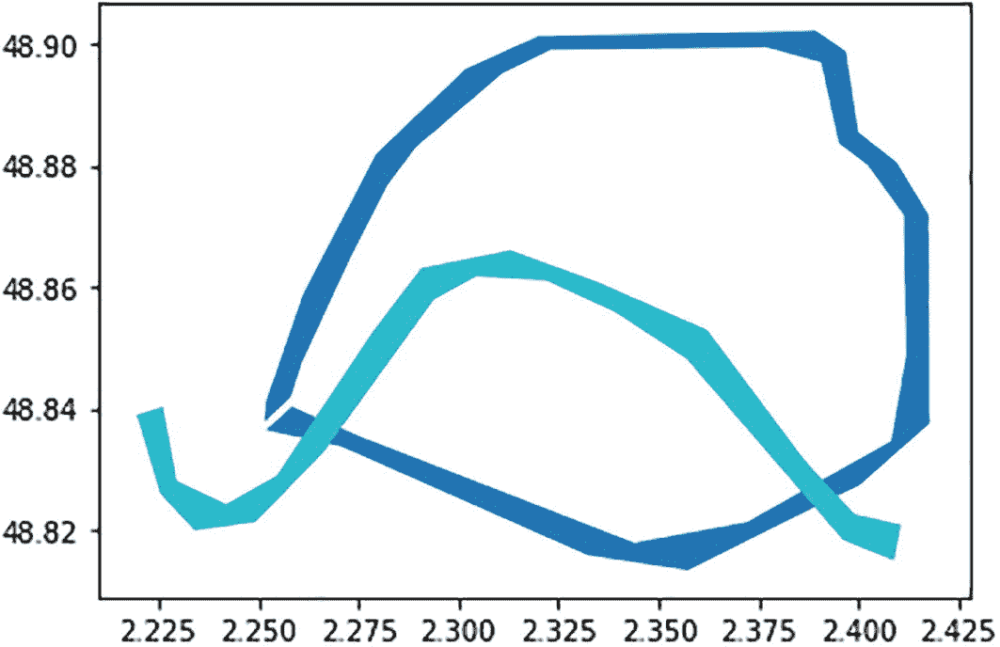

由代码块 5 到 8 生成的图表。图表中的第一条线描绘了微小的波动，起点处有一个极小低谷，图表中心有一个极大峰值。第二条线描绘了图表中的环形运动，起点和终点均位于 2.250 处的 48.84。

图 5-15

由代码块 5-8 生成的图表。作者提供的图片

与之前的例子相比，这里的数据已被转换为多边形。你将在后面的章节中看到如何使用缓冲自动完成此操作，但目前已经为你完成了这一步，多边形数据可直接在数据集中获取。

我们可以清晰地看到两个交叉点，因此可以预期会识别出两座桥梁（或隧道）。现在，让我们使用相交函数来自动找到它们。

代码块 5-9 中的代码展示了如何使用 geopandas 中的 overlay 函数来创建相交。

```
# 提取环城大道数据
periph = data.iloc[0:1,:]
# 提取塞纳河数据
seine = data.iloc[1:2,:]
intersection = seine.overlay(periph, how='intersection')
intersection
代码块 5-9
创建相交
```

结果是一个仅包含两个多边形相交部分的数据集，如图 5-16 所示。

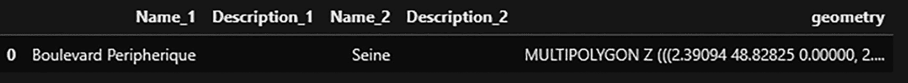

由代码块 5-9 生成的图表表格。列标题为名称 1、描述 1、名称 2、描述 2 和几何图形。行条目为 Boulevard Peripherique、Seine、MULTIPOLYGON Z。

图 5-16

由代码块 5-9 生成的图表。作者提供的图片

结果对象是一个多多边形，因为它包含两个多边形：每个桥梁（或隧道）对应一个。当你使用代码块 5-10 创建此数据集的图表时，可以更清楚地看到这一点。

```
intersection.plot()
代码块 5-10
绘制相交结果
```

如果没有上下文，结果可能看起来有点奇怪，但它基本上只是显示了巴黎环城大道的两座桥梁/隧道。如图 5-17 所示。

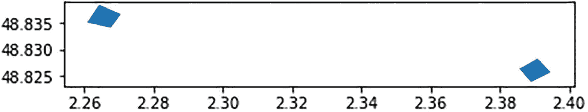

塞纳河与巴黎环城大道两处交叉点的图表。图表上有两个小方块，第一个方块位于 2.26 处的 48.835，第二个方块位于 2.39 处的 48.825。数值为近似值。

图 5-17

塞纳河与巴黎环城大道的两处交叉点。作者提供的图片

现在，练习的目标已经达成。我们成功创建了一种自动提取道路与河流交叉位置的方法。如果我们现在想对整个城市进行此操作，只需找到包含巴黎所有道路和河流的数据集，并使用相同的方法来找到巴黎所有的桥梁。

当然，这只是一个例子，你可以将其推广到许多需要创建相交的场景中，例如，如果你想进行机器学习，可以在数据集中创建新特征，或者在地图上添加新要素。

请记住，overlay 函数中还有其他选项，我们将在接下来的章节中看到其中一些。这些都与集合论中的其他操作有关，这是一种思考这些基本地理数据操作的非常实用的方式。

### 裁剪与相交的区别

现在你已经了解了裁剪和相交工具，应该明白两者通常都会减少数据量。两者之间存在根本区别，你对工具的选择应取决于你想要实现的目标。

裁剪通过获取一个输入数据集和一个边界数据集来减少数据。生成的输出数据具有输入数据的精确形状，仅受边界数据集施加的地理范围限制。唯一保留的数据是输入图层的数据。你在裁剪示例中已经看到，输出中不存在巴黎多边形：只有塞纳河存在，但其地理范围被缩减了。

对于相交，两个数据集可以被视为同等重要。不存在一个输入数据集和一个边界数据集，而是有两个输入数据集。生成的输出是一个组合，它保留了来自两个输入数据集的所有信息，同时仅保留地理上重合的点。

在稍后将要进行的相交示例中，你将看到输出包含来自两个输入数据集的数据，因此它与裁剪操作不同。

## 关键要点

1.  有许多基本的地理数据操作，它们通常已在大多数地理数据工具中标准实现。乍看之下可能很简单，但将其应用于地理数据可能会带来一些困难。

2.  裁剪操作获取一个输入数据集，并将其大小缩减到由边界数据集给定的范围。这适用于所有地理数据类型。

3.  对栅格数据或点使用裁剪，相当于删除范围外的像素点。

4.  对线或多边形使用裁剪，将完全删除那些完全在范围外的线和多边形，但对于那些部分在边界内、部分在边界外的部分，则会创建一个新的缩减形式。

5.  相交操作基于集合论，允许找到两个输入数据集之间共享的要素。它与裁剪不同，因为它将两个数据集都视为输入，因此保留了两者的要素。在裁剪中则不是这样，因为只有输入数据集的要素被认为是相关的。

6.  对点进行相交，基本上相当于根据点是否同时存在于两个数据集中来进行过滤。

7.  对线进行相交通常会产生点（两条线的交叉点或两条曲线之间的接触点），但如果两条线在其轨迹的某一部分完全重合，它们也可能产生线。

8.  对多边形进行相交将产生一个或多个较小的多边形，因为相交被认为是两个多边形共有的区域。

9.  你已经了解了如何使用 geopandas 作为裁剪和相交操作的便捷工具。


