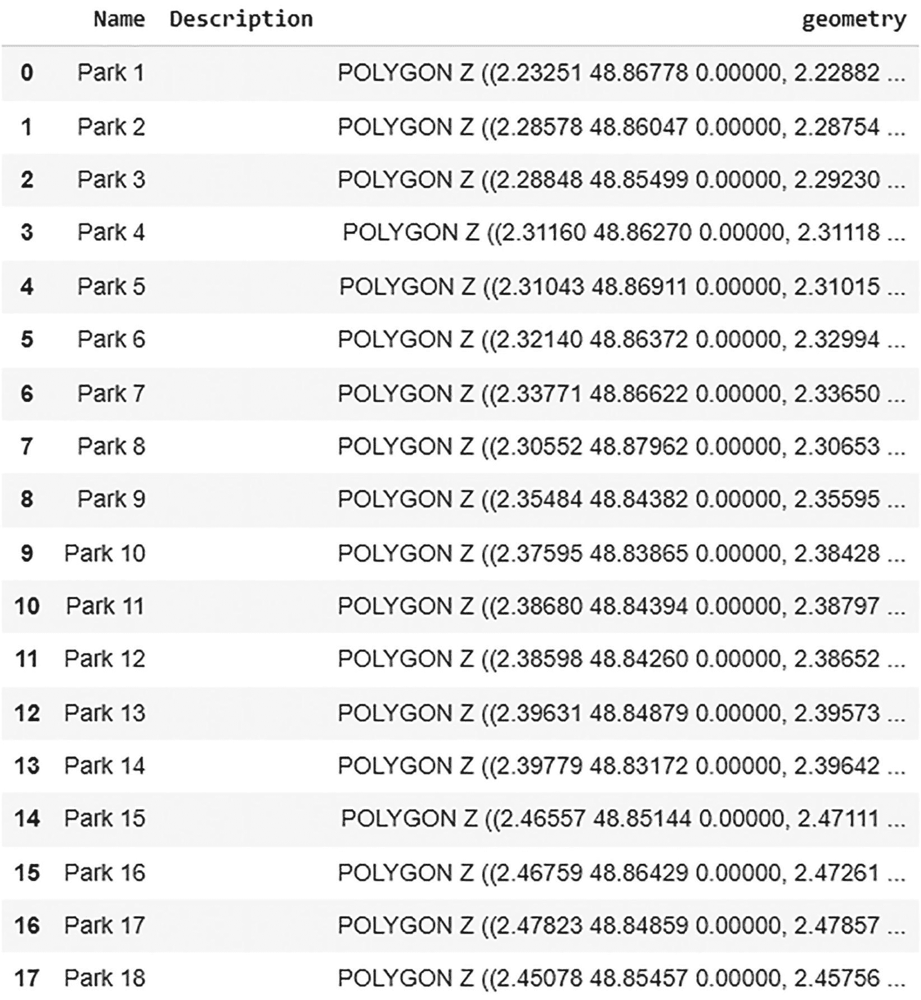

# 导入巴黎公园数据
gpd.io.file.fiona.drvsupport.supported_drivers['KML'] = 'rw'
parks = gpd.read_file('Paris_Parks.kml')
parks
代码块 6-11
导入公园数据
```

在图 6-15 中，你会看到该数据集中有 18 个公园，全部以多边形形式标识。



来自代码块 6-11 的数据表。列标题为名称、描述和几何图形。行条目为公园 1 至 18 及其多边形 Z 坐标。

图 6-15

来自代码块 6-11 的数据。作者提供的图片

你可以通过代码块 6-12 中的方式，将这些数据直接添加到地图中进行可视化。

```
import contextily as cx
