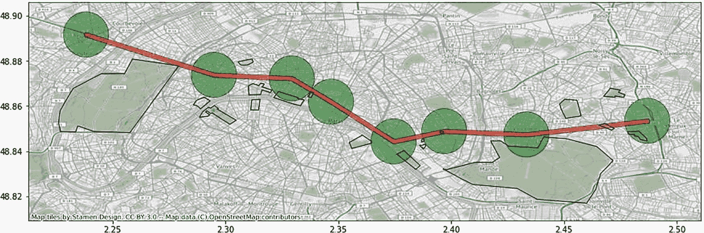
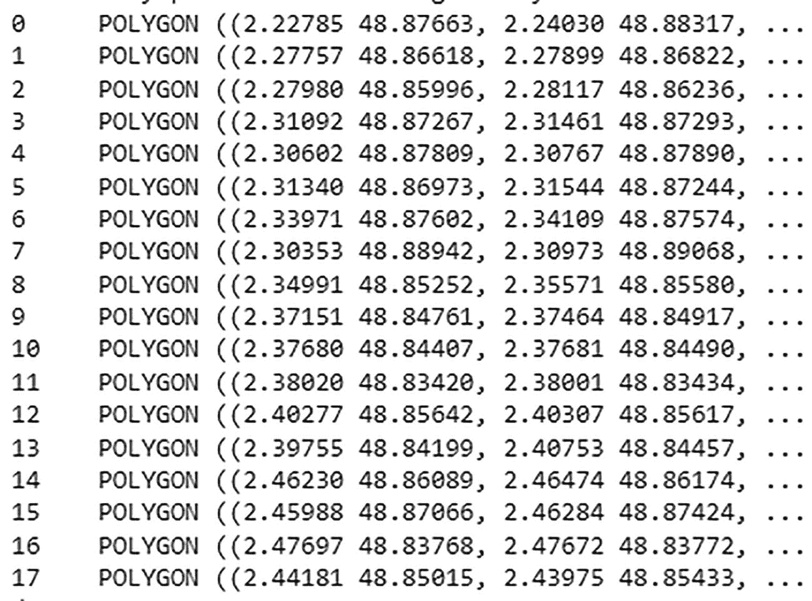

# 添加底图
cx.add_basemap(ax, crs=data.crs)
代码块 6-12
在地图中直接可视化数据
```

公园在地图中显示为黑色轮廓线。尚未创建任何缓冲区。这个中间结果如图 6-16 所示。



一张添加了公园的地图。地图上的图形相同，此次图形分布在地图的左右两侧。

图 6-16

添加了公园的地图。作者使用 contextily 源数据和图像作为参考提供的图片

当然，你不太可能在公园内找到房子，因此我们需要将搜索区域设定为包含公园周边的边界。同样，这可以通过为多边形数据添加缓冲区来实现。缓冲区操作与之前一样，通过调用带有距离参数的 `buffer` 方法完成。代码块 6-13 展示了这一过程。

```
parks.buffer(0.01)
代码块 6-13
为公园添加缓冲区
```

结果如图 6-17 所示。



缓冲区操作结果数据表。18 行条目包含多边形及其坐标。

图 6-17

来自代码块 6-13 的结果数据

缓冲区操作后，你得到的是多边形数据，与之前相同。但多边形的尺寸现在变大了，因为它包含了原始多边形周围的缓冲区。现在，我们将此结果添加到图形中，看看它如何影响我们寻找房屋的区域。代码块 6-14 展示了这一过程。

```
import contextily as cx
