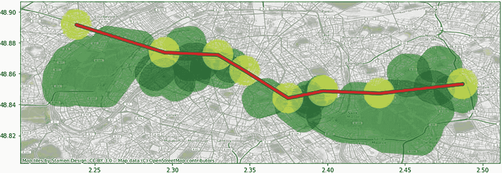
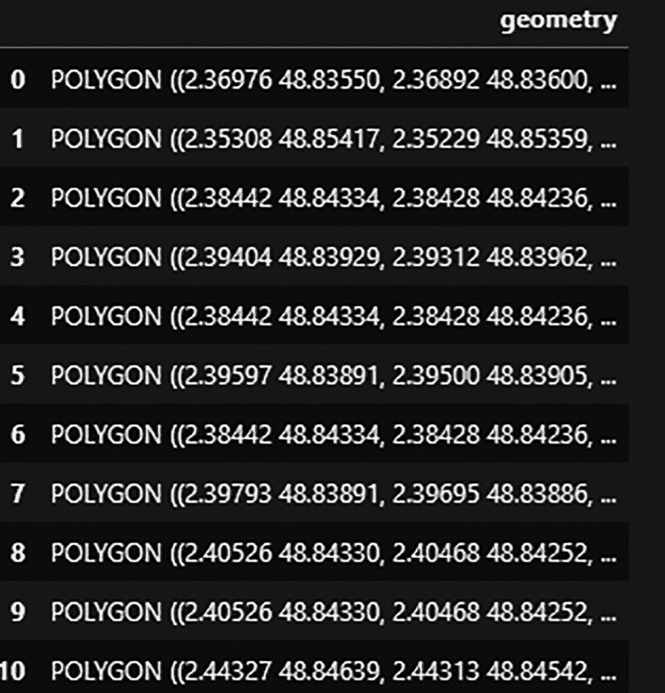

# 添加底图
cx.add_basemap(ax, crs=data.crs)
代码块 6-14
将所有数据整合在一起
```

颜色和“zorder”（叠加顺序）已稍作调整，以使地图更易读。毕竟，它开始包含大量要素。你将看到如图 6-18 所示的结果。



来自代码块 6 至 14 的结果图。多边形的尺寸现在变大了，因为它包含了原始多边形周围的缓冲区。

图 6-18

来自代码块 6-14 的结果图。作者使用 contextily 源数据和图像作为参考提供的图片

这张地图是一个你可以使用的初步结果。当然，你还可以更进一步，将其与第 5 章的理论相结合，在该章中你学习了如何使用集合论中的运算来组合不同形状。让我们看看如何实现这一点，最终目标是获得一个数据框，该数据框仅包含基于引言中所有三个标准我们想要寻找房屋的区域。


## 组合缓冲区与集合运算

要将三个缓冲区组合在一起，我们需要执行多个操作。首先，我们需要对“地铁站邻近区域”和“公园邻近区域”进行交集运算。毕竟，我们希望同时拥有两者，而不能只满足于其中之一。正如你在前一章所见，交集运算正是实现这一目标的正确操作。

代码块 6-15 中的代码在两个缓冲数据框之间创建了一个交集图层。它们首先被分别赋值给各自的数据框变量，以便创建更易于使用的对象。

```
station_buffer = data.buffer(0.01)
rails_buffer = gdf.buffer(0.001)
park_buffer = parks.buffer(0.01)
A = gpd.GeoDataFrame({'geometry': station_buffer})
B = gpd.GeoDataFrame({'geometry': park_buffer})
C = gpd.GeoDataFrame({'geometry': rails_buffer})
代码块 6-15
准备创建交集图层
```

然后，使用交集参数应用叠加方法，如代码块 6-16 所示。

```
A_and_B = A.overlay(B, how='intersection')
A_and_B
代码块 6-16
创建交集图层
```

你将获得一个类似于图 6-19 所示的数据集。



代码块 6 至 16 生成的数据表。列标题为 geometry。11 行条目包括多边形及其坐标。

图 6-19

代码块 6-16 生成的数据。图片由作者提供

有了这个车站和公园的交集，我们现在需要移除所有离地铁线路太近的位置，因为正如引言中所述，这些地方预计会过于嘈杂。

为此，我们也可以使用叠加方法，但这次我们不需要集合论中的交集运算，因为交集运算会保留所有同时靠近车站、公园和铁路的位置。然而，我们想要的是靠近车站和公园，但不靠近铁路的位置。为此，我们需要使用集合论中的差集运算。代码块 6-17 中的代码展示了如何实现这一点。

```
A_and_B_not_C = A_and_B.overlay(C, how='difference')
A_and_B_not_C
代码块 6-17
创建差集
```

数据看起来仍然和之前的数据框类似。唯一的变化是，随着每一步操作，数据变得复杂得多，因为我们可接受位置的形状变得越来越不规则。让我们使用代码块 6-18 绘制最终对象的地图。

```
import contextily as cx
