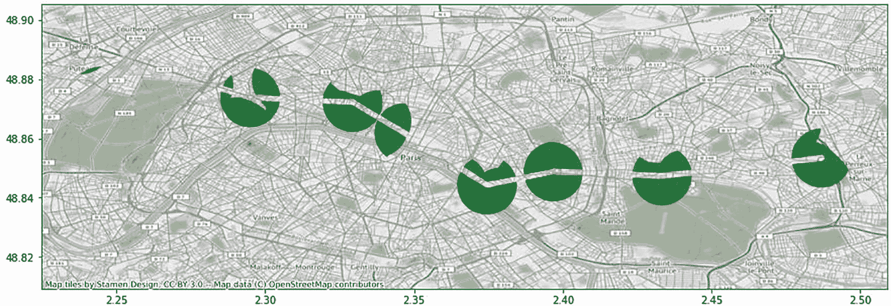
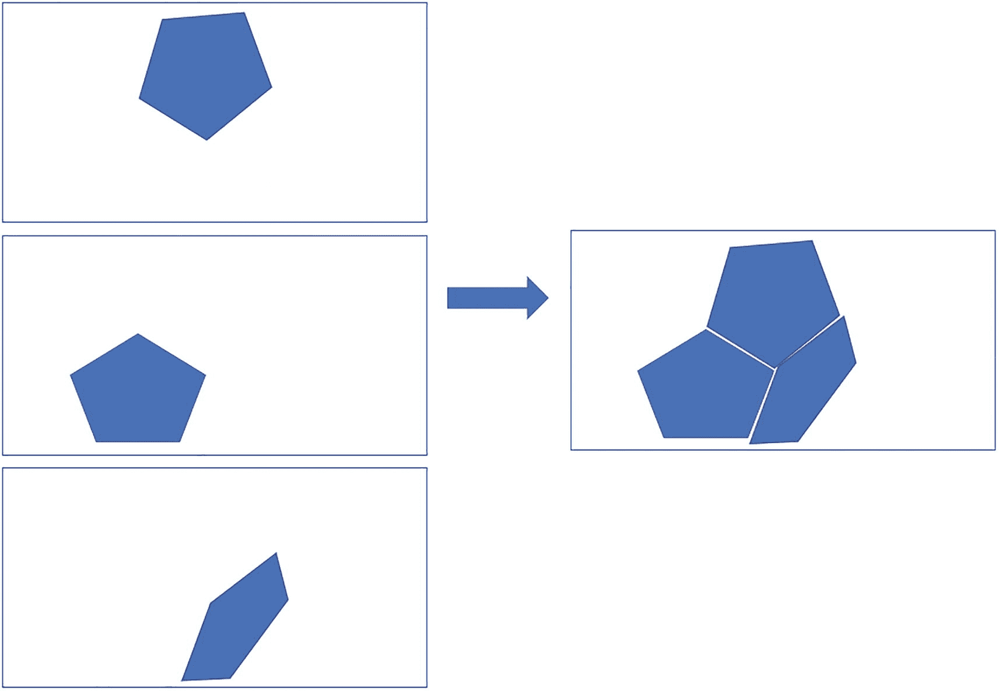
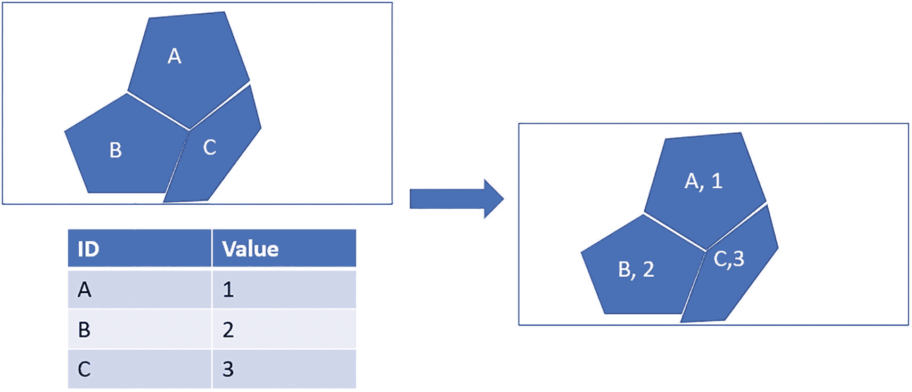
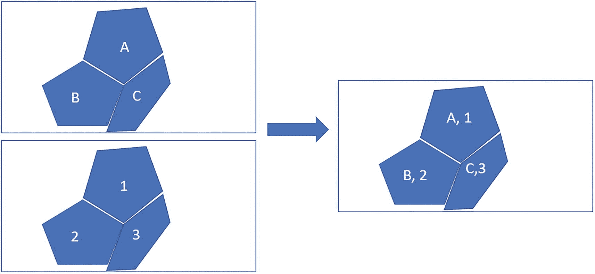
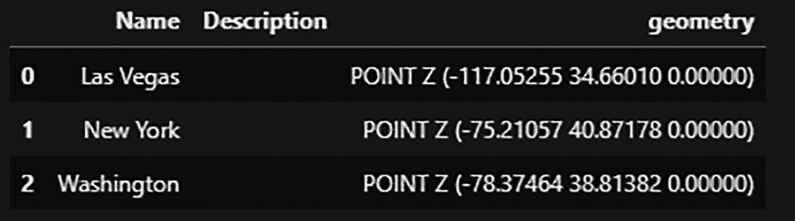
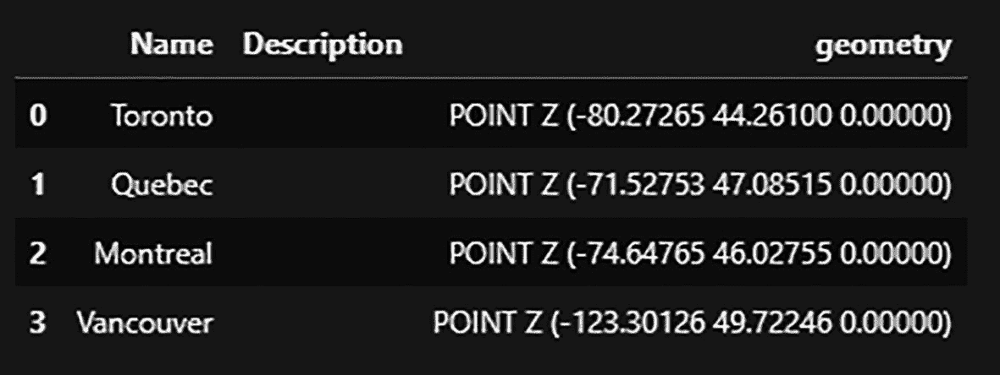
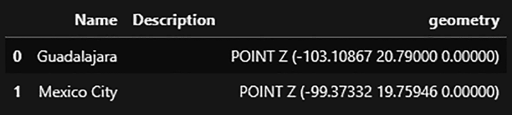

# 添加背景地图
cx.add_basemap(ax, crs=data.crs)
代码块 6-18
创建最终对象的地图
```



练习的最终地图。绿色区域现在是一个过滤器，用于根据坐标确定房屋位置。所有表示都绘制在地图上。

图 6-20

练习的最终地图。图片由作者使用 contextily 源数据及图像中引用的图像创建

如图 6-20 所示，绿色区域现在是一个过滤器，我们可以用它来根据坐标选择房屋。这回答了练习中提出的问题，同时也生成了一张有趣的地图。如果你想进一步进行此练习，可以创建一个包含房屋点数据的小型数据集。然后，要查找某个房屋（点数据坐标）是否在多边形内部，可以使用称为“contains”或“within”的操作。相关文档可在此处找到：

*   [`https://geopandas.org/en/stable/docs/reference/api/geopandas.GeoSeries.within.html`](https://geopandas.org/en/stable/docs/reference/api/geopandas.GeoSeries.within.html)

*   [`https://geopandas.org/en/stable/docs/reference/api/geopandas.GeoSeries.contains.html`](https://geopandas.org/en/stable/docs/reference/api/geopandas.GeoSeries.contains.html)

此操作留作练习，因为它超出了本章重点——缓冲区操作演示的范围。

## 关键要点

1.  有许多基本的地理数据操作，这些操作在大多数地理数据工具中都是标准实现的。它们乍看之下可能很简单，但将其应用于地理数据可能会带来一些困难。

2.  缓冲区操作为矢量对象添加一个多边形。无论初始对象是点、线还是多边形，结果始终是一个多边形。

3.  应用缓冲区时，可以选择缓冲区边界到初始对象的距离。选择完全取决于具体用例。

4.  一旦计算出缓冲区，它们可用于制图目的，或用于进一步的地理空间操作。

# 7. 合并与融合

在前两章中，我们开始研究一些常见的地理空间操作：这些操作在常规数据上不可能实现，或者至少不常见，但在地理空间数据上却非常普遍。

尽管本书旨在为机器学习应用做准备，但了解存在哪些类型的地理空间操作，并具备通过文档或研究来理解其他类似操作的工作性知识，是很有益处的。本书展示的标准操作包括：

*   裁剪与相交

*   缓冲区

*   合并与融合

*   擦除

在上一章中，你已经了解了裁剪、相交和缓冲区操作。你甚至看到了一个以逻辑方式组合这些方法的用例。

在本章中，我们将研究合并与融合，它们与之前介绍的操作截然不同。它们也属于标准的地理空间操作，掌握这些工具非常有用。

正如前几章所解释的，这些空间操作都应被视为工具箱中的工具。当你想要实现特定目标时，需要选择到达目标所需的不同工具。这通常意味着要以智能的方式使用不同的工具组合。你了解的工具越多，能实现的目标就越多。

我们将从合并操作开始本章，涵盖其理论和 Python 实现，然后继续介绍融合操作。最后，你将看到两者的比较。

## 合并操作

让我们从介绍合并操作开始。我们将从理论介绍和一些示例入手，然后进入合并操作的 Python 实现。

### 什么是合并？

与常规数据一样，合并地理数据包括获取多个输入数据集，并将它们组合成一个新的单一输出要素。在上一章中，你已经看到了一个可能的合并用例。如果你还记得，基于多个标准创建了多个“适宜性”多边形。最后，所有这些多边形被组合成一个单一的空间图层。尽管在该示例中使用了另一种解决方案，但也可以使用合并来将所有图层整合到同一个图层中。


### 合并操作的示意图例

让我们通过一个可视化示例来阐明这一定义。作为一个简单直观的例子，假设你有三个数据集，每个数据集包含某个特定区域的多边形要素。你需要制作一张包含这三个区域的地图，因此需要找到一种方法，将这三个数据集合并成一个包含三个区域的单一数据集。合并操作就能为你实现这一点。图 7-1 展示了其工作原理。



一个关于三个多边形数据集合并操作的示意图。三个方框各自包含不同大小的五边形，它们被组合在一起，形成一个包含三个区域的单一数据集。

图 7-1

合并操作。作者供图

#### 合并的不同定义

根据你使用的软件不同，合并操作的定义也并非完全相同。理解不同类型合并的工作原理非常重要，这样你就能根据文档中的描述找到所需的方法。

合并操作真正的定义是：将要素按行方向追加在一起。这不会改变现有要素的任何属性，也不会对列方向产生任何影响。上述示例的示意图展示的正是这种操作。

“合并”这个词有时也用来指代连接。将这些操作称为“连接”可能更合适，但有些软件并未采用这种命名方式。常见的连接有两种类型：空间连接和属性连接。

属性连接可能是你已经熟悉的一种连接类型。这是一种类似 SQL 的连接，你的地理数据中拥有某种键，用于从另一个也包含此键的表中添加信息。图 7-2 的示意图展示了一个例子。



属性连接示意图。第一张图展示了一个包含 A、B、C 三个区域的单一数据集。下方的表格有 2 列 3 行，列标题为 I D 和 Value。行条目分别为 A, 1；B, 2；C, 3。该图与表格结合，最终得到一个包含 A, 1；B, 2；C, 3 三个区域的单一数据集。

图 7-2

属性连接。作者供图

如你所见，这是一个简单的类似 SQL 的连接，它利用两个数据集之间的共同标识符，将属性表的列添加到地理数据集的列中。

另一种是空间连接，它稍微复杂一些。空间连接同样合并两个数据集的列，但它不是使用共同标识符，而是使用两个数据集的地理坐标。图 7-3 的示意图展示了其原理。



空间连接示意图。第一个数据集展示了一个包含 A、B、C 三个区域的单一数据集。第二个数据集展示了一个包含 1、2、3 三个区域的单一数据集。这两个数据集合并成一个包含 A, 1；B, 2；C, 3 三个区域的单一数据集。

图 7-3

空间连接。作者供图

在这个例子中，空间连接相对简单，因为两个输入数据集中的对象完全相同。在实际应用中，你可能会看到要素之间存在细微差异，也可能需要连接不同的要素。你可以指定各种空间连接参数来进行正确的组合：

*   连接彼此靠近的所有对象（指定一个距离）
*   基于一个对象包含另一个对象进行连接
*   基于存在交集进行连接

这为你提供了丰富的工具来处理数据集的组合，无论是按行方向（合并）还是按列方向（连接）。现在，让我们看看在 Python 中执行合并、属性连接和空间连接的一些示例。

## 在 Python 中进行合并

在接下来的示例中，我们将研究一些易于理解的数据。有多个小型数据集，在整个练习过程中，我们将执行所有三种类型的合并操作。

数据包含：

*   一个包含加拿大、美国和墨西哥三个多边形的文件
*   一个包含加拿大部分城市的文件
*   一个包含美国部分城市的文件
*   一个包含墨西哥部分城市的文件

在练习过程中，我们将执行以下步骤：

*   使用按行合并的方式合并三个城市文件
*   通过属性查找向合并后的城市文件添加一个新变量
*   使用多边形文件进行空间查找，找出每个城市所属的国家

现在，让我们开始将三个城市文件合并成一个包含所有城市的单一图层。


### Python 中的按行合并

按行合并操作通常就是我们所说的合并操作。它类似于将三个数据集按行拼接。让我们看看如何使用三个包含每个国家部分城市的示例数据文件在 Python 中实现这一点。首先，按照你在前几章中已经学到的功能，导入数据，分别绘制每个数据集，并添加背景地图。如代码块 7-1 所示。

```
import geopandas as gpd
import fiona
gpd.io.file.fiona.drvsupport.supported_drivers['KML'] = 'rw'
us_cities = gpd.read_file('/kaggle/input/chapter7/USCities.kml')
us_cities
代码块 7-1
导入数据
```

美国城市如图 7-4 所示。



一个表格展示了美国城市的按行合并操作。该表格有 3 列和 3 行。列标题是名称、描述和几何图形。行条目是拉斯维加斯、纽约和华盛顿，它们在几何图形中拥有各自的点 Z 坐标。

图 7-4
美国城市

让我们导入加拿大城市，如代码块 7-2 所示。

```
canada_cities = gpd.read_file('/kaggle/input/chapter7/CanadaCities.kml')
canada_cities
代码块 7-2
导入加拿大城市
```

它们如图 7-5 所示。



一个表格展示了加拿大城市的按行合并操作。该表格有 3 列和 4 行。列标题是名称、描述和几何图形。行条目是多伦多、魁北克、蒙特利尔和温哥华，它们在几何图形中拥有各自的点 Z 坐标。

图 7-5
加拿大城市。图片由作者提供

墨西哥城市通过代码块 7-3 导入。

```
mexico_cities = gpd.read_file('/kaggle/input/chapter7/MexicoCities.kml')
mexico_cities
代码块 7-3
导入墨西哥城市
```

它们如图 7-6 所示。



一个表格展示了墨西哥城市的按行合并操作。该表格有 3 列和 2 行。列标题是名称、描述和几何图形。行条目是瓜达拉哈拉和墨西哥城，它们在几何图形中拥有各自的点 Z 坐标。

图 7-6
墨西哥城市。图片由作者提供

我们可以使用你在本书前面学过的语法来创建这三个数据集的组合地图。这在代码块 7-4 中完成。

```
import contextily as cx
