# contextily 底图
cx.add_basemap(ax, crs=us_cities.crs)
代码块 7-4
创建数据集的地图
```

这将生成如图 7-7 所示的地图。

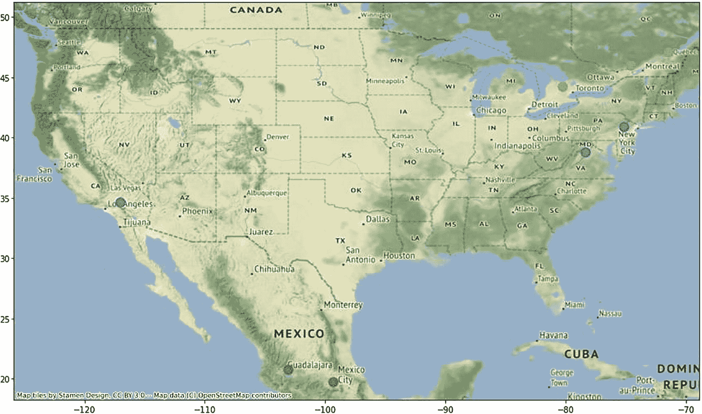

一张地图展示了使用代码块 7-4 创建的美国、加拿大和墨西哥城市的三个输入地理数据框。美国的拉斯维加斯、马里兰州和纽约市，加拿大的温哥华、多伦多、蒙特利尔和魁北克，以及墨西哥的瓜达拉哈拉和墨西哥城，在地图上都以不同颜色的点表示，每个国家一种颜色。

图 7-7
使用代码块 7-4 创建的地图。图片由作者使用 contextily 源数据和图像制作，图像引用如上

现在，这已经不错了，但我们实际上希望所有这些数据都在一个图层中，这样更容易处理。为此，我们将执行按行合并操作。在 Python 中，可以使用 pandas 的 concat 方法来实现。如代码块 7-5 所示。

```
import pandas as pd
cities = pd.concat([us_cities, canada_cities, mexico_cities])
cities
代码块 7-5
使用拼接
```

你将获得一个数据集，其中所有点现在都已合并。`cities` 现在包含了三个输入地理数据框中所有城市的行，如图 7-8 所示。

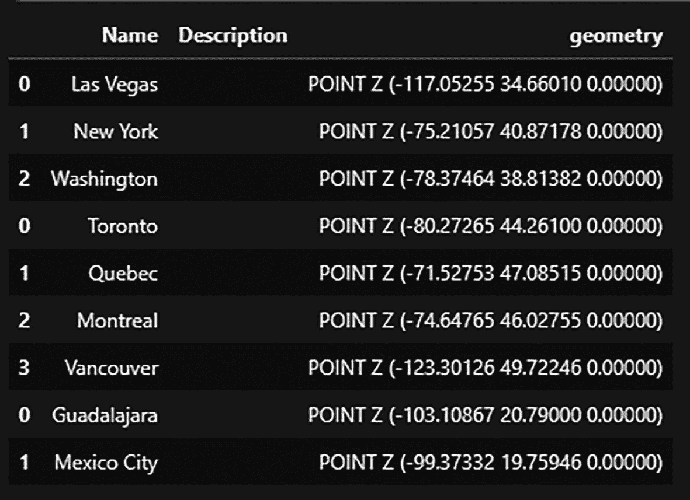

一个表格展示了美国、加拿大和墨西哥城市拼接后的数据框。该表格有 3 列和 9 行。列标题是名称、描述和几何图形。行条目是拉斯维加斯、纽约、华盛顿、多伦多、魁北克、蒙特利尔、温哥华、瓜达拉哈拉和墨西哥城，它们在几何图形中拥有各自的点 Z 坐标。

图 7-8
拼接后的数据框。图片由作者提供

如果我们现在绘制这些数据，我们只需绘制一个图层，而不必绘制三次。这在代码块 7-6 中完成。你可以看到所有数据都已成功合并到一个图层中。

```
ax = cities.plot(markersize=128,figsize=(15,15))
cx.add_basemap(ax, crs=us_cities.crs)
代码块 7-6
绘制拼接后的城市
```

结果如图 7-9 所示。

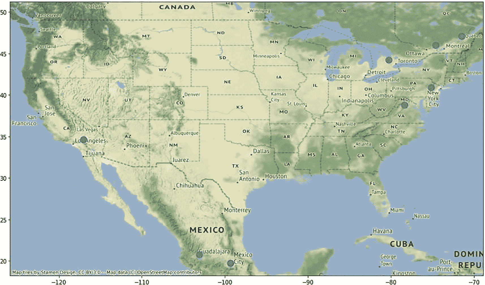

一张地图展示了使用代码块 7-6 对美国、加拿大和墨西哥城市进行合并操作的结果。美国的拉斯维加斯、马里兰州和纽约市，加拿大的温哥华、多伦多、蒙特利尔和魁北克，以及墨西哥的瓜达拉哈拉和墨西哥城，现在在地图上都以相同颜色的点表示。

图 7-9
由代码块 7-6 生成的地图。图片由作者使用 contextily 源数据和图像制作，图像引用如上

你还可以看到，所有点现在都具有相同的颜色，因为它们现在都在同一个数据集中。这种相当简单的按行合并操作在你日常的 GIS 操作中会非常有用。

现在我们已经将所有数据合并到一个图层中，接下来让我们通过属性连接来添加一些要素。


### Python 中的属性连接

为了基于查找表和类似 SQL 的连接添加新变量，我们将使用属性连接。为此，我们首先生成一个包含一些虚构数据的查找表，仅用于了解如何执行这些操作。这将在代码块 7-7 中完成。

```
lookup = pd.DataFrame({
'city': [
'Las Vegas',
'New York',
'Washington',
'Toronto',
'Quebec',
'Montreal',
'Vancouver',
'Guadalajara',
'Mexico City'
],
'population': [
1234,
2345,
3456,
4567,
4321,
5432,
6543,
1357,

]
})
lookup
代码块 7-7
创建查找表
```

查找表如图 7-10 所示。

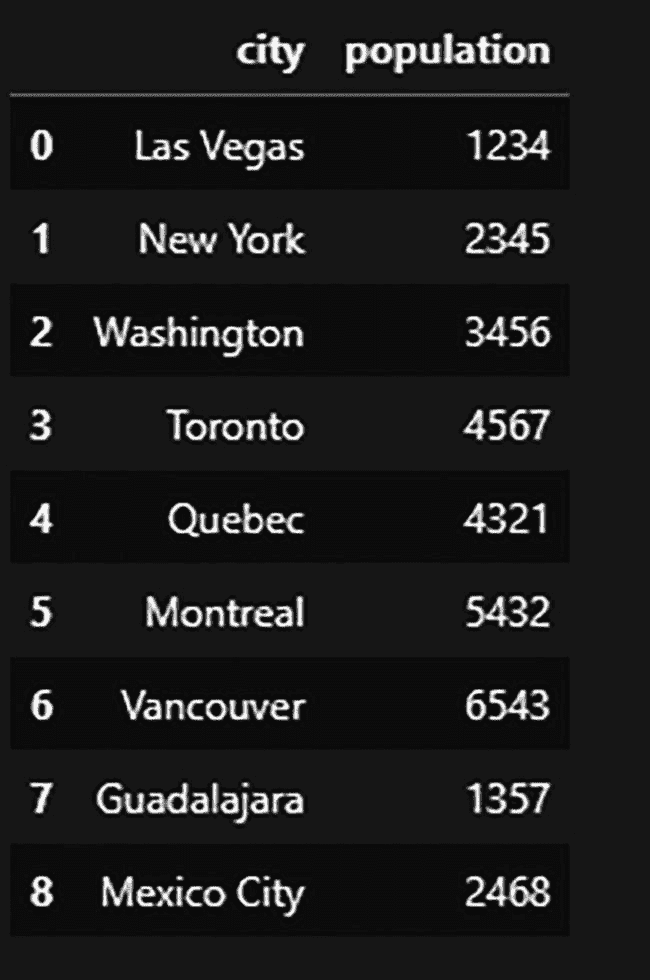

一个查找表展示了美国、加拿大和墨西哥的城市。该表有 3 列和 9 行。列标题是“城市”和“人口”。行条目是拉斯维加斯、纽约、华盛顿、多伦多、魁北克、蒙特利尔、温哥华、瓜达拉哈拉和墨西哥城，以及它们各自的人口。

图 7-10

查找表。图片由作者提供

现在，要将此数据添加到地理数据框中，我们希望执行类似 SQL 的连接，其中查找表中的“population”列将根据地理数据框中的“Name”列和查找表中的“city”列添加到地理数据框中。这可以使用代码块 7-8 完成。

```
cities_new = cities.merge(lookup, left_on='Name', right_on='city')
cities_new
代码块 7-8
属性连接
```

您可以在数据框中看到 population 列已被添加，如图 7-11 所示。

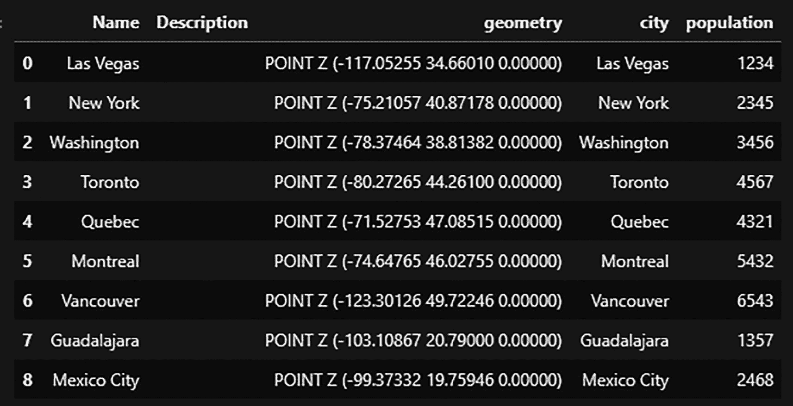

一个结果数据表，结合了地理数据框和查找表，包含 5 列和 9 行。列标题是“名称”、“描述”、“几何”、“城市”和“人口”。行条目是拉斯维加斯、纽约、华盛顿、多伦多、魁北克、蒙特利尔、温哥华、瓜达拉哈拉和墨西哥城，以及它们各自的点 Z 坐标和人口。

图 7-11

代码块 7-8 的结果数据。图片由作者提供

现在，您可以轻松访问这些数据，例如，如果您想进行过滤、计算等操作。另一个例子是使用此属性数据根据（模拟的）人口规模调整地图上每个点的大小（当然，这是玩具数据，因此结果不正确，但如果您愿意，可以随意改进）。代码如代码块 7-9 所示。

```
ax = cities_new.plot(markersize=cities_new['population'] // 10, figsize=(15,15))
cx.add_basemap(ax, crs=us_cities.crs)
代码块 7-9
绘制新数据
```

图 7-12 中的结果显示，城市的大小已根据 population 列的值进行调整，该列是通过属性连接添加到数据集中的。

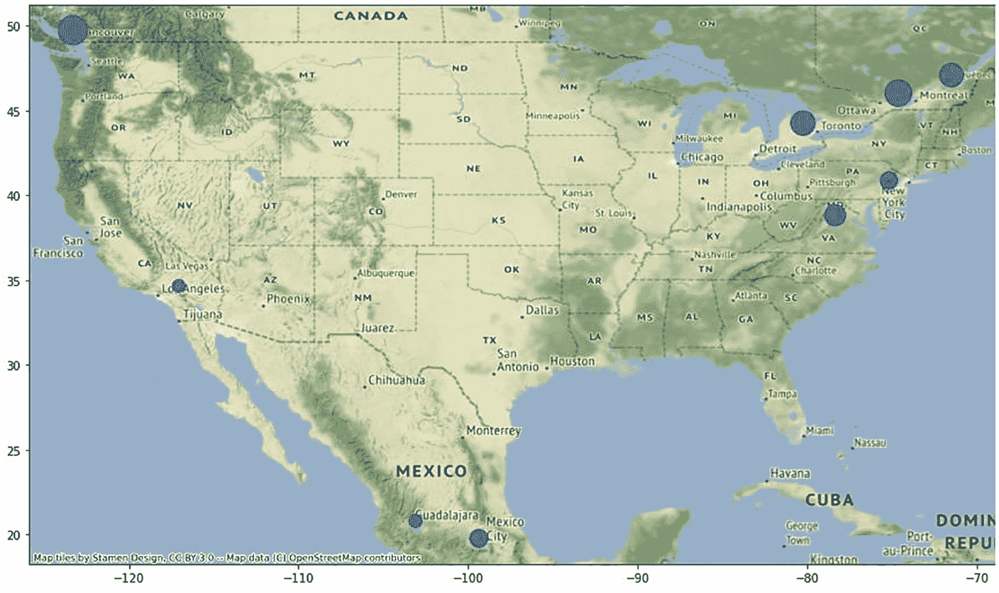

一张地图使用代码块 7-9 展示了美国、加拿大和墨西哥城市的人口规模。美国境内的拉斯维加斯、马里兰州和纽约市，加拿大境内的温哥华、多伦多、蒙特利尔和魁北克，以及墨西哥境内的瓜达拉哈拉和墨西哥城，均由点表示，每个点的大小根据查找表中 population 列的值进行调整。

图 7-12

代码块 7-9 生成的地图。图片由作者使用 contextily 源数据和图像（如图中引用所示）创建

### Python 中的空间连接

您现在已经了解了如何基于表格属性连接两个数据集。然而，也可以基于空间信息连接数据。对于此示例，我们将使用包含近似国家/地区多边形的数据集，该数据集可在 KML 文件中找到。再次强调，目标不是提供最终产品，而是展示制作它们的技术，因此数据是对真实数据外观的模拟近似。您可以使用代码块 7-10 中的代码导入国家/地区多边形。

```
countries = gpd.read_file('NorthMiddleAmerciaCountries.kml')
countries
代码块 7-10
导入数据
```

数据如图 7-13 所示。

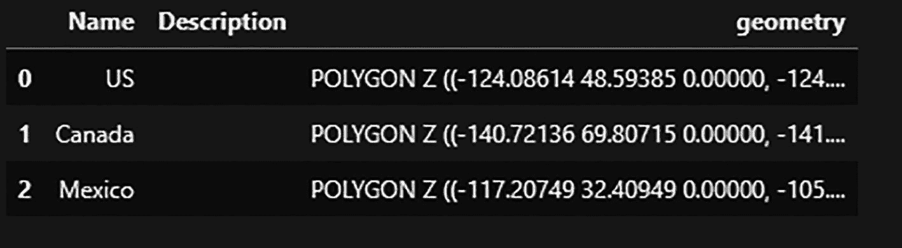

一个表格展示了代码块 7-10 的结果数据。该表有 3 列和 3 行。列标题是“名称”、“描述”和“几何”。行条目是美国、加拿大和墨西哥，以及它们近似的国家多边形。

图 7-13

代码块 7-10 的结果数据

如果我们将数据绘制在背景地图上，您可以看到这些多边形是对国家边界的快速近似，仅用于本练习的目的。这将在代码块 7-11 中完成。

```
ax = countries.plot(figsize=(15,15), edgecolor='black', facecolor='none')
cx.add_basemap(ax, crs=countries.crs)
代码块 7-11
绘制数据
```

这将显示图 7-14 中的地图。

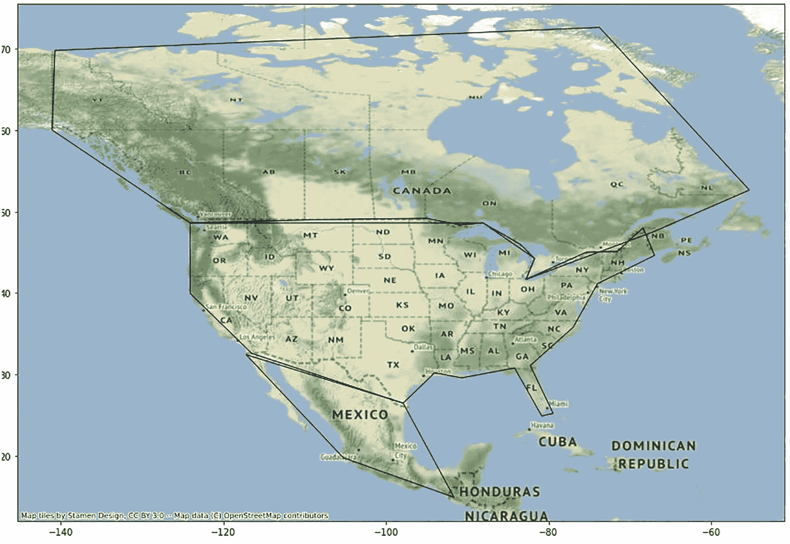

一张地图使用代码块 7-11 展示了美国、加拿大和墨西哥的绘制结果。美国、加拿大和墨西哥的边界在地图上用多边形突出显示。

图 7-14

代码块 7-11 生成的绘图。图片由作者使用 contextily 源数据和图像（如图中引用所示）创建

您可以看到这张地图上有些变形。如果您已经学习了第 2 章中关于坐标系统的理论，您应该能够理解变形的原因，并且如果您愿意，也有工具可以重新处理此地图的坐标系统。对于当前的练习，这些变形不是问题。现在，让我们使用代码块 7-12 将我们的城市添加到这张地图上。

```
ax = countries.plot(figsize=(15,15), edgecolor='black', facecolor='none')
cities_new.plot(ax=ax, markersize=cities_new['population'] // 10, figsize=(15,15))
cx.add_basemap(ax, crs=countries.crs)
代码块 7-12
将城市添加到地图
```

这给出了如图 7-15 所示的组合地图。

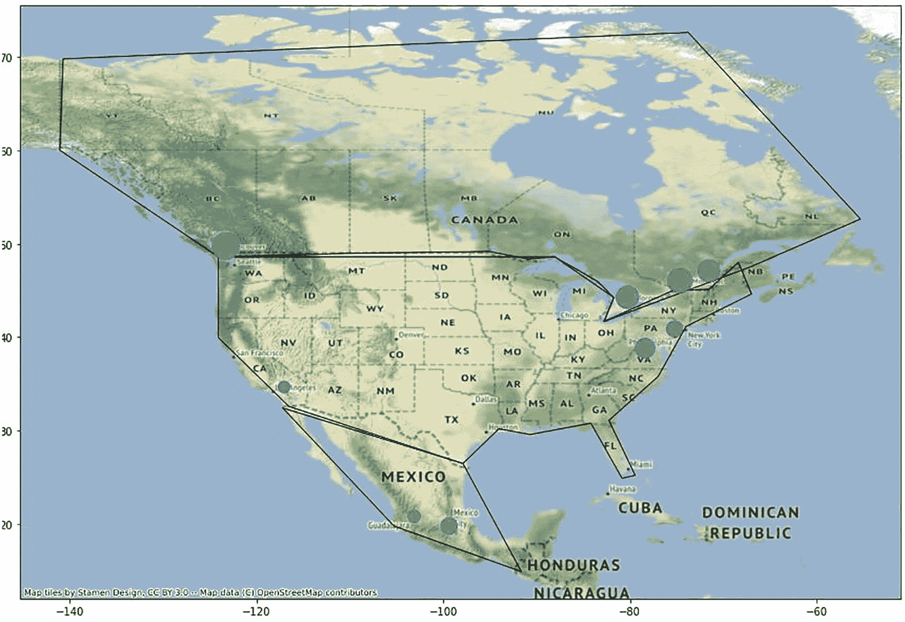

一张地图展示了美国、加拿大和墨西哥的组合多边形和城市。美国、加拿大和墨西哥的边界用多边形突出显示，城市用相同颜色的点表示，并在地图上显示其人口。

图 7-15

组合地图。图片由作者使用 contextily 源数据和图像（如图中引用所示）创建

这引出了空间连接的主题。在这张地图中，您可以看到有两个数据集：

*   城市数据仅包含城市名称和人口信息。
*   国家数据只是多边形。

使用类似 SQL 的连接为城市数据集中的每一行添加一个“国家”列是不可能的。然而，我们可以清楚地看到，基于空间信息，可以找出每个城市位于哪个国家。

空间连接正是为此目的而设计的。它允许我们按列组合两个数据集，即使没有共同的标识符：仅基于空间信息。这是可以使用地理数据但无法使用常规数据完成的事情之一。


好的，作为高级文档工程师和翻译员，我将严格遵循您提供的注意事项和示例格式，将给定的英文文本翻译成中文。


你可以在代码块 7-13 中看到，城市和国家数据集之间是如何基于“包含”空间连接进行空间连接的：城市需要位于多边形内部才能接收其属性。

```
cities_3 = cities_new.sjoin(countries, how="inner", predicate='within')
cities_3
代码块 7-13
城市与国家之间的空间连接
```

数据如图 7-16 所示。

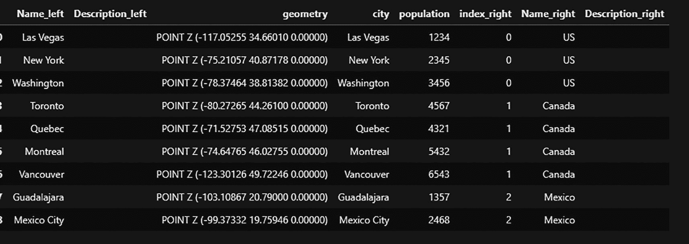

一张表格展示了使用代码块 7-13 进行空间连接后的结果数据，包含 8 列和 9 行。列标题分别为：名称（左）、描述（左）、几何图形、城市、人口、索引（右）、名称（右）和描述（右）。行条目包括：拉斯维加斯、纽约、华盛顿、多伦多、魁北克、蒙特利尔、温哥华、瓜达拉哈拉和墨西哥城。

图 7-16

代码块 7-13 的结果数据。作者提供的图片

你可以看到，国家的名称已被添加到城市数据集中。现在，我们可以在城市数据集中根据需要随意使用这个属性。例如，我们可以使用代码块 7-14，根据城市所属的国家为点赋予颜色。

```
cities_3['color'] = cities_3['index_right'].map({0: 'green', 1: 'yellow', 2: 'blue'})
ax = cities_3.plot(markersize=cities_3['population'] // 10, c=cities_3['color'], figsize=(15,15))
cx.add_basemap(ax, crs=cities_3.crs)
代码块 7-14
基于国家的颜色
```

这产生了如图 7-17 所示的地图。

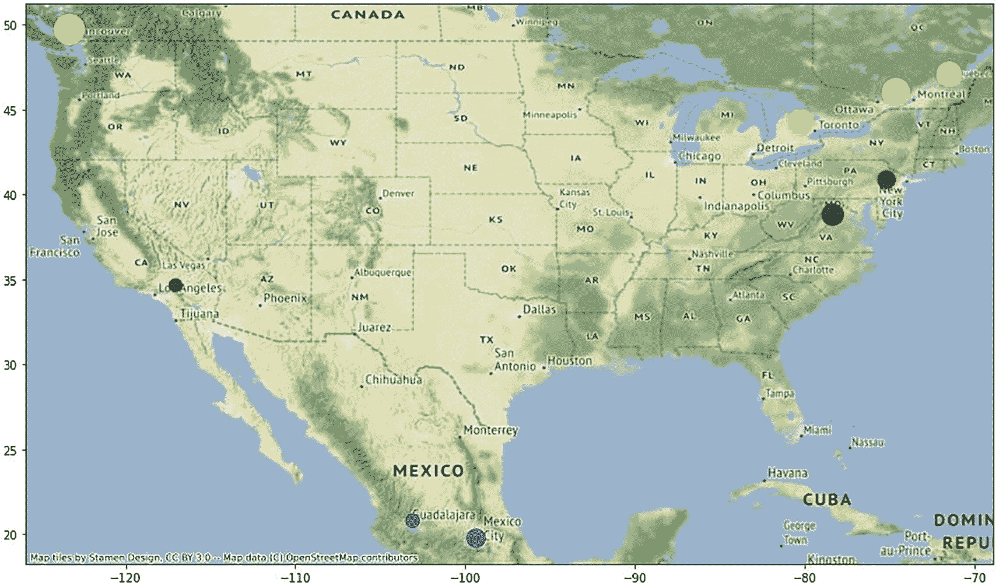

一张地图展示了使用代码块 7-14 绘制的美国、加拿大和墨西哥城市数据集。地图上，美国的拉斯维加斯、马里兰州和纽约市，加拿大的温哥华、多伦多、蒙特利尔和魁北克，以及墨西哥的瓜达拉哈拉和墨西哥城，都根据其所在国家以不同颜色的点表示。

图 7-17

代码块 7-14 的结果地图。作者使用 contextily 源数据和图像（如图中引用所示）制作的图片

通过这个最终结果，你现在已经看到了将多个数据集合并为单个数据集的多种方法：

*   行级拼接操作，在 GIS 中通常称为合并（merge）
*   属性连接，使用 geopandas 中一个容易混淆地称为合并（merge）的方法完成，而它通常被称为连接（join）而非合并（merge）
*   空间连接，这是一种基于空间属性而非任何公共标识符的连接

在本章的最后部分，你将了解融合（dissolve）操作，这在合并多个数据集时通常非常有用。

## 融合操作

在合并许多不同数据集时，经常会得到大量重叠的要素，例如不同粒度的多边形都保留在数据中，或者相同的要素出现在每个数据集中并造成信息重复。融合操作可以解决此类问题。

### 什么是融合操作？

融合操作是更广泛的概化工具家族中的一个工具。它允许你将过于详细或粒度过细的数据合并成更大的要素。你可以将融合工具视为一种分组操作。它的工作方式类似于 SQL 或 pandas 中的 groupby 操作。

### 融合操作示意图

你可以在图 7-18 中看到融合操作的示意图。在此图中，你可以看到多个多边形根据其数值特征被分组为一个，如图 7-18 所示。

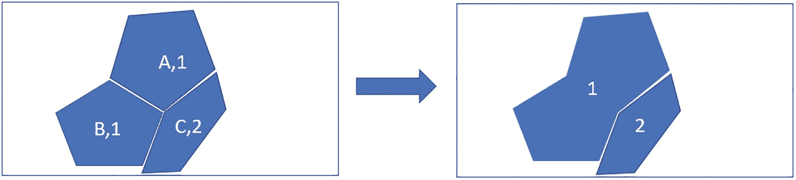

融合操作的示意图。第一个数据集展示了一个包含三个区域的数据集，分别标记为 A（1）、B（1）和 C（2）。该数据集根据其数值特征被分组为一个，现在标记为 1 和 2。

图 7-18

融合操作。作者提供的图片

多边形 A 和 B 的值都是 1，因此按值分组会将这两个多边形合并为一个多边形。当你的数据过于粒化时，此操作会很有用，这可能是由于你执行了大量地理空间操作，或者合并了大量数据文件所致。

### Python 中的融合操作

现在让我们看看如何在 Python 中执行融合操作。让我们使用与前一个示例相同的数据，并尝试了解如何使用融合操作，根据多边形位于北美（美国和加拿大）还是中美洲（墨西哥）来重新分组。为此，我们必须向国家数据集添加一个指示此信息的属性。代码块 7-15 中的代码展示了如何实现这一点。

```
countries['Area'] = ['North America', 'North America', 'Middle America']
countries
代码块 7-15
添加国家属性
```

执行此操作后，你会看到数据集中添加了一个新列，如图 7-19 所示。

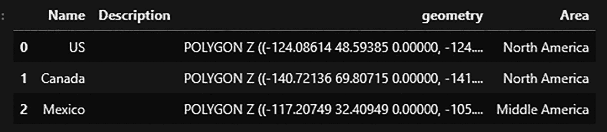

一张表格展示了代码块 7-15 的结果数据。该表格有 4 列和 3 行。列标题为：名称、描述、几何图形和区域。行条目为：美国、加拿大和墨西哥，以及它们近似的国家多边形和位于北美/中美洲的区域。

图 7-19

代码块 7-15 的结果数据。作者提供的图片

现在的目标是创建两个多边形：一个用于北美，一个用于中美洲。我们将使用融合方法来实现这一点，如代码块 7-16 所示。

```
areas = countries.dissolve(by='Area')[['geometry']]
areas
代码块 7-16
融合操作
```

新创建的数据集是前一个数据集分组（融合）后的结果，如图 7-20 所示。

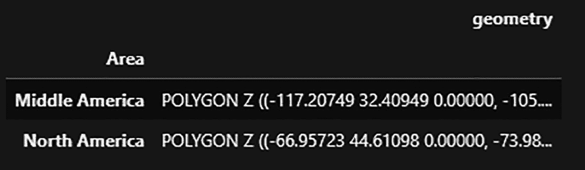

一张表格展示了使用融合操作后的分组数据集。该表格有 2 列和 2 行。列标题为：区域和几何图形。行条目为：中美洲和北美，以及它们近似的多边形。

图 7-20

分组后的数据集。作者提供的图片

我们现在可以使用代码块 7-17 绘制此数据，看看它是什么样子。

```
ax = areas.plot(figsize=(15,15), edgecolor='black', facecolor='none')
cx.add_basemap(ax, crs=areas.crs)
代码块 7-17
绘制数据
```

图 7-21 中的地图显示了融合操作的结果。

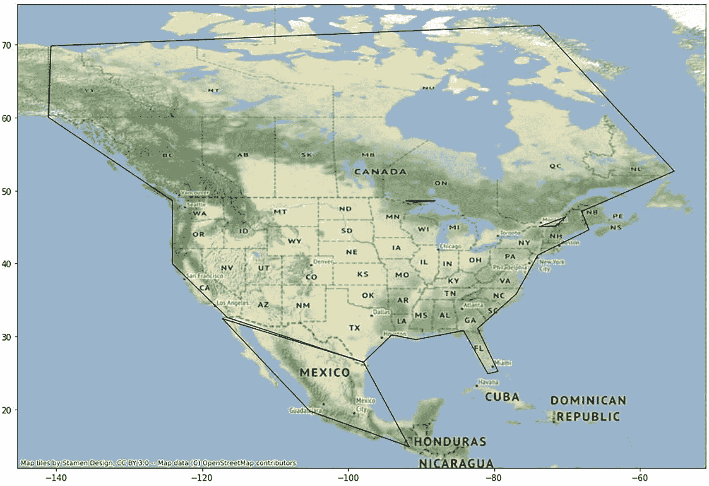

一张地图展示了北美和中美洲融合操作的结果。地图上，美国、加拿大和墨西哥的边界用多边形突出显示。美国和加拿大被合并为一个多边形以表示北美，而墨西哥则作为中美洲的另一个多边形。

图 7-21

融合操作的结果。作者使用 contextily 源数据和图像（如图中引用所示）制作的图片

这个合并后的结果已按区域特征进行了分组，并且是输入数据的概化版本。因此，融合操作非常类似于 groupby 操作，这是处理地理数据时需要掌握的一个非常有用的工具。


## 关键要点

1.  大多数地理数据工具都标准实现了大量基础地理数据操作。这些操作乍看简单，但应用于地理数据时可能会遇到一些困难。

2.  合并操作通常指按行合并，即将多个对象拼接成一个数据集。

3.  属性连接（在 geopandas 中令人困惑地被称为 merge）是一种按列进行的、类似 SQL 的连接操作，它利用两个输入数据集之间的共同属性进行连接。

4.  空间连接是另一种按列连接的方式，它允许在没有共同标识符的情况下合并两个数据集。两个数据集行之间的对应关系完全由空间信息决定。

5.  在空间连接中，有多种方式可以指定你想要用于连接的空间关系类型。例如，两个对象之间存在交集、一个对象完全包含在另一个对象内、一个对象部分包含在另一个对象内，甚至仅仅是两个对象相对接近。

6.  融合工具允许你根据指定的列，将对象分组为更大的对象，从而对数据集进行概括。此操作类似于空间要素的分组操作，当你拥有过多或过于细碎的对象，需要将其概括为更大的区块时，该工具非常有用。

# 8. 擦除

在本章中，你将学习擦除操作。前三章介绍了一些标准的 GIS 操作。裁剪和相交在第 5 章中介绍，缓冲区分析在第 6 章中介绍，合并和融合在第 7 章中介绍。

本章将是这四章中介绍地理空间分析常用工具的最后一章。尽管标准的 GIS 工具箱中还有更多工具可用，但本章的目标是让你扎实掌握基础知识，并能够自主学习 Python 中的其他 GIS 操作。

本章将从擦除操作的理论介绍开始，然后通过多个 Python 示例实现，演示如何将擦除应用于不同的地理数据类型。

## 擦除操作

擦除不仅仅是 GIS 分析中的一种操作，也是删除的常见同义词。为了澄清，让我们先看看“标准”的要素删除，这不是空间擦除，而是基于要素 ID（而非空间信息）完全删除一个要素。

无论你处理的是点、线还是面，都可以想象你只是想删除其中一个。图 8-1 中的示意图展示了这意味什么。

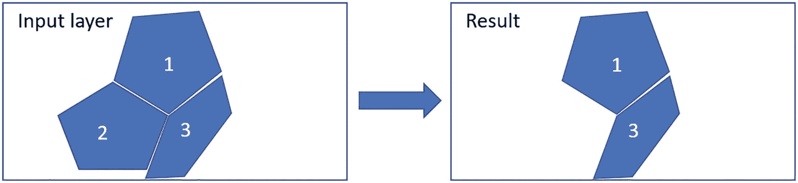

擦除操作的示意图，包含输入图层和结果。两者都有编号为 1 到 3 的五边形，其中标记为 1 的多边形位于顶部，标记为 2 的多边形位于左侧，标记为 3 的多边形位于右侧。结果面板显示标记为 2 的多边形缺失。

图 8-1

擦除操作示意图。图片由作者提供

在此示意图中，你可以看到左侧有三个多边形（编号为 1、2 和 3）。删除操作删除了多边形 2，因此右侧输出中只剩下两个多边形。多边形 2 被删除，或者用同义词说，被擦除了。包含数据的表格将受到影响，如图 8-2 所示。

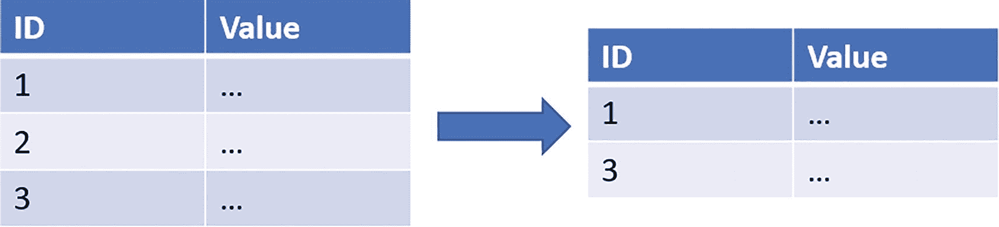

表格格式的擦除操作示意图。两个表格都有两列，分别标记为 I D 和 Value。左侧表格有三行，右侧表格有两行。两个表格行的相应标签分别是 1、2、3 和 1、3。一个右箭头连接两个表格。

图 8-2

此操作的表格视图。图片由作者提供

这个操作相对容易理解，不需要深入探讨。然而，在 GIS 中，通常所说的擦除操作并非指此操作。

GIS 中的擦除功能实际上更接近我们之前介绍过的其他空间操作。擦除操作需要两个输入：一个输入图层（我们要对其应用擦除操作的图层）和擦除要素。

输入图层可以是任何类型的矢量图层：面、线、点，甚至混合类型。擦除要素通常必须是面，尽管某些实现可能允许你使用其他类型。

该操作的作用是擦除输入图层中位于擦除多边形内部的所有数据。这将删除部分输入数据，通常是因为你不需要它。

接下来，让我们看看在不同输入数据类型上执行擦除的一些示意图概览。

### 空间擦除点的示意图概览

空间擦除点实际上与标准删除操作非常相似。执行空间擦除时，你将删除输入要素中与擦除要素在空间上重合的所有部分。然而，由于点没有大小，它们要么完全位于擦除要素内部，要么完全位于外部，这导致每个点要么被完全删除，要么被保留。图 8-3 中的示意图展示了其工作原理。

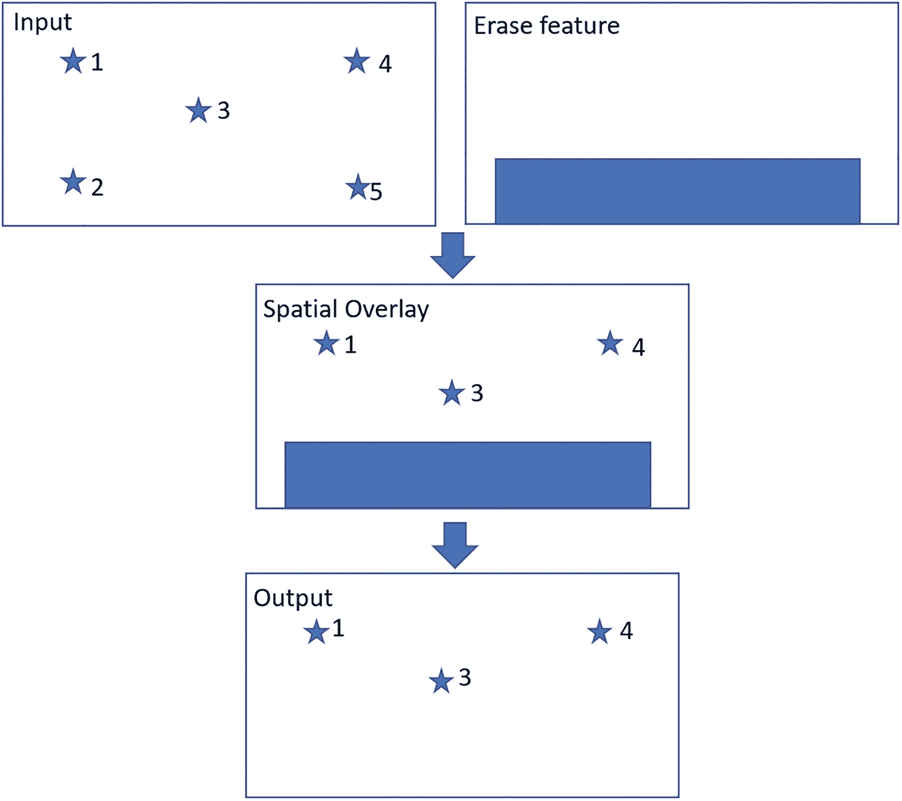

空间擦除点的示意图。它有四个带标签的矩形。输入有 5 个带编号的星形，而擦除要素是一个位于中下部的水平矩形。它们之间的向下箭头连接到空间叠加和输出，输出包含相同的 1、3 和 4 号星形，但后者中没有水平矩形。

图 8-3

空间擦除点的示意图。图片由作者提供

你可以在图 8-4 的示意图中看到数据表在操作前后的变化。

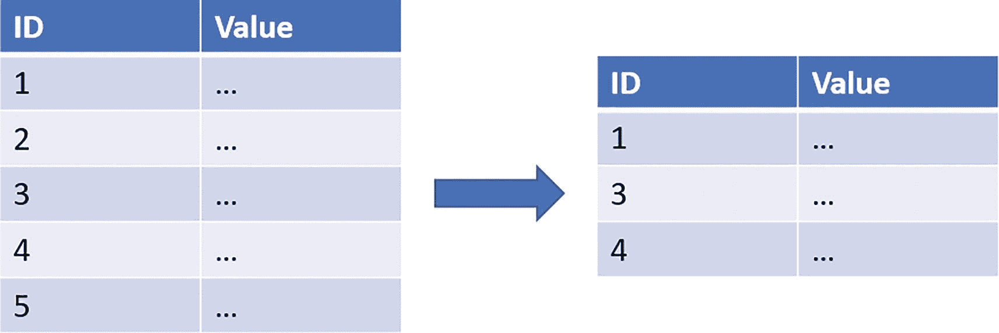

表格格式的空间擦除示意图。两个表格都有两列，分别标记为 I D 和 Value。左侧表格有五列，右侧表格有三列。两个表格行的相应标签分别是 1、2、3、4、5 和 1、3、4。一个右箭头连接两个表格。

图 8-4

空间擦除背后的表格视图。图片由作者提供

你可以看到要素 2 和 5 已被擦除操作简单地移除。这也可以通过删除 ID 为 2 和 5 的要素来实现。尽管使用空间擦除而不是按 ID 擦除来删除一些点在功能上结果相同，但在这里使用空间擦除可能非常有用，甚至是必要的。

当你有一个擦除要素时，你还没有要删除的点的确切 ID。这样，自动获取 ID 列表的唯一方法是进行空间连接或叠加，这正是空间擦除中所发生的。

正如你接下来将看到的，当使用更复杂的要素（如线和面）时，空间擦除的重要性甚至更大。


### 空间擦除线的示意图

现在让我们看看在线数据上执行空间擦除时是如何工作的。在图 8-5 中，您可以看到有两个线要素和一个多边形擦除要素。

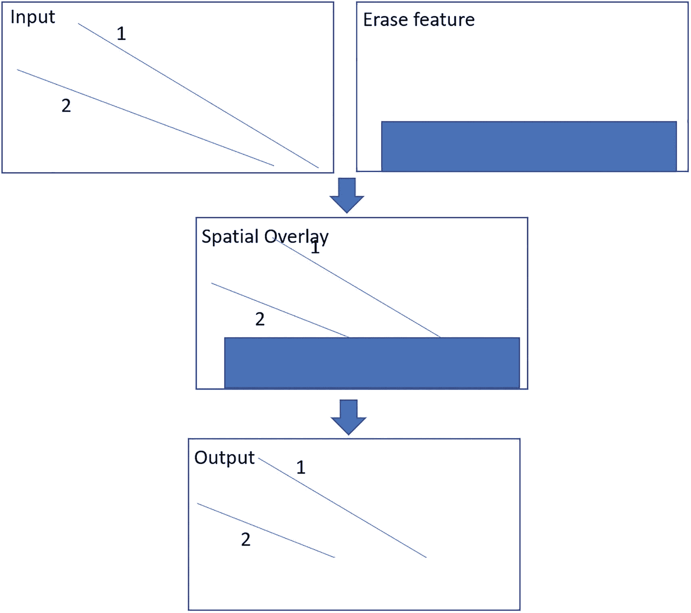

擦除线的示意图。图中包含四个带标签的矩形。输入部分有两条分别标记为 1 和 2 的对角线，而擦除要素则是一个位于右下角附近的水平矩形。两者之间的向下箭头连接到空间叠加和输出部分，输出部分中相同的标记对角线被截短。

图 8-5

擦除线。作者自绘

这里发生的情况与点示例中的情况截然不同。空间擦除并非删除或保留整个要素，而是对要素进行了修改。前后对比，数据仍然由两条线组成，但它们已不再是完全相同的线。每个要素只有一部分被擦除，因此要素的数量没有改变，改变的只是几何形状。在数据表中，这看起来会像图 8-6 所示。

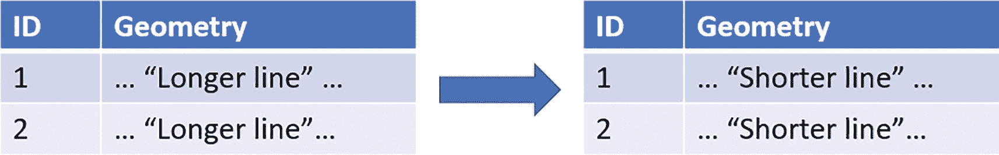

表格格式下擦除线的示意图。两个表格都有两列，分别标记为 ID 和几何形状，以及左侧标记为 1 和 2 的两行条目。两个表格右侧的行条目分别是省略号左引号较长线省略号和省略号右引号较短线省略号。

图 8-6

擦除线的表格视图。作者自绘

在下一节中，您将看到这对于多边形是如何工作的。

### 空间擦除多边形的示意图

对多边形进行空间擦除的功能本质上与应用于线的空间擦除相同。输入层中的多边形，就像线一样，当它们部分落在擦除要素内部时，可以被修改。图 8-7 中的示意图展示了这是如何工作的。

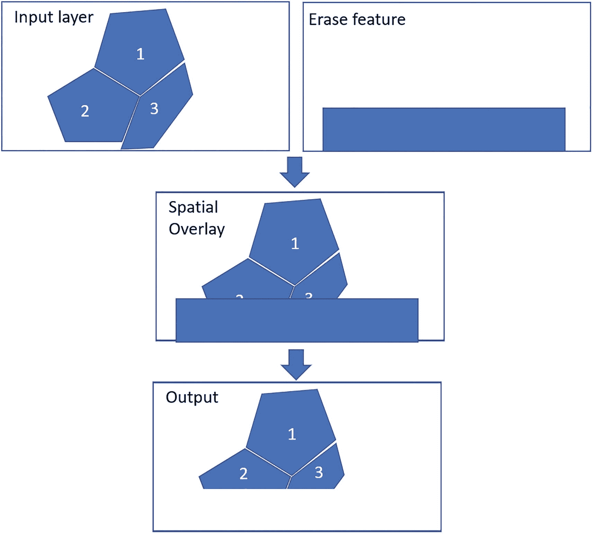

对多边形执行空间擦除操作的示意图。图中包含四个带标签的矩形。输入层有三个五边形，编号为 1 到 3，而擦除要素是一个位于中下部的水平矩形。两者之间的向下箭头连接到空间叠加和输出部分，其中编号 2 和 3 几乎被切成两半。

图 8-7

应用于多边形的空间擦除操作。作者自绘

在示意图中，您可以看到左上角的输入层中有三个多边形。擦除要素是一个矩形多边形。使用空间擦除后，输出包含多边形 2 和 3 的修改版本，因为它们与擦除要素重叠的部分已被切除。

此操作对数据表的影响也与线数据类似。与此示例对应的表格可以在图 8-8 中看到。

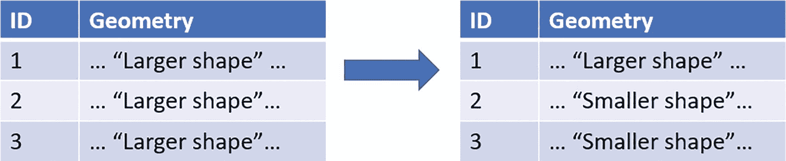

表格格式下对多边形进行空间擦除的示意图。两个表格都有两列，分别标记为 ID 和几何形状，以及三行条目。两个表格的左侧行条目都标记为 1 到 3，右侧条目为省略号左引号较大形状省略号，除了第二个表格的第二和第三个右侧条目标记为较小形状。

图 8-8

对多边形进行空间擦除的表格视图。作者自绘

现在您应该对空间擦除操作有了相对较好的直观理解。为了完善您的理解，下一节将在转向 Python 实现之前，对空间擦除器与一些可比较的操作进行深入比较。

## 擦除与其他操作的对比

正如您在前三章中已经看到的，标准 GIS 工具包中有大量的空间操作。这很好，因为它允许您使用最适合您用例的工具。然而，深入研究每个操作的细节也至关重要，以确保您有效地使用正确的工具来完成手头的任务。

现在让我们来看几个与擦除任务相对可比较的操作。在某些情况下，您可能会使用另一个工具来完成完全相同的任务。这没有问题，只要您注意具体的实现方式，并在执行工具之前仔细查看其文档。

### 擦除与删除要素

删除整个要素，也称为丢弃要素或删除数据中的一行，之前已经提到过与空间擦除器相对相似。然而，空间擦除器与简单地丢弃整个要素之间存在本质区别。

丢弃要素只允许您完全删除一个要素。空间擦除也可以做到这一点，但空间擦除器能做更多。当输入层中的要素完全被擦除要素覆盖时，整个输入要素将被删除，但当输入层中的要素仅与擦除要素部分重叠时，将会发生修改而非删除。实际上，输入要素的 ID 并未从数据集中删除，但其几何形状将被修改：通过移除与擦除要素重叠的部分来缩小。

当您想基于几何形状删除要素或要素的一部分时，应使用空间擦除。否则，当您想基于 ID 或数据的任何其他列要素进行删除时，删除要素是有用的。

### 擦除与裁剪

您已经看到裁剪操作是介绍的第一个 GIS 工具。此工具用于将输入层裁剪到固定范围，这意味着删除范围之外的所有内容。由于裁剪也会删除部分数据，它可能与空间擦除操作混淆。让我们看看两者之间的区别。

裁剪操作与擦除操作的主要区别在于，裁剪操作会将数据缩减到固定范围，该范围可以是坐标或一个要素。使用裁剪时，您的目标始终是保留数据的特定部分，并删除边界之外的所有内容。简而言之，您保留内部（您分析或地图聚焦的区域）并移除更远的、边界之外的数据。

空间擦除不一定采用内部/外部边界的逻辑。您也可以使用擦除器来移除感兴趣区域内的较小区域，同时保留周围区域。

虽然这两个工具都像饼干模具，但切出的饼干用途不同：使用裁剪操作时，您用饼干模具切出您想保留的饼干；而使用擦除操作时，模具用于切出您想丢弃的部分。简而言之，这是两个非常相似的工具，但用于截然不同的目的。


### 擦除 vs. 叠加

第三种也是最后一种与空间擦除操作类似的操作是空间叠加操作。正如在第 5 章介绍交集时所述，集合论中有多种操作可应用于地理数据。在该章中，你主要关注的是交集操作，即保留两个图层在空间上相交的所有数据。

集合论中的另一种操作是差集操作。你可以使用与交集相同的空间叠加功能来计算差集操作。与保留两个输入图层中相交部分不同，差集操作将保留输入图层 A 中所有不在输入图层 B 中的要素及要素部分。因此，它会从图层 A 中删除图层 B 中的所有内容，类似于擦除操作。

根据你使用的软件，你可能会遇到也可能不会遇到擦除操作的实现。例如，在某些付费版 ArcGIS 软件中，存在擦除功能。然而，在 geopandas 中并没有此功能，因此我们不妨使用叠加功能中的差集操作来获得与擦除操作相同的效果/功能/结果。这就是我们将在下一节中要做的事情。

## 在 Python 中实现擦除

在本练习中，你将使用一个专门为此练习创建的小型示例地图。该数据不应用于除练习之外的任何其他目的，因为它并不十分精确，但这目前不是问题，因为我们的目标是掌握地理空间分析工具。

在接下来的练习中，你将使用伊比利亚半岛（包含西班牙和葡萄牙的半岛）的混合数据集。练习的目标是根据这些数据创建一张西班牙地图，尽管没有多边形指示西班牙的确切区域：必须通过从伊比利亚半岛中移除葡萄牙来创建。

我建议在 Kaggle 笔记本或本地环境中运行此代码，因为 Google Colab 在创建叠加图层时存在一些问题。要开始练习，你可以使用代码块 8-1 中的代码导入数据。

```
import geopandas as gpd
import fiona
gpd.io.file.fiona.drvsupport.supported_drivers['KML'] = 'rw'
all_data = gpd.read_file('chapter_08_data.kml')
all_data
代码块 8-1
导入数据
```

你将获得一个如图 8-9 所示的数据框。

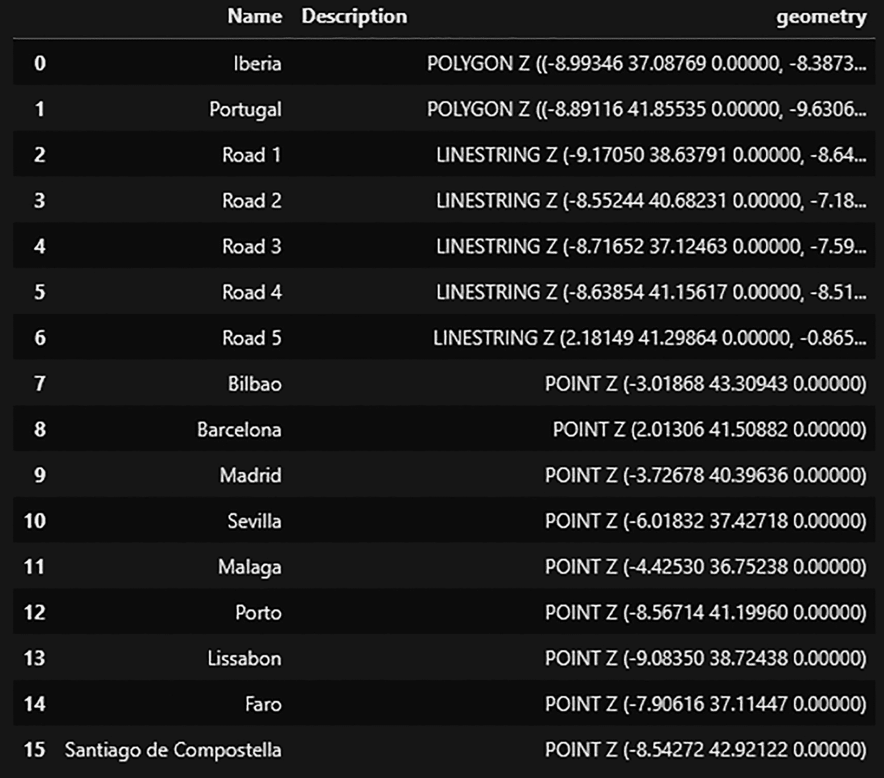

一张包含 4 列 16 行的表格图像。最左侧的行条目标记为 0 到 15。名称列包含伊比利亚半岛、葡萄牙、道路 1 至 5、毕尔巴鄂、巴塞罗那、马德里、塞维利亚、马拉加、波尔图、里斯本、法鲁和圣地亚哥-德孔波斯特拉。描述列没有条目。几何列包含多边形、线串和点的 Z 值。

图 8-9

数据表。作者提供的图像

在此数据框中，你可以看到混合了多种数据类型或几何类型。前两行包含伊比利亚半岛（即西班牙加葡萄牙的轮廓）的多边形。然后是一些道路（线要素），接着是一些城市（点要素）。

让我们使用代码块 8-2 快速创建一张地图，以确切了解我们正在处理的数据。你可以使用下面的代码来实现。如果你对这些绘图方法还不熟悉，我建议回顾前面的章节以加深了解。从现在开始，我们将加快对数据导入、文件格式、数据类型和地图绘制等基础内容的讲解速度，因为这些内容在本书的前面部分已经详细讨论过。

```
import contextily as cx
