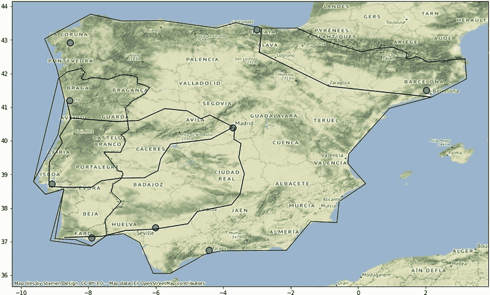

# 添加 contextily 底图
cx.add_basemap(ax, crs=all_data.crs)
代码块 8-2
可视化数据
```

运行此代码后，你将看到如图 8-10 所示的地图。



欧洲西南部地区的地图，重点显示葡萄牙和西班牙，以及东北部和东南部地区的法国和阿尔及利亚部分地区。可以看到点和连线。葡萄牙陆地上有 3 个点，而西班牙有 6 个分散的点。垂直轴数值范围为 36 到 44，X 轴数值范围为负 10 到正 2。

图 8-10

代码块 8-2 生成的地图。作者提供的图像

这张地图不太清晰，因为它仍然包含多种类型的数据，并且这些数据相互重叠。由于我们的目标是过滤掉一些数据，让我们在改进可视化之前先完成这一步。


### 从伊比利亚半岛中擦除葡萄牙以得到西班牙

目标是获取西班牙的地图，并从我们的数据中移除所有位于葡萄牙境内的部分。第一步是创建一个西班牙的多边形。由于我们知道伊比利亚半岛由西班牙和葡萄牙组成，我们只需计算伊比利亚半岛与葡萄牙的差集即可得到西班牙。这可以通过代码块 8-3 中的代码实现。

```
