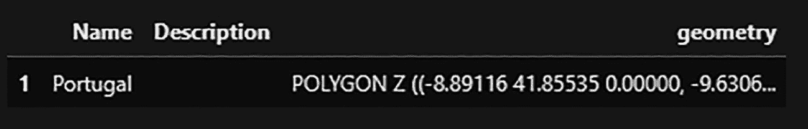

# 根据名称过滤数据
portugal = all_data[all_data['Name'] == 'Portugal']
portugal
代码块 8-4
过滤葡萄牙数据
```

生成的数据框仅包含对应于葡萄牙的多边形。该数据框如图 8-12 所示。



一张包含四列一行的表格图片。除第一列外，各列标签分别为 Name、Description 和 geometry。展示的行条目中，除 Description 列外，依次为 1、Portugal 和 POLYGON Z double open parentheses negative 8.89116 41.85535 0.00000 comma negative 9.6306 ellipsis。

图 8-12

来自代码块 8-4 的数据。作者供图

现在，我们有了两个独立的对象：一个仅包含伊比利亚多边形的地理数据框，以及另一个仅包含葡萄牙多边形的地理数据框。我们想要得到的是两者之间的差集，因为西班牙是伊比利亚半岛中不属于葡萄牙的那部分。代码块 8-5 中的代码正是实现此目的。

```
