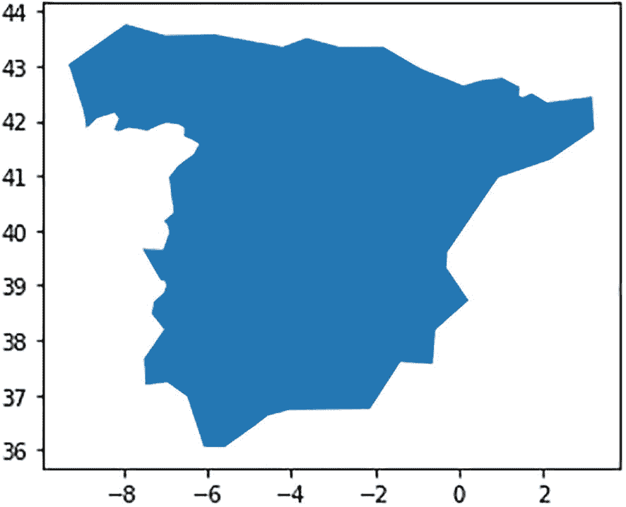
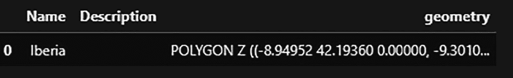
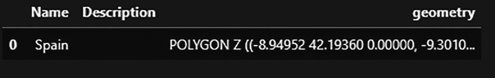

# 绘制生成的西班牙多边形
spain.plot()
代码块 8-5
差集操作
```

生成的绘图如图 8-13 所示。



一张纯色填充的西班牙地图。纵轴数值从 36 到 44，步长为 1；横轴数值从 -8 到 2，步长为 2。

图 8-13

来自代码块 8-5 生成的地图。作者供图

尽管形状是正确的，但当我们查看 `spain` 数据框对象时，会发现其名称仍然设置为输入图层，即伊比利亚。你可以使用代码块 8-6 轻松打印数据。

```
spain
代码块 8-6
打印数据
```

结果如图 8-14 所示。



一张包含四列一行的表格图片。除第一列外，各列标签分别为 Name、Description 和 geometry。展示的行条目中，除 Description 列外，依次为 0、Iberia 和 POLYGON Z double open parentheses negative 8.94952 42.19360 0.00000 comma negative 9.3010 ellipsis。

图 8-14

西班牙数据。作者供图

我们可以使用代码块 8-7 中的代码将名称重置为 Spain。

```
spain.Name = 'Spain'
spain
代码块 8-7
将名称设置为 Spain
```

现在，生成的数据框在 Name 列中有了正确的值，如图 8-15 所示。



一张包含四列一行的表格图片。除第一列外，各列标签分别为 Name、Description 和 geometry。展示的行条目中，除 Description 列外，依次为 0、Spain 和 POLYGON Z double open parentheses negative 8.94952 42.19360 0.00000 comma negative 9.3010 ellipsis。

图 8-15

名称正确的西班牙数据。作者供图

让我们使用背景地图绘制到目前为止完成的所有内容，以便在后续练习中继续向这张西班牙地图添加内容。创建此绘图的代码如代码块 8-8 所示。

```
