# 添加 contextily 底图
cx.add_basemap(ax, crs=spain.crs)
代码块 8-8
绘制新的西班牙多边形
```

生成的地图如图 8-16 所示。

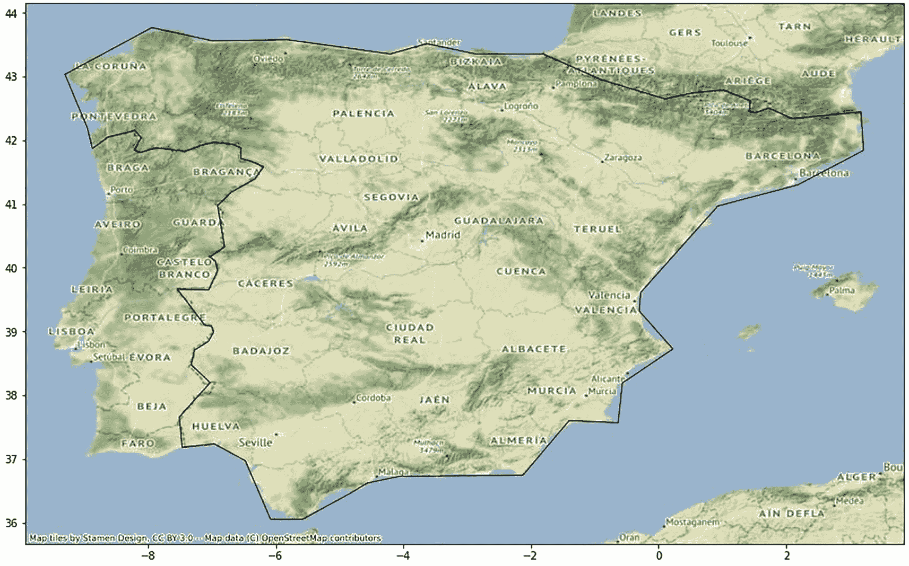

一张聚焦于西班牙边界的欧洲西南部地区地图。可以看到葡萄牙，以及东北部的法国部分地区和东南部的阿尔及利亚部分地区。纵轴数值从 36 到 44，步长为 1；横轴数值从 -8 到 2，步长为 2。

图 8-16

来自代码块 8-8 生成的绘图。作者供图

如果你熟悉西班牙的形状，你会发现它与这张地图上的形状非常吻合。我们仅通过使用两个其他多边形进行空间操作，就成功地为西班牙这个国家创建了一个多边形。你可以想象，在处理空间数据时，无论是用于空间分析、制图与可视化，还是用于机器学习中的特征工程，此类工作都会经常出现。

在下一节中，你将通过从数据中移除葡萄牙的城市来继续此练习，以便我们只为西班牙数据集保留相关的城市。


### 从数据集中擦除葡萄牙的城市

在本练习的第二部分，你将处理代表伊比利亚半岛城市的点数据。数据集中包含一些伊比利亚半岛的主要城市，这意味着既有西班牙的城市，也有葡萄牙的城市。本练习的目标是筛选出位于西班牙的城市，并移除位于葡萄牙的城市。

在前面的章节中，你已经看到了一些可能对此有用的技术。例如，可以想象与一个外部表进行连接。这个外部表可以是一个从城市到国家的映射表，这样在将地理数据框连接到这个查找表之后，你就可以简单地根据国家进行筛选。

在当前练习中，我们采用一种不同的方法，即使用带有差集操作的空间叠加，这与擦除操作相同。通过这种方式，我们将从城市中擦除所有与葡萄牙多边形有空间叠加的城市。

本练习的第一步是创建一个仅包含城市的独立地理数据框。处理只包含一种数据类型的数据库总是更容易。让我们使用代码块 8-9 中的代码来筛选出所有点数据，在本例中这些点数据就是城市。

```
from shapely.geometry.point import Point
cities_filter = all_data.geometry.apply(lambda x: type(x) == Point)
cities = all_data[cities_filter]
cities
代码块 8-9
筛选出所有点数据
```

你将获得如图 8-17 所示的数据集，其中仅包含城市。

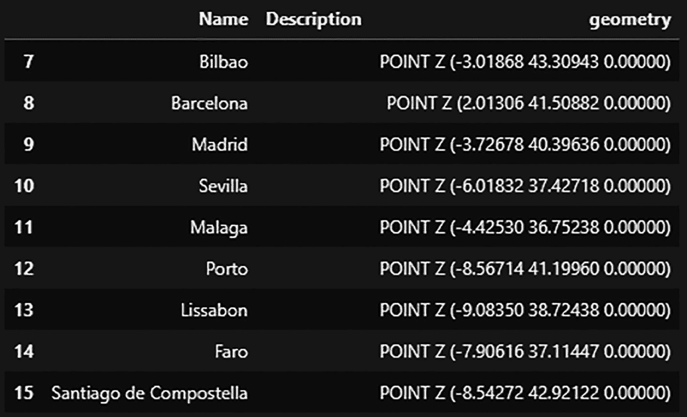

一张包含四列九行的表格图片。最左列条目编号为 7 到 15。名称列包含条目：毕尔巴鄂、巴塞罗那、马德里、塞维利亚、马拉加、波尔图、里斯本、法鲁和圣地亚哥-德孔波斯特拉。描述列没有条目。几何列包含不同的 POINT Z 值。

图 8-17

代码块 8-9 得到的数据集。图片由作者提供

现在我们有了一个只包含城市的数据集，我们仍然需要筛选出西班牙的城市并移除葡萄牙的城市。如你所见，没有其他列可以用来应用此筛选条件，手动列出所有西班牙和葡萄牙的城市会非常繁琐。即使对于当前练习来说可行，但如果数据集更大，工作量会大得多，因此这不是一个好做法。

以下代码展示了如何移除所有与葡萄牙多边形有叠加的城市。将 `how` 参数设置为 `"difference"` 会使它们被移除而不是保留。提醒一下，你在前面的章节中已经看到过其他参数，如 `intersection` 和 `union` 的使用。如果你不记得其他版本的作用，此时最好使用代码块 8-10 快速回顾一下。

```
spanish_cities = cities.overlay(portugal, how = 'difference')
spanish_cities
代码块 8-10
差集操作
```

`spanish_cities` 数据集如图 8-18 所示。

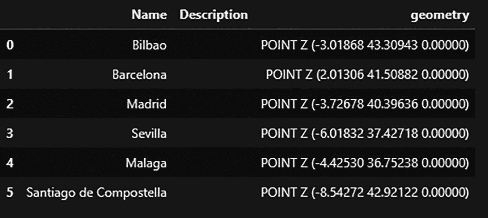

一张包含四列六行的表格图片。最左列条目编号为 0 到 5。名称列包含条目：毕尔巴鄂、巴塞罗那、马德里、塞维利亚、马拉加和圣地亚哥-德孔波斯特拉。描述列没有条目。几何列包含不同的 POINT Z 值。

图 8-18

代码块 8-10 得到的数据集。图片由作者提供

将此数据集与之前的数据集进行比较，你可以看到确实有一些城市被移除了。保留的西班牙城市是毕尔巴鄂、巴塞罗那、马德里、塞维利亚、马拉加和圣地亚哥-德孔波斯特拉。葡萄牙的城市已被移除：波尔图、里斯本和法鲁。这就是本练习的目标，因此我们可以认为它已成功完成。

作为最后一步，最好将所有这些添加到我们在上一节开始制作的地图中。让我们使用代码块 8-11 中的代码，将西班牙城市添加到西班牙多边形地图上。

```
ax = spain.plot(figsize=(15,15), edgecolor='black', facecolor='none')
spanish_cities.plot(ax=ax, markersize=128)
cx.add_basemap(ax, crs=spain.crs)
代码块 8-11
在地图上添加西班牙城市
```

此代码将生成如图 8-19 所示的地图，其中包含西班牙国家的多边形、西班牙的城市以及一个用于更好可视化的 contextily 底图。

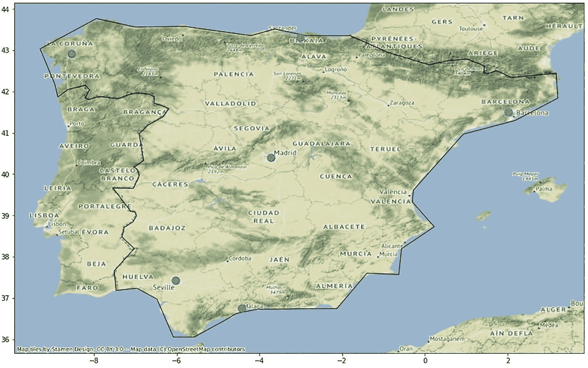

欧洲西南部地区的地图，在西班牙边界内的六个不同城市上有圆点标记，分别是：毕尔巴鄂、巴塞罗那、马德里、塞维利亚、马拉加和圣地亚哥-德孔波斯特拉。可以看到附近的国家。垂直轴数值从 36 到 44，间隔为 1；水平轴数值从 -8 到 +2，间隔为 2。

图 8-19

代码块 8-11 得到的地图。图片由作者提供

我们现在已经完成了练习的两个部分。我们已经看到了如何切割多边形，并且筛选出了西班牙的城市。剩下唯一要做的事情是调整道路的尺寸，并确保只筛选出位于西班牙多边形内部的道路部分。这将是下一节的目标。


### 仅保留西班牙境内的道路线段

在本节中，我们将处理道路数据，这是输入数据中我们尚未处理的唯一部分。输入数据集包含五条道路。回顾一下数据的第一个整体图，您会发现其中一些道路穿越了两个国家，而另一些则仅位于一个国家境内。此操作既包含过滤，也涉及修改，因为跨国道路需要被裁剪至西班牙多边形的范围内。

首先，我们创建一个仅包含道路的数据框，因为单一类型的数据集总是更易于处理。代码块 8-12 展示了这一过程。

```
from shapely.geometry.linestring import LineString
roads_filter = all_data.geometry.apply(lambda x: type(x) == LineString)
roads = all_data[roads_filter]
roads
代码块 8-12
创建仅包含道路的数据框
```

现在，您将获得一个仅包含道路的数据集，如图 8-20 所示。

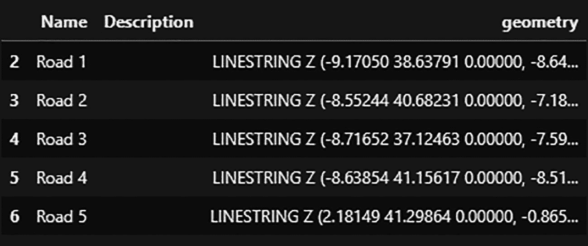

一张包含四列五行表格的图片。最左列条目标记为 2 至 6。名称列包含道路 1 至 5 的条目。描述列没有条目。几何列包含不同的 LINESTRING Z 值。

图 8-20

代码块 8-12 生成的数据集。作者提供的图片

从数据中并不能清晰地看出问题所在，因此我们使用代码块 8-13 中的代码绘制一张图，以查看这些 LineString 对象的问题。

```
ax = spain.plot(figsize=(15,15), edgecolor='black', facecolor='none')
spanish_cities.plot(ax=ax, markersize=128)
roads.plot(ax=ax, linewidth=4, edgecolor='grey')
cx.add_basemap(ax, crs=spain.crs)
代码块 8-13
绘制数据
```

这段代码将生成图 8-21 中的地图，该图显示仍有大量道路线段位于葡萄牙境内，这是我们不希望出现在西班牙地图上的。

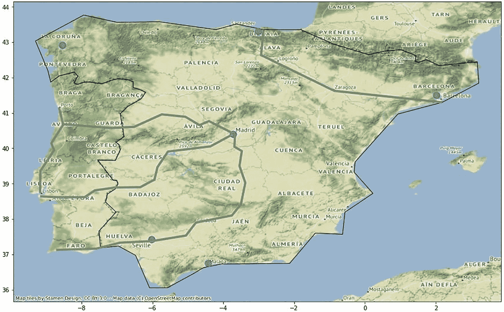

一张欧洲西南部地区的地图，显示了连接西班牙部分城市的线条网络。马德里和塞维利亚连接到一个横跨葡萄牙领土的大型线条网络，而毕尔巴鄂和巴塞罗那则由一条长线连接。图中还显示了邻近国家以及其他两个未连接的西班牙城市，以及垂直和水平轴的值。

图 8-21

代码块 8-13 生成的地图。作者提供的图片

确实，您可以看到有一条道路（从波尔图到里斯本）需要被完全移除。还有三条道路始于马德里，终点在葡萄牙，因此我们需要裁剪掉这些道路位于葡萄牙境内的部分。

使用叠加分析中的差异操作可以轻松完成所有这些操作，如代码块 8-14 中的代码所示。

```
spanish_roads = roads.overlay(portugal, how = 'difference')
spanish_roads
代码块 8-14
差异操作
```

结果如图 8-22 所示。

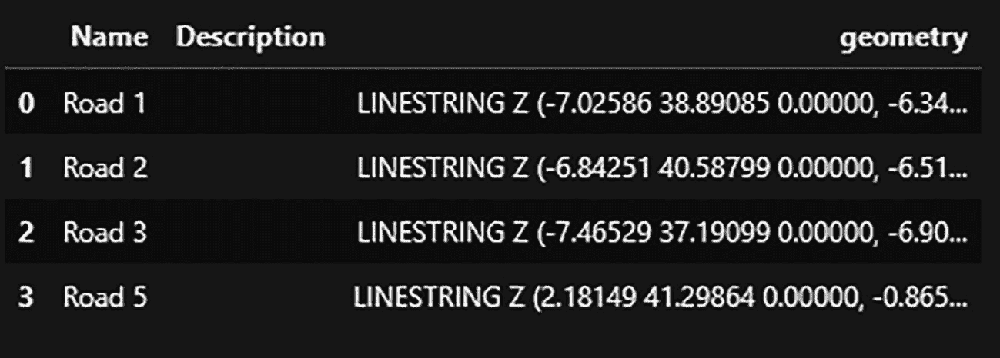

一张包含四列四行表格的图片。最左列条目标记为 0 至 3。名称列包含道路 1、2、3 和 5 的条目。描述列没有条目。几何列包含不同的 LINESTRING Z 值。

图 8-22

代码块 8-14 生成的数据。作者提供的图片

您可以清楚地看到，一些完全位于葡萄牙境内的道路已从数据集中被移除。部分位于葡萄牙、部分位于西班牙的道路则被修改，而完全位于西班牙境内的道路则被完整保留。

现在，我们将道路添加到包含国家多边形和城市的整体地图中，以完成我们仅包含西班牙要素的最终地图。代码块 8-15 展示了这一过程。

```
ax = spain.plot(figsize=(15,15), edgecolor='black', facecolor='none')
spanish_cities.plot(ax=ax, markersize=128)
spanish_roads.plot(ax=ax, linewidth=4, edgecolor='grey')
cx.add_basemap(ax, crs=spain.crs)
代码块 8-15
将道路添加到整体地图中

```

生成的地图如图 8-23 所示。

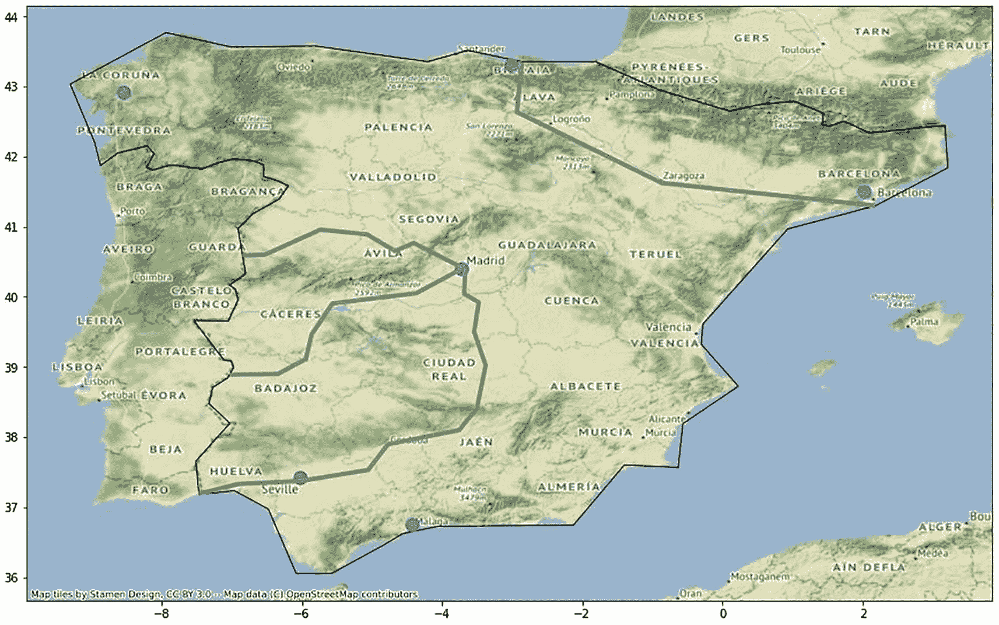

一张欧洲西南部地区的地图，显示了西班牙边界内的连接线条。西班牙。观察到两个线条网络，一个涉及西部的马德里和塞维利亚城市，另一个涉及东北部的毕尔巴鄂和巴塞罗那城市。图中还显示了邻近国家以及其他两个未连接的西班牙城市，以及垂直和水平轴的值。

图 8-23

代码块 8-15 生成的地图。作者提供的图片

这张地图展示了所有要素被缩减至西班牙境内的结果，而我们的初始数据集中甚至没有一个西班牙多边形。这些示例展示了在空间分析或面向空间机器学习的特征工程中非常常见的工作类型。毕竟，数据并非总是干净完美的，通常需要一些处理才能使用。

通过本章及前几章的学习，您应该已经掌握了处理地理空间数据的基础知识，并具备了足够的背景知识，能够通过查阅文档和其他资料来了解如何执行其他地理空间操作。在接下来的章节中，重点将转向更多的数学和统计学内容，因为我们即将进入机器学习的章节。

## 要点总结

1.  擦除操作有多种解释。在空间分析中，其定义是基于与指定擦除要素的空间叠加来擦除要素或要素的部分。

2.  根据具体实现方式，擦除基本上等同于叠加分析中的差异操作，后者是集合论操作之一。

3.  您可以使用差异叠加来擦除矢量数据集（点、线或多边形）中的数据。

4.  擦除点时，您最终会擦除或保留整个点，因为无法将点切割成多个部分。

5.  擦除线或多边形时，如果要素完全与擦除要素重叠，则可以擦除整个要素；但如果要素仅部分重叠，则该要素将被修改而非移除。

# 第三部分机器学习和数学

# 9. 插值

在本书前四章介绍了空间数据的基础知识，并在过去四章介绍了一些基本的 GIS 操作之后，现在是时候进入最后四章了，您将在此看到一系列应用于空间数据的统计和机器学习技术。

本章将介绍插值，这是进入机器学习领域的一个良好切入点。本章首先介绍插值的定义和直观解释，然后介绍一些在 Python 中的示例用例。


## 什么是插值？

插值是一项对大多数人来说相对直观的任务。从高层次来看，插值意味着填补数字序列中的缺失值。例如，我们来看下面这个数字列表：

*   1, 2, 3, 4, ???, 6, 7, 8, 9, 10

许多人很容易就能发现，数字 5 应该放在写有 ??? 的位置。让我们试着理解为什么这如此简单。如果我们想用图形表示这个列表，可以将数值与列表中的位置（索引）对应绘制，如图 9-1 所示。

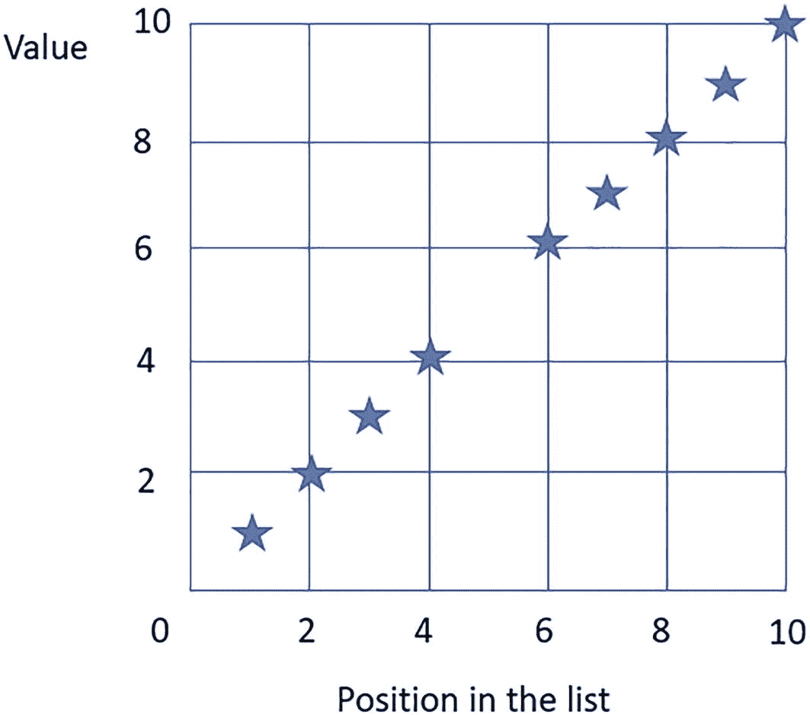

一张图表展示了在数值列表中进行插值。纵轴标记为“数值”，取值范围从 10 到 0，间隔为 2；横轴标记为“列表中的位置”，取值范围从 0 到 10，间隔为 2。共有九个数值（1, 2, 3, 4, 6, 7, 8, 9, 10）以星号形式绘制。

图 9-1

在数值列表中进行插值。图片由作者提供

看到这个，我们很容易倾向于认为这些数据遵循一条直线，如图 9-2 所示。

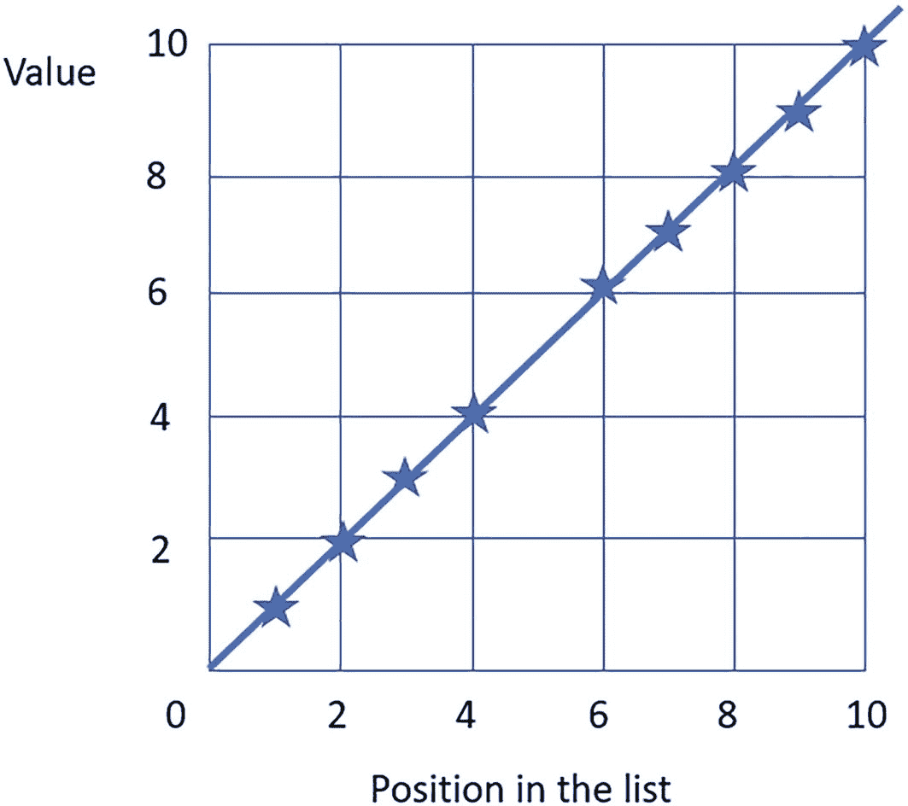

一张折线图展示了带有直线对角线的数值列表。纵轴标记为“数值”，取值范围从 10 到 0，间隔为 2；横轴标记为“列表中的位置”，取值范围从 0 到 10，间隔为 2。共有九个数值（1, 2, 3, 4, 6, 7, 8, 9, 10）以星号形式绘制。

图 9-2

插值得到的直线。图片由作者提供

由于我们不知道这些数字来自何处，很难判断这是否正确，但假设它们来自一条直线似乎合乎逻辑。现在，让我们尝试另一个例子。为了给你一个更复杂的例子，请尝试以下序列：

*   1, ???, 4, ???, 16

如果你能找到答案，你最可能的猜测是倍增函数，它可以用图形表示，如图 9-3 所示。

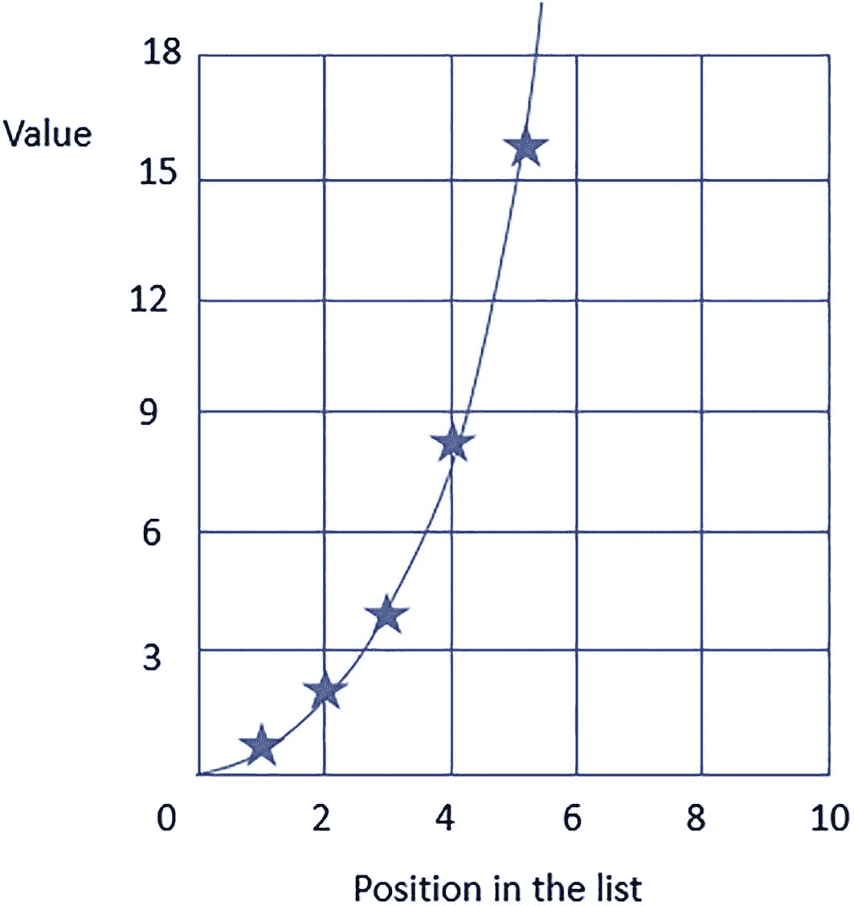

一张曲线图展示了一个数值列表。纵轴标记为“数值”，取值范围从 18 到 0，间隔为 3；横轴标记为“列表中的位置”，取值范围从 0 到 10，间隔为 2。共有五个数值以星号形式绘制。曲线从纵轴 0 处开始，然后向上攀升，在横轴约 5 处、纵轴 18 到 15 之间达到峰值。

图 9-3

使用曲线进行插值。图片由作者提供

在进行插值时，我们试图基于一个看似适合我们数据的数学公式，来找到其他数值之间某个值的最佳估计。虽然插值不一定是机器学习方法家族中的一员，但它是开始探索机器学习领域的一个绝佳方式。毕竟，插值的目标是猜测出最能代表数据的公式，而这从根本上来说也是机器学习的核心。不过，更多内容将在下一章介绍。让我们先深入探讨一下插值如何工作以及如何应用于空间数据的一些技术细节。

## 不同类型的插值

让我们首先介绍一些可用于“标准”插值或空间插值的方法。最直接的方法是线性插值。

### 线性插值

最直接的插值方法是线性插值。线性插值归结为从每个点到下一个点画一条直线，并估计位于该直线上的中间值。图 9-4 中的图表展示了一个示例。

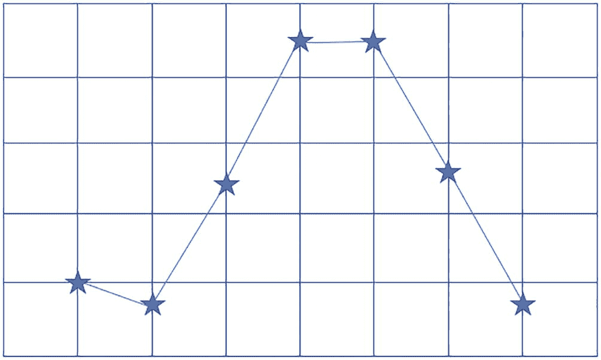

一张折线图展示了七个数值的线性插值。这七个数值以星号形式绘制在 5x8 的网格上。从左到右，第一个数值绘制在最左侧最下方单元格的右上角，然后下降、上升、趋于平稳，最后在右侧最下方单元格的左侧呈下降趋势。

图 9-4

线性插值。图片由作者提供

虽然这看起来不算太差，但也不够精确。线性插值的优点在于它通常不会错得太离谱：你不会冒险估计出严重偏离范围的值，因此它是一个值得首先尝试的好方法。

线性插值的数学函数如下：

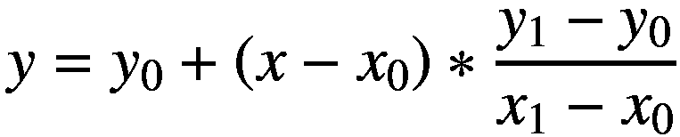

如果你输入想要计算新 y 值的 x，以及新点之前 (x[0], y[0]) 和之后 (x[1], y[1]) 的 x 和 y 值，就能得到该点的新 y 值。

### 多项式插值

多项式插值在估计此类函数时效果稍好一些，因为多项式函数实际上可以是弯曲的。只要你能找到合适的多项式函数，通常就能得到相对较好的近似结果。这可能类似于图 9-5 所示。

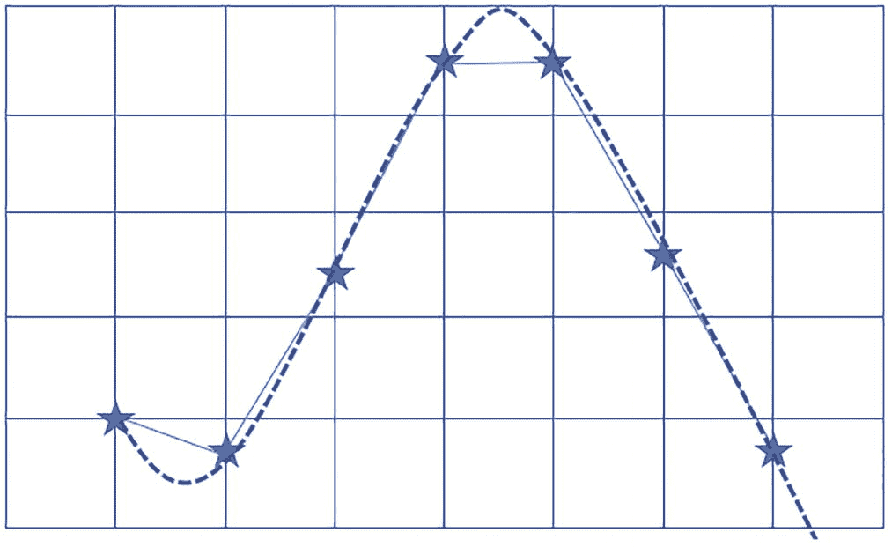

一张曲线图展示了七个数值的多项式插值。这七个数值以星号形式绘制在 5x8 的网格上。从左到右，第一个数值绘制在最左侧最下方单元格的右上角，然后向下弯曲，再向上弯曲，达到峰值，最后在右侧最下方单元格内部呈下降趋势。

图 9-5

多项式插值。图片由作者提供

多项式估计的一个风险是，实际上可能很难找到一个适合你数据的多项式函数。如果识别出的多项式非常复杂，那么函数中某处出现“疯狂曲线”的风险就很大，这将导致某些插值结果严重错误。

在此深入探讨多项式的完整理论会有些冗长，但简而言之，多项式的公式是任何包含平方项的函数形式，例如

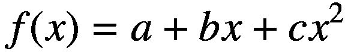

这可以复杂化到非常复杂的形式，例如

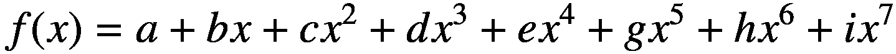

还存在许多许多其他形式的多项式。如果你对多项式不熟悉，值得查阅一些关于该主题的在线资源。

#### 分段多项式或样条

分段多项式是一种替代方案，它拟合多个更简单的多项式，而不是为所有数据拟合一个多项式。这降低了常规多项式可能产生严重错误估计的风险。

尽管分段多项式在最终形式上更简单，但它们不一定更容易估计。寻找“常规”多项式的挑战在于搜索至少能通过所有点的最简单多项式，而分段多项式的问题在于存在许多潜在的解决方案。

然而，只要我们为自己设定一些规则，这个问题就很容易解决。在实践中，有现成的优秀实现可用于拟合三次样条和其他变体。在这个主题上无需重新发明轮子，因为现有的解决方案已经相当成熟。你可以查看 Python 中的 Scipy 包，那里提供了大量此类算法。


### 最近邻插值

最后，另一种常见的标准插值方法是最近邻插值。它的核心思想是通过寻找最近的邻居并复制其值来估算一个数值。这种方法的优点在于，你能够确保所有估算出的值都确实存在于原始数据的某个位置，从而避免“凭空捏造”任何实际上不可能存在的数值。但代价是，这样得到的估算结果会非常不平滑。图 9-6 中的示例将最近邻插值添加到了图表中。

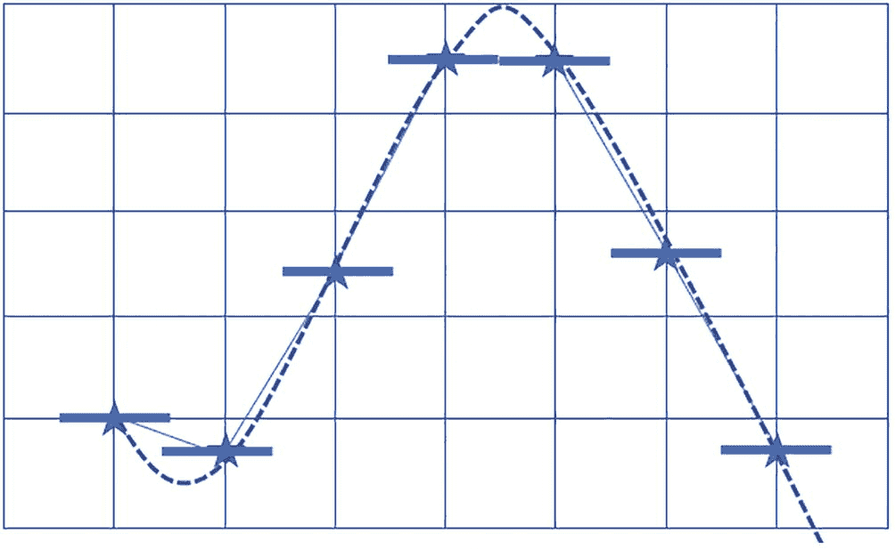

一个曲线图展示了七个数值的最近邻插值结果。这七个数值在 5x8 的网格上以星号标记。其轨迹与多项式插值的轨迹相似，起点和终点分别位于左右两侧最底部的单元格。最大的变化体现在星号标记处的水平线上。

图 9-6
将最近邻插值添加到图表中。图片由作者提供

这种最近邻插值会将数值赋值为与其最近点的值相同。因此，线条形状是一个分段函数：当在 x 轴上接近下一个点时，插值得到的 y 轴数值会跳跃到下一个 y 轴值。如你所见，对于手头的这条曲线来说，这并非最佳方案，但在其他情况下，它可能是一种简单易用的插值方法。

## 从一维插值到空间插值

现在你已经了解了插值的一些基本直观概念，是时候转向空间插值了。当然，本章的目标是讨论空间数据的插值，你可能很难想象我们如何从之前的图表过渡到二维空间插值的情况。或者，你可以将之前的图表想象成当你站在地面上时，空间插值值的侧视图。

由于可视化通常是理解插值方法的好途径，让我们从一个非常常见的用例开始讨论空间插值：对一个只有少数几个官方国家温度计的国家进行温度插值。想象一下，你在图 9-7 的地图上有一个矩形国家，并在每个点都测量了温度。


一个 5x8 网格的示意图。水平面上最顶部的单元格值为 10。左右两侧最底部的单元格值分别为 0，其余单元格为空。

图 9-7
一个插值练习。图片由作者提供

根据我们居住的位置，我们希望获得最适合自己的数值。在该国的北部，温度为 10 摄氏度；在南部，温度为 0 摄氏度。让我们对此使用线性插值，结果如图 9-8 所示。

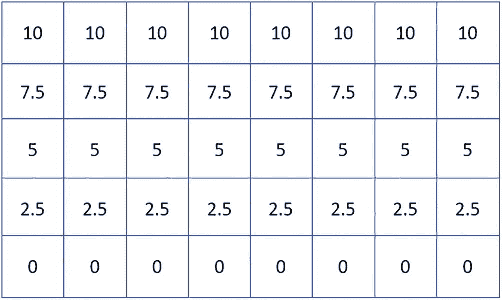

一个 5x8 网格的示意图。水平面上最顶部的单元格值为 10。其下方的水平单元格组的值依次为 7.5、5、2.5 和 0。

图 9-8
使用线性插值进行练习的结果。图片由作者提供

这种线性方法看起来还不错，并且对于这些数据来说，手工计算也很容易。让我们再看看如果使用最近邻插值（同样易于手工计算）会发生什么。结果如图 9-9 所示。

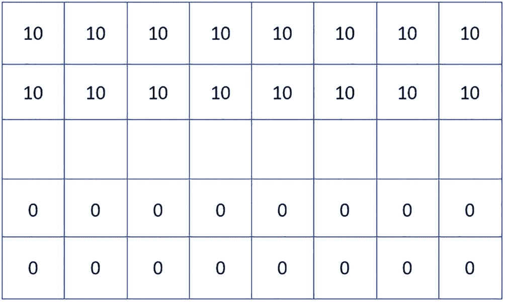

一个 5x8 网格的示意图。最顶部的水平单元格组及其下方的单元格组值为 10。最底部的水平单元格组及其上方的单元格组值为 0。中间的水平单元格组为空。

图 9-9
使用最近邻插值进行练习的结果。图片由作者提供

中间部分被省略了，因为定义边界并不那么简单，但你可以大致了解在这个例子中使用最近邻插值会发生什么。

目前，我们不会深入探讨数学定义，但如果你想深入研究，可以在网上找到很多资源。例如，你可以从这里开始：[`https://towardsdatascience.com/polynomial-interpolation-3463ea4b63dd`](https://towardsdatascience.com/polynomial-interpolation-3463ea4b63dd)。现在，我们将专注于在 Python 中应用于地理数据的实践。

## Python 中的空间插值

在本节中，你将看到如何在 Python 中应用其中一些插值方法。让我们先生成一些示例数据点，以便应用这些插值方法。假设我们只有以下四个点的数据。每个数据点都是同一时间戳但不同位置的温度测量值。练习的目标是使用插值来估算这些未测量位置（即这些点之间）的值。数据如代码块 9-1 所示。

```
data = { 'point1': {
'lat': 0,
'long': 0,
'temp': 0 },
'point2': {
'lat': 10,
'long': 10,
'temp': 20 },
'point3' : {
'lat': 0,
'long': 10,
'temp': 10 },
'point4': {
'lat': 10,
'long': 0,
'temp': 30 }
}
代码块 9-1
数据
```

现在，我们要做的第一件事是从这个字典创建一个数据框，并将这些数据转换为地理数据框。为此，最简单的方法是先使用代码块 9-2 中的代码创建一个常规的 pandas 数据框。

```
import pandas as pd
df = pd.DataFrame.from_dict(data, orient='index')
df
代码块 9-2
创建数据框
```

我们看到数据框已成功创建，如图 9-10 所示。

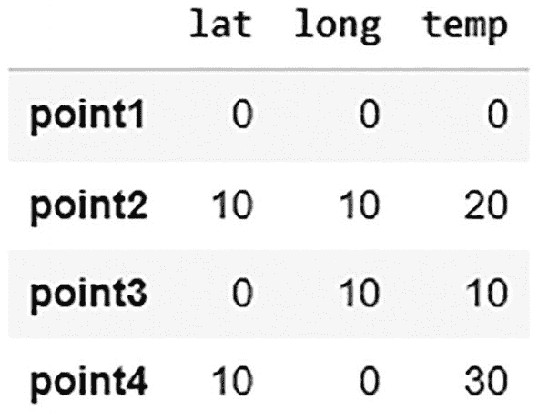

一个包含四列四行的表格。最左列包含条目 point 1、point 2、point 3 和 point 4。lat 列包含条目 0、10、0 和 10。long 列包含条目 0、10、10 和 0。temp 列包含条目 0、20、10 和 30。

图 9-10
导入 Python 的数据。图片由作者提供

下一步，让我们将这个数据框转换为 geopandas 地理数据框，同时指定几何图形为点数据，并包含经纬度信息。这在代码块 9-3 中完成。

```
import geopandas as gpd
from shapely.geometry.point import Point
gdf = gpd.GeoDataFrame(df, geometry=[Point(y,x) for x,y in zip(list(df['lat']), list(df['long']))])
gdf.plot(markersize=(gdf['temp']+1)*10)
代码块 9-3
转换为地理数据框
```

此代码生成的图表如图 9-11 所示。

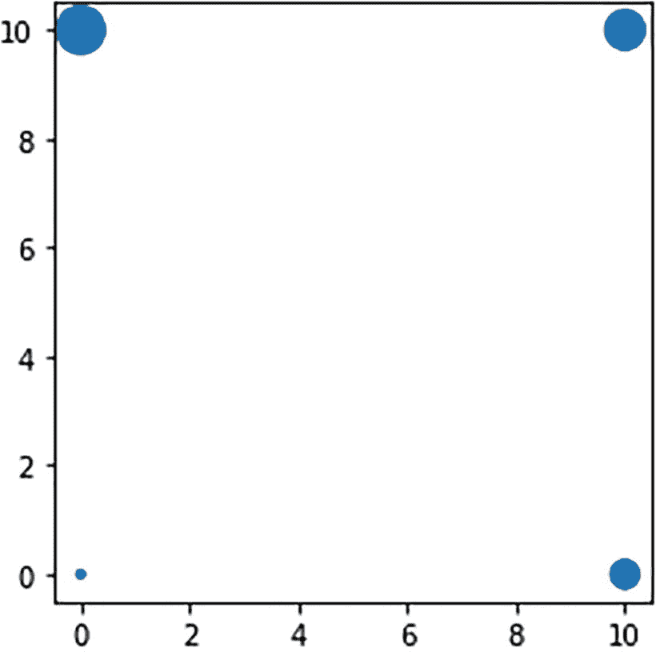

一个图表展示了代码块 9-3 的结果数据。四个角上有不同大小的圆圈。从最大到最小的圆圈坐标分别为 (0, 10)、(10, 10)、(10, 0) 和 (0, 0)。

图 9-11
代码块 9-3 生成的图表。图片由作者提供

正如你在该图表中所见，有四个大小不同的点。从宏观角度来看，找到这些点之间的中间值似乎是可行的。然而，要做到这一点，需要在 Python 中找到一个代表这种插值的数学公式，然后用它来预测插值后的数值。


### 使用 Scipy Interp2d 进行线性插值

我们首先要尝试的是二维线性插值。为此，我们将使用 Scipy 的 `interp2d` 函数，该函数会返回一个插值函数。一旦使用输入数据创建了这个函数，你就可以调用它来预测任何新点的值。

代码块 9-4 中的代码展示了如何使用四个输入点创建二维线性插值函数。

```
from scipy.interpolate import interp2d
my_interpolation_function = interp2d(df['lat'], df['long'], df['temp'], kind='linear')
代码块 9-4
创建插值函数
```

现在我们有了这个函数，就可以在新点上调用它了。不过，我们首先需要定义用于插值的点。由于我们有四个呈正方形排列的点，让我们在正中间的点以及各边中点的位置进行插值。我们可以使用代码块 9-5 中的代码创建这个新的 DataFrame。

```
new_points = {'point5': {'lat': 0, 'long': 5},
'point6': {'lat': 5, 'long': 0},
'point7': {'lat': 5, 'long': 5},
'point8': {'lat': 5, 'long': 10},
'point9': {'lat': 10, 'long': 5}
}
new_df = pd.DataFrame.from_dict(new_points, orient='index')
new_df
代码块 9-5
新的数据框
```

生成的 DataFrame 如图 9-12 所示。

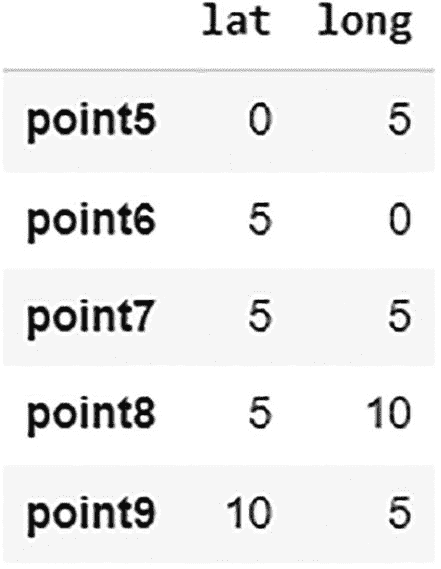

一个包含三列五行数据的表格。行标题为 point5、point6、point7、point8 和 point9。lat 列的条目为 0、5、5、5 和 10。long 列的条目为 5、0、5、10 和 5。

图 9-12

生成的 DataFrame。图片由作者提供

这里的数据只有纬度和经度，但还没有估算的温度。毕竟，我们的目标是使用插值函数来获取这些估算的温度。

在代码块 9-6 中，你可以看到如何遍历这些新点并调用插值函数来估算该位置的温度。请记住，这个插值函数是基于我们给定的输入数据，对线性插值的数学定义。

```
interpolated_temps = []
for i,row in new_df.iterrows():
interpolated_temps.append(my_interpolation_function(row['lat'], row['long'])[0])
new_df['temp'] = interpolated_temps
new_df
代码块 9-6
应用插值
```

你可以在图 9-13 中看到这些结果的数值估算值。

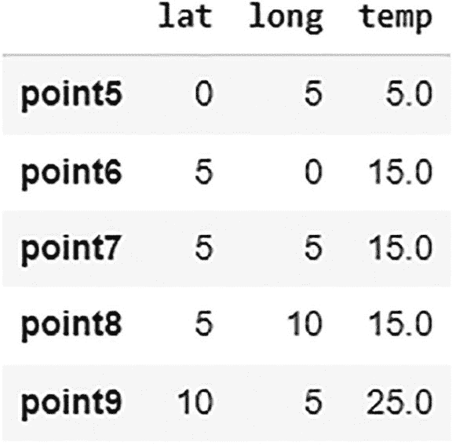

一个包含四列五行数据的表格。行标题为 point5、point6、point7、point8 和 point9。lat 列的条目为 0、5、5、5 和 10。long 列的条目为 5、0、5、10 和 5。temp 列的条目为 5.0、15.0、15.0、15.0 和 25.0。

图 9-13

代码块 9-6 得出的估算结果。图片由作者提供

线性插值是最直接的方法，从这些预测结果可以清楚地看出，它们看起来是可靠的。很难说它们是好是坏，因为在插值用例中我们没有任何真实值作为参考，但至少可以说结果并不离谱。

现在我们已经完成了估算，应该尝试做一些分析。代码块 9-7 将它们合并到一个 DataFrame 中，以便我们重新绘制图表。

```
combi_df = pd.concat([df, new_df])
gdf = gpd.GeoDataFrame(combi_df, geometry=[Point(y,x) for x,y in zip(list(combi_df['lat']), list(combi_df['long']))])
gdf.plot(markersize=(gdf['temp']+1)*10)
代码块 9-7
合并数据并绘图
```

这段代码将输出如图 9-14 所示的图表。

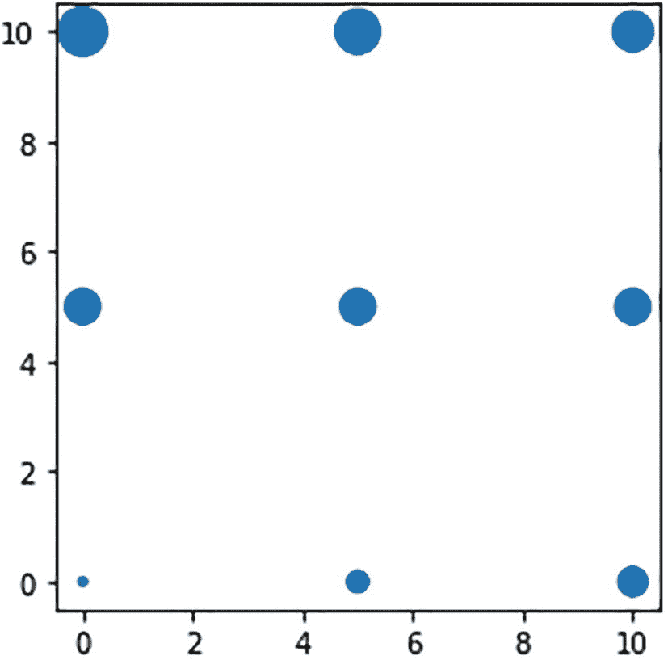

一个展示了插值结果的图表。左侧、中间和右侧由不同大小的圆圈标记。从最大到最小的圆圈对应的估算坐标分别为 (0, 10)、(5, 10)、(10, 10)、(0, 5)、(5, 5)、(10, 5)、(10, 0)、(5, 0) 和 (0, 0)。

图 9-14

带有插值结果的图表。图片由作者提供

尽管我们没有精确的指标来判断这次插值是好是坏，但至少可以说，从视觉上看，插值结果似乎或多或少是合乎逻辑的，这令人欣慰。这第一次尝试看起来相当成功。让我们在下一节尝试一些更高级的方法，看看不同方法会带来怎样不同的结果。

## 克里金法

在本章的第一部分，你已经了解了一些基本的、基础的插值方法。插值的特点在于，你可以根据需要将其做得非常简单，也可以非常复杂。

尽管前面讨论的基础方法在实际结果和用例中通常令人满意，但我们还需要介绍一些更高级的技术。

在本章的第二部分，我们将探讨一种名为克里金法的插值方法。克里金法是一种更为高级的插值数学定义。虽然深入探讨其数学细节会超出本书的范畴，但对于那些不介意更多数学细节的读者，欢迎查阅一些在线资源，例如 [`https://en.wikipedia.org/wiki/Kriging`](https://en.wikipedia.org/wiki/Kriging) 和 [`www.publichealth.columbia.edu/research/population-health-methods/kriging-interpolation`](https://www.publichealth.columbia.edu/research/population-health-methods/kriging-interpolation)。


### 线性普通克里金法

克里金法有多种形式。与许多数学方法一样，方法越复杂，需要调整和设置的参数就越多。在接下来的章节中，我们将探讨几种克里金法解决方案，它们将与之前给出的线性插值方案形成对比。最后，我们将通过练习进行比较并得出结论。

首先，你可以使用带有普通克里金功能的 `pykrige` 库，如代码块 9-8 所示。和之前一样，先估算函数，然后在 `new_df` 上进行估算。具体操作见代码块 9-8。

```
from pykrige.ok import OrdinaryKriging
my_ok = OrdinaryKriging(df['long'], df['lat'], df['temp'])
zvalues, sigmasq = my_ok.execute('points', new_df['long'].map(float).values, new_df['lat'].map(float).values)
new_df['temp'] = zvalues.data
new_df
代码块 9-8
使用线性普通克里金法进行插值
```

你可以在图 9-15 中看到估算结果。

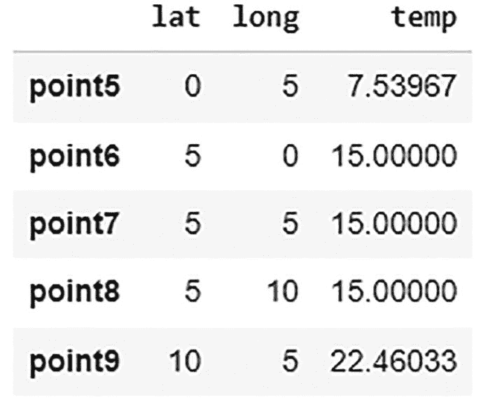

一个四列五行的表格。行标题为点 5、点 6、点 7、点 8 和点 9。lat 列条目为 0、5、5、5、10。long 列条目为 5、0、5、10、5。temp 列条目为 7.53967、15.00000、15.00000、15.00000、22.46033。

图 9-15
使用线性普通克里金法插值后的值。图片由作者提供。

有趣的是，其中一些估算值并不完全相同。让我们用代码块 9-9 中的代码绘制它们，看看图中是否有任何异常或不同之处。

```
combi_df = pd.concat([df, new_df])
gdf = gpd.GeoDataFrame(combi_df, geometry=[Point(y,x) for x,y in zip(list(combi_df['lat']), list(combi_df['long']))])
gdf.plot(markersize=(gdf['temp']+1)*10)
代码块 9-9
绘制插值结果
```

生成的图如图 9-16 所示。


一个图表展示了使用线性普通克里金法的数据结果。左侧、中间和右侧由不同大小的圆圈标记。从最大到最小的圆圈对应的估算坐标分别为 (0, 10)、(5, 10)、(10, 10)、(0, 5)、(5, 5)、(10, 5)、(10, 0)、(5, 0) 和 (0, 0)。

图 9-16
使用线性普通克里金法得到的图。图片由作者提供。

从图中判断，并没有明显的错误估算，因此没有理由否定这些结果。由于我们没有衡量插值好坏的标准，这只能被视为一种替代估算。让我们在下一节中尝试对克里金法使用其他设置，看看会发生什么。

### 高斯普通克里金法

在本节中，让我们尝试更改克里金插值背后的插值模型。我们可以通过将 `variogram_model` 参数设置为其他值来调整设置。这里，我们选择“gaussian”来看看效果。具体操作见代码块 9-10。

```
my_ok = OrdinaryKriging(df['long'], df['lat'], df['temp'], variogram_model = 'gaussian')
zvalues, sigmasq = my_ok.execute('points', new_df['long'].map(float).values, new_df['lat'].map(float).values)
new_df['temp'] = zvalues.data
new_df
代码块 9-10
高斯普通克里金法
```

现在，结果如图 9-17 中的表格所示。

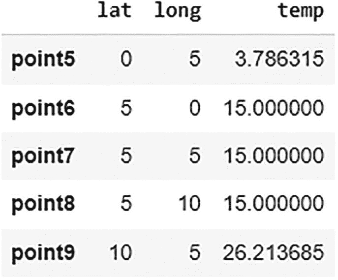

一个四列五行的表格。行标题为点 5、点 6、点 7、点 8 和点 9。lat 列条目为 0、5、5、5、10。long 列条目为 5、0、5、10、5。temp 列条目为 3.786315、15.00000、15.00000、15.00000、26.213685。

图 9-17
高斯普通克里金法的结果。图片由作者提供。

有趣的是，点 5 和点 9 的估算值再次发生了显著变化！让我们再次绘制图表，看看这次插值过程中是否出现异常。具体操作见代码块 9-11。

```
combi_df = pd.concat([df, new_df])
gdf = gpd.GeoDataFrame(combi_df, geometry=[Point(y,x) for x,y in zip(list(combi_df['lat']), list(combi_df['long']))])
gdf.plot(markersize=(gdf['temp']+1)*10)
代码块 9-11
绘制结果
```

生成的图如图 9-18 所示。

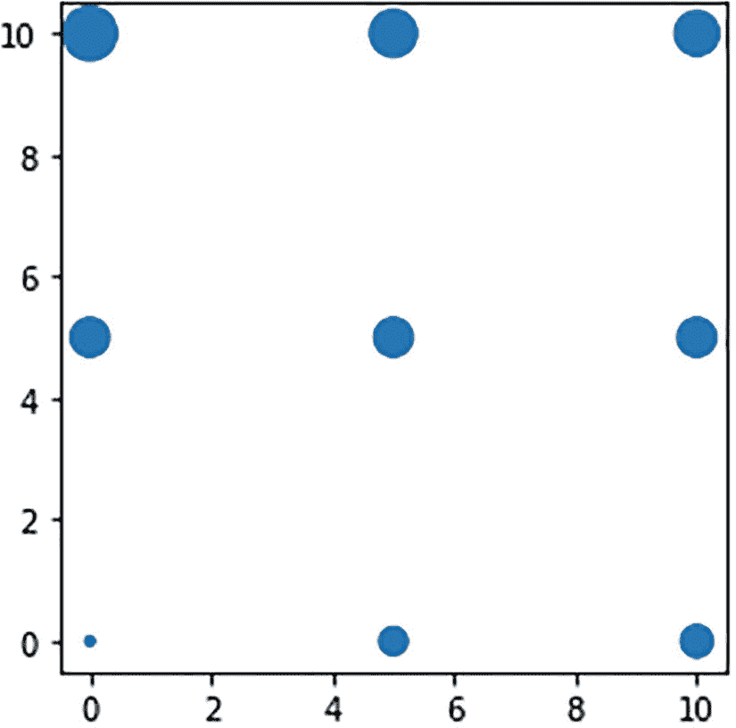

一个图表展示了使用高斯普通克里金法的数据结果。左侧、中间和右侧由不同大小的圆圈标记。从最大到最小的圆圈对应的估算坐标，其数据大小与线性普通克里金法图的结果相近。

图 9-18
高斯普通克里金法的结果。图片由作者提供。

同样，查看此图时，不能认为这种插值有任何错误。它与其他方法不同，但同样有效。

### 指数普通克里金法

作为最后的测试和练习，让我们再次尝试变差函数的另一种设置。这次，我们将 `variogram_model` 设置为“exponential”。相关代码如代码块 9-12 所示。

```
my_ok = OrdinaryKriging(df['long'], df['lat'], df['temp'], variogram_model = 'exponential')
zvalues, sigmasq = my_ok.execute('points', new_df['long'].map(float).values, new_df['lat'].map(float).values)
new_df['temp'] = zvalues.data
new_df
代码块 9-12
指数普通克里金法
```

此插值的结果如图 9-19 所示。

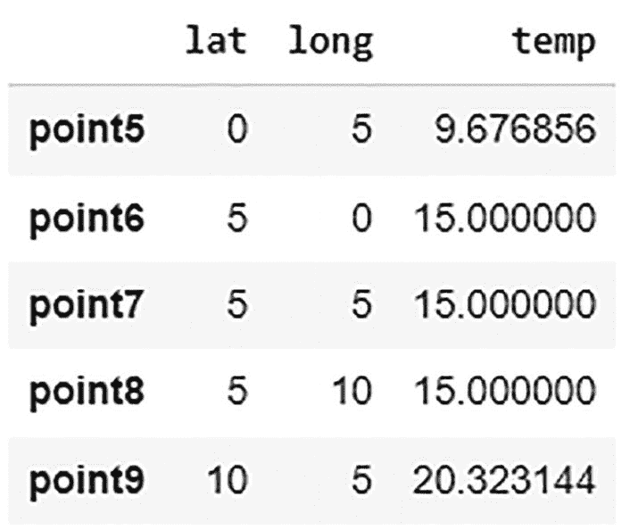

一个四列五行的表格。行标题为点 5、点 6、点 7、点 8 和点 9。lat 列条目为 0、5、5、5、10。long 列条目为 5、0、5、10、5。temp 列条目为 9.676856、15.00000、15.00000、15.00000、20.323144。

图 9-19
指数普通克里金法的结果。图片由作者提供。

有趣的是，再次是点 5 和点 9 变化很大，而其他点保持不变。为了保持连贯性，我们也绘制此插值的图，使用代码块 9-13。

```
combi_df = pd.concat([df, new_df])
gdf = gpd.GeoDataFrame(combi_df, geometry=[Point(y,x) for x,y in zip(list(combi_df['lat']), list(combi_df['long']))])
gdf.plot(markersize=(gdf['temp']+1)*10)
代码块 9-13
绘制指数普通克里金法结果
```

生成的图如图 9-20 所示。

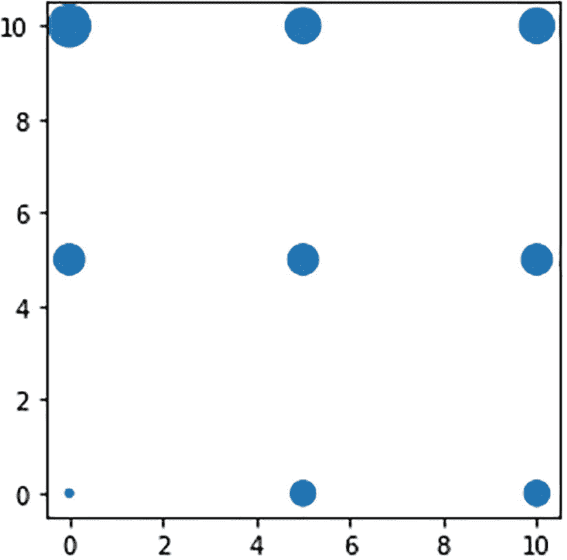

一个图表展示了使用指数普通克里金法的结果。左侧、中间和右侧由不同大小的圆圈标记。从最大到最小的圆圈对应的估算坐标分别为 (0, 10)、(5, 10)、(10, 10)、(0, 5)、(5, 5)、(10, 5)、(10, 0)、(5, 0) 和 (0, 0)。

图 9-20
指数普通克里金法的图。图片由作者提供。

同样，这张图没有明显错误，但其结果再次与之前不同。我们自然会想知道哪一种方法是正确的。让我们在下一节中对此进行总结。


## 插值方法总结

有趣的是，我们以一个相当简单的插值用例开启了本章。虽然人们可能倾向于认为这个问题非常容易解决，甚至可以通过手动计算完成，但不同方法给出的多种可能答案表明，这并非一项简单的任务。

回顾一下，我们在表 9-1 中获得了所有可能的答案。

表 9-1

插值基准测试结果

|  | 线性 | 线性克里金 | 高斯克里金 | 指数克里金 |
| --- | --- | --- | --- | --- |
| 点 5 | 5 | 7.54 | 3.79 | 9.68 |
| 点 6 | 15 | 15 | 15 | 15 |
| 点 7 | 15 | 15 | 15 | 15 |
| 点 8 | 15 | 15 | 15 | 15 |
| 点 9 | 25 | 22.46 | 26.21 | 20.32 |

即使对于这样一个简单的插值示例，我们也能看到点 5（图中底部中间）和点 9（图中右侧中间）的估计值存在惊人的巨大差异。

现在，这里的大问题当然是，我们能否说其中任何一种方法优于其他方法。不幸的是，当将数学模型应用于没有真实基准值的数据时，你无从知晓。你可以构建对用例有用的模型，可以利用人类逻辑和业务逻辑来评估不同的估计值，也可以使用像奥卡姆剃刀原则（保持模型尽可能简单）这样的经验法则来决定保留哪个模型。

或者，你也可以转向监督式机器学习来解决这个问题。分类和回归将在接下来的两章中介绍，它们也是用于估计未知数据点的方法，但它们更侧重于通过性能指标来评估模型对现实数据的拟合程度，而这在插值用例中通常是缺失的。

总之，虽然不一定只有一个正确答案，但掌握插值的基本应用知识总是有用的。尤其是在空间用例中，通常需要将在特定点（如温度站等）测量的数据转换为更大二维表面（如国家、地区等）上的连续视图。你在本章中已经看到，相对简单的插值在某些用例中已经相当高效，而对于那些希望深入研究的人来说，还有更复杂的领域等待探索。

## 要点总结

1.  插值是在一系列已知值之间估计未知值的任务，这相当于估计未测量位置上的值。

2.  我们通常基于已知值定义一个数学函数或公式，然后使用这个函数来估计我们不知道的值。

3.  有许多数学“基础”公式可以应用于你的数据点，根据你选择的公式，最终可能会得到截然不同的结果。

4.  进行插值时，我们通常力求为没有真实基准值的点获得估计值，也就是说，我们实际上不知道哪个值是错误或正确的。可以使用交叉验证和其他评估方法，这些将在接下来的机器学习章节中介绍。

5.  当多种插值方法给出不同结果时，我们通常需要根据常识、业务逻辑或领域知识来做出选择。

# 10. 分类

从本章开始，你将进入本书关于机器学习的主要部分之一，即分类。分类与回归和聚类并列为机器学习的三大主要任务，本书将涵盖所有这些内容。

机器学习是一个非常庞大的主题，仅用这三章来涵盖所有机器学习内容是不可能的。我们选择专注于将机器学习模型应用于空间数据。因此，重点在于展示有趣且实用的空间数据机器学习用例，同时说明空间数据如何作为相对于常规数据的增值部分被使用。

这些章节中不会涉及非常高级的数学、统计学或算法讨论。对于那些希望深入、透彻地理解机器学习通用数学原理的读者，有许多标准资源可供参考。

本章将从分类的定义、用途以及进行分类所需的一些模型和工具开始进行总体介绍，然后我们将在本章剩余部分深入探讨一个空间分类的详细用例。现在，让我们先从一些定义和介绍开始。

## 机器学习快速入门

对于那些不太熟悉机器学习的读者，让我们对此做一个非常简短的介绍。简而言之，机器学习的目标是通过创建可在新数据上重复使用的模型来发现数据中的模式。有大量不同的模型，它们本质上是数学公式或算法，能够以某种方式识别这些模式。

机器学习中的一个重要区分是监督式模型与非监督式模型。非监督式模型是那些能够发现数据中的模式，但没有真实基准值来衡量其性能的机器学习模型，这与你在上一章关于插值的内容中看到的情况非常相似。非监督式模型的两个主要类别是聚类（你试图根据数据集的行来寻找分组）和特征降维（你试图通过分析列之间的相关性和其他关系，以更优化的方式重新定义你的列）。

监督式模型则完全不同，因为这里存在一个需要预测的真实、确切的值。在监督式模型中，我们有一个目标变量（即我们想要预测的值）和多个预测特征（也称为自变量或 X 变量）。同样，有许多特定的模型试图最好地捕捉数学信息，以确定一个预测函数，该函数使用 X 变量来预测目标值。

## 分类快速入门

在大多数情况下，监督式机器学习中的目标变量属于两种类型之一。如果目标变量是数值型变量，那么我们就处于回归的场景。如果目标变量是分类型变量，那么我们就处于分类的场景。

在不深入细节的情况下，你可以直观地理解，预测一个数字与预测一个类别是略有不同的。这两个领域是相关的，模型通常建立在相同的基础上，但为了适应目标输出而进行的必要调整使得它们被视为两种不同的用例。


## 空间分类用例

在本章中，我们将进行一个分类用例。因此，我们处于监督式机器学习的范畴，这意味着我们知道目标变量的真实情况。同时，由于我们进行的是分类任务，目标变量将是类别型的。

本章的用例将展示一家大型购物中心 20 位假设客户的 GPS 追踪数据。这 20 位客户被要求在手机上安装一个追踪应用，并且他们在购物中心内的 GPS 坐标在整个访问过程中都被收集了。

参与者被告知，他们将获得一张新餐厅五折优惠的礼品券。这样做不仅是为了激励参与者参与研究，还有一个别有用心的目的。实际上，我们设置了一个追踪机制来测量用户是否使用了优惠券，这样我们就可以研究移动模式与这家新餐厅潜在兴趣之间的联系。

我们的分类案例将作为这家新餐厅的一项营销研究来执行。该研究的目标是利用追踪到的 GPS 路径来预测一个人是否对这家餐厅感兴趣。如果模型成功，它将被用来推送通知广告，以激励客户了解这家新餐厅。

向用户发送广告需要花费成本，因此，确定我们想要向哪些客户发送广告或不发送广告，具有实际意义。我们需要构建一个尽可能好的模型，仅根据 GPS 点序列来预测使用优惠券的兴趣。

### 利用附加数据进行特征工程

在这个用例中，特征工程占据了很大比重，这是通过使用空间分析操作来完成的，就像前一章中介绍的那些操作一样。这展示了这些主题是如何相互关联的，以及空间操作对于空间数据的机器学习具有巨大的附加价值。

原因在于，单纯的 GPS 坐标本身对于预测任何事情并没有太大价值。我们需要处理这些数据，并将其转换为能够实际用于创建优惠券兴趣预测的变量。接下来，让我们看看数据，以便更清楚地了解我们正在处理的内容。对于这个用例，建议使用 Kaggle 笔记本环境或你选择的任何其他环境。

### 导入和检查数据

让我们从导入数据开始。你可以使用代码块 10-1 中的代码来执行此操作。

```
import geopandas as gpd
import fiona
gpd.io.file.fiona.drvsupport.supported_drivers['KML'] = 'rw'
all_data = gpd.read_file('chapter_10_data.kml')
all_data
代码块 10-1
导入数据
```

查看这些数据时，你会看到类似图 10-1 的内容。

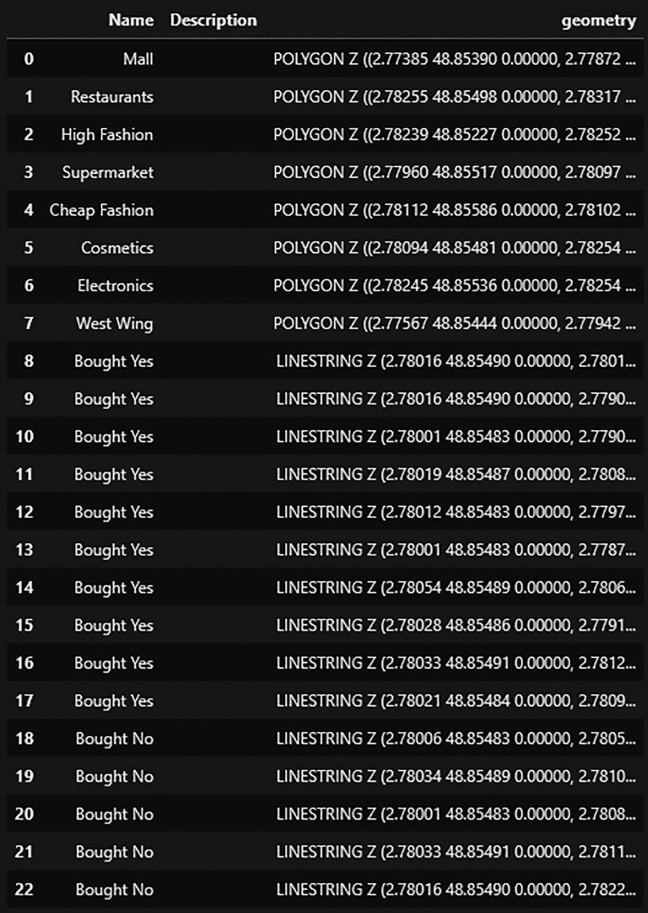

一个窗口页面包含一个有三列和 23 行的表格。上方是三个列标题，分别是名称、描述和几何图形。

图 10-1

代码块 10-1 产生的数据。图片由作者提供

这个数据集比我们在前几章中处理的数据要复杂一些，所以让我们确保充分理解我们正在处理的内容。

地理数据框的第一行包含一个名为“购物中心”的对象。这个多边形覆盖了整个购物中心区域，也就是我们研究的范围。它仅用于提供信息，在练习中我们不会用到它。

接下来的第 1 行到第 7 行的要素展示了购物中心的各个区域。它们也是多边形。每个区域可以是一个商店、一组商店、整个购物区或其他什么，但它们通常将某种类型的商店重新组合在一起。我们将能够利用这些信息来构建我们的模型。

其余的数据是 20 条路线。每条路线都表示为一个`LineString`，即一条线，它只是研究中 20 位参与者每人所经过的一系列点。每个`LineString`的名称要么是“已购买是”，表示他们在研究后使用了优惠券（表明他们对产品感兴趣），要么是“已购买否”，表示优惠券未被使用，因此客户可能对该产品不感兴趣。

现在，让我们继续绘制所有这些数据的组合图，以便更好地了解我们正在处理的内容。这可以使用代码块 10-2 来完成。

```
all_data.plot(figsize=(15,15),alpha=0.1)
代码块 10-2
绘制数据
```

执行此代码时，你将得到图 10-2 中的地图。当然，这不是最直观的地图，但这里的目的是将所有内容快速整合到一张图片中，以查看数据中发生了什么。

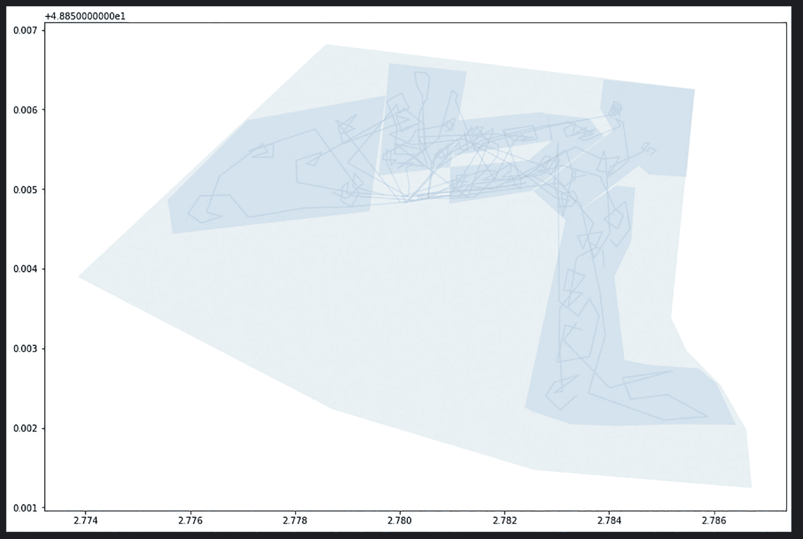

一个由图形中的线条组成的图表，每个角位于水平轴 2.774 和 2.786 之间，以及垂直轴 0.001 和 0.007 之间。

图 10-2

代码块 10-2 产生的地图

在这张地图中，最外层的浅灰色轮廓是设定整个购物中心区域的大多边形的轮廓。在此之内，你可以看到许多较小的多边形，它们指示了我们研究感兴趣的区域，每个区域内都有一组特定类型的商店。最后，你还可以看到纵横交错的线条，这代表了研究中 20 位参与者在购物中心内移动的轨迹。

我们现在要做的是利用商店区域多边形的信息来注释每位参与者的行程。如果能得出每位参与者在每种类型的商店中花费的时间百分比，那就太好了，这样我们就可以构建一个模型，学习购物中心内被访问的商店类型与新餐厅潜在兴趣之间的关系。

作为构建此模型的第一步，让我们分离数据，以获得仅包含一种数据类型的多个数据集。为此，我们需要将信息多边形与参与者的路线分开。利用你在本书前面学到的所有知识，这应该不难。代码块 10-3 中的代码展示了如何将信息多边形放入一个新数据集中。

```
info_polygons = all_data.loc[1:7,:]
info_polygons
代码块 10-3
将信息多边形选择到单独的数据集中
```

结果就是图 10-3 中显示的包含`info_polygons`的数据集。

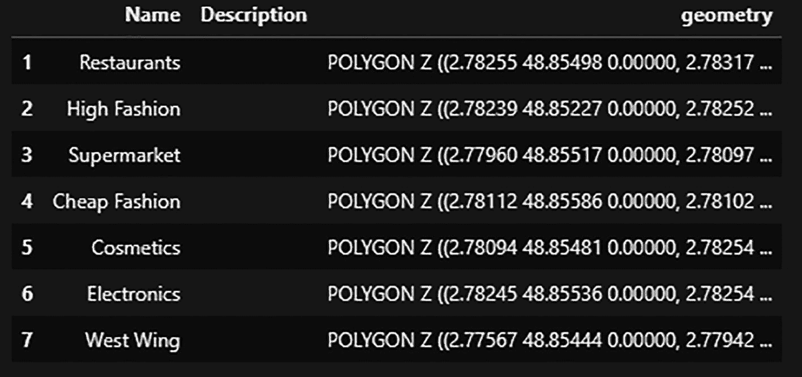

一个窗口页面包含一个有三列和七行的表格。上方是三个列标题，分别是名称、描述和几何图形。

图 10-3

代码块 10-3 产生的数据。图片由作者提供

让我们也使用代码块 10-4 中的代码提取路线。

```
itineraries = all_data.loc[8:,:]
itineraries
代码块 10-4
选择路线
```

路线数据集稍长一些，但看起来如图 10-4 所示（截断版本）。

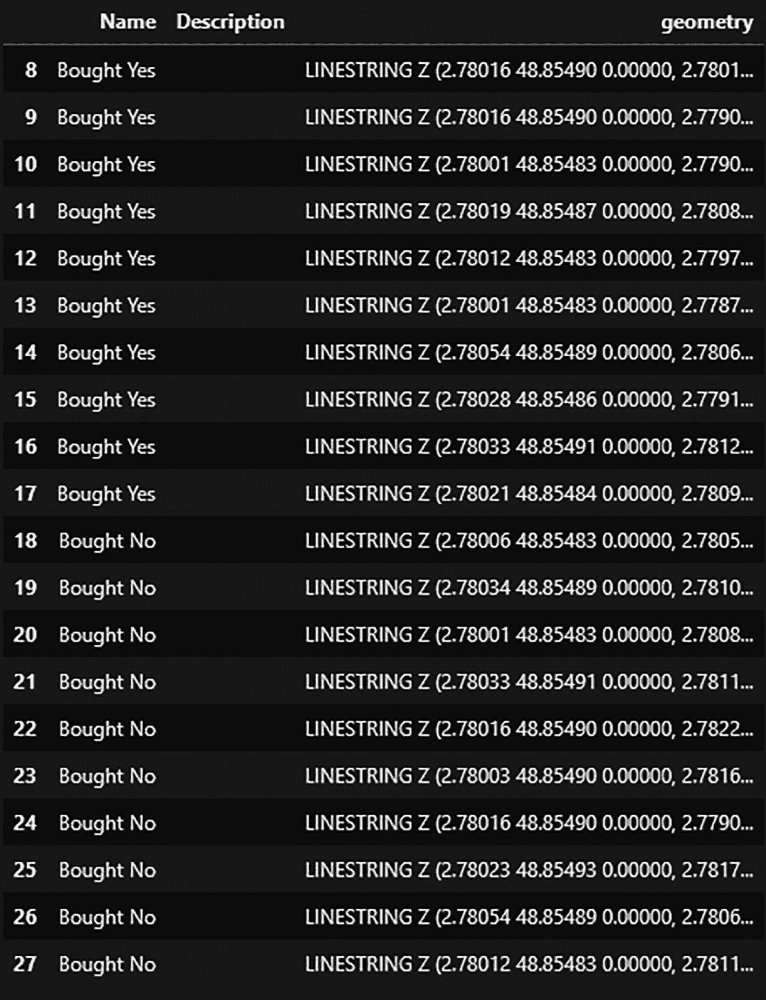

一个窗口页面包含一个有三列和 20 行的表格。上方是三个列标题，分别是名称、描述和几何图形。

图 10-4

代码块 10-4 中数据的截断版本


### 用于特征工程的空间操作

现在我们已经对这个数据集有了很好的了解，是时候开始执行空间操作，以添加参与者在每个地点出现的信息了。为此，我们需要某种空间叠加操作，正如你在本书前面部分所看到的那样。

要进行叠加部分，逐点操作会更容易，因为我们的线路会穿过许多兴趣区域。如果我们使用线路进行操作，最终将需要根据多边形的边界切割线路，并使用线路长度来估算在商店区域停留的时间。

如果我们将线路切割成点，就可以执行空间操作来查找每个点的存在情况，然后简单地统计每个参与者在每个商店区域中的点数。如果这些点是在等频率的基础上收集的，那么点的数量就是时间的精确表示。

我们可以不使用线路的原因是，我们在这里不关心方向或顺序。毕竟，如果我们想研究访问每个商店区域的顺序，就需要保留关于序列的信息。线路能够做到这一点，而点数据类型则不能。

在本节中，你将看到掌握 Python 处理地理数据用例的巨大优势。确实，Python 的一大优势在于，我们可以自由地将几何对象转换为字符串，并对它们进行循环，这在更多依赖点击按钮、预编码的 GIS 工具中可能会复杂得多。

缺点可能是有时理解起来有点困难，但代码块 10-5 中的代码将引导你使用一种方法，将数据从宽格式（每行一个客户）转换为长格式（每行一个数据点/坐标）。

```
import pandas as pd
from shapely.geometry.point import Point
results = []
