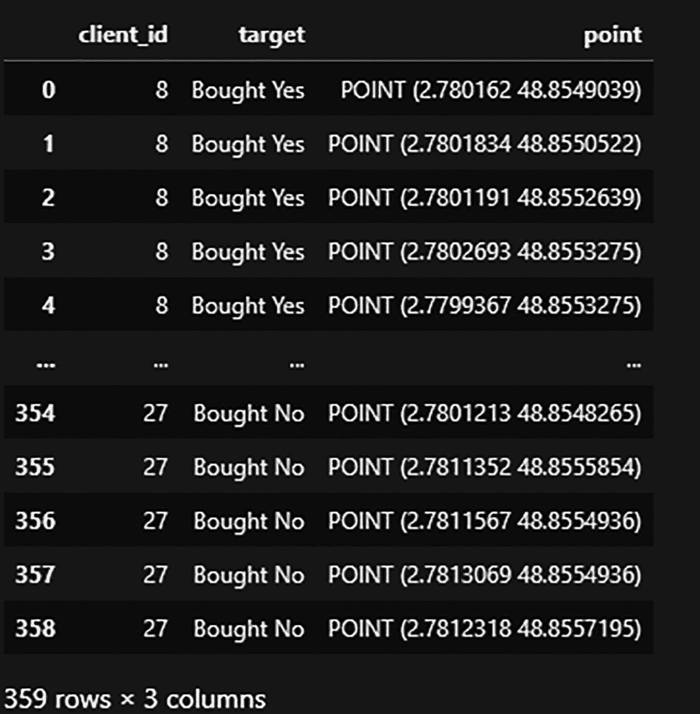
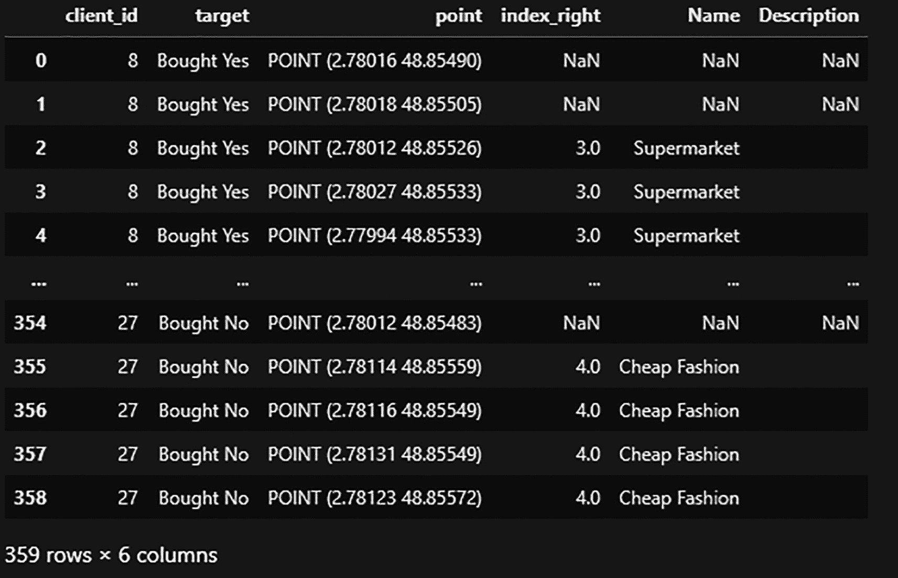

# convert lat and long into floats
list_of_points_extracted = [Point([ float(y) for y in x.strip(' ').split(' ')]) for x in list_of_points_extracted]
list_of_points_extracted = [[i, row.Name] + [x] for x in list_of_points_extracted]
results += list_of_points_extracted
results_df = pd.DataFrame(results)
results_df.columns = ['client_id', 'target', 'point']
results_df
代码块 10-5
将数据从宽格式转换为长格式
```

这段代码的结果是长格式的数据：每行一个点，而不是每行一个参与者。部分数据显示在图 10-5 中。



一个窗口页面包含一个三列十行的表格。上方是三个列标题，分别是 client i d、target 和 point。

图 10-5

代码块 10-5 产生的部分数据。图片由作者提供

这里的结果是一个 pandas 数据框。正如你现在所知，为了进行空间操作，最好将其转换为地理数据框。这可以使用代码块 10-6 中的代码来完成。

```
import geopandas as gpd
gdf = gpd.GeoDataFrame(results_df, geometry='point')
gdf
代码块 10-6
转换为地理数据框
```

你的对象 `gdf` 现在已具有地理参考。我们可以继续使用空间连接，将这个点数据集与商店信息数据集连接起来。这个空间连接使用代码块 10-7 中的代码执行。

```
joined_data = gpd.sjoin(gdf, info_polygons, how='left')
joined_data
代码块 10-7
将地理数据框连接到 info_polygons
```

连接后的数据将如图 10-6 所示。



一个窗口页面包含一个六列十行的表格。上方是三个列标题，分别是 client i d、target、point、index right、name 和 description。

图 10-6

代码块 10-7 产生的数据。图片由作者提供

你可以看到，对于大多数点，操作是成功的。然而，对于许多点，似乎引入了 NA 或缺失值。这可以解释为存在一些点不与任何商店信息多边形重叠，因此没有查找信息。对此采取一些措施是好的。在决定如何处理这些 NA 之前，让我们使用代码块 10-8 中的代码来统计每个没有参考信息的客户的数量。

```
