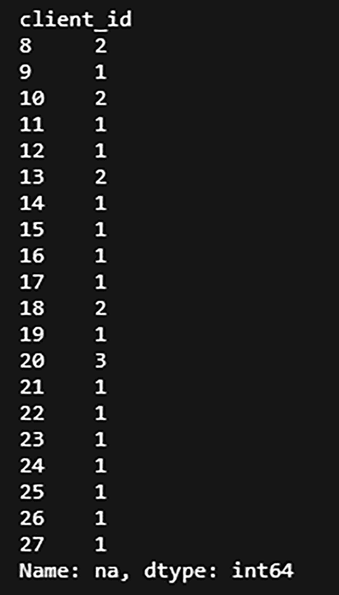

# inspect NA
joined_data['na'] = joined_data.Name.isna()
joined_data.groupby('client_id').na.sum()
代码块 10-8
检查 NA
```

结果显示在图 10-7 中。



一个有两列二十行的表格，列标题为 client i d。底部有一个标签，显示 name, n a, d type, i n t 64。

图 10-7

代码块 10-8 的结果。图片由作者提供

每个参与者的未引用点数各不相同，但从未超过三个。因此，我们可以得出结论，直接丢弃没有引用的数据确实没有问题。毕竟，这样的数据非常少，而且这些数据中没有增加任何信息。

代码块 10-9 中的代码展示了如何删除具有缺失值的行数据。

```
