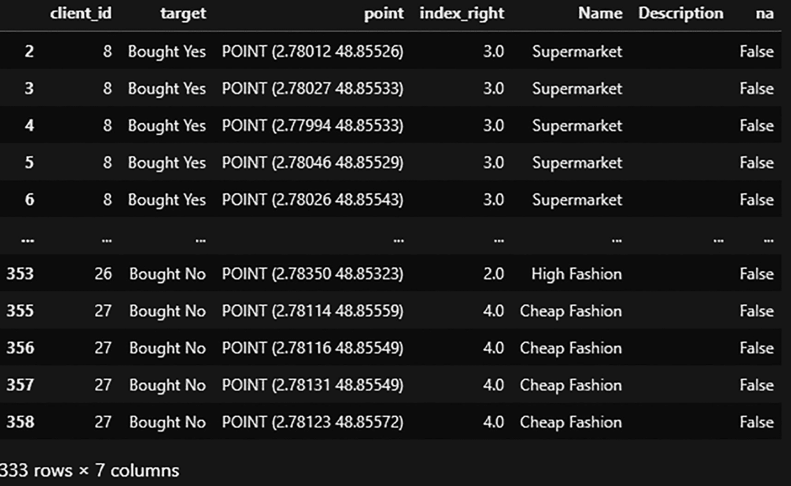
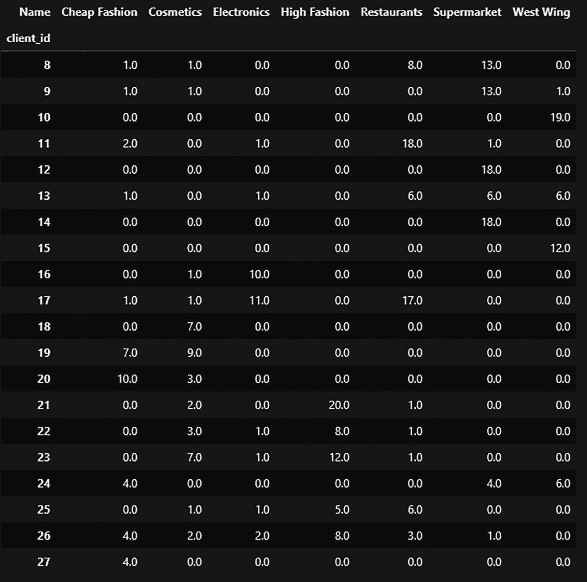

# drop na
joined_data = joined_data.dropna()
joined_data
代码块 10-9
删除 NA
```

结果数据框稍微短了一些：从 359 行减少到 333 行，如图 10-8 所示。



一个窗口页面包含一个六列十行的表格。上方是三个列标题，分别是 client i d、target、point、index right、name 和 description。

图 10-8

没有 NA 的数据集

我们现在有了一个包含解释性信息的数据框，这将帮助我们预测优惠券的使用情况。


### 数据重组与标准化

现在，构建分类模型所需的所有信息都已齐备，但我们仍需对数据进行正确的组织。毕竟，Python 中的模型接口需要数据以正确的格式呈现。

在本节中，我们将对空间连接后的数据框进行处理，将其恢复为宽格式，即再次得到一个每行代表一个参与者的数据框。我们不再需要坐标线串（LineString），而是希望获得每个参与者在各个类别中的出现情况。这只需通过统计每个参与者在每个商店类别中的点数即可实现。这可以通过分组操作（groupby）来完成，如代码块 10-10 所示。

```
location_behavior = joined_data.pivot_table(index='client_id', columns='Name', values='target',aggfunc='count').fillna(0)
location_behavior
代码块 10-10
用于获取位置行为的分组操作
```

此分组操作的结果如图 10-9 所示。



一个窗口页面包含一个具有七列和二十行的表格，这些行被称为 client i d。上方有八个列标题。

图 10-9
代码块 10-10 的结果。图片由作者提供

这些分组后的数据似乎已经是非常有用的信息，有助于了解每个客户的情况。例如，我们可以看到 client_id 为 21 的参与者在高端时尚区域花费了大量时间。另一个例子是 client_id 为 9 的参与者，他似乎只去过超市。

尽管这个数据集信息量很大，但在进入分类模型之前，仍然存在一个问题。观察电子类别时，我们可以看到 client_id 为 17 的参与者是该类别中数值最大的。然而，如果进一步查看 client_id 为 17 的参与者，我们会发现电子类别实际上并不是该参与者最大的类别。

数据中存在偏差，这是因为并非所有参与者的线串（LineString）都具有相同数量的点。为了解决这个问题，我们需要根据点的数量进行标准化，这可以使用代码块 10-11 中的代码来实现。

```
