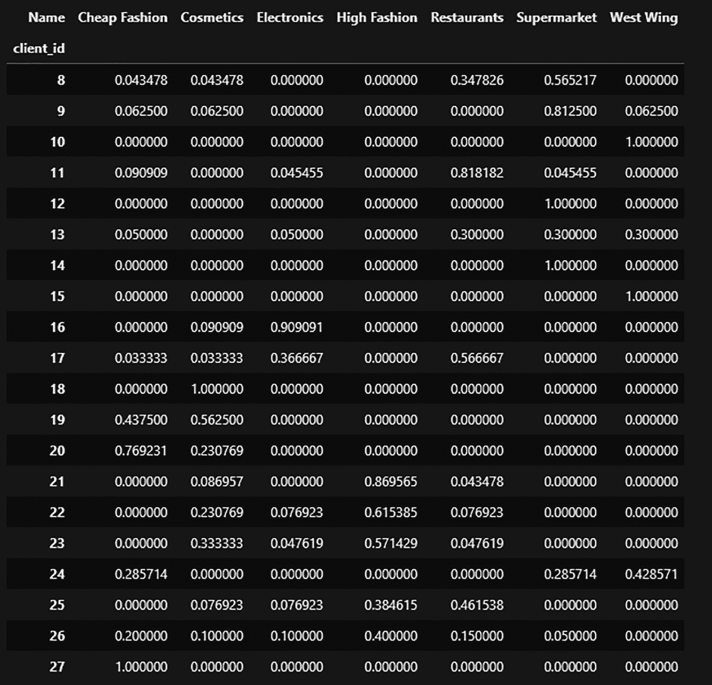
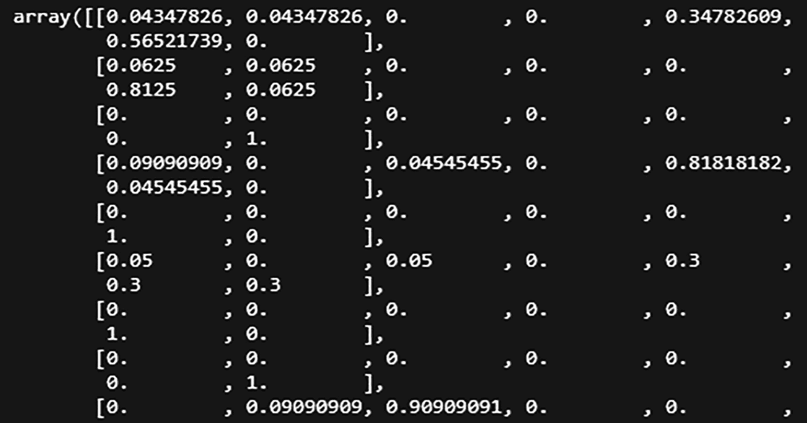
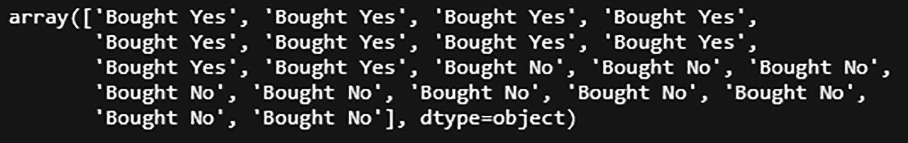

# 标准化
location_behavior = location_behavior.div( location_behavior.sum(axis=1), axis=0 )
location_behavior
代码块 10-11
标准化数据
```

标准化后的输出如图 10-10 所示。



一个窗口页面包含一个具有七列和二十行的表格，这些行被称为 client i d。上方有八个列标题。

图 10-10
代码块 10-11 得到的数据。图片由作者提供

### 建模

现在，让我们保持数据的这种格式用于模型——即用于将数据输入模型。让我们脱离数据框格式，使用代码块 10-12 中的代码将数据转换为 numpy 数组。

```
X = location_behavior.values
X
代码块 10-12
转换为 numpy 数组
```

X 数组看起来如图 10-11 所示。



一段代码，以 array 开头，接着是九行包含开括号和闭括号的内容。

图 10-11
代码块 10-12 得到的数组。图片由作者提供

你可以用同样的方法获取目标变量（也称为 y）的数组。这在代码块 10-13 中完成。

```
y = itineraries.Name.values
y
代码块 10-13
获取 y 作为数组
```

y（即目标变量）现在如图 10-12 所示。



一段代码：array，左括号，左方括号，bought yes, bought yes, bought yes, bought yes, bought yes, bought yes, bought yes, bought yes, bought yes, bought yes, bought no, bought no, bought no, bought no, bought no, bought no, bought no, bought no, bought no, bought no，右方括号，d type 等于号 object，左括号。

图 10-12
y 数组。图片由作者提供

建模的下一步是构建训练-测试集划分。机器学习中的训练-测试集划分是指根据行将数据分成两部分，仅使用部分数据来构建模型。用于构建模型的部分是训练集，而未使用的部分是测试集。

测试集必须保留出来，因为机器学习模型倾向于学习使用 X 来预测 y 的关系，这些关系在模型已见过的数据上完全有效，但在任何新数据上却无效。这个过程称为对训练集的过拟合。

当在训练集上训练模型，并在训练阶段模型未见过的数据集上评估它时，我们就能确保模型评估是公平的。我们确信模型没有过拟合测试数据，因为它在拟合（训练）过程中从未被使用过。

代码块 10-14 中的代码执行了分层训练-测试集划分。分层是一种抽样形式，它强制指定变量在训练集和测试集中的分布相同。毕竟，存在所有优惠券用户都在训练集中的风险，那样测试集就完全无法评估模型在优惠券用户上的性能。分层强制训练集和测试集中优惠券用户的百分比相同，从而促进公平评估。

```
