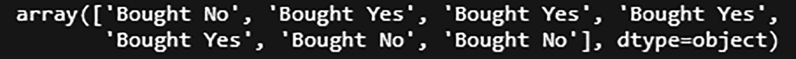

# logistic regression
from sklearn.linear_model import LogisticRegression
my_lr = LogisticRegression()
my_lr.fit(X_train, y_train)
代码块 10-15
逻辑回归
```

对象 my_lr 现在是一个已拟合的逻辑回归模型，这基本上意味着其系数已基于训练数据估算出来，并存储在该对象内部。现在，我们可以使用 my_lr 对象对任何包含与 X_train 中相同数据的外部数据进行预测。

幸运的是，我们预留了 X_test，以便轻松进行模型评估。第一步是使用代码块 10-16 中的代码进行预测。

```
preds = my_lr.predict(X_test)
preds
代码块 10-16
预测
```

该数组包含对 X_test 中每一行的预测结果，如图 10-13 所示。



一段代码：array, open parenthesis, open bracket, bought no, bought yes, bought yes, bought yes, bought yes, bought no, bought no, close bracket, d type equal sign object, open parenthesis。

图 10-13

预测结果。图片来源：作者

我们同样拥有这些参与者的真实结果。毕竟，他们并非真正的新参与者，而是我们已知其是否使用了优惠券的参与者子集，我们特意将其预留用于评估。我们可以使用代码块 10-17 中的代码，将预测结果与真实结果进行比较。

```
