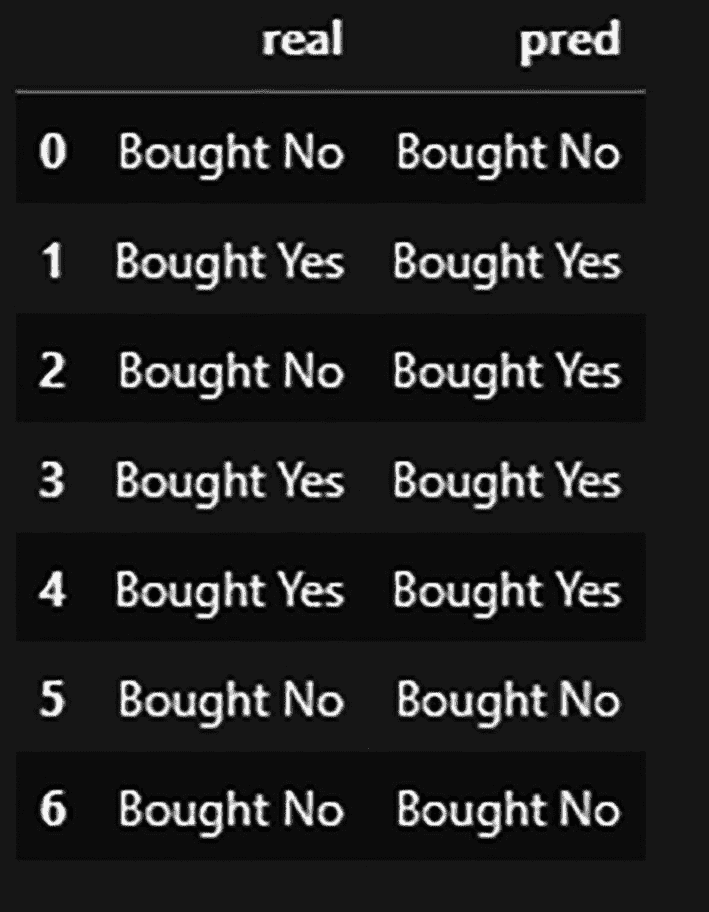
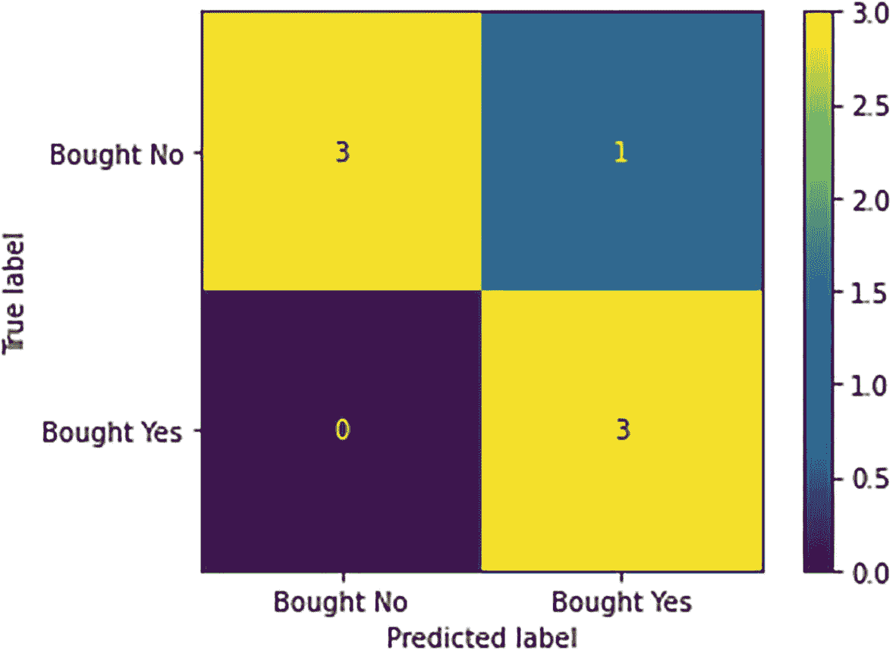
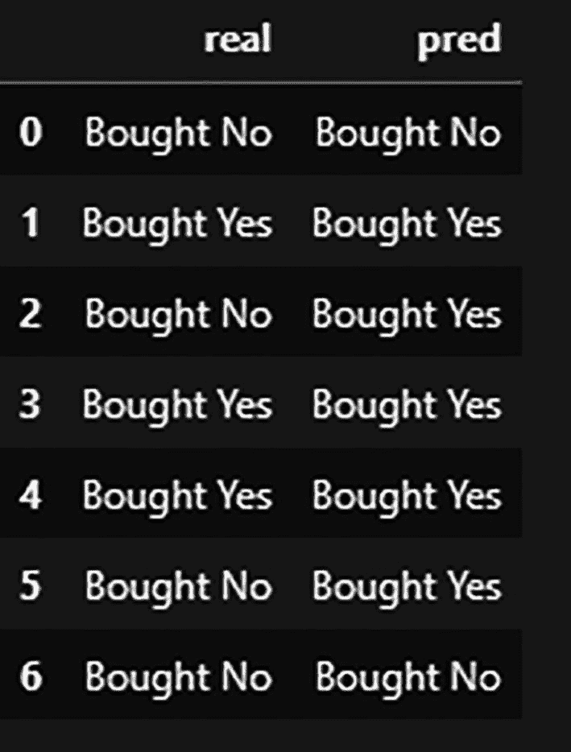
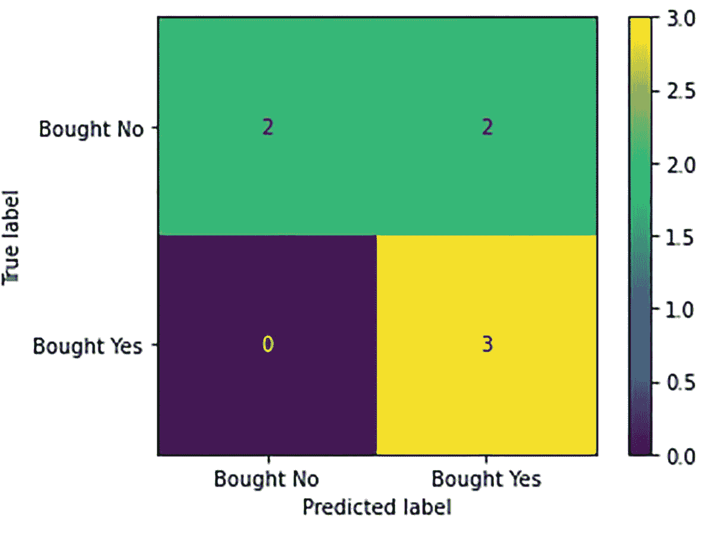
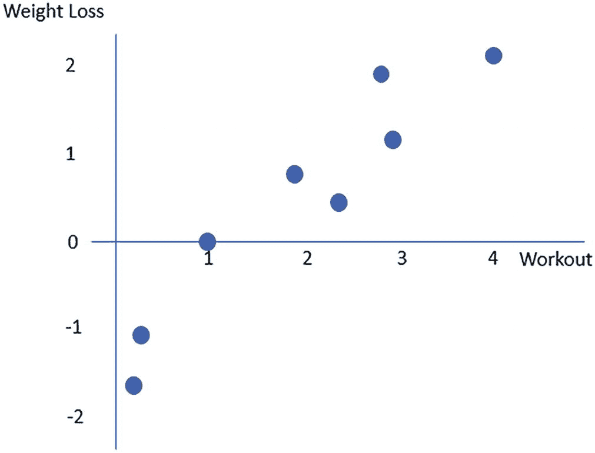
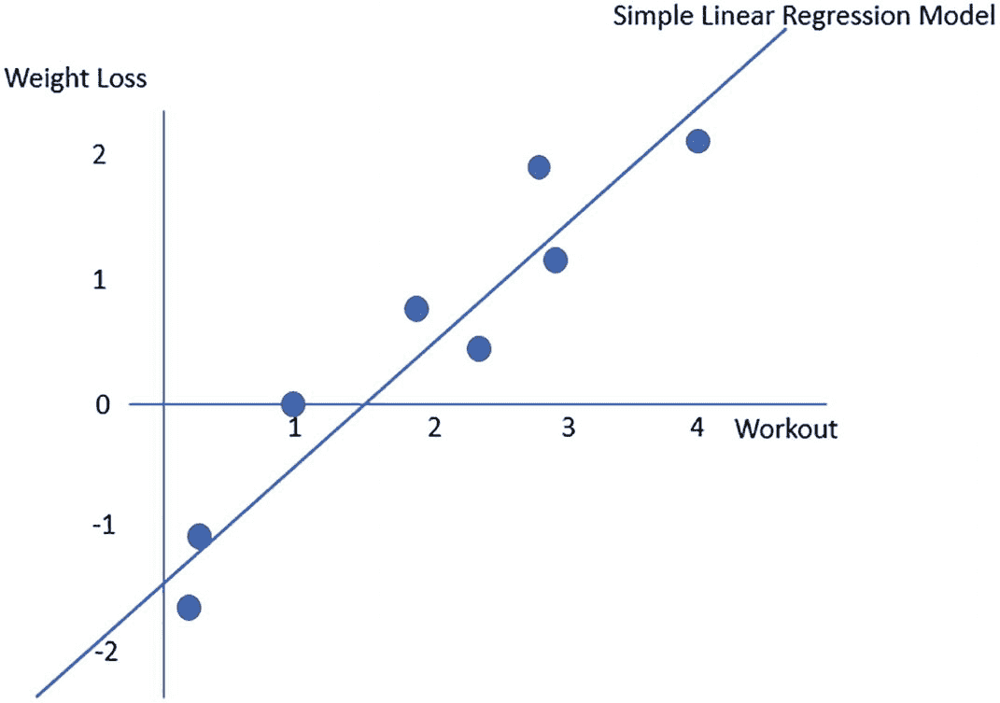
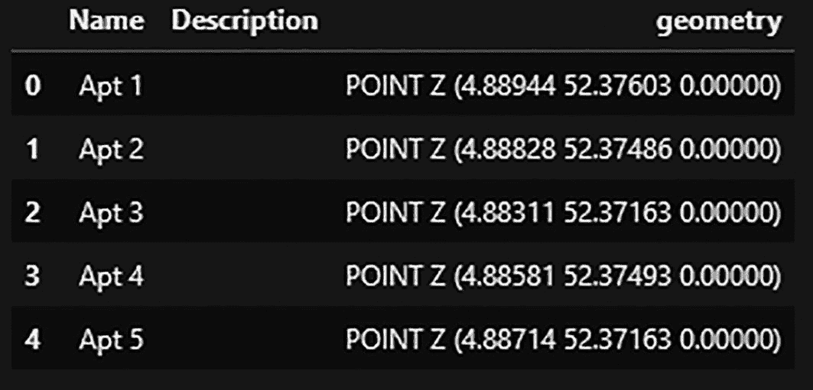
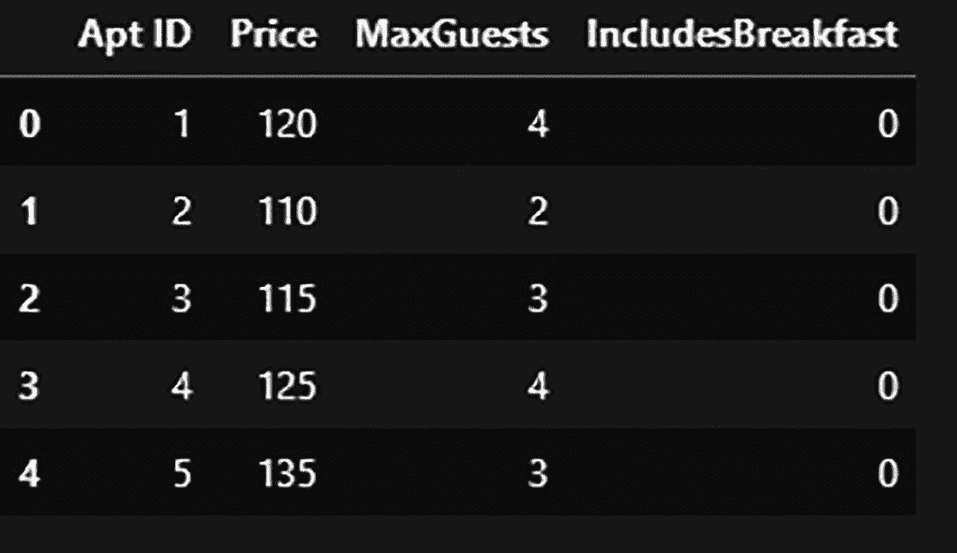
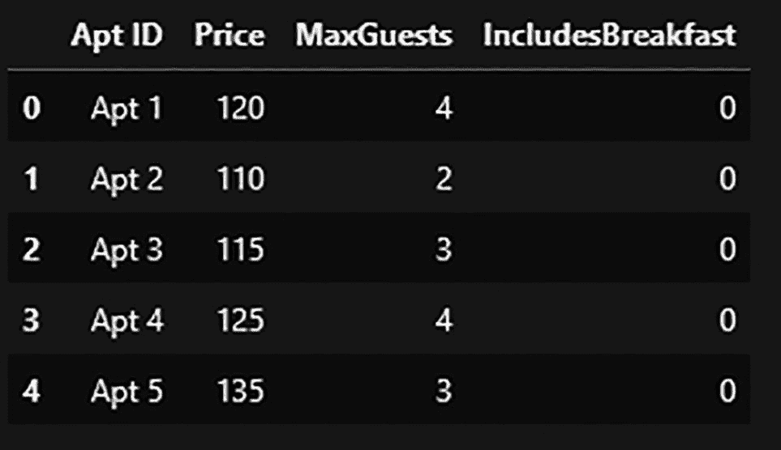
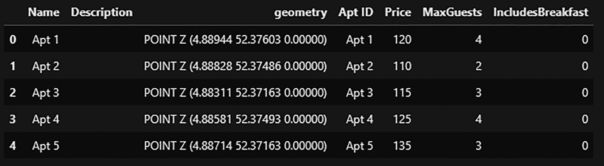

# indeed one error for the log reg
pd.DataFrame({'real': y_test, 'pred': preds})
代码块 10-17
将错误与真实结果转换为数据框
```

生成的比较数据框如图 10-14 所示。



一个窗口框包含一个表格，该表格有两列五行。列标题为 real 和 pred。行标签为 0、1、2、3 和 4。

图 10-14

用于错误分析的数据框。图片来源：作者

本例中的测试集相当小，我们可以手动得出结论：该模型的预测效果实际上相当不错。在数据量更大的用例中，最好使用其他方法来总结这种性能。分析分类模型的一个绝佳工具是混淆矩阵。它在一张图中展示了所有正确预测的数据，同时也展示了错误预测的数据，以及每种错误发生的次数。代码块 10-18 中的代码展示了如何为此用例创建这样一个混淆矩阵。

```
from sklearn.metrics import confusion_matrix, ConfusionMatrixDisplay
conf_mat = confusion_matrix(y_test, preds, normalize=None)
conf_mat_plot = ConfusionMatrixDisplay(conf_mat, display_labels = set(y_test))
conf_mat_plot.plot()
代码块 10-18
分析预测错误
```

生成的图表如图 10-15 所示。



一个图表由预测标签和真实标签的方形图组成，分为四个区域，分别为 2、2、0 和 3。右侧是一个刻度，数值从 0 到 3，增量为 0.5。

图 10-15

代码块 10-18 生成的图表。图片来源：作者

在此图中，您可以看到大多数预测都是正确的，只出现了一个错误。这个错误是一位实际上没有购买的参与者，而模型预测他使用了优惠券进行了购买。

### 模型基准测试

该模型只犯了一个错误，因此我们可以得出结论，它是一个相当不错的模型。然而，为了完整性，尝试另一个模型会更好。您可以随意测试 scikit-learn 中的任何分类模型，但由于数据量相对较小，我们在此尝试使用决策树模型。代码块 10-19 中的代码执行了与之前完全相同的步骤，只是换了一个不同的模型。

```
from sklearn.tree import DecisionTreeClassifier
my_dt = DecisionTreeClassifier()
my_dt.fit(X_train, y_train)
preds = my_dt.predict(X_test)
pd.DataFrame({'real': y_test, 'pred': preds})
代码块 10-19
模型基准测试
```

生成的评估数据框如图 10-16 所示。



一个窗口框包含一个表格，该表格有两列五行。列标题为 real 和 pred。行标签为 0、1、2、3 和 4。

图 10-16

代码块 10-19 生成的数据框。图片来源：作者

同样，由于数据集规模较小，很容易解读并得出结论：该模型更差，因为它犯了两个错误，而逻辑回归只犯了一个错误。为了保持连贯性，我们也用混淆矩阵分析来收尾。这在代码块 10-20 中完成。

```
conf_mat = confusion_matrix(y_test, preds, normalize=None)
conf_mat_plot = ConfusionMatrixDisplay(conf_mat, display_labels = set(y_test))
conf_mat_plot.plot()
代码块 10-20
绘制混淆矩阵
```

结果如图 10-17 所示，确实显示了两个错误。



一个图表由预测标签和真实标签的方形图组成，分为四个区域，分别为 2、2、0 和 3。右侧是一个刻度，数值从 0 到 3，增量为 0.5。

图 10-17

决策树模型的结果

有两个错误，都是实际未购买的参与者。似乎未购买的人群比购买的人群更难检测，尽管需要更多证据来进一步研究这一点。

## 要点总结

1.  分类是监督式机器学习的一个领域，涉及学习如何使用自变量预测分类目标变量的模型。

2.  特征工程与空间操作相结合，可用于将空间数据转换为机器学习格式。最终得到对当前分类任务有用的变量定义至关重要。

3.  训练-测试集划分对于模型评估是必要的，因为模型往往会在训练数据上过拟合。

4.  混淆矩阵是评估分类模型性能的绝佳工具。

5.  模型基准测试是指在同一任务上使用多个不同的机器学习模型，以便找到性能最佳的模型并保留用于未来。


# 11. 回归分析

在前两章中，你已经学习了使用空间数据进行机器学习用例的基础知识。你首先了解了多种插值方法。插值作为机器学习的入门介绍，其定义了一种基于理论的插值函数，用于填充目标变量的未知值。

下一步是从这种无监督方法转向有监督方法，即构建模型来预测我们拥有真实值的变量。通过应用训练-测试分割，这些真实值随后被用于计算性能指标。

前一章展示了如何使用监督模型进行分类。与插值不同，在分类模型中，目标变量是一个分类变量。所展示的示例使用了二元目标变量，将人群分为两类：购买者和非购买者。

在本章中，你将学习如何为数值型目标变量构建监督模型。这被称为回归分析。尽管回归分析与插值一样，都用于估计数值型目标，但其方法实际上通常更接近于监督分类方法。

在回归分析中，使用指标并构建在该指标上表现最佳的模型至关重要，这与分类分析中的情况相同。模型需要适应数值型目标变量，并且需要选择不同的指标来考虑目标变量是数值型这一事实。

本章将首先介绍回归模型是什么以及我们可以用它做什么。本章的其余部分将深入分析一个使用空间数据的回归模型，期间将介绍众多理论概念。

## 回归分析简介

尽管本书的目标并非深入介绍机器学习的数学内容，但我们还是先探讨一下回归模型背后的一般概念。请记住，有许多资源可以补充这些理论知识，而本书的目标是介绍如何将回归模型与空间数据分析和建模相结合。

让我们从考虑回归建模中最简单的情况之一开始本节：简单线性回归。在简单线性回归中，我们有一个数值型目标变量（y 变量）和一个数值型预测变量（X 变量）。

在这个例子中，我们考虑一个数据集，我们希望根据一个人一周内的锻炼小时数来预测其每周的体重减轻量。我们预期两者之间存在正相关关系。图 11-1 显示了每周体重减轻量与每周锻炼小时数的关系图。



散点图展示了体重减轻量与每周锻炼小时数的结果数据。有两个值位于负值区域，而另外五个值（除了横轴上的一个点外）分散在东部区域。纵轴从+2 到-2，间隔为 1；横轴从 1 到 4，间隔为 1。

图 11-1

示例数据图。作者自绘

该图显示了锻炼与体重减轻之间明显的正相关关系。我们可以找到穿过这些点的直线的数学定义，然后使用这个数学公式作为模型，根据锻炼小时数来估计每周的体重减轻量。这可以在图 11-2 中直观地展示。



散点图展示了一条标记为“简单线性回归模型”的直线对角线，位于体重减轻量与每周锻炼小时数的结果数据上。显示了正相关性。纵轴从+2 到-2，间隔为 1；横轴从 1 到 4，间隔为 1。

图 11-2

添加到图中的简单线性回归线。作者自绘

这个线性回归模型的数学形式如下：

*y = a * x + b*

对于这个例子，它将转化为：

*Weight_Loss = a * Workout + b*

存在确定 a 和 b 最佳拟合值的数学方法，并可用于估计此模型。其背后的精确数学原理将留给读者进一步阅读，以免超出本书的范围。然而，理解估计此类模型的一般概念非常重要。

考虑接下来可能采取的步骤也很重要，所以让我们花些时间来思考这些步骤。首先，当前模型只使用了一个解释变量（锻炼），这并不能真正代表一个人减肥的实际过程。

实际上，人们可能会认为食物摄入量也是减肥的一个非常重要的因素。这就需要扩展数学公式，变成如下形式：

*Weight_Loss = a * Workout + b * CaloriesEaten + c*

在这种情况下，线性回归背后的数学原理需要为三个系数 a、b 和 c 找到最佳值。这个过程可以通过添加更多变量和更多系数来继续。

到目前为止，我们首先讨论了简单线性回归，然后是更一般的线性回归。尽管线性回归通常非常适合拟合回归模型，但还有许多其他数学和算法函数可以使用。

其他模型的例子包括决策树、随机森林和提升模型。在底层，每个模型都有其自己的基本模型定义，数据可用于拟合该模型（相当于线性模型中估计系数的替代方案）。对于那些希望深入了解这些模型确切工作原理的读者，有许多参考文献可供参考。

现在，让我们通过一个使用空间数据的回归用例，转向更偏应用的角度。

## 空间回归用例

本章的剩余部分将引导你完成一个监督机器学习用例的多次迭代。在实践中，构建机器学习模型通常需要多个步骤和多次迭代。本章分为多个部分，以尽可能贴近实际情况。

该模型的目标是估计阿姆斯特丹市中心一处 Airbnb 房源应收取的价格。想象一下，你住在阿姆斯特丹，想以最优价格在 Airbnb 上出租你的公寓，并且你已经收集了一些数据来研究如何定价。

此用例的目标变量是价格，我们将使用许多变量作为预测变量。首先，有关于公寓允许入住的最大客人数的数据。其次，收集了数据以记录房价是否包含早餐。让我们从导入和准备数据开始。


### 导入与准备数据

在本节中，我们将导入并准备数据。数据集中包含两个文件：

*   一个 KML 文件中的地理数据
*   一个包含每套公寓价格和预测变量的 Excel 文件

你可以像本书前几章所介绍的那样，使用 `geopandas` 和 `Fiona` 导入地理数据集。具体操作如代码块 11-1 所示。

```
import geopandas as gpd
import fiona
gpd.io.file.fiona.drvsupport.supported_drivers['KML'] = 'rw'
geodata = gpd.read_file('chapter 11 data.kml')
geodata.head()
代码块 11-1
导入数据
```

导入后的地理数据如图 11-3 所示。



一张包含四列五行表格的图片。最左列标记为 0 到 4。Name 列包含 Apt 1 到 5 的条目。Description 列无条目。geometry 列包含不同的 POINT Z 值。

图 11-3

代码块 11-1 生成的数据。图片由作者提供

如你所见，该数据集仅包含两个变量：

*   Name 包含每个点的标识符。
*   Point 包含每套公寓的坐标。

其他变量位于 Excel 文件中，你可以使用代码块 11-2 中的代码导入该文件。

```
import pandas as pd
apartment_data = pd.read_excel('house_data.xlsx')
apartment_data.head()
代码块 11-2
导入房屋数据
```

第二个数据集如图 11-4 所示。



一张包含五列五行表格的图片。最左列标记为 0 到 4。Apt ID 列包含标记为 1 到 5 的条目。Price 列包含 120、110、115、125 和 135 的条目。Max Guests 列包含 4、2、3、4 和 3 的条目。Includes Breakfast 列包含 0、0、0、0 和 0 的条目。

图 11-4

房屋数据。图片由作者提供

从这张图片可以看出，数据包含以下变量：

*   Apt ID：每套公寓的标识符
*   Price：每套公寓在 Airbnb 上的价格
*   MaxGuest：公寓允许入住的最大客人数
*   IncludesBreakfast：如果包含早餐则为 1，否则为 0

Apt ID 的格式与地理数据中的标识符格式不同。需要转换这些值以使它们对应起来。这将使我们能够在后续步骤中将两个数据集合并在一起。具体操作使用代码块 11-3 中的代码完成。

```
apartment_data['Apt ID'] = apartment_data['Apt ID'].apply(lambda x: 'Apt ' + str(x))
apartment_data.head()
代码块 11-3
转换公寓 ID
```

此操作之后，数据集现在如图 11-5 所示。



一张包含五列五行表格的图片。最左列标记为 0 到 4。Apt ID 列包含标记为 Apt 1 到 5 的条目。Price 列包含 120、110、115、125 和 135 的条目。Max Guests 列包含 4、2、3、4 和 5 的条目。Includes Breakfast 列包含 0、0、0、0 和 0 的条目。

图 11-5

代码块 11-3 生成的数据。图片由作者提供

现在两个数据集有了对应的标识符，是时候开始合并操作了。这次合并会将所有列整合到同一个数据集中，这将使数据处理更加方便。合并操作使用代码块 11-4 中的代码完成。

```
merged_data = geodata.merge(apartment_data, left_on='Name', right_on='Apt ID')
merged_data.head()
代码块 11-4
合并两个数据集
```

你可以在图 11-6 中看到生成的 DataFrame。



一张包含八列五行表格的图片。最左列 0 到 4。Name 列包含 Apt 1 到 5。Description 列无条目。geometry 列包含不同的 POINT Z 值。Apt ID 列包含 Apt 1 到 5。Price 列包含 120、110、115、125 和 135。Max Guests 列包含 4、2、3、4 和 3。Includes Breakfast 列包含 0、0、0、0 和 0。

图 11-6

合并后的数据。图片由作者提供

现在，所有列都位于同一个 DataFrame 中。数据准备阶段到此结束。作为最后一步，让我们对阿姆斯特丹市内的公寓位置进行可视化，以便更好地了解数据。具体操作使用代码块 11-5 中的代码完成。

```
import contextily as cx
