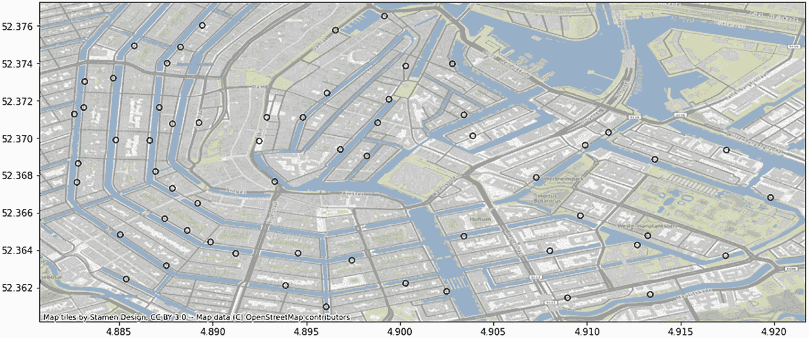
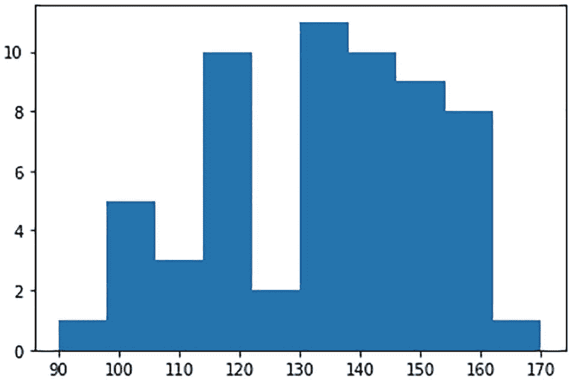

# 添加 contextily 底图
cx.add_basemap(ax, crs=merged_data.crs)
代码块 11-5
公寓地图
```

生成的地图如图 11-7 所示。



荷兰阿姆斯特丹的地图，图上用圆形标记标出了该市 60 套不同公寓的位置。纵轴数值从 52.362 到 52.376，间隔为 0.002；横轴数值从 4.885 到 4.920，间隔为 0.005。西北部区域有大量公寓聚集。

图 11-7

代码块 11-5 生成的地图。图片由作者使用 contextily 源数据和图像绘制，来源如图中所示

你可以看到，本研究中使用的公寓在阿姆斯特丹市中心分布得相当均匀。在下一节中，我们将对数据集进行更深入的探索。


### 数据探索的第一次迭代

在数据探索的第一次迭代中，让我们看看如何将非地理数据用于回归模型。这将产生一种与本章前面理论部分给出的示例类似的方法。

为了开始探索，让我们绘制公寓价格直方图。可以使用代码块 11-6 中的代码创建直方图。

```
import matplotlib.pyplot as plt
plt.hist(merged_data['Price'])
代码块 11-6
创建直方图
```

该直方图的结果如图 11-8 所示。



公寓租金价格的直方图。纵轴从 0 到 10，间隔为 2；横轴从 90 到 170，间隔为 10。价格走势呈现反复的急剧上升和下降，在横轴约 130、纵轴超过 10 处达到峰值，随后逐渐下降，在横轴约 170、纵轴低于 2 处回落。

图 11-8

价格直方图。图片由作者提供

该直方图显示，所有价格都在 90 到 170 之间，其中大部分集中在 130 附近。数据似乎并不完全符合正态分布，尽管我们确实看到靠近中心的数据点比远离中心的数据点更多。

如果我们需要对 Airbnb 的最合适价格进行一个非常粗略的估计，我们可以简单地使用阿姆斯特丹市中心 Airbnb 的平均价格。代码块 11-7 中的代码计算了这个平均值。

```
