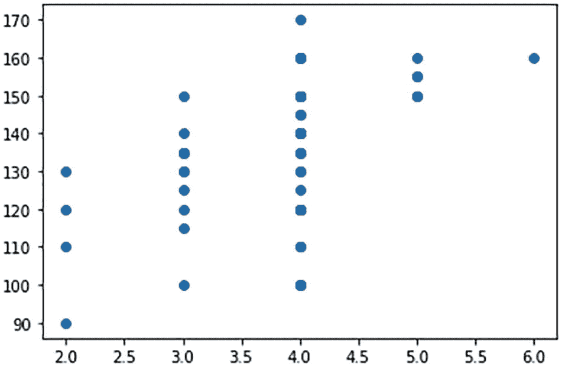
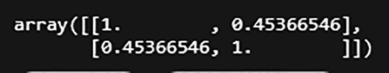
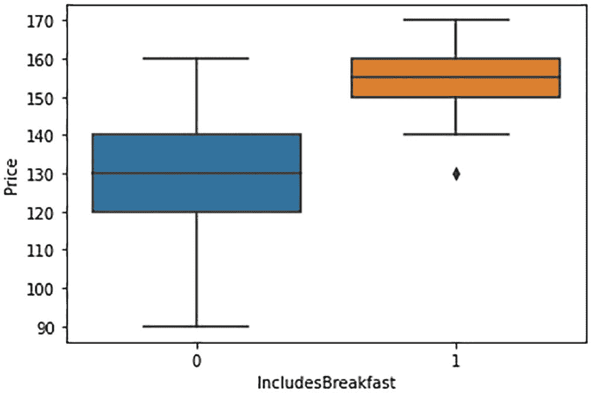

# 然而，我们可以使用额外信息使这个估计更贴合实际
plt.scatter(merged_data['MaxGuests'], merged_data['Price'])
代码块 11-8
创建散点图
```

虽然趋势不如本章开头理论示例中观察到的那么清晰，但我们可以清楚地看到，x 轴（最大房客数）上的较高值通常对应 y 轴（价格）上的较高值。图 11-9 展示了这一点。



散点图展示了价格与最大房客数的数据关系。数值以垂直方式呈现。横轴约 4.0 处的数据集在中间区域显示出最高且最多的数值。纵轴数值从 90 到 170，间隔为 10；横轴数值从 2.0 到 6.0，间隔为 0.5。

图 11-9

价格与最大房客数的散点图。图片由作者提供

线性关系的质量也可以通过更量化的方法来衡量。皮尔逊相关系数是一个介于 –1 和 1 之间的分数，用于指示这种关系。值为 0 表示无相关性，接近 –1 的值表示两者之间存在负相关，接近 1 的值表示变量之间存在正相关。

可以使用代码块 11-9 中的代码计算相关系数。

```
import numpy as np
np.corrcoef(merged_data['MaxGuests'], merged_data['Price'])
代码块 11-9
计算相关系数
```

这将给出如图 11-10 所示的相关系数矩阵。



相关系数的图像。内容为：array( [[1.        , 0.45366546], [0.45366546, 1.        ]] )

图 11-10

相关系数。图片由作者提供

最大房客数与价格之间的相关系数为 0.453。这是一个相当强的正相关，表明房客数量对我们 Airbnb 的定价有很强的正向影响。简而言之，容纳更多人的 Airbnb 应该要价更高，而容纳人数少的 Airbnb 则应定价更低。

作为下一步，让我们看看是否也可以使用“包含早餐”变量来设定 Airbnb 的价格。由于早餐变量是分类变量（是或否），最好使用不同的技术来研究这种关系。代码块 11-10 中的代码创建了一个箱线图来回答这个问题。

```
import seaborn as sns
sns.boxplot(x='IncludesBreakfast',y='Price',data=merged_data)
代码块 11-10
创建箱线图
```

生成的箱线图如图 11-11 所示。



一个带须线的垂直箱线图展示了价格与包含早餐的关系。箱线图中使用了值 0 和 1。后者存在一个异常值。前者的中位数约为 130，须线范围为 160 到 90，四分位距为 140 到 120。后者的中位数和四分位距约为 160 到 150，须线范围为 170 到 140。

图 11-11

生成的箱线图。图片由作者提供

该箱线图显示，提供早餐的 Airbnb 通常能够比不提供早餐的 Airbnb 要价更高。根据你是否提供早餐，你应该相应地为你的公寓定价。

### 模型的第一次迭代

上一节的见解对于公寓业主来说已经是非常有用的要素。然而，它们仍然是更通用的建议，而不是我们需要设定的精确数值价格估计。在本节中，我们将构建机器学习模型的第一个版本，以便根据早餐和最大房客数这两个变量精确设定价格。首先，让我们将 X 和 y 设置为建模变量。这在代码块 11-11 中完成。

```
X = merged_data[['IncludesBreakfast', 'MaxGuests']]
y = merged_data['Price']
代码块 11-11
创建 X 和 y 对象
```

在此建模阶段，我们将使用线性模型。可以使用代码块 11-12 中的代码来估计 scikit-learn 实现的线性模型。

```
