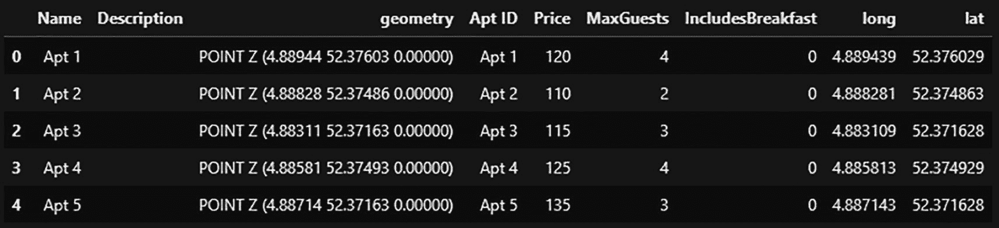
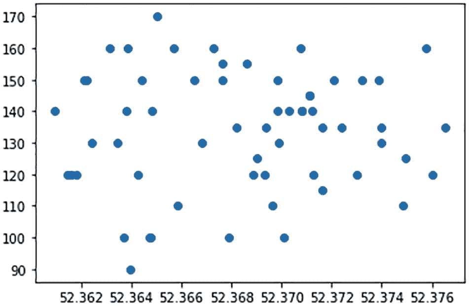
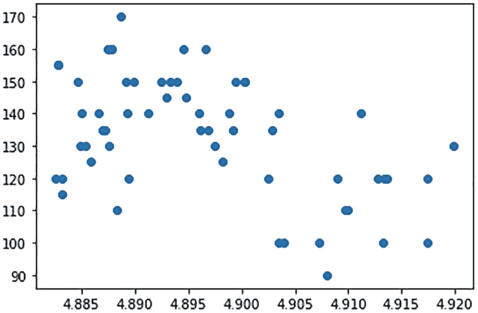
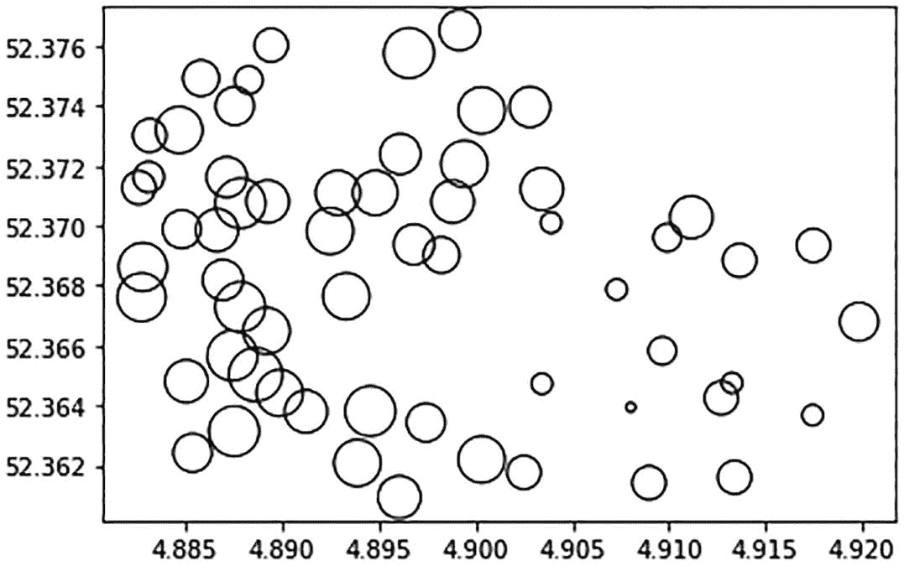

# 添加地理数据并查看是否能改善情况
merged_data['long'] = merged_data['geometry'].apply(lambda x: x.x)
merged_data['lat'] = merged_data['geometry'].apply(lambda x: x.y)
merged_data.head()
代码块 11-18
添加地理数据
```

生成的数据框如图 11-12 所示。



一张包含十列五行数据的表格图像。除第一列外，各列标签分别为：名称、描述、几何信息、A p t I D、价格、最大客人、是否含早餐、经度、纬度。描述列没有条目。

图 11-12

代码块 11-18 生成的数据集。作者提供图片

让我们通过绘制价格与纬度、价格与经度的散点图，来看看纬度和经度与价格的关系。第一个散点图在代码块 11-19 中创建。

```
plt.scatter(merged_data['lat'], merged_data['Price'])
代码块 11-19
创建散点图
```

生成的散点图如图 11-13 所示。



一张散点图展示了价格与纬度的关系数据。纵轴数值从 90 到 170，间隔为 10；横轴数值从 52.362 到 52.376，间隔为 0.002。数据点散布在整个区域。

图 11-13

代码块 11-19 生成的散点图。作者提供图片

这张散点图中似乎没有太明显的趋势。价格似乎在 90 到 170 之间波动，并且对于任何其他纬度来说，情况也并无不同。让我们使用代码块 11-20 中的代码来检查经度是否也是如此。

```
plt.scatter(merged_data['long'], merged_data['Price'])
代码块 11-20
使用经度创建散点图
```

生成的散点图如图 11-14 所示。



一张散点图展示了价格与经度的关系数据。纵轴数值从 90 到 170，间隔为 10；横轴数值从 4.885 到 4.920，间隔为 0.005。该图显示，在较高经度区域数据点更集中，且西部区域价格较低。

图 11-14

价格与经度的散点图。作者提供图片

有趣的是，价格与经度之间的关系要强得多。看起来，较高的经度通常比较低的经度价格更低。

这两张散点图并没有真正捕捉到位置信息。毕竟，我们很容易想象，与纬度和经度的关系不一定是线性的。期望“越往东走，价格越低”是一条永远成立的规则，这很奇怪。更有可能的是，在整个区域内存在特定的高价值区和低价值区。在下面的代码中，我们创建了一个可视化图表，同时根据纬度和经度来绘制价格。


创建此可视化的第一步是将价格转换为可用于设置公寓点大小的变量。这需要将我们的数据缩放到更适合绘图的范围内，例如，将最便宜的公寓设置为点大小 16，最贵的设置为点大小 512。这在代码块 11-21 中完成。

```
from sklearn.preprocessing import MinMaxScaler
scaler = MinMaxScaler(feature_range=(16, 512))
merged_data[['MarkerSize']] = scaler.fit_transform(merged_data[['Price']])
代码块 11-21
应用 MinMaxScaler
```

现在，我们可以在创建散点图时使用此大小设置。这在代码块 11-22 中完成。

```
plt.scatter(merged_data['long'], merged_data['lat'], s=merged_data['MarkerSize'], c='none', edgecolors='black')
代码块 11-22
创建带有标记大小的地图
```

生成的可视化结果如图 11-15 所示。



散点图展示了结果数据，其中不同的价格呈现出非线性特征。数值由不同大小的圆圈表示。纵轴数值从 52.362 到 52.376，间隔为 0.002；横轴数值从 4.885 到 4.920，间隔为 0.005。东部区域高度集中。

图 11-15

生成的散点图

该图显示不存在线性关系，但我们可以预期某些区域的价格普遍较高或普遍较低。这意味着我们可能需要改用非线性模型来更好地拟合实际情况。

### 模型迭代 2

尽管之前的探索告诉我们首选模型可能是非线性的，但我们还是用线性模型做最后一次尝试。这将为我们提供一个良好的基准 R²分数，用于评估后续试验。这在代码块 11-23 中完成。

```
