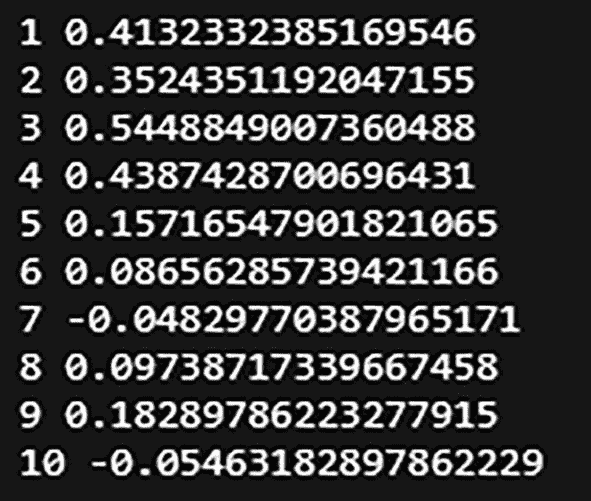

# 评估模型
pred_reg_5 = dt_reg_5.predict(X2_test)
print(max_depth, r2_score(y_test, pred_reg_5))
代码块 11-25
使用 max_depth 调整模型
```

生成的输出如图 11-16 所示。



模型调整循环的结果图像。共观察到十个条目，分别为：0.4132332385169546、0.3524351192047155、0.5448849007360488、0.438728700696431、0.15716547901821065、0.0865285739421166、-0.04829770387965171、0.09738717339667458、0.18289786223277915 和 -0.05463182897862229。

图 11-16

模型调整循环的结果。图片由作者提供

在此输出中，你可以看到`max_depth`为 3 时，R²分数达到了 0.54，远优于–0.04 的结果。对`max_depth`的调整显然对模型性能产生了重要影响。还可以进行许多其他试验和迭代，但这留作练习。目前，保留`max_depth = 3`的`DecisionTreeRegressor`作为最终回归模型。


### 迭代 4 模型解读

作为本用例的最后一步，让我们仔细看看这个非线性回归模型学到了什么。决策树的一大优势在于，我们可以导出其结构图，从而精确了解模型是如何学习趋势的。代码块 11-26 中的代码展示了如何生成树状图。

```
from sklearn import tree
