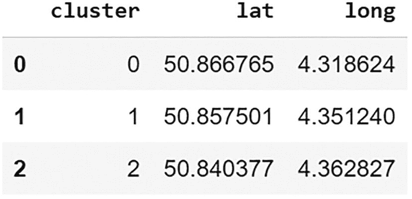
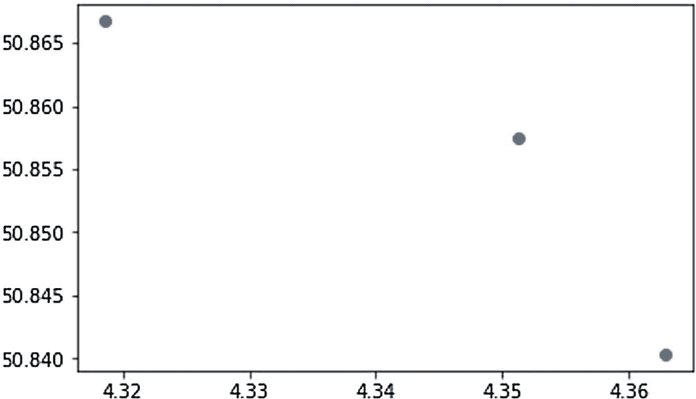
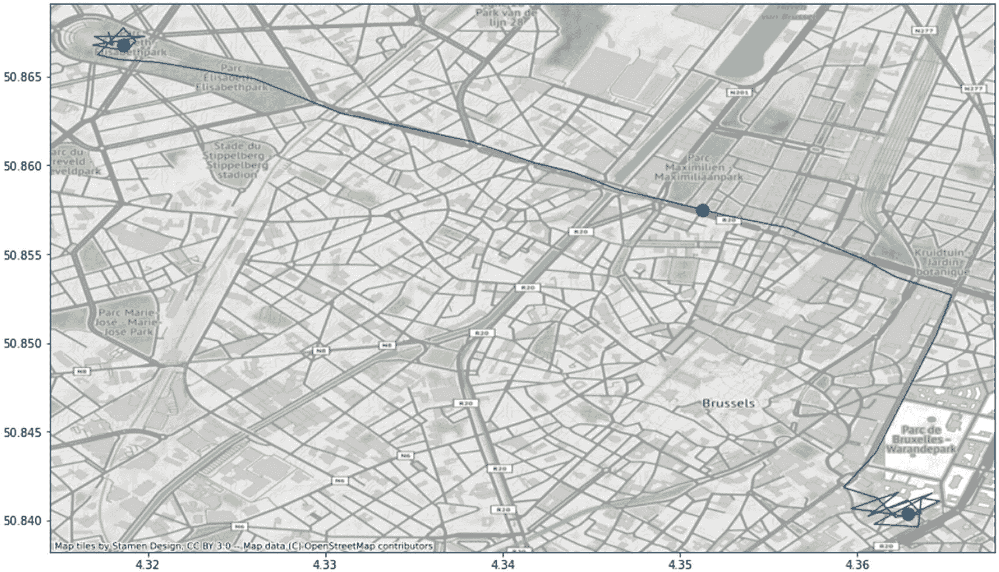

# 移除所有聚类簇为 -1（异常值）的观测值
one_person_points_df = one_person_points_df[one_person_points_df[‘cluster’] != -1]
代码块 12-9
移除异常值聚类簇
```

现在，我们可以通过使用 `groupby` 操作计算中位数点来得到每个聚类簇的中心点。这在代码块 12-10 中完成。

```
medians_of_POI = one_person_points_df.groupby(['cluster'])[['lat', 'long']].median().reset_index(drop=False)
medians_of_POI
代码块 12-10
计算聚类簇的中位数
```

图 12-10 显示了聚类簇 0、1 和 2 的中位数坐标。



一个包含三列三行、由不同数值组成的表格。列标题为 cluster、lat 和 long。行标签为 0、1、2 和 3。

图 12-10

生成的聚类簇。图片由作者提供

让我们使用代码块 12-11 中的代码将这些中心坐标绘制在地图上。

```
from shapely.geometry.point import Point
medians_of_POI_gdf = gpd.GeoDataFrame(medians_of_POI, geometry=[Point(x) for x in zip( list(medians_of_POI['long']), list(medians_of_POI['lat']))])
medians_of_POI_gdf.plot()
代码块 12-11
绘制人员 1 的中心坐标
```

包含三个中心点的基本图如图 12-11 所示。



显示人员 1 三个中心点的图表。用于绘制这些中心坐标的代码是代码块 12-11。这三个点位于 (4.32, 50.867)、(4.35, 50.859) 和 (4.38, 50.840)。数值为近似值。

图 12-11

显示人员 1 三个中心点的图。图片由作者提供

让我们使用代码块 12-12 中的代码为这张地图添加更多背景信息。

```
ax = one_person.plot(figsize=(15,15))
medians_of_POI_gdf.plot(ax=ax,markersize=128)
cx.add_basemap(ax, crs = one_person.crs)
代码块 12-12
在中心点背后绘制底图
```

结果如图 12-12 所示。




一张包含中心点绘制的地图。该地图使用代码块 12-12 中的代码生成。地图描绘了一个额外的质心，该质心并非兴趣点。

图 12-12

将中心点绘制到背景地图上。图片由作者使用 contextily 源数据和图像作为参考绘制

这张地图显示聚类并不完全成功。左上角的聚类质心正确识别了一个兴趣点，右下角的质心也正确识别了一个。然而，中间还有一个额外的质心，它本不应被识别为兴趣点。在下一节中，我们将调整模型以改进这一结果。

## 调整聚类模型

在无监督模型中调整模型比在有监督模型中复杂得多。毕竟，我们没有带注释的数据集：真正的兴趣点是未知的。最好的方法是进行一些手动检查，并牢记你的目标是什么。在当前案例中，我们希望找到质心，并且只找兴趣点的质心。

在以下代码中，为 OPTICS 模型设置了不同的参数：

*   `Min_samples` 设置为 10。

一个点被视为核心点所需的邻域内样本数量。

*   `Max_eps` 设置为 2。

此超参数表示一个点与聚类质心之间允许的最大距离，超过该距离则不再被视为该聚类的一部分。

*   `Min_cluster_size` 设置为 8。

一个聚类若要保留，其中必须包含的最少数据点数量。

*   `Xi` 设置为 0.05。

    有助于调整聚类的数量。

这些超参数值是通过尝试不同的设置，然后观察识别出的质心是否与地图上的兴趣点重合而获得的。代码如代码块 12-13 所示。

```
