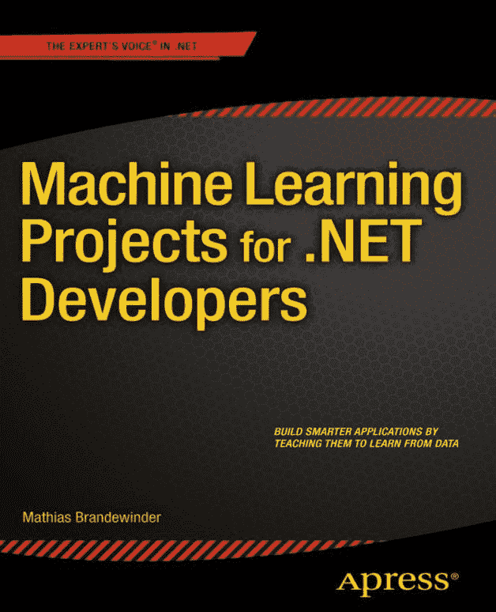

# 面向 .NET 开发人员的机器学习项目

**马蒂亚斯·布兰德温德**

版权所有 © 2015 马蒂亚斯·布兰德温德

本作品受版权保护。出版商保留所有权利，无论是整体还是部分材料，具体包括翻译、重印、重用插图、朗诵、广播、以缩微胶片或任何其他物理方式复制，以及信息存储与检索的传输或电子改编、计算机软件，或目前已知或今后开发的任何类似或不同方法的权利。法律保留的例外情况包括与评论或学术分析相关的简短摘录，或专门为输入并执行于计算机系统而提供的材料，仅供作品购买者独家使用。仅可根据出版商所在地现行版权法的规定，复制本出版物或其部分内容，且必须始终从 Springer 获得使用许可。使用许可可通过版权清算中心的 RightsLink 获取。违反者将根据相应版权法被起诉。

ISBN-13（平装）：978-1-4302-6767-6
ISBN-13（电子版）：978-1-4302-6766-9

本书中可能出现商标名称、标识和图像。我们并非在每次出现商标名称、标识或图像时都使用商标符号，而是仅以编辑方式使用这些名称、标识和图像，以维护商标所有者的利益，且无意侵犯商标权。

本出版物中使用的商品名称、商标、服务标志及类似术语，即使未明确标识，也不应被视为对其是否受专有权利保护的表达。

尽管本书中的建议和信息在出版时被认为是真实准确的，但作者、编辑和出版商均不对可能存在的任何错误或遗漏承担法律责任。出版商对本书所含内容不作任何明示或暗示的保证。

常务董事：韦尔莫德·斯帕尔
首席编辑：格温南·斯皮林
技术审校：斯科特·瓦拉辛
编辑委员会：史蒂夫·安格林、马克·贝克纳、加里·康奈尔、路易丝·科里根、吉姆·德沃尔夫、乔纳森·根尼克、罗伯特·哈钦森、米歇尔·洛曼、詹姆斯·马卡姆、苏珊·麦克德莫特、马修·穆迪、杰弗里·佩珀、道格拉斯·庞迪克、本·雷诺-克拉克、格温南·斯皮林、马特·韦德、史蒂夫·韦斯
协调编辑：梅丽莎·马尔多纳多和克里斯汀·里基茨
文字编辑：金伯利·伯顿-韦斯曼和阿普丽尔·龙多
排版：SPi Global
索引编制：SPi Global
插图制作：SPi Global

全球图书贸易发行由 Springer Science+Business Media New York 负责，地址：233 Spring Street, 6th Floor, New York, NY 10013。电话：1-800-SPRINGER，传真：(201) 348-4505，电子邮件：orders-ny@springer-sbm.com，或访问 [www.springeronline.com](http://www.springeronline.com)。Apress Media, LLC 是一家加利福尼亚有限责任公司，其唯一成员（所有者）是 Springer Science + Business Media Finance Inc (SSBM Finance Inc)。SSBM Finance Inc 是一家特拉华州公司。

如需翻译相关信息，请发送电子邮件至 rights@apress.com，或访问 [www.apress.com](http://www.apress.com)。

Apress 和 friends of ED 的书籍可批量购买用于学术、企业或促销用途。大多数图书也提供电子版和许可证。更多信息，请参阅我们的特殊批量销售–电子书许可网页：[www.apress.com/bulk-sales](http://www.apress.com/bulk-sales)。

作者在本文中引用的任何源代码或其他补充材料，读者可在 [www.apress.com](http://www.apress.com) 获取。有关如何找到本书源代码的详细信息，请访问 [www.apress.com/source-code/](http://www.apress.com/source-code/)。

## 内容概览

关于作者
关于技术审校
致谢
引言
第 1 章：256 级灰度
第 2 章：垃圾邮件还是正常邮件？
第 3 章：类型提供程序的乐趣
第 4 章：自行车与人
第 5 章：你并非独一无二的雪花
第 6 章：树与森林
第 7 章：一场奇特的游戏
第 8 章：数字，再探
第 9 章：结论
索引

## 目录

关于作者
关于技术审校
致谢
引言

### 第 1 章：256 级灰度

什么是机器学习？
一个经典的机器学习问题：图像分类
我们的挑战：构建一个数字识别器
机器学习中的距离函数
从简单开始
我们的第一个模型，C# 版本
数据集组织
读取数据
计算图像间的距离
编写分类器
那么，我们如何知道它有效？
交叉验证
评估模型质量
改进你的模型
为机器学习引入 F#
使用 F# Interactive 进行实时脚本编写和数据探索
创建我们的第一个 F# 脚本
剖析我们的第一个 F# 脚本
创建函数管道
使用元组和模式匹配操作数据
训练和评估分类器函数
改进我们的模型
尝试另一种距离定义
提取距离函数
那么，我们学到了什么？
一个好的距离函数应具备什么特征
模型不必复杂
为什么选择 F#？
进一步探索

### 第 2 章：垃圾邮件还是正常邮件？

我们的挑战：构建一个垃圾邮件检测引擎
了解我们的数据集
使用可区分联合来建模标签
阅读我们的数据集
确定一个单词
将单词作为线索
量化我们的确定程度
贝叶斯定理
处理罕见词
组合多个单词
将文本拆分为词元
朴素地组合得分
简化文档得分
实现分类器
将代码提取到模块中
对文档进行评分与分类
介绍集合与序列
从文档语料库中学习
训练我们的第一个分类器
实现我们的第一个分词器
交互式验证我们的设计
通过交叉验证建立基线
改进我们的分类器
使用每一个单词
大小写重要吗？
少即是多
谨慎选择我们的单词
创建新特征
处理数值
理解错误
那么，我们学到了什么？

### 第 3 章：类型提供程序的乐趣

探索 StackOverflow 数据
StackExchange API
使用 JSON 类型提供程序
构建一个最小领域特定语言来查询问题
世界上的所有数据
世界银行类型提供程序
R 类型提供程序
与 R 数据框一起分析数据
Deedle，一个 .NET 数据框
世界数据，联合起来！
那么，我们学到了什么？
进一步探索

### 第 4 章：关于自行车与人

了解数据
数据集中有什么？
使用 FSharp.Charting 检查数据
通过移动平均线发现趋势
为数据拟合模型
定义基本的直线模型
寻找成本最低的模型
使用梯度下降法寻找函数最小值
使用梯度下降法拟合曲线
更通用的模型公式
实现梯度下降法
随机梯度下降法
分析模型改进
批量梯度下降法
线性代数来救场
亲爱的，我把公式缩小了！
使用 Math.NET 进行线性代数运算
正规方程
使用 MKL 加速
快速演进和验证模型
再次讨论交叉验证与过拟合
简化模型的创建
向模型添加连续特征
使用更多特征优化预测
处理分类特征
非线性特征
正则化
那么，我们学到了什么？
使用梯度下降法最小化成本
通过回归预测数值

### 第 5 章：你并非独一无二的雪花

检测数据中的模式
我们的挑战：理解 StackOverflow 上的主题
了解我们的数据
使用 K-Means 聚类寻找簇
改进簇与质心
实现 K-Means 聚类
对 StackOverflow 标签进行聚类
运行聚类分析
分析结果
好簇与坏簇
重新缩放数据集以改进簇
确定要搜索的簇数量
什么是好簇？
在 StackOverflow 数据集上确定 k 值
我们的最终簇
检测特征之间的关联
协方差与相关性
StackOverflow 标签之间的相关性
使用主成分分析识别更好的特征
用代数重新组合特征
PCA 实战小预览
实现 PCA
将 PCA 应用于 StackOverflow 数据集
分析提取的特征
提出建议
一个原始标签推荐器
实现推荐器
验证推荐结果
那么，我们学到了什么？

### 第 6 章：树与森林

我们的挑战：泰坦尼克号上的生死抉择
了解数据集
查看特征

## 构建决策树桩
### 训练树桩
### 不合适的特征
### 数值型特征怎么办？
### 缺失数据怎么办？
### 衡量数据中的信息量
### 用熵衡量不确定性
### 信息增益
### 实现最佳特征识别
### 使用熵对数值特征进行离散化
### 从数据中生长出一棵树
### 对树进行建模
### 构建树
### 一棵更美观的树
### 改进树
### 为什么我们会过拟合？
### 用过滤器限制过度自信
### 从树到森林
### 使用 K 折交叉验证进行更深入的验证
### 将脆弱的树组合成健壮的森林
### 实现缺失的模块
### 生长出一片森林
### 尝试森林
### 那么，我们学到了什么？

## 第 7 章：一个奇特的游戏
### 构建一个简单的游戏
### 对游戏元素进行建模
### 对游戏逻辑进行建模
### 以控制台应用形式运行游戏
### 渲染游戏
### 构建一个原始大脑
### 对决策过程进行建模
### 从经验中学习获胜策略
### 实现大脑
### 测试我们的大脑
### 我们能更有效地学习吗？
### 探索与利用
### 红色的门和蓝色的门有区别吗？
### 贪婪与规划
### 一个永无止境的地砖世界
### 实现大脑 2.0
### 简化世界
### 提前规划
### 埃普西隆学习
### 那么，我们学到了什么？
### 一个符合直觉的简单模型
### 一种自适应机制

## 第 8 章：数字，再探
### 优化与扩展你的算法代码
### 调优你的代码
### 搜索什么
### 调优距离
### 使用 `Array.Parallel`
### 使用 `Accord.NET` 的不同分类器
### 逻辑回归
### 使用 Accord 进行简单逻辑回归
### 一对一、一对多分类
### 支持向量机
### 神经网络
### 使用 Accord 创建并训练神经网络
### 使用 m-brace.net 进行扩展
### 在 Azure 上使用 Brisk 快速上手 `MBrace`
### 使用 `MBrace` 处理大型数据集
### 那么，我们学到了什么？

## 第 9 章：结论
### 绘制我们的旅程
### 科学！
### F#：以函数式风格高效工作
### 下一步是什么？

## 索引

## 关于作者
**马蒂亚斯·布兰德温德**是微软 F#方向的 MVP，现居加利福尼亚州旧金山，就职于 Clear Lines Consulting。作为一名毫不掩饰的数学极客，他早期便对构建模型以帮助他人利用数据做出更优决策产生了浓厚兴趣。他拥有商业、经济学和运筹学的研究生学位，并在抵达硅谷后不久便爱上了编程。自.NET 诞生之初，他便开始从事专业软件开发，为多个行业开发业务应用程序，专注于预测模型和风险分析。

## 关于技术审校
**斯科特·瓦拉钦**是一名.NET 开发者、架构师和作家。他在从高级 UX/UI 到底层数据库实现的广泛领域拥有超过 20 年的经验。

他曾用多种语言编写过严肃的代码，最喜欢的是 Smalltalk、Python，以及最近的 F#，他关于 F#的博客发布在`fsharpforfunandprofit.com`。

## 致谢
感谢我的父母，我在一个充满书籍的房子里长大；书籍深刻地影响了我今天的样子。我对书籍的热爱，部分原因促使我开始了这个疯狂的项目，试图自己写一本书，尽管无数人警告说这段旅程会很艰难。旅程确实艰难，但完全值得，我无比自豪：我也写了一本书！为此，以及更多，我要感谢我的父母。

独自旅行毫无乐趣，我很幸运在旅途中遇到了三位出色的伙伴：无畏的格温南、睿智的斯科特和磐石般的佩塔尔。格温南·斯皮林和斯科特·瓦拉钦不懈地审阅了手稿，给了我宝贵的反馈，并让这个项目保持在正轨上。最终的结果比原本可能的样子要好得多。最好的部分归功于他们，而你可能发现的任何问题都归咎于我。

我衷心感谢佩塔尔·武采廷。我很幸运能拥有他作为商业伙伴和朋友。他是那个不得不承受我情绪波动和低谷时刻的人，却依然鼓励我，给我时间和空间来完成这本书。谢谢，伙计——你是一个真正的朋友。

还有许多其他人在此旅程中帮助了我，多到无法在此一一提及。感谢每一位让这一切成为可能的人，无论是通过代码、建议，还是仅仅一句温暖的话语——你们知道我说的是谁！特别要大声感谢 F#社区。这个社区声音响亮（有时甚至有点烦人），但更重要的是，认识你们中的许多人给我带来了巨大的快乐和灵感。请继续保持优秀！

最后，没有燃料，任何旅程都无法走远。这段特别的旅程主要靠咖啡因驱动，旧金山的 Coffee Bar 是我在过去一年半里找到完美玛奇朵、开启美好一天的地方。

## 引言
如果你正拿着这本书，我必须假设你是一位对机器学习感兴趣的.NET 开发者。你可能很擅长用 C#编写应用程序，很可能是业务线应用程序。你之前可能接触过 F#，也可能没有。而且你很可能对机器学习充满好奇。这个话题每天都会获得更多关注，因为它与软件工程紧密相连，但它也使用了不熟悉的方法和看似抽象的数学概念。简而言之，机器学习看起来是一个有趣的话题，也是一项值得学习的技能，但很难弄清楚从哪里开始。

本书旨在为开发者介绍机器学习。我写作的主要目标是让这个主题对一位擅长编写代码、但并非数学家的读者来说易于理解。对数学的兴趣当然没有坏处，但这本书旨在通过代码，使用实际示例来说明事物如何以及为何工作，从而学习一些核心概念。

但首先，什么是机器学习？机器学习是一门编写计算机程序的艺术，这些程序随着可用数据的增多，在执行任务时会变得更好，而无需开发者更改代码。

这是一个相当宽泛的定义，反映了机器学习适用于非常广泛的领域这一事实。然而，该定义中的某些具体方面值得更仔细地指出。机器学习是关于编写程序——在生产环境中运行并执行任务的代码——这使其与统计学等领域有所不同。机器学习是一个跨学科领域，既与倾向于数学的研究人员相关，也与软件工程师相关。

该定义中另一个有趣的部分是数据。机器学习是关于利用你拥有的数据来解决实际问题。处理数据是机器学习的关键部分；理解你的数据并学习如何从中提取有用信息，往往比你将使用的具体算法更重要。因此，我们将从数据入手来探讨机器学习。每一章都将从一个真实的数据集开始，包含其所有现实世界的不完美和意外，以及一个我们想要解决的具体问题。然后，从那里开始，我们将从头开始构建一个问题的解决方案，在需要时、在上下文中引入各种想法。在此过程中，我们将建立一个基础，帮助你理解不同的想法如何协同工作，并在以后需要时，让你能够轻松高效地使用库或框架。

我们的探索将从熟悉的 C#和 Visual Studio 环境开始，但随着我们的深入，我们将引入 F#，这是一种特别适合机器学习问题的.NET 语言。就像机器学习一样，函数式编程风格起初可能令人生畏。然而，一旦你掌握了窍门，F#既简单又极其高效。如果你是一个完全的 F#初学者，本书将引导你了解该语言所需的知识，你将学会如何高效地将其应用于现实世界中有趣的问题。

在这一过程中，我们将探索一系列多样化的难题，让你感受到机器学习能在众多领域（甚至以意想不到的方式）优化你的应用。我们将研究图像识别、垃圾邮件过滤器、自学习游戏以及更多内容。而当我们共同踏上这段旅程时，你会发现机器学习并非那么复杂，相当简单的模型也能产生令人惊讶的好结果。最后同样重要的是，你会看到机器学习充满乐趣！那么，闲话少叙，让我们开始攻克第一个机器学习问题吧。