# 第 1 章 256 级灰度

## 构建自动识别数字图像的程序

如果你要列出当前科技领域的热门话题，机器学习肯定位居前列。然而，尽管这个词随处可见，其确切含义却常常令人困惑。它和“大数据”或“数据科学”是一回事吗？它和统计学有何不同？表面上看，机器学习可能是一门使用复杂数学和算法、与软件工程师日常工作少有交集的神秘而令人生畏的专业。

在本章以及本书的其余部分，我的目标是通过一起完成实际项目来揭开机器学习的神秘面纱。我们将逐步解决问题，主要从零开始编写代码。通过这种方法，我们将能够理解事物运作的细节，同时阐明广泛适用的核心思想和方法，为你日后使用专业库打下坚实基础。在第一章中，我们将直接切入一个经典问题——识别手写数字——并在此过程中完成几件事：
*   建立一种适用于大多数机器学习问题的方法论。开发机器学习模型与编写标准的业务线应用程序略有不同，它伴随着特定的挑战。在本章结束时，你将理解交叉验证的概念、其重要性以及如何使用它。
*   让你理解如何“像机器学习一样思考”以及如何看待机器学习问题。我们将讨论相似性和距离等概念，这些是大多数算法的核心。我们还将表明，虽然数学是机器学习的重要组成部分，但这一方面往往被过分强调，而一些核心思想实际上相当简单。我们将从一个相当直接的算法开始，并看到它实际上效果很好！
*   了解如何在 C# 和 F# 中处理问题。我们将首先用 C# 实现解决方案，然后展示在 F#（一种特别适合机器学习和数据科学的 .NET 语言）中的等效解决方案。

在第一章就直面这样一个问题听起来可能一开始就令人生畏——但别害怕！这表面上是一个难题，但正如你将看到的，我们只需使用相当简单的方法就能创建出相当有效的解决方案。此外，解决琐碎的玩具问题又有什么乐趣呢？

## 什么是机器学习？

但首先，什么是机器学习？其核心是，机器学习是编写能够从经验中学习如何执行任务的程序，而无需被明确编程来这样做。这仍然是一个模糊的定义，并引出了一个问题：你究竟如何定义学习？一个有点枯燥的定义如下：如果一个程序在获得更多数据点时，能自动更好地执行给定任务，那么它就是在学习。另一种看待它的方式是反过来定义：如果你一遍又一遍地做同样的事情，而不管观察到的结果如何，那你肯定没有在学习。

这个定义很好地概括了“做机器学习”的含义。你的目标是编写一个能自动执行某些任务的程序。该程序应该能够从经验中学习，无论是来自过去观察的预先存在的数据集，还是来自程序在执行任务时自身积累的数据（即所谓的“在线学习”）。随着更多数据的出现，程序应该能更好地完成任务，而无需你修改程序本身的代码。

编写这样一个程序的工作涉及几个要素。首先，你的程序需要可以从中学习的数据。机器学习的很大一部分工作围绕着收集和准备数据，使其成为程序能够使用的形式。这种将原始数据重新组织成更能代表问题领域且能被程序理解的过程，称为`特征提取`。

然后，你的程序需要能够理解自己执行任务的好坏程度，以便进行调整并从经验中学习。因此，定义一个能恰当捕捉“做好”或“做坏”任务含义的衡量标准至关重要。

最后，机器学习需要一些耐心、好奇心和大量的创造力！你需要选择一个算法，向其提供数据以训练预测模型，验证模型的表现，并可能进行优化和迭代，也许是通过定义新特征，或者选择新算法。这个循环——从训练数据中学习，从验证数据中评估，以及优化——是机器学习过程的核心。这就是科学方法在实践中的应用：你试图通过提出假设并进行一系列验证实验来决定如何推进，从而识别出一个能充分预测世界的模型。

在我们深入第一个问题之前，有两个简短的说明。首先，这听起来可能是一个宽泛的描述，事实也确实如此。机器学习适用于广泛的问题，从检测垃圾邮件、自动驾驶汽车，到推荐你可能喜欢的电影、自动翻译，或使用医疗数据辅助诊断。虽然每个领域都有其特殊性，需要充分理解才能成功应用机器学习技术，但其原理和方法在很大程度上是相同的。

然后，请注意我们的机器学习定义明确提到了“编写程序”。与主要关注验证模型是否正确（即统计学）不同，机器学习的最终目标是创建一个能在生产环境中运行的程序。因此，这使得它成为一个非常有趣的工作领域，首先因为它本质上是跨学科的（很难同时成为统计方法和软件工程方面的专家），其次因为它为软件工程师开辟了一个非常令人兴奋的新领域。

现在我们已经有了基本定义，让我们深入第一个问题。

## 一个经典的机器学习问题：图像分类

识别图像，尤其是人类手写体，是机器学习中的一个经典问题。首先，这是一个具有极高实用价值的问题。自动识别信件上的地址或邮政编码，能让邮局高效分拣信件，省去人工分拣的繁琐工作；能够通过自动取款机（ATM）存入支票并识别金额，可以加快资金到账速度，减少在银行排队的等待时间。再想象一下，如果人类书写过的所有文档都被数字化，搜索和探索信息将会变得多么容易！同时，这也是一个难题：人类手写体，甚至印刷体，都存在各种变化（大小、形状、倾斜度，你能想到的都有）；虽然人类能毫无困难地识别不同人书写的字母和数字，但计算机处理这项任务却非常吃力。这就是验证码（CAPTCHA）之所以能成为区分真人用户和机器人既简单又有效方法的原因。人脑拥有这种惊人的能力，即使在严重扭曲的情况下也能识别出字母和数字。

### 趣味知识：验证码与新一代验证码

验证码（全称“全自动区分计算机和人类的图灵测试”）是一种旨在从人类中过滤掉计算机程序的机制。为了确保用户是真人，验证码会显示一段故意混淆的文本，使计算机自动识别变得困难。有趣的是，这个想法通过新一代验证码（reCAPTCHA）得到了延伸。新一代验证码会显示两幅图像，而不仅仅是一幅：其中一幅用于过滤机器人，另一幅则是实际数字化后的文本片段（参见图 1-1）。每次人类通过这种方式登录时，他也在帮助数字化档案文件，例如《纽约时报》的过刊，一次一个单词。

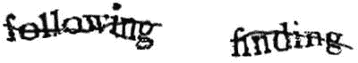

图 1-1. 新一代验证码示例

### 我们的挑战：构建一个数字识别器

我们将要解决的问题被称为“数字识别器”，它直接源自 Kaggle.com 上的一场机器学习竞赛。你可以在这里找到所有相关信息：[`www.kaggle.com/c/digit-recognizer`](http://www.kaggle.com/c/digit-recognizer)

挑战如下：我们拥有一个包含 50,000 张图像的数据集。每张图像都是一个单独的数字，由人手写而成，并以 28×28 像素的分辨率扫描，采用灰度编码，每个像素取从纯白到纯黑的 256 种灰度之一。对于每次扫描，我们也知道正确答案，即人类写下的数字是什么。这个数据集被称为`训练集`。我们现在的目标是编写一个程序，让它从训练集中学习，并利用这些信息对从未见过的图像进行预测：它是 0、1，还是其他数字。

从技术上讲，这被称为`分类`问题：我们的目标是将图像划分到已知的“类别”中，也就是类（因此有了“分类”这个词）。在这种情况下，我们有十个类别，分别对应从 0 到 9 的每个数字。机器学习根据你要解决的问题类型有不同的形式，分类只是其中之一。然而，它或许也是最具有代表性的一种。我们将在本书中涵盖更多类型！

那么，我们该如何解决这个问题呢？让我们先从一个不同的问题开始。假设我们只有两幅图像，一个 0 和一个 1（参见图 1-2）：

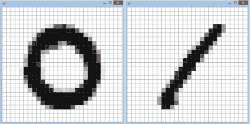

图 1-2. 数字化后的 0 和 1 样本

现在假设我给你图 1-3 中的图像，并问你以下问题：它与图 1-2 中显示的两幅图像中的哪一幅最相似？

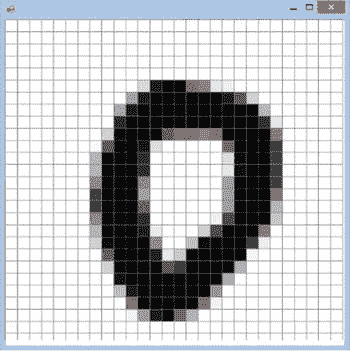

图 1-3. 待分类的未知图像

作为人类，我猜你会觉得这个问题很简单，并回答“显然是第一幅”。就此而言，我猜一个两岁的小孩也会觉得这是个相当简单的游戏。真正的问题是，你如何将大脑完成的这种神奇过程转化为代码？

解决这个问题的一种方法是换个角度来重新表述问题：最相似的图像就是*差异最小*的图像。在这个框架下，你可以开始玩“找不同”的游戏，逐像素比较图像。图 1-4 中的图像显示了一个差异的“热力图”：两个像素差异越大，颜色就越深。

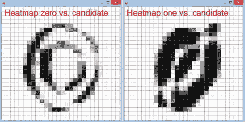

图 1-4. 突出显示图 1-2 与图 1-3 之间差异的“热力图”

在我们的例子中，这种方法似乎效果很好；第二幅图像“非常不同”，中间有一大块黑色区域，而第一幅图像（绘制了两个 0 之间的差异）大部分是白色，只有一些细小的深色区域。

### 机器学习中的距离函数

现在，我们可以通过将所有像素的差异求和，用一个数字来概括两幅图像的差异程度。这样做，对于相似的图像，我们会得到一个较小的数字；对于不相似的图像，则会得到一个较大的数字。我们在这里成功定义的是图像之间的一个“`距离`”，用来描述它们有多接近。完全相同的两幅图像距离为零，像素差异越大，距离就越大。一方面，我们知道距离为零意味着完美匹配，这是我们能期望的最好结果。另一方面，我们的相似度度量也有局限性。例如，如果你拿一幅图像并简单地复制它，但将其向左移动（比如）一个像素，那么它们逐像素的距离最终可能会非常大，即使这两幅图像本质上是相同的。

距离的概念在机器学习中非常重要，并且以某种形式出现在大多数模型中。距离函数是你将试图实现的目标转化为机器可以处理的形式的方式。通过将像两幅图像这样复杂的东西简化为一个数字，你使得算法能够采取行动——在这种情况下，是判断两幅图像是否相似。同时，通过将复杂性简化为一个数字，你也承担了某些细微差别会“在转换中丢失”的风险，就像我们移动图像的场景那样。

距离函数在机器学习中也常以另一个名称出现：`成本函数`。它们本质上是同一回事，但从不同的角度看待问题。例如，如果我们试图预测一个数字，我们的预测误差——即我们的预测值与实际数字相差多远——就是一个距离。然而，用成本来描述这一点是等价的：更大的误差是“昂贵的”，改进模型就意味着降低其成本。

## 从简单开始

但就目前而言，让我们继续前进，愉快地忽略那个问题，并遵循一个对我编写软件和开发预测模型都屡试不爽的方法——什么是最简单且可能有效的方法？先从简单的开始，看看会发生什么。如果效果很好，你就不必构建任何复杂的东西，并且会更快完成。如果效果不佳，那么你只花了很少的时间构建一个简单的概念验证，并且通常在这个过程中对问题空间有了很多了解。无论哪种方式，这都是一个胜利。

因此，目前我们应避免过度思考和过度设计；目标是实现我们认为可能奏效的最简单方法，后续再进行优化。我们可以这样做：当需要识别图像代表的数字时，在已知的 50,000 个训练样本库中搜索最相似（或差异最小）的图像，并预测该图像对应的数字。如果它看起来像 5，那它肯定就是 5！

我们的算法框架如下：给定一张待识别的 28×28 像素图像（称为“未知图像”），以及 50,000 个训练样本（每个样本包含 28×28 像素图像及其标签），我们将：

*   计算未知图像与每个训练样本之间的总差异；

*   找出差异最小的训练样本（即“最相似图像”）；以及

*   预测“未知图像”与“最相似图像”相同。

让我们开始行动吧！

## 第一个模型：C# 版本

为了热身，我们先从熟悉的 C# 实现开始，在 Visual Studio 中创建一个 C# 控制台应用程序。我将解决方案命名为 `DigitsRecognizer`，C# 控制台应用程序命名为 `CSharp`——你可以发挥更多创意！

### 数据集组织

首先，我们显然需要数据。从 [`1drv.ms/1sDThtz`](http://1drv.ms/1sDThtz) 下载数据集 `trainingsample.csv`，并保存到本地某个位置。同时，同一位置还有一个文件 `validationsample.csv`，我们稍后会用到，但最好现在就一并下载。该文件采用 CSV 格式（逗号分隔值），其结构如 图 1-5 所示。第一行是标题行，后续每一行代表一张图像。第一列（“label”）表示图像代表的数字，后续 784 列（“pixel0”、“pixel1”……）代表原始图像的每个像素，以灰度编码，取值范围为 0 到 255（0 表示纯黑，255 表示纯白，中间值表示不同灰度）。

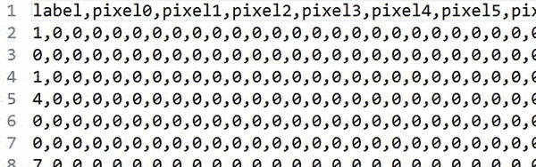

图 1-5. 训练数据集的结构

例如，这里的第一行数据代表数字 1。如果要从该行数据重建实际图像，我们需要将该行拆分为 28 个“切片”，每个切片代表图像的一行：pixel0、pixel1、……、pixel27 编码图像的第一行，pixel28、pixel29、……、pixel55 编码第二行，以此类推。这样我们总共得到 785 列：一列用于标签，28 行 × 28 列 = 784 个像素。图 1-6 描述了一个简化的 4×4 像素图像的编码机制：实际图像是一个数字 1（第一列），后面跟着 16 列，代表每个像素的灰度值。

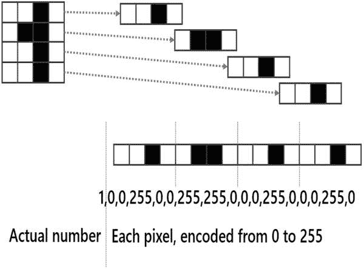

图 1-6. 图像简化为 CSV 行的编码方式

 **注意** 如果仔细观察，你会发现 `trainingsample.csv` 文件只包含 5,000 行，而不是我之前提到的 50,000 行。为了方便，我创建了这个较小的文件，只保留了原始文件的前面部分。50,000 行虽然不算巨大，但足以显著拖慢我们的进度，而且目前处理更大的数据集并不会带来太多价值。

### 读取数据

按照典型的 C# 风格，我们将围绕几个代表领域的类和接口来组织代码。我们将每张图像的数据存储在 `Observation` 类中，并用接口 `IClassifier` 表示算法，以便后续创建模型变体。

第一步，我们需要将 CSV 文件中的数据读取到观测值集合中。进入解决方案，在 CSharp 控制台项目中添加一个类，用于存储观测值：

***清单 1-1***. 将数据存储在 `Observation` 类中

```csharp
public class Observation
{
    public Observation(string label, int[] pixels)
    {
        this.Label = label;
        this.Pixels = pixels;
    }

    public string Label { get; private set; }
    public int[] Pixels { get; private set; }
}
```

接下来，添加一个 `DataReader` 类，用于从数据文件中读取观测值。这里我们需要完成两个不同的任务：从文本文件中提取每一相关行，以及将每一行转换为我们的观测值类型。我们将这两个任务拆分为两个方法：

***清单 1-2***. 使用 `DataReader` 类从文件读取数据

```csharp
public class DataReader
{
    private static Observation ObservationFactory(string data)
    {
        var commaSeparated = data.Split(',');
        var label = commaSeparated[0];
        var pixels =
            commaSeparated
            .Skip(1)
            .Select(x => Convert.ToInt32(x))
            .ToArray();

        return new Observation(label, pixels);
    }

    public static Observation[] ReadObservations(string dataPath)
    {
        var data =
            File.ReadAllLines(dataPath)
            .Skip(1)
            .Select(ObservationFactory)
            .ToArray();

        return data;
    }
}
```

注意，这里的代码主要是 `LINQ` 表达式！面向表达式的代码（如 `LINQ`，或者你稍后会看到的 F#）有助于编写非常清晰的代码，以直接的方式传达意图，通常比过程式代码好得多。它读起来很像英语：“读取所有行，跳过标题行，按逗号拆分每一行，解析为整数，然后给我新的观测值。”如果我和同事交流，这正是我描述自己意图的方式，而这种意图在代码中得到了非常清晰的体现。它尤其适合数据处理任务，因为它提供了一种自然的方式来描述数据转换工作流，而这正是机器学习的核心。毕竟，这就是 `LINQ` 的设计初衷——“语言集成查询”！

现在，我们有了数据、读取器和存储结构——让我们在控制台应用程序中整合这些内容，并将 `trainingPath` 中的 `PATH-ON-YOUR-MACHINE` 替换为本地机器上实际数据文件的路径，进行测试：

***清单 1-3***. 控制台应用程序

```csharp
class Program
{
    static void Main(string[] args)
    {
        var trainingPath = @"PATH-ON-YOUR-MACHINE\trainingsample.csv";
        var training = DataReader.ReadObservations(trainingPath);

        Console.ReadLine();
    }
}
```

如果在此代码块末尾设置断点，然后以调试模式运行，你应该会看到 `training` 是一个包含 5,000 个观测值的数组。很好——一切似乎都正常。

下一个任务是编写一个分类器，当传入一张图像时，它会将该图像与数据集中的每个观测值进行比较，找到最相似的一个，并返回其标签。为此，我们需要两个元素：距离计算和分类器。

## 计算图像之间的距离

我们先从距离开始。我们需要一个方法，它接受两个像素数组，并返回一个描述它们差异程度的数值。距离是我们算法中容易变动的部分；我们很可能希望尝试不同的图像比较方式，以找出最佳方案，因此设计一个允许我们轻松替换不同距离定义而无需大量修改代码的架构是非常可取的。接口为我们提供了一种方便的机制来避免紧耦合，并确保当我们决定稍后更改距离代码时，不会遇到烦人的重构问题。因此，让我们从一开始就提取一个接口：

### 清单 1-4. IDistance 接口

```
public interface IDistance
{
    double Between(int[] pixels1, int[] pixels2);
}
```

现在我们有了接口，就需要实现它。同样，我们会选择当前最简单可行的方式。如果我们想要衡量两张图片的差异程度，为什么不逐像素比较、计算每个差值，然后将绝对值相加呢？完全相同的图片距离为零，而两个像素差异越大，两张图片的距离就越大。这种距离恰好有一个名称，叫做“曼哈顿距离”，实现起来也相当直接，如代码清单 1-5 所示：

### 代码清单 1-5. 计算图片间的曼哈顿距离

```
public class ManhattanDistance : IDistance
{
    public double Between(int[] pixels1, int[] pixels2)
    {
        if (pixels1.Length != pixels2.Length)
        {
            throw new ArgumentException("Inconsistent image sizes.");
        }

        var length = pixels1.Length;

        var distance = 0;

        for (int i = 0; i < length; i++)
        {
            distance += Math.Abs(pixels1[i] - pixels2[i]);
        }

        return distance;
    }
}
```

### 趣味知识：曼哈顿距离

我之前提到过，距离可以通过多种方法计算。我们这里使用的具体公式被称为“曼哈顿距离”。之所以叫这个名字，是因为如果你在纽约市开出租车，这正是计算两点之间驾驶距离的方法。由于所有街道都排列成完美的矩形网格，你需要计算东西方向和南北方向位置的绝对距离，这正是我们代码中所做的。这种距离也被称为 L1 距离，不过这个名字就没那么有诗意了。

我们取两张图片，逐像素比较，计算差值并返回总和，这个总和代表了两张图片的差异程度。请注意，这里的代码采用了非常过程式的风格，完全没有使用 LINQ。实际上，我最初是用 LINQ 编写这段代码的，但坦白说，我不喜欢最终代码的样子。在我看来，超过某个限度（或对于某些操作），用 C# 编写的 LINQ 代码往往会显得过于复杂，这在很大程度上是因为 C# 语言本身比较冗长，尤其是在函数式构造（如`Func<A,B,C>`）方面。这也是一个对比两种风格的有趣例子。在这里，要理解代码的意图，确实需要逐行阅读并将其转化为“人类可读的描述”。代码还使用了变量修改，这是一种需要小心谨慎的风格。

MATH.ABS()

你可能想知道为什么这里要使用绝对值。为什么不直接计算差值呢？要理解这为什么会有问题，请看下面的例子：

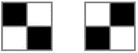

如果我们只使用像素颜色的“普通”差值，就会遇到一个微妙的问题。计算第一张和第二张图片的差值会得到 -255 + 255 – 255 + 255 = 0——这与第一张图片和它自身的距离完全相同。这显然不对：第一张图片显然与自身完全相同，而第一张和第二张图片则尽可能不同，然而根据这个度量标准，它们看起来竟然一样相似！这正是我们需要使用绝对值的原因：如果不这样做，方向相反的差值会相互抵消，结果导致完全不同的图片可能看起来具有非常高的相似度。绝对值保证了我们不会遇到这个问题：任何差值都会根据其幅度受到惩罚，而不管其正负符号。

## 编写分类器

现在我们有了比较图片的方法，接下来编写分类器，从一个通用接口开始。在任何情况下，我们都期望一个两步过程：首先，通过向分类器输入一组已知观测值的训练集来训练它；完成后，我们期望能够预测一张图片的标签：

### 代码清单 1-6. IClassifier 接口

```
public interface IClassifier
{
    void Train(IEnumerable<Observation> trainingSet);
    string Predict(int[] pixels);
}
```

以下是实现我们之前描述的算法的多种方法之一：

### 代码清单 1-7. 基本分类器实现

```
public class BasicClassifier : IClassifier
{
    private IEnumerable<Observation> data;

    private readonly IDistance distance;

    public BasicClassifier(IDistance distance)
    {
        this.distance = distance;
    }

    public void Train(IEnumerable<Observation> trainingSet)
    {
        this.data = trainingSet;
    }

    public string Predict(int[] pixels)
    {
        Observation currentBest = null;
        var shortest = Double.MaxValue;

        foreach (Observation obs in this.data)
        {
            var dist = this.distance.Between(obs.Pixels, pixels);
            if (dist < shortest)
            {
                shortest = dist;
                currentBest = obs;
            }
        }

        return currentBest.Label;
    }
}
```

这个实现同样非常过程化，但应该不难理解。训练阶段只是将训练观测值存储在分类器内部。为了预测一张图片代表什么数字，算法会查找训练集中的每一个已知观测值，计算它与待识别图片的相似度，然后返回最匹配图片的标签。非常简单！

那么，我们怎么知道它有效呢？

太好了——我们有了一个分类器，一个闪亮的代码片段，可以对图片进行分类。我们完成了——发布吧！

别急！我们这里有个小问题：我们完全不知道代码是否有效。作为一名软件工程师，判断“是否有效”很容易。你拿着规格说明（每个人都有规格说明，对吧？），编写测试（你当然会写），运行它们，然后砰！你就知道有没有出问题了。但我们关心的不是“有效”或“无效”，而是“我们的模型在预测方面表现好吗？”

## 交叉验证

一个自然的起点是直接衡量模型执行任务的性能。在我们的例子中，这其实相当容易：我们可以向分类器输入图片，要求它进行预测，将结果与正确答案进行比较，然后计算我们答对了多少。当然，要做到这一点，我们需要知道正确答案是什么。换句话说，我们需要一个带有已知标签的图片数据集，并用它来测试我们模型的质量。这个数据集被称为验证集（有时也简称为“测试数据”）。

此时，你可能会问，那为什么不直接使用训练集本身呢？我们可以训练分类器，然后对 5000 个样本中的每一个都运行它。这不是一个好主意，原因如下：如果你这样做，你衡量的是模型学习训练集的效果。而我们真正感兴趣的是稍微不同的东西：一旦我们将分类器“发布到现实世界”，并开始输入它从未见过的新图片，我们期望它的表现如何？给它输入训练时用过的图片，很可能会给你一个过于乐观的估计。如果你想要一个现实的估计，就给模型输入尚未使用过的数据。

 **注意** 举个例子，我们当前的分类器就是一个有趣的例子，说明使用训练集进行验证可能会出大问题。如果你尝试这样做，你会发现它正确识别了每一张图片。100% 的准确率！对于这样一个简单的模型来说，这好得令人难以置信。实际情况是这样的：当我们的算法在训练集中搜索最相似的图片时，它每次都能找到完美匹配，因为我们测试的图片本身就属于训练集。所以，当结果好得令人难以置信时，请再三检查！

解决该问题的通用方法被称为交叉验证。将你手头的数据留出一部分，拆分为训练集和验证集。用训练集训练模型，用验证集评估模型质量。

# 评估与改进模型

之前，你下载了两个文件：`trainingsample.csv` 和 `validationsample.csv`。我已经为你准备好了这些文件，省去了你自行操作的麻烦。训练集是从完整的 50,000 张原始数据集中抽取的 5,000 张图像样本，验证集则是来自同一数据源的另外 500 张图像。交叉验证还有更高级的实现方式，同时也存在一些需要注意的潜在陷阱，我们将在后续章节中讨论。但简单地将数据拆分为两个独立样本（例如 80%/20% 的比例）是一种简单有效的入门方法。

## 评估模型质量

让我们编写一个类，通过计算模型分类正确的比例来评估我们的模型（或任何我们想尝试的其他模型）：

***清单 1-8***. 评估 `BasicClassifier` 的质量

```
public class Evaluator
{
    public static double Correct(
        IEnumerable<Observation> validationSet,
        IClassifier classifier)
    {
        return validationSet
            .Select(obs => Score(obs, classifier))
            .Average();
    }

    private static double Score(
        Observation obs,
        IClassifier classifier)
    {
        if (classifier.Predict(obs.Pixels) == obs.Label)
            return 1.0;
        else
            return 0.0;
    }
}
```

这里我们使用了一个小技巧：向 `Evaluator` 传入一个 `IClassifier` 和一个数据集，对于每张图像，我们通过比较分类器的预测结果与真实值来“评分”。如果匹配，记录为 1，否则记录为 0。通过使用数字而非布尔值，我们可以计算平均值，从而得到正确分类的百分比。

## 完整示例与验证

现在，让我们将所有内容整合起来，看看这个超级简单的分类器在提供的验证数据集 `validationsample.csv` 上的表现如何：

***清单 1-9***. 训练和验证一个基础的 C# 分类器

```
class Program
{
    static void Main(string[] args)
    {
        var distance = new ManhattanDistance();
        var classifier = new BasicClassifier(distance);

        var trainingPath = @"PATH-ON-YOUR-MACHINE\trainingsample.csv";
        var training = DataReader.ReadObservations(trainingPath);
        classifier.Train(training);

        var validationPath = @"PATH-ON-YOUR-MACHINE\validationsample.csv";
        var validation = DataReader.ReadObservations(validationPath);

        var correct = Evaluator.Correct(validation, classifier);
        Console.WriteLine("Correctly classified: {0:P2}", correct);

        Console.ReadLine();
    }
}
```

如果你现在运行这段代码，在一个绝非简单的任务上，你应该能得到 93.40% 的正确率。我的意思是，我们正在以相当可靠的准确率自动识别手写数字！这已经很不错了，尤其是考虑到这是我们第一次尝试，并且我们刻意保持了方法的简洁性。

## 改进你的模型

那么，下一步是什么？嗯，我们的模型表现不错，但为什么要止步于此呢？毕竟，我们距离 100% 正确率的“圣杯”还很遥远——我们能否加入一些巧妙的改进，获得更好的预测结果呢？

这正是验证集至关重要的地方。就像单元测试能在代码偏离轨道时发出警告一样，验证集为你的模型建立了一个基准，让你不至于盲目行事。现在，你可以自由地尝试各种建模思路，并能清晰地判断某个方向是前景光明还是糟糕透顶。

在这个阶段，你通常会选择两条路径之一。如果你的模型已经足够好，就可以收工了。如果还不够好，你就需要开始思考改进预测的方法，创建新模型，并在验证集上运行它们，通过比较正确分类的百分比来评估新模型是否更优，逐步优化模型，直到你对结果满意为止。

但在我们急于开始尝试改进模型的方法之前，现在似乎是介绍 F# 的最佳时机。F# 是一种出色的 .NET 语言，特别适合机器学习和数据科学；它将使我们实验模型的工作变得容易得多。既然我们已经有了一个可用的 C# 版本，让我们深入探讨并用 F# 重写它，以便比较和对比两者，更好地理解 F# 的编程方式。

## 介绍用于机器学习的 F#

你是否注意到运行我们的模型花了多少时间？为了查看模型的质量，每次代码更改后，我们都需要重新生成控制台应用程序并运行它，重新加载数据，然后进行计算。步骤繁多，如果你的数据集变得稍微大一点，你一天的大部分时间都会浪费在等待数据加载上。这并不理想。

### 使用 F# Interactive 进行实时脚本编写和数据探索

相比之下，F# 在 Visual Studio 中附带了一个非常方便的功能，称为 F# Interactive。F# Interactive 是一个 REPL（读取-求值-打印循环），基本上是一个实时脚本编写环境，你可以在其中试验代码，而无需经历我之前描述的整个周期。

因此，我们将使用脚本而不是控制台应用程序。让我们进入 Visual Studio，向解决方案中添加一个新的库项目（参见图 1-7），并将其命名为 `FSharp`。

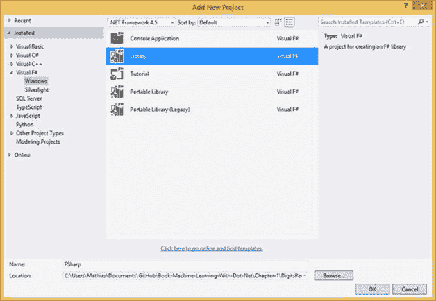

图 1-7. 添加一个 F# 库项目

 **提示** 如果你使用的是 Visual Studio Professional 或更高版本，F# 应该已默认安装。对于其他情况，请查看 [www.fsharp.org](http://www.fsharp.org)（F# 软件基金会），那里有关于安装的全面指南。

值得指出的是，你刚刚向一个包含现有 C# 项目的 .NET 解决方案中添加了一个 F# 项目。F# 和 C# 是完全可互操作的，可以毫无问题地相互通信——你不必限制自己只用一种语言做所有事情。不幸的是，人们常常认为 C# 和 F# 是竞争语言，但事实并非如此。它们很好地互补，因此你可以两全其美：用 C# 做 C# 擅长的事情，利用 F# 的优势做 F# 闪耀的地方！

在你的新项目中，你现在应该看到一个名为 `Library1.fs` 的文件；这相当于 F# 中的 `.cs` 文件。但你是否也注意到一个名为 `script.fsx` 的文件？`.fsx` 文件是脚本文件；与 `.fs` 文件不同，它们不参与构建。它们可以在 Visual Studio 之外作为纯粹的独立脚本使用，这本身就非常有用。在我们当前的机器学习与数据科学背景下，我特别感兴趣的是在 Visual Studio 中的用法：`.fsx` 文件构成了一个绝佳的“草稿本”，你可以在其中试验代码，并享受 IntelliSense 的所有好处。

让我们打开 `Script.fsx`，删除其中的所有内容，然后简单地在任意位置输入以下内容：

```
let x = 42
```

现在选中你刚刚输入的行，然后右键单击。在上下文菜单中，你会看到“在交互窗口中执行”选项，如图 1-8 所示。

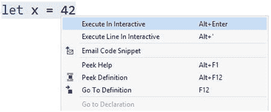

图 1-8. 选择要在交互窗口中运行的代码

继续操作——你应该会看到结果出现在一个标记为“F# Interactive”的窗口中（图 1-9）。

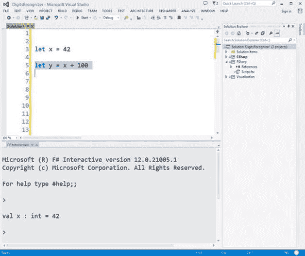

图 1-9. 在 F# Interactive 中实时执行代码

 **提示** 你也可以使用键盘快捷键 `Alt + Enter` 执行脚本文件中选中的任意代码。这比使用鼠标和上下文菜单要快得多。给 ReSharper 用户一个小提醒：直到最近，ReSharper 还有一个讨厌的习惯，会重置该快捷键，所以如果你使用的版本低于 8.1，你可能需要重新创建该快捷键。

F# 交互窗口（为简洁起见，我们通常简称为 FSI）以会话形式运行。也就是说，你在交互窗口中执行的任何内容都将保留在内存中，供你使用，直到你通过右键单击 F# 交互窗口的内容并选择“重置交互会话”来重置会话。

# F# 交互式入门

在这个示例中，我们简单地创建了一个变量 `x`，其值为 42。作为初步近似，这与 C# 语句 `var x = 42;` 非常相似。存在一些细微的差异，但我们稍后会讨论。既然 `x` 在 FSI 中“存在”，我们就可以继续使用它。例如，你可以直接在 FSI 中键入以下内容：

```
> x + 100;;
val it : int = 142
>
```

FSI“记住”了 `x` 的存在：你不需要重新运行 `.fsx` 文件中的代码。一旦运行过一次，它就会保留在内存中。当你想要操作一个相当大的数据集时，这非常方便。使用 FSI，你可以在早上加载一次数据，然后继续编码，而不必像在 C# 中那样，每次有更改时都重新加载。

你可能注意到了 `x + 100` 后面神秘的 `;;`。这向 FSI 指示，到目前为止键入的所有内容都需要立即执行。例如，当你要执行的代码跨越多行时，这很有用。


`提示`：如果你尝试直接在 FSI 中键入 F# 代码，你可能已经注意到没有 IntelliSense。与完整的 Visual Studio 体验相比，FSI 是一个相对原始的开发环境。我关于流程的建议是，只在最小程度上在 FSI 中键入代码。相反，主要在一个 `.fsx` 文件中工作。你将获得现代 IDE 的所有好处，例如自动完成和语法验证。这将自然地引导你编写完整的脚本，这些脚本将来可以重放。虽然脚本不是解决方案构建的一部分，但它们是解决方案本身的一部分，并且也（应该）进行版本控制，这样你始终能够复现你在脚本中进行的任何实验。

## 创建我们的第一个 F# 脚本

既然我们已经了解了 FSI 的基础知识，让我们开始吧。我们将转换我们的 C# 示例，从读取数据开始。首先，我们将执行一个完整的 F# 代码块，看看它做了什么，然后我们将详细检查它，了解它是如何工作的。让我们删除 `Script.fsx` 中当前的所有内容，并编写 清单 1-10 中显示的 F# 代码：

***清单 1-10***. 从文件读取数据

```
open System.IO
type Observation = { Label:string; Pixels: int[] }

let toObservation (csvData:string) =
    let columns = csvData.Split(',')
    let label = columns.[0]
    let pixels = columns.[1..] |> Array.map int
    { Label = label; Pixels = pixels }

let reader path =
    let data = File.ReadAllLines path
    data.[1..]
    |> Array.map toObservation

let trainingPath = @"PATH-ON-YOUR-MACHINE\trainingsample.csv"
let trainingData = reader trainingPath
```

这几行 F# 代码中有相当多的操作。在讨论这一切是如何工作之前，让我们运行它，看看我们劳动成果的结果。选择代码，右键单击，然后选择“在交互中运行”。几秒钟后，你应该会在 F# 交互窗口中看到类似这样的内容出现：

```
>
type Observation =
  {Label: string;
   Pixels: int [];}
val observationFactory : csvData:string -> Observation
val reader : path:string -> Observation []
val trainingPath : string =
  "-"+[58 chars]
val trainingData : Observation [] =
  [|{Label = "1";
     Pixels =
      [|0; 0; 0; 0; 0; 0; 0; 0; 0; 0; 0; 0; 0; 0; 0; 0; 0; 0; 0; 0; 0; 0; 0; 0;
        0; 0; 0; 0; 0; 0; 0; 0; 0; 0; 0; 0; 0; 0; 0; 0; 0; 0; 0; 0; 0; 0; 0; 0;
        0; 0; 0; 0; 0; 0; 0; 0; 0; 0; 0; 0; 0; 0; 0; 0; 0; 0; 0; 0; 0; 0; 0; 0;
        0; 0; 0; 0; 0; 0; 0; 0; 0; 0; 0; 0; 0; 0; 0; 0; 0; 0; 0; 0; 0; 0; 0; 0;
        0; 0; 0; 0; ...|];};
    /// 为简洁起见，此处输出已被截断 ///
    {Label = "3";
     Pixels =
      [|0; 0; 0; 0; 0; 0; 0; 0; 0; 0; 0; 0; 0; 0; 0; 0; 0; 0; 0; 0; 0; 0; 0; 0;
        0; 0; 0; 0; 0; 0; 0; 0; 0; 0; 0; 0; 0; 0; 0; 0; 0; 0; 0; 0; 0; 0; 0; 0;
        0; 0; 0; 0; 0; 0; 0; 0; 0; 0; 0; 0; 0; 0; 0; 0; 0; 0; 0; 0; 0; 0; ...|];};
    ...|]

>
```

基本上，用十几行 F# 代码，我们就获得了 `DataReader` 和 `Observation` 类的所有功能。通过在 F# 交互中运行它，我们可以立即加载数据并查看其外观。此时，我们在 F# 交互会话中加载了一个 `Observation` 数组（数据），它将根据需要一直保留在那里。例如，假设你想知道训练集中第 100 个 `Observation` 的标签。无需重新加载或重新编译任何内容：只需在 F# 交互窗口中键入以下内容并执行：

```
let test = trainingData.[100].Label;;
```

就是这样。因为数据已经在内存中，所以它可以直接工作。

这非常方便，尤其是在数据集很大且加载耗时的情况下。对于以数据为中心的工作，使用 F# 相比 C# 的一个显著优势是：虽然 C# 控制台应用程序中的任何代码更改都需要重新构建和重新加载数据，但一旦数据加载到 F# 交互中，你就可以随心所欲地进行修改。你可以更改代码并进行实验，而无需重新加载的麻烦。

## 剖析我们的第一个 F# 脚本

既然我们已经看到了这十行代码的作用，让我们深入了解它们是如何工作的：

```
open System.IO
```

这一行很直接——它等同于 C# 语句 `using System.IO`。每个 .NET 库都可以被 F# 访问，因此你多年来学习 .NET 命名空间丛林所积累的所有知识都不会丢失——你将能够重用所有这些知识，并用一些 F# 特有的好东西来增强它！

在 C# 中，我们创建了一个 `Observation` 类来保存数据。让我们在 F# 中做同样的事情，使用一个略有不同的类型：

```
type Observation = { Label:string; Pixels: int[] }
```

砰——完成了。在一行中，我们创建了一个*记录*（F# 特有的类型），它本质上是一个不可变的类（如果你从 C# 调用你的 F# 代码，它也会显示为这样），具有两个属性：`Label` 和 `Pixels`。使用记录非常简单，如下所示：

```
let myObs = { Label = "3"; Pixels = [| 1; 2; 3; 4; 5 |] }
```

我们只需打开花括号并填充其所有属性，即可实例化一个 `Observation`。F# 自动推断我们想要的是一个 `Observation`，因为它是唯一具有正确属性的记录类型。我们通过使用符号 `[| |]` 打开和关闭数组并填充内容来为 `Pixels` 创建一个整数数组。

现在我们有了数据的容器，让我们从 CSV 文件中读取。在 C# 示例中，我们创建了一个方法 `ReadObservations` 和一个 `DataReader` 类来容纳它，但该类实际上并没有为我们做太多事情。因此，与其创建一个类，我们只需编写一个函数 `reader`，它接受一个参数 `path`，并使用一个辅助函数从 CSV 行中提取一个 `Observation`：

```
let toObservation (csvData:string) =
    let columns = csvData.Split(',')
    let label = columns.[0]
    let pixels = columns.[1..] |> Array.map int
    { Label = label; Pixels = pixels }
```

```fsharp
let reader path =
    let data = File.ReadAllLines path
    data.[1..]
```


# 探索 F# 的特性

```fsharp
    |> Array.map toFactory
```

这里我们使用了 F# 的不少特性——让我们逐一拆解。代码虽然有些密集，但一旦你掌握了这些内容，就能理解使用 F# 高效进行数据科学所需的 80% 知识！

## 从宏观概览开始

以下是等效的 C# 代码（清单 1-2）：

```csharp
private static Observation ObservationFactory(string data)
{
    var commaSeparated = data.Split(',');
    var label = commaSeparated[0];
    var pixels =
        commaSeparated
        .Skip(1)
        .Select(x => Convert.ToInt32(x))
        .ToArray();
    return new Observation(label, pixels);
}

public static Observation[] ReadObservations(string dataPath)
{
    var data =
        File.ReadAllLines(dataPath)
        .Skip(1)
        .Select(ObservationFactory)
        .ToArray();
    return data;
}
```

C# 和 F# 之间存在一些明显的差异。首先，F# 没有花括号；与 Python 等其他语言类似，F# 使用空白字符来标记代码块。换句话说，空白字符在 F# 代码中具有语义：当你看到缩进深度相同的代码时，它们属于同一个代码块，就好像周围有不可见的花括号一样。以清单 1-10 中的 `reader` 函数为例，我们可以看到函数体从 `let data ...` 开始，到 `|> Array.map observationFactory` 结束。

另一个明显的宏观差异是缺少返回类型或函数参数的类型声明。这是否意味着 F# 是一种动态语言？如果你将鼠标悬停在 `.fsx` 文件中的 `reader` 上，会看到如下提示：`val reader : path:string -> Observation []`，这表示一个函数，它接受一个预期为 `string` 类型的 `path` 参数，并返回一个观测值数组。F# 与 C# 一样是静态类型语言，但它使用强大的类型推断引擎，该引擎会利用所有可用提示自动推断出正确的类型。在这个例子中，`File.ReadAllLines` 只有两个重载，唯一可能的匹配意味着 `path` 必须是 `string` 类型。

从某种意义上说，这为你提供了两全其美的体验——你既能像使用动态语言一样享受更少代码带来的好处，又能拥有一个坚实的类型系统，编译器会帮助你避免愚蠢的错误。

 `提示` F# 的类型推断系统非常出色，仅凭最细微的提示就能推断出你的意图。然而，有时你需要帮助它，因为它无法自行推断。在这种情况下，你可以简单地用预期类型进行注解，像这样：`let reader (path:string) =`。通常，我建议在代码的高层组件或关键组件中使用类型注解，即使并非必要。这有助于让他人更直接地理解你的代码意图，而无需打开 IDE 查看推断出的类型。它还有助于追踪某些问题的根源，确保当你组合多个函数时，每一步都传递了预期的类型。

C# 和 F# 之间另一个有趣的差异是缺少 `return` 语句。与主要采用过程式风格的 C# 不同，F# 是面向表达式的。像 `let x = 2 + 3 * 5` 这样的表达式将名称 `x` 绑定到一个表达式；当该表达式被求值（`2 + 3 * 5` 结果为 17）时，该值被绑定到 `x`。函数也是如此：函数将求值为最后一个表达式的值。下面是一个人为构造的例子来说明这一点：

```fsharp
let demo x y =
    let a = 2 * x
    let b = 3 * y
    let z = a + b
    z // 这是最后一个表达式：
      // 因此 demo 将求值为 z 求值的结果。
```

你可能注意到的另一个区别是参数周围没有括号。我们先忽略这一点，稍后在本章中会再讨论。

## 创建函数管道

让我们深入探讨 `read` 函数的函数体。`let data = File.ReadAllLines path` 只是将位于 `path` 的文件的所有内容一次性读入一个字符串数组，每行一个元素。这里没有什么神奇之处，但它证明了我们确实可以在 F# 中使用 .NET 框架提供的任何功能，无论编写该功能使用的是哪种语言。

`data.[1..]` 展示了 F# 中索引器的语法；`myArray.[0]` 将返回数组的第一个元素。注意 `myArray` 和方括号索引之间有一个点！这里的另一个有趣的语法点展示了数组切片；`data.[1..]` 表示“给我一个新数组，从 `data` 中提取从索引 1 开始到最后一个元素的所有元素”。类似地，你可以执行 `data.[5..10]`（给我索引 5 到 10 的所有元素），或 `data.[..3]`（给我直到索引 3 的所有元素）。这对于数据处理来说非常方便，也是 F# 成为数据科学优秀语言的众多原因之一。

在我们的示例中，我们保留了从索引 1 开始的所有元素，换句话说，我们丢弃了数组的第一个元素——即表头。

在 C# 代码中，下一步涉及使用 `ObservationFactory` 方法从每一行提取一个 `Observation`，我们通过以下方式实现：

```csharp
myData.Select(line => ObservationFactory(line));
```

F# 中的等效行如下：

```fsharp
myData |> Array.map (fun line -> toObservation line)
```

从宏观层面看，你可以将这条语句理解为“获取数组 `myData`，并将其传递给一个函数，该函数将对每个数组元素应用映射，将每一行转换为一个观测值”。与 C# 代码有两个重要区别。首先，虽然 `Select` 语句看起来像是我们正在操作的数组上的一个方法，但在 F# 中，函数的逻辑所有者不是数组本身，而是 `Array` 模块。`Array` 模块的作用类似于 `Enumerable` 类，后者提供了 `IEnumerable` 上的一组 C# 扩展方法。

 `注意` 如果你喜欢在 C# 中使用 LINQ，我想你会非常喜欢 F#。在许多方面，LINQ 是将函数式编程的概念引入面向对象语言 C#。F# 提供了更丰富的类似 LINQ 的函数供你使用。要感受这一点，只需在 `.fsx` 中键入“Array.”，看看有多少函数可供你使用！

第二个主要区别是神秘的符号“|>”。这被称为*管道转发*运算符。简而言之，它获取前一个表达式的结果，并将其传递给管道中的下一个函数，该函数会将其作为最后一个参数使用。例如，考虑以下代码：

```fsharp
let double x = 2 * x
let a = 5
let b = double a
let c = double b
```

这可以重写如下：

```fsharp
let double x = 2 * x
let c = 5 |> double |> double
```

`double` 是一个期望单个整数参数的函数，因此我们可以通过管道转发运算符将 `5` 直接“喂”给它。由于 `double` 也产生一个整数，我们可以继续将操作结果向前转发。我们可以稍微重写这段代码，使其看起来像这样：

```fsharp
let double x = 2 * x
let c =
    5
    |> double
    |> double
```

我们使用 `Array.map` 的例子遵循相同的模式。如果我们使用原始的 `Array.map` 版本，代码将如下所示：

```fsharp
let transformed = Array.map (fun line -> toObservation line) data
```

`Array.map` 期望两个参数：对每个数组元素应用什么转换，以及要应用转换的数组。由于目标数组是函数的最后一个参数，我们可以使用管道转发将数组“喂”给 `map`，如下所示：

```fsharp
data |> Array.map (fun line -> toObservation line)
```


# 如果你完全是 F# 的新手，这可能会让你有点不知所措。别担心！随着学习的深入，我们会看到更多 F# 实际应用的例子。虽然完全理解其工作原理可能需要一些时间，但让它运行起来其实相当简单。管道转发运算符是 F# 中我最喜欢的特性之一，因为它让工作流程变得非常直观：获取数据，然后将其传递到一系列步骤或操作的管道中，直到完成。

## 使用元组和模式匹配处理数据

现在我们有了数据，需要从训练集中找到最接近的图像。就像在 C# 示例中一样，我们需要一个距离函数。与 C# 不同的是，我们不会创建类或接口，而是直接使用一个函数：

```fsharp
let manhattanDistance (pixels1,pixels2) =
    Array.zip pixels1 pixels2
    |> Array.map (fun (x,y) -> abs (x-y))
    |> Array.sum 
```

这里我们使用了 F# 的另一个核心特性：元组与模式匹配的结合。*元组* 是一组未命名但有序的值的组合，这些值可能具有不同的类型。C# 中也有元组，但该语言缺乏模式匹配，这严重削弱了元组的实用性，这非常可惜，因为元组和模式匹配的组合对于数据处理来说是一个强大的工具。

模式匹配的应用远不止于元组。总的来说，模式匹配是一种机制，它能让你的代码简单地识别数据中的各种形状，并据此采取行动。下面是一个小例子，说明模式匹配如何作用于元组：

```fsharp
let x = "Hello", 42 // 创建一个包含 2 个元素的元组
let (a, b) = x // 通过模式匹配解包 x 的两个元素
printfn "%s, %i" a b
printfn "%s, %i" (fst x) (snd x)
```

这里，我们将两个元素“打包”到 `x` 中：一个字符串 "Hello" 和一个整数 42，用逗号分隔。逗号通常表示一个元组，所以在 F# 代码中要注意这一点，一开始可能会有点令人困惑。第二行“解包”了元组，将其两个元素分别提取到 `a` 和 `b` 中。对于包含两个元素的元组，有一种特殊语法可以使用 `fst` 和 `snd` 函数来访问其第一个和第二个元素。

 提示：你可能已经注意到，与 C# 不同，F# 不使用括号来定义函数期望的参数列表。例如，`add x y = x + y` 是你编写加法函数的典型方式。下面的函数 `tupleAdd (x, y) = x + y` 是完全有效的 F# 代码，但含义不同：它期望一个参数，即一个完整的元组。因此，虽然 `1 |> add 2` 是有效代码，但 `1 |> tupleAdd 2` 将无法编译——而 `(1,2) |> tupleAdd` 则可以工作。

这种方法也适用于超过两个元素的元组；主要区别在于它们不支持 `fst` 和 `snd`。注意下面使用了通配符 `_`，意思是“忽略第 2 个位置的元素”：

```fsharp
let y = 1,2,3,4
let (c,_,d,e) = y
printfn "%i, %i, %i" c d e
```

让我们看看这在 `manhattanDistance` 函数中是如何工作的。我们获取两个像素数组（图像），应用 `Array.zip`，创建一个由元组组成的单个数组，其中相同索引的元素被配对在一起。一个简单的例子可能有助于澄清：

```fsharp
let array1 = [| "A";"B";"C" |]
let array2 = [| 1 .. 3 |]
let zipped = Array.zip array1 array2
```

在 FSI 中运行这段代码应该会产生以下输出，这很容易理解：

```fsharp
val zipped : (string * int) [] = [|("A", 1); ("B", 2); ("C", 3)|]
```

所以曼哈顿距离函数所做的是：获取两个数组，将对应的像素配对，对于每一对，计算它们差值的绝对值，然后将所有这些绝对值求和。

## 训练和评估分类器函数

现在我们有了曼哈顿距离函数，让我们在训练集中搜索与我们要分类的图像最接近的元素：

```fsharp
let train (trainingset:Observation[]) =
    let classify (pixels:int[]) =
        trainingset
        |> Array.minBy (fun x -> manhattanDistance x.Pixels pixels)
        |> fun x -> x.Label
    classify

let classifier = train training
```

`train` 是一个期望接收 `Observation` 数组的函数。在该函数内部，我们创建了另一个函数 `classify`，它接收一张图像，找到与目标距离最小的图像，并返回该最接近候选者的标签；`train` 返回那个函数。还要注意，虽然 `manhattanDistance` 不是 `train` 函数参数列表的一部分，但我们仍然可以在其内部使用它；这被称为“将变量捕获到闭包中”，即在函数内部使用一个作用域未在该函数内定义的变量。还要注意 `minBy` 的使用（C# 或 LINQ 中没有这个函数），它方便地允许我们使用任何我们想要比较项目的任意函数，来找到数组中最小的元素。

现在，创建模型就像调用 `train training` 一样简单。

如果你将鼠标悬停在 `classifier` 上，你会看到它具有以下类型：

```fsharp
val classifier : (int [] -> string)
```

这告诉你，`classifier` 是一个函数，它接收一个整数数组（你试图分类的图像的像素），并返回一个字符串（预测的标签）。总的来说，我强烈建议花些时间将鼠标悬停在代码上，确保类型与你认为的一致。F# 的类型推断系统非常出色，但有时它过于智能，它会设法找到一种方式让你的代码工作，但可能并不总是以你预期的方式。

我们差不多完成了。现在让我们验证我们的分类器：

```fsharp
let validationPath = @" PATH-ON-YOUR-MACHINE\validationsample.csv"
let validationData = reader validationPath

validationData
|> Array.averageBy (fun x -> if model x.Pixels = x.Label then 1. else 0.)
|> printfn "Correct: %.3f"
```

这是对我们 C# 代码的一个相当直接的转换：我们读取验证数据，将每个正确预测标记为 1，并计算平均值。完成。

就是这样。在大约三十行代码中，在一个文件里，我们就拥有了所有必需的完整代码。

显然，F# 远不止我们在这次简短速成课程中看到的这些。然而，至此，你应该对 F# 是什么以及为什么它如此适合机器学习和数据科学有了更好的理解。代码简短但可读性强，并且非常适用于构建数据转换管道，这是机器学习中的一项基本活动。F# 交互窗口允许你将数据加载到内存中（只需一次），然后探索数据和建模思路，而无需浪费时间重新加载和重新编译。仅此一点就是一个巨大的优势——但随着我们在本书中的深入，我们将会看到更多关于 F# 的内容，以及如何将其强大功能与 C# 结合使用！

## 改进我们的模型

我们实现了“可能奏效的最笨模型”，而且它的表现实际上相当不错——正确率 93.4%。我们能做得更好吗？

不幸的是，对此没有通用的答案。除非你的模型在预测中已经达到 100% 正确，否则总是存在改进的可能性，并且只有一种方法可以知道：尝试一下，看看是否有效。构建一个好的预测模型涉及大量的试错，因此，做好充分准备以快速迭代、实验和验证想法至关重要。

我们可以探索哪些方向？我脑海中立刻浮现出几个想法。我们可以

*   调整距离函数。我们在此使用的曼哈顿距离只是众多可能性之一，而选择“正确”的距离函数通常是构建优秀模型的关键要素。距离函数（或称成本函数）本质上是你向机器传达其世界中哪些项目应被视为相似或不同的方式，因此仔细思考这一点非常重要。
*   搜索多个最近点，而不是仅考虑一个最近点，并采取“多数投票”机制。这可以使模型更加稳健；考虑更多候选点可以降低我们偶然选中一个不良点的概率。这种方法有一个名称——该算法被称为“K 最近邻”，是机器学习中的经典算法。
*   对图像进行一些巧妙的处理；例如，想象拍摄一张照片，但将其向右移动一个像素。如果你将该图像与原始版本进行比较，即使它们是同一张图像，距离也可能非常大。解决该问题的一种方法是，例如，使用某种模糊处理。用每个像素的相邻像素的平均颜色替换该像素，可以缓解“图像未对齐”的问题。

我相信你也能想到其他想法。让我们一起探讨第一个想法。

## 尝试另一种距离定义

让我们从距离开始。试试看你在高中可能见过的距离如何？它学名叫做“欧几里得距离”。以下是该距离的数学公式：

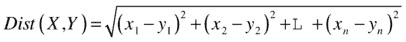

这简单地表明，点 X 和 Y 之间的距离等于它们每个坐标之差的平方和的平方根。你可能见过这个公式的简化版本，即如果你取平面上的两个点 X = (x1, x2) 和 Y = (y1, y2)，它们的欧几里得距离为：

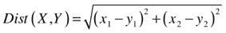

如果你对代码比对数学更熟悉，以下是它在 F# 中的样子：

```
let euclideanDistance (X,Y) =
    Array.zip X Y
    |> Array.map (fun (x,y) -> pown (x-y) 2)
    |> Array.sum
    |> sqrt
```

我们输入两个浮点数数组（每个数组代表一个点的坐标），计算它们每个元素的差值并平方，然后求和，最后取平方根。这并不难，而且非常清晰！

这里需要提及一些技术细节。首先，F# 内置了许多通常在 `System.Math` 类中寻找的数学函数。`sqrt` 就是这样一个函数——能够编写 `let x = sqrt 16.0` 而不是 `var x = Math.Sqrt(16)` 是不是很棒？`pown` 是另一个这样的函数；它是“求 n 次幂”的一个特化版本，适用于指数为整数的情况。通用版本是 `**` 运算符，例如 `let x = 2.0 ** 4.0`；当你已知指数为整数时，`pown` 能带来显著的性能提升。

另一个细节：我们这里的距离函数是正确的，但从技术上讲，为了我们的目的，我们实际上可以去掉其中的 `sqrt`。我们需要的是最近的点，如果 `0 <= A < B`，那么 `sqrt A < sqrt B`。因此，与其承担该运算的开销，不如去掉它。这也使我们能够在整数上操作，这比双精度浮点数或单精度浮点数快得多。

## 提取距离函数

如果我们的目标是尝试不同的模型，那么现在可能是进行一些重构的好时机。我们希望交换代码中的不同部分，并观察其对预测质量的影响。具体来说，我们想要切换距离。典型的面向对象方法是提取一个接口，例如 `IDistance`，并将其注入到训练中（这正是我们在 C# 示例中所做的）。然而，如果你仔细想想，接口完全是多余的——我们需要的只是一个函数，它接受两个点作为输入并返回一个整数，即它们之间的距离。以下是我们如何实现它：

***清单 1-11***。重构距离

```
type Distance = int[] * int[] -> int

let manhattanDistance (pixels1,pixels2) =
    Array.zip pixels1 pixels2
    |> Array.map (fun (x,y) -> abs (x-y))
    |> Array.sum

let euclideanDistance (pixels1,pixels2) =
    Array.zip pixels1 pixels2
    |> Array.map (fun (x,y) -> pown (x-y) 2)
    |> Array.sum

let train (trainingset:Observation[]) (dist:Distance) =
    let classify (pixels:int[]) =
        trainingset
        |> Array.minBy (fun x -> dist (x.Pixels, pixels))
        |> fun x -> x.Label
    classify
```

我们没有使用接口，而是创建了一个类型 `Distance`，它是一个函数签名，期望接收一对像素并返回一个整数。现在，我们可以将任何我们想要的 `Distance` 作为参数传递给 `train` 函数，该函数将返回一个使用该特定距离的分类器。例如，我们可以使用 `manhattanDistance` 函数或 `euclideanDistance` 函数（或者任何其他任意的距离函数，如果我们想进一步实验的话）来训练一个分类器，并比较它们的性能。请注意，这在 C# 中也完全可行：与其创建一个接口 `IDistance`，我们可以简单地使用 `Func<int[],int[],int>`。我们的代码将如下所示：

***清单 1-12***。函数式 C# 示例

```
public class FunctionalExample
{
    private IEnumerable<Observation> data;
    private readonly Func<int[], int[], int> distance;

    public FunctionalExample(Func<int[], int[], int> distance)
    {
        this.distance = distance;
    }

    public Func<int[], int[], int> Distance
    {
        get { return this.distance; }
    }

    public void Train(IEnumerable<Observation> trainingSet)
    {
        this.data = trainingSet;
    }

    public string Predict(int[] pixels)
    {
        Observation currentBest = null;
        var shortest = Double.MaxValue;
        foreach (Observation obs in this.data)
        {
            var dist = this.Distance(obs.Pixels, pixels);
            if (dist < shortest)
            {
                shortest = dist;
                currentBest = obs;
            }
        }
        return currentBest.Label;
    }
}
```

这种方法侧重于组合函数而非对象，是典型的所谓函数式编程风格。C# 虽然源于面向对象，但支持许多函数式编程惯用法。可以说，自 3.5 版本以来，几乎所有进入 C# 的特性和创新（LINQ、Async 等）都借鉴自函数式编程。在这一点上，我们可以将 C# 描述为一种首先是面向对象，但支持函数式惯用法的语言；而 F# 则首先是一种函数式编程语言，但也能适应面向对象的风格。在本书中，我们总体上将强调函数式风格而非面向对象风格，因为在我们看来，它比面向对象风格更适合机器学习算法，而且更普遍地说，以函数式风格编写的代码具有显著的优势。

无论如何，我们已经准备好验证我们的想法是否可行。现在我们可以创建两个模型并比较它们的性能：

```
let manhattanClassifier = train trainingData manhattanDistance

let euclideanClassifier = train trainingData euclideanDistance

printfn "曼哈顿距离"

evaluate validationData manhattanClassifier

printfn "欧几里得距离"

evaluate validationData euclideanClassifier
```

这里的好处在于，我们无需将数据集重新加载到内存中；只需修改脚本文件，选中包含要运行的新代码的部分，然后执行即可。如果这样做，我们会看到新模型 `euclideanModel` 正确分类了 94.4% 的图像，而 `manhattanModel` 的正确率是 93.4%。太棒了！我们刚刚挤出了 1% 的提升。1% 听起来可能不多，但如果你已经达到了 93.4%，那么你实际上将错误率从 6.6% 降低到了 5.6%，提升了大约 15%。

仅仅通过距离函数的一个小改动，我们就获得了非常显著的改进。这似乎是一个很有前景的方向，或许值得尝试更复杂的距离函数，或者探索前面提到的其他方向。如果你不注意，很可能会面临一个问题：你会得到一大碗混乱的代码，里面充斥着各种实验。就像版本控制和自动化对于传统软件开发至关重要一样，在开发预测模型时，它们也是你的得力助手。过程的细节和节奏可能有所不同，但总体思路是一样的：你希望处于这样一种状态——可以修改代码而不用担心破坏任何东西，并且“在我的机器上能运行”是远远不够的。任何时候，任何人都应该能够直接获取你的代码，并在无需人工干预的情况下复现你的结果。这种方法被称为“可复现研究”。我强烈建议你朝这个方向努力，并尽可能使用脚本和源代码控制；我亲身经历过那种可怕的场景：你明明知道昨天有一个效果更好的模型，但因为懒得干净地保存，就是想不起来当时具体是怎么做的，那个模型也就此消失。不要成为那样的人！尤其是在当今这个时代，使用 `Git` 或 `Mercurial` 这样的 DVCS 创建分支如此简单，没有任何借口再出现这类问题。当你对模型有了新想法时，创建一个分支，并将你在脚本中执行的步骤保存下来。

## 那么，我们学到了什么？

本章我们涵盖了不少内容！在机器学习方面，你现在已经熟悉了几个关键概念以及方法论。如果你是 `F#` 新手，那么你已经编写了你的第一段 `F#` 代码！

让我们回顾一些要点，先从机器学习方面开始。

首先，我们讨论了交叉验证，即使用独立的数据集进行训练和验证，留出一部分数据来评估预测模型质量的过程。这在多个层面上都是一个关键过程。首先，它为你提供了一个基线，一个指导你实验的“基本事实”。没有验证集，你就无法判断某个特定模型是否优于另一个模型。交叉验证允许你科学地衡量质量。它的作用有点像自动化测试套件，当你的开发工作偏离轨道时向你发出警告。

一旦交叉验证设置就绪，你就可以尝试进行实验，在可量化的基础上选择模型或研究方向。试错法是“做机器学习”的重要组成部分。事先无法知道某个特定方法是否有效，因此你必须亲自在数据上尝试，这使得为自己创造成功条件并拥抱“可复现研究”理念变得非常重要。尽可能通过脚本自动化你的流程，并大量使用源代码控制，以便在任何给定时刻，无需人工干预就能复现模型的每一步。总的来说，要让自己能够轻松地修改和运行代码。

## 一个好的距离函数应具备哪些特征

在我们的数字识别探索中，我们看到距离函数的一个小改动显著提升了我们的模型。在大多数（所有？）机器学习模型的核心，都有一个距离函数。所有的学习过程归根结底就是计算机试图找到最佳方式来将已知数据拟合到特定问题——而“最佳拟合”的定义完全包含在距离函数中。从某种意义上说，它是将你的目标从人类形式转化为机器可理解的、用数学表述的语句。距离函数也常被称为成本函数；从成本角度思考，更强调是什么让一个糟糕的解决方案变得糟糕，以及应该使用什么惩罚来避免选择糟糕的解决方案。

根据我的经验，花时间仔细思考你的成本函数总是值得的。无论你使用的算法多么巧妙，如果成本函数有缺陷，结果都会很糟糕。想象一个包含两个测量值的数据集：以英尺为单位的身高和以磅为单位的体重。如果我们像处理图像那样，在数据集中寻找“最相似”的个体，会发生以下情况：虽然身高通常在 5 到 6 英尺的范围内，但体重则处于更宽且数值更高的范围，比如 100 到 200 磅。因此，直接基于这两个测量值计算距离基本上会忽略身高差异，因为 1 英尺的差异将等同于 1 磅的差异。解决这个问题的一种方法是转换所有特征，确保它们处于一致的尺度上，这个过程称为“归一化”，我们将在后面更详细地讨论这个主题。幸运的是，所有像素都以相同的尺度编码，我们可以在这里忽略这个问题，但我希望这个“距离出错”的例子能让你明白，为什么值得花些心思在你的距离函数上！

这也是一个恰当数学定义确实有用的例子。如果你翻出学生时代的数学笔记，你会看到距离函数（数学家有时也称其为度量）由几个性质定义：

*   `距离(A,B) > 0`（没有负距离）
*   `距离(A,B) = 0` 当且仅当 `A = B`（与 `A` 距离为 0 的唯一元素是 `A` 本身）
*   `距离(A,B) = 距离(B,A)`（对称性：从 `A` 到 `B` 的距离应与从 `B` 到 `A` 的距离相同）
*   `距离(A,B) <= 距离(A,C) + 距离(C,B)`（“三角不等式”：两点之间没有比直线更短的距离）

我们在本章中只看了两种距离，但满足这些性质的函数有很多种，每种都以不同的方式定义相似性。就此而言，模型中的成本函数并不需要满足所有这些性质，但通常来说，如果不满足，你可能需要问问自己，这可能会产生哪些意想不到的副作用。例如，在最初使用曼哈顿距离的例子中，如果我们省略了绝对值，就会公然违反规则 1（非负距离）和规则 3（对称性）。在某些情况下，有充分的理由可以灵活处理，使用一个不是度量的函数，但当这种情况发生时，请多花一分钟思考一下可能出错的地方！

## 模型不必复杂

最后，我希望传达的一点是，有效的模型不必复杂！无论是 `C#` 还是 `F#`，这两个分类器都很小，并且使用了相当简单的数学。当然，一些复杂的模型也可能给你带来惊人的结果，但如果你能用简单、易于理解和修改的模型获得同样的结果，那为什么不选择简单的呢？

这被称为奥卡姆剃刀，以中世纪哲学家 **奥卡姆的威廉** 命名。奥卡姆剃刀遵循经济原则。在试图解释某件事时，当多个模型都能拟合时，选择最简单的那个。只有当简单的解释行不通时，才应该转向复杂的模型。

本着同样的精神，我们在这里首先实现了“可能奏效的最简单的东西”，我强烈建议你遵循这种方法。如果你不这样做，很可能发生的情况是：你会开始实现一些可能有效的想法；这些想法会激发新的灵感，于是你很快就有了一堆半成品的原型，然后你会越陷越深，没有清晰的流程或方法。突然，你会意识到自己已经花了几周时间在编码，却不太确定是否有什么东西能工作，或者下一步该往哪里走。这种感觉可不好。给自己设定时间限制，花一天（或一周、一小时，根据你的问题设定一个现实的时间），用你能想到的最笨、最简单的预测模型构建一个端到端的模型。它可能实际上已经足够好了，这样你就没有浪费时间。如果它不够好，到那时你也会拥有一个合适的框架，集成了数据整合和交叉验证，并且很可能已经发现了数据集中可能存在的任何意想不到的棘手问题。那时你就处于一个进入“丛林”的绝佳位置。

## 为什么选择 F#？

如果这是你第一次接触 `F#`，你最初可能会疑惑我为什么要介绍这门语言，而不是坚持用 `C#`。我希望这个例子已经让你明白为什么了！在我看来，虽然 `C#` 是一门很棒的语言，但 `F#` 非常适合机器学习和数据探索。我们将在后续章节中看到更多 `F#` 的内容，但我希望本章已经阐明了其中一些原因。

首先，`F#` 交互式环境和脚本环境绝对能节省时间。在开发机器学习模型时，能够快速实验、修改代码并看到效果至关重要，而这需要一个脚本环境。我典型的 `F#` 工作流程是，在一天开始时，将所需的任何数据加载到交互式环境中。一旦完成，我就不需要重新加载它——数据就在那里，在内存中，我可以自由地摆弄模型。相比之下，在 `C#` 中测试一个新想法，迫使我重新构建代码并重新加载数据，这最终会成为一个巨大的时间消耗。

此外，`F#` 的一些语言特性使其非常适合数据处理。它专注于函数而非对象，这对于将函数应用于数据并以任何需要的方式塑造数据非常有效。管道转发运算符 `|>` 非常方便，可以组合这些转换并创建一个管道，以非常易读的方式表示数据转换工作流。再结合将数据打包成元组并通过模式匹配解包的能力，以及 `Array`、`List` 和 `Seq` 模块中丰富的内置函数，你就拥有了一个类似增强版 `LINQ` 的工具，可以用任何你想要的方式转换和重塑数据。

## 更进一步

我第一次向人们展示这个算法时，经常得到的反应是“但是……这太笨了。”他们真正的意思是，“但是……学习在哪里？”从形式上讲，机器学习被定义为“编写一个程序，当获得更多数据时，它能更好地执行任务。”我们的模型，即 1 最近邻，完美符合这个定义：你会期望更大的样本“工作得更好”（或者相反，如果你减少样本，你会期望性能下降）。另一方面，它并不完全符合我们对学习的直观理解。我们的模型真的记住了它看到的一切，而人类倾向于将学习视为识别更高层次的抽象，这些抽象提供了我们经验的更紧凑表示。当你看到一张数字图片时，你不会翻遍你一生中看过的每一张图片来决定是否匹配——你知道更高层次的概念，可以让你过滤和识别（“0 看起来像一个圆圈”）。

更高级的算法，例如支持向量机或神经网络，可以用于我们的问题（我们将在第 8 章中这样做），它们的行为更符合这种“学习”的概念：它们在训练阶段处理数据并提取一个精简的表示。明显的缺点是训练阶段实际上会复杂得多；优点是生成的模型会更小、更快。

那么，你应该使用支持向量机、神经网络还是其他什么？通常情况下，答案是“视情况而定”。首先，这取决于你的最终目标是什么。你的目标可能是提高准确性；如果你的代码要部署到实际生产环境中，也可能要求速度更快、占用内存更少，或者其他要求。

正如我们之前讨论的，实际上没有办法知道一个模型是否会比另一个更好——你必须去尝试，而这可能代价高昂。因此，在开始追求改进模型之前，请三思：你当前的模型是否已经足够好？你是否把精力用在了正确的问题上？正如法国谚语所说，“le mieux est l’ennemi du bien”——“更好是好的敌人。”我们简单的算法实现了大约 95% 的正确分类，这已经相当不错了。如果这已经足够，就不要浪费时间了；继续解决你的下一个有趣问题吧。机器学习问题往往有自我发展的趋势：除非你得到了一个快速且 100% 准确的完美模型，否则你永远不会完全完成，而且很容易想回头尝试改进它，再挤出一点准确性。所以，提前想好什么是“足够好”，否则你可能会陷入对完美的漫长追求中！

## 实用链接

*   F# 软件基金会，网址为 [www.fsharp.org](http://www.fsharp.org)，提供了大量关于如何安装和开始使用 F# 的信息。
*   Kaggle 数字识别器竞赛的完整数据集可以在 [www.kaggle.com/c/digit-recognizer](http://www.kaggle.com/c/digit-recognizer) 找到。你甚至可以参加比赛，看看自己的表现如何——这非常有趣，也是一次很棒的学习体验！