# 第 2 章 垃圾邮件还是正常邮件？

使用贝叶斯定理自动检测文本中的垃圾邮件


如果你使用电子邮件（我猜你肯定在用！），那么你很可能每天都在见证机器学习在发挥作用。你的邮件客户端可能包含某种垃圾邮件过滤机制，它能自动识别收件箱中那些明显不受欢迎的推广内容，并将其悄悄送入“垃圾邮件文件夹”中遗忘。这让你免去了逐一手动删除这些邮件的烦恼，也避免了不小心点击潜在有害链接的风险。这正是机器学习在运用得当时如何改善人类生活的典型例子。计算机擅长执行重复性任务，并且能做到一丝不苟；通过自动处理繁琐的工作并帮助我们避免错误，它们使我们人类能够专注于更有趣、更需思考的活动。

垃圾邮件检测是机器学习实际应用的一个绝佳例证，也是分类问题的经典范例。给定一组电子邮件，我们需要将它们分为两类：垃圾邮件（应直接送入垃圾箱的不受欢迎邮件）或正常邮件（我们确实想阅读的有效邮件）。它之所以有趣还有另一个原因：与我们在第 1 章中处理的数字识别问题（数据为数值形式）不同，垃圾邮件检测完全涉及文本。数字世界中可用的大部分材料都是文本，而非组织良好的数字表格，因此理解如何处理文本至关重要。

在本章中，我们将从头构建一个垃圾邮件检测引擎，然后以此为例说明一些有用的技术和思路。我们将：

*   建立一种处理文本的方法。从计算机的角度来看，原始文本文档只是一堆随机字符。我们将看到如何通过将文本块转换为计算机可以处理的标记，从中提取特征（即，将原始数据转换为新的、更具信息性或更可用的属性，即“特征”）。
*   了解贝叶斯定理，这是一个简单而强大的数学公式，它量化了如何纳入新信息以更新我们对不确定事件的评估。作为直接应用，我们将实现一个朴素贝叶斯分类器，这是一种利用词汇频率来确定文档类型的算法。
*   讨论理解数据对于正确解释结果及其质量的重要性，并说明如何从数据集中提取新特征，可以在不修改算法本身的情况下显著增强模型的预测能力。

我们将首先专注于实现一个通用算法，用于分析文本文档并判断它们属于哪个类别。一旦我们拥有了这个工具，我们将把注意力转回数据集，看看仔细检查我们拥有的数据如何使我们能够设计新特征，并显著提高预测质量。

我们的挑战：构建一个垃圾邮件检测引擎

我们这里要处理的文档不会是电子邮件。相反，我们将处理短信。我们的目标是使用来自英国的真实短信（短消息服务）数据集来识别垃圾邮件，该数据集来自优秀的加州大学尔湾分校机器学习库。

 **附注** UCI 机器学习库由加州大学尔湾分校的机器学习与智能系统中心于 1987 年创建。你可以在[`archive.ics.uci.edu/ml/`](http://archive.ics.uci.edu/ml/)找到该机器学习库。它包含近 300 个干净且文档完备的数据集，可按大小、特征类型等标准进行搜索和分类。这是学习机器学习的绝佳资源，其中包含许多常被用作算法性能评估基准的“经典”数据集。

了解我们的数据集

在讨论我们可以使用什么模型之前，让我们先看看数据。该数据集可以从[`1drv.ms/1uzMplL`](http://1drv.ms/1uzMplL)下载（它只是 UCI 存储库中原始文件的副本，原始文件可在[`archive.ics.uci.edu/ml/datasets/SMS`](http://archive.ics.uci.edu/ml/datasets/SMS)+Spam+Collection 找到）。它存储为一个名为 SMSSpamCollection 的纯文本文件，没有文件扩展名，包含 5,574 条真实短信。每一行是一条单独的短信，被标记为“正常”或“垃圾邮件”。以下是前几行的样子：

```
ham    Go until jurong point, crazy.. Available only in bugis n great world la e buffet... 
       Cine there got amore wat...
ham    Ok lar... Joking wif u oni...
spam   Free entry in 2 a wkly comp to win FA Cup final tkts 21st May 2005\. Text FA to 87121 
       to receive entry question(std txt rate)T&C's apply 08452810075over18's
ham    U dun say so early hor... U c already then say...
ham    Nah I don't think he goes to usf, he lives around here though
spam   FreeMsg Hey there darling it's been 3 week's now and no word back! I'd like some fun 
       you up for it still? Tb ok! XxX std chgs to send, £1.50 to rcv
```

我首先注意到的是，人们在短信中使用的语言显然与“标准规范英语”不同！这一点我们需要牢记，因为它可能对我们的分析产生影响。例如，像“U c”（“You see”的缩写）这样的片段，很可能在普通词典中找不到。

考虑到这一点，我的第一步是尝试获得一种非正式的“直觉”，了解这两组数据有何不同。是否有某些词在垃圾邮件或正常邮件中出现得更频繁？这可以帮助我们指导构建一个智能引擎来自动区分正常邮件和垃圾邮件。让我们首先按类别（“正常”与“垃圾邮件”）拆分数据集，并统计每个类别中的词频。鉴于这项活动的探索性质，使用 F#脚本似乎是个不错的选择。

 **提示** 花时间探索你的数据！盲目地将算法应用于数据集可能效果尚可，但只能带你走到那一步。正如在开发应用程序时学习领域模型会有所回报一样，对数据的更深入理解将帮助你构建更智能的预测模型。

使用可区分联合来建模标签

我们首先需要的是数据。我们将沿用上一章的思路，但有一个变化。虽然整个数字数据集由数字组成（无论是编码像素还是标签），但这里我们有一个特征（短信文本本身）和一个标签（要么是正常，要么是垃圾邮件）。我们应该如何表示它？

一种可能性是将标签编码为布尔值，例如，`true`表示正常，`false`表示垃圾邮件。这完全可行；然而，它有一个缺点：它不能使字段的含义不言自明。如果我仅仅向你展示一个以这种方式编码的数据集记录——例如：

```
True    Ok lar... Joking wif u oni... ,
```

你如何能猜到`true`代表什么？另一个潜在问题是，如果将来需要更多类别——比如正常、垃圾邮件和模棱两可的邮件——布尔值将无法很好地扩展。


机器学习本身已经足够困难，无需再增加额外且不必要的复杂性。因此，我们将用 F# **可区分联合**（有时我也会简称为 DU）来表示标签。如果你从未接触过可区分联合，可以初步将其理解为与 C# 枚举类似，它们都定义了一组互斥的情况，但可区分联合的功能要强大得多。虽然这种类比远不能完全体现 DU 的能力，但足以帮助我们入门。

让我们通过一个可以在 FSI 中运行的示例，简要说明 DU 的工作原理。定义一个 DU 就像定义一个类型一样简单：

```
type DocType =
    | Ham
    | Spam
```

在 F# Interactive 窗口中运行这段代码（在末尾添加 ;; 以触发求值），你应该会看到以下内容：

```
type DocType =
  | Ham
  | Spam
```

这定义了一个简单的类型 `DocType`，它只能是两种值之一，别无其他：Spam 或 Ham。我喜欢可区分联合的主要原因之一是，它们与模式匹配配合得非常好，能让你以非常清晰的方式编写描述业务领域的代码。例如，在我们的案例中，训练集中的每个示例要么是 Ham 要么是 Spam，并且包含文本，即实际消息的内容。我们可以将其表示为一个元组，其中每个示例是一个 `DocType` 和一个字符串，然后按以下方式处理示例，你可以在 F# Interactive 窗口中尝试：

```
let identify (example:DocType*string) =
     let docType,content = example
     match docType with
     | Ham -> printfn "'%s' is ham" content
     | Spam -> printfn "'%s' is spam" content
```

这个示例仅用于说明目的，但展示了我们稍后将遵循的模式。在这个例子中，我们创建了一个小函数，它接收一个示例并打印出其内容，以及它是 Ham 还是 Spam。我们首先通过模式匹配元组将示例拆分为两部分（DocType 和内容），然后对 DocType 的两种可能情况使用模式匹配，在单独的“分支”中处理每种情况。尝试在 FSI 中输入以下代码：

```
identify (Ham,"good message");;
```

...你应该会看到以下结果：

```
'good message' is ham
```

在我们能更好地确定如何处理实际的短信内容之前，这就是我们建模数据的方式。让我们开始加载数据集吧！

读取数据集

就像在第 1 章中一样，我们将大部分时间花在实时处理数据集上，在脚本环境中逐步构建和优化模型。让我们启动 Visual Studio，创建一个新的 F# 库项目，并将其命名为 `HamOrSpam`。为了方便起见，我们还可以在 Visual Studio 外部使用文件系统，在解决方案中添加一个名为 `Data` 的文件夹，并将数据文件 `SMSSpamCollection`（从前面提到的链接下载，保持原样，不带任何文件扩展名）放入其中。参见图 2-1。

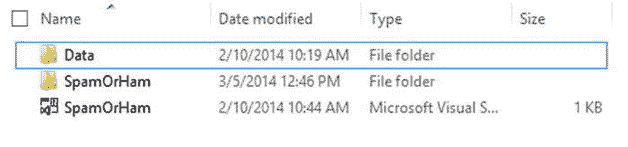

图 2-1. 文件夹组织结构

这将使我们能够使用一个小技巧，以比第 1 章更简洁的方式访问数据文件。F# 有几个方便的内置常量，`__SOURCE_DIRECTORY__` 和 `__SOURCE_FILE__`，它们极大地简化了脚本中文件的操作，并允许我们引用数据文件的位置，而无需硬编码依赖于本地机器的路径。从它们的名称你可能已经猜到，第一个常量会求值为包含文件本身的目录的完整路径，第二个常量则返回文件本身的完整路径，包括文件名。

现在该进入脚本本身了。这与数字识别数据集的主要区别在于，我们没有表头，只有两列，并且这两列不是用逗号分隔，而是用制表符分隔。除此之外，问题大致相同：我们有一个包含示例的文件，需要将其提取到一个数组中。毫不奇怪，我们的解决方案看起来也非常相似：读取文件，并对每一行应用一个函数，以便将其解析为标签和内容，并围绕制表符 `'\t'` 进行分割。

让我们直接进入项目中的 `Script.fsx` 文件。删除默认存在的代码，并粘贴以下代码：

***清单 2-1***. 从文件中读取短信数据集

```
open System.IO

type DocType =
     | Ham
     | Spam

let parseDocType (label:string) =
    match label with
    | "ham"  -> Ham
    | "spam" -> Spam
    | _      -> failwith "Unknown label"

let parseLine (line:string) =
    let split = line.Split('\t')
    let label = split.[0] |> parseDocType
    let message = split.[1]
    (label, message)

Let fileName = "SMSSpamCollection"
let path = __SOURCE_DIRECTORY__ + @"..\..\Data\" + fileName

let dataset =
    File.ReadAllLines path
    |> Array.map parseLine
```

此时，你应该能够选中脚本文件中刚刚编写的所有代码，并在 F# Interactive 中执行它，这将产生以下输出：

```
val dataset : (DocType * string) [] =
  [|(Ham,
     "Go until jurong point, crazy.. Available only in bugis n grea"+[50 chars]);
    (Ham, "Ok lar... Joking wif u oni...");
    (Spam,
     "Free entry in 2 a wkly comp to win FA Cup final tkts 21st May"+[94 chars]);
    // 为简洁起见已省略
    (Ham,
     "Hi. Wk been ok - on hols now! Yes on for a bit of a run. Forg"+[117 chars]);
    (Ham, "I see a cup of coffee animation"); ...|]
```

我们现在有了一个示例数据集，每个示例都被标识为 Spam 或 Ham。我们可以开始着手处理我们真正感兴趣的问题：我们可以使用哪些特征来区分 Ham 和 Spam 消息？

 **提示**  使用 `File.ReadAllLines` 读取数据集的内容并不总是最佳选择。我们是一次性将所有内容加载到内存中的一个数组，然后创建另一个数组来存储 `Array.map` 转换的结果。这个特定数据集包含大约 5000 行，相当小，但在处理更大的数据集时，你可以使用流式版本（例如 `System.IO.StreamReader.ReadLine()`）来逐行将数据集加载到内存中。

决定单个单词

现在我们有了数据，可以开始分析了。我们的最终目标是识别 Spam 和 Ham，但与数字识别案例不同，我们还没有一组清晰的特征；我们唯一可用的材料是原始的文本块，即短信本身。同时，可以推测文本中有大量信息可以利用。我们只需要找到一种方法，将这些字符串转换为我们可以使用的特征。

使用单词作为线索

如果你浏览了我们刚刚加载的数据集，可能会注意到 Spam 消息看起来与 Ham 有些不同。浏览消息时，你的眼睛很容易发现一些引起警觉的线索，这些线索表明某条消息更可能是 Spam。例如，单词“FREE”（全大写！）在几个 Spam 项目中很早就出现了，而在 Ham 中似乎不常见。

这提示了一种可能的方法：使用整个消息中的单个单词来识别它属于哪个类别。让我们首先尝试通过统计包含该特定字符串的 Spam 消息数量，并与 Ham 消息进行比较，来确认我们的直觉是否正确。我们可以通过在脚本中输入几行 F# 代码来测试这一点。首先，让我们过滤数据集，只保留 Spam，然后再次过滤，这次只保留包含“FREE”的消息，最后统计剩余多少条：


```
let spamWithFREE =
    dataset
    |> Array.filter (fun (docType,_) -> docType = Spam)
    |> Array.filter (fun (_,sms) -> sms.Contains("FREE"))
    |> Array.length
```

选中上述代码并在 F# Interactive 中运行，你将看到以下结果：

```
val spamWithFREE : int = 112
```

现在对 Ham（正常邮件）执行相同操作：

```
let hamWithFREE =
    dataset
    |> Array.filter (fun (docType,_) -> docType = Ham)
    |> Array.filter (fun (_,sms) -> sms.Contains("FREE"))
    |> Array.length
```

这将产生以下结果：

```
val hamWithFREE : int = 1
```

这些数字证实了我们的直觉：“FREE”在垃圾邮件中的出现频率确实远高于正常邮件，似乎是一个区分两类邮件的良好标志。我们可以利用这一点构建一个非常原始的垃圾邮件分类器，如下所示：

```
let primitiveClassifier (sms:string) =
     if (sms.Contains "FREE")
     then Spam
     else Ham
```

这是一个有前景的开端。然而，如果我们想利用这个想法构建更严肃的应用，就需要解决两个问题。首先，我们选择了“FREE”作为垃圾邮件的指示词，但并未真正论证其合理性。我们如何知道某个特定词是否是垃圾邮件或正常邮件的良好标记？其次，仅根据整条消息中的一个词来做决定似乎相当局限。我们能否同时使用多个词，并将它们（可能相互矛盾的）信息整合到一个单一的决策过程中？

**量化我们的确定程度**

凭直觉就能看出，包含“FREE”的消息极有可能是垃圾邮件，这并不需要统计学高级学位。我们能否以一种不依赖直觉的方式，将得出这一结论的过程形式化，并量化某个特定词在指示消息是正常邮件还是垃圾邮件方面的可靠性？

就我个人而言，我经常借助决策树来更好地理解概率问题。在我们的案例中，我们是这样做的：取包含 5,574 份文档的语料库，按文档类型将其分为两组（747 封垃圾邮件 vs. 4,827 封正常邮件），然后针对每组文档，统计其中包含单词“FREE”的文档数量。这可以用决策树来表示，如图 2-2 所示：

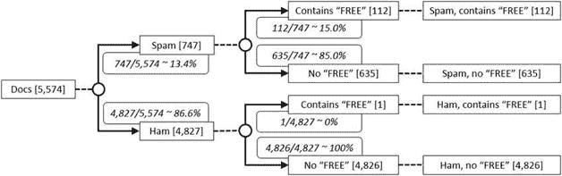

图 2-2. 决策树

我喜欢将决策树想象成一系列管道（如果你愿意，也可以说是流水线）。从一个初始节点开始，但注入的不是水，而是 100% 的概率。每个节点代表一个可能产生多个结果的事件；概率在分支之间分配，并且不应有任何概率消失。

在这个案例中，我们从 5,574 份文档开始，它们要么是正常邮件，要么是垃圾邮件。绝大多数文档是正常邮件——5,574 份中有 4,827 份，占 86.6%——因此，在没有其他信息的情况下，如果我随机挑选一条消息并问你“它是正常邮件还是垃圾邮件？”，你的答案应该是正常邮件（并且你有 86.6% 的概率是正确的）。

树的下一层考虑的是，对于每个组，文档包含单词“FREE”的可能性。例如，如果一条消息是垃圾邮件，那么它包含“FREE”的概率是 747 分之 112。用概率术语来说，在已知文档是垃圾邮件的条件下，该文档包含“FREE”的概率是 15.0%。

这很有趣，但对于我们的分类目的来说并无用处。我们真正想要的是，在已知文档包含“FREE”的条件下，该文档是垃圾邮件的概率。不过，获取这个信息并不太难：我们只需要重新组织这棵树，从文档是否包含“FREE”开始，而不是从垃圾邮件与正常邮件开始。请注意，无论我们如何构建树，最终都应该得到相同的四个叶子组；例如，仍然应该有 112 份文档既是垃圾邮件又包含“FREE”。在 5,574 份文档中，有 113 份包含“FREE”，其中 112 份来自垃圾邮件组，1 份来自正常邮件组。经过一些重新组织，我们应该得到如图 2-3 所示的决策树。虽然它与之前的树完全等价，但它提供了关于不同信息片段之间如何相互关联的不同视角。

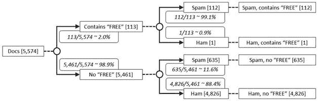

图 2-3. 翻转后的决策树

具体来说，它直接给出了我们关心的信息：如果文档包含单词“FREE”，那么它是垃圾邮件的概率是 112/113，即 99.1%（从而科学地证实了我们之前的直觉）。

**贝叶斯定理**

我们刚刚使用的方法有一个名字：**贝叶斯定理**。在其最枯燥的教科书形式中，通常表述如下：

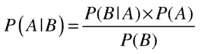

符号 | 应读作“在……条件下”。我们刚刚经历的示例是关于计算在已知邮件包含单词“FREE”的条件下，该邮件是垃圾邮件的概率，用贝叶斯定理的公式表示如下：

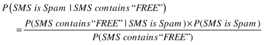

如果你机械地计算这些数字，将得到以下结果，这正是我们通过决策树得出的结论：

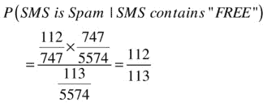

理解贝叶斯定理的一种方式是将其视为两部分数据之间的平衡：我们对世界的初始认知（在我们的示例中，即一开始垃圾邮件的比例）和一条额外信息（单词“FREE”在垃圾邮件或正常邮件中出现的频率）。贝叶斯定理量化了如何权衡这条新信息：垃圾邮件越罕见，我们的默认预测就越应倾向于正常邮件，并且需要更强的证据才能改变预测。

理解贝叶斯定理的另一种方式是将其与独立性的概念联系起来。两个事件 A 和 B 被称为独立的，当且仅当以下等式成立：

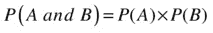

……如果你对贝叶斯定理稍加推导，这又意味着：

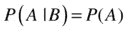

换句话说，了解关于 B 的任何信息都不会传递关于 A 的有用信息（反之亦然）。相反，如果 A 和 B 不独立，贝叶斯定理将捕捉到这两条信息之间关联的强度。最后一点（也是提醒注意的一点），请注意这种效应可能有多么不对称。如果我知道一封邮件是垃圾邮件，那么它包含“FREE”的概率是 15%；然而，如果我知道一封邮件包含单词“FREE”，那么它是垃圾邮件的概率是 99%！

**蒙提霍尔问题**


如果你觉得这种方法令人困惑，别担心。它既简单又复杂——执行计算很容易，但理解其背后的原理却不容易。众所周知，人脑并不擅长处理不确定性，就连非常聪明的人也曾在这个问题上犯过令人难堪的错误。最著名的例子就是蒙提霍尔问题：在游戏节目中，参赛者从三扇门中选一扇，其中一扇门后有奖品，主持人会从剩下的两扇门中打开一扇没有奖品的门。问题是，参赛者此时是否应该换门？20 世纪 50 年代，玛丽莲·沃斯·莎凡特正确回答了这个问题，但几位著名的数学家，比如保罗·埃尔德什，却错误地试图证明她错了。我个人从这个故事中学到的是，处理概率时要非常小心，因为人类的直觉在这方面记录不佳——当然，在公开批评任何人之前也要三思！

处理罕见词汇

贝叶斯定理为我们提供了一种便捷的方法，可以根据单个词判断一条信息是正常邮件还是垃圾邮件。不过，你可能注意到了一个小问题。如果你选了一个只出现在某一类中的词——例如，“叔叔”、“蜜蜂”或“葡萄酒”这些只出现在正常邮件中的词——那么我们的公式会为其中一个类别分配 100%的概率，而为另一个类别分配 0%的概率。换句话说，如果我们看到一条包含“叔叔”这个词的信息，我们会自动以 100%的置信度判定这条信息不可能是垃圾邮件，而忽略信息的其余部分。

显然，这不可能是对的；我们不应该基于有限的训练样本对任何事情抱有 100%的置信度。解决这个问题的一种方法是使用**拉普拉斯平滑**。这项以法国数学家皮埃尔-西蒙·拉普拉斯命名的技术，听起来很吓人，但可以说它只是一个“修正因子”。我们将通过将每个词的计数加一，并计算 P(垃圾邮件包含“xyz”) = (1 + 包含“xyz”的垃圾邮件计数) / (1 + 垃圾邮件总数)，来消除缺失词的问题。本质上，我们是在虚构一条包含所有词的信息，这样一来，最罕见的词也会有一个非常低的概率，但不会是零。

组合多个词

利用贝叶斯定理，我们弄清楚了如何根据一条短信是否包含某个特定词来对其进行分类。这算是一种进步，但我们还没完成。一条信息中有很多词，每个词都会以不同的强度将其推向正常邮件或垃圾邮件。我们如何将这些可能发出矛盾信号的信息组合成一个单一的值，并用它来做决策呢？

将文本拆分为词元

举个例子，考虑下面这条假设的信息：“开车，不能发短信。”它是垃圾邮件的概率是多少？

我们可以尝试直接应用贝叶斯定理，在我们的数据集中查找整条信息。然而，我不认为这种方法会很有效。找到完全重复的信息（更不用说很多条了）的可能性微乎其微。另一方面，我们之前看到“免费”这个词携带了一些相关信息。我们要做的就是把信息拆分成一组词：“开车”、“不能”和“发短信”，然后用这种表示形式代替原始文本。然后，我们可以分析单个词元，并（希望）将它们各自所暗示的信息组合成一个我们可以信赖的单一值来做决策。

这种将一段文本拆分成有意义的元素（词或其他符号），即词元的过程，被称为**词元化**。决定如何词元化是模型的重要组成部分，而且没有唯一正确的方法——这取决于手头的问题。目前，和往常一样，我们将从最容易实现的方法开始：如果单个词“免费”就具有信息量，那么让我们扩展这个想法，将信息拆分成所有单个的词。实际上，我们是在将每条信息转换成一个特征集合，每个特征代表某个特定词的出现与否。

例如，如果我们有两个字符串：“编程很有趣”和“函数式编程更有趣！”，我们可以将它们分解为“编程”、“是”、“有趣”和“函数式”、“编程”、“是”、“更”、“有趣”。这种表示形式将使我们能够更高效地工作。我们不需要检查一条信息是否包含某个特定的子串，而是可以预处理每个文档，将其变成一组词元，并快速验证它是否包含我们感兴趣的特定词元。

 **注意** 这种通用方法对于将文本转换成计算机可以处理的形式非常有用。例如，我们可以收集语料库中找到的所有词元集合——[“函数式”；“编程”；“是”；“更”；“有趣”]——并通过统计每个词元出现的次数来编码每个文档。在我们的例子中，第一段文本变成了[0；1；1；0；1]，第二段变成了[1；1；1；1；1]。我们的数据集现在变成了人类完全无法阅读的形式，但看起来却很像第 1 章中的数字数据集：每一行是一个观测值，每一列是一个特征，所有内容都被编码为数字——例如，我们可以用这个来判断两个文档的相似程度。将观测值转换成一组计算机可以分析以发现模式的数值特征，这种方式是人类无法做到的，这在机器学习中相当典型。

你可能会想，“这太过于简化了”，而你是对的。毕竟，我们是在把完整的句子转换成原始的词汇集合，忽略了句法、语法或词序等因素。这种转换显然会丢失信息；例如，“我喜欢胡萝卜讨厌西兰花”和“我喜欢西兰花讨厌胡萝卜”这两个句子会被拆分成相同的词元集合[和；西兰花；胡萝卜；讨厌；我；喜欢]，因此会被视为完全相同。同时，我们并不是要理解句子的含义；我们只需要识别哪些词与特定的行为相关联。

我想强调的另一点是，虽然我们的词元化看起来相当直接，但它已经包含了许多隐含的决策。我们决定将“编程”和“编程”视为同一个词，忽略大小写。这是一个合理的假设吗？也许吧，也许不是。如果你在在线讨论中（比如论坛或 YouTube 评论）花过一点时间，你可能会同意，大量使用大写字母通常意味着讨论质量在下降。因此，可以认为大小写很重要，并且可能为分类信息提供相关信息。这里的另一个隐含决策是去掉了“！”；这合理吗？标点符号可能也很重要。

好消息是，与其争论大小写或标点符号是否重要，我们以后可以很容易地通过交叉验证来解决这个问题。用 W·爱德华兹·戴明的不朽名言来说：“我们相信上帝——其他人请拿出数据。”为每个假设创建替代模型，比较它们的性能，让数据来做决定。

朴素地组合分数


既然我们已经决定将消息分解为三个标记——“driving”、“cant”和“txt”——我们仍需找出一种方法来计算该消息是正常邮件还是垃圾邮件的概率。“txt”强烈指向垃圾邮件，而“driving”则指向正常邮件。我们该如何综合所有这些证据呢？

如果我们应用贝叶斯定理，在已知消息包含所有三个标记的条件下，计算该消息是垃圾邮件的概率，我们会得到：

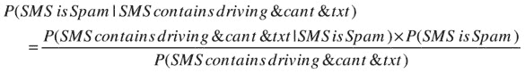

这个公式看起来有点吓人。然而，如果我们做一个简化假设，事情就会变得简单得多。我们暂且假设标记之间是相互独立的——也就是说，在一条消息中看到一个标记，并不会影响其他标记是否出现。在这种情况下，我们可以计算：

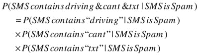

对上述公式稍加运用贝叶斯定理的“柔术”，你应该会得到以下结果：

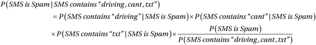

从根本上说，我们正在做的是：不再试图以完全复杂的方式对英语进行建模，而是使用一个简单得多的模型。想象你有两个巨大的单词桶，一个装垃圾邮件单词，一个装正常邮件单词，每个桶中单词的比例不同。消息是通过从其中一个桶中随机抽取单词并串联起来生成的。当然，这是一个相当荒谬的语言模型。但同时，它也有一些明显的好处。一个更“正确”的模型可能特定于某种语言（例如，考虑其语法和句法），并且很可能不适用于其他语言。因此，让我们从一个相当糟糕的模型开始，这个模型对任何语言或文档类型来说都同样糟糕，但易于处理，然后看看它会带我们走向何方！

简化文档评分

至此，我们几乎可以开始编写代码并实现分类器了。我们可以轻松地提取出 P(短信是垃圾邮件)，即训练集中垃圾邮件的比例，以及 P(短信包含“X” | 短信是垃圾邮件)，即包含标记“X”的垃圾邮件的比例。

在开始之前，让我们做最后几项调整。首先，你可能已经注意到，对于垃圾邮件和正常邮件两种情况，我们冗长的贝叶斯公式都涉及除以同一个项：P(短信包含“driving”, “cant”, “txt”)。最终，我们感兴趣的是判断一条消息是垃圾邮件还是正常邮件，而不一定是精确的概率。在这种情况下，我们不妨去掉这个公共项，省去一些不必要的计算，直接计算一个“分数”而不是概率：

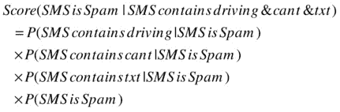

如果 Score(垃圾邮件) > Score(正常邮件)，我们将把该消息归类为垃圾邮件。

事实上，如果我们只想要一个分数，我们还可以更进一步，解决另一个与精度相关的问题。根据定义，我们在一条消息中观察到任何特定标记的概率都是一个小于 1 的数，并且通常是一个接近零的数。由于我们的公式涉及将这些概率相乘，结果会趋近于零，这可能导致舍入问题。

为了避免这个问题，通常使用一个老技巧，将计算转换为对数形式。具体细节并不重要，但以下是为什么这可能是个好主意的原因。由于 log (a * b) = log a + log b，我们将能够把公式从乘积形式转换为求和形式，从而避免舍入问题；并且由于对数函数是递增函数，通过对数转换公式将保留分数的排序。因此，我们将使用以下公式对消息进行评分，而不是原始公式：

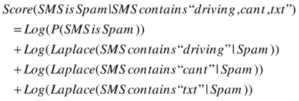

在某种程度上，这阐明了算法的逻辑。每个标记都有一个正常邮件分数和一个垃圾邮件分数，量化了它指示每种情况的强度。当尝试判断一个文档是否为垃圾邮件时，算法从一个垃圾邮件分数（即垃圾邮件的基线水平）开始，每个标记都会独立于其他标记，增加或减少文档的垃圾邮件分数。如果文档的垃圾邮件分数最终高于正常邮件分数，则该文档是垃圾邮件。

实现分类器

前面讨论了很多数学和建模内容，编码部分不多。幸运的是，这就是我们所需要的全部：我们现在可以开始实现一个朴素贝叶斯分类器了。从根本上说，分类器依赖于两个要素：一个用于将文档分解为标记的分词器，以及一组标记——即我们用来对文档评分的单词。有了这两个组件，我们需要从样本示例中学习每个标记在垃圾邮件和正常邮件中分别获得什么分数，以及每个类别的相对权重。

图 2-4 概述了学习阶段。从一个已标记的消息语料库开始，我们将其分成两组：垃圾邮件和正常邮件，并测量它们的相对大小。然后，对于选定的标记集（此处为“free”、“txt”和“car”），我们测量它们的频率，并将每组文档缩减为对应于其整体权重的分数，并为该特定组中的每个标记得出一个分数：

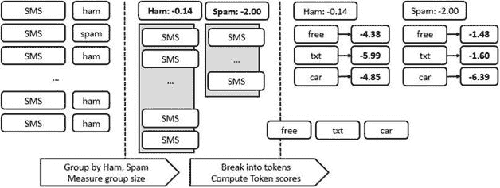

图 2-4. 朴素贝叶斯学习阶段

一旦这些信息可用，对新文档进行分类就遵循 图 2-5 中概述的流程：对文档进行分词，根据存在的标记计算其在每个组中的分数，并预测得分最高的组。

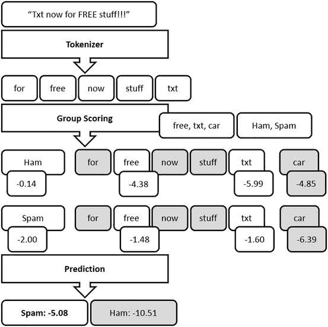

图 2-5. 朴素贝叶斯分类器概述

在这个特定示例中，一旦文档被分词，我们查找每个单独标记是否有可用分数（如果没有则忽略），计算每个组的总体分数，并决定哪个组最可能是匹配项。

将代码提取到模块中

为了避免脚本中代码过于杂乱，让我们将分类器本身提取到一个模块中。为此，只需右键单击解决方案，选择“添加新项”，然后选择“源文件”。将该文件重命名为 `NaiveBayes.fs`，删除可能存在的任何默认代码，并将其替换为以下内容：

```
namespace NaiveBayes

module Classifier =

let Hello name = printfn "Hello, %s" name
```

最后，右键单击该文件并选择“上移”（或 Alt + 上箭头），直到 `NaiveBayes.fs` 出现在解决方案文件列表的第一位（你也可以通过在解决方案资源管理器中选择一个文件，然后使用“在上面添加”或“在下面添加”直接将文件添加到所需位置）。现在，你已经创建了一个模块，可以在其中开始编写函数，并从脚本中调用它们，或者从 F# 或 C# 项目中使用它们。仅出于说明目的，以下是如何从当前脚本中使用 `Hello` 函数的方法：

```
#load "NaiveBayes.fs"
open NaiveBayes.Classifier
Hello "World"
```


 **注意**  你可能想知道为什么必须将刚创建的文件上移。与 C# 不同，在 F# 解决方案中，文件的顺序很重要。其主要原因在于类型推断系统。编译器会通过查看你在代码文件中截至当前所定义的内容，自动推断出你意图使用的类型。类似地，如果你想在代码中使用函数 `f`，那么该函数 `f` 必须在使用它的代码之前定义。这虽然是一个额外的约束，但在我看来，这是为类型推断带来的好处所付出的合理代价；而且，作为一个有趣的副作用，它还为 F# 解决方案提供了一种自然的顺序，使得代码非常易于解读：从第一行开始向前阅读，或者从最后一行开始向后阅读！

对文档进行评分与分类

现在我们已经有了模块，接下来将在该模块中编写算法本身，然后使用脚本文件通过该算法探索数据。让我们遵循典型的 F# 模式，自底向上构建，先编写小段代码，再将其组合成更大的工作流。模型的关键要素是评分计算，它衡量文档属于某个组（例如垃圾邮件）的证据有多强。

评分依赖于两个组成部分：该组在整个语料库（训练数据）中出现的频率，以及某些特定标记在该组中出现的频率。让我们先定义几个类型来表示我们的领域。与其将文档和标记都表示为字符串，不如实事求是地定义一个 `Token` 类型——一个 `string` 的类型别名。这将使类型签名更加清晰。例如，我们现在可以将 `Tokenizer` 定义为一个函数，它接受一个字符串（文档）并返回一组标记。类似地，让我们为已分词化的文档提供一个名称，使用 `TokenizedDoc` 类型别名：

```
type Token = string
type Tokenizer = string -> Token Set
type TokenizedDoc = Token Set
```

为了对一个新的文档（带有未知标签）进行分类，我们需要利用已有的带标签文档样本，为每个可能的组计算其评分。这需要每个组的两类信息：其比例（该组在整个数据集中出现的频率），以及我们为模型选择的每个标记的评分，该评分指示该标记指向该组的强度。

我们可以用一个数据结构 `DocsGroup` 来建模，它包含 `Proportion`（该组在整个数据集中出现的频率）和 `TokenFrequencies`，后者是一个 `Map`（一种 F# 数据结构，其作用类似于 `Dictionary`），将每个标记与其在数据集中的（经拉普拉斯修正的）频率关联起来。例如，在我们的具体案例中，我们会创建两个 `DocsGroup`——一个用于正常邮件，一个用于垃圾邮件——其中正常邮件的 `DocsGroup` 包含正常邮件在整个数据集中的总体比例，以及我们感兴趣的每个标记及其在正常邮件中出现的实际频率：

```
type DocsGroup =
    {   Proportion:float;
        TokenFrequencies:Map<Token,float> }
```

假设一个文档已经被分解为一组标记，那么计算其在给定组中的评分就相当简单。我们不必担心这些数字是如何计算出来的。如果这部分已经完成，我们只需将组频率的对数，以及同时出现在分词化文档和模型所用标记列表中的每个标记的对数相加即可：

***清单 2-2***。对文档进行评分

```
let tokenScore (group:DocsGroup) (token:Token) =
    if group.TokenFrequencies.ContainsKey token
    then log group.TokenFrequencies.[token]
    else 0.0

let score (document:TokenizedDoc) (group:DocsGroup) =
    let scoreToken = tokenScore group
    log group.Proportion +
    (document |> Seq.sumBy scoreToken)
```


对文档进行分类，只需使用分词器将其转换为词元，在可能的文档组列表中找到得分最高的组，并返回其标签即可：

***清单 2-3***。预测文档的标签

```
let classify (groups:(_*DocsGroup)[])
             (tokenizer:Tokenizer)
             (txt:string) =
    let tokenized = tokenizer txt
    groups
    |> Array.maxBy (fun (label,group) ->
        score tokenized group)
    |> fst
```

你可能会对 `classify` 函数中的 `groups:(_*DocsGroup)[]` 部分感到疑惑。为什么不为每个文档组使用 `(DocType*DocsGroup)` 元组？这个神秘的 `_` 符号又是什么？仔细想想，到目前为止我们所做的一切都不依赖于标签的具体内容。我们考虑的是垃圾邮件和正常邮件，但同样可以将其应用于不同的文档语料库，例如，预测书面电影评论对应的是 1、2、3、4 还是 5 星评级。因此，我决定让代码具有通用性；只要你拥有一个标签类型一致的示例文档集合，它就能工作。`_` 符号表示“类型通配符”（支持任何类型），如果你查看 `classify` 函数的签名，会看到：`groups:('a * DocsGroup) [] -> tokenizer:Tokenizer -> txt:string -> 'a`。通配符已被替换为 `'a`（表示泛型类型），并且该函数返回一个 `'a`，即（泛型）标签类型。

## 介绍集合和序列

这里引入了两种新类型：序列和集合。我们先简要讨论一下集合。顾名思义，集合表示一组唯一项的集合，其主要目的是回答“项 X 是否属于集合 S？”这个问题。鉴于我们想要查找特定单词（或更一般地说，词元）是否出现在短信中，以判断其可能是垃圾邮件还是正常邮件，使用一种能够高效比较项集合的数据结构似乎是合理的。通过将文档简化为词元集合，我们将能够快速识别包含诸如“txt”之类词元的文档，而无需承担使用 `Contains()` 字符串方法的开销。

`Set` 模块提供了一些围绕集合操作的有用函数，如下面的代码片段所示。在 F# 交互式窗口中输入以下内容：

```
> let set1 = set [1;2;3]
let set2 = set [1;3;3;5];;

val set1 : Set<int> = set [1; 2; 3]
val set2 : Set<int> = set [1; 3; 5]
```

这创建了两个集合。注意，重复值 3 已从 `set2` 中移除。`Set` 模块提供了用于计算集合并集和交集的函数：

```
> let intersection = Set.intersect set1 set2
let union = Set.union set1 set2;;

val intersection : Set<int> = set [1; 3]
val union : Set<int> = set [1; 2; 3; 5]
```

`Set` 还公开了一个有用的函数 `difference`，它从一个集合中减去另一个集合；也就是说，它会从第一个集合中移除在第二个集合中找到的每个元素：

```
> let diff1 = Set.difference set1 set2
let diff2 = Set.difference set2 set1;;

val diff1 : Set<int> = set [2]
val diff2 : Set<int> = set [5]
```

注意，与交集和并集函数不同，`difference` 是不可交换的；也就是说，参数的顺序很重要，如前面的示例所示。最后，请注意集合是不可变的：一旦创建了集合，就无法修改：

```
> let set3 = Set.add 4 set1
set1.Contains 4;;

val set3 : Set<int> = set [1; 2; 3; 4]
val it : bool = false
```

将 4 添加到 `set1` 会创建一个新集合 `set3`，它确实包含 4，但原始集合 `set1` 并未受到该操作的影响。

我们引入的另一种类型是序列，它是一个惰性求值的元素序列——也就是说，它是一个仅在需要时才会计算的集合，从而可能减少内存或计算使用量。让我们在 F# 交互式窗口中尝试以下代码：

```
> let arr1 = [| for x in 1 .. 10 -> x |]
let seq1 = seq { for x in 1 .. 10 -> x };;

val arr1 : int [] = [|1; 2; 3; 4; 5; 6; 7; 8; 9; 10|]
val seq1 : seq<int>
```

这两个表达式——`arr1` 和 `seq1`——非常相似；它们都生成从 1 到 10 的整数。然而，数组立即显示其全部内容，这些内容已被急切求值；相比之下，`seq1` 显示为一个整数序列，没有更多细节。实际内容只会在代码需要时生成。让我们通过以下示例进一步证明这一点，该示例通过获取 `seq1` 并将其每个元素加倍来构造一个新序列。注意我们如何在序列本身中添加了一个副作用：每当生成序列的一个元素时，我们都会打印出正在映射的元素：

```
> let seq2 =
    seq1
    |> Seq.map (fun x ->
        printfn "mapping %i" x
        2 * x) ;;

val seq2 : seq<int>
```

同样，结果是一个还没有实际内容的序列，因为到目前为止还没有任何东西需要它。让我们通过请求前三个元素的和来改变这一点：

```
> let firstThree =
    seq2
    |> Seq.take 3
    |> Seq.sum;;
mapping 1
mapping 2
mapping 3

val firstThree : int = 12
```

当此代码执行时，会打印出“mapping 1”、“mapping 2”和“mapping 3”，表明序列正在提取其前三个元素，这是计算总和所必需的。然而，其余七个可用元素目前仍然不需要，因此尚未被求值。

那么，既然我们已经有了像数组这样完美的集合，序列还有什么意义呢？第一个好处是惰性求值。因为序列只会“按需”求值，我们可以用它们来生成无限序列；例如，用数组完全不可能做到的事情。下面的代码片段提供了一个有点牵强的例子：我们创建一个无限序列，永远在 1 和 -1 之间交替。显然，我们无法在内存中实例化这样一个无限的数字序列，但现在它被定义了，我们可以使用它，例如，计算任意数量元素的总和：

```
> let infinite = Seq.initInfinite (fun i -> if i % 2 = 0 then 1 else -1)
let test = infinite |> Seq.take 1000000 |> Seq.sum;;

val infinite : seq<int>
val test : int = 0
```

F# 序列经常被使用的另一个原因是它们等同于 C# 的 `IEnumerable`；因此，所有标准的 .NET 集合都可以被视为序列，并且，`Seq` 模块提供的函数可以用来操作它们，使用实际集合本身不存在的功能。作为说明，考虑这个例子：

```
> let arr = [| 1;2;2;3;4;4;4|]
let counts = 
    arr
    |> Seq.countBy (fun x -> x)
    |> Seq.toArray;;

val arr : int [] = [|1; 2; 2; 3; 4; 4; 4|]
val counts : (int * int) [] = [|(1, 1); (2, 2); (3, 1); (4, 3)|]
```

我们生成一个整数数组，然后想要计算每个整数出现的次数。虽然数组不直接支持此功能（至少在 F# 4.0 正式发布之前是这样），但序列支持，因此我们在数组上调用 `Seq.countBy`，并将结果转换回数组以触发序列求值。

 **提示** 虽然序列有很多优点（谁不想只计算需要的东西，不多不少呢？），但惰性求值也有其缺点，包括给调试增加了一些复杂性。

## 从文档语料库中学习

为了使用 `classify` 函数，我们需要每个文档组的汇总数据。生成这些数据需要哪些信息？组比例需要组中的文档数量以及文档总数。然后，对于我们选择用于分类器的每个词元，我们需要计算（经过拉普拉斯修正的）文档比例，这些文档在分词后包含该词元。


 **注意** 无论你使用何种语言或风格，以这种方式进行应用程序设计都非常有效：创建职责单一、任务明确的小型组件，无需担心程序其他部分的情况。这有助于提取具有最小数据结构的清晰模型。然后，你可以将所有组件连接起来，此时，如果出于性能等原因需要稀释设计，也不会很困难。

收集汇总数据的显而易见的方法是编写一个函数，其签名期望接收一个文档集合，并返回一个包含传入文档组分析结果的 `DocsGroup`。同样，我们假设我们获取的数据形式恰好便于当前任务处理，稍后再考虑如何实现这一点。

首先，让我们创建几个辅助函数，以避免在计算比例和拉普拉斯平滑比例时进行整数到浮点数的转换，并帮助我们统计包含特定标记的文档数量：

```
let proportion count total = float count / float total
let laplace count total = float (count+1) / float (total+1)
let countIn (group:TokenizedDoc seq) (token:Token) =
    group
    |> Seq.filter (Set.contains token)
    |> Seq.length
```

现在，我们拥有了分析一组具有相同标签的文档并将其汇总到 `DocsGroup` 所需的所有构建块。我们需要做的就是：

*   计算该组相对于文档总数的相对大小，以及
*   对于我们决定用于分类文档的每个标记，找出它们在组内的拉普拉斯校正比例。

***清单 2-4***。分析一组文档

```
let analyze (group:TokenizedDoc seq)
            (totalDocs:int)
            (classificationTokens:Token Set)=
    let groupSize = group |> Seq.length
    let score token =
        let count = countIn group token
        laplace count groupSize
    let scoredTokens =
        classificationTokens
        |> Set.map (fun token -> token, score token)
        |> Map.ofSeq
    let groupProportion = proportion groupSize totalDocs

{
        Proportion = groupProportion
        TokenFrequencies = scoredTokens
    }
```

 **注意** 统计标记。我们通过统计单词在多少文档中出现来确定其出现频率。这对于短消息非常合适，但对于较长的文档效果不佳。如果你试图判断一本书是否关于计算机，统计该词出现的次数可能比简单地问“这个词在这本书中至少出现一次吗？”更能说明问题。我们用于短信的方法被称为“词集”；另一种标准方法是“词袋”，它依赖于整体词频，可能更适合某些文档类型。

我们快完成了。既然我们知道如何分析单个文档组，我们只需要协调这些部分，并完全实现我们在图 2-4 中概述的算法。给定一组文档及其标签，我们需要：

*   将每个文档分解为标记，
*   按标签将它们分开，以及
*   分析每个组。

***清单 2-5***。从文档中学习

```
let learn (docs:(_ * string)[])
          (tokenizer:Tokenizer)
          (classificationTokens:Token Set) =
    let total = docs.Length
    docs
    |> Array.map (fun (label,docs) -> label,tokenizer docs)
    |> Seq.groupBy fst
    |> Seq.map (fun (label,group) -> label,group |> Seq.map snd)
    |> Seq.map (fun (label,group) -> label,analyze group total classificationTokens)
    |> Seq.toArray
```

是时候收尾了。我们真正希望从整个过程中得到的是一个函数，它接收一个字符串（原始短信消息），并根据我们从文档训练集中学到的知识，给出得分最高的标签。

***清单 2-6***。训练朴素贝叶斯分类器

```
let train (docs:(_ * string)[])
          (tokenizer:Tokenizer)
          (classificationTokens:Token Set) =
    let groups = learn docs tokenizer classificationTokens
    let classifier = classify groups tokenizer
    classifier
```

基本上就是这样。大约 50 行代码，我们就有了一个可用的朴素贝叶斯分类器。

训练我们的第一个分类器

既然我们已经实现了一个通用算法，终于可以回到手头的问题上，即识别哪些消息是正常邮件，哪些是垃圾邮件。`train` 函数的签名清晰地勾勒出我们的目标：要获得一个分类器，我们需要一个训练样本集、一个分词器以及一组要使用的标记。训练集已经提供给我们，因此我们现在的目标是确定哪种分词器和标记的组合效果最好，并使用交叉验证来指导我们的分析。

实现我们的第一个分词器

考虑到这一点，让我们回到做最简单可行的事情上，从分词开始。我们要做的是接收一个字符串，将其分解为单词，并忽略大小写。

这是一个非常适合使用正则表达式的任务。`\w+` 模式将匹配由一个或多个“单词”字符（即字母或数字，但不包括标点符号）组成的“单词”。让我们使用该模式创建一个正则表达式 `matchWords`，并按照我们经典的管道结构，在 `script.fsx` 中编写一个 `tokens` 函数。我们将输入字符串转换为小写，然后应用正则表达式。`matchWords.Matches` 创建一个 `MatchCollection`，即应用表达式时找到的所有匹配项的集合。我们将此集合转换为 `Match` 序列，检索匹配的值（每个匹配的字符串），最后将其转换为一个 `Set`，其中包含正则表达式识别的所有唯一单词。在你的脚本文件中，在我们为读取数据集编写的代码下方，添加以下代码：

***清单 2-7***。使用正则表达式对一行文本进行分词

```
open System.Text.RegularExpressions

let matchWords = Regex(@"\w+")

let tokens (text:string) =
    text.ToLowerInvariant()
    |> matchWords.Matches
    |> Seq.cast<Match>
    |> Seq.map (fun m -> m.Value)
    |> Set.ofSeq
```

这段代码看起来有点复杂；说实话，如果不是 .NET 正则表达式的一些奇怪设计，它会看起来更简单。无论如何，我们现在有了所需的东西：一个能将字符串分解为其中所有单个单词的函数。

交互式验证我们的设计

乍一看，这段代码似乎可能在做我们想要的事情。然而，“可能”并不是一个理想的状态；验证它是否真的有效会更好。在用 C# 编码时，我的习惯是采用测试驱动开发（TDD）：先编写测试，然后编写满足需求并通过测试的代码。TDD 的好处之一是，它使你能够独立于整个应用程序运行小段代码，快速确保其按预期工作，并在过程中逐步完善你的设计思路。在 F# 中，我的工作流程略有不同。F# 交互式环境支持更流畅的设计实验风格。你可以直接在 F# 交互式环境中进行实验，而不是立即确定设计并为其编写测试（这可能需要后续重构），一旦设计成型，再将代码提升为单元测试。

在我们的例子中，检查 `token` 函数是否工作很简单。只需在 FSI 中输入如下内容并运行即可：

```
> tokens "42 is the Answer to the question";;
```

你将立即在 F# 交互式窗口中看到结果：


```markdown

```
val it : Set<string> = set ["42"; "answer"; "is"; "question"; "the"; "to"]
```

我们的函数看起来运行正常。所有单词都已被分离出来，包括数字“42”，重复的“the”在结果中只出现一次，并且 *Answer* 中的大写字母“A”也已消失。此时，如果我要编写一个用于生产环境的实际库，我会直接提取 token 函数，将其从探索脚本移动到解决方案中一个合适的正式文件中，然后将那段小代码片段转换为实际的单元测试。目前我们“只是在探索”，所以我就先这样处理，暂时不费心编写测试。

## 通过交叉验证建立基线

现在我们有了一个模型，来看看它的表现如何。我们将使用与之前相同的脚本，因此已经加载了数据集中的所有消息，即一个 `(DocType * string)` 数组。与上一章一样，我们将使用交叉验证，用数据集的一部分进行训练，保留其余部分来验证每个模型的表现（无论好坏！）。我随意地保留 1000 条观测数据进行验证，并使用其余所有数据进行训练。为了确保一切正常，让我们尝试一个相当原始的模型，仅使用 token “txt” 来做决策：

```
#load "NaiveBayes.fs"
open NaiveBayes.Classifier

let txtClassifier = train training wordTokenizer (["txt"] |> set)

validation
|> Seq.averageBy (fun (docType,sms) ->
    if docType = txtClassifier sms then 1.0 else 0.0)
|> printfn "基于 'txt'，正确分类的比例: %.3f"
```

在我的机器上，我得到了 87.7% 的正确率。这相当不错！是吗？如果没有上下文，像 87.7% 这样的数字看起来令人印象深刻，但你必须全面看待它。如果我使用最笨的模型，无论短信内容如何，总是预测为“正常邮件”，那么我在验证集上的成功率是 84.8%，这样 87.7% 的得分就不那么令人印象深刻了。

这里重要的一点是，你应该始终从建立基线开始：如果你使用最简单的策略，你的预测效果能有多好？对于分类问题，像我们这样始终预测最频繁的标签，会给你一个起点。对于时间序列模型，当你试图根据过去预测明天时，预测明天与今天完全一样是一个经典方法。在某些情况下，正确分类 20% 可能就很棒了，而在其他情况下（比如我们的正常邮件与垃圾邮件示例），85% 的正确率可能会令人失望。基线完全取决于数据。

第二点重要之处在于，你应该非常小心数据集的构建方式。在划分训练集和验证集时，我只是简单地取了前 1000 条作为验证集。设想一下，如果我的数据集是按标签排序的，所有垃圾邮件示例在前，接着是所有正常邮件示例。那将非常糟糕：我们基本上是在一个几乎只包含正常邮件的样本上训练分类器，然后只在垃圾邮件上测试它。至少，你会预期评估质量会相当差，因为分类器学会识别的数据与实际要处理的数据差异很大。

这对每个模型来说都是一个问题；然而，在我们的案例中，由于朴素贝叶斯分类器的工作原理，这个问题会尤其严重。如果你还记得算法的工作原理，本质上，朴素贝叶斯权衡了两个要素：不同组中 token 的相对频率，以及组本身的频率。第一部分不会受到不良采样的影响；然而，每个组的频率可能会完全偏离，这将极大地影响预测。例如，如果训练集中正常邮件远多于垃圾邮件，会导致分类器完全低估消息是垃圾邮件的概率，并倾向于预测为正常邮件，除非证据绝对确凿。

这里的要点是，在运行可能耗时的计算来训练模型之前，你需要问自己：“我使用的样本是否与模型稍后将要处理的实际数据相似？”以及“我的训练集和验证集的组成是否大致相同？”在某些情况下，样本失真可能完全没问题——你只需要意识到这一点。特别是对于朴素贝叶斯分类器，或受贝叶斯定理启发的方法，要警惕这种失真，它们会对模型质量产生深远影响。如果你检查我们的短信数据集，应该会发现它大致是平衡的：在训练样本和验证样本中，正常邮件与垃圾邮件的比例大致相同。

## 改进我们的分类器

我们现在有了一个基线——任何低于 84.4% 的结果都是差的，需要超越的数字是 87.7%。是时候看看我们能否利用手头的两个杠杆做得更好：分词器以及分类器将使用的 token 选择。

### 使用每一个单词

仅用一个单词，我们就将分类器的正确率从 84.8% 提高到了 87.7%。如果我们不使用单个单词，而是使用所有可用的 token，那么我们的预测效果肯定会突飞猛进。让我们尝试这个想法。首先，我们需要从训练集中提取每个 token。让我们编写一个词汇表函数，通过对每个文档应用分词器并将 token 合并到一个集合中来实现这一点。然后，从训练集中检索 token 就很简单了：使用 `snd` 获取每个文档元组的第二个元素，并将其传递给我们的词汇表函数：

```
let vocabulary (tokenizer:Tokenizer) (corpus:string seq) =
    corpus
    |> Seq.map tokenizer
    |> Set.unionMany

let allTokens =
    training
    |> Seq.map snd
    |> vocabulary wordTokenizer
```

简洁明了。现在我们可以使用那个大的 token 列表来训练一个新的分类器并评估其性能：

```
let fullClassifier = train training wordTokenizer allTokens

validation
|> Seq.averageBy (fun (docType,sms) ->
    if docType = fullClassifier sms then 1.0 else 0.0)
|> printfn "基于所有 token，正确分类的比例: %.3f"
```

然而，我们并没有得到期望的重大改进，而是得到了这个相当令人失望的结果：“基于所有 token，正确分类的比例: 0.864”。面对现实吧，这是一个失败。我们在这里所实现的，只是一个勉强超过朴素预测器的模型，并且比我们之前依赖单个单词“txt”做决策的模型还要差。

这里的高层教训是，盲目地将大量数据扔进标准算法中，只能带你走到这一步。在我们的例子中，我们精心选择了一个单一特征，结果模型更简单、更快，并且预测效果更好。选择合适的特征是构建良好预测器的关键部分，这也是我们接下来要尝试做的。在这种情况下，我们可以做两件事来改变特征的定义，而不改变算法本身：我们可以使用不同的分词器来以不同方式切分消息，并且我们可以选择（或忽略）不同的 token 集合。

既然说到这里，我们开始重复一些代码了；让我们将整个“训练-评估”过程封装到一个函数中，该函数接收一个分词器和一个 token 集合，运行训练，并打印出评估结果：

***清单 2-8***。一个通用的模型评估函数

```
let evaluate (tokenizer:Tokenizer) (tokens:Token Set) =
    let classifier = train training tokenizer tokens
    validation
    |> Seq.averageBy (fun (docType,sms) ->
        if docType = classifier sms then 1.0 else 0.0)
    |> printfn "正确分类的比例: %.3f"
```

评估特定模型就变成了一行代码：

```
> evaluate wordTokenizer allTokens;;
正确分类的比例: 0.864
```

```


这为我们提供了一个相当直接的后续流程：选择一个分词器和一组词元，然后调用 evaluate 来查看这个特定组合是否比我们之前尝试过的任何组合更好。

大小写重要吗？

让我们从分词器开始。如果你还记得我们之前的讨论，我们目前使用的 wordTokenizer 会忽略大小写；从它的角度来看，“txt”和“TXT”之间没有区别——两者会被视为同一个词元。

这种做法并非不合理。例如，考虑两条信息：“Txt me now”和“txt me now”。通过忽略大小写，我们实际上是在说这两条信息在任何有意义的方面都没有区别。大小写在这里没有引入任何相关信息，可以被视为噪声。

另一方面，考虑这两条信息：“are you free now?”和“FREE STUFF TXT NOW!”——可以说，忽略大小写会丢失信息。

那么，到底哪种做法正确呢？让我们尝试一下，看看一个不将所有内容转换为小写的不同分词器，是否比 wordTokenizer 表现更好：

***清单 2-9***。使用正则表达式对一行文本进行分词

```
let casedTokenizer (text:string) =
    text
    |> matchWords.Matches
    |> Seq.cast<Match>
    |> Seq.map (fun m -> m.Value)
    |> Set.ofSeq

let casedTokens =
    training
    |> Seq.map snd
    |> vocabulary casedTokenizer

evaluate casedTokenizer casedTokens
```

在 FSI 中运行此代码，得到了 87.5% 的正确结果。一方面，我们仍然低于依赖“txt”存在的简单分类器。另一方面，我们现在非常接近了（87.5% 对比 87.7%），这比使用每个词元的 wordTokenizer 的等效方法（86.4%）要好得多。

少即是多

我们似乎有了一个更好的分词器；然而，事实仍然是，通过添加大量特征，我们最终得到了一个既更差又更慢的分类器。这显然不太好，而且也是反直觉的：添加更多信息怎么可能让我们的模型变得更差呢？

让我们换个角度来看这个问题，思考一下为什么我们早期的单词元模型表现如此出色。我们选择“txt”作为词元的原因是它在垃圾邮件中非常常见，而在正常邮件中很少见。换句话说，它能很好地区分这两类，并且对垃圾邮件具有相当的特异性。

我们现在所做的是使用每一个词元，无论它可能包含多少信息。结果，我们可能向模型中引入了相当多的噪声。如果我们更有选择性一些，比如只选择每个文档组中最常出现的词元，会怎么样呢？

让我们从一个简单的函数开始，给定一组原始文档（纯字符串）和一个分词器，该函数将返回最常用的 n 个词元：

```
let top n (tokenizer:Tokenizer) (docs:string []) =
    let tokenized = docs |> Array.map tokenizer
    let tokens = tokenized |> Set.unionMany
    tokens
    |> Seq.sortBy (fun t -> - countIn tokenized t)
    |> Seq.take n
    |> Set.ofSeq
```

现在，我们可以将训练样本拆分为正常邮件和垃圾邮件，在此过程中丢弃标签：

```
let ham,spam =
    let rawHam,rawSpam =
        training
        |> Array.partition (fun (lbl,_) -> lbl=Ham)
    rawHam |> Array.map snd,
    rawSpam |> Array.map snd
```

我们提取并统计每组中有多少个词元，选取前 10%，然后使用 `Set.union` 将它们合并为一个词元集：

```
let hamCount = ham |> vocabulary casedTokenizer |> Set.count
let spamCount = spam |> vocabulary casedTokenizer |> Set.count

let topHam = ham |> top (hamCount / 10) casedTokenizer
let topSpam = spam |> top (spamCount / 10) casedTokenizer

let topTokens = Set.union topHam topSpam
```

现在，我们可以将这些词元整合到一个新模型中，并评估其性能：

```
> evaluate casedTokenizer topTokens;;
Correctly classified: 0.952
```

我们从 87.5% 跃升到了 95.2%！这是一个相当大的改进，我们不是通过添加更多数据，而是通过移除特征来实现的。

谨慎选择词语

在这一点上，我们还能做得更好吗？让我们试试！通过选择词元的一个子集，试图只保留携带有意义信息的词元，我们看到了非常显著的改进。沿着这个思路，我们可以先检查一下正常邮件和垃圾邮件中最常用的词元是什么，这很容易实现：

```
ham |> top 20 casedTokenizer |> Seq.iter (printfn "%s")
spam |> top 20 casedTokenizer |> Seq.iter (printfn "%s")
```

运行此代码会产生以下结果：

表 2-1\. 正常邮件和垃圾邮件中最常用的词元

| 分组 | 词元 |
| --- | --- |
| 正常邮件 | I, a, and, for, i, in, is, it, m, me, my, not, of, on, s, that, the, to, u, you |
| 垃圾邮件 | 1, 2, 4, Call, FREE, a, and, call, for, from, have, is, mobile, now, on, or, the, to, you, your |

有两件事立刻引起了我们的注意。首先，这两个列表相当相似；在 20 个词元中，有 8 个是共同的（a, and, for, is, on, the, to, you）。其次，这些词非常通用；无论主题是什么，任何句子都必然包含一些冠词和代词。这并不理想；这些词元可以被描述为“填充材料”，它们不会告诉我们太多关于一条信息是正常邮件还是垃圾邮件的信息，甚至可能给我们的分析引入一些噪声。仅从性能角度来看，这意味着我们花费了大量的 CPU 周期来分析那些传递有限或无关信息的词元。基于所有这些原因，从分析中移除这些词元可能是有益的。

在此之前，我认为列表中还有另一个有趣的方面。与正常邮件不同，垃圾邮件列表包含一些相当具体的词，比如“call”、“free”、“mobile”和“now”——并且不包含“I”或“me”。如果你仔细想想，这是有道理的：虽然普通短信有多种用途，但垃圾邮件通常是一种“网络钓鱼”尝试，试图引诱你做某事。在这种情况下，看到像“now”和“free”这样带有广告气息的词并不奇怪；而且，因为奉承很少是让人们做你想让他们做的事的错误方式，所以垃圾邮件更少关于“I”而更多关于“you”也就不足为奇了。

 **注意**  什么是网络钓鱼？网络钓鱼是利用电子邮件、短信或电话从某人那里窃取钱财的行为。网络钓鱼通常使用一些社会工程学手段（冒充可信机构、威胁或诱惑）来让目标采取诈骗者自己无法执行的操作，例如点击一个会在你机器上安装恶意软件的链接。

我们很快就会回到这一点。与此同时，让我们看看是否能够移除“填充材料”。一种常见的方法是依赖一个预定义的此类词语列表，这些词语通常被称为“停用词”。你可以在这里找到这样一个列表的示例：[`norm.al/2009/04/14/list-of-english-stop-words/`](http://norm.al/2009/04/14/list-of-english-stop-words/)。不幸的是，没有一种普遍正确的方法来处理这个问题；显然，这取决于你的文档所使用的语言，甚至上下文也可能很重要。例如，在我们的样本中，“u”是短信中一种常见的缩写“you”的方式，它会是一个很好的停用词。然而，大多数标准列表不会包含它，因为这种用法极其特定于短信，并且极不可能在任何其他文档类型中找到。


与其依赖停用词列表，我们将采用更简单的方法。我们的 `topHam` 和 `topSpam` 集合包含了正常邮件和垃圾邮件中最常用的词元。如果一个词元同时出现在两个列表中，它很可能只是英语短信中的常见词汇，对正常邮件或垃圾邮件都没有特别指向性。让我们找出所有这些常见词元（即两个列表的交集），将它们从我们的词元选择中移除，然后重新运行分析：

```
let commonTokens = Set.intersect topHam topSpam
let specificTokens = Set.difference topTokens commonTokens
evaluate casedTokenizer specificTokens
```

通过这个简单的改动，正确分类的短信百分比从 95.2% 跃升至 97.9%！这已经相当不错了，而且随着我们接近 100.0%，改进将变得越来越困难。

**创建新特征**

在尝试提出新想法时，我发现一个经常有用的方法是将问题颠倒过来，从不同角度审视它。例如，当我编写代码时，我通常先设想“快乐路径”，即程序完成有用功能所需的最少步骤，然后直接实现它们。这是一个很好的方法，直到你想测试代码；你的思维已经过于专注于成功路径，以至于很难思考失败情况。因此，我喜欢通过反向提问来着手测试：“我能让这个程序崩溃的最快方式是什么？”我发现这非常有效，而且让测试也变得有趣！

让我们尝试用这种方法来改进我们的分类器。查看每个类别中最常见的词汇带来了显著的改进，因为贝叶斯分类器依赖于类别中的高频词汇来识别它。那么，查看每个文档类别中最不常见的词汇会怎样呢？通过对我们之前编写的代码稍作修改，我们可以提取一个组中最不常用的词元：

***清单 2-10***。提取最不常用的词元

```
let rareTokens n (tokenizer:Tokenizer) (docs:string []) =
    let tokenized = docs |> Array.map tokenizer
    let tokens = tokenized |> Set.unionMany
    tokens
    |> Seq.sortBy (fun t -> countIn tokenized t)
    |> Seq.take n
    |> Set.ofSeq

let rareHam = ham |> rareTokens 50 casedTokenizer |> Seq.iter (printfn "%s")
let rareSpam = spam |> rareTokens 50 casedTokenizer |> Seq.iter (printfn "%s")
```

下表总结了结果：

**表 2-2.** 最不常用的正常邮件和垃圾邮件词元

| 分组 | 词元 |
| --- | --- |
| 正常邮件 | 000pes, 0quit, 100, 1120, 116, 1205, 128, 130, 140, 15pm, 16, 180, 1Apple, 1Cup, 1IM, 1Lemon, 1Tulsi, 1mega, 1stone, 1thing, 2000, 21, 21st, 24th, 255, 26, 2B, 2DOCD, 2GETHA, 2GEVA, 2Hook, 2I, 2MOROW, 2MORRO, 2MWEN, 2WATERSHD, 2bold, 2geva, 2hrs, 2morow, 2morrowxxxx, 2mro, 2mrw, 2nhite, 2nite, 2u, 2u2, 2years, 2yrs, 30ish |
| 垃圾邮件 | 0089, 0121, 01223585236, 0207, 02072069400, 02085076972, 021, 0430, 050703, 0578, 07, 07008009200, 07090201529, 07090298926, 07099833605, 07123456789, 07742676969, 07781482378, 077xxx, 078, 07801543489, 07808247860, 07808726822, 07821230901, 078498, 0789xxxxxxx, 0796XXXXXX, 07973788240, 07XXXXXXXXX, 08, 08000407165, 08000938767, 08002888812, 08002986030, 08081263000, 0825, 083, 0844, 08448350055, 08448714184, 0845, 08450542832, 08452810075over18, 08700435505150p, 08700469649, 08700621170150p, 08701213186, 08701237397, 0870141701216, 087016248 |

你注意到规律了吗？垃圾邮件列表里充满了看似电话号码或短信代码的内容。这同样说得通：如果有人对我进行钓鱼攻击，他们希望我采取行动——而在手机上，这意味着打电话或发短信到一个号码。

这也凸显了一个问题：虽然我们人类一眼就能看出这个列表是“很多电话号码”，但在我们的模型中，每个号码都被当作一个独立的词元处理，出现频率极低。然而，短信中是否包含电话号码似乎很可能是垃圾邮件的标志。解决这个问题的一种方法是创建一个新特征，用于捕获消息是否包含电话号码，而不管具体是哪个号码。这将让我们能够计算电话号码在垃圾邮件中出现的频率，并（潜在地）将其作为朴素贝叶斯分类器中的一个词元使用。

如果你仔细检查稀有词元列表，可能会发现更具体的模式。首先，列出的电话号码结构相似：以 07、08 或 09 开头，后跟九位数字。此外，列表中还有其他数字，主要是五位数字，很可能是短信代码。

让我们为每种情况创建一个特征。每当我们看到类似 07 后跟九位数字的内容时，就将其转换为词元 `__PHONE__`；每当我们遇到五位数字时，就将其转换为 `__TXT__`：

***清单 2-11***。识别电话号码

```
let phoneWords = Regex(@"0[7-9]\d{9}")
let phone (text:string) =
    match (phoneWords.IsMatch text) with
    | true -> "__PHONE__"
    | false -> text

let txtCode = Regex(@"\b\d{5}\b")
let txt (text:string) =
    match (txtCode.IsMatch text) with
    | true -> "__TXT__"
    | false -> text

let smartTokenizer = casedTokenizer >> Set.map phone >> Set.map txt
```

`smartTokenizer` 只是将三个函数串联起来。`casedTokenizer` 函数接收一个字符串并返回一个字符串集合，其中包含识别出的各个词元。由于它返回一个字符串集合，我们可以应用 `Set.map`，对每个词元运行 `phone` 函数，将每个看起来像电话号码的词元转换为 `__PHONE__` 词元——然后对 `txt` 函数执行相同操作。

让我们通过在 F# Interactive 中运行以下代码来确保其正常工作：

```
> smartTokenizer "hello World, call 08123456789 or txt 12345";;
val it : Set<string> =
  set ["World"; "__PHONE__"; "__TXT__"; "call"; "hello"; "or"; "txt"]
```

这正是我们预期的结果——看来可行。让我们测试一下调整后的分词器，手动将我们刚刚创建的两个词元添加到列表中（如果不这样做，词元列表仍然会包含单个数字，这些数字无法与“智能分词器”生成的 `__PHONE__` 词元匹配）：

```
let smartTokens =
    specificTokens
    |> Set.add "__TXT__"
    |> Set.add "__PHONE__"

evaluate smartTokenizer smartTokens
```

请敲鼓……又一次跃升，从 96.7% 提高到 98.3% 的正确率！考虑到我们目前的性能水平，这是一个非常不错的提升。值得花点时间讨论一下我们做了什么。我们通过聚合现有特征，对数据集进行了转换，创建了一个新特征。这个过程是开发良好机器学习模型的关键部分。从原始数据集（可能包含低质量数据）开始，随着你逐渐深入理解领域并发现变量之间的关系，你将逐步重塑数据，形成更适合当前问题的新表示形式。这种进行实验并将原始数据提炼为优质特征的循环，正是机器学习的核心。

**处理数值**

让我们通过一个简短的讨论来结束本节关于特征提取的内容。在本章中，我们只考虑了离散特征；也就是说，只能取离散值集合的特征。那么连续特征，或者仅仅是数值特征呢？例如，假设你直觉认为消息长度很重要。你能从我们目前看到的内容中借鉴一些想法吗？


一种方法是将问题简化为一个已知问题，并将消息长度（可在 0 到 140 个字符之间取任意值）转化为二元特征，将其分为两类：短消息和长消息。问题就变成了：“在长短消息之间进行划分的合适阈值是多少？”

我们可以直接使用**贝叶斯定理**来解决这个问题：对于给定的阈值，我们可以计算当消息长度大于该阈值时，该消息是垃圾邮件的概率。识别“好”的阈值只需测试不同的值并选择信息量最大的那个。下面的代码正是这样做的，而且应该不难理解：

***代码清单 2-12***。基于消息长度的垃圾邮件概率

```
let lengthAnalysis len =

let long (msg:string) = msg.Length > len

let ham,spam =
        dataset
        |> Array.partition (fun (docType,_) -> docType = Ham)
    let spamAndLongCount =
        spam
        |> Array.filter (fun (_,sms) -> long sms)
        |> Array.length
    let longCount =
        dataset
        |> Array.filter (fun (_,sms) -> long sms)
        |> Array.length

let pSpam = (float spam.Length) / (float dataset.Length)
    let pLongIfSpam =
        float spamAndLongCount / float spam.Length
    let pLong =
        float longCount /
        float (dataset.Length)

let pSpamIfLong = pLongIfSpam * pSpam / pLong
    pSpamIfLong

for l in 10 .. 10 .. 130 do
    printfn "P(Spam if Length > %i) = %.4f" l (lengthAnalysis l)
```

如果你运行这段代码，你会发现消息是垃圾邮件的概率随着长度显著增加，这并不意外。垃圾邮件发送者发送大量消息，希望用最小的成本获得最大的收益，因此他们会尽可能地将内容塞进一条短信中。这里我先点到为止；我们将在第 6 章中从略有不同的角度重新讨论这个话题，但我想展示的是，贝叶斯定理如何能在各种场景中轻松派上用场。

**理解错误**

还记得吗？87.7% 的正确分类率听起来很棒，直到我们将其放在全局中与一个朴素基线进行比较。我们成功地将这个数字提升到了 98.3%，这显然好得多。然而，当你将整个数据集简化为一个单一数字时，从定义上讲，你遗漏了一些信息。人们喜欢单一数字的总结，因为它们易于比较。我给你的建议是：每当你看到一个统计数据时，最好多思考一下这个数字可能遗漏或隐藏了什么。

在我们的案例中，我们知道的是，在 1000 条消息中，平均会有大约 17 条被错误分类。我们不知道的是模型在哪些地方犯了错误。截然不同的情况可能导致相同的 98.3% 正确率：这 17 条错误可能主要是垃圾邮件，主要是正常邮件，或者介于两者之间。根据具体情境，这可能是一个关键的区别。例如，我猜想大多数人会更喜欢一个漏掉几条垃圾邮件并将其留在收件箱中的分类器，而不是一个过于激进、因为误判而将正常邮件自动移入垃圾邮件文件夹的分类器。

那么，我们的分类器表现如何呢？让我们来测量一下它识别垃圾邮件和正常邮件的能力。我们只需要在验证集中将正常邮件和垃圾邮件分开，然后计算每组中正确分类的百分比。这很容易做到——我们只需在脚本中添加几行代码，并在 F# Interactive 中运行它们：

***代码清单 2-13***。按类别划分的错误率

```
let bestClassifier = train training smartTokenizer smartTokens
validation
|> Seq.filter (fun (docType,_) -> docType = Ham)
|> Seq.averageBy (fun (docType,sms) ->
    if docType = bestClassifier sms
    then 1.0
    else 0.0)
|> printfn "Properly classified Ham: %.5f"
validation
|> Seq.filter (fun (docType,_) -> docType = Spam)
|> Seq.averageBy (fun (docType,sms) ->
    if docType = bestClassifier sms
    then 1.0
    else 0.0)
|> printfn "Properly classified Spam: %.5f"
```

……这会输出以下结果：

```
Properly classified Ham: 0.98821
Properly classified Spam: 0.95395
```

这相当不错。我们的分类器在两个类别上都表现良好，并且在正常邮件组上表现最佳，只有 1.2% 的消息被错误分类。这个数字被称为**假阳性率**，即检测到实际上并不存在的情况的比例。类似地，**假阴性率**是我们遗漏问题的比例；在我们的案例中，大约有 4.6% 的情况未能检测到垃圾邮件。

那么，这条信息为什么有用呢？至少有两个原因。

首先，深入分析分类错误并理解它们是假阳性还是假阴性，对于评估分类器的商业价值至关重要。这种价值完全取决于具体情境，本质上取决于哪种类型的错误代价更高。因为一条消息被误判为垃圾邮件而错过与老板的会议，远比手动从收件箱中删除一条垃圾邮件要严重得多。在这种情况下，假阳性的代价远高于假阴性，因此不应被同等对待。

这也有助于我们将精力集中在正确的方向上，避免浪费时间做无意义的工作。如果我们的分类器在正常邮件识别上已经达到了 100% 的正确率，那么唯一可以改进的方向就是另一个类别。也许一个起点是检查当前模型未能识别为垃圾邮件的消息，看看是否会出现某种模式？

在这里，理想情况下，我们希望尽可能可靠地识别正常邮件，即使以漏掉一些垃圾邮件为代价。实现这一点的一种方法是，例如，“降低”对垃圾邮件的敏感度，并在正常邮件上更加努力。作为一种快速而粗略的方法，我们可以减少从垃圾邮件侧保留的令牌数量，同时增加从正常邮件侧保留的令牌数量。换句话说，我们只保留高度特异的垃圾邮件令牌（这些是强指示符），并扩大正常邮件令牌的捕获范围。与其像当前最佳模型那样为每个类别保留 10% 的最频繁令牌，不如在正常邮件侧保留 20%，在垃圾邮件侧保留 5%？让我们尝试一下，保持代码不变，但将 `topHam` 和 `topSpam` 修改如下：

```
let topHam = ham |> top (hamCount / 5) casedTokenizer
let topSpam = spam |> top (spamCount / 20) casedTokenizer
```

使用这段代码，我得到了以下结果：总体正确率为 97.4%，低于之前的 98.3%；但正常邮件的正确率为 99.0%，高于之前的 98.8%；垃圾邮件的正确率为 92.8%，低于之前的 95.4%。换句话说，我们以牺牲另一个类别为代价，在正常邮件上获得了小幅提升。0.2% 的提升可能看起来不多，但我们真正实现的是将错误率从每 1000 条消息中错误分类 12 条降低到 10 条，即在最重要的类别上提升了 16.7%。

**那么，我们学到了什么？**

我相信这个模型还有更多可以改进的地方；毕竟，我们距离完美还有 1.7% 的差距！不过，我将把这个留给你作为有趣的练习，而是回顾一下本章的一些关键点。


首先，我们讨论了贝叶斯定理和独立性的概念。我发现这个结果特别有趣，至少有几个原因。首先，它的通用公式相当简单。其次，它非常强大：贝叶斯定理提供了一个通用框架，用于描述和量化不同不完美信息片段之间的关系。因此，它是统计学和机器学习中的一个关键成果，因为这两个学科都试图从不完整的样本中得出结论，并发现数据之间的模式。也就是说，识别数据在何处不独立，并加以利用。

可以说，朴素贝叶斯分类器本身是贝叶斯定理的一个相当简单的应用：我们对文本的工作方式做了一些简化的假设，以使数学计算可行，然后简单地推导出应用贝叶斯定理的结果。也许比分类器本身更有趣的是文本分词的过程。机器学习算法通常需要一组特征才能运行，而原始的文本块并不符合这种模式。通过将文本分解为词元，从而识别和统计文档中出现的单词，我们成功地将文本转换为一种更方便的结构。

最后，我们花了很多时间通过提取新特征来优化基础模型并改进它。这里的关键点是，我们自始至终使用了一个相当简单的算法，但仅仅通过花时间理解数据，然后利用这些知识对数据进行一些重组，就将模型的预测能力从平庸提升到了相当不错的水平。决定使用什么算法当然是机器学习的一个重要部分，但构建一个好的模型通常不在于找到那个能神奇地解决问题的唯一算法，而在于更好地理解问题领域，并利用这些知识提取更好的特征。

在这个特定案例中，出现了一些模式。首先，数据越多并不总是越好。一些特征包含大量信息，而另一些则不然。找到信息量大的特征并消除其余特征，将有助于模型，因为它们提供的信息携带更多信号、更少噪声，并且更容易利用。然后，我们看到了两种相反的现象在起作用。我们最终使用了一个保留单词大小写的分词器。发生的情况是，我们意识到原始特征过于粗糙，因此我们将其拆分为多个更具体的特征（例如，“FREE”和“free”）。相反，我们注意到我们有很多电话号码，并将它们聚合到一个之前不存在的单一总体特征中，以观察其影响。再次强调，了解你的领域和数据绝对至关重要：一个优秀的算法如果以错误的方式看待特征，也不会走得太远，而对特征的微小改动往往是你从拥有一个不错的模型到拥有一个优秀模型的关键。

**实用链接**

*   加州大学尔湾分校维护着一个精彩的机器学习数据集仓库：[`archive.ics.uci.edu/ml/`](http://archive.ics.uci.edu/ml/)
*   以下网页包含一个有用的常用英语停用词基本列表：[`norm.al/2009/04/14/list-of-english-stop-words/`](http://norm.al/2009/04/14/list-of-english-stop-words/)
*   如果你想探索更多处理文本的方法，斯坦福 NLP 页面提供了丰富的资源：[`nlp.stanford.edu/`](http://nlp.stanford.edu/)

