# 第三章 类型提供程序的乐趣

从任何地方查找和准备数据

让我告诉你机器学习中一个不为人知的小秘密：如果你只看公开讨论的话题，你会认为大部分工作都围绕着设计花哨的算法，剩下的时间则花在设计分布式运行这些算法的方法上，或者其他一些同样有趣的工程挑战。可悲的事实是，这只是工作中相当边缘的一部分；你的大部分时间可能会花在一个更平凡的活动上：数据清理任务。如果你想让机器学习任何东西，你需要给它提供数据，而数据往往来自各种不同的来源，其形状和格式对于你想用它做的事情来说并不实用。它通常缺少信息，并且很少得到适当的文档记录。简而言之，查找和准备数据对于机器学习来说既极其重要，也可能是一个巨大的痛苦来源。

除了数据本身状态不佳之外，掌握数据之所以具有挑战性还有另一个原因。这个原因是技术性的：想想看，你试图做的是将信息（它对你的编程语言一无所知）拉入你的编程语言类型系统中，以便你可以实际使用该编程语言来操作它。这里有两种主要方向。如果你选择的语言是动态类型的，比如 Python，那么处理数据就相当容易。你可以以一种乐观的方式编写代码，而不必过多担心语言类型；如果它能工作，那就太好了！缺点是，你得不到编译器的任何帮助。要知道你的代码是否有效，唯一的方法就是运行它。如果你没有观察到运行时错误，你就必须假设它可能有效。相反，如果你使用像 C# 这样具有更严格类型系统的语言，将数据引入你的世界将会更加痛苦和耗时。它可能需要重型工具，例如对象关系映射系统（ORM）。不过，好处是，它将使你免于犯下诸如拼写错误或明显的类型转换错误之类的愚蠢错误。

这是一个令人不快的权衡：要么你可以快速获取数据，但不太确定你得到了什么；要么你可以获得可靠的数据，但牺牲了敏捷性。幸运的是，F# 提供了一个非常有趣的选择，让你在不牺牲任何东西的情况下获得静态类型的所有好处，它使用了一种称为类型提供程序的机制。在撰写本文时，没有其他主流语言存在类型提供程序。类型提供程序（简称 TP）是一种组件，旨在针对特定类型的资源或数据格式，例如 SQL、XML 或 JSON。然后，你可以简单地将适当的类型提供程序指向你感兴趣的数据源，它将通过检查其模式并动态创建一个你可以安全使用的静态类型表示来为你完成繁重的工作。

虽然类型提供程序的主题可以说只与机器学习间接相关，但数据访问和操作是数据科学活动的核心部分，我想花一点时间讨论数据探索这个普遍问题。在本章中，我们将说明如何使用类型提供程序来消费来自不同来源的数据。我们将介绍 Deedle，一个 .NET 数据框库，它极大地简化了操作和重塑数据集的过程。最后，我们还将演示类型提供程序的一个与机器学习直接相关的用法，即直接在 F# 内部使用开源统计语言 R。

探索 StackOverflow 数据


我猜想，对于大多数写过代码的人来说，StackOverflow 其实无需过多介绍。不过，万一你还没听说过它，StackOverflow 是 Jeff Atwood 和 Joel Spolsky 的创意结晶，并迅速成为解决任何编程问题的首选之地。随着时间的推移，一些类似的网站也相继涌现，专注于从数学到英语用法或家庭酿造等不同专业领域，它们都统一在 StackExchange 这个总品牌之下（顺便提一句，[`stats.stackexchange.com`](http://stats.stackexchange.com) 上的 Cross-Validated 网站是统计学和机器学习的绝佳资源）。StackOverflow 从一开始就秉持着非常开放、类似维基的理念，因此，他们为 StackOverflow 及其姊妹网站提供开放的 API，允许你通过编程方式深入挖掘所有数据，也就不足为奇了。在本节中，我们将了解如何利用 F# 类型提供程序来探索通过该 API 提供的数据。

StackExchange API

StackExchange API 的文档位于 [`api.stackexchange.com/docs`](http://api.stackexchange.com/docs)。它是一个 REST API，返回 JSON 格式的响应。某些方法需要身份验证，并且使用量会受到限制。如果你打算使用该 API 构建实际应用程序，可以获取一个密钥；但对于轻量级的探索，使用限制不成问题。每个可用的方法都可以直接在网页上尝试，这有助于你理解参数的工作方式。例如，访问 [`api.stackexchange.com/docs/questions`](http://api.stackexchange.com/docs/questions) 可以让你搜索 StackOverflow 的问题，并根据日期或标签等各种条件进行查询。

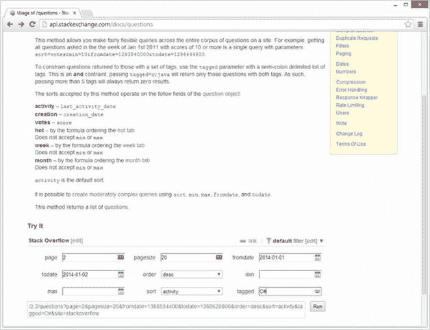

图 3-1。StackExchange API 的“试试看”功能

图 3-1 展示了如何搜索 2014 年 1 月 1 日至 2 日期间提出的 C# 问题。查询结果按每页 20 条进行分页，我们请求的是第二页的结果；也就是说，问题编号 21 到 40。如果你点击“运行”按钮，当前查询将被执行，其结果将立即显示在同一窗口的下方。

另请注意，当你编辑查询时，“运行”按钮左侧的部分会随之变化，反映你的编辑内容。显示的是实际的查询语句，你可以用它来获取数据。例如，如果你正在查找标记为 C# 的问题，页面上将显示如图 3-2 所示的界面：

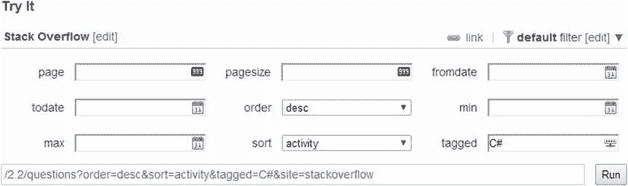

图 3-2。一个简单的查询

现在，你可以简单地将该查询粘贴到浏览器中，并在其前面加上 [`api.stackexchange.com/`](http://api.stackexchange.com/)；例如，[`api.stackexchange.com/2.2/questions?order=desc&sort=activity&site=stackoverflow&tagged`](https://api.stackexchange.com/2.2/questions?order=desc&sort=activity&site=stackoverflow&tagged)= C%23（注意，我们将 C# 替换为 C%23，从而将不安全的 ASCII 字符 # 替换为其安全编码 %23）将产生类似于图 3-3 所示的结果。

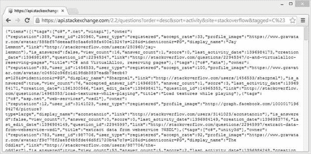

图 3-3。在浏览器中运行查询

现在，我们可以使用 WebRequest 从 .NET 运行该查询。然而，还有一个问题需要解决：我们得到的是一个 JSON 文档（items，即问题列表），我们仍然需要创建一个 .NET 类来表示这些数据，然后将每个项反序列化到该类中。虽然这不是一项特别复杂的任务，但很繁琐。如果我们有一种机制，能够“直接”查看该模式，完成创建合适类型的繁重工作，并将响应加载到其中，那就太好了。好消息是，这正是类型提供程序所做的。

使用 JSON 类型提供程序

类型提供程序是一种开放机制；也就是说，任何人都可以实现一个。因此，除了微软在 F# 3.0 最初发布时附带的一些类型提供程序外，F# 社区还实现了许多针对各种资源的额外类型提供程序。其中大部分已整合到 FSharp.Data 库中；它是主流类型提供程序的事实上的社区参考库，并且维护和文档都非常完善。

NuGet 包和 F# 脚本

要在 F# 脚本中使用库，你需要使用 #r 指令来引用它。例如，要使用属于 dll 库 libraryAssembly.dll 一部分的 MyLibrary 库，你需要在脚本中运行以下两行代码：

#r "path-to-the-dll/libraryAssembly.dll"
open MyLibrary

使用 NuGet 包的一种快速简便的方法是安装该包，在解决方案资源管理器的“引用”文件夹中找到它，然后从“属性”窗口中将其完整路径复制并粘贴到脚本中，如图 3-4 所示。

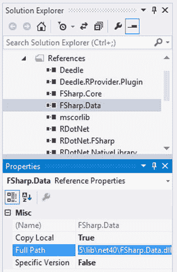

图 3-4。检索程序集的完整路径

不过，这种方法存在一些问题。默认情况下，NuGet 包会下载到解决方案中的 Packages 文件夹中，每个包都存储在一个包含其名称和特定版本号的文件夹中。因此，使用默认的 Visual Studio 项目结构，你的脚本将如下所示：

#r @"\Mathias\Documents\Visual Studio 2013\Projects\ProjectName\packages\PackageName.1.2.3\lib\net40-full\Assembly.dll"

这显然不太理想：路径依赖于本地机器和版本号，两者都可能发生变化。你可以通过使用相对路径和 #I 指令来解决第一个问题，该指令会添加一个搜索程序集的路径：

#I "..\packages"
#r @"PackageName.1.2.3\lib\net40-full\Assembly.dll"

版本号问题则更为棘手；每次更新到库的新版本时，你的脚本都会中断，直到你手动修复路径。Paket ([`fsprojects.github.io/Paket/`](http://fsprojects.github.io/Paket/))，一个用于 .NET 的依赖管理库，为这个问题提供了一个优雅的解决方案。在本书的其余部分，我们将使用特定版本的路径，因为在这种情况下，这有助于明确所使用的版本。

在 FSharp.Data 中可以找到的类型提供程序中，包括 JSON 类型提供程序。它的行为是典型类型提供程序工作方式的体现。涉及以下步骤：

*   首先，通过查看示例数据来创建类型，
*   然后将实际数据源中的数据加载到已创建的类型中。

让我们创建一个新的 F# 解决方案，通过安装相应的 NuGet 包来添加对 FSharp.Data 的引用，并在默认的 Script.fsx 文件中引用 FSharp.Data 库，如列表 3-1 所示。

***列表 3-1***。使用 JSON 类型提供程序检索最新的 StackOverflow C# 问题

```
#I @"..\packages\"
#r @"FSharp.Data.2.2.0\lib\net40\FSharp.Data.dll"

open FSharp.Data

type Questions = JsonProvider<"""https://api.stackexchange.com/2.2/questions?site=stackoverflow""">

let csQuestions = """https://api.stackexchange.com/2.2/questions?site=stackoverflow&tagged=C%23"""
Questions.Load(csQuestions).Items |> Seq.iter (fun q -> printfn "%s" q.Title)
```

运行此示例代码应会生成一个包含 30 个问题标题的列表（默认页面大小为 30），这些是 StackOverflow 上标记为 C# 的最活跃问题。由于查询的时间依赖性，结果会因机器而异。


 **提示**  F# 提供了两种机制来处理包含特殊字符的字符串。逐字字符串会忽略转义字符（如 `\`），并允许你通过双引号在字符串中嵌入引号，例如：`printfn @"He said ""hello""!"`。三重引号同样忽略转义字符，但直接允许在字符串内部使用引号，例如：`printfn """He said "hello"!"""`。

那么这里发生了什么？第一部分 `type Questions = JsonProvider<...>` 基于样本数据创建了一个名为 `Questions` 的类型。样本数据通过我们提供的 URL 从网络获取，正如我们之前所见，它会调用 StackExchange API 并返回一个包含 30 个最新问题的 JSON 文档。类型提供程序会扫描该样本，并根据需要创建相应的属性和类型。例如，如果你在 Visual Studio 的脚本文件中输入 `Questions.` 并等待 IntelliSense 提供提示，你会看到两件事。首先，`Questions` 包含几个根据样本内容自动创建的类：`Item`、`Owner` 和 `Root`。尝试在 IntelliSense 启动后出现的下拉菜单中点击 `Item`；你应该会看到它公开了一系列属性，例如 `member AcceptedAnswerId:Option<int>`。基于样本，类型提供程序生成了一个具有适当类型的类（当存在时，接受的答案 ID 应为整数，但如果没有提供满意的答案，也可能不存在）。

`Questions` 还公开了一个 `Load` 方法。此方法可用于从特定源检索数据，并且预期会返回符合 `Questions` 类型的内容。这正是脚本第二部分所发生的事情：我们传入一个查询，请求标记为 C#（编码为 `C%23`）的最新问题，然后类型提供程序通过网络发出请求，接收 JSON 文档，并自动将其转换为一个完整的类型。

你可以以稍微不同的方式使用 JSON 类型提供程序，这有助于阐明其工作机制。除了调用 StackExchange API 来生成 `Questions` 类型之外，你还可以直接提供一个样本，无论是作为文件还是内联字符串。清单 3-2 演示了这一过程：我们将期望从 API 获得的 JSON 输出的有效样本作为纯字符串提供（使用 `[<Literal>]` 属性标记，该属性将其编译为常量字面量），然后将该样本传递给类型提供程序，后者会根据样本中数据的结构创建一个新的 F# 类型。

***清单 3-2***. 从本地 JSON 样本创建类型

```
[<Literal>]
let sample = """{"items":[
{"tags":["java","arrays"],"owner": // 为简洁起见已省略"},
{"tags":["javascript","jquery","html"],"owner": // 为简洁起见已省略"},],
"has_more":true,"quota_max":300,"quota_remaining":299}"""

type HardCodedQuestions = JsonProvider<sample>
```

此时，编译器已基于样本字符串创建了一个类型，你可以通过传入一个预期返回遵循相同结构的 JSON 响应的查询来使用它访问 StackExchange API 的数据；例如，拉取与 Java 相关的问题：

```
[<Literal>]
let javaQuery = "https://api.stackexchange.com/2.2/questions?site=stackoverflow&tagged=java"

let javaQuestions = HardCodedQuestions.Load(javaQuery)
```

换句话说，编译器使用样本生成类型；无论 JSON 来自本地文件还是通过网络，都没有关系。一旦类型创建完成，它就可以用于加载具有适当形状的数据。例如，如果我们使用此类型调用不同的 API 端点，将会得到一个运行时异常。

这两种方法之间一个有趣的区别是，当模式随时间变化时，它们会产生不同的影响。想象一下，例如，`Title` 属性被重命名为其他名称。在第一种情况下，我们会得到一个编译时错误，因为每次构建时都会通过访问 API 创建类型，编译器会捕获到我们正在使用一个不再存在的属性。相比之下，当使用“本地样本”时，我们会得到一个运行时错误：我们的类型基于一个过时的样本，该样本仍然具有旧属性，只有当我们尝试访问实时数据时才会捕获到不匹配。

构建一个用于查询问题的最小 DSL

StackExchange API 相当直接，手动编写查询并不十分困难。然而，这会在我们的代码中引入大量重复，从而增加出现拼写错误和 bug 的可能性。让我们避免这种情况，创建一个最小的领域特定语言，或者通常所说的 DSL。

你可能已经注意到 StackExchange API 的请求遵循一种模式：从一个基础 URL（[`api.stackexchange.com/2.2/`](https://api.stackexchange.com/2.2/)）开始，我们附加一个字符串，编码我们感兴趣的实体（questions），后跟一个问号和进一步指定查询的可选参数（?site=stackoverflow&tagged=C%23;F%23）。简化查询构建的一种方法是利用这种模式，创建描述我们如何修改基础查询以满足需求的小型函数，以便我们可以将这些操作组合成一个清晰可读的管道。请参见清单 3-3。

***清单 3-3***. 构建一个最小查询 DSL

```
let questionQuery = """https://api.stackexchange.com/2.2/questions?site=stackoverflow"""
let tagged tags query =
    // 将标签连接成一个以分号分隔的字符串
    let joinedTags = tags |> String.concat ";"
    sprintf "%s&tagged=%s" query joinedTags

let page p query = sprintf "%s&page=%i" query p

let pageSize s query = sprintf "%s&pagesize=%i" query s

let extractQuestions (query:string) = Questions.Load(query).Items
```

本质上，`questionQuery` 定义了我们开始的基础查询。接下来的三个函数将可选的查询细节附加到该查询上，最后一个函数 `extractQuestions` 尝试使用已构建的任何查询字符串加载数据，然后检索相应的项。请注意，我们不必提供类型注解，因为 `sprintf` 包含了足够的提示供编译器推断正确的类型。

让我提请你注意这里的一个模式：每个函数都将 `query` 作为其最后一个参数。从 C# 的角度来看，这相当不寻常。通常，C# 方法中的参数按重要性排序，从必不可少的参数开始，逐渐过渡到不太重要的参数。你会在 F# 代码中非常频繁地看到这种“反向”模式，因为它允许使用管道转发运算符 `|>` 将函数组合成工作流。管道转发运算符允许你用前一个函数的计算结果替换函数的最后一个参数，例如，`add 42 1` 等价于 `1 |> add 42`。在我们的示例中，我们可以使用非常易读的代码检索 100 个标记为 C# 的问题和 100 个标记为 F# 的问题。请参见清单 3-4。

***清单 3-4***. 使用我们的 DSL 提取标记为 C# 和 F# 的问题

```
let ``C#`` = "C%23"
let ``F#`` = "F%23"

let fsSample =
    questionQuery
    |> tagged [``F#``]
    |> pageSize 100
    |> extractQuestions

let csSample =
    questionQuery
    |> tagged [``C#``]
    |> pageSize 100
    |> extractQuestions
```


 **提示**  任何由双反引号包围的字符串，例如“C#”，都是有效的标识符。这有助于让代码更易读；例如，在这种情况下，“C#”的含义比“C%23”形式要清晰得多。此功能的一个常见用途是在测试场景中：与其将测试方法命名为 `The_Price:Should_Be_Positive()`，不如直接写成“The price should be positive”( )。

我们用了七行代码来引用 JSON 类型提供程序并编写一个极简的 DSL；至此，我们已经完全准备好直接处理数据本身并进行探索。例如，比较哪些标签或主题与某一组最常关联，只需几行代码即可完成，如清单 3-5 所示。

***清单 3-5***。按语言比较标签

```
let analyzeTags (qs:Questions.Item seq) =
    qs
    |> Seq.collect (fun question -> question.Tags)
    |> Seq.countBy id
    |> Seq.filter (fun (_,count) -> count > 2)
    |> Seq.sortBy (fun (_,count) -> -count)
    |> Seq.iter (fun (tag,count) -> printfn "%s,%i" tag count)

analyzeTags fsSample
analyzeTags csSample
```

以 `Item` 序列作为输入，我们收集标签以将序列的序列展平为单个序列，统计每个标签的出现次数，过滤掉出现次数少于两次的标签，按降序排序，最后打印出标签及其计数。

 **提示**  在“解包”元组时，下划线用作通配符。这省去了为未使用的变量命名的麻烦，同时也有助于表明你正在积极使用元组中的哪些元素。

如果你运行这段代码，可能会观察到略有不同的结果，因为查询结果与时间相关。不过，我推测其核心内容应该与我观察到的结果一致（参见表 3-1）。

表 3-1。C# 和 F# 问题中最常见的标签

| C# 标签 | F# 标签 |
| --- | --- |
| c#,100wpf,13.net,13asp.net,11entity-framework,5asynchronous,5asp.net-mvc-4,5sql,5linq,4xaml,4windows-store-apps,4 | f#,100f#-data,10type-providers,7functional-programming,6f#-3.0,6c#,5.net,5f#-interactive,5 |

C# 感兴趣的主题中很大一部分涉及客户端技术和 Web，而 F# 看起来更侧重于数据（这一点到现在应该不会让你感到惊讶）。有趣的是，C# 问题中有很大一部分与 F# 类型提供程序能极大简化的技术相关（如 SQL 和数据访问、XAML 等）。

本章的目标并非对 StackOverflow 进行全面分析（我们将在第 5 章中探讨这个问题），而是说明类型提供程序和 F# 如何让处理来自不同来源的数据变得异常简单。虽然我们这里重点介绍了一个 JSON 示例，但大多数面向数据的类型提供程序（CSV、XML 等）都遵循类似的模式：首先获取数据样本以推断要创建的类型，然后使用创建的类型加载数据。我们在此节对 StackOverflow 的探索就到此为止——欢迎你自行进一步探索！

世界上的所有数据

既然我们已经了解了类型提供程序是什么，以及它们如何让针对数据的编程变得极其简单，我想重点讨论两个与数据科学家特别相关的主题。第一个是 Deedle，一个 .NET 数据框库，它极大地简化了数据集的操作和分析。第二个是 R 类型提供程序，它使得可以在 F# 中使用 R 统计语言，并打开了其庞大的统计和可视化包生态系统。

世界银行类型提供程序

世界银行是联合国的一个国际金融机构，为发展中国家的资本项目提供贷款。它还以维护并向公众提供非常丰富的社会经济信息数据集而闻名。你可以在 [`data.worldbank.org/`](http://data.worldbank.org/) 了解该数据集包含的内容；对于世界上超过 200 个国家中的每一个，你都可以下载涵盖从经济与增长到性别或基础设施等主题的 1400 多个指标的多年年度数据。

那么，一切都很美好吗？嗯，并非如此。问题在于，虽然数据就在那里，但获取数据有点繁琐。例如，如果我想获取 2000 年和 2010 年的人口，以及每个国家当前的陆地面积，我必须进行大量导航来选择适当的国家、指标和年份；我得到的将是一个文件（Excel、CSV 或 XML），而且我可能仍然需要对其进行一些处理，才能将其塑造成适合我需求的形状和形式。此外，如果我不知道其名称，找到我关心的序列（或国家）可能并不总是显而易见的。

请注意，这绝不是对世界银行网站的批评，该网站实际上非常出色。问题在于，在大型数据集中进行分层导航时，很难创建一个用户界面来让用户自由选择所需内容。这里非常方便的做法是采用一种不同的机制，使我能够即时查询和发现数据——而这正是 FSharp.Data 世界银行类型提供程序所提供的。它遵循的模式与我们之前看到的略有不同。它不是使用模式信息为通用数据格式创建类型，而是专门为该数据源编写，唯一目的是让数据以最小的努力变得可发现和可用。

使用世界银行类型提供程序只需安装 FSharp.Data NuGet 包，在脚本中添加对它的引用，并创建一个数据上下文，该上下文将建立与世界银行的连接，如清单 3-6 所示。

***清单 3-6***。使用世界银行类型提供程序

```
#I @"..\packages\"
#r @" FSharp.Data.2.2.0\lib\net40\FSharp.Data.dll"

open FSharp.Data

let wb = WorldBankData.GetDataContext ()
wb.Countries.Japan.CapitalCity
```

一旦创建了数据上下文，就可以使用它直接访问世界银行，并通过 IntelliSense 发现哪些数据可用（参见图 3-5）。

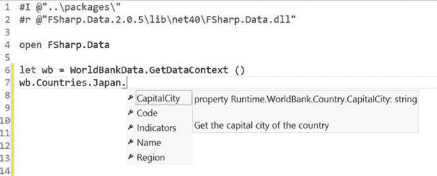

图 3-5。使用 IntelliSense 浏览世界银行数据

我们在这里要做的只是检索世界上每个国家在 2000 年和 2010 年的人口，这相当简单：

```
let countries = wb.Countries

let pop2000 = [ for c in countries -> c.Indicators.``Population, total``.[2000]]
let pop2010 = [ for c in countries -> c.Indicators.``Population, total``.[2010]]
```

世界银行类型提供程序让我们能够立即访问一个数据宝库；话虽如此，现在我们面临一个新问题，即如何从中提取一些有趣的信息？在数百个国家的数据点中摸索，希望发现模式，并不是挖掘数据以获取有趣事实的最有效方法。如果能有一些统计工具供我们使用就好了——幸运的是，借助 R 类型提供程序，我们确实有这些工具。

R 类型提供程序

用 R 自己的话来说，它是“一个用于统计计算和图形的免费软件环境”（[www.r-project.org](http://www.r-project.org)）。它是一种由统计学家为统计学家设计和实现的编程语言。它是开源且完全免费的，并附带由 R 社区创建的惊人包生态系统，几乎涵盖了统计学的每个领域。


R 类型提供程序是一种有趣的构造。到目前为止，我们看到的示例都侧重于让数据变得可发现。R 提供程序做了类似的事情，但针对的是完全不同类型的外部资源：一种编程语言。假设你的机器上安装了 R，它会发现已安装的包，然后让你在 F# 环境中打开它们，就像它们是普通的 .NET 库一样。它还能让你发现哪些 R 函数可用，并直接从 F# 调用它们。

 **安装 R**  使用 R 类型提供程序需要在你的机器上安装 R。R 完全免费且开源，并可在所有平台上运行。你可以在 [`www.r-project.org/`](http://www.r-project.org/) 找到关于 R 的说明和文档。请注意，虽然 R 在所有平台上都能良好运行，但在撰写本文时，R 类型提供程序仅在 mono 上得到部分支持。

让我们看看 R 提供程序能为我们做些什么。首先，让我们安装 NuGet 包 RProvider，并在脚本中添加所需的引用：

```
#r @"R.NET.Community.1.5.16\lib\net40\RDotNet.dll"
#r @"RProvider.1.1.8\lib\net40\RProvider.Runtime.dll"
#r @"RProvider.1.1.8\lib\net40\RProvider.dll"
open RProvider
open RProvider.``base``
open RProvider.graphics
```

此时，我们可以开始打开各种 R 包并使用它们。这里，我们将打开 `base` 和 `graphics` 包，它们提供了基本函数和图表。请注意，如果你输入 `open RProvider.`，IntelliSense 将开始显示你的计算机上实际存在的包。作为对可能性的快速介绍，让我们对国家的国土面积进行一个基本分析（参见清单 3-7）。

***清单 3-7***. 来自 R 的基本汇总统计

```
// 获取国家国土面积的（F#）列表
let surface = [ for c in countries -> c.Indicators.``Surface area (sq. km)``.[2010]]
// 生成汇总统计
R.summary(surface) |> R.print
```

我们使用世界银行类型提供程序获取每个国家的国土面积，并将这些值存储在一个 F# 列表中。使用 R 将再次通过 IntelliSense 显示当前环境中可用的函数。首先，我们通过调用 `R.summary` 生成国土面积变量的汇总，然后调用 `R.print`，它会生成以下“漂亮打印”：

```
    Min.  1st Qu.   Median     Mean  3rd Qu.      Max.     NA's
       2    11300    99900   630200   450300  17100000        1
```

 **注意**  如果你只运行 `R.summary`，你可能会注意到它返回一个 `RDotNet.SymbolicExpression`。为了避免 R 和 .NET 类型之间不必要的、代价高昂的转换，R 类型提供程序通常通过 R 符号表达式（R 表示数据和/或操作的方式）将信息发送给 R，并尽可能保持这种形式，仅在需要时才转换回 .NET 类型。

这里没有什么惊天动地的，但非常方便。汇总返回了最小值和最大值，以及平均值、三个四分位数（大于样本 25%、50% 和 75% 的值）和缺失值（NA）的数量。一眼看去，我们看到国土面积差异巨大，从最小的 2 平方公里到最大的 1700 万平方公里——还有一个国家我们没有找到数据。这很有用，但考虑到这些值似乎分布得很分散，图表将帮助我们更好地理解数据的“样子”。使用 `R.hist(surface)` 函数很容易做到这一点，它会生成图 3-6 中的图表。

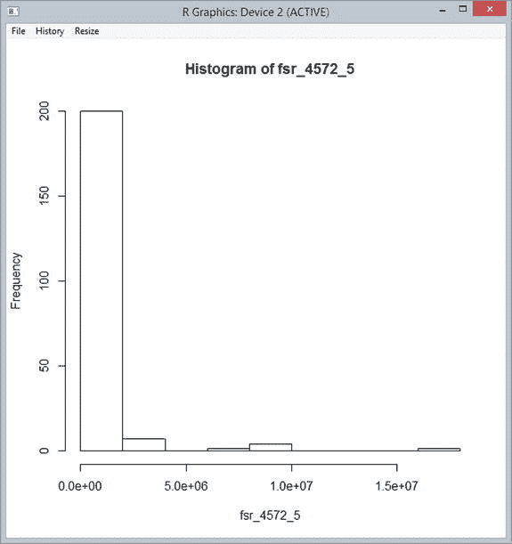

图 3-6. 使用 R 图形绘制的国家国土面积基本直方图

我承认——这不是一张漂亮的图表。X 轴显示的不是国土面积，而是一个名为 `fsr_4572_5` 的、非常不具表现力的变量。我们稍后会看到如何创建更漂亮的图表，但请记住，我们只调用了一次 `R.hist` 就生成了这张图表，它对于探索来说完全够用，并且能快速告诉我们所有需要知道的信息，即国土面积分布极不均匀，绝大多数国家相对较小，而少数几个国家则非常巨大。

如果我们想更好地了解中间部分的情况，可以绘制国土面积的对数图。这里的好处是，我们可以使用我们认为最适合这项工作的工具：F# 代码或 R 函数。在这种情况下，例如，我们可以使用像 `R.hist(surface |> List.map log)` 这样的 F# 代码；然而，`R.log` 函数更简短，所以我们选择 `R.hist(surface |> R.log)`，它会生成图 3-7 中的图表。

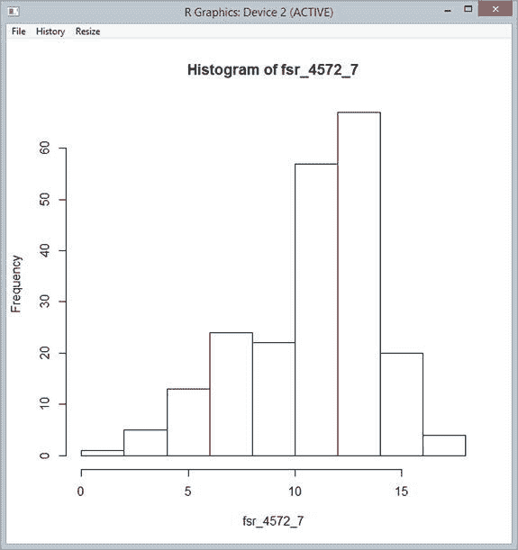

图 3-7. 使用 R 图形绘制的对数变换后的国家国土面积

直方图是理解特征分布的好方法。然而，数据可视化的主力是散点图，它将数据点投影到二维图表上。这是探索特征之间关系的一种非常便捷的方式。例如，我们可能想知道一个国家的国土面积和人口是否相关。解决这个问题的一种方法是将人口放在一个轴上，国土面积放在另一个轴上，使用 `R.plot(surface, pop2010)` 并目视检查结果，如图 3-8 所示。

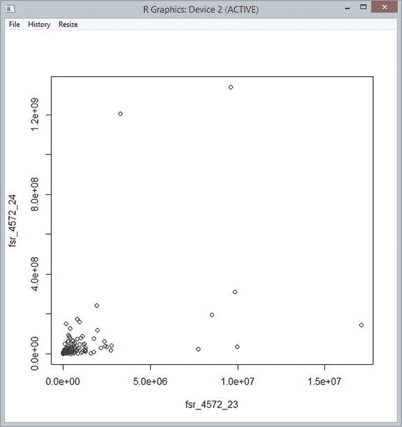

图 3-8. 使用 R.plot 绘制的基本散点图

从外观上看，国土面积和人口充其量只有有限的关系；散点图没有显示明显的模式。

这个简单的场景说明了 R 如何通过生成简单的统计数据和图表来帮助我们更好地理解单个特征。然而，如果你的数据集不是微不足道的，一次处理一个特征很快就会变成一场噩梦。在挖掘数据时，你通常会有很多特征，你需要能够快速探索它们之间的关系，并通过组合现有特征将它们重新排列成新的特征。这就是为什么数据框（我们接下来要探讨的主题）在数据科学家中如此受欢迎的原因。

使用 R 数据框共同分析数据

简而言之，数据框是一种面向操作观测值集合的数据结构。每个观测值对应数据框中的一行，但单个特征也可以作为列来访问。从这个意义上说，数据框类似于数据库表，但面向的是内存中的操作。就其本身而言，这已经非常方便了：它保留了单个行的类型信息，但极大地简化了诸如“计算收入大于 100 万的客户的订单量特征平均值”之类的操作，这些操作并不困难，但需要一遍又一遍地重复类似的代码。参见图 3-9。

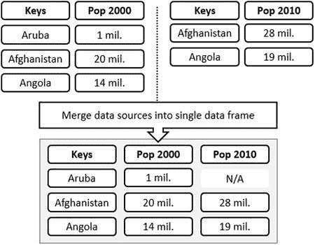

图 3-9. 将多个数据源合并到单个数据框中


数据框的另一个主要用途是帮助将多个数据源合并到单个数据框中。因此，数据框通常依赖键来唯一标识每一行数据，以便将各种特征与正确的行关联起来并进行连接。另一个重要的相关功能是缺失值的管理：如果我试图合并两个特征——例如，各国的国土面积和人口——并且其中一些数据不完整，我希望生成的数据框包含所有国家的并集，但能标记哪些数据缺失，并在计算（例如平均国土面积）时轻松处理这些缺失数据。最后，数据框通常支持动态创建列。在前面的例子中，我可能想研究一个新特征，比如国家密度（人口除以国土面积）；数据框通常允许你添加新列，并以简单的方式表达列的组合。

数据框是 R 语言的核心类型之一；如今，数据科学家使用的大多数编程语言都有数据框库。它们通常受 R 数据框的启发，但根据语言特性有不同的风格。.NET 也不例外；有几个优秀的商业产品，还有一个很棒的开源库 Deedle，我们将在此简要演示。

但在研究 Deedle 之前，我们先快速了解一下如何使用原生的 R 数据框。R 类型提供程序附带了一些实用函数，可以更轻松地从 F# 创建 R 数据框。例如，试试代码清单 3-8 中的代码。

***代码清单 3-8***。创建并绘制 R 数据框

```
let pollution = [ for c in countries -> c.Indicators.``CO2 emissions (kt)``.[2000]]
let education = [ for c in countries -> c.Indicators.``School enrollment, secondary (% gross)``.[2000]]

let rdf =
    [ "Pop2000", box pop2000
      "Pop2010", box pop2010
      "Surface", box surface
      "Pollution", box pollution
      "Education", box education ]
    |> namedParams
    |> R.data_frame

// 所有特征的散点图
rdf |> R.plot

// 所有特征的摘要
rdf |> R.summary |> R.print
```

我们检索了几个额外的特征（以二氧化碳排放量衡量的污染，以及以中学入学率衡量的教育），并创建了一个包含五列的数据框，每列都与一个名称相关联。数据框创建完成后，我们可以生成一个摘要，输出如下：

```
>
    Pop2000             Pop2010             Surface           Pollution
 Min.   :9.419e+03   Min.   :9.827e+03   Min.   :       2   Min.   :     15
 1st Qu.:6.255e+05   1st Qu.:7.981e+05   1st Qu.:   11300   1st Qu.:   1050
 Median :5.139e+06   Median :5.931e+06   Median :   99900   Median :   6659
 Mean   :2.841e+07   Mean   :3.207e+07   Mean   :  630216   Mean   : 122608
 3rd Qu.:1.631e+07   3rd Qu.:2.097e+07   3rd Qu.:  450300   3rd Qu.:  53601
 Max.   :1.263e+09   Max.   :1.338e+09   Max.   :17098240   Max.   :5713560
                                         NA's   :1          NA's   :20
   Education
 Min.   :  6.051
 1st Qu.: 41.699
 Median : 78.588
 Mean   : 70.782
 3rd Qu.: 93.882
 Max.   :160.619
 NA's   :70
```

我们甚至可以通过将整个数据框直接传递给 `R.plot` 来可视化所有特征，如图 3-10 所示。

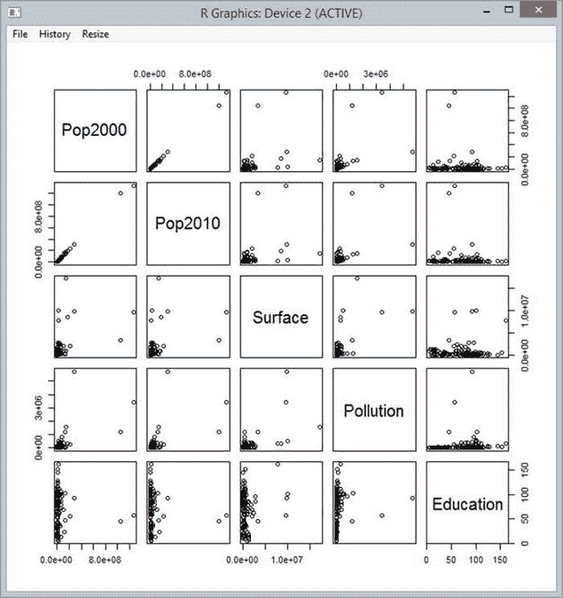

图 3-10。可视化特征之间的关系

这种图表非常有用。一眼就能看出 Pop2000 和 Pop2010 是相关的：它们的散点图形成了一条近乎完美的直线。教育似乎与其他四个特征无关（没有明显的视觉模式），而国土面积和污染似乎与人口有一定关系（人口越多，数值往往越高）。还要注意，尽管我们有大量缺失值，但 R 没有报错，并且优雅地处理了这个问题。

这里的细节并不特别重要；我希望传达的重点是，数据框在处理多个特征时非常方便。然而，除了像这样简单的案例之外，使用 R 数据框本身从 F# 操作数据相当不便。这就是 Deedle 的用武之地：它是 .NET 原生的，语法设计为对 .NET 友好（适用于 C# 和 F#），但可以通过 Deedle RProvider 插件直接输入到 R 中。

Deedle：一个 .NET 数据框

Deedle 的两个核心构建块是序列和数据框。*序列*是一个键值对集合；序列可以合并到数据框中，并根据键进行匹配，自动处理缺失值。我们先从一个简单的示例开始，说明 Deedle 的工作原理，然后在一个更有趣的场景中使用它（参见代码清单 3-9）。

***代码清单 3-9***。使用 Deedle 创建序列和数据框

```
#r @"Deedle.1.0.7\lib\net40\Deedle.dll"
open Deedle

let series1 = series [ "Alpha", 1.; "Bravo", 2.; "Delta", 4\. ]
let series2 = series [ "Bravo", 20.; "Charlie", 30.; "Delta", 40\. ]
let toyFrame = frame [ "First", series1; "Second", series2 ]

series1 |> Stats.sum
toyFrame |> Stats.mean
toyFrame?Second |> Stats.mean

toyFrame?New <- toyFrame?First + toyFrame?Second
toyFrame |> Stats.mean
```

我们创建了两个序列，将键（“Alpha”、“Bravo”等）与值关联起来，并从中创建一个数据框，为每个序列指定一个名称（“First”、“Second”）。现在，我们可以对每个序列执行操作（例如，获取其总和），或对整个数据框执行操作——或者使用语法 `DataframeName?ColumnName`（如 `toyFrame?Second`）以动态方式从数据框中访问每个序列。请注意，尽管两个序列都有缺失值，数据框如何优雅地处理均值的计算。

这个示例中最有趣的部分是最后两行，我们动态创建并命名了一个新列，并根据其他列定义了它。此时，我们的数据框包含三列，而不是最初的两列，我们可以像新列从一开始就存在一样开始使用它。

 **提示**  `?` 运算符用于访问动态属性。它在 F# 中的使用相当罕见，因为这意味着放弃了静态类型的安全性。然而，对于像 Deedle 这样的库来说，这是有意义的。如果我们需要自由地向现有数据框添加数据，我们无法预先创建一个具有已知属性的单一类型。因此，数据框的行为类似于 Expando Object，当向其中添加新序列时，会创建新属性。

Deedle 的功能远不止我们在这里看到的；我鼓励你访问文档页面（[`bluemountaincapital.github.io/Deedle/`](http://bluemountaincapital.github.io/Deedle/)），亲自看看你能用它做什么。这个示例旨在让你了解数据框是什么，并通过介绍 Deedle 背后的一些关键概念来帮助你入门。现在，让我们看一个集成 R 和 Deedle 的示例。

世界数据，联合起来！


在上一节中，我们开始研究世界人口，从世界银行类型提供程序获取数据。超过一定限度后，很难在大型数据集中辨别任何模式，而对于包含 200 多个国家的列表，我们需要其他方法。真正有效的方式是使用地图。幸运的是，现有的众多 R 包之一——`rworldmap`，正如其名：创建世界地图。实现方法之一就是将数据附加到国家上，然后让该包发挥其魔力。

我们先从绘制 2000 年和 2010 年各国人口分布图开始。首先，我们将创建一个 Deedle 数据框，并用世界银行的数据填充它。为此，我们需要构建一个序列，如果你还记得，序列是作为键值对集合构建的。我们还希望这些信息能被`rworldmap`使用，以便它能将正确的数据点连接到正确的国家。事实证明，`rworldmap`和世界银行都支持 ISO3 代码——一种唯一标识国家的三位字母代码——我们将用它作为我们的键。

为清晰起见，让我们创建一个新的脚本文件`WorldMap.fsx`，并构建我们的数据框，如清单 3-10 所示。

***清单 3-10***。使用世界银行数据构建 Deedle 数据框

```
#I @"..\packages\"
#r @"FSharp.Data.2.2.0\lib\net40\FSharp.Data.dll"
#r @"Deedle.1.0.7\lib\net40\Deedle.dll"

open FSharp.Data
open Deedle

let wb = WorldBankData.GetDataContext ()
let countries = wb.Countries

let population2000 =
    series [ for c in countries -> c.Code, c.Indicators.``Population, total``.[2000]]
let population2010 =
    series [ for c in countries -> c.Code, c.Indicators.``Population, total``.[2010]]
let surface =
    series [ for c in countries -> c.Code, c.Indicators.``Surface area (sq. km)``.[2010]]

let ddf =
    frame [
        "Pop2000", population2000
        "Pop2010", population2010
        "Surface", surface ]
ddf?Code <- ddf.RowKeys

#r @"R.NET.Community.1.5.16\lib\net40\RDotNet.dll"
#r @"RProvider.1.1.8\lib\net40\RProvider.Runtime.dll"
#r @"RProvider.1.1.8\lib\net40\RProvider.dll"
#r @"Deedle.RPlugin.1.0.7\lib\net40\Deedle.RProvider.Plugin.dll"let dataframe =
    frame [ 
        "Pop2000", population2000
        "Pop2010", population2010
        "Surface", surface ]
dataframe?Code <- dataframe.RowKeys
```

我们只需检索 2000 年和 2010 年的人口数据以及各国国土面积，创建三个序列，每个国家以其国家代码作为键。然后我们创建一个 Deedle 数据框，为每个序列赋予单独的名称，最后添加另一个名为“Code”的序列，它直接暴露国家代码（我们需要它来将地图与国家数据关联起来）。

现在数据框里有了数据，我们需要创建一张地图，并定义如何将每个国家与数据关联起来。这相当直接，如清单 3-11 所示。

***清单 3-11***。使用`rworldmap`创建地图

```
#r @"R.NET.Community.1.5.16\lib\net40\RDotNet.dll"
#r @"RProvider.1.1.8\lib\net40\RProvider.Runtime.dll"
#r @"RProvider.1.1.8\lib\net40\RProvider.dll"
#r @"Deedle.RPlugin.1.0.7\lib\net40\Deedle.RProvider.Plugin.dll"

open RProvider
open RProvider.``base``
open Deedle.RPlugin
open RProvider.rworldmap

let map = R.joinCountryData2Map(dataframe,"ISO3","Code")
R.mapCountryData(map,"Pop2000")
```

我们打开 Deedle R 插件（它使 Deedle 数据框可直接被 R 使用）和`rworldbank`包，然后创建一张地图，定义数据来源（数据框`ddf`），以及如何通过使用“Code”列（映射到世界银行国家代码）作为 ISO3 代码（`rworldbank`内置选项之一）将地图上的每个国家与数据框中的数据关联起来。然后我们就可以开始了：运行`R.mapCountryData(map,"Pop2000")`将从数据框中检索`Pop2000`列的所有值，并通过将`Code`列与国家 ISO3 代码匹配，将其附加到国家上，生成一张类似图 3-11 的地图。对于十几行代码来说，效果相当不错！

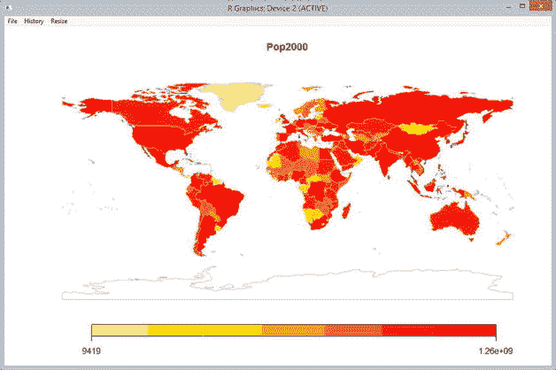

图 3-11。2000 年世界人口地图

 **注意** 安装 R 包。当你在机器上安装 R 时，它会安装一组最小的包，提供基本功能。然而，R 的关键优势之一是其庞大的包生态系统，它们为几乎任何可视化或统计场景提供解决方案。R 自带一个内置的包管理器，允许你轻松地在本地机器上下载和安装包。例如，我们这里使用的`rworldmap`包并非标准包。要安装它，你可以从 R 环境本身调用`install.packages("rworldmap")`，或者使用 F# Interactive 中的 R 类型提供程序，通过`open RProvider.utils`和`R.install_packages(["rworldmap"])`。这会提示你选择一个下载站点，然后会在你的机器上安装该包及其依赖项，之后你就可以使用它了。

这是一张不错的地图，也是快速找出数据集中模式的更好方式。然而，这并没有太大启发性：我们在这里看到的是，格陵兰岛、喜马拉雅山脉和撒哈拉沙漠的人口非常稀少。让我们看看能否制作一些更有趣的地图。使用像 Deedle 这样的数据框，而不是操作原始数据的好处之一是，它使得创建新特征变得非常容易。例如，考虑一下国家人口密度；即每平方公里（或英里）居住的人数。使用 Deedle，这轻而易举，如清单 3-12 和图 3-12 所示。

***清单 3-12***。生成人口密度地图

```
dataframe?Density <- dataframe?Pop2010 / dataframe?Surface
let map = R.joinCountryData2Map(dataframe,"ISO3","Code")
R.mapCountryData(map,"Density")
```

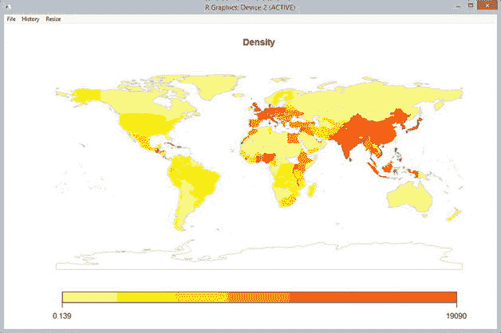

图 3-12。世界人口密度地图

我们动态创建了一个名为`Density`的新列，定义为其他两列的函数，然后简单地将地图重新绑定到更新后的数据框。这是一张更有趣的地图，突出了世界上几个非常高密度的地区，位于西欧、东南亚和非洲。

类似地，我们可以用几行代码可视化世界人口增长情况，如清单 3-13 和图 3-13 所示。

***清单 3-13***。生成人口增长地图

```
dataframe?Growth  <- (dataframe?Pop2010 - dataframe?Pop2000) / dataframe?Pop2000
let map = R.joinCountryData2Map(dataframe,"ISO3","Code")
R.mapCountryData(map,"Growth")
```

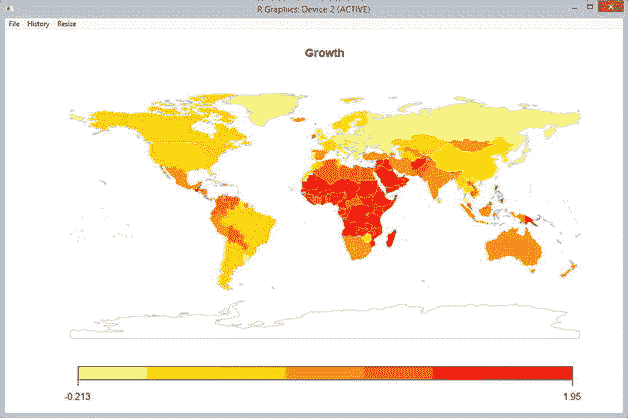

图 3-13。2000 年至 2010 年世界人口增长地图

同样，用几行代码我们就得到了一个相当不错的显著事实总结：非洲人口正在快速增长，而俄罗斯和欧洲大部分地区人口正在减少。

那么，我们学到了什么？


在本章中，我们了解了类型提供程序（F# 独有的特性）如何使得将外部数据或资源无缝引入 .NET 类型系统成为可能。对于任何数据探索场景而言，这都显著提升了生产力。类型提供程序实现了一项非凡的壮举：获取数据本身与动态语言一样简单，但使用静态类型数据能让用户获得来自编译器和工具的额外帮助，并防止那些否则只能在运行时才能捕获的愚蠢错误（例如属性拼写错误或类型转换错误）。

或许更有趣的是，拥有类型化数据在数据可发现性方面也带来了巨大好处。数据通常以主要旨在解决计算机 I/O 问题而非人类可读性的格式存储。因此，理解数据集往往是一种不必要的糟糕体验，至少对人类而言是如此。类型提供程序提供了一种非常有趣的机制，它利用了几十年来帮助开发者导航和理解大型代码库（可以说是复杂的数据集）内部组织的工具，并通过 IntelliSense 将它们应用于“普通”数据。这是一种异常强大的机制。根据我的经验，能够通过输入“.”来发现数据片段之间的关联，或者让计算机自动找到与我输入内容部分匹配的项目，是深入数据集并理解其组织方式的极其有效的方法。

本章的另一个要点展示了如何使用相同的机制，在 F# 环境中利用 R 的所有资源。R 语言既有粉丝也有批评者，但有一点很难反驳，那就是其生态系统的深度。如果你遇到一个统计学问题，很可能“有一个包可以解决它”。R 几乎拥有针对所有统计学问题的包，并且还以生成精美的、达到出版级别的图表和可视化而闻名，而所有这些在 F# 中都可以使用。

R 类型提供程序是 F# 作为一种高效粘合语言的绝佳示例。使用像 RStudio 这样的 R 专用工具，可能会比通过类型提供程序从 F# 调用 R 获得稍好一些的体验。然而，选择 R 作为主要开发环境会产生重大影响。R 在设计之初并未考虑集成，将其用于生产环境或与其他系统通信并非其强项。除此之外，R 完全没有类似类型提供程序的功能；从任何地方探索和加载数据的能力也就无从谈起。

相比之下，F# 是一种旨在运行生产级关键代码的语言；它恰好也拥有相当不错的脚本编写能力。在这种背景下，使用 F# 作为主要环境就非常有意义了。数据科学家可以使用它编写脚本，按照自己的喜好组合各种工具来构建模型原型，同时还能利用 .NET 框架的全部功能；同样的脚本可以非常轻松地转换为类或模块，并且能够在生产环境中大规模地顺利运行。

最后，我们还看到了如何使用管道转发运算符进行函数组合，从而非常轻松地创建微型领域特定语言。通过创建小型函数并仔细考虑如何组织它们的参数，我们能够编写出几行代码，这些代码可以以灵活的方式链接在一起，同时具有很高的可读性。F# 中关于 DSL 的主题远不止这里给出的简化示例，但这至少应该能让你初步了解为什么该语言非常适合这个领域！

**深入探索**

我们在本章中看到了类型提供程序的一个小样本，但几乎对于任何暴露了某种模式的数据格式，都有一个可用的类型提供程序。用于 XML、Soap、CSV、SQL、JSON 等的类型提供程序是一种开放机制：任何人都可以编写一个来针对特定类型的数据，而 F# 社区一直在忙于创建各种各样的类型提供程序。目前，`FSharp.Data` 是最大且文档最完善的类型提供程序集合。还有几个值得一提，特别是用于对 T-SQL 命令的输入参数和结果集进行静态类型访问的 SQL Command 类型提供程序（[`fsprojects.github.io/FSharp.Data.SqlClient/`](http://fsprojects.github.io/FSharp.Data.SqlClient/)），以及用于探索和查询各种 SQL 实现的 SQL 类型提供程序（[`github.com/fsprojects/SQLProvider`](https://github.com/fsprojects/SQLProvider)）。

除了数据之外，类似于 R，针对不同语言的类型提供程序也正在开发中；从机器学习的角度来看，最有趣的是，目前正在努力创建 Matlab 和 Python 类型提供程序。然而，在撰写本文时，这些提供程序尚未达到与 R 类型提供程序相同的成熟度。

**实用链接**

*   *FSharp.Data* 是一个维护良好且文档齐全的开源 F# 类型提供程序集合：[`fsharp.github.io/FSharp.Data/`](http://fsharp.github.io/FSharp.Data/)
*   世界银行数据网站：[`data.worldbank.org/`](http://data.worldbank.org/)
*   R 统计环境：[`www.r-project.org/`](http://www.r-project.org/)
*   F# R 提供程序：[`bluemountaincapital.github.io/FSharpRProvider/`](http://bluemountaincapital.github.io/FSharpRProvider/)
*   Deedle，一个 .NET 数据框库：[`bluemountaincapital.github.io/Deedle/`](http://bluemountaincapital.github.io/Deedle/)
*   关于 rworldmap 包入门的优秀教程：[`cran.r-project.org/web/packages/rworldmap/vignettes/rworldmap.pdf`](http://cran.r-project.org/web/packages/rworldmap/vignettes/rworldmap.pdf)
*   Paket，一个 .NET 依赖管理器：[`fsprojects.github.io/Paket/`](http://fsprojects.github.io/Paket/)
*   Fsharp.Data.SqlClient，位于 [`fsprojects.github.io/FSharp.Data.SqlClient`](http://fsprojects.github.io/FSharp.Data.SqlClient)，以及 SQLProvider，位于 [`fsprojects.github.io/SQLProvider`](http://fsprojects.github.io/SQLProvider)，是两个专门用于处理 SQL 数据库的互补类型提供程序。

