# 第四章 自行车与人

使用梯度下降法将回归模型拟合到数据

到目前为止，我们解决的问题都涉及在有限数量的可能类别中对项目进行分类。虽然分类在许多实际场景中都有应用，但可以说更常见的问题是预测一个数值。例如，考虑以下任务：给定一辆二手车的特征（车龄、里程、发动机排量等），你将如何预测它的售价？这个问题并不完全符合分类的模式。我们这里需要的是一种至少在两个方面与分类模型不同的模型：
* 模型预测的是实际数值，这些数值可以取一个广泛的范围，并且可以进行有意义的比较。
* 我们感兴趣的是特征与其预测值之间的函数关系；也就是说，特征的变化如何影响预测。

在我们的汽车示例中，我们寻找的是类似这样的模型：
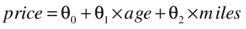

与我们之前看到的分类模型不同，预测价格并不局限于一组固定的可能选择；它们可以取一个很宽范围内的值。此外，如果你在模型中为里程数输入不同的值，就可以直接观察到特征的变化如何影响预测值，并可能将其与车龄值的变化进行比较，从而了解价格对各种特征的敏感程度。

这种模型被称为`回归模型`，它的历史相对较短，重大发展始于十九世纪。其起源来自物理学，以及根据实验观测验证物理模型的需求，这奠定了现代统计学的基础。这些方法随后传播到生物学、经济学和其他领域，在此过程中不断演变和适应，以处理每个学科特有的问题，并且是当今机器学习的重要组成部分。

在本章中，我们的目标是，在给定天气状况或星期几等信息的情况下，预测某一天使用共享单车服务的人数。我们将从一个相当简单的模型开始，逐步进行改进以提高准确性，并在此过程中介绍重要的机器学习技术。随着学习的深入，我们将：
* 解释如何将找到一条能很好拟合数据的直线，表述为找到一条整体误差最小的直线；
* 介绍梯度下降法，这是一种非常强大且通用的寻找函数最小值的技术，然后将其付诸实践，创建我们的第一个预测模型；
* 探索线性代数如何帮助编写更简洁的模型和算法，并可能加速计算；
* 介绍一种简单的方法来轻松创建和修改模型，即使用函数来定义特征，从而选择我们想要用来进行预测的数据部分；
* 进一步优化我们的预测，说明如何通过处理不同的数据类型以及创建更复杂的非线性特征来利用更多的数据。

## 了解数据

在本章中，我们将使用加州大学欧文分校机器学习库中的另一个数据集，即“共享单车数据集”，你可以在这里找到它：[`archive.ics.uci.edu/ml/datasets/Bike`](https://archive.ics.uci.edu/ml/datasets/Bike)+Sharing+Dataset。
该数据集基于 Capital Bikeshare 项目。用他们自己的话来说：
*Capital Bikeshare 让超过 2500 辆自行车触手可及。您可以选择华盛顿特区、弗吉尼亚州阿灵顿和亚历山大市以及马里兰州蒙哥马利县超过 300 个站点中的任何一个，并将其归还到您目的地附近的任何站点。租一辆自行车去上班、去地铁站、办事、购物或拜访朋友和家人。*
来源：[`www.capitalbikeshare.com`](http://www.capitalbikeshare.com)

完整数据集结合了 Capital Bikeshare 公开的数据以及其他公共数据源，例如天气和公共假日数据。

### 数据集中有什么？

在深入构建模型之前，让我们快速了解一下我们正在处理的数据。数据集本身可以在 [`archive.ics.uci.edu/ml/machine-learning-databases/00275/`](https://archive.ics.uci.edu/ml/machine-learning-databases/00275/) 找到；压缩文件 `Bike-Sharing-Dataset.zip` 包含三个文件：`day.csv`、`hour.csv` 和 `readme.txt`。我们将要处理的文件是 `day.csv`，它包含按天聚合的数据；`hour.csv` 是相同的数据，但按小时级别聚合。至于 `readme.txt` 包含什么，我想你可以大胆猜测一下！
像往常一样，让我们先创建一个包含脚本文件的 F# 库项目，然后将我们的数据文件 `day.csv` 添加到项目中。如果你在 Visual Studio 中点击该文件，你将看到数据的内容，如图 4-1 所示。
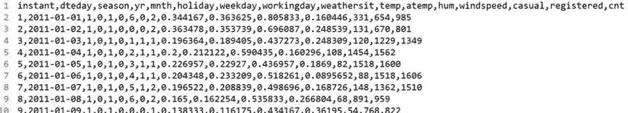
图 4-1。`day.csv` 文件的内容

该文件遵循常见的 `.csv` 格式，第一行是描述列名的标题，后面是 731 行观测数据，每天一行。那么这里面有什么呢？如果你仔细阅读 `readme.txt` 文件，你会发现每列的定义如下：
* `instant`：记录索引 *(表示自数据集第一次观测以来经过的天数)*
* `dteday`：日期
* `season`：季节 (1:春季, 2:夏季, 3:秋季, 4:冬季)
* `yr`：年份 (0: 2011, 1:2012)
* `mnth`：月份 (1 到 12)
* `holiday`：是否为假日 (摘自 [`dchr.dc.gov/page/holiday-schedule`](http://dchr.dc.gov/page/holiday-schedule))
* `weekday`：星期几
* `workingday`：如果既不是周末也不是假日则为 1，否则为 0。
* `weathersit`：
    * 1: 晴朗, 少云, 多云, 部分多云
    * 2: 薄雾 + 多云, 薄雾 + 碎云, 薄雾 + 少云, 薄雾
    * 3: 小雪, 小雨 + 雷暴 + 疏云, 小雨 + 疏云
    * 4: 大雨 + 冰雹 + 雷暴 + 薄雾, 雪 + 雾
* `temp`：归一化摄氏温度。值除以 41（最大值）
* `atemp`：归一化体感摄氏温度。值除以 50（最大值）
* `hum`：归一化湿度。值除以 100（最大值）
* `windspeed`：归一化风速。值除以 67（最大值）
* `casual`：临时用户数量
* `registered`：注册用户数量
* `cnt`：包括临时用户和注册用户在内的总租车人数

我们有几个不同的特征可用：时间/日历信息、是否是常规工作日或“特殊”日、多个与天气相关的测量值，最后是当天租用自行车的人数，分为注册用户和临时用户。

我们这里的重点将是创建一个模型来预测 `cnt`，即某一天租用自行车的人数，使用我们当天可用的测量值（当然，不包括 `casual` 和 `registered`，因为根据定义 `casual + registered = cnt`，用它们预测就没意思了）。请注意，我们的数据并非同质的：虽然有些特征是数值型的——即实际的数字（例如，`temp`，温度），但相当一部分是分类的——即每个数字编码一种状态（例如，`weathersit` 或 `workingday`）。

### 使用 FSharp.Charting 检查数据

像往常一样，让我们先在脚本文件中工作，更仔细地查看数据，使用来自 `fsharp.Data` 的 `CSV` 类型提供程序将其加载到内存中，我们首先从 NuGet 安装它：
```fsharp
#I @"packages\"
#r @"FSharp.Data.2.2.1\lib\net40\FSharp.Data.dll"

open FSharp.Data

type Data = CsvProvider<"day.csv">
let dataset = Data.Load("day.csv")
let data = dataset.Rows
```

与我们之前看到的一些问题不同，这个数据集有一组相当明显的起始特征。在这种情况下，简单地手动检查数据以查看我们是否能发现任何模式可能是值得的。让我们从绘制随时间变化的自行车使用量开始。为此，我们将使用另一个 F# 库 `fsharp.Charting`，它提供了一系列经典图表。让我们用 Nuget 安装这个库，并创建我们的第一个图表，将总使用量绘制成折线图：
```fsharp
#load @"FSharp.Charting.0.90.10\FSharp.Charting.fsx"
open FSharp.Charting

let all = Chart.Line [ for obs in data -> obs.Cnt ]
```
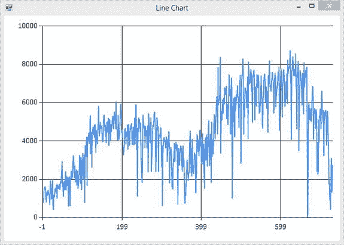
图 4-2。自第一次观测以来，逐日的自行车使用量随时间变化图

 提示 `FSharp.Charting` 可以作为一个常规库使用，但它也附带了一些实用工具，使其在交互式脚本环境中使用起来很方便。特别是，创建图表（如 `Chart.Line [ ... ]`）会自动显示它，而无需调用 `.ShowChart()`。要使用“交互模式”，只需加载 `fsharp.Charting.fsx` 而不是打开 `fsharp.Charting` 的 dll 文件。

有几件事立刻引人注目。首先，数据相当不规则——每日波动很大。此外，在更大尺度上也存在波动：使用量似乎随时间呈现高低起伏的阶段性变化。最后，总体来看，似乎存在一个上升趋势。

## 用移动平均线发现趋势

我们能否确认直觉上存在的这种趋势？一种方法是使用所谓的移动平均线。为了减少数据中的日常噪声，我们可以对特定窗口长度内的观测值进行平均，然后绘制所得曲线，从而将深层趋势与短期波动分离开来。F# 的 `Seq` 模块包含一个便捷函数 `Seq.windowed`，它可以将一个序列转换为一个新序列，其中包含连续观测值的块：

```fsharp
let windowedExample =
    [ 1 .. 10 ]
    |> Seq.windowed 3
    |> Seq.toList
```

这将序列 `1 .. 10` 分块为三个连续值的块：`[|[|1; 2; 3|]; [|2; 3; 4|]; [|3; 4; 5|]; [|4; 5; 6|]; [|5; 6; 7|]; [|6; 7; 8|]; [|7; 8; 9|]; [|8; 9; 10|]|]`。由此，生成移动平均线只需计算每个块的平均值：

```fsharp
let ma n (series:float seq) =
    series
    |> Seq.windowed n
    |> Seq.map (fun xs -> xs |> Seq.average)
    |> Seq.toList
```

让我们绘制原始序列以及七天和三十天移动平均线的叠加图：

```fsharp
Chart.Combine [
    Chart.Line count
    Chart.Line (ma 7 count)
    Chart.Line (ma 30 count) ]
```

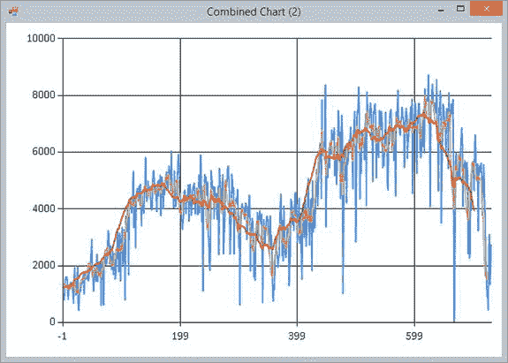

图 4-3. 七天和三十天移动平均线

虽然移动平均线本身并非定论，但它们确实暗示了更长期的趋势，并清晰地显示了全年波动中的某种规律性，包括季节性峰值。

## 为数据拟合模型

我们接下来的目标是，基于数据集中已有的信息，构建一个预测自行车使用量的模型。在深入探讨之前，让我们先量化一下，并为我们的任务建立一个基准。我们如何定义结果的好坏？我们能创建的最简单的模型是始终预测同一个数字，即平均值。在这种情况下，我们的典型误差会是多少？

```fsharp
let baseline =
    let avg = data |> Seq.averageBy (fun x -> float x.Cnt)
    data |> Seq.averageBy (fun x -> abs (float x.Cnt - avg))
```

使用这种简单方法，我们的预测平均会偏离正确值 1581.79——这是我们需要超越的数字。让我们看看能否做得更好。

### 定义基本的直线模型

什么是最简单且可能有效的模型？平均使用量似乎随时间增加，因此我们可以尝试通过引入一个趋势来改进我们的简单模型，思路如下：

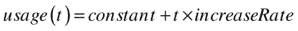

换句话说，我们将使用量表示为一条直线，从一个初始值开始，随时间线性增加。这可能不是我们能做到的最好结果——例如，这无法解释我们发现的季节性效应——但希望它能比我们“预测平均值”的简单模型表现更好。

任何时间尺度 `t` 都可以，但碰巧的是，数据集中的观测值都包含一个字段 `instant`，即自首次观测以来经过的天数，这可以作为时间起点。用稍微正式一点的方式，我们可以按如下方式指定一个预测模型：

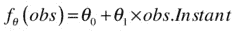

换句话说，我们可以定义一整类预测模型，称为**线性回归模型**，它们都遵循相同的一般模式。我们试图使用一个或多个输入变量（本例中为 `obs.Instant`）来预测一个值。每个输入变量都有自己的“通用”乘数 Theta，通过索引标识——即**回归系数**。预测值是通过将每个变量乘以其系数然后相加来计算的，这形成了所谓的**线性组合**。

稍后，我们将研究使用多个输入变量。目前，我们坚持使用单一变量 `obs.Instant`。如果我们设定 `Theta0` 和 `Theta1` 的值（或者简称为 `Theta`，表示 `Theta0` 和 `Theta1` 值的组合），我们就得到了一个特定的预测模型。这可以直接转化为 F# 代码：

```fsharp
type Obs = Data.Row

let model (theta0, theta1) (obs:Obs) =
    theta0 + theta1 * (float obs.Instant)
```

让我们用两个任意案例来说明，一个模型 `model0`，其中 `Theta0` 设置为序列的平均值；另一个模型 `model1`，我们任意将 `Theta0` 设为 6000.0，`Theta1` 设为 -4.5。现在我们可以绘制这两个模型对实际数据的预测结果：

```fsharp
let model0 = model (4504., 0.)
let model1 = model (6000., -4.5)

Chart.Combine [
    Chart.Line count
    Chart.Line [ for obs in data -> model0 obs ]
    Chart.Line [ for obs in data -> model1 obs ] ]
```

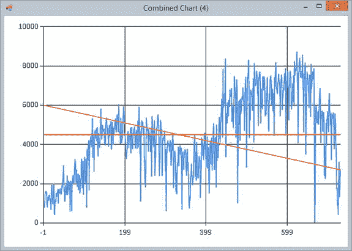

图 4-4. 可视化两个演示线性回归模型

显然，这两个模型都不是数据的理想拟合。好的一面是，我们有了一个通用结构来定义广泛的预测模型。然而，我们面临一个新问题：如何为 `Theta` 选择“好的”值？

### 寻找成本最低的模型

这里的首要问题是更清晰地定义我们的目标。通俗地说，我们寻找的是最适合数据的直线。换句话说，我们想要一条预测值曲线，在与实际观测值比较时，能给出尽可能小的误差——或者等价地说，一条与实际数据距离最小的曲线。我们在第 1 章中见过类似的方法！我们可以简单地调整距离函数；不再逐像素计算两张图像之间的距离，而是计算预测曲线与实际曲线之间的欧几里得距离，对每个数据点比较真实值和预测值。

你可能会问，为什么我选择欧几里得距离，而不是其他距离。毕竟，我们在第 1 章中从曼哈顿距离开始，因为它易于计算。选择欧几里得距离有几个原因。第一个是出于建模考虑。欧几里得距离通过平方差来惩罚误差；因此，较大的误差会比小误差受到更重的惩罚，这是一件好事。在试图最小化距离时，我们将主要关注避免大误差，而不是小误差。第二个原因是技术性的：它使数学计算变得简单得多。

例如，让我们计算两个模型的成本：

```fsharp
type Model = Obs -> float

let cost (data:Obs seq) (m:Model) =
    data
    |> Seq.sumBy (fun x -> pown (float x.Cnt - m x) 2)
    |> sqrt

let overallCost = cost data
overallCost model0 |> printfn "Cost model0: %.0f"
overallCost model1 |> printfn "Cost model1: %.0f"
```

首先，我们创建一个类型 `Model`，它捕捉了所有模型的核心功能——即将一个观测值 `Obs` 转换为一个浮点数，即对用户数量 `Cnt` 的预测值。计算特定数据集上的代价，只需将每个 `Obs` 与对应预测值之间的平方差求和，再取平方根即可。然后，我们可以利用偏函数应用创建一个 `overallCost` 函数，用于计算整个数据集上的代价，并在我们的两个模型上进行测试，得到以下结果：

```
模型 0 的代价：52341
模型 1 的代价：71453
```

在这个例子中，模型 0 的代价远低于模型 1，这表明它更贴合数据，并且与图 4-4 一致。至此，我们可以重新表述我们的问题：我们的目标是找到一个 `Theta` 值，使得代价函数最小化。太好了！既然知道了目标，那就开始行动吧！

#### 使用梯度下降法寻找函数的最小值

我们将采用的方法称为**梯度下降法**。其思路是：从一个 `Theta` 值开始，观察预测误差，然后逐步调整 `Theta` 以逐渐减小误差。为此，我们需要一种方法，能够基于当前模型，朝着减小误差的方向移动 `Theta0` 和 `Theta1`。

##### 梯度下降法

在深入实际问题之前，我们先简单回顾一下微积分知识。我们的目标是解释梯度下降法的一些基本原理。如果你对微积分不太熟悉（或不感兴趣），也不必担心——你仍然可以应用梯度下降法。不过，了解其工作原理还是很有趣的。这是一种相当通用的技术，适用于需要寻找函数最大值或最小值的场景。特别是在机器学习中，它被广泛用于识别最适合数据集的最佳参数，这正是我们接下来要做的。

让我们从一个简单的例子开始：

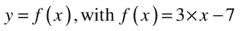

函数 `f` 描述了一条直线，其导数为：

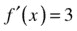

这个数字代表什么？导数对应的是函数 `f` 在某个值 `x` 附近的斜率，或者换句话说，如果我们从当前值“稍微”增加 `x`，预期 `y` 会增加多少。这个例子并不特别有趣：无论我们在直线上的哪个位置，斜率都是恒定的。这也意味着 `f` 没有最小值：对于任何 `x` 值，我们都可以通过减小 `x` 来减小 `f(x)`。然而，让我们考虑一个更有趣的例子：

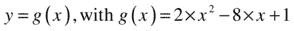

函数 `g` 是一个二次多项式，其导数为：

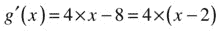

这就有趣多了。在这种情况下，斜率会随着 `x` 的每个值而变化。此外，斜率还会改变符号：当 `x < 2` 时为负，当 `x > 2` 时为正，在 `x = 2` 时为零。这意味着，对于 `x > 2`，斜率是向上的：如果我们“稍微”减小 `x`，就会沿着斜坡向下，`g(x)` 应该会减小。相反，对于 `x` 小于 2 的值，导数为负，`x` 的微小增加将沿着斜坡向下，从而减小 `g`。

作为说明，图 4-5 展示了 `g` 及其在 `x = 3` 处的导数。`g'(3) = 4`：在 `x = 3` 附近，稍微增加 `x` 会导致 `y` 增加四倍。

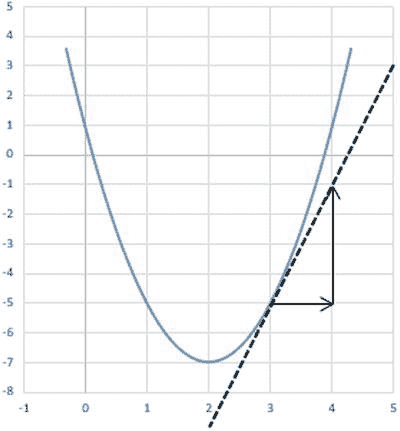

图 4-5. 利用导数求曲线的斜率

那么 `x = 2` 呢？对于这个值，斜率为 0，这意味着我们到达了一个平坦区域，可以说：没有明显的方向可去。导数为 0 的点被称为**极值点**，它可能是两种情况之一：最小值或最大值。

那么，这为什么有趣呢？因为我们可以利用这一点来设计一个寻找函数最小值的通用策略。从一个任意值 `x` 开始，我们可以测量导数（或梯度），然后朝着下降的方向迈出一小步：

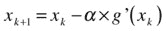

值 `alpha` 被称为**学习率**。斜率仅在 `x` 附近是准确的，而 `alpha` 允许我们调整更新 `x` 时迈出的步长大小。还要注意，变化量取决于 `g'`。当斜率陡峭时，我们对 `x` 的改动会更大；当 `g'` 很小，并且我们可能接近最小值时，我们会进行更小的调整。使用这种方法，如果一切按计划进行，我们可以生成一系列值 `x0`、`x1` 等等，每个值都会产生一个更小的 `g` 值。这就是梯度下降算法。

### 使用梯度下降法拟合曲线

让我们将这个想法应用到当前的问题上。这里我们要稍微调整一下问题：我们将不再关注模型预测的值，而是考虑误差或代价函数，即我们试图减小的值。另一个调整是，我们不再将观测值 `x` 视为输入参数，而是反过来将 `Theta` 视为我们的参数。在这个框架下，使用参数 `Theta` 衡量模型代价的代价函数为：

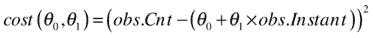

换句话说，这个函数衡量的是，如果我们对模型使用参数 `Theta0` 和 `Theta1`，对于某个观测值 `obs` 会产生的误差。如果我们稍微增加 `Theta1`，误差会改变多少？这就是代价函数关于 `Theta1` 的导数将告诉我们的，所以让我们来计算它。首先，让我们明确一下，将代价函数重写为关于 `Theta1` 的函数，展开并重新组织各项，使其看起来像 `a * Theta1² + b * Theta1 + c`：

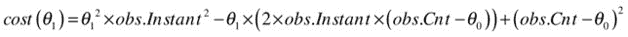

这是一个简单的多项式，记住 `a * x²` 的导数是 `2 * a * x`，`b * x` 的导数是 `b`，我们得到代价函数的导数：

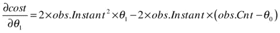

太好了！这费了不少功夫，让我们看看它是否有效。沿着导数方向“稍微”移动 `Theta1` 应该会减少预测误差。让我们将“稍微”定义为一个参数 `alpha`，现在我们有了一个更新过程，可以迭代地修改 `Theta1`，每一步都减少观测值上的误差：

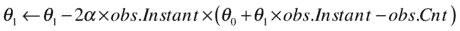

注意，这个公式有一个相对直观的解释，有助于我们理解算法的功能。方程中的最后一项正是误差项。假设 `obs.inst` 为正，如果预测值低于 `obs.cnt`（我们试图预测的实际值），则模型预测偏低，算法会稍微增加 `Theta1` 的值，这将使我们朝着正确的方向移动。相反，如果情况相反，`Theta1` 的值将会减小。还要注意，对于较大的 `obs.inst` 值，修正幅度会更大。

最后，还要注意，虽然这种方法会使 `Theta1` 朝着正确的方向移动，但根据 `alpha` 的值，我们最终可能会过度补偿。正如我们稍后将看到的，`alpha` 是一个需要手动调整的参数。如果 `alpha` 足够小，算法将朝着 `Theta1` 的最优值稳步前进。然而，较小的值也意味着修正速度较慢，这可能导致需要等待很长时间，程序才能为 `Theta1` 产生一个良好的值。

### 更通用的模型形式

在将这种方法应用到当前问题之前，趁我们对数学还记忆犹新，让我们做两点说明，这将使我们的算法更加通用。想象一下，我们不再像之前那样试图拟合一条简单的直线，而是有 N 个特征 `X1, X2, ... XN`，并试图拟合一个如下形式的预测模型：

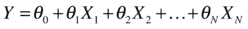

这与我们正在处理的模型类型完全相同，只是特征更多。我们的简单直线模型恰好有 N = 1。第一个便捷的技巧是在模型中引入一个“虚拟”特征 X0，并对每个观测值设置 X0 = 1。这样做的便利之处在于，我们现在可以以一致的方式为所有 Theta 编写预测模型，而无需对常数项 Theta0 进行特殊处理：

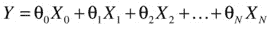

因此，你现在可以重写代价函数，对于任何 Theta 值，它看起来都是这样的：

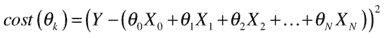

这里的美妙之处在于，如果你现在试图找出如何更新 Thetak（对于 0 到 N 之间的任意 k），在执行求导并重复我们上面所做的步骤后，最终会得到以下公式：

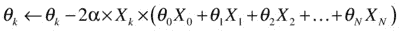

这非常棒。通过这种方法，我们现在拥有一个算法，可以同时更新所有参数 Theta（包括应用于常数项的 Theta0），适用于任意数量的特征。

让我们说明一下如何将这个想法应用到我们的模型上——一个真实的例子可能有助于减少抽象感。例如，我们可以尝试使用即时变量和温度（分别扮演 X1 和 X2 的角色）来预测用户数量。在这种情况下，回归模型将如下所示：

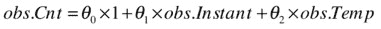

如果我们试图更新 Theta2 的值以减少预测误差（代价），应用我们的程序将产生以下更新规则：

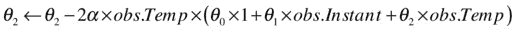

此外，同样的规则现在也可以应用于更新 Theta0 和 Theta1；唯一需要的修改是在公式中替换正确的 Thetak 和 Xk。

## 实现梯度下降

现在我们有了梯度下降这个强大的工具，让我们回到自行车问题，使用我们的算法最终在数据集中拟合出一条直线。我们将从直接应用更新方法开始，然后分析结果，看看如何改进这种方法。

### 随机梯度下降

我们可以采用的第一种方法是简单地遍历观测值，并在每一步进行小幅调整。让我们试试看。首先，我们需要一个函数，给定一个观测值和 Theta 的值，以学习率 alpha 更新 Theta：

```fsharp
let update alpha (theta0, theta1) (obs:Obs) =
    let y  = float obs.Cnt
    let x  = float obs.Instant
    let theta0' = theta0 - 2. * alpha * 1. * (theta0 + theta1 * x - y)
    let theta1' = theta1 - 2. * alpha * x *  (theta0 + theta1 * x - y)
    theta0', theta1'
```

这是我们之前推导出的公式的直接实现。我们计算 Theta 的更新值，并将其作为元组返回。让我们用一个例子来确认这种方法是否有效，例如，使用第 100 个观测值，并将 Theta 的初始值设为 (0.0, 0.0)：

```fsharp
let obs100 = data |> Seq.nth 100
let testUpdate = update 0.00001 (0.,0.) obs100
cost [obs100] (model (0.,0.))
cost [obs100] (model testUpdate)
```

看起来一切正常：应用更新后，对该特定观测值的新预测得到了改善，误差更小。此时，我们只需要将其应用于整个数据集，从上一步得到的 `theta` 值开始，逐步更新每个观测值的 `theta`：

```
let stochastic rate (theta0,theta1) =
    data
    |> Seq.fold (fun (t0,t1) obs ->
        printfn "%.4f,%.4f" t0 t1
        update rate (t0,t1) obs) (theta0,theta1)
```

这里我们使用了 `Seq.fold`，它相当于 LINQ 中的 C# `Enumerable.Aggregate` 方法。`fold` 操作简单地接受一个初始值和一个值序列，通过对序列中的每个元素应用相同的函数来更新累加器。一个简单的例子可能有助于更好地说明这个想法：

```
let data = [0;1;2;3;4]
let sum = data |> Seq.fold (fun total x -> total + x) 0
```

`fold` 操作会跟踪一个总值，初始为 0，并将每个值 `x` 加到总值上，直到序列中没有剩余元素——此时，返回总值。

在我们的例子中，我们遵循相同的模式：用两个值——`theta0` 和 `theta1`——初始化累加器，并对数据集中的每个观测值更新它们，直到没有剩余的观测值，然后返回 `Theta` 的最终值。

我们快完成了。剩下的唯一问题是校准学习率 `alpha`，取值要足够小以避免过度调整，同时又要足够大，以免算法进展过慢。这很容易做到，因为我们可以测试不同的 `Alpha` 值（`0.1`, `0.01`, `0.001`...），并在对数据集进行一次更新后，比较结果的质量，从 `Theta = (0.0, 0.0)` 开始：

```
let tune_rate =
    [ for r in 1 .. 20 ->
        (pown 0.1 r), stochastic (pown 0.1 r) (0.,0.) |> model |> overallCost ]
```

如果你打印出每个学习率 `alpha` 值对应的代价，你会得到以下结果：

```
Alpha                  Cost
0.1                  : NaN
0.01                 : NaN
0.001                : NaN
0.000,1              : NaN
0.000,01             : Infinity
0.000,001            : 94,007
0.000,000,1          : 93,189
0.000,000,01         : 59,367
0.000,000,001        : 107,780
0.000,000,000,1      : 129,677
0.000,000,000,01     : 132,263
0.000,000,000,001    : 132,526
0.000,000,000,000,1  : 132,552
0.000,000,000,000,01 : 132,555
0.000,000,000,000,001: 132,555
```

结果相当典型。对于较大的 `alpha` 值，调整过于激进，以至于 `Theta` 的值剧烈波动，从未稳定下来。相反，对于较小的值，调整幅度太小，几乎无法改善拟合效果。最有效的 `alpha` 值似乎是 `1e-8`，即 `0.000,000,01`，它给出的代价约为 `59,367`，对应的 `Theta` 值约为 `(0.03, 8.21)`；如果我们绘制出最终的直线，结果如下：

```
let rate = pown 0.1 8
let model2 = model (stochastic rate (0.0,0.0))

Chart.Combine [
    Chart.Line count
    Chart.Line [ for obs in data -> model2 obs ] ]
```

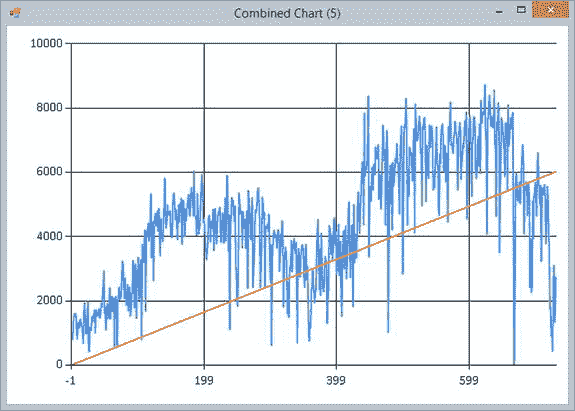

图 4-6\. 使用随机梯度下降的最佳拟合曲线

 **注意** 我们找到了一个相当有效的 `alpha` 值，但这里还有一个微妙的问题。我们曲线的斜率看起来不错，但其起始值 `Theta0` 看起来太低了。问题在于我们的变量尺度差异很大：常数项是 1，但即时变量范围从 0 到大约 700。因此，调整主要由幅度较大的特征 `Theta1` 驱动。为了更快地调整 `Theta0`，我们需要对数据集进行预处理，使所有输入都处于可比较的尺度上，这个过程称为重新缩放。我们现在先忽略这个问题，但会在第 5 章中更详细地讨论特征缩放。

**分析模型改进**

接下来该怎么做？下一步是重复该过程，对数据集进行多次遍历，直到我们观察到没有显著改进为止。不过，与其这样做，不如我们先看看算法的行为，特别是预测误差随着我们的推进是如何演变的。代码的细节并不特别重要——我们在这里所做的是采用一个非常激进的 `alpha` 值（比我们之前确定的“最佳点”值高 10 倍），并在每次调整后绘制总体误差：

```
let hiRate = 10.0 * rate
let error_eval =
    data
    |> Seq.scan (fun (t0,t1) obs -> update hiRate (t0,t1) obs) (0.0,0.0)
    |> Seq.map (model >> overallCost)
    |> Chart.Line
```

这很有趣。在缓慢启动之后，误差开始稳步下降，中间阶段减速，最后又开始回升。这是怎么回事？由于我们采用了激进的**学习率** `alpha`，我们得到了图 4-7 中的图表。

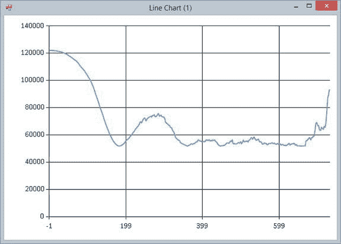

图 4-7. 使用随机梯度下降的逐步误差

发生的情况是，由于我们的数据集中存在季节性效应（可以推测，在严冬骑自行车上班的吸引力远不如春天），多个连续的观测值呈现出相同的趋势，要么高于理想线，要么低于理想线。结果，每次只观察一个观测值的更新过程，会进行一系列都偏向同一方向的修正（因为误差都倾向于同一方向），并开始偏离，暂时增加了整体模型的误差。

这有几点启示。首先，除了梯度下降之外，如果我们使用交叉验证来评估工作质量，需要非常小心。例如，如果我们把最后 200 个观测值设为验证样本，我们会对预测误差得到一个非常有偏的估计，因为在该特定时间段内，曲线遵循一个（推测是）暂时的下降趋势，并且肯定不能代表数据的整体形态。

这表明了我们的随机下降方法存在一个潜在的限制。用一种非常非正式的方式来说，我们试图达成的是一个共识估计，但我们的过程本质上是逐个探测每个观测值，并遵循最新观测值指示的方向。这可能会导致一些不必要的波动，例如，当我们遇到一个高度异常的观测值或一连串这样的观测值时。公平地说，这可以在一定程度上得到缓解——通过随机顺序而非顺序选取观测值（这将限制连续观测值呈现相似偏差的风险），并逐步降低学习率 `alpha`（这将减少任何单个观测值的权重并减慢更新过程）——但即便如此，事实仍然是这种方法可能会产生波动。

解决这个问题的一种方法是避免依赖单个观测值，而是基于整个数据集执行更新。这就是**批量梯度下降**的基础，我们接下来将看到它的实际应用。同时，随机梯度下降也不应被完全抛弃。它实现起来相当容易，并且适用于广泛的情况。更有趣的是，它允许所谓的“在线学习”。该算法不需要一开始就拥有整个数据集来学习；如果你随着时间的推移获得新数据，你的模型可以仅使用当前模型和最新到达的观测值进行更新。

**批量梯度下降**

那么，我们如何调整模型，使其基于整个数据集而不是单个观测值进行更新呢？事实证明，这相当直接。在随机下降方法中，我们的目标是最小化单个观测值的误差，由成本函数定义：


与其关注单个观测值，我们不如关注整个数据集上的平均误差，这仅仅是所有单个误差的平均值。由此产生的成本函数如下所示，每个观测值从 1 到 N 索引：

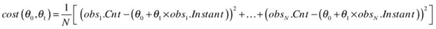

遵循与之前相同的思路，我们需要计算成本相对于其参数 `Theta0` 和 `Theta1` 的导数。这实际上相当容易，如果你记得 `f(x) + g(x)` 的导数是它们各自导数的和；聚合误差的导数是每个单个观测值上导数的和。`Theta1` 的更新就变成了下面这样：

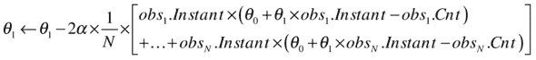

解释这个函数的一种方式是，算法不再基于单个观测值的误差进行更新，而是计算对每个观测值都会进行的调整，然后取平均修正。这可以很容易地扩展到所有 `Theta`，方式类似于我们对随机下降所做的。因为我们喜欢节省篇幅，这次我们就不一步步推导了，而是引用经典的“我们将把它留作练习，让读者自行推导细节”，直接跳到更新算法的一种可能实现：

### 批量更新算法

```fsharp
let batchUpdate rate (theta0, theta1) (data:Obs seq) =
    let updates =
        data
        |> Seq.map (update rate (theta0, theta1))
    let theta0' = updates |> Seq.averageBy fst
    let theta1' = updates |> Seq.averageBy snd
    theta0', theta1'
```

我们在这里所做的是，获取每个观测值，计算仅基于该观测值对 Theta 所做的调整，然后取所有调整的平均值。然后我们可以重复更新过程，逐步优化我们对 Theta 的估计，在一定的迭代次数后停止，或者可能在搜索稳定且 Theta 的值在迭代之间变化不大时停止：

```fsharp
let batch rate iters =
    let rec search (t0,t1) i =
        if i = 0 then (t0,t1)
        else
            search (batchUpdate rate (t0,t1) data) (i-1)
    search (0.0,0.0) iters
```

我们只需要找到一个合适的学习率 `alpha` 值，遵循与之前相同的步骤。对于 `Alpha` = 0.000,001，如果我们绘制误差随迭代次数的变化图，我们会得到一条漂亮平滑的曲线，显示误差稳定下降，没有任何波动。请看下面：

```fsharp
let batched_error rate =
    Seq.unfold (fun (t0,t1) ->
        let (t0',t1') = batchUpdate rate (t0,t1) data
        let err = model (t0,t1) |> overallCost
        Some(err, (t0',t1'))) (0.0,0.0)
    |> Seq.take 100
    |> Seq.toList
    |> Chart.Line

batched_error 0.000001
```

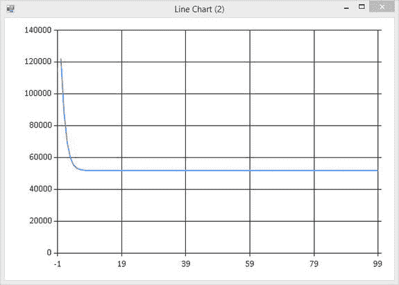

图 4-8. 使用批量梯度下降的逐步误差

这好多了。一方面，我们现在一次性使用整个数据集，在我们的例子中这不是问题，但如果数据集大得多，可能会成为问题。另一方面，我们的过程现在稳定地向最优值收敛，过程中没有任何波动：你等待的时间越长，估计值就越好。这里的好处是，同样的方法也适用于超出通过数据拟合直线的情况。本质上，只要你的成本函数是可微的并且是凸的，就可以采用同样的通用方法。

然而，我们的方法仍存在一些小缺陷。首先，需要手动调整学习率 `alpha` 令人烦恼——如果无需此步骤就好了。其次，若算法迭代次数过多，你会发现代价持续下降，而参数 `Theta0` 不断增大，最终需要极长时间才能稳定。这源于我们之前提到的问题：`Theta0` 和 `Theta1` 的量级差异巨大，在缓慢的学习率下，算法需要大量迭代才能达到“正确”值。在下一节中，我们将看到如何针对当前的具体问题（不含任何正则化惩罚项的线性回归），利用线性代数简化工作，并大幅提升算法速度。

## 线性代数来救场

到目前为止，我们一直遵循的方向是坚守领域本身，将数据集表示为带有命名属性的观测值集合，并应用针对当前领域的映射和折叠操作进行转换。然而仔细想想，一旦开始应用更新过程，领域的具体细节就不再重要。无论是尝试根据发动机排量和里程预测汽车价格，还是根据风速预测自行车使用量，最终结果并无区别。归根结底，这两种情况最终都会将观测值简化为双精度浮点数行，并用它们来预测另一个双精度浮点数。

在这种框架下，与其关注此时已无关紧要的领域细节，不如聚焦于数据结构，将领域转化为通用结构，并应用相同的通用算法来解决具有相同结构的问题。这正是代数的用武之地：它为我们提供了一套成熟的语言来描述数字行，以及对其执行各种操作的方法。

## 线性代数速览

线性代数的两个基本元素是向量和矩阵。大小为 n 的向量就是 n 个元素的集合，索引从 1 到 n，例如：

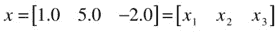

矩阵由其维度（或大小）m x n 描述，其中 m 表示行数，n 表示列数。例如，M 是一个 3 × 2 矩阵：

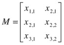

粗略类比，我们可以将向量和矩阵视为数组和二维数组的数学等价物。

向量可以表示为行向量或列向量；在处理矩阵时，这种区分尤为重要。矩阵可以看作行向量或列向量的集合，而向量上的大多数操作都可以视为矩阵操作的特例。

我们需要的四个核心运算是加法、标量乘法、转置和乘法。矩阵（或向量）相加只需按索引逐元素相加，且要求两个矩阵大小相同：

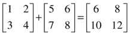

标量乘法是指将矩阵（或向量）乘以一个单一数字（标量），每个元素都乘以该标量：

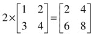

矩阵转置（用 T 表示）是指重新定向矩阵，使行变为列，列变为行：

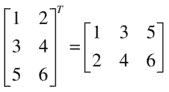

最后，矩阵乘法计算为第一个矩阵的每个行向量与第二个矩阵的每个列向量的点积（或内积）。两个向量的点积是一个单一数字，计算为它们每个对应项乘积之和：

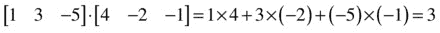

应用于矩阵乘法时，我们得到如下结果：

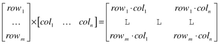

注意，为了正确定义，此方法要求第一个矩阵的列数等于第二个矩阵的行数。

## 公式向量化

让我们看看如何用代数语言重新表述我们的问题。之前，我们这样定义预测模型：

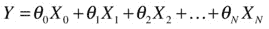

如果我们将 Y 定义为 `obs.cnt`，并将 Theta 和 X 定义为两个向量，其中：

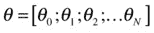

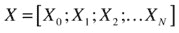

……那么我们的预测模型可以更紧凑地重新表述为两个向量的乘积：

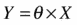

类似地，我们在批量梯度下降算法中试图最小化的代价函数，是每个观测值上平方误差之和，再对 N 个观测值取平均：

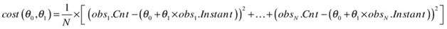

同样，这可以更紧凑地重新表述，用 `Yn` 表示第 n 个观测值的输出值（即 Y 向量的第 n 个元素），用 `Xn` 表示描述第 n 个观测值的数据行：

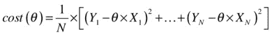

或者，更好的是，如果我们将所有观测值堆叠起来，就得到一个矩阵 X，其中 `Xn`（矩阵的第 n 行）包含第 n 个观测值：

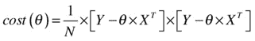

我们可以继续这样下去，将整个批量梯度下降算法重写为一系列向量和矩阵运算。在深入探讨之前，让我们先确保这确实可行，并且使用线性代数时，我们的结果与原始公式完全相同。

## 使用 Math.NET 进行线性代数运算

虽然还有其他选择，但在 .NET 上“做代数”的最佳起点是 Math.NET。Math.NET 是一个维护良好的开源库，多年来经过了大量实战检验。与其在我们一直使用的同一个脚本中塞入更多代码，不如新建一个脚本，通过 NuGet 导入 Math.NET 及其 F# 扩展，以及我们一直在使用的其他包。首先，让我们看看如何使用 Math.NET 执行基本代数运算：

```fsharp
#I @"packages\"
#r @"FSharp.Data.2.2.1\lib\net40\FSharp.Data.dll"
#load @"FSharp.Charting.0.90.10\FSharp.Charting.fsx"
#r @"MathNet.Numerics.Signed.3.6.0\lib\net40\MathNet.Numerics.dll"
#r @"MathNet.Numerics.FSharp.Signed.3.6.0\lib\net40\MathNet.Numerics.FSharp.dll"

open FSharp.Charting
open FSharp.Data
open MathNet
open MathNet.Numerics.LinearAlgebra
open MathNet.Numerics.LinearAlgebra.Double
```

为了演示，让我们创建一个向量 A 和一个矩阵 B，并对它们执行一些操作：

```
let A = vector [ 1.; 2.; 3. ]
let B = matrix [ [ 1.; 2. ]
                 [ 3.; 4. ]
                 [ 5.; 6. ] ]

let C = A * A
let D = A * B
let E = A * B.Column(1)
```

一切似乎都按预期工作，而且额外的好处是，代码看起来与数学书中的数学公式非常相似。现在，让我们用“代数风格”重写我们的预测函数和代价函数：

```
type Data = CsvProvider<"day.csv">
let dataset = Data.Load("day.csv")
let data = dataset.Rows

type Vec = Vector<float>
type Mat = Matrix<float>

let cost (theta:Vec) (Y:Vec) (X:Mat) =
    let ps = Y - (theta * X.Transpose())
    ps * ps |> sqrt

let predict (theta:Vec) (v:Vec) = theta * v

let X = matrix [ for obs in data -> [ 1.; float obs.Instant ]]
let Y = vector [ for obs in data -> float obs.Cnt ]
```

 **提示** 为方便起见，我们创建了两种类型 `Vec` 和 `Mat`，分别对应 `Vector<float>` 和 `Matrix<float>`。事实证明，这能极大简化代码：Math.NET 支持对 `float`/`double` 以外的数值类型进行代数运算，这虽然非常有用，但也会让代码变得杂乱，并需要额外添加一些类型注解来明确具体类型。由于我们只对浮点数进行操作，保持所有泛型化并无实际意义，反而会产生干扰，因此我们做了简化。

现在，我们可以使用相同的 Theta 值，将之前得到的预测值和成本与新的公式结果进行比较：

```
let theta = vector [6000.; -4.5]

predict theta (X.Row(0))
cost theta Y X
```

所有结果都吻合。我们已经有了可靠的基础，接下来继续估算 Theta。

**正规方程**

我们可以用“代数风格”重写批量梯度下降法。不过，这里我们将采用另一种方式，以突出使用代数的某些优势。事实上，我们试图解决的问题（找到使成本最小化的 Theta 值）在数学上存在所谓的闭式解；也就是说，可以直接从输入计算出一个明确、精确的解，无需任何数值近似。

解释如何推导出这个结果超出了本书的范围，而且对理解机器学习部分也没有太大价值，因此我将直接给出结果；如果你对此感到好奇，可以在你喜欢的搜索引擎中搜索“正规方程回归”。不加任何证明，问题

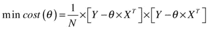

的解为 Theta，即

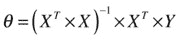

这正是线性代数库大显身手的地方。矩阵转置和求逆已经为我们实现好了，我们的算法现在变成了一行代码。更棒的是，我们无需经历调整学习率的漫长过程，也无需运行数千次昂贵的迭代并祈祷能接近正确值——我们一次性就能得到正确的解。请看以下代码：

```
let estimate (Y:Vec) (X:Mat) =
    (X.Transpose() * X).Inverse() * X.Transpose() * Y
```

这是否意味着我们之前关于梯度下降的所有工作都白费了？当然不是！除了练习本身的教学价值（希望它阐明了总体流程）之外，梯度下降是一种更通用的算法，适用于例如我们决定使用不同的非线性成本函数的情况，只需对导数进行适当的修改即可。相比之下，正规方程只是针对一个非常特定方程的解，无法开箱即用地推广。话虽如此，它所能解决的问题类别还是相当广泛的。

**借助 MKL 全力加速**

到目前为止，我们强调的以代数为中心的方法的主要优势在于，对于合适的问题，它能够实现更紧凑的公式表达。代数在机器学习中如此重要的另一个完全不同的原因是性能。

如果仅用于机器学习，代数在软件中可能不会那么重要。幸运的是，还有另一个领域，开发者非常重视代数，那就是游戏行业。3D 图形本质上就是围绕多边形移动的问题，这从根本上来说是一个代数问题。因此，由于对更快、更精细的游戏世界的不断追求，人们在实现高性能代数运算方面投入了大量精力，包括在硬件层面。该领域最显著的例子是 GPGPU（图形处理单元上的通用计算），通过使用最初为矢量图形设计的硬件，它可以在某些类型的计算上实现巨大的加速。

使用 GPGPU 功能强大，但也需要一些额外工作。不过，Math.NET 为你提供了一种利用类似功能的选项，且几乎无需额外工作。该库支持 MKL 提供程序，这种机制本质上允许你将计算任务发送到 **MKL**（**数学核心库**），这是一组内置于英特尔处理器的高度优化的数学库。

在 Math.NET 中使用 MKL 相当直接。一旦将相应的 NuGet 包添加到项目中，就会出现两个库：`MathNet.Numerics.MKL.dll` 和 `libiomp5md.dll`。右键点击 MKL 的 dll 文件，在属性中，将“复制到输出目录”设置为“始终复制”。

 **提示**  MKL 有多种版本：32 位与 64 位，以及 Windows 与 Linux 版本。安装 NuGet 包时，请确保选择适合你机器的包。

此时，将计算任务发送到 MKL 只需如下操作：

```
System.Environment.CurrentDirectory <- __SOURCE_DIRECTORY__

open MathNet.Numerics
open MathNet.Numerics.Providers.LinearAlgebra.Mkl
Control.LinearAlgebraProvider <- MklLinearAlgebraProvider()
```

第一行代码略显丑陋，其目的是将当前目录设置为源代码所在的目录；这是为了让脚本能够找到位于该目录下的 MKL dll 文件。完成这一步后，只需将默认的 `LinearAlgebraProvider` 替换为对应的 MKL 版本，我们就可以开始了。

那么，这究竟能给我们带来什么好处呢？具体效果会因你使用的计算机和所处理问题的规模而异。通常，对于较小的矩阵（比如我们目前处理的这种），即使能看到效果，其收益也微乎其微。然而，如果是在较大的数据集上运行计算，看到十倍的加速效果也并非罕见。

**快速演进和验证模型**

我们从使用梯度下降的小锤子，升级到了使用正规方程的强大工具。将模型拟合到数据集突然变得相当简单和通用：只要我们能将观测值转换为双精度浮点数向量，就万事大吉了。在本节中，我们将重构代码，以便从通用算法中获益。我们的目标是尽可能轻松地改变使用数据进行预测的方式，并通过添加或移除特征来试验不同的模型。然而，如果要创建多个模型，我们首先需要一个比较它们质量的过程。让我们先把这个过程建立起来，一旦基础稳固，我们将探索如何快速演进和优化模型。

**再次讨论交叉验证和过拟合**

毫不意外，我们将使用交叉验证作为模型比较的基础。我们将留出一部分数据集用于验证，仅使用 70% 的数据训练模型，保留 30% 的数据用于验证。

请注意，这对我们的情况尤其重要。考虑一下以下情况：假设你正在考虑使用一组特征 `[Theta0; Theta1; ... ThetaN]` 和另一个模型 `[Theta0; Theta1; ... ThetaN; ThetaM]`——即相同的模型，但额外增加了一个特征。第二个模型产生的误差是否可能比第一个模型更差？

答案是，第二个特征集（包含第一个特征集的所有特征以及一个额外特征）的误差总是低于第一个特征集。作为一个非正式的证明，可以这样想：在最坏的情况下，`ThetaM` 的值可能为 0，此时两个模型是等价的，显然具有相同的误差。因此，至少，寻找最低可能成本的算法在两种情况下都能达到相同的水平。然而，在第二种情况下，一旦达到该值，就可以选择将 `ThetaM` 从 0 改为其他值，并可能改变其他 Theta 值，以获得更低的成本。

换句话说，我们添加的特征越多，成本就会越低，无论这些额外特征是好是坏。如果我添加一个完全随机的特征，比如东京一磅萝卜的每日价格，机械地，我会得到一个更好的拟合——或者至少，一个同样好的拟合。

结论很简单：在训练数据上获得良好的拟合并不总是一件好事。再次强调，我们追求的不是一个完美拟合我们输入数据的模型，而是一个能在从未见过的新数据上产生稳健预测的模型。
```

### 洗牌算法示例

这里我们需要处理的一个额外问题是，如果我们简单地切割数据集，使用前 70% 的观测值进行训练，后 30% 进行验证，那么我们的验证集将无法“代表”未来可能出现的任意新观测值。由于存在明显的季节性模式，最后一块数据将相似的观测值聚集在一起，并完全忽略了某些情况。为了避免这种情况，我们将首先对样本进行洗牌以消除季节性影响，使用经典的 `Fisher-Yates` 随机洗牌算法，如下所示：

```
let seed = 314159
let rng = System.Random(seed)

// Fisher-Yates 洗牌
let shuffle (arr:'a []) =
    let arr = Array.copy arr
    let l = arr.Length
    for i in (l-1) .. -1 .. 1 do
        let temp = arr.[i]
        let j = rng.Next(0,i+1)
        arr.[i] <- arr.[j]
        arr.[j] <- temp
    arr
```

洗牌算法简单地接受一个泛型数组，并返回一个新数组，其中的元素以随机顺序重新排列：

```
let myArray = [| 1 .. 5 |]
myArray |> shuffle
>
val myArray : int [] = [|1; 2; 3; 4; 5|]
val it : int [] = [|4; 1; 5; 2; 3|]
```

 **提示** 使用随机数生成器（如 `System.Random`）时，指定种子通常是个好主意。这样，你可以在不同会话间重现结果，这有助于确保你的计算行为符合预期——当每次运行代码结果都不同时，这是很难做到的！

现在，我们可以通过简单地洗牌数据集并返回两个切片来创建训练集和验证集：前 70% 作为训练集，剩余 30% 作为验证集：

```
let training,validation =
    let shuffled =
        data
        |> Seq.toArray
        |> shuffle
    let size =
        0.7 * float (Array.length shuffled) |> int
    shuffled.[..size],
    shuffled.[size+1..]
```

### 简化模型的创建

一切准备就绪，评估框架也已到位。此时，我们想要的是通过包含或移除特征来轻松创建各种模型，然后运行计算看看哪些有效。

为此，我们需要一种方法将观测值转换为特征列表，每个特征从观测值中提取一个浮点数，这样我们就可以将观测值转换为特征矩阵，并通过正规方程估计相应的 `Theta`。为了实现这一点，我们将创建一个新类型 `Featurizer`，它将接受一个 `Obs` 并将其转换为浮点数列表：

```
type Obs = Data.Row
type Model = Obs -> float
type Featurizer = Obs -> float list
```

使用这种方法，我们将能够简化定义模型的方式，通过列出我们想要如何使用“特征化器”从观测值中提取数据。作为示例，以下是我们如何重新创建简单的直线模型，其中包含一个始终取值为 1.0 的常数虚拟变量，并从观测值中提取 `Instant`：

```
let exampleFeaturizer (obs:Obs) =
  [   1.0;
      float obs.Instant; ]
```

为了方便起见，我们还可以创建一个预测函数，它接受一个 `Featurizer` 和一个向量 `Theta`，并返回一个将单个观测值转换为预测值的函数：

```
let predictor (f:Featurizer) (theta:Vec) =
    f >> vector >> (*) theta
```

趁此机会，我们再来创建一个函数，用于评估特定模型在给定数据集上的质量。这样，我们就能在训练集和验证集上对模型进行比较。虽然成本函数也能胜任，但我们将改用另一个经典指标——平均绝对误差（MAE），即平均绝对预测误差，因为它更易于理解。MAE 表示我们的预测平均偏离了多少，如下所示：

```
let evaluate (model:Model) (data:Obs seq) =
    data
    |> Seq.averageBy (fun obs ->
        abs (model obs - float obs.Cnt))
```

现在，让我们把这些整合起来：

```
let model (f:Featurizer) (data:Obs seq) =
    let Yt, Xt =
        data
        |> Seq.toList
        |> List.map (fun obs -> float obs.Cnt, f obs)
        |> List.unzip
    let theta = estimate (vector Yt) (matrix Xt)
    let predict = predictor f theta
    theta,predict
```

`model` 函数接收一个特征提取器 `f`，用于描述我们希望从观测数据中提取哪些特征，以及一个用于训练模型的数据集。首先，我们从数据集中提取输出 `Yt` 和矩阵 `Xt`。然后，我们使用 `Yt` 和 `Xt` 来估计 `Theta`，并返回向量 `Theta`，同时附带相应的预测函数，该函数现在即可投入使用。

### 为模型添加连续特征

让我们在简单的直线模型上测试一下，我们将其称为 `model0`：

```
let featurizer0 (obs:Obs) =
    [   1.;
        float obs.Instant; ]

let (theta0,model0) = model featurizer0 training
```

简单又方便！现在，我们可以在训练集和验证集上评估模型 `model0` 的质量：

```
evaluate model0 training |> printfn "Training: %.0f"
evaluate model0 validation |> printfn "Validation: %.0f"
>
Training: 1258
Validation: 1167
```

将模型结果与实际数据可视化（参见图 4-9），可以看到一条漂亮的直线，它看起来确实拟合得相当不错：

```
Chart.Combine [
    Chart.Line [ for obs in data -> float obs.Cnt ]
    Chart.Line [ for obs in data -> model0 obs ] ]
```


图 4-9. 直线回归的可视化

现在，我们可以开始向模型添加特征，从可用的连续变量中选择——即具有数值意义的变量，如温度或风速——并将它们添加到新的特征提取器中：

```
let featurizer1 (obs:Obs) =
    [   1.
        obs.Instant |> float
        obs.Atemp |> float
        obs.Hum |> float
        obs.Temp |> float
        obs.Windspeed |> float
    ]

let (theta1,model1) = model featurizer1 training

evaluate model1 training |> printfn "Training: %.0f"
evaluate model1 validation |> printfn "Validation: %.0f"
>
Training: 732
Validation: 697
```

显然，我们做对了：MAE 显著下降，无论是在训练集（这是意料之中的）还是验证集（这才是关键）上。之前，我们的平均误差大约为 1200 个单位，现在降到了 750 左右。虽然还不完美，但进步明显！如果我们绘制新的预测曲线，这一点一目了然——新的预测曲线开始更紧密地贴合目标（参见图 4-10）。

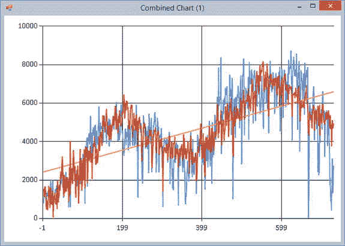

图 4-10. 包含更多连续特征

让我们换个角度观察数据，绘制实际值与预测值的对比图：

```
Chart.Point [ for obs in data -> float obs.Cnt, model1 obs ]
```

图 4-11 证实了我们的模型开始看起来像那么回事了。散点图虽然不完美，但大致遵循一条 45 度直线，上面散布着一些噪声。

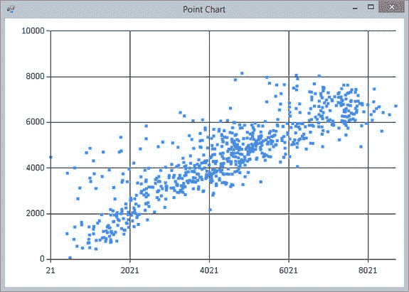

图 4-11. 预测值与实际值的散点图

# 用更多特征优化预测

至此，我们已经建立了一个结构，允许我们通过最少的代码更改，非常自由地试验，轻松地向模型添加或移除数据。这固然很好，但数据集中还有大量数据我们尚未利用。在本节中，我们将探讨如何更进一步，在模型中包含更多特征，从而改进我们的结果。

## 处理分类特征

我们已经使用了数据集中大部分可用的数据，但也遗漏了一些。例如，节假日呢？假设周末对自行车使用量有影响，这并非不合理。那星期几呢？没有理由认为人们在周一和周五的行为会没有差异。

不过，我们这里有一个问题：这些变量是`分类变量`。虽然工作日被编码为 0、1……6（分别对应周日至周一），但这些数字没有数值意义。周三的价值不是周一的 3 倍，将自行车使用量建模为工作日代码的倍数也没有意义。

然而，我们可以采用之前用来表示方程中常数项的相同技巧。如果我们为每一天创建一个特征——例如，为周一创建一个特征，在周一将观测值标记为 1.0，否则为 0.0——那么对`Theta`的估计应该能捕捉到周一的影响。让我们试试看：

```
let featurizer2 (obs:Obs) =
    [   1.
        obs.Instant |> float
        obs.Hum |> float
        obs.Temp |> float
        obs.Windspeed |> float
        (if obs.Weekday = 0 then 1.0 else 0.0)
        (if obs.Weekday = 1 then 1.0 else 0.0)
        (if obs.Weekday = 2 then 1.0 else 0.0)
        (if obs.Weekday = 3 then 1.0 else 0.0)
        (if obs.Weekday = 4 then 1.0 else 0.0)
        (if obs.Weekday = 5 then 1.0 else 0.0)
        (if obs.Weekday = 6 then 1.0 else 0.0)
    ]

let (theta2,model2) = model featurizer2 training
```

然后……呃？我们对`Theta`的估计返回了`seq [nan; nan; nan; nan; ...]`。这是怎么回事？我们面临的问题的术语是`共线性`。在深入探讨我们为何在此遇到这个问题之前，先看一个更简单的例子，它说明了问题的根源。回想一下我们的第一个模型，我们定义的特征如下：

*Y* = *θ*[0] + *θ*[1] × `obs.Instant`

现在假设我们修改了特征，转而采用以下规范：

*Y* = *θ*[0] + *θ*[1] × `obs.Instant` + *θ*[2] × `obs.Instant`

当然，这是一个愚蠢的规范，但让我们暂且接受它。在这种情况下，会发生什么？我们会遇到一点麻烦。对于`Theta1`和`Theta2`，存在无数种可能的组合都能工作。如果我们在初始模型中`Theta1`的最优值是 10.0，那么任何`Theta1`和`Theta2`之和为 10.0 的组合对于修改后的模型也是最优的。10.0 和 0.0、5.0 和 5.0、1000.0 和 -990.0 都能同样有效地工作，而我们无法在这些组合中做出选择。这本质上就是算法面临的问题：它无法找到`Theta`的唯一最优值，因此彻底失败。

那么，我们为什么会遇到共线性问题呢？仔细想想，如果我们的任何一个特征可以表示为其他特征的线性组合，我们就会遇到这个问题。嗯，任何一天都必须是七个现有工作日之一，所以周一 + 周二 + …… + 周日 = 1.0。但 1.0 也是我们常数项的值，即映射到`Theta0`的那个。对此我们能做些什么呢？

我们可以采取两种做法。第一种是从列表中移除某个工作日。在这种情况下，实际上我们是将该日设为“参考日”，而分配给其余六天中每一天的`Theta`值将捕捉与参考日相比的增益或损失差异。另一种做法是从方程中移除常数项；这样，我们最终将直接得到一周七天中每一天的估计值。

我们继续操作，移除星期日，将其作为参考点。现在估计过程运行得非常顺利，甚至模型质量还有小幅提升：

```
let featurizer2 (obs:Obs) =
    [   1.
        obs.Instant |> float
        obs.Hum |> float
        obs.Temp |> float
        obs.Windspeed |> float
        (if obs.Weekday = 1 then 1.0 else 0.0)
        (if obs.Weekday = 2 then 1.0 else 0.0)
        (if obs.Weekday = 3 then 1.0 else 0.0)
        (if obs.Weekday = 4 then 1.0 else 0.0)
        (if obs.Weekday = 5 then 1.0 else 0.0)
        (if obs.Weekday = 6 then 1.0 else 0.0)
    ]

let (theta2,model2) = model featurizer2 training

evaluate model2 training |> printfn "Training: %.0f"
evaluate model2 validation |> printfn "Validation: %.0f"

>
Training: 721
Validation: 737
```

如果我们稍微检查一下`Theta`，将最后六个系数与对应的工作日匹配，似乎星期六是骑自行车最受欢迎的日子，而星期日则更适合做其他事情。

我们不会进一步深入探讨如何向模型添加更多分类特征，但欢迎您自行尝试，看看能从中挤出多少改进空间！我们在此想强调的两个要点是：首先，只需付出最少的努力，就可以通过将分类变量拆分为单个特征，并使用指示变量（1 表示存在，0 表示不存在）来表示其激活状态，从而在回归模型中使用分类变量。然后，我们讨论了共线性问题及其如何对模型造成严重破坏，以及当问题出现时的处理方法。

## 非线性特征

我们几乎把所有能想到的特征都包含进去了。难道就没有其他方法可以尝试改进我们的预测了吗？

为了解决这个问题，让我们先重新审视一下数据，绘制自行车使用量与温度的关系图（参见图 4-12）：

```
Chart.Point [ for obs in data -> obs.Temp, obs.Cnt ]
```

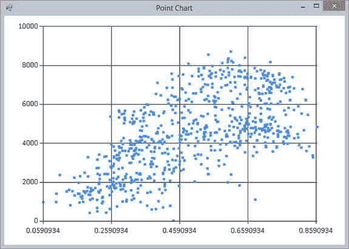

图 4-12. 自行车使用量与温度的散点图

数据相当杂乱，但总体来看，使用量似乎随着温度升高而增加，但只增加到某个点，之后便开始下降。这并非不合理：当天气严寒或酷热时，骑自行车的吸引力会降低。不幸的是，我们当前的模型并不擅长捕捉这一点。所有的影响都表示为线性函数；也就是说，它们的形式是`Theta` × 特征值。如果`Theta`为正，在其他条件不变的情况下，特征值越高，预测值就越高；反之，如果`Theta`为负，特征值越高，预测值就越低。

这对于我们想要捕捉的温度影响来说是不够的；我们预期当温度变得非常低或非常高时，使用量都会下降。那么，我们能做些什么呢？

如果线性关系不够，我们可以使用其他方法，例如高阶多项式。一个可能奏效的最简单方法是在模型中添加一个平方项。与其将温度的影响建模为

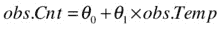

不如尝试

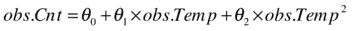

让我们尝试这个想法，暂时忽略所有其他特征，以展示这个方程会得出什么样的曲线：

```
let squareTempFeaturizer (obs:Obs) =
    [   1.
        obs.Temp |> float
        obs.Temp * obs.Temp |> float ]

let (_,squareTempModel) = model squareTempFeaturizer data

Chart.Combine [
    Chart.Point [ for obs in data -> obs.Temp, obs.Cnt ]
    Chart.Point [ for obs in data -> obs.Temp, squareTempModel obs ] ]
```

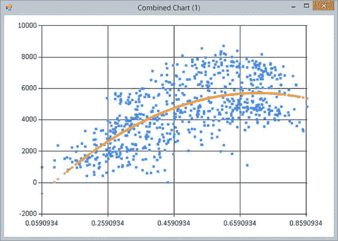

图 4-13\. 拟合温度平方项

我们得到的不是一条直线，而是一条带有轻微弯曲的曲线。曲线上升达到最大值，然后再次下降。由这个方程生成的曲线族被称为抛物线，它总是遵循相同的一般形状（围绕最小值或最大值对称），这使得它成为在模型中捕捉某个特征在特定值达到峰值影响效应的自然候选者。

现在，让我们将这个新特征纳入我们的模型，看看是否能有所改进：

```
let featurizer3 (obs:Obs) =
    [   1.
        obs.Instant |> float
        obs.Hum |> float
        obs.Temp |> float
        obs.Windspeed |> float
        obs.Temp * obs.Temp |> float
        (if obs.Weekday = 1 then 1.0 else 0.0)
        (if obs.Weekday = 2 then 1.0 else 0.0)
        (if obs.Weekday = 3 then 1.0 else 0.0)
        (if obs.Weekday = 4 then 1.0 else 0.0)
        (if obs.Weekday = 5 then 1.0 else 0.0)
        (if obs.Weekday = 6 then 1.0 else 0.0)
    ]

let (theta3,model3) = model featurizer3 training

evaluate model3 training |> printfn "Training: %.0f"
evaluate model3 validation |> printfn "Validation: %.0f"
>
Training: 668
Validation: 645
```

太好了！我们的误差从 750 降到了 670 以下，这是一个非常显著的改进。更棒的是，我们现在有了一个可以进一步尝试优化模型的大方向。我们可以引入新的特征——例如，其他变量的平方，或两个变量的乘积——来捕捉模型中其他潜在的非线性效应。我们甚至可以更进一步，扩展到更高阶的多项式，如立方项，或其他函数形式，例如指数或对数。

这种方法的一个小缺点是，对结果的解释变得更加棘手。在线性模型中，理解每个 `Theta` 系数的含义相当直接。它可以被解读为一个乘数：将某个特征的值增加 1.0，输出就会增加（或减少）`Theta`。

这造成了一个小小的困境。首先，这引入了一个实际问题。随着需要考虑的潜在特征数量增加，手动检查哪些特征应该被排除或包含将变得非常麻烦。例如，如果我们有 N 个可用变量，一个线性模型将包含 N + 1 个特征（每个变量和一个常数项）。包含每个特征之间的交互项及其平方项，会增加 N × (N + 1) / 2 个特征，以及数量可能惊人的组合需要考虑。对于变量数量适中的数据集，手动检查每个组合仍然是可能的，但随着数据集宽度的增加，这种方法就行不通了。

## 正则化

当然，更大的问题是我们之前讨论过的一点。如果我们能把所有特征和厨房水槽都扔给模型，那当然没问题。但是，正如我们之前所见，盲目地这样做会机械地提高训练集上的质量，而不一定能产生一个稳健的预测模型。这个问题被称为 **过拟合** ：搜索算法使用它能使用的所有特征来拟合数据集，在这个过程中，它在这项任务上做得过于出色，可能会捕捉到训练数据集中的伪影，而这些伪影在训练集之外无法泛化。

那么，我们该如何避免这个问题呢？一种常用的方法被称为 **正则化** 。其思路如下：过拟合的症状之一是，算法在试图用特征拟合训练集时，会对某些 `Theta` 系数产生“离谱”的值，而在一个“合理”的模型中，系数应保持在特定范围内，从而确保输入的变化不会引起剧烈的波动。

我们不会完整地讲解正则化的例子，而只是大致勾勒出通常的处理方法。

如果目标是防止每个参数 `Theta` 波动过于剧烈，一种可能性是引入一个惩罚项，使得较大的单个值比小值代价更高。例如，我们可以在代价函数中引入以下惩罚项：


为什么这会是一个好的候选方案？正如我们之前在原始代价函数的讨论中所说，因为平方函数在数值离零越远时增长越快，每个 `Theta` 的较大值会受到更重的惩罚。因此，默认情况下，这个惩罚项会倾向于更均衡的值，而非高度差异化的值。例如，`Theta` 为 `[1.0; 1.0]` 的代价是 2.0，而 `[0.0; 2.0]` 的代价则是 4.0。

综合来看，我们现在可以用以下函数替换原始的代价函数：


这个公式有一个相当直观的解释。模型的代价结合了两个要素：拟合误差的大小以及参数的大小。换句话说，现在通过增大参数 `Theta` 来改善拟合会产生代价，算法会“偏好”那些使用更均衡参数来改善拟合的方式。

在探讨如何将其应用于实际算法之前，有几个重要的技术考量需要注意。

第一个是，为了使这个方法生效，每个特征都需要处于可比较的量级上。这一点很重要，因为我们引入的惩罚项假设 `Theta` 系数的相似变化是可以相互比较的。用一句话来概括我们通过这个惩罚项试图达成的目标是：“当你可以通过增加特征的系数来提高拟合质量时，优先增加系数最小的那个特征。”只要特征本身是可比较的，这就是一个很好的标准。例如，在我们的案例中，`obs.Instant` 的范围是从 1 到 731，而 `obs.Windspeed` 的范围大约是从 0 到 0.5。将 `Instant` 的系数增加 1.0 会导致输出在 1 到 731 之间变化，而对 `Windspeed` 做同样的改变，其影响最多只有 0.5。

用于解决这个问题的方法称为 **归一化** 。归一化就是将模型中的所有特征进行重新缩放，使它们具有可比性。有几种方法可以实现这一点；最简单的方法是通过应用以下变换，将每个特征缩放到 0 到 1 的范围：`normalized = (x - xmin) / (xmax - xmin)`。

第二点值得注意的是，正则化惩罚项中省略了 `Theta0`。这不是笔误。首先，我们很难找到一种方法来归一化它，因为该特征的每一个观测值都是 1.0。其次，`Theta0` 扮演着偏移量的角色：对于所有其他被归一化的特征，`Theta0` 设定了模型的基线，这个基线可以是任何值。

第三点也是最后一点，是惩罚项前面的参数 `lambda`。这个参数可以解释为一个权重；它决定了正则化惩罚在代价函数中的比重。这个参数需要手动调整，以确定最佳的正则化程度。这是一个常规流程：尝试不同的级别，选择在验证集上效果最好的 `lambda` 值；也就是说，误差最小的那个值。

假设数据集已经预先归一化，我们可以使用这个新公式轻松更新原始的梯度下降算法，更新规则如下：


那么，我们学到了什么？

坦白说，这一章内容很密集。我们讨论了很多想法，并花了相当多的时间以相当抽象、数学化的方式讨论问题。让我们看看能否重新组织并总结本章的关键要点。

### 使用梯度下降最小化代价

我们在本章讨论的最重要的技术适用于机器学习的多个领域，而不仅仅是回归。我们介绍了梯度下降算法，这是一种通用的方法，用于通过沿着梯度（即从当前状态下降最陡的方向）迭代调整参数，来识别使函数值最小化的参数。

梯度下降起初可能看起来有点令人生畏，因为它伴随着大量的微积分运算，但一旦克服了最初的障碍，它就是一个相当简单的算法。更有趣的是，它适用于广泛的情况；基本上，只要存在最小值，函数是可微的（我们确实需要导数！）并且不是太病态，你就没问题。事实证明，这使得它成为解决大多数机器学习问题的绝佳通用工具：如果你试图找到最适合数据集的模型，你就是在最小化某种形式的距离或代价函数，而梯度下降很可能会帮助你找到它。

我们还看到了该算法的两种变体：随机梯度下降和批量梯度下降，它们各有优缺点。随机梯度下降一次只更新一个观测值的参数。它不需要一次性处理整个数据集，这使得它非常适合在线学习。如果你的数据集随时间增长，并且你不断收到新的观测值，你可以仅使用最新到达的数据点来更新你的估计，并逐步学习。正如我们在示例中看到的，缺点是它相对较慢且可能不太稳定：虽然算法总体上朝着正确的方向前进，但不能保证每一步都能带来改进。相比之下，批量梯度下降一次性处理整个数据集，每一步都会产生一个改进的模型。缺点是每一步的计算量更大；此外，使用整个数据集可能不切实际，尤其是在数据集很大的情况下。

### 使用回归预测数值

本章的主要目标是利用某一天可用的任何数据，预测共享单车服务当天的用户数量。这被称为回归模型。与分类模型（目标是预测观测值属于哪个类别）不同，这里我们试图通过找到一个结合特征并尽可能紧密拟合数据的函数来预测一个数值。

从最简单的模型——通过数据拟合一条直线——开始，我们逐步引入更多特征，构建出更复杂的模型，并在此过程中展示了几种简单的技术。具体来说，我们演示了如何超越连续特征，通过将分类特征拆分为多个特征（每个特征用 1 或 0 表示哪个状态处于激活状态），将其纳入模型。我们还看到，引入非线性项（如平方或更高次多项式）如何用于建模输入与输出之间更复杂的关系，而这些关系是线性模型无法恰当捕捉的。

为模型添加更复杂的特征是一把双刃剑，提升预测潜力的同时也要付出代价。首先，这会导致特征数量激增，而管理哪些特征该保留、哪些该剔除本身就会成为一个问题。其次，这引出了一个更深层次的问题：添加任何特征都会机械地提升模型对训练集的拟合程度，无论该特征是否与当前问题相关。这个问题被称为`过拟合`：更多的特征赋予了算法更多“自由”，使其能够以创造性的、扭曲的方式利用这些特征，而更好的拟合并不一定意味着更好的预测。

我们讨论了通过交叉验证和正则化来缓解该问题的技术方案。然而，作为最后的说明，或许有必要思考一下，这里存在一种固有的张力。模型可能因两个截然不同的原因而有用：理解现象，或进行预测。添加更多数据通常有助于做出更好的预测，但也会引入复杂性。相反，更简单的模型可能精度较低，但有助于理解变量如何协同工作，并能验证事物是否合理。在构建模型之前，问问自己：你更倾向于一个极其准确但难以理解的`黑箱模型`，还是一个精度稍低、但可以向同事解释清楚的模型？这或许能指导你在此过程中的决策！

## 实用链接

*   `FSharp.Charting` 是一个稳定的库，便于在从 FSI 探索数据时创建基本图表：[`fslab.org/FSharp.Charting/`](http://fslab.org/FSharp.Charting/)

*   `Math.NET` 是一个开源库，涵盖了广泛的数学和数值分析工具。它尤其包含基本的线性代数算法：[`www.mathdotnet.com/`](http://www.mathdotnet.com/)

*   如果你的算法需要更高性能，即使需要更复杂的实现，`quantalea` 提供了一个非常有趣的 .NET 到 GPGPU 的库，特别适合 F#：[`www.quantalea.net/`](http://www.quantalea.net/)

*   `DiffSharp`，虽然在撰写本文时仍在发展中，但是一个很有前景的自动微分库，可以大大简化梯度计算：[`gbaydin.github.io/DiffSharp/`](http://gbaydin.github.io/DiffSharp/)