# 第 5 章 你并非独一无二的雪花

## 通过聚类和主成分分析检测模式

有时，你的机器学习工作始于一个非常具体的问题。你能判断一封收到的邮件是否是垃圾邮件吗？你能多准确地预测销售额？你已接到明确指令：从一个问题开始，寻找可用的数据，然后着手构建能回答该问题的最佳模型。

然而，很多时候，情况并非如此清晰明了，你的工作始于一个模糊得多的问题。你只有数据，还没有明确的问题。也许有人找到你，只是简单地问：“你能告诉我数据中有什么有趣的东西吗？”也许你想对某个数据集进行分析，但首先想了解自己手中的牌。也许这个数据集很大，包含许多特征，让人难以把握特征之间是否存在明显的关系。手动数据探索是一个费时费力的过程——如果我们能把部分工作交给机器，让它来判断数据中是否存在模式，那就太好了。

这就是`无监督学习`的领域。在监督学习方法（如分类或回归）中，我们从一个问题以及带标签的数据（即带有问题答案的样本）开始，并利用这些数据来学习一个拟合数据的模型。相比之下，在无监督学习中，我们只有数据，我们希望计算机帮助我们找到其中的一些结构。希望这些结构在人类看来是“有趣的”，并且可以用来以有意义的方式组织各个元素。

在本章中，我们将进行以下操作：

*   介绍两种经典的数据分析技术：`k-means` 聚类和主成分分析，它们都旨在自动从数据集中提取信息，并提供更简单、更易用的表示。我们将把这些技术应用于 StackOverflow 网站的历史数据，看看出现的模式是否有趣。

*   概述同样的基本思想——检测数据中的模式——如何能根据用户过去的行为以及这些行为与我们观察到的其他用户模式的相似性，向用户提供推荐。

 **注意** 本章中一些更复杂的图表已包含在源代码包中，以便在需要时以更大的格式查看。

### 检测数据中的模式

如果你稍加思考，就会意识到这不是一项容易的任务。如何定义数据中的“有趣的东西”？没有明确的“有趣”度量标准，那么，我们到底要求计算机为我们做什么呢？

数据“有趣”的方式有很多种。如果从反面来看，不有趣的数据就是没有任何突出点的数据。从这个意义上说，图 5-1 展示的是无趣的数据。

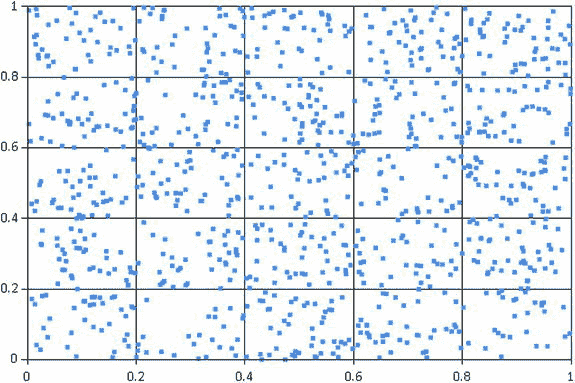

图 5-1. 没有模式的数据

相比之下，图 5-2 展示了“一些有趣的东西”。数据并非均匀、同质地分布，而是呈现出某种组织性。观测值聚集成两组，随机散布在两个中心周围。这种模式被称为`聚类`，而聚类分析就是自动识别数据集中这种结构的过程。

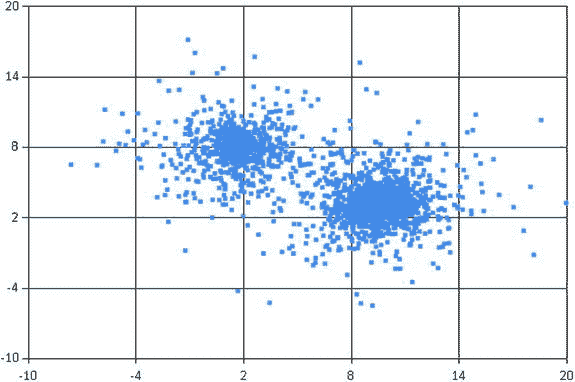

图 5-2. 组织成两个聚类的数据

然而，套用列夫·托尔斯泰的话来说，“所有无趣的数据集都是相似的；每个有趣的数据集都以自己的方式有趣。”聚类只是数据集可能有趣的一种方式。例如，考虑图 5-3。数据清晰地展示了一种有趣的模式，观测值大致沿着一条直线分布，但没有聚类。

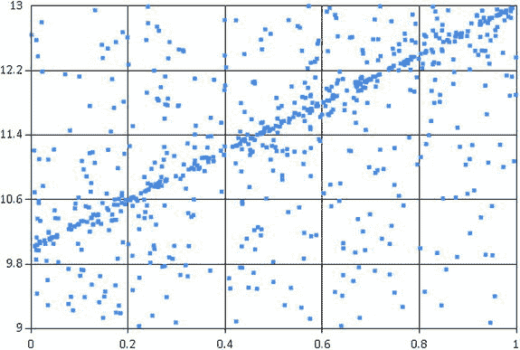

图 5-3. 线性模式

聚类和线性结构是数据集可能有趣的两种方式，但数据展现模式的方式几乎是无穷无尽的；例如，考虑图 5-4，数据似乎组织成环状。它有点聚类（我们可以区分出三个组），又有点类似于图 5-3（数据沿着线分布）——但又有很大不同。

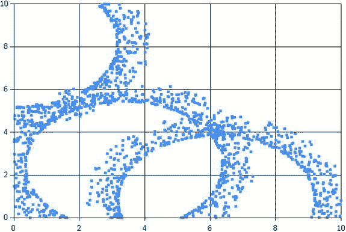

图 5-4. 复杂模式

结构可以呈现多种形式，因此，不存在一种适用于所有情况的方法。每个数据集都是独一无二的，而数据挖掘更像是一门玄学。要找出有效的方法，通常需要尝试不同的算法，同时还要对数据进行处理，并将其转化为更合适的特征。

我们人类非常擅长检测模式。你甚至无需思考就能发现我刚才展示的一些图表中存在的模式。从这个角度来看，图表是你的好帮手：绘制一个特征与另一个特征的散点图，是一种非常廉价且有效的方法，可以直观地观察数据中的结构。

同时，散点图的作用也仅限于此。逐一检查数据集中每一对变量之间的交互关系，很快就会变得非常繁琐。此外，或许更重要的是，数据中可能存在一些模式，仅通过同时观察两个变量是很难发现的。因此，虽然你应该尽可能花时间查看数据，但你也需要一种系统化、机械化的方法来筛选数据集，并找到潜在的“有趣事实”。

我们为什么首先要关心寻找“有趣的模式”？对于我们上面展示的所有例子，我们可以用一句话来描述数据集：“我们有两个组”，“数据遵循一条直线”，“数据围绕三个环组织”。换句话说，我们可以对整个数据集进行更简洁的描述。这非常有用，至少体现在两个方面。

首先，我们现在有了更好的数据表示方式。数据集不再是随机的数字集合，而是可以用有意义的方式描述，并可能围绕它提供一套术语。例如，如果图 5-2 中聚类图里的每个数据点代表一个客户，我们现在就可以开始描述两种类型的客户画像。

其次，就像我们可以用简洁的英文描述每种情况一样，我们也可以提供简洁的数学表示。所有这些数据集都相似，因为它们遵循一个简单的数学结构，并在此基础上叠加了一些统计噪声。

### 我们的挑战：理解 StackOverflow 上的主题

在本章中，我们将应用一些经典的无监督学习技术，看看能否从 StackOverflow 的使用数据中挖掘出一些信息。这是一个有趣的数据集，因为其领域对大多数开发者来说应该很熟悉。因此，我们将能够尝试各种算法和修改，并以一种非科学的方式判断该方法是否产生了合理的结果。

具体来说，我们将研究能否识别 StackOverflow 问题中使用的标签模式。StackOverflow 上的每个问题都带有最多五个描述其主题的单词标签。我们的目标是，当我们观察一段时间内的大量用户和问题，以及每个用户最活跃的标签时，看看是否能发现一些结构和常见的组合。

为此，我使用我们在第 3 章中讨论的方法创建了一个数据集——使用 JSON 类型提供程序从 StackExchange API 收集数据。该数据集文件`userprofiles-toptags.txt`可以在这里下载：[`1drv.ms/1ARuLg9`](http://1drv.ms/1ARuLg9)。我确定了当时 StackOverflow 上最常用的 30 个标签，并为每个标签检索了最活跃的用户，将回答最多和提问最多的用户（历史总榜和当月榜的最佳回答者和最佳提问者）分组在一起。这给了我一份大约 1,600 个不同 StackOverflow 用户的列表。

然后，对于每个用户，我检索了他们在 2015 年最活跃的前 100 个标签及其对应的活跃度，并只保留了与这 30 个主要标签相关的数据。最后，我将数据重新整理成最终的数据集，包含 30 列（每个标签一列），1,600 行（每个用户一行），对于每一行和每一列，其值为该用户在 2015 年对该标签的活跃次数。请注意，由于我只检索了用户的前 100 个标签，因此每个标签的信息并不完整；如果某个用户对例如 XML 标签有活跃，但这只是他第 101 活跃的标签，那么我们会将其记录为零。

### 数据集是如何创建的？

我们使用 [`api.stackexchange.com/docs/tags`](https://api.stackexchange.com/docs/tags) 检索了 StackOverflow 上最受欢迎的 30 个标签。在创建时，得到了以下列表：

`net, ajax, android, arrays, asp.net, asp.net-mvc, c, c#, c++, css, django, html, ios, iphone, java, javascript, jquery, json, linux, mysql, objective-c, php, python, regex, ruby, ruby-on-rails, sql, sql-server, wpf, xml`

我们使用以下方法按标签创建了最活跃用户列表，并提取了他们最活跃的标签：

[`api.stackexchange.com/docs/top-answerers-on-tags`](https://api.stackexchange.com/docs/top-answerers-on-tags)：选择回答最多（历史总榜或最近一个月）的用户

[`api.stackexchange.com/docs/top-askers-on-tags`](https://api.stackexchange.com/docs/top-askers-on-tags)：选择提问最多（历史总榜或最近一个月）的用户

[`api.stackexchange.com/docs/tags-on-users`](https://api.stackexchange.com/docs/tags-on-users)：对于选定的用户集，返回其最活跃标签的活跃度

### 了解我们的数据

# 数据探索与聚类分析

## 1. 准备工作与数据加载
鉴于我们任务的探索性质，我们将再次在 F# 脚本环境中工作。让我们创建一个新的解决方案，其中包含一个 F# 库项目`Unsupervised`，为了方便，将数据文件添加到解决方案中。数据集是一个文本文件`userprofiles-toptags.txt`，可以从以下链接下载：[`1drv.ms/1M727fP`](http://1drv.ms/1M727fP)。如果你在 Visual Studio 中查看它，应该会看到类似这样的内容：

```
UserID,.net,ajax,android,arrays,asp.net,asp.net-mvc,c,c#,c++,css,django,html,ios,iphone,java,javascript,jquery,json,linux,mysql,objective-c,php,python,regex,ruby,ruby-on-rails,sql,sql-server,wpf,xml
1,0,0,0,0,0,0,0,0,0,0,0,0,0,0,0,0,0,0,0,0,0,0,0,0,0,0,0,0,0,0
1000343,0,0,0,0,0,0,0,0,0,3,0,5,0,0,0,0,0,0,0,0,0,0,2,52,0,0,0,0,0,0
100297,0,0,0,26,0,0,0,0,0,0,99,62,0,0,0,29,0,182,0,26,0,0,4478,172,0,0,32,0,0,27
100342,0,0,0,0,0,1,0,0,0,0,0,3,0,0,0,16,5,0,0,0,0,0,0,0,1,7,0,0,0,0
```

第一行是描述每列内容的标题。第一列包含用户 ID，后面跟着 30 个以逗号分隔的列，每列包含该特定用户和标签的活跃度。

## 2. 基本数据统计
在深入算法之前，让我们先从基本统计开始，以了解大致情况。我们将从打开`Script.fsx`文件开始。我们将读取每一行，丢弃用户 ID（我们并不真正需要），并将每一行解析为一个浮点数数组。我们也可以将值保留为整数，但由于我们可能要进行求平均值等操作，不如直接转换为易于处理的类型。我们还将把标题保存在一个单独的数组中，以便稍后将列映射到正确的标签名称。

### 2.1 数据集读取
**清单 5-1**。将数据集读入内存

```fsharp
open System
open System.IO

let folder = __SOURCE_DIRECTORY__
let file = "userprofiles-toptags.txt"

let headers,observations =

let raw =
        folder + "/" + file
        |> File.ReadAllLines

// 第一行是标题，第一列是用户 ID
    let headers = (raw.[0].Split ',').[1..]

let observations =
        raw.[1..]
        |> Array.map (fun line -> (line.Split ',').[1..])
        |> Array.map (Array.map float)

headers,observations
```

### 2.2 数据分布概览
现在我们有了数据，接下来通过计算基本统计量（如平均值、最小值和最大值）来观察每个变量的分布情况。这里我们使用了两个小技巧。`Array.iteri`允许我们在遍历数组时捕获当前索引；因此，我们可以遍历`headers`，并使用当前索引`i`从`observations`中提取第`i`列。第二个技巧是，我们在`printfn`中使用高级格式化器来强制统一列宽和小数位数，从而使输出更易读。例如，`printfn "%4.2f" 12.34567;;`使用了格式化器`%4.2f`，它只保留小数点后两位，并且（除非宽度不足）会将列填充到四个字符。

**清单 5-2**。数据集基本统计量

```fsharp
printfn "%16s %8s %8s %8s" "Tag Name" "Avg" "Min" "Max"
headers
|> Array.iteri (fun i name ->
    let col = observations |> Array.map (fun obs -> obs.[i])
    let avg = col |> Array.average
    let min = col |> Array.min
    let max = col |> Array.max
    printfn "%16s %8.1f %8.1f %8.1f" name avg min max)
```

>        Tag Name      Avg      Min      Max
>            .net      3.5      0.0    334.0
>            ajax      1.7      0.0    285.0
>         android      7.1      0.0   2376.0
>          arrays      6.4      0.0    327.0
>         asp.net      2.6      0.0    290.0
> // 为简洁起见，此处省略部分内容

快速浏览输出结果，有几个点值得注意。首先，每个标签的最小值都是零，这意味着没有用户在所有标签上都有活跃行为。其次，与最大值相比，每个标签的平均值都很低，且相当接近零。这表明，对于每个标签，大多数用户活跃度很低或没有活跃度，而少数用户活跃度非常高。考虑到我们收集的是每个标签下顶级用户的使用数据，这并不完全出乎意料。每个标签的活跃度并非呈现经典的正态分布（即数值围绕平均值均匀分布），而是分为两个群体（要么非常活跃，要么非常不活跃），中间状态几乎没有。

## 3. 数据可视化与聚类分析思路
数字表格往往过于底层，难以洞察更大的趋势。让我们通过 NuGet 添加`FSharp.Charting`，并将每个变量绘制在条形图上（图 5-5），以便更直观地理解数据。

**清单 5-3**。按标签绘制平均使用量

```fsharp
#r @"..\packages\FSharp.Charting.0.90.9\lib\net40\FSharp.Charting.dll"
#load @"..\packages\FSharp.Charting.0.90.9\FSharp.Charting.fsx"
open FSharp.Charting

let labels = ChartTypes.LabelStyle(Interval=0.25)

headers
|> Seq.mapi (fun i name ->
    name,
    observations
    |> Seq.averageBy (fun obs -> obs.[i]))
|> Chart.Bar
|> fun chart -> chart.WithXAxis(LabelStyle=labels)
```

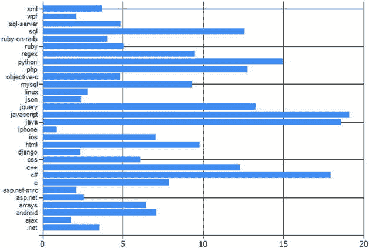

图 5-5。按标签划分的平均使用量

图表显示，有几个标签（Javascript、Java、C#、Python、jQuery、PHP、SQL 和 C++）明显大于其他标签，而其他标签相比之下则小得多。这是有用的信息，但仍有局限。我们需要的不是孤立的事实，而是一个更全面的视角，帮助我们理解这些主题之间可能存在的关系。这正是我们接下来要探讨的内容：首先使用`k-means`聚类来识别具有相似行为的用户群体，然后使用主成分分析来更好地理解变量之间的相互关系。

### 3.1 使用 K-Means 聚类寻找簇
当我们说“这个数据集有两个簇”时，究竟是什么意思？我们的想法大致是这样的：观测值并非均匀分布，而是集中在两个区域。换句话说，“在这个数据集中，大致有两种类型的观测值，类型 1 和类型 2。”这两个高密度区域分别包含类型 1 和类型 2 的观测值——也就是说，这些观测值彼此相当接近（参见图 5-6）。

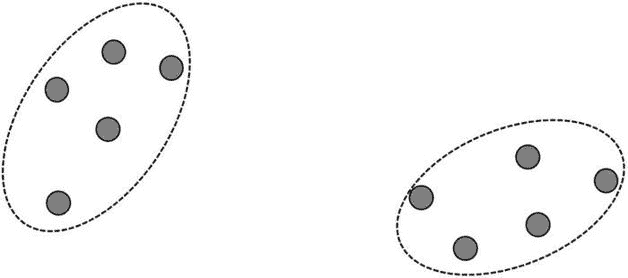

图 5-6。数据簇

我们可以换一种稍微不同、或许更简单的方式来理解。一个簇中的所有观测值都是某个理想化底层观测值的微小变体。这大大简化了问题：我们不需要检测簇的边界，而是可以将一个簇简化为整个群体的一个原型代表。这些“虚构的代表”被称为**质心**。

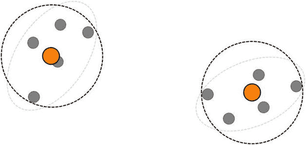

图 5-7。簇与质心

为什么是质心？如果我想要一个簇的良好代表，它应该位于簇的中心位置，以便与簇中的任何观测值都不太远。在这种框架下，确定簇质心的一个明显候选就是其组成元素的平均值。反过来，这也形成了一个非常简单的分类规则：如果我想确定一个观测值属于哪个簇，只需查找所有可用的质心，并选择最近的那个。

### 3.2 算法核心：改进簇与质心
这一切都很好，但我们如何找到这些神奇的质心呢？在本节中，我们将详细阐述一种更新质心的方法，从而定义出更好的簇。如果我们反复应用这个更新过程，就会得到一个算法，从任意质心开始，逐步优化簇。这就是`k-means`聚类算法的核心。

 **注意** 由于名称有些相似，人们有时会混淆`k-means`和`k`近邻算法。它们几乎毫无共同之处——请注意避免混淆！

假设你通过某种神奇的方式，恰好知道数据集中应该找到多少个簇——比如说，两个。想象一下，你从两个随机的质心猜测开始。那么，你首先要做的是确定数据集中的每个观测值属于哪个质心。对于每个观测值，只需找到最近的质心，并将其分配给该质心。

图 5-8 展示了图 5-6 中的虚构数据集，其中两个“真实”簇用浅灰色边界标记。我们从两个任意质心 A 和 B 开始，并将每个数据点分配给最近的质心。较深的边界大致代表了基于当前质心所形成的簇的样子。

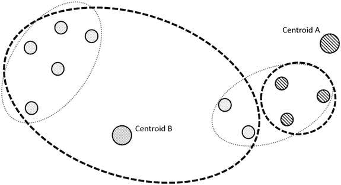

图 5-8。将观测值分配给质心

我们刚才所做的是定义候选簇。所有分配给同一个质心的观测值构成一个可能的簇。如果当前的簇质心是一个“好的质心”，它应该位于该簇的中间位置。让我们调整质心的位置（图 5-9），将其移动到簇的平均位置，即中心。

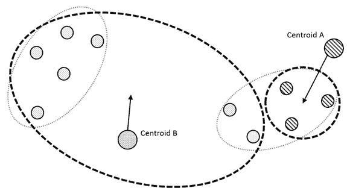

图 5-9。调整质心

在此过程中，请注意几个有趣的现象。将质心移向簇内的平均位置，意味着它会倾向于被吸引到高密度区域，这些区域在狭小空间内集中了更多权重，并充当“吸引子”。例如，观察图 5-10 中质心 B 的变化：它自然地向左侧的“真实”簇移动。与此同时，它也会远离孤立的边缘观测值，例如右侧的两个点。这往往会将非典型元素从簇中剔除，并让数据点有机会被另一个质心吸收。

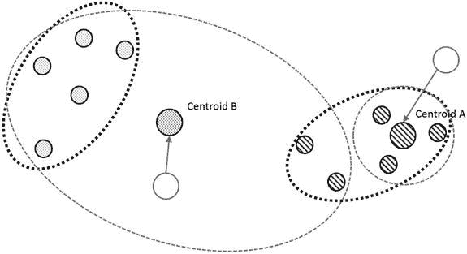

图 5-10。更新后的质心与簇

完成一次更新后，我们可以重复该过程，重新计算每个观测值所属的质心，以及质心的更新位置。

何时停止？请注意，如果在质心位置更新前后，完全相同的观测值被分配到相同的簇，那么质心将不再移动。每个质心已经占据了其簇的平均位置，再次更新也不会改变其位置。

这本质上就是`k-means`聚类算法的工作原理：将数据集划分为`k`个簇，选取`k`个任意质心，并逐步更新它们的位置，直到达到稳定状态。希望这个解释能让你理解为什么该方法有效，以及它为何能得出位于高密度簇中的稳定质心；我们就此打住，不再试图证明它是否真的有效。

该算法可以看作是定点法的一种应用。该过程假设存在稳定的质心，并试图通过逐步消除质心定义的簇与簇定义的质心之间的差异来实现自洽性（可以这么说）。仍有一些重要问题我们尚未解答，例如如何确定`k`值或簇的数量——但首先，让我们继续前进，假设我们知道正确的`k`值，开始用 F# 实现该算法，看看结果如何。

## 实现 K-Means 聚类

从算法描述中浮现出几个概念：给定一组观测值，我们需要能够根据最短距离将每个观测值分配给`k`个质心之一，并且还需要将一个簇的观测值归约为一个质心。到目前为止，这些听起来并不特别针对我们的数据集，因此让我们尝试编写一个通用版本的算法，放在一个独立的模块中，稍后通过脚本加载它来解决当前问题。

这为我们提供了一个坚实的起点。从外部来看，算法应该如下所示：我们需要提供一组观测值和一个簇数`k`。我们还需要一个距离定义，以便将观测值分配给最近的质心，以及一种方法，将同一簇中的观测值归约为一个单一的、聚合的观测值，即更新后的质心。以下是伪代码形式的实现大纲：

```
clusterize
      1. 初始化
              为每个观测值分配初始质心 ID 0
              选取 k 个不同的观测值作为初始质心 1 到 k
      2. 搜索
              将每个观测值分配给最近的质心
              如果没有分配发生变化，则完成：我们得到了良好、稳定的质心
              否则
                      将分配到同一簇的观测值分组
                      将观测值归约为它们的平均质心
                      使用新的质心重复
      3. 从初始质心开始搜索
```

我至少期望输出返回算法识别出的所有质心；作为额外奖励，最好能返回一个“分类器”函数，给定任意观测值，它能直接告诉我该观测值被分配给了哪个质心。

让我们开始实现。首先，我们需要一个新文件——我们将其命名为`KMeans.fs`——然后我们可以开始编写一个`clusterize`函数。在开始迭代更新簇和分配之前，我们需要初始化这两者，并决定如何表示它们。让我们为每个簇分配一个 ID，它只是一个整数，并将分配定义为带有簇 ID 的观测值。当然，我们可以为分配和观测值创建专用类型，但这似乎不值得——毕竟，这完全是算法实现内部的细节。因此，与其创建不必要的类型，我们在这里简单地使用元组，在这两种情况下都将簇 ID 存储在第一槽位，观测值存储在第二槽位。

然后，我们可以用几行代码初始化该过程。创建一个随机数生成器，随机选取`k`个观测值作为质心的起始候选，簇 ID 从 1 到`k`。这并非不合理：选取现有的观测值可以保证质心位置不会完全不切实际。同时，这也意味着我们有可能选取“糟糕的”初始质心。我们暂时忽略这个问题，稍后再讨论。

我们的第一个问题是从数据集中随机选取`k`个不同的观测值，作为起始质心。让我们用简单的方法：在 0 到`size - 1`的区间内选取随机数，并将它们添加到一个集合中（该集合会自动检测并消除重复项），直到选取的观测值数量达到`k`，即我们想要的簇数。这并不完美；特别是，如果我们试图从数据集中选取大量不同的索引，这种方法会非常低效。然而，假设簇的数量相对较小，这种方法就可行。

***清单 5-4***。选取`k`个观测值作为初始质心

```
namespace Unsupervised
module KMeans =

let pickFrom size k =
        let rng = System.Random ()
        let rec pick (set:int Set) =
            let candidate = rng.Next(size)
            let set = set.Add candidate
            if set.Count = k then set
            else pick set
        pick Set.empty |> Set.toArray
```

至于分配，我们将为它们分配一个任意的起始质心 ID 0，该 ID 与任何真实质心 ID 都不匹配。鉴于所有质心的 ID 都大于 1，这意味着在第一轮中，每个观测值都保证会被分配一个不同的质心，并且算法至少会完成一个完整的更新周期。

***清单 5-5***。初始化聚类算法

```
let initialize observations k =
    let size = Array.length observations

let centroids =
        pickFrom size k
        |> Array.mapi (fun i index ->
            i+1, observations.[index])

let assignments =
        observations
        |> Array.map (fun x -> 0, x)

(assignments,centroids)
```

现在我们有了一个起点，我们需要做的就是编写更新过程：将每个观测值分配给其最近的质心，从而得到一个新的分配，并将其与前一个分配进行比较。如果没有观测值改变簇，我们就完成了（每个簇将保持不变，质心也将保持不变），否则，按簇 ID 对观测值进行分组，将它们归约为平均质心，然后继续。我们将在`clusterize`函数内部定义一个递归函数`search`，生成初始值，并开始递归更新质心。

***清单 5-6***。递归簇更新

```
让我们回到脚本文件，看看对数据集进行聚类会发生什么。运行聚类算法需要几个要素：在脚本中加载并打开 `KMeans` 模块、观测值、适用于观测值的距离和归约函数，以及一个 `k` 值（即我们要搜索的簇数量）。

## 运行聚类分析

让我们使用欧几里得距离，并将一组观测值归约到它们的平均值。通过以下代码可以轻松实现，将其放入脚本中：

***清单 5-7***。定义聚类的距离和归约

```fsharp
#load "KMeans.fs"
open Unsupervised.KMeans

type Observation = float []

let features = headers.Length

let distance (obs1:Observation) (obs2:Observation) =
    (obs1, obs2)
    ||> Seq.map2 (fun u1 u2 -> pown (u1 - u2) 2)
    |> Seq.sum

let centroidOf (cluster:Observation seq) =
    Array.init features (fun f ->
        cluster
        |> Seq.averageBy (fun user -> user.[f]))
```

现在我们可以开始搜索簇了。我们将剔除那些没有使用任何标签的观测值（即在此期间用户在所选标签上完全没有活动），完全随意地选择 `k=5`，然后调用 `clusterize`：

***清单 5-8***。对数据集进行聚类

```fsharp
let observations1 =
    observations
    |> Array.map (Array.map float)
    |> Array.filter (fun x -> Array.sum x > 0.)

let (clusters1, classifier1) =
    let clustering = clusterize distance centroidOf
    let k = 5
    clustering observations1 k
>
val clusters1 : (int * Observation) [] =
  [|(1,
     [|2.47860262; 1.063755459; 9.765065502; 5.454148472; 2.333624454;
       2.293449782; 5.173799127; 10.98689956; 4.822707424; 5.772052402;
       1.693449782; 7.274235808; 9.717030568; 1.220087336; 23.49956332;
       10.12751092; 5.999126638; 2.011353712; 2.509170306; 7.932751092;
       6.620087336; 12.78777293; 7.658515284; 7.425327511; 6.794759825;
       5.561572052; 9.624454148; 4.525764192; 1.031441048; 4.483842795|]);
    // 为简洁起见已截断
    (2,
     [|0.0; 0.0; 19.0; 17.0; 19.0; 0.0; 0.0; 69.0; 0.0; 0.0; 0.0; 0.0; 0.0;
       0.0; 68.0; 0.0; 0.0; 0.0; 0.0; 4159.0; 0.0; 821.0; 17.0; 56.0; 0.0; 0.0;
       7054.0; 1797.0; 0.0; 0.0|])|]
val classifier1 : (Observation -> int)
```

正如预期，我们得到了两个结果：一个包含五个簇的数组，每个簇都有一个 ID 和一组值，代表该簇在每个标签上的特征。例如，在上面的输出中，`(2, [|0.0; 0.0; 19.0; // 已截断 // 0.0|])` 表示 ID 为 2 的簇；该簇中的平均用户从未使用过 `.NET` 或 `ajax` 标签（列表中的前两个标签），但使用了 `Android` 标签 19 次。请注意，由于我们随机选择初始质心，每次运行很可能会观察到不同的结果（我们稍后会回到这一点）。

## 分析结果

说实话，以当前形式解释输出很困难。首先有帮助的做法是映射每个簇，并将标签名称与我们拥有的数字对齐。让我们这样做：

```fsharp
clusters1
|> Seq.iter (fun (id,profile) ->
    printfn "CLUSTER %i" id
    profile
    |> Array.iteri (fun i value -> printfn "%16s %.1f" headers.[i] value))

>
CLUSTER 4
            .net 2.9
            ajax 1.1
         android 6.1
          arrays 5.0
         asp.net 2.4
         // 为简洁起见已截断
```

这样好一些了；至少我们可以开始浏览每个簇，寻找某种模式的出现。然而，信息仍然有点令人不知所措——让我们看看图表是否能更清晰地可视化输出（参见图 5-11）：

```fsharp
Chart.Combine [
    for (id,profile) in clusters1 ->
        profile
        |> Seq.mapi (fun i value -> headers.[i], value)
        |> Chart.Bar
    ]
|> fun chart -> chart.WithXAxis(LabelStyle=labels)
```

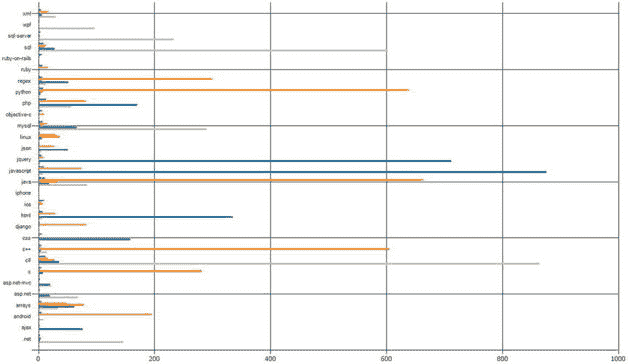

图 5-11。簇特征（详情请参阅源代码包）

生成的图表更容易解析。在这种情况下，我观察到的是：
```

# 观察聚类结果

簇 2 在 `Java` 和 `Android` 上有一个大峰值，`Python` 和 `Regex` 也是如此（！）；
簇 4 在 `Javascript`、`JQuery`、`html` 和 `css` 以及 `PHP` 上有强峰值；
簇 5 在 `C#`、`.NET` 和 `WPF` 以及 `SQL`、`SQL Server` 和 `MySQL` 上很强；
簇 3 在 `C` 和 `C++` 上有峰值，还有一点 `Linux` 和 `Arrays` 的迹象；以及
簇 1 没有明显的峰值。

这很有趣。一方面，聚类算法确实运行了，并产生了簇，而且出现的一些关联是有意义的。看到 `Java` 和 `Android` 在一起并不奇怪。看到像 `Javascript`、`JQuery` 和 `html` 这样的 Web 客户端技术在同一组中，或者像 `SQL`、`MySQL` 和 `SQL Server` 这样的数据库相关标签在一起，是合乎逻辑的。我们的算法确实捕捉到了有意义的关联。同时，似乎也存在一些奇怪之处：`Java`、`Python` 和 `Regex` 真的相关吗？那个混合了 `.NET` 和数据库开发者的奇怪组是怎么回事？

在进一步讨论之前，让我们看看另一条信息。这些簇各自有多大？

```fsharp
observations1
|> Seq.countBy (fun obs -> classifier1 obs)
|> Seq.iter (fun (clusterID, count) ->
    printfn "Cluster %i: %i elements" clusterID count)
>
Cluster 4: 1137 elements
Cluster 2: 22 elements
Cluster 1: 23 elements
Cluster 5: 20 elements
Cluster 3: 15 elements
```

这不太理想。我们这里有一个巨大的簇，包含了大约 93% 的观测值，以及四个簇，每个簇包含的数据集不到 2%。在理想情况下，我们希望看到大小大致相当的簇。这是怎么回事？

## 好簇，坏簇

让我们退一步，思考一下我们的方法可能出了什么问题，以及我们如何有望改进。首先，有一个明显的可能性：也许数据中根本就没有簇。在这种情况下，我们确实无能为力——如果不存在，那就是不存在。然而，鉴于我们在初步分析中看到了一些合理的标签分组出现，我们将继续假设情况并非无药可救。

我们的算法至少可能在两个方面出错：一是寻找的聚类数量不足，二是特征可能处于差异过大的量级，以至于无法进行有意义的比较。让我们仔细审视这两个问题，并希望能找到改进聚类的思路。

我们选择了一个完全任意的聚类数量进行搜索——如果这个数量不准确，结果会怎样？请看图 5-12，图中展示了三个相当清晰的聚类，现在假设要求你找出两个聚类。

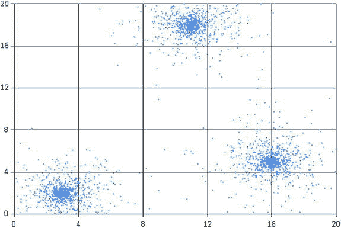

图 5-12. 搜索不足数量的聚类

算法很可能会识别出两个聚类，其方式有三种：其中一个聚类会是“正确的”，而另一个聚类则将剩余的两个聚合在一起，例如图 5-13 所示。

这实际上相当合理：如果我们只能选择两个组，那么选出一个好的组，并将剩余两个合并成一个平庸的组，已经是我们能做到的最好结果了。然而，由于我们随机选择初始质心，聚类结果几乎完全取决于我们最初选择的三个随机观测点。如果我们多次重复这个过程，将会看到三种不同的结果，它们以不同的方式组合“真实”的聚类。在聚类数量超过三个的情况下，我们预计会看到更多组合出现。

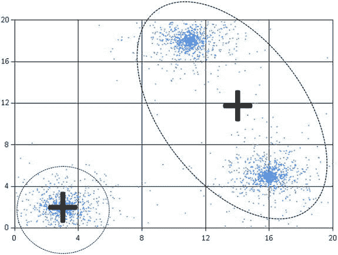

图 5-13. 从三个聚类中搜索两个聚类

这个问题与我们目前观察到的现象一致。如果你多次运行聚类函数，可能会发现以下情况：每次运行的结果都不同，但总有一些稳定的分组频繁同时出现，不过也可能与其他分组混在一起。例如，`Java` 和 `Android` 的组合经常出现，有时包含 `Python`，有时不包含。

要解决这个问题，我们需要将聚类数量增加到实际有效的值；也就是说，找到一个接近实际聚类数量的 `k` 值。

我们将在下一节重新审视这个问题，在此之前，先看看 `k-means` 聚类的另一种出错方式。考虑图 5-14 描述的情况。这里有两个聚类，中心分别位于 `{-2;0}` 和 `{2;0}`，但在 X 轴和 Y 轴上的延伸程度差异很大。X 值主要分布在 `[-3;-1]` 和 `[1;3]` 范围内，而 Y 值则在 `-20` 到 `20` 之间变化。

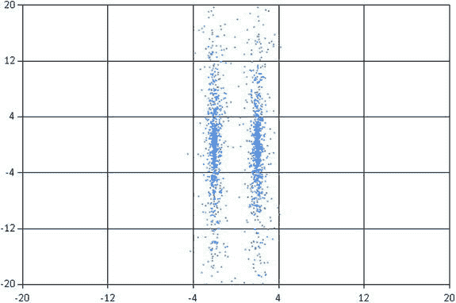

图 5-14. 量级差异很大的特征

如果我们直接对这个数据集运行 `k-means` 算法，并要求找出两个聚类，会发生什么？同样，结果存在随机性，取决于我们选择的初始质心，但一个可能的结果如下：我们很可能得到两个聚类，一个中心在 `{0;10}` 附近，另一个在 `{0;-10}` 附近。这是为什么呢？

问题在于这两个特征的量级差异很大，因此，X 轴（第一个特征）上存在的任何差异，都会被 Y 轴上的离散程度完全掩盖。换句话说，使用原始数据计算距离，将很难准确反映两个点之间的远近程度（参见图 5-15）。

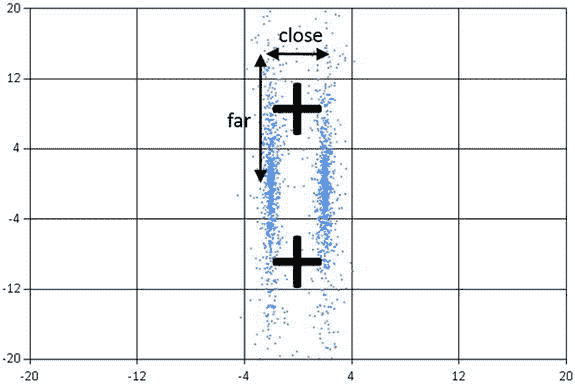

图 5-15. 相近的点

如何解决这个问题？很简单：如果问题源于特征量级不同，我们需要对数据进行变换，使得相同幅度的差异在所有特征上都具有可比性。换句话说，当一个观测值在某个特征上取值较低或较高时，对距离函数的影响应该是可比的。

一种常见的方法是使用以下公式对每个特征进行重新缩放：`x' <- (x - min) / (max - min)`。这样，每个特征都被缩放到 `0` 到 `1` 的区间内，最小值变为 `0`，最大值变为 `1`，其余值则线性缩放。举例来说，如果我们对之前的数据集应用此方法，数据将如下所示（参见图 5-16）：

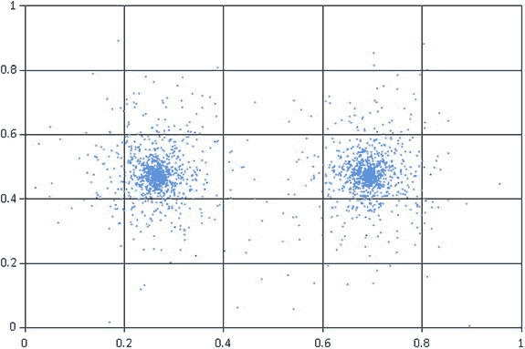

图 5-16. 重新缩放后的特征

这并不是重新缩放特征的唯一方法；根据数据的不同，其他方法可能更合适。稍后我们将看到另一种特征缩放方式。特征缩放有点像一门黑魔法，没有唯一的方法。作为经验法则，问问自己：你使用的距离是否在比较具有可比性的东西？

## 重新缩放数据集以改进聚类

我们最初的聚类提取出了一些看似合理的信息；但它也存在明显的问题，这些问题与聚类数量不足（每次运行算法都会得到不同结果）以及特征量级差异有关。在着手解决确定合适聚类数量这一更困难的任务之前，让我们先处理重新缩放数据集这个更简单的问题。

你可能已经注意到，我们最初聚类检测到的峰值对应于使用量最高的标签：`Javascript`、`Java`、`C#`、`Python` 等。总的来说，虽然算法每次运行会产生不同的聚类，但同一组标签总会出现。这很合理，因为高流量标签会产生较大的距离差异。这并不理想，因为我们的算法本质上是在寻找高流量标签，而无法捕捉到低流量标签上更细微的差异。

这里的主要问题是每个标签的活动量差异相当大：`JavaScript` 的平均使用量是 `iPhone` 标签的 20 倍以上。我们可以按照之前描述的方法重新缩放特征，将它们映射到 `0` 到 `1` 的区间。不过，我们将采取不同的方向。以下是我们对数据集的描述方式：我们认为用户可以根据少数兴趣画像进行分类，但他们在 StackOverflow 上的活动水平差异很大。为了直接比较他们的画像，而不考虑他们在网站上的活跃程度，我们需要消除因活动水平造成的差异。例如，考虑以下三个假设用户：

|    | JavaScript | C#  |
| --- | --- | --- |
| 用户 1 | 100       | 20  |
| 用户 2 | 10        | 2   |
| 用户 3 | 50        | 50  |

按原始距离计算，用户 1 和用户 3 最相似，因为他们比用户 2 活跃得多。然而，可以说用户 1 和用户 2 非常相似——比用户 1 和用户 3 更相似。虽然用户 1 比用户 2 活跃十倍，但他们花费时间的地方完全相同。解决这个问题的一种方法是按用户进行缩放：对于每一行，将最大的标签缩放为 `100%`，并相应地缩放其他每个标签。

|    | JavaScript | C#    |
| --- | --- | --- |
| 用户 1 | 100%      | 20%   |
| 用户 2 | 100%      | 20%   |
| 用户 3 | 100%      | 100%  |

如果这样做，用户 1 和用户 2 突然变得完全相同，而用户 3 则非常不同。我们实际上是在从方程中移除用户活动水平。这里的隐含模型可以表述为：“存在几种典型的 StackOverflow 用户，他们对相同的标签感兴趣。然而，其中一些用户有更多时间可以投入，因此他们的活动量会成比例地更高。”请注意，这也意味着我们现在忽略了用户在网站上的活跃程度。这样做对吗？也许对，也许不对——这个问题没有明确的答案。

无论如何，让我们尝试一下，仍然使用一个“糟糕”的聚类数量。我们真正需要做的，就是将每个观测值除以该行中的最大值。

***清单 5-9***. 将观测值归一化到相似的活动水平

## 确定要搜索的簇数量

我们仍然没有解决确定应该搜索多少个簇这个关键问题。不幸的是，正如我们之前讨论过的，这不是一个可以回避的问题：搜索过少的簇会导致结果不稳定。那么，让我们先弄清楚如何解决这个问题，然后将其应用到我们的数据集中。

### 什么是好的簇？

我要再次重申，识别簇并非易事，因为对于什么是簇存在一些模糊性。看看图 5-18：你看到了多少个簇？你可以说有三大簇，或者七个簇——可能还有更多介于两者之间的组合（需要说明的是，这张图是用七个簇生成的）。

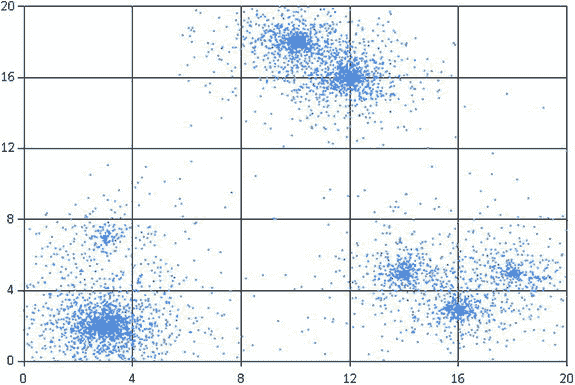

图 5-18. 簇是模糊的

希望这个例子至少能传达出我们所说的“簇并非完全清晰明确”的含义。如果我们连“簇”的含义都无法达成一致或解释清楚，即使是非正式的解释，那么机械算法也很可能觉得这项任务具有挑战性。

那么，我们在簇中寻找什么呢？实际上，是几个方面。一个簇是一组彼此相当相似，并且与其他簇有明显区别的观测值。换句话说，相对于数据集中的整体离散程度，每个观测值都应该靠近其质心。这提出了一种衡量一组质心代表数据好坏程度的方法：取每个观测值，测量其与质心的距离，然后将这些距离求和。这个度量被称为`残差平方和`，通常缩写为`RSS`。

`RSS`本质上将我们在第 4 章回归上下文中已经看到的一个想法移植到了簇上。在回归的情况下，我们通过一个代价函数来衡量模型与数据的匹配程度，计算每个数据点与相应预测值之间的平方差，然后求和。在我们现在的情况下，每个属于某个簇的观测值都被建模为其质心，我们通过将每个观测值与相应的质心进行比较来衡量我们的簇对数据的拟合程度。

我们尝试不同的 `k` 值，然后找到使 `RSS` 最小的那个值怎么样？嗯，这有点问题。假设我们有一个包含 `N` 个观测值的数据集——有一个明显的值可以使 `RSS` 最小化，那就是 `k = N`。如果我们为每个观测值创建一个质心，我们当然会得到完美的拟合。还要注意，如果我们有 `k` 个质心，增加一个质心总是会减少 `RSS`（更准确地说，`RSS` 永远不会增加）。

这很有用，因为它澄清了我们追求的目标。我们想要的是数据的“高效”总结，再次遵循奥卡姆剃刀原则。我们想要能够很好地解释数据，但又尽可能简单的簇。仅考虑 `RSS` 忽略了第二点：没有对复杂性进行惩罚，我们的聚类会过拟合，仅仅复制数据集本身，而没有任何形式的总结。

那么，我们应该怎么做？一般的答案是，如果我们有一个衡量聚类质量的指标，它可能应该包括 `RSS`（模型拟合数据的程度）和一个复杂性惩罚项。同样，这是一个棘手的问题，这里没有银弹。有几种流行的方法。首先，假设你计算了某个 `k` 值的 `RSS`。现在计算 `k + 1` 的 `RSS`：如果 `RSS` 几乎没有改善，那么增加簇的数量是不经济的。这种方法被称为肘部法——寻找 `RSS` 相对改善程度下降的位置。

这个总体方向可以用来计算特定 `k` 值好坏的数值度量。`赤池信息量准则`，或`AIC`，是一个流行的选择。它将 `RSS` 和惩罚项 `2 * m * k` 结合在一个度量中，其中 `m` 是特征数量，`k` 是簇的数量。换句话说，优先选择簇数量较少的模型，并对特征数量多的模型更加保守。还有其他一些经典的度量方法（我们这里不实现），例如 BIC（贝叶斯信息准则）或 Calinski-Harabasz 指数，它们大致遵循相同的一般原则。

哪一个是对的？不幸的是，这取决于具体情况。再次强调，聚类是一项有点模糊的任务；所有这些方法都是启发式的，虽然它们遵循类似的总体方法，但它们不一定一致；确定有效的方法通常需要一些试错。在下一节中，我们将简单地使用 `AIC`，因为它特别容易实现。

### 在 StackOverflow 数据集上确定 k

让我们看看这在手头的数据集上效果如何。我们将用来校准哪个 `k` 值可能有效的第一个启发式方法是行业中常见的“经验法则”，它建议 `k` 取以下值：

```fsharp
let ruleOfThumb (n:int) = sqrt (float n / 2.)
let k_ruleOfThumb = ruleOfThumb (observations2.Length)
```

这种方法显然过于简单，无法在所有情况下都有效；它唯一考虑的因素是数据集的大小！另一方面，它有其简单性的优点。我建议仅仅用它来粗略了解可能合理的值范围。在这种情况下，建议的值为 25，我们将把它作为 `k` 的上限。接下来，让我们尝试 `AIC`。

***清单 5-10***. 赤池信息量准则 (AIC)

```fsharp
let squareError (obs1:Observation) (obs2:Observation) =
    (obs1,obs2)
    ||> Seq.zip
    |> Seq.sumBy (fun (x1,x2) -> pown (x1-x2) 2)

let RSS (dataset:Observation[]) centroids =
    dataset
    |> Seq.sumBy (fun obs ->
        centroids
        |> Seq.map (squareError obs)
        |> Seq.min)

let AIC (dataset:Observation[]) centroids =
    let k = centroids |> Seq.length
    let m = dataset.[0] |> Seq.length
    RSS dataset centroids + float (2 * m * k)
```

为了找出一个合适的 `k` 值，我们将尝试 `k = 1` 到 `k = 25` 之间的每一个可能值。由于聚类本身在 `k` 值较小时会不稳定，我们将对每个 `k` 值运行算法若干次，并计算相应的 `AIC` 平均值，从而抵消因初始值选择不当等偶然因素造成的潜在偏差：

```fsharp
[1..25]
|> Seq.map (fun k ->
    let value =
        [ for _ in 1 .. 10 ->
            let (clusters, classifier) =
                let clustering = clusterize distance centroidOf
                clustering observations2 k
            AIC observations2 (clusters |> Seq.map snd) ]
        |> List.average
    k, value)
|> Chart.Line
```

## 我们的最终聚类

现在，基于 AIC 我们选择了`k = 10`，让我们看看结果如何。我们可以多次运行聚类算法以避免偶然因素，并选择针对该特定`k`值使 RSS 最小化的模型。

### 清单 5-11. 最终聚类

```fsharp
let (bestClusters, bestClassifier) =
    let clustering = clusterize distance centroidOf
    let k = 10
    seq {
        for _ in 1 .. 20 ->
            clustering observations2 k
    }
    |> Seq.minBy (fun (cs,f) ->
        RSS observations2 (cs |> Seq.map snd))
```

我们的聚类里有什么？让我们检查一下，然后打印出每个聚类中使用频率最高的标签。请注意，通常仅仅挑选高值可能不是一个好主意；我们真正要找的是那些与其他观测值显著不同的值。一般来说，挑选与平均值绝对差异较大的值可能更好，但在我们的情况下，由于平均值非常低，我们可以安全地只寻找异常高的值。

```fsharp
bestClusters
|> Seq.iter (fun (id,profile) ->
    printfn "CLUSTER %i" id
    profile
    |> Array.iteri (fun i value ->
        if value > 0.2 then printfn "%16s %.1f" headers.[i] value))
```

```
> 
CLUSTER 5
         android 0.3
            java 0.5
CLUSTER 7
          django 0.3
          python 0.9
CLUSTER 4
            html 0.3
      javascript 0.9
          jquery 0.5
CLUSTER 6
            ruby 0.7
   ruby-on-rails 0.7
CLUSTER 10
               c 0.4
             c++ 0.8
CLUSTER 2
      javascript 0.3
           mysql 0.2
             php 1.0
CLUSTER 8
            .net 0.3
              c# 0.9
CLUSTER 9
           mysql 0.3
             sql 0.8
      sql-server 0.6
CLUSTER 1
             ios 1.0
     objective-c 0.6
CLUSTER 3
             css 0.9
            html 0.7
      javascript 0.5
          jquery 0.3
```

这看起来相当不错。我猜你可以轻松地为每个画像勾勒出一幅心理图景，它们对应着清晰的开发技术栈。这太棒了：我们几乎不费吹灰之力，就从原始数据中自动提取出了有意义的信息。在完全不了解这些标签含义的情况下，仅通过查看数据集和历史使用模式，k-means 就发现了 Ruby 和 Ruby on Rails 是相关的，或者一些我们称之为 DBA 的人主要专注于 SQL 相关技术。

我们可能还能利用 k-means 从数据集中挖掘出更多信息；然而，如果我们继续沿着这个方向，想要获得新的有趣结果可能会越来越难，因为我们目前的结果已经相当不错了。我们接下来要做的是就此打住 k-means 方法，转而介绍一种完全不同的技术：主成分分析。我们将把它应用到同一个问题上，以便比较和对比这两种方法。

## 检测特征之间的关联方式

尽管 k-means 聚类有很多优点，但它并非万能。特别是，它无法提供特征如何协同工作的全面图景。我们可以通过检查每个聚类的画像，寻找那些明显高于或低于典型值的特征来找出一些关系，但这是一种繁琐的手动过程。我们现在要探索的方法，`主成分分析`，简称`PCA`，在某种意义上是对 k-means 的补充：k-means 提供了单个画像的清晰图景，但关于特征之间如何关联的信息不多，而 PCA 主要关注检测特征中的某些结构，而非个体中的结构。

### 协方差与相关性

数据中的模式可以有无限多种形态。虽然检测所有模式是不可能的，但有些模式既实用又容易发现。其中一个例子是：“每当数量 A 增加时，数量 B 也会增加。”这就是`协方差`和`相关性`所涉及的内容。

两个测量值 X 和 Y 之间的协方差定义为：

```
Cov(X,Y) = average [(X-average(X)) * (Y-average(Y))]
```

一旦你开始分解这个公式，就会发现这是一个合理的方法。如果两个值 X 和 Y 同升同降，那么当一个值高于其平均值时，另一个值也应该高于其平均值，乘积将是正数。类似地，当一个值低于平均值时，另一个值也应该低于平均值——此时它们差值的乘积（现在两个都是负数）仍然是正数。按照同样的推理，你会预期两个反向变动的特征具有负的协方差。

 **附注** 重要的是要认识到，协方差（或相关性）为零并不意味着特征之间没有关系。它仅仅表明它们的关系不像同升同降那么简单。例如，描述一个完美圆形的数据点，其相关性为零，尽管它们的关系是完全确定的。

协方差很好，但它有一个问题：它依赖于特征的尺度，并且本身没有明显的尺度，这使得解释它变得困难。什么是高协方差？这取决于数据。相关性是协方差的一种修正，解决了这个问题。形式上，特征 X 和 Y 之间的相关性定义为：

```
Corr(X,Y) = Cov(X,Y) / (stdDev(X) * stdDev(Y))
```

其中`stdDev`代表`标准差`。根据你对统计学的熟悉程度，这看起来可能令人生畏。其实不必如此——让我们稍微分解一下。我们关于协方差的问题在于 X 和 Y 之间的尺度差异。为了使不同的特征具有可比性，我们需要将 (X-average(X)) 和 (Y-average(Y)) 这些项缩减到相似的尺度。将 (X-average(X)) 除以其平均值——即 X 与其平均值的平均距离（真是拗口！）——就能做到这一点，而这正是标准差（通常用 sigma 表示）的定义。

 **提示** 标准差（及其平方，方差）通常被描述为衡量特征离散程度的指标。就个人而言，我发现以下描述很有帮助：`标准差 sigma 衡量的是到平均值的平均距离`。如果你从样本中随机抽取一个观测值，标准差就是它离样本平均值的距离。

你可以展开协方差部分，并稍微重新组织公式，得到如下等价形式，这有助于我们更好地理解相关性是如何工作的：

```
Corr(X,Y) = average [(X-avg(X))/stdDev(X) * (Y-avg(Y))/stdDev(Y)]
```

项 (X-average(X))/stdDev(X) 从协方差中提取了与平均值的差异，并通过 sigma 重新缩放，使得平均差异现在为 1.0。X 和 Y 项现在处于可比较的尺度上，因此（我们在此不证明），相关性具有一个令人愉悦的特性，即其取值范围在 -1.0 到 1.0 之间。值为 1.0 表示 X 和 Y 始终完美地同向增长，-1.0 表示完美地反向增长，而 0.0 则表示未检测到此类关系。相关性越接近 1.0 或 -1.0，这种模式就越强——也就是说，这些特征大致同步变化，但存在一定的不确定性。

顺便提一下，将测量值 X 转换为 (X-average(X))/stdDev(X) 是一种经典的特征重新缩放方法，被称为 `z-score`。它比我们之前讨论的简单地将值从 [min;max] 转换为 [0;1] 的方法要复杂一些，但它也有一些优势。转换后的特征以 0 为中心，因此正值或负值可以立即被解读为高或低。如果特征大致呈正态分布，即围绕其均值呈钟形分布，那么结果可能也更“合理”。虽然最小值和最大值根据定义是极端值的离群点，但标准差通常是衡量观测值的更好指标。

### StackOverflow 标签之间的相关性

现在让我们看看这在我们的数据集上效果如何。为了方便起见，我们不会在当前脚本中添加代码，而是创建一个新脚本`PCA.fsx`和一个模块`PCA.fs`，我们将从中提取主成分分析代码。在本节中，我们还将大量使用线性代数和统计学，因此与其重新发明轮子，不如通过NuGet将`Math.NET Numerics`和`Math.NET Numerics for F#`的引用添加到我们的项目中。我们的脚本将以与之前相同的方式开始，加载对`fsharp.Charting`的引用，并从文件中读取标题和观测值。

事实证明，Math.NET内置了相关矩阵。相关函数期望数据以特征的形式呈现，而不是以观测值的形式——也就是说，我们需要将1600个观测值（每个有30个值）转置为30行，对应30个特征。

### 清单 5-12。计算相关矩阵

```
#r @"..\packages\MathNet.Numerics.3.5.0\lib\net40\MathNet.Numerics.dll"
#r @"..\packages\MathNet.Numerics.FSharp.3.5.0\lib\net40\MathNet.Numerics.FSharp.dll"

open MathNet
open MathNet.Numerics.LinearAlgebra
open MathNet.Numerics.Statistics

let correlations =
    observations
    |> Matrix.Build.DenseOfColumnArrays
    |> Matrix.toRowArrays
    |> Correlation.PearsonMatrix

>

val correlations : Matrix<float> =
  DenseMatrix 30x30-Double
          1    0.00198997  -0.00385582     0.11219     0.425774  ..     0.172283   0.0969075
 0.00198997             1    -0.0101171    0.259896      0.16159  ..  -0.00783435    0.025791
-0.00385582    -0.0101171             1   0.0164469  -0.00862693  ..  -0.00465378   0.0775214
// 为简洁起见，已截断
```

正如预期，我们得到了一个30 x 30的矩阵，其中每个单元格对应两个特定特征之间的相关性。令人放心的是，对角线上的值都是1（一个特征应该与自身完全相关），并且矩阵是对称的（A和B之间的相关性应与B和A之间的相关性相同）。这并不特别实用，因为数据量太大了，所以让我们取出每个标签对，从矩阵中获取它们的相关性，并提取绝对值最大的20个，因为大的正值或负值表示同等强度的相关性：

```
let feats = headers.Length
let correlated =
    [
        for col in 0 .. (feats - 1) do
            for row in (col + 1) .. (feats - 1) ->
                correlations.[col,row], headers.[col], headers.[row]
    ]
    |> Seq.sortBy (fun (corr, f1, f2) -> - abs corr)
    |> Seq.take 20
    |> Seq.iter (fun (corr, f1, f2) ->
        printfn "%s %s : %.2f" f1 f2 corr)

> 
ios objective-c : 0.97
ios iphone : 0.94
mysql sql : 0.93
iphone objective-c : 0.89
sql sql-server : 0.88
css html : 0.84
.net c# : 0.83
javascript jquery : 0.82
ajax javascript : 0.78
mysql sql-server : 0.76
html javascript : 0.73
html jquery : 0.71
ajax jquery : 0.70
ajax html : 0.66
ajax json : 0.60
javascript json : 0.56
asp.net c# : 0.53
c c++ : 0.50
ruby ruby-on-rails : 0.50
mysql php : 0.48
```

 **提示** 在撰写本文时，F#中没有内置的降序排序。作为替代，你可以通过取反进行排序；例如，在`Seq.sortBy (fun (corr, f1, f2) -> - abs corr)`中。

结果非常合理。我们立即看到一些特征组是紧密相关的：iOS、objective-c和iPhone；SQL、MySQL和SQL-server——等等。只需很少的努力，相关矩阵就从我们的数据集中提取了大量信息。

## 通过主成分分析识别更好的特征

我们将相关矩阵视为特征之间关系的有用总结。另一种解读方式是，它表明我们的数据集包含大量冗余信息。例如，iOS、objective-C和iPhone之间的相关性非常接近100%。这意味着我们几乎可以将这三个特征合并为一个——比如“iOS开发者”。一旦你知道其中一个是高（或低），你基本上就知道了另外两个。

同时，有些相关性处理起来有点棘手。例如，如果你深入研究数据集，你会发现MySQL和SQL、SQL和SQL-Server，以及MySQL和PHP高度相关。这是否意味着，通过传递性，PHP和SQL-Server也相关？我对此表示怀疑——根据我的个人经验，我会将其解读为两种不同的关系，一方面是DBA，另一方面可能是LAMP开发者。他们恰好对MySQL有共同的兴趣，但他们并非一体。

在本节中，我们将演示主成分分析（简称PCA），这是一种数据挖掘技术，它查看协方差或相关矩阵的结构，并利用它来将数据重新组织为一组新的特征，将现有特征组合成能更有效表示数据并避免冗余的复合特征。

## 用代数重新组合特征

完整解释PCA为何有效会让我们在代数上走得太远，而最终并不那么有用。我们将尝试通过一个说明性示例来传达关键点，在关键处有意使用一些粗略的表述，并让有兴趣的读者自行深入研究。

我们这里的目标是找到一种重新组织数据集的方法。暂时考虑一个只有两个特征的数据集，而不是我们的30个。表示特征变换的一种方法是使用一个2 x 2矩阵。如果我们将一个观测值（一个包含两个元素的向量）乘以该矩阵，我们将得到一个新的向量，它仍然有两个特征：

```
let observation = vector [ 2.0; 5.0 ]
let transform =
    matrix [ [ 1.0; 3.0 ]
             [ 2.0; 1.0 ] ]
transform * observation |> printfn "%A"

>
seq [17.0; 9.0]
```

变换矩阵中的每一行都可以看作是权重。例如，第一行表示第一个变换后的特征组合了1.0份的第一个原始特征和3.0份的第二个原始特征。如果该变换是单位矩阵（对角线为1，其余为0），那么变换将简单地返回原始数据。

我们寻找的正是这种形式的矩阵。显然，我们不能随意挑选一个矩阵；它只会重新排列特征，但缺乏先验理由来产生任何特别有用的结果。那么，我们在这里想要实现什么呢？在这种特定情况下，我们希望这种变换能够重新排列特征，从而限制我们在相关矩阵中发现的信息冗余。我们还希望有一种方法，能够将数据集中的主要趋势与不重要的差异区分开来。

接下来就是大量模糊解释的部分了。事实证明，有一种线性代数技术恰好能满足我们的需求：将矩阵分解为特征向量和特征值。从非常高的层面来看，一个N x X的方阵M可以被唯一地分解为最多N对特征值和特征向量（一个浮点数和一个包含N个元素的向量），每一对都满足以下方程：M x 特征向量 = 特征值 x 特征向量。换句话说，特征向量是一个方向，它仅以对应特征值的幅度拉伸M。

如果我们将这种技术应用于协方差矩阵，会得到什么结果？首先，每个特征向量代表一个通过组合现有特征构建的新特征。请记住，协方差矩阵衡量的是每个特征偏离平均值的差异；具有最大特征值的特征向量代表拉伸幅度最大的特征。因此，对于协方差矩阵而言，这意味着我们观察到数据中心联合变化最大的方向。换句话说，具有最大特征值的特征向量以某种方式组合了现有特征，从而解释了我们在数据集中观察到的大部分差异。一旦第一个特征的影响被移除，第二大特征值就会分离出下一个信息量最大的组合，依此类推。

### PCA 实战小预览

到目前为止，这一切都相当抽象。在深入实现 `PCA` 并将其应用于完整数据集之前，让我们通过一个小例子来说明我们追求的目标。我们将使用即将编写的代码，忽略细节，仅展示预期结果类型，以更清晰地说明 `PCA` 的工作原理。

我们之前进行的相关分析显示，有两对特征之间存在强相关关系：iOS 和 Objective-C，以及 SQL 和 SQL Server。让我们忽略所有其他特征，仅对这四项进行主成分分析。

该分析提取了四个特征值，其大小分别为 98.73、38.59、5.69 和 0.61，总计 143.61。这些值代表每个新特征解释了原始信息的多少。例如，第一个也是最大的主成分足以捕获数据中 98.73 / 143.61 ≈ 69% 的变异，第二个主成分则捕获了 27%。换句话说，仅使用这两个主要特征——即两个主成分——我们就能重现原始数据集中超过 95% 的信息。最后两个主成分仅占信息量的不到 5%，很可能可以忽略，因为它们几乎不带来额外信息。

这些新特征看起来是什么样呢？我们只需查看特征向量就能弄清楚。表 5-1 以表格形式展示了特征向量。每一列对应一个主成分，按重要性递减排序。每一行对应一个原始特征，每个值代表该原始特征在主成分中的“权重”。

表 5-1. 主成分

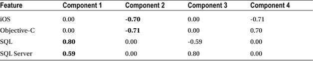

在这种情况下，我们看到的是：主成分 1 组合了 SQL 和 SQL Server，主成分 2 组合了 Objective-C 和 iOS。这非常棒：`PCA` 基本上将我们的数据集从四个特征简化为两个特征，即“iOS / Objective-C”和“SQL / SQL Server”，且几乎没有信息损失。

我们可以通过展示原始特征如何映射到主成分上来可视化这些信息，如图 5-20 所示。随着特征数量的增加，这种方法尤其方便：它使得我们能够直观地观察特征之间的关系，而这些关系在数字表格中要难发现得多。

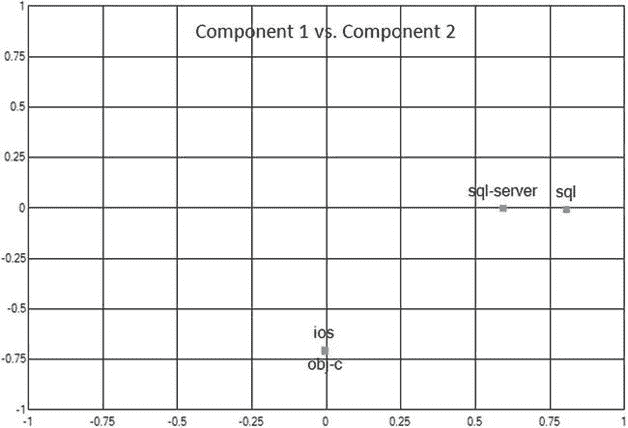

图 5-20. 原始特征投影到主成分上

另一个经常有用的图表是，将原始观测值从原始特征转换为主成分后进行可视化。例如，图 5-21 显示，StackOverflow 用户通常不关心这两个主题（除了一位孤独的用户）；积极参与 SQL 的人——即图表右侧位置的人——不关心 iPhone 开发，反之亦然。

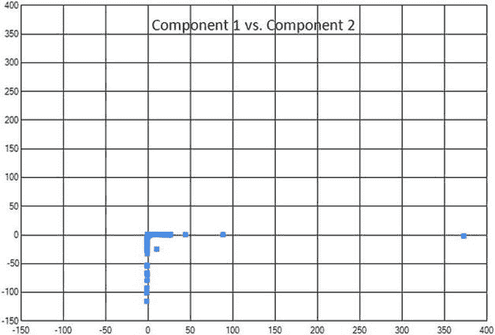

图 5-21. 原始观测值投影到主成分上

希望这个小例子能让您更好地了解 `PCA` 能带来什么。通过运用一点线性代数，我们基本上成功地将数据集缩小了一半，且几乎没有信息损失。从最初的四个特征，我们最终得到了两个特征——两个主要的主成分——它们浓缩了信息，并为我们提供了更清晰的数据集图景。现在我们已经看到了 `PCA` 能为我们做什么，接下来让我们深入探讨如何实现它，然后将其应用于完整数据集。

## 实现 `PCA`

实现本身并不复杂。我们将通用代码移到一个名为 `PCA.fs` 的单独代码文件中。`PCA` 依赖于数据集协方差矩阵的特征分解。`Math.NET` 中没有内置的协方差矩阵，但生成它很容易；我们计算每个特征列之间的协方差，并利用矩阵是对称的这一事实（即，第 `r` 行第 `c` 列的值等于第 `c` 行第 `r` 列的值）来避免重复工作。

***清单 5-13***. 计算协方差矩阵

```fsharp
namespace Unsupervised
module PCA =

    open MathNet
    open MathNet.Numerics.LinearAlgebra
    open MathNet.Numerics.Statistics

    let covarianceMatrix (M:Matrix<float>) =
        let cols = M.ColumnCount
        let C = DenseMatrix.create cols cols Matrix.Zero
        for c1 in 0 .. (cols - 1) do
            C.[c1,c1] <- Statistics.Variance (M.Column c1)
            for c2 in (c1 + 1) .. (cols - 1) do
                let cov = Statistics.Covariance (M.Column c1, M.Column c2)
                C.[c1,c2] <- cov
                C.[c2,c1] <- cov
        C
```

趁此机会，我们再添加一个便捷函数。`PCA` 期望特征已居中且尺度相似；为此，数据集通常会被**标准化**，首先减去平均值使每个特征均值为零，然后除以标准差使其围绕均值的散布为 1。

***清单 5-14***. 特征标准化

```fsharp
let normalize dim (observations:float[][]) =
    let averages =
        Array.init dim (fun i ->
            observations
            |> Seq.averageBy (fun x -> x.[i]))

    let stdDevs =
        Array.init dim (fun i ->
            let avg = averages.[i]
            observations
            |> Seq.averageBy (fun x ->
                pown (float x.[i] - avg) 2 |> sqrt))

    observations
    |> Array.map (fun row ->
        row
        |> Array.mapi (fun i x ->
            (float x - averages.[i]) / stdDevs.[i]))
```

主成分分析本身几乎已无需再实现任何内容。基于由观测行组成的数据集，我们计算协方差矩阵并进行特征分解。为方便起见，我们还返回一个函数（后文称为“投影器”），该函数接收单个观测值，并计算其在 `PCA` 识别的新空间中的表示。

***清单 5-15***. 主成分分析

```fsharp
let pca (observations:float[][]) =
    let factorization =
        observations
        |> Matrix.Build.DenseOfRowArrays
        |> covarianceMatrix
        |> Matrix.eigen

    let eigenValues = factorization.EigenValues
    let eigenVectors = factorization.EigenVectors

    let projector (obs:float[]) =
        let obsVector = obs |> Vector.Build.DenseOfArray
        (eigenVectors.Transpose () * obsVector)
        |> Vector.toArray

    (eigenValues,eigenVectors), projector
```

还记得我们之前描述的变换矩阵吗？这正是我们在此所做的；我们只需转置特征向量矩阵，因为分解返回的特征向量是列向量，而我们需要行向量。

## 将 `PCA` 应用于 StackOverflow 数据集

是时候在我们的脚本中尝试一下了！使用我们的算法非常简单：

***清单 5-16***. 在 StackOverflow 数据集上运行 `PCA`

```fsharp
#load "PCA.fs"

open Unsupervised.PCA

let normalized = normalize (headers.Length) observations

let (eValues,eVectors), projector = pca normalized
```

让我们看看输出结果。通常我们会检查特征值，它们能反映每个主成分（我们的新特征）包含多少信息。为此，我们只需计算提取出的 30 个特征值的总模长，然后输出每个特征值占总模长的百分比，以及截至当前仅使用信息量最大的特征所覆盖的总百分比。

***清单 5-17***. 特征权重分析

```
```
let total = eValues |> Seq.sumBy (fun x -> x.Magnitude)
eValues
|> Vector.toList
|> List.rev
|> List.scan (fun (percent,cumul) value ->
    let percent = 100. * value.Magnitude / total
    let cumul = cumul + percent
    (percent,cumul)) (0.,0.)
|> List.tail
|> List.iteri (fun i (p,c) -> printfn "Feat %2i: %.2f%% (%.2f%%)" i p c)

> 
Feat  0: 19.14% (19.14%)
Feat  1: 9.21% (28.35%)
Feat  2: 8.62% (36.97%)
// 为简洁起见，省略部分内容
Feat 28: 0.07% (99.95%)
Feat 29: 0.05% (100.00%)
```

这与我们的相关矩阵一致：前五个特征解释了数据集的 50%以上，前十个特征覆盖了近 80%。相比之下，最后十个特征每个覆盖的信息量均不足 1%。

 **注意** 通常我们会按特征值递减的顺序查看特征，但 Math.NET 返回的特征值和特征向量顺序相反。因此，例如，最重要的主成分将位于特征向量矩阵的最后一列。请务必小心！

## 分析提取出的特征

我们能看看这些特征吗？每个特征向量直接将旧特征映射到一个新特征（即主成分）。我们只需从之前 PCA 分析结果中获取特征向量，并将其每个值映射到相应的标签名称。清单 5-18 将原始特征与任意一对主成分进行对比；请注意，当我们重构第 x 个主成分时，我们检索的是特征向量的第 30^(th) – x 列，因为分析结果是按重要性递增顺序返回的。

### 清单 5-18：将原始特征与提取出的主成分进行对比

```
let principalComponent comp1 comp2 =
    let title = sprintf "主成分 %i 与 %i 对比" comp1 comp2
    let features = headers.Length
    let coords = Seq.zip (eVectors.Column(features-comp1)) (eVectors.Column(features-comp2))
    Chart.Point (coords, Title = title, Labels = headers, MarkerSize = 7)
    |> Chart.WithXAxis(Min = -1.0, Max = 1.0,
        MajorGrid = ChartTypes.Grid(Interval = 0.25),
        LabelStyle = ChartTypes.LabelStyle(Interval = 0.25),
        MajorTickMark = ChartTypes.TickMark(Enabled = false))
    |> Chart.WithYAxis(Min = -1.0, Max = 1.0,
        MajorGrid = ChartTypes.Grid(Interval = 0.25),
        LabelStyle = ChartTypes.LabelStyle(Interval = 0.25),
        MajorTickMark = ChartTypes.TickMark(Enabled = false))
```

然后，我们只需在 F#交互环境中调用`principalComponent 1 2;;`即可可视化两个主要主成分。作为示例，图 5-22 展示了 PCA 识别出的一些最大特征：主成分 1 与 2 的对比，以及主成分 3 与 4 的对比。考虑到相关矩阵，毫不意外，主要特征非常清晰地映射到 SQL、MySQL 和 SQL-Server，而其他所有技术则被归为另一类；我们不妨称这个特征为“数据库管理员”。第二个特征的解释则不那么明显，它似乎将 WPF，以及较小程度上的 C#和.NET 相关技术（如 ASP.NET 和 ASP.NET MVC）与许多其他技术对立起来，尤其是 Python/Django 和 Ruby。特征 3 也不完全明显，但似乎将 Web 与非 Web 技术对立起来，Ruby on Rails、Django、HTML 和 JavaScript 位于一侧。特征 4 则明显让 Python 和 Ruby 相互对立。

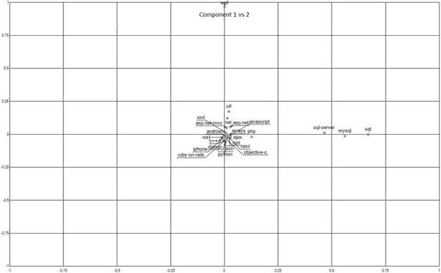

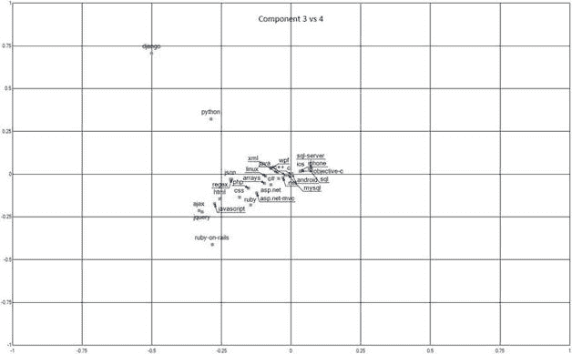

**图 5-22. 主要主成分（详情请参阅源代码包）**

通常我会深入挖掘每个主要主成分，试图理解它们捕获了什么。然而，这需要生成更多图表，却不会为讨论增加太多内容。因此，我就此打住——欢迎进一步探索，看看还能从这个数据集中学到什么！

## 映射观测值到主成分

让我们转而探讨另一个问题：通过新特征的视角来看，原始观测值看起来如何？我们只需使用投影器函数（它是 PCA 输出的一部分）将观测值转换为新坐标。请注意，我们预先计算了最小值和最大值，以便在可比较的尺度上显示每个图表。

### 清单 5-19：将观测值映射到主成分

```
let projections comp1 comp2 =
    let title = sprintf "主成分 %i 与 %i 对比" comp1 comp2
    let features = headers.Length
    let coords =
        normalized
        |> Seq.map projector
        |> Seq.map (fun obs -> obs.[features-comp1], obs.[features-comp2])
    Chart.Point (coords, Title = title)
    |> Chart.WithXAxis(Min = -200.0, Max = 500.0,
        MajorGrid = ChartTypes.Grid(Interval = 100.),
        LabelStyle = ChartTypes.LabelStyle(Interval = 100.),
        MajorTickMark = ChartTypes.TickMark(Enabled = false))
    |> Chart.WithYAxis(Min = -200.0, Max = 500.0,
        MajorGrid = ChartTypes.Grid(Interval = 100.), 
        LabelStyle = ChartTypes.LabelStyle(Interval = 100.),
        MajorTickMark = ChartTypes.TickMark(Enabled = false))
```

图 5-23 展示了我们之前观察过的相同组件对的结果。这些图表并非最令人兴奋，但仍呈现出一些有趣的模式。第一张图将“数据库”组件绘制在 X 轴上，WPF/.NET 组件绘制在 Y 轴上。首先，大多数观测值相当清晰地落在某个轴上，原点附近有一个非常大的聚集点。这表明关注某个主题的人通常不关心另一个主题（在 SQL 上得分高的人在另一个轴上得分不高，反之亦然），并且大多数人在两个主题上都不活跃。此外，观测值分布并不均匀：少数观测值得分非常高，大量观测值接近零，中间值很少。考虑到我们是通过收集每个标签最活跃的用户来构建数据集的，这并不令人意外：我们应该预期会看到一些用户的得分远高于平均水平。

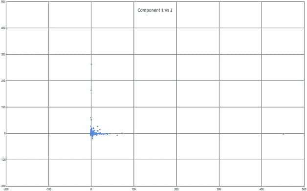

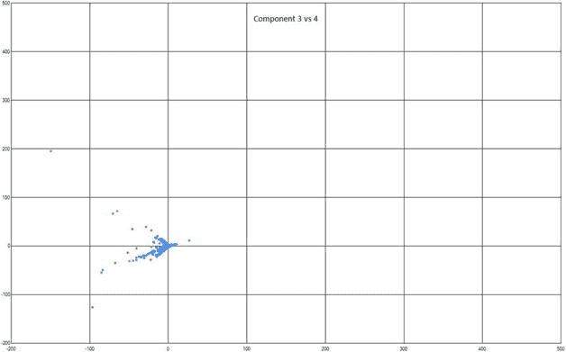

**图 5-23. 原始观测值在主成分上的投影**

 **提示** 图表显示了一些较大的**异常值**，即远离平均值的观测值。异常值是数据集中需要警惕的潜在问题。几个较大的异常值可能会产生扭曲的模型，使其对典型、平均观测值的代表性降低。

第二张图很有趣，它在一个轴上绘制了似乎是 Web 开发的内容，在另一个轴上绘制了 Ruby/Rails 与 Python/Django 的对比。我们仍然在原点附近有一个大量不关心这些主题的人群聚集点，但随着我们向左移动，人群分叉成两组。我对此的解释是，Ruby 和 Python Web 应用开发者有一些共同感兴趣的技术（JSON、JavaScript），但在语言和框架上存在不可缩减的差异。
```

再次强调，如果我们真的想深入理解这个数据集，应该进一步调查，但我们将把这项工作留给你，如果你有兴趣的话。我们这里的主要目标是说明主成分分析是什么以及它在哪些方面有帮助。在我们的场景中，我们成功地从数据集中提取了一些有趣的事实，而无需指定我们在寻找什么。PCA 发现了一个与我们称之为“数据库”的主题相符的维度，并且它识别出，虽然 Rubyists 和 Pythonistas 在使用什么框架上存在分歧，但他们中的许多人都在从事 Web 应用开发工作。

PCA 和聚类分析有一些相似之处，它们都能在无监督的情况下对数据进行有效的总结。然而，它们在处理问题的方式上存在深刻差异。与提取具有相似行为的观测值组的聚类分析不同，PCA 重新组织数据，创建新的特征，将原始特征重新组合成新的特征，用以描述观测值之间行为上的广泛差异。在这个过程中，它创建了一个高层级、全面的数据集“地图”，通过使用更少但信息量更大的特征，以更有效的方式描述数据。

与其在 PCA 上花费更多时间，我们接下来将转向一个不同的主题：做出推荐。仔细想想，无论是使用 `k-means` 还是 `PCA`，我们都只是获取了一个数据集，并寻找用户之间的相似性和差异性，观察他们的历史行为——在这两种情况下，我们确实找到了模式。也许我们可以用类似的想法在数据中寻找模式，以便做出推荐——例如，向用户建议他们可能感兴趣查看的标签。

## 做出推荐

如果你退一步思考我们使用聚类分析和主成分分析所做的工作，在这两种情况下，我们都观察了许多个体随时间的行为，并寻找他们之间的相似性。而且，在这两种情况下，都奏效了。我们每个人都有自己独特的个性，但归根结底，很少有人是完全独一无二的。只要选取足够大的人群，你就能找到与你相当相似的人。

这就是`协同过滤`背后的基本思想。简而言之，这个想法是：如果你和我在一组项目上表达了相同的偏好，那么我们在其他项目上也很可能有相似的口味。例如，如果我们恰好喜欢和讨厌同样的十部电影，并且我知道你恰好喜欢另一部我还没看过的电影，那么我很有可能也会喜欢那部电影，你推荐我去看那部电影也是合理的。

当然，这可能只是巧合。也许我们恰好达成一致的十部电影有某种共同特征，比如动作片，而另一部电影则非常不同。你可能喜欢浪漫片，而我不喜欢。然而，如果我们不只是比较你和我的口味档案，而是开始观察大量用户，并且普遍共识是喜欢这些电影的人也喜欢另一部电影，那么我们就可以更有信心地认为这是一个好的推荐。反之，如果这只是巧合，那么就不会出现共识：一些喜欢动作片的人会喜欢浪漫片，一些不会，就不会出现模式。

请注意，我们也可以从不同的方向来探讨这个问题。与其从用户的角度（这两个人的口味档案相似吗？）来看，我们可以从电影的角度来看，并比较电影档案。例如，如果给电影 A 评分的人倾向于以同样的方式给电影 B 评分，那么根据你对电影 A 的看法，就可以合理猜测你对电影 B 的看法，并根据预测的兴趣水平做出推荐。

## 一个原始标签推荐器

让我们将这个想法应用到我们的 StackOverflow 数据集上。这个例子会有点人为设计，主要目的是勾勒出解决该问题的一种方法。我们将从数据集中提取 100 名“测试”用户，并尝试根据前 20 个标签预测他们可能对最后 10 个标签中的哪些感兴趣。换句话说，让我们假设这些是相对较新的用户，我们唯一知道的是他们到目前为止活跃在哪些标签上。基于他们的历史，我们能推荐标签吗？鉴于我们也知道他们在剩余 10 个标签上的实际行为，我们将能够通过将我们的猜测与真实行为进行比较来验证。

让我们尝试基于用户档案的推荐。我们的方法很简单：选取一个用户，针对我们知道的 20 个标签，将他（或她）的档案与已知用户进行比较，并确定他们的相似程度。然后，通过计算已知用户对这些标签的平均兴趣水平（按他们与目标用户的相似度加权），来预测剩余 10 个标签的兴趣水平。

如果我们要使用相似度计算加权平均值，我们需要两样东西。首先，我们需要一个随档案相似度增加而增加的度量：如果我找到了一个与你非常相似的人，在尝试预测你可能喜欢或不喜欢什么时，我希望更多地考虑这个人的偏好，而不是其他人。然后，我们需要一个始终为正的相似度值，这样我们才能计算加权平均值。

我们可以用距离来计算相似度吗？经典的欧几里得距离符合一个标准——它始终为正——但不符合另一个标准：两个用户画像越接近，距离就越小。不过，这个问题并不难解决。如果我们取距离的倒数而不是距离本身，就会得到一个随着距离减小而增大的量。然而，这里有一个小问题：如果两个用户画像完全相同，距离将为零，倒数则为无穷大。让我们稍作调整，用以下公式来衡量相似度：

```
相似度(X,Y) = 1.0 / (1.0 + 距离(X,Y))
```

现在，完全相同的项相似度为 1.0（或者 100%，如果你喜欢的话），用户之间的距离越远，相似度就越小，极限值为 0.0。如果你觉得这听起来更像是猜测而非科学，那么在一定程度上你是对的。就像对于使用什么距离或如何缩放特征没有明显的唯一选择一样，定义正确的相似度取决于数据。最终，“正确”的相似度将是效果最好的那个，这需要通过交叉验证来确定。

## 实现推荐器

我们将在一个新的脚本文件中探索这一点，以免使现有的两个脚本变得杂乱。我们将以与其他两种方法相同的方式开始，即在内存中打开`userprofiles-toptags.txt`文件，提取观测值和标题，并过滤掉仅包含零值的观测值。

为了使用户画像具有可比性，我们需要解决在聚类中遇到的相同问题；也就是说，用户之间的活动水平差异很大。让我们从重新缩放观测值开始，使最大的标签值为 100%，最小的为 0%，然后提取出 100 个观测值——我们将用于交叉验证的测试对象。

***清单 5-20***。准备数据集

```
let scale (row:float[]) =
    let min = row |> Array.min
    let max = row |> Array.max
    if min = max
    then row
    else
        row |> Array.map (fun x -> (x - min) / (max - min))

let test  = observations.[..99]  |> Array.map scale
let train = observations.[100..] |> Array.map scale
```

在深入预测部分之前，我们需要一些辅助函数：一个相似度函数，它将使用距离。为了方便起见，我们还将编写一个权重函数，该函数接收一个浮点数数组并重新缩放它们，使它们总和为 100%，以便在加权平均中使用；以及一个分割函数，它将前 20 个标签与 10 个“未知”标签分开。

***清单 5-21***。相似度和实用函数

```
let distance (row1:float[]) (row2:float[]) =
    (row1,row2)
    ||> Array.map2 (fun x y -> pown (x - y) 2)
    |> Array.sum

let similarity (row1:float[]) (row2:float[]) =
    1. / (1. + distance row1 row2)

let split (row:float[]) =
    row.[..19],row.[20..]

let weights (values:float[]) =
    let total = values |> Array.sum
    values
    |> Array.map (fun x -> x / total)
```

 **提示** `||>`运算符可用于同时操作两个集合的函数，例如`Array.map2`或`Array.zip`。与其向函数传递两个参数，不如使用“双管道转发”运算符将它们作为元组输入，这在操作管道中看起来更一致。

我们现在准备进入预测部分。给定一个用户历史记录，我们将只保留我们假设已知的部分（前 20 个标签），然后计算它与训练集中每个用户的相似度。完成后，我们将取最后十列（我们试图预测的列），对于每一列，我们将计算相似度与已知使用水平的乘积之和，这将生成一个包含十个值的数组——即十个感兴趣标签的预测兴趣水平。

***清单 5-22***。计算对用户的预测


## 预测实现

我们现在已经准备好进行预测。让我们在第一个测试对象上试试：

```fsharp
let predict (row:float[]) =
    let known,unknown = row |> split
    let similarities =
        train
        |> Array.map (fun example ->
            let common, _ = example |> split
            similarity known common)
        |> weights
    [| for i in 20 .. 29 ->
        let column = train |> Array.map (fun x -> x.[i])
        let prediction =
            (similarities,column)
            ||> Array.map2 (fun s v -> s * v)
            |> Array.sum
        prediction |]
```

```fsharp
let targetTags = headers.[20..]
predict test.[0] |> Array.zip targetTags
```
输出结果为：
```
>
val it : (string * float) [] =
  [|("objective-c", 0.06037062258); ("php", 0.1239587958);
    ("python", 0.1538872057); ("regex", 0.06373121502); ("ruby", 0.1001880899);
    ("ruby-on-rails", 0.09474917849); ("sql", 0.07666851406);
    ("sql-server", 0.05314781127); ("wpf", 0.02386000125);
    ("xml", 0.03285983829)|]
```

对于这 10 个标签中的每一个，我们得到一个从 0% 到 100% 的预测兴趣水平。在这种情况下，我们的首选候选是 Python，为 15%，其次是 PHP（12%）和 Ruby（10%）。这个预测好吗？我们可以将其与实际发生的情况进行比较：

```fsharp
> test.[0] |> split |> snd;;
val it : float [] =
  [|0.0; 0.0; 0.03846153846; 1.0; 0.0; 0.0; 0.0; 0.0; 0.0; 0.0|]
```

如果我们根据最大的预测兴趣水平（15.4%）推荐一个标签，我们会建议第三个标签（Python），这确实是用户活跃过的标签。这很好。同时，我们会错过这个用户真正喜欢的标签 Regex，它在我们的预测中约为 6%，并且根据得分最高的推荐，它远未接近。

## 验证推荐

我们不能仅仅通过查看一个例子来判断我们的推荐器是否好用。让我们假设我们将按以下方式使用推荐器：计算每个未知标签的预测兴趣，并提出预测水平最高的标签。衡量推荐效果的一种方法是看用户是否真的对推荐的标签表现出兴趣。这是一种比较弱的评估；例如，在前面的例子中，我们会将“Python”视为一个好的推荐，尽管我们错过了一个更好的推荐“Regex”。同时，这也不是一个糟糕的推荐，因为我们提出了一些可能确实对用户感兴趣的东西。

尽管这可能不是最好的衡量标准，但它相当容易实现，所以我们将保留它。我们将对 100 个测试对象中的每一个进行测试，简单地将预测与用户活跃的标签匹配的每个案例计为正例。我们只需要获取我们感兴趣的十个标签中每个标签的实际活动水平，预测每个标签的水平，获取最大的那个，并检查对于推荐的标签，观察到的水平是否确实大于 0。我们将每次这种情况计为成功，并计算正确预测的比例。

`清单 5-23`。正确推荐百分比

```fsharp
let validation =
    test
    |> Array.map (fun obs ->
        let actual = obs |> split |> snd
        let predicted = obs |> predict
        let recommended, observed =
            Array.zip predicted actual
            |> Array.maxBy fst
        if observed > 0. then 1. else 0.)
    |> Array.average
    |> printfn "Correct calls: %f"
```

根据这个指标，我们得到了 32% 的正确推荐。让我们面对现实——这并不令人印象深刻。然而，我们并没有一个真正的基线来与之比较。我们能做的最简单的预测就是简单地预测平均评分最高的标签，完全忽略用户之间的任何相似性。让我们对该方法进行一个快速而粗略的评估。

`清单 5-24`。朴素推荐准确率

```fsharp
let averages =  [|
    for i in 20 .. 29 ->
        train |> Array.averageBy(fun row -> row.[i]) |]

let baseline =
    test
    |> Array.map (fun obs ->
        let actual = obs |> split |> snd
        let predicted = averages
        let recommended, observed =
            Array.zip predicted actual
            |> Array.maxBy fst
        if observed > 0. then 1. else 0.)
    |> Array.average
    |> printfn "正确呼叫次数: %f"
```


使用一种朴素的推荐方法，我们的准确率降至 13% 的正确呼叫次数。虽然这并不能让我们的 32% 准确率显得出色，但它证明了我们基于相似性的方法确实在发挥作用。

我们将保持推荐引擎的现状，不再尝试进一步改进。我相当确定我们可以让它变得更好，但我认为在这个过程中我们不会获得太多洞见。最后，我将提出一些值得考虑的要点，以防你想进一步探索这个问题——无论是基于当前数据集还是其他数据集。

首先，我们的样本并非使用该方法的典型场景。在典型场景中，你知道人们对某些项目的评分，但不知道他们对其他项目的评价；例如，某人看过哪些电影以及他们的评分（从糟糕到精彩）。这与我们的情况略有不同，体现在两个方面：在那种场景下，我们知道某个项目是否已被评分，且所有评分都有一致的量纲。相比之下，我们的数据集中每个用户的量纲差异巨大，因为我们衡量的是活动量，并且我们无法清晰区分空值（用户从未见过此标签）和无趣标签（用户有机会看到该标签但不感兴趣）。因此，比较用户或标签的相似性变得有些复杂。

在更典型的情况下，我们会面临略有不同的挑战。一行数据中大部分是未知值（用户尚未评分的所有项目），而将该用户与其他用户进行比较时，需要仅基于共同项目进行对比，这比简单计算两个完整行之间的距离要复杂得多。这也指出了协同过滤方法的一个局限性，在我们的示例中可能不那么明显。当一个全新用户出现在系统中时，该用户没有历史记录，因此我们没有任何可用信息来生成推荐。这就是所谓的“冷启动”问题。如果你进一步尝试我们的模型，你大致会看到以下结果：默认情况下，推荐器会预测 Python，这是十个目标标签中最受欢迎的标签。只有在用户画像非常明确且强烈的情况下，引擎才会产生不同的推荐。这是你通常会预期的结果：在信息有限的情况下，引擎会推荐广泛流行的项目，只有对于提供了大量信息的用户，才会开始产生“有趣”的推荐。

关于这个主题的最后一点说明：为了生成推荐，我们必须扫描每一个用户。这显然是一项昂贵的操作，暗示着明显的扩展性问题。首先，我们可以尝试按特征而非按用户来处理问题，尝试检测 30 个标签之间的相似性，而不是 1600 个用户；我们甚至可以预先计算列之间的相似性，这将大大减少计算量。

**那么，我们学到了什么？**

在本章中，我们介绍了无监督学习。在监督学习方法（如分类或回归）中，算法旨在通过训练集示例的引导来回答特定问题。相比之下，无监督学习是在没有用户明确指导的情况下，自动识别“原始”数据中的有趣特征或结构。在探索无监督技术的过程中，我们讨论了不少主题。我们的目标是获取一个数据集，看看是否能够应用更机械化的方法，系统地提取和总结数据中的信息，而不是手动探索数据以期发现有趣的模式。

我们对数据应用了两种互补的技术：基于 k-means 算法的聚类和主成分分析。它们有相似的特点：都试图通过发现数据中的模式并简化信息，基于某种距离概念将相似元素分组，从而将数据集压缩为更简洁的表示。这两种方法在寻找的模式类型上有所不同。K-means 聚类试图将观测值分组到簇中，理想情况下，同一簇内的项目彼此接近，而不同簇之间则尽可能不同。K-means 识别出质心，这些质心本质上是“原型”，足以描述一大类观测值。

相比之下，主成分分析不关注观测值之间的相似性，而是关注哪些特征共同变化，以及观测值如何偏离平均值。通过检查协方差矩阵，它识别出共同变化的特征，并尝试提供一种替代表示，将通常同向或反向演变的特征分组，并以强调观测值之间最大差异因素的方式组织它们。

在这两种情况下，一个关键优势是数据集更简单、更紧凑的描述。在聚类的情况下，我们可以用少数几个表现出一致行为的原型来描述数据集，而不是许多独特的观测值。在 PCA 的情况下，我们得到几个新的特征（主成分），它们能强烈区分观测值，而不是多个不相关的特征。因此，我们不再面对大量难以解释的事实，而是开始理解这些维度，它们比原始数据更有意义、更易于推理。这些方法使我们能够开发一种更高效地讨论数据的语言，或许还能更好地理解数据是如何“运作”的，以及我们如何从中获得洞见。

同时，这两种技术都只是在数据中搜索特定类型的模式。无法保证这些模式确实存在，即使存在，也无法保证它们对我们有趣。例如，我们可能会发现一些没有实际意义的簇；它们可能无法采取行动，或者只是陈述了显而易见的事实。

我们讨论的另一个方面是距离的概念以及考虑量纲的重要性。聚类将接近的观测值分组，在这种框架下，为算法提供有意义的距离至关重要。因此，我们最终对观测值进行了预处理，将其简化为可比较的用户画像。PCA 将具有相似平均偏差的特征分组，这引出了我们对归一化和相关性的讨论，这两个概念都围绕着重新缩放度量值以使它们的变化可比较这一思想。

最后，我们勾勒了如何运用类似的想法，不是为了从数据集中提取信息，而是为了生成推荐。在这三个案例中，我们观察了多个个体及其行为方式，并意识到尽管存在个体差异，但整体上存在一些模式。在最后一个例子中，我们基于“在多种情境下行为相似的人，在其他情境下也可能行为相似”这一假设，探讨了如何通过检测相似性并加以应用，来预测未知情况下可能发生的行为，从而制定推荐方案。