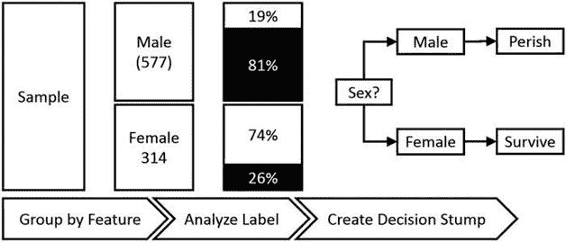
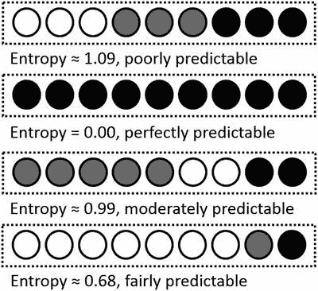
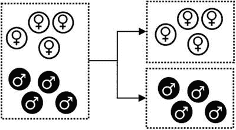
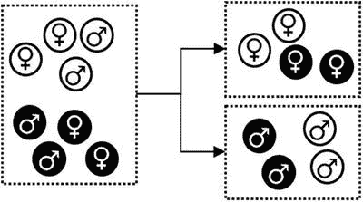
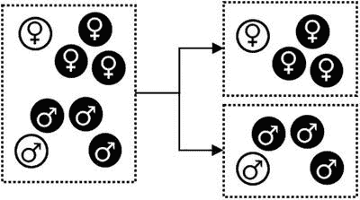
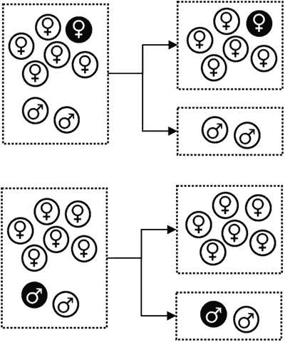
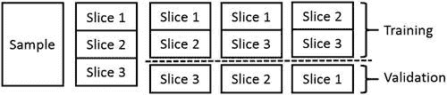

# 第六章 树与森林

## 从不完整数据中进行预测

我侄女们最喜欢的游戏之一是猜谜游戏。一个人想好某样东西，另一个玩家只能通过问“是”或“否”的问题来猜出那是什么。如果你玩过这个游戏，你很可能见过这样的模式：先问那些能排除大部分可能答案类别的问题，比如“是动物吗？”，然后随着获取更多信息，逐步缩小问题的焦点。这比一开始就问“你想的是斑马吗？”要有效得多。一方面，如果答案是“是”，你就猜中了，因为只有一个可能的答案。另一方面，如果答案是“否”，你的处境就很糟糕了，因为你基本上什么也没学到。

决策树是一种分类器，其运作方式与这个游戏类似。它们模仿我们人类通过提出一系列问题来进行诊断的方式，试图快速排除错误的答案，并根据到目前为止所学到的所有信息来决定接下来要问什么问题。在这种背景下，特征可以被看作是关于某个观测特征的问题。决策树将从训练集中学习，分析训练集以确定哪个特征能提供最多的信息，同时考虑到在分类时关于该观测已知的所有信息。

在本章中，我们将使用一个经典数据集，逐步学习越来越强大的分类器，从决策桩开始，扩展到决策树和随机森林。在此过程中，我们将进行以下操作：
*   学习如何构建灵活的决策树，使其能够处理几乎任何类型的数据，包括数据缺失的情况。我们还将看到如何使用 F# 类型（如可区分联合和选项）来非常有效地对树状结构进行建模。
*   引入熵作为衡量数据集包含信息量多少的方法，并利用它来比较特征，决定应该选择哪些特征。
*   讨论过拟合的风险以及应对方法。特别是，我们将探索更高级的交叉验证方法，例如 k 折交叉验证，以及如何将相同的思路引向集成方法——一种将多个简单预测器聚合为一个稳健预测器的通用方法。

我们的挑战：泰坦尼克号上的生死抉择

我们将在本章中使用的数据集是一个经典数据集。利用登上泰坦尼克号的乘客名单以及每位乘客的一些人口统计信息，我们的目标是预测他们的命运。这个数据集和问题都很有趣，原因有几个。首先，一旦你抛开其略显恐怖的特性，手头的问题就是一大类问题的典型代表。“那位访客会点击网站上的这个链接吗？”或者“哪些客户会选择小份、中份或大份订单？”本质上都是同一个问题：利用你所掌握的关于个体的信息以及他们过去的行为方式，你试图建立一个分类模型，从一组有限的可能结果中预测出一个结果。

其次，数据本身非常典型地反映了现实世界的情况，因为它很杂乱。它混合了不同类型的特征，从数值型（乘客支付了多少票钱？）到分类型（乘客是男性还是女性？），以及介于两者之间的类型（乘客姓名和头衔）。部分数据也存在缺失。理想情况下，我们希望有一个足够灵活的分类器，能够轻松处理所有这些变量。

最后，出于显而易见的历史原因，数据本身也很有趣。泰坦尼克号灾难长期以来一直吸引着人们，尽管为一个近一个世纪前的一次性事故创建预测模型几乎没有实际用途，但这个数据集提供了一个机会，让我们看看通过分析其数据可以获得什么样的见解。

了解数据集

我们将使用的具体数据集来自 Kaggle 竞赛“泰坦尼克号：机器学习的灾难”：[`www.kaggle.com/c/titanic-gettingStarted`](https://www.kaggle.com/c/titanic-gettingStarted)。其变体很容易在网上找到（例如，[`www.encyclopedia-titanica.org`](http://www.encyclopedia-titanica.org)）。不过，我们认为使用 Kaggle 参考数据集会很有趣；这样，你可以尝试一下自己的技能，看看表现如何。为方便起见，我们将相同的数据集上传到了 OneDrive，链接如下：[`1drv.ms/1HUh1ny`](http://1drv.ms/1HUh1ny)。

该数据集是一个 CSV 文件，名为 `titanic.csv`，组织得很好，带有一个标题行，描述了 12 个可用列中每一列的内容。当然，我们可以编写一些代码来解析它，但为什么不使用 `CSV` 类型提供程序呢？让我们创建一个包含 F# 项目 `Titanic` 的解决方案，将 `titanic.csv` 文件添加到该项目中，并将 `fsharp.data` NuGet 包添加到项目中。

我们现在可以开始探索数据了。在 `script.fsx` 文件中，让我们添加对 `FSharp.Data` 的引用（具体路径可能因当前包的最新版本而异），通过查看样本数据创建一个 `Titanic` 类型，并添加一个类型别名 `Passenger`，以便我们可以更直观地引用数据集的每一行。现在我们可以读取数据集了。

清单 6-1。使用 `CSV` 类型提供程序读取泰坦尼克号数据集

```
#r @".\packages\FSharp.Data.2.2.2\lib\net40\FSharp.Data.dll"
open FSharp.Data

type Titanic = CsvProvider<"titanic.csv">
type Passenger = Titanic.Row

let dataset = Titanic.GetSample ()
```

`CSV` 类型提供程序为我们创建了一个很好的类型，并带有属性，在探索数据时为我们提供了类型的所有好处。我们现在可以开始工作了。如果我们的目标是预测谁幸存或死亡，第一步是获取该值的基线。让我们首先统计每个类别中的乘客数量，然后通过将以下代码添加到脚本中并在 F# Interactive 中运行，来计算单个乘客幸存的概率：

```
dataset.Rows
|> Seq.countBy (fun passenger -> passenger.Survived)
|> Seq.iter (printfn "%A")

dataset.Rows
|> Seq.averageBy (fun passenger ->
    if passenger.Survived then 1.0 else 0.0)
|> printfn "Chances of survival: %.3f"

>
(false, 549)
(true, 342)
Chances of survival: 0.384
```

我们有 891 名乘客，其中只有 342 人幸存；换句话说，在没有额外信息的情况下，每位乘客只有 38.4% 的幸存几率（或者，等价地，有 61.6% 的几率无法活着下船）。如果我们想改进预测，就需要找到能够帮助我们识别幸存几率超过 50% 的乘客的特征。任何其他特征，虽然可能提供信息，但不会直接对我们的预测产生实质性影响，因为它不会改变我们相对于默认情况的决策。

查看特征

有了这个框架，我们开始审视特征。我们想要的是快速将乘客划分为不同组别，然后计算每组的存活率。计算存活率很简单：给定一组乘客样本，只需计算幸存乘客数除以该样本中乘客总数的比例。然后我们可以根据不同的标准（例如性别或舱位等级）对乘客进行分组，并显示每组的存活率。

代码清单 6-2。计算不同组别的存活率

```
let survivalRate (passengers:Passenger seq) =
    let total = passengers |> Seq.length
    let survivors =
        passengers
        |> Seq.filter (fun p -> p.Survived)
        |> Seq.length
    100.0 * (float survivors / float total)

let bySex =
    dataset.Rows
    |> Seq.groupBy(fun p -> p.Sex)

bySex
|> Seq.iter (fun (s,g) ->
    printfn "Sex %A: %f" s (survivalRate g))

let byClass =
    dataset.Rows
    |> Seq.groupBy (fun p -> p.Pclass)

byClass
|> Seq.iter (fun (s,g) ->
    printfn "Class %A: %f" s (survivalRate g))
>
Sex "male": 18.890815
Sex "female": 74.203822
Class 3: 24.236253
Class 1: 62.962963
Class 2: 47.282609
```

显然，这两个特征都极具信息量。事实证明，在泰坦尼克号上身为女性，有 74% 的存活几率，这确实是个非常有利的条件。同样，头等舱乘客有相当不错的生还机会（63%），而三等舱的可怜虫们前景则黯淡得多，存活几率仅为 24%。套用乔治·奥威尔的话来说：“所有乘客都是平等的，但有些乘客比其他乘客更平等。”这里有一些相当明显的社会学解读，但我将留给你自己思考：毕竟，数据展示了“是什么”，但并未说明“为什么”。

`构建决策树桩`

有了这些信息，我们就能实现一个极其简单的分类器及其训练过程。取样本数据，按照我们刚才的做法将样本分成不同组别，然后针对每个组别，预测出现最频繁的标签。这种模型被称为决策树桩，是你能构建的最短的树。它是树的构建基石，也是一个最小化的分类器，通常作为其他模型的构建模块出现。

例如，我们如何基于乘客性别构建一个树桩？首先，我会从样本中取出所有乘客，根据所选特征的值（本例中为性别值“男性”或“女性”）将他们分成组。然后，对于每个组，我会查找所选标签的值（在我们的案例中，即他们是否幸存），并找出每个组中出现最频繁的标签。接着，我们可以构建一个分类器（即树桩）：将一名乘客作为输入，计算其特征值，在组中查找该值，并返回该组最频繁的标签（参见图 6-1）。



图 6-1。使用性别作为特征构建用于预测存活的决策树桩

 `注意` 在前面的章节中，我们使用术语 `类` 来描述分类器的预测结果。在这里，我们将改用 `标签`，这也是常见的用法。在我们的案例中，这样做很方便，因为乘客舱位等级是数据集的一个特征，如果两者都使用“类”这个词，可能会引入一些潜在的歧义。

实际上，如果我们把特征和标签都做成从观测值中提取值的函数，就可以使这个过程完全通用化。假设我处理的不是乘客，而是一系列泛型类型 'a 的项；那么特征就是一个函数，当给定一个 'a 时，它返回一个值 'b；类似地，标签接收一个 'a 并返回另一个类型 'c。在我们的具体案例中，'a 将是 `Passenger`，'b 是一个字符串（取值为“男性”或“女性”），'c 是一个布尔值（是否幸存）。对我们类型的唯一额外要求是 'b 和 'c 需要支持相等性比较，因为我们需要根据特征值和标签值进行分组和计数。

那么，我们的实现看起来如何呢？几乎和我们描述的一样：

***代码清单 6-3***。学习一个决策树桩

```
let mostFrequentLabelIn group =
    group
    |> Seq.countBy snd
    |> Seq.maxBy snd
    |> fst

let learn sample extractFeature extractLabel =
    // 将具有相同选定特征值的观测值分组，
    // 并找出每组中最频繁的标签。
    let groups =
        sample
        |> Seq.map (fun obs -> extractFeature obs, extractLabel obs)
        |> Seq.groupBy fst
        |> Seq.map (fun (feat,group) -> feat, mostFrequentLabelIn group)
    // 对于一个观测值，找到具有匹配特征值的组，
    // 并预测该组最频繁的标签。
    let classifier obs =
        let featureValue = extractFeature obs
        groups
        |> Seq.find (fun (f,_) -> f = featureValue)
        |> snd
    classifier
```

请注意，主要是为了说明问题，我没有在代码清单 6-3 的两个函数上添加任何类型注解。如果你在 F# Interactive 中运行这段代码，或者只是悬停查看 `learn` 的定义，你会看到以下内容：

```
val learn :
  sample:seq<'a> ->
    extractFeature:('a -> 'b) -> extractLabel:('a -> 'c) -> ('a -> 'c)
    when 'b : equality and 'c : equality
```

这看起来有点吓人，所以让我们解析一下。它的意思是，`learn` 是一个函数，当给定一个观测值样本（'a 的序列）、一个从观测值 'a 中提取特征值 'b 的函数（'a -> 'b），以及一个从观测值 'a 中提取标签值 'c 的函数（'a -> 'c）时，它会返回一个函数 'a -> 'c，即一个接收观测值并返回标签的函数，这正是我们对分类器的期望。如果这个函数签名的所有细节不清楚，别担心，因为它并不是特别重要。我提到它的原因是，它展示了 F# 类型推断系统的强大之处。我们只描述了想要如何处理输入，没有太多具体说明，而 F# 就正确地创建了一个带有泛型类型的函数，甚至推断出我们需要对提取的标签和特征值都支持相等性比较。

### 训练树桩

我们如何训练一个树桩？我们需要为想要使用的标签和特征创建一个规范，并将它们定义为适合我们数据集的函数。调用 `learn` 将创建一个完整的分类器函数，我们可以立即运行并评估它（暂时忽略交叉验证）。

***代码清单 6-4***。训练和评估一个树桩

```
let survived (p:Passenger) = p.Survived
let sex (p:Passenger) = p.Sex

let sexClassifier = survived |> learn (dataset.Rows) sex

printfn "Stump: classify based on passenger sex."
dataset.Rows
|> Seq.averageBy (fun p ->
    if p.Survived = sexClassifier p then 1.0 else 0.0)

>
Stump: classify based on passenger sex.
val it : float = 0.7867564534
```

在整个样本上运行，我们得到了 78.6% 的正确预测率，明显优于最初的 61.6%。我们同样可以轻松地基于乘客舱位等级创建一个模型，如下所示：

***代码清单 6-5***。一个多分支的树桩

```
let classClassifier = survived |> learn (dataset.Rows) (fun p -> p.Pclass)
dataset.Rows
|> Seq.averageBy (fun p ->
    if p.Survived = classClassifier p then 1.0 else 0.0)
```

不出所料，正确率达到 67.9%，相比没有模型的情况有所改进，尽管提升幅度比之前观察到的案例要小。不过，我运行这个示例的目的并非真的为了提升性能。它揭示了两个有趣的方面。首先，与第一个示例不同，这个决策树桩有三个分支，而非仅仅两个。一个树桩（以及后续的决策树）可以容纳不止二元选择。其次，请注意我们的两个特征具有不同的类型：`Sex` 返回字符串，而 `p.Pclass` 返回整数。类型推断系统自动为我们处理了这一点。

### 不合适的特征

显然，这种仅使用单一特征进行预测的简单模型只能带我们走到这里，此时一个显而易见的问题是：“我们如何将多个特征组合成一个单一的模型？”这正是我们接下来要探讨的方向，即通过整合更多数据集信息，并将多个树桩组合成决策树来改进预测。然而，在研究更复杂的模型之前，我们需要解决几个问题。我们的决策树桩方法相当灵活，但也存在一些局限性。

### 数值型特征怎么办？

在我们的特征中，考虑这一个：`fare`（票价）。毕竟，如果乘客舱位等级能提供信息，那么他们为船票支付的价格很可能也同样具有信息量。让我们通过计算不同票价下的生存率来验证这一点。

***清单 6-6***。一个具有连续数值的特征

```
let survivalByPricePaid =
    dataset.Rows
    |> Seq.groupBy (fun p -> p.Fare)
    |> Seq.iter (fun (price,passengers) ->
        printfn "%6.2F: %6.2f" price (survivalRate passengers))
>
  7.25:   7.69
 71.28: 100.00
  7.93:  44.44
 53.10:  60.00
// 为简洁起见，省略部分内容...
  5.00:   0.00
  9.85:   0.00
 10.52:   0.00
```

数字本身没错，但这似乎不是处理该特征的好方法。票价被分成了 248 个不同的独立数值，其中大部分生存率要么是 0%，要么是 100%。如果遵循这个模型，支付 39.4000 的乘客有 100% 的生存几率；支付 39.6000 的乘客只有 50% 的生存几率；而支付 39.6875 的乘客则完全没有生还的可能。这显然很荒谬。

这里的问题在于，票价和舱位等级（例如）本质不同。舱位等级是离散状态（你位于头等舱、二等舱或三等舱；没有其他选择），而票价原则上可以取无限多个值。这两个特征的另一个区别在于，票价代表一个实际的数字；例如，你可以将两张票价相加，或者相减，而乘客舱位等级的总和则毫无意义。

问题在于，我们的树桩只能处理分类特征；我们如何纳入连续数据呢？一种方法是将问题简化为已知问题，并将票价转换为分类特征。例如，我们可以创建一个新的特征“票价水平”，包含“廉价”或“昂贵”两个级别，具体取决于票价是低于还是高于平均值。

***清单 6-7***。将票价转换为离散区间

# 处理离散化与缺失数据

让我们考虑一下我们可用的另一个特征。假设我们想将`Embarked`（每位乘客的登船港口）作为模型中的一个特征。让我们按登船港口查看生存率。

```fsharp
let survivalByPortOfOrigin =
    dataset.Rows
    |> Seq.groupBy (fun p -> p.Embarked)
    |> Seq.iter (fun (port,passengers) ->
        printfn "%s: %f" port (survivalRate passengers))

>
S: 33.695652
C: 55.357143
Q: 38.961039
: 100.000000
```

显然，在法国瑟堡（C）登船比在皇后镇（Q）或南安普敦（S）登船有稍高的生存几率。但那个生存率为 100% 的匿名类别是什么？

答案是缺失数据。对于每位乘客，我们知道其性别和舱位等级，但对于某些乘客，我们不知道他们从哪里登船。这个问题真实存在且非常普遍。不幸的是，在现实生活中，你得到的大多数数据集都会存在一些问题，缺失值是最常见的问题之一。那么，我们应该怎么做呢？一个诱人的选择是删除不完整的记录。然而，这样做可能会丢弃大量有价值的信息，尤其是当数据集中的多个特征都存在缺失数据时。

然而，我们不能将一个空字符串保留为有效的登船港口！至少，我们应该明确标记这是缺失数据，以便我们以后决定如何处理它。我们可以在这里创建一个专用的可区分联合，但当我们有`Option`类型可用时（它有两个情况：`Some<'T>` 或 `None`），这似乎有些大材小用。

在这种框架下，一个选择（请原谅这个双关语）是稍微修改我们定义特征的方式，要求它通过返回一个`Option`来明确指定缺失值是什么，其中`None`表示缺失数据。因此，学习函数现在需要明确处理这种情况的策略。清单 6-9 中的代码片段说明了一种实现方法。与我们之前的版本相比，主要变化是我们从样本中过滤掉了具有缺失值的示例，然后仅为这些情况创建一个分支，为方便起见将其存储为`Map`。当遇到缺失值时，我们将简单地预测样本中最常见的标签。

### 清单 6-9。纳入缺失值

```fsharp
let hasData extractFeature = extractFeature >> Option.isSome
let betterLearn sample extractFeature extractLabel =
    let branches =
        sample
        |> Seq.filter (extractFeature |> hasData)
        |> Seq.map (fun obs -> extractFeature obs |> Option.get, extractLabel obs)
        |> Seq.groupBy fst
        |> Seq.map (fun (feat,group) -> feat, mostFrequentLabelIn group)
        |> Map.ofSeq
    let labelForMissingValues =
        sample
        |> Seq.countBy extractLabel
        |> Seq.maxBy snd
        |> fst
    let classifier obs =
        let featureValue = extractFeature obs
        match featureValue with
        | None -> labelForMissingValues
        | Some(value) ->
            match (branches.TryFind value) with
            | None -> labelForMissingValues
            | Some(predictedLabel) -> predictedLabel
    classifier

let port (p:Passenger) =
    if p.Embarked = "" then None
    else Some(p.Embarked)

let updatedClassifier = survived |> betterLearn (dataset.Rows) port
```

 **注意** 在分类器函数中对 `Option` 结果进行模式匹配，可以形成非常易于理解的逻辑流程。然而，先过滤掉缺失值的样本，再提取实际值，这种做法相当丑陋。`Seq` 模块包含一个函数 `Seq.choose`，它可以一步完成这两项操作，但要求原始序列包含选项，遗憾的是，在我们的示例中并非如此。

# 测量数据中的信息

我们现在有了一种方法，可以使用单个特征为总体创建分类器，无论其特征类型如何，也无论是否存在缺失值。这很棒，但我们不能局限于一次只使用一个特征，而忽略我们可用的其他特征中可能包含的信息。

我们将按照与“20 个问题”游戏相同的方式来扩展我们的模型。我们将轮流进行；在每一轮中，你可以从特征列表中就观测值提出一个“问题”：乘客是男性还是女性？他乘坐的是头等舱、二等舱还是三等舱？根据这些问题的答案，你需要做出一个决定：你是否拥有足够的信息来做出预测（幸存与否），或者，根据你得到的答案（“乘客是男性”），你是否想再问另一个问题，以提高得出正确答案的几率？

这里的关键问题是如何衡量和比较信息，以便我们能够决定哪一组问题是最佳的。这就是我们将在本节中讨论的内容。

## 用熵测量不确定性

特征本身并不包含信息；信息存在于你可能得到的可能答案中，以及这些答案如何帮助你判断哪个标签最有可能。为了衡量一个问题的信息量，我需要考虑知道答案后我的情况会改善多少。知道“乘客是男性”会更好，还是知道“乘客乘坐头等舱”会更好？

现在，我们真正关心的不是乘客是男性还是女性，而是如果我告诉你他是男性，你对他幸存的可能性有多大把握？我能告诉你的最糟糕的情况是，“如果乘客是男性，他幸存的可能性是 50%。”这基本上等同于说信息毫无价值。相反，如果男性幸存的可能性是 100%——或者相反——那么你就完成了：这是完美的信息，不需要再问任何额外的问题来改进。

这里的直觉是，总体分布越均匀，我们拥有的信息就越少：没有哪个猜测比另一个更好。信息论中有一个专门为此定义的度量：熵（具体来说是香农熵）。如果你有一个样本总体，其熵的计算方式为：

```
entropy(sample) = sum [ - p(x) * log p(x) ]
```

其中 `p(x)` 是样本中 `x` 的比例，即观察到值为 `x` 的项的概率。

 **注意** 选择什么底数来计算对数并不重要，只要保持一致即可。不同的底数会导致不同的单位（比特、纳特等），但不会影响样本的排序方式。因此，我们将使用 `log`，即自然对数，因为它在 F# 中最容易使用。

让我们在 F# 中实现这一点，以便更好地了解其工作原理。给定一个数据样本，我们将计算每个类别中有多少个元素，除以总数，然后计算 `p log p`。请注意，当 `x = 0` 时，`x log(x)` 是未定义的；我们将用它的右极限零来代替，最终得到以下结果：

### 清单 6-10。样本的香农熵

## 熵的计算与解释

```fsharp
let entropy data =
    let size = data |> Seq.length
    data
    |> Seq.countBy id
    |> Seq.map (fun (_,count) -> float count / float size)
    |> Seq.sumBy (fun f -> if f > 0. then - f * log f else 0.)
```

 提示：F# 有一个内置函数 `id` 用于标识，即一个返回其输入作为输出的函数。这在像清单 6-10 这样的情况下很有用，我们想要找到序列中的唯一元素并计算每个元素的数量。

让我们通过在 F# 交互环境中运行几个示例来快速探索熵的行为：

```fsharp
> [1;1;1;2;2;2] |> entropy;;
val it : float = 0.6931471806
> [1;1;1;1;1;1] |> entropy;;
val it : float = 0.0
```

当样本信息量最小时（每个标签都同等出现），熵最大；而对于一个完全有序（且可预测）的样本，熵趋近于零。图 6-2 对比了几个具有不同特征的示例，并说明了熵如何映射我们对秩序或纯度的直观概念：样本纯度越高，越容易猜测，其熵越低。顺便提一下，熵也可以处理两个以上的标签，这使其成为一个方便的度量标准。



### 图 6-2。用熵比较样本信息

## 信息增益

香农熵为我们提供了一种衡量样本中信息可用性的方法——熵越低，信息越好。这很有用，但并非我们真正追求的目标。我们想要的是：如果我们有一个样本，需要从两个问题（特征）中选择一个来提问，我们应该选择哪一个？

为了做出这个决定，我们将使用信息增益的概念。让我们从它的数学表达式开始，然后讨论为什么这有意义。假设你有一个样本，通过观察特征 `F`，你可以将该样本分成 `n` 组：`sample(1)`, ..., `sample(n)`。那么特征 `F` 的熵增益为：

```
gain = entropy(sample) - (proba(sample(1)) * entropy(sample(1)) + ... proba(sample(n)) * entropy(sample(n)))
```

为什么这个公式有意义？第一部分 `entropy(sample)` 简单地表示当前的熵——即我们对原始样本的信息有多好。你可能已经注意到第二部分是一个平均值，即根据我们的特征分割样本后得到的平均熵。

在深入实现之前，让我们在一些图形示例上说明这个想法。在每个图像中，我们将考虑一个虚构的乘客样本，其中幸存者用白色表示，否则用黑色表示，乘客性别用经典的火星和金星符号表示。

在图 6-3 中，我们看到了理想情况。我们从一个对于做出预测来说最糟糕的样本开始（一半幸存者，一半伤亡者）。如果我们根据性别分割样本，最终会得到两个完美的组，一组全是幸存者，另一组全是死者。在这种情况下，性别是一个完美的特征；如果我们询问乘客的性别，我们将确切地知道他们的命运——并且熵增益将尽可能高。



### 图 6-3。完美的信息增益

相比之下，图 6-4 代表了最糟糕的情况。我们从一个没有信息的样本开始，在根据性别分割后，我们得到两个仍然没有信息的样本。在这种情况下，性别完全没有信息量，相应的信息增益将为零。



### 图 6-4。零信息增益

请注意，熵增益是关于我们通过分割一个特征（或提出一个问题）获得了多少信息，而不是熵本身。例如，图 6-5 展示了一种情况，在根据性别分割后，我们得到了两个信息量尚可的样本（在男性或女性这两种情况下，我们都可以以 75% 的置信度对结果进行猜测），但与原始情况相比没有改善，并且与之前的情况一样，熵没有增益。



### 图 6-5. 信息虽好，但无增益

信息增益中另一个值得关注的组成部分是**组大小**。请看图 6-6，该图描绘了两种相似但略有不同的情况。在这两种情况下，按性别划分样本都能为我们带来信息增益。然而，下方的情况优于上方。在上方情况中，如果我们得知乘客是男性，就能获得完美信息，但听到这个答案的概率只有 25%。相比之下，在第二种情况中，我们有 75% 的概率得知乘客是女性，并获得完美信息。使用相同的特征，在一种情况下我们完成任务的速度会远快于另一种情况，这一方面将再次通过信息增益的构建方式体现出来，因为它会考虑按组划分的熵，并按每组的大小进行加权。



### 图 6-6. 按组划分的信息增益

换句话说，信息增益为我们提供了一种度量标准，用于比较哪些特征最有利于使用——如果我们想高效地了解标签，并且每次只能提出一个问题的话。

## 实现最佳特征识别

这部分我们已经完成了第一步；唯一需要的是在按给定特征划分样本后的平均熵。这相当直接，我们唯一需要注意的就是样本中可能存在的缺失数据。我们只需过滤掉任何在该特征上无值的观测值，按特征值分组，然后计算按组加权的平均熵。

***清单 6-11***. 特征划分后的平均熵

```fsharp
let splitEntropy extractLabel extractFeature data =
    // 针对所选特征无缺失值的观测值
    let dataWithValues =
        data
        |> Seq.filter (extractFeature |> hasData)
    let size = dataWithValues |> Seq.length
    dataWithValues
    |> Seq.groupBy extractFeature
    |> Seq.sumBy (fun (_,group) ->
        let groupSize = group |> Seq.length
        let probaGroup = float groupSize / float size
        let groupEntropy = group |> entropy extractLabel
        probaGroup * groupEntropy)
```

让我们通过计算 F# 交互环境中不同特征的信息增益，来看看效果如何。

***清单 6-12***. 比较不同特征的信息增益

```fsharp
let survived (p:Passenger) = p.Survived
let sex (p:Passenger) = Some(p.Sex)
let pclass (p:Passenger) = Some(p.Pclass)
let port (p:Passenger) =
    if p.Embarked = ""
    then None
    else Some(p.Embarked)
let age (p:Passenger) =
    if p.Age < 12.0
    then Some("Younger")
    else Some("Older")

printfn "Comparison: most informative feature"
let h = dataset.Rows |> entropy survived
printfn "Base entropy %.3f" h

dataset.Rows |> splitEntropy survived sex |> printfn "  Sex: %.3f"
dataset.Rows |> splitEntropy survived pclass |> printfn "  Class: %.3f"
dataset.Rows |> splitEntropy survived port |> printfn "  Port: %.3f"
dataset.Rows |> splitEntropy survived age |> printfn "  Age: %.3f"

>
Comparison: most informative feature
Base entropy 0.666
  Sex: 0.515
  Class: 0.608
  Port: 0.649
  Age: 0.660
```

这里明显的赢家是性别，它的熵最低，因此是最具信息量的特征；等级似乎也有些潜力，但港口和年龄没有显示出明显的改善。这给了我们一个决策桩，以及两个组：男性和女性；我们可以重复同样的过程。

***清单 6-13***. 比较子组中的信息增益

```fsharp
let bySex = dataset.Rows |> Seq.groupBy sex
```

## 分析特征列表

```fsharp
for (groupName, group) in bySex do
    printfn "Group: %s" groupName.Value
    let h = group |> entropy survived
    printfn "Base entropy %.3f" h

group |> splitEntropy survived sex |> printfn "  Sex: %.3f"
    group |> splitEntropy survived pclass |> printfn "  Class: %.3f"
    group |> splitEntropy survived port |> printfn "  Port: %.3f"
    group |> splitEntropy survived age |> printfn "  Age: %.3f"
>
Group: male
Base entropy 0.485
  Sex: 0.485
  Class: 0.459
  Port: 0.474
  Age: 0.462
Group: female
Base entropy 0.571
  Sex: 0.571
  Class: 0.427
  Port: 0.555
  Age: 0.565
```

如果你运行这段代码，首先会看到再次按性别划分会产生零增益，这令人放心（我们已经使用了该信息）。你还会看到，每个组的特征排序不同——在这个例子中，两者最佳特征仍然是等级，但你完全可能为每个分支得到不同的特征。最后，还要注意，划分后我们总是至少得到与之前相同的熵水平，这意味着如果我们只是添加更多特征并继续递归下去，情况永远不会变得更糟，而且很可能会不断将样本分割成越来越小的组，无论这种划分是否真正有意义。因此，我们需要考虑一个停止规则，来决定何时继续向下划分不再值得。

从编码角度来看，你可能已经想到，上面的代码迫切需要重构。手动编写每个特征非常繁琐，能够定义一个特征列表会令人满意得多。不幸的是，我们这里有点问题。如果你考虑特征，比如性别和等级，你会注意到它们的类型不同。性别产生一个字符串选项，而等级返回一个整数选项，因此，我们不能将它们放在同一个列表中。

那么，我们该怎么办？有几种选择，但没有一种是完美的。为了简单起见，我们强制特征产生一个字符串选项。同时，让特征也有一个名称会很方便。例如，如果我们为特征定义一个类型，如 `type Feature<'a> = string * 'a -> string option`，我们就可以统一地处理它们，并以更连贯的方式进行分析。

### 清单 6-14

```fsharp
let survived (p:Passenger) = p.Survived
let sex (p:Passenger) = Some(p.Sex)
let pclass (p:Passenger) = Some(p.Pclass |> string)

let features =
    [   "Sex", sex
        "Class", pclass ]

features
|> List.map (fun (name, feat) ->
    dataset.Rows
    |> splitEntropy survived feat |> printfn "%s: %.3f" name)
>
Sex: 0.515
Class: 0.608
```

## 使用熵对数值特征进行离散化

作为一种特殊情况，这种方法可以派上用场，让我们重新审视之前讨论过的问题，即如何将一个连续特征（如年龄或票价）简化为一组离散情况。

在上一节中，我们为年龄创建了一个特征，其中 12 岁以下的乘客被视为“年轻”，其他为“年长”。为什么是 12，而不是 5、42 或其他任何值？我们完全是随意选取的这个值。它可能有效，但不够科学或数据驱动。

与其依赖直觉，我们可以尝试用熵来解决这个问题。我们要寻找的是一个信息量尽可能大的年龄阈值。用熵的术语来说，我们希望找到一个能最大化信息增益的值。这并不复杂：只需从数据集中取出每个可能的年龄值，并通过为每个可能的切分点创建一个特征，来找出能产生最大信息增益的那个值：

```fsharp
let ages = dataset.Rows |> Seq.map (fun p -> p.Age) |> Seq.distinct
let best =
    ages
    |> Seq.minBy (fun age ->
        let age (p:Passenger) =
            if p.Age < age then Some("Younger") else Some("Older")
        dataset.Rows |> splitEntropy survived age)
printfn "Best age split"
printfn "Age: %.3f" best

Best age split
Age: 7.000
```

这种方法并不完美。对连续变量进行分箱处理有点像一门黑暗艺术，没有万全之策。而这种方法的好处在于它是完全自动化的；因此，你可以在无需人工干预的情况下，从数据中生成决策桩。

 **注意** 该方法的一个局限性在于，它假设将数值离散化为两个类别是一种好方法，但这可能并不总是合适的。解决这个问题的一种方法是递归地应用相同的过程，并检查已识别的分箱是否可以进一步拆分以获益。然而，这可能会很棘手，因为随着分箱变小，人为划分的风险会增加。我们暂且点到为止，但为有兴趣进一步探索该问题的读者提一下搜索关键词“最小描述长度”。

## 建模决策树

现在，我们拥有了构建决策树所需的两个关键要素。借助决策桩，我们有了最小单元，它们可以被训练，根据某个特征将观测值分配到不同的分支。借助熵，我们可以衡量在给定观测样本的情况下，某个特定特征的有用程度。我们现在需要做的，就是将决策桩组合成一棵完整的树。从一组特征和一个训练集开始，我们将识别出信息量最大的特征，为每个结果创建一个决策桩，然后对每个分支重复此操作。

我们将要编写的代码相当通用，因此，类似于第 2 章的做法，我们将其提取到一个独立的模块中。我们将在解决方案中添加一个文件，比如 `Tree.fs`，开始将一些通用代码移入其中，并在我们的脚本中使用该文件，这些脚本将专门专注于为泰坦尼克号数据集构建模型这一特定问题。

让我们从最终结果——决策树开始。决策桩和完整树的主要区别在于，决策桩的每个分支都会给出一个最终、确定的答案，而树则更为复杂：它可以给出最终答案，但也可以继续深入，将我们引向另一个决策桩，并提出一个后续问题。

大多数情况下，当你听到涉及“或”语句（“它可以是这个或那个”）的领域描述时，F# 的解决方案会涉及一个可区分联合。这在这里非常适用：一棵树要么是一个答案，要么是一个通向另一棵树的决策桩。代码清单 6-15 相当直接地映射了我们对问题的描述。

### 代码清单 6-15：将决策树建模为可区分联合

```fsharp
namespace Titanic
module Tree =

type Feature<'a> = 'a -> string Option
    type NamedFeature<'a> = string * Feature<'a>
    type Label<'a,'b when 'b:equality> = 'a -> 'b

type Tree<'a,'b when 'b:equality> =
        | Answer of 'b
        | Stump of NamedFeature<'a> * string * Map<string,Tree<'a,'b>>
```

这里需要快速说明几点：首先，即使在泰坦尼克号案例中标签是字符串，但情况并非总是如此。例如，在第 1 章中，类别是整数。我们在这里将标签设为泛型，以便我们的树能够处理更一般的情况。然后，`Tree` 数据结构有点复杂——我们来稍微解释一下。它的意思是，一棵树会产生两种结果之一：要么我们到达了一个答案（一个最终的叶子节点，包含标签值 `'b`），要么它通向一个 `Stump`。在这种情况下，我们需要知道三件事：该决策桩是基于哪个特征构建的（`NamedFeature<'a>`），当特征值缺失时使用什么值（一个字符串），以及对于该特征我们预期会看到的每个可能值（决策桩的“分支”），接下来是什么，要么是 `Answer`，要么是另一个 `Stump`。

我们将如何使用它来做决策？我们想要的是：给定一个乘客和一棵树，如果树是一个 `Answer`，那么我们就完成了。否则，使用附加在 `Stump` 上的特征来获取该乘客的另一个特征值，并在对应的树中继续搜索。如果该值为 `None`，则遇到了缺失数据，我们将使用 `Stump` 中指定的默认值。我们还决定，如果遇到未知值，也将其视为默认值。你可能会争辩说，在这种情况下，树应该抛出异常；你可以随意这样做，但这会带来潜在问题的代价。

### 代码清单 6-16：使用决策树进行决策

## 构建决策树

快完成了！我们需要做的最后一件事，是从一个样本和一组初始特征构建出树。我们将简单地找到样本中信息量最大的特征，为其创建一个决策桩，然后递归地继续，直到没有剩余特征，或者剩余数据太少而无法使用。

代码清单 6-17 正是实现了这一点；它有点长，但并不特别复杂。有两个棘手的地方或许值得注意。首先，特征作为 `Map<string,Feature>` 传入；一方面，这使得通过名称访问特征以及添加或删除特征变得容易。另一方面，当将 `Map` 用作序列时，元素会以 `KeyValuePair` 的形式出现。此外，我们不希望决策桩中有用于缺失值的分支：这些将由默认值情况处理。

### 代码清单 6-17. 从样本和特征中生长决策树

```fsharp
let mostFrequentBy f sample =
    sample
    |> Seq.map f
    |> Seq.countBy id
    |> Seq.maxBy snd
    |> fst

let rec growTree sample label features =

    if (Map.isEmpty features)
        // 我们没有剩余特征可以拆分：
        // 我们的预测是数据集中最频繁出现的标签
        then sample |> mostFrequentBy label |> Answer
        else
            // 从我们可用的命名特征中，
            // 找出熵增益最大的那个。
            let (bestName,bestFeature) =
                features
                |> Seq.minBy (fun kv ->
                    splitEntropy label kv.Value sample)
                |> (fun kv -> kv.Key, kv.Value)
            // 为该特征取值的每个值创建一个分组，
            // 排除特征值缺失的情况。
            let branches =
                sample
                |> Seq.groupBy bestFeature
                |> Seq.filter (fun (value,group) -> value.IsSome)
                |> Seq.map (fun (value,group) -> value.Value,group)
            // 找出该特征最频繁出现的值；
            // 我们将用它作为缺失值的默认替换值。
            let defaultValue =
                branches
                |> Seq.maxBy (fun (value,group) ->
                    group |> Seq.length)
                |> fst
            // 从下一层树可用的特征列表中移除我们选中的特征
            let remainingFeatures = features |> Map.remove bestName
            // ... 并对每个分支重复此操作，
            // 在树中构建更深的一层
            let nextLevel =
                branches
                |> Seq.map (fun (value,group) ->
                    value, growTree group label remainingFeatures)
                |> Map.ofSeq

            Stump((bestName,bestFeature),defaultValue,nextLevel)
```

我们的大部分工作已经完成。现在，我们可以从数据集和特征集合中学习一棵树。让我们试试看！既然我们的算法开始变得稳定，也许是时候将探索转移到新的脚本文件中了。

### 清单 6-18. 第一棵泰坦尼克树

```fsharp
#r @".\packages\FSharp.Data.2.2.2\lib\net40\FSharp.Data.dll"
#load "Tree.fs"

open System
open FSharp.Data
open Titanic
open Titanic.Tree

type Titanic = CsvProvider<"titanic.csv">
type Passenger = Titanic.Row

let dataset = Titanic.GetSample ()

let label (p:Passenger) = p.Survived

let features = [
    "Sex", fun (p:Passenger) -> p.Sex |> Some
    "Class", fun p -> p.Pclass |> string |> Some
    "Age", fun p -> if p.Age < 7.0 then Some("Younger") else Some("Older") ]

let tree = growTree dataset.Rows label (features |> Map.ofList)

dataset.Rows
|> Seq.averageBy (fun p -> if p.Survived = decide tree p then 1\. else 0.)

>
val tree : Tree<CsvProvider<...>.Row,bool> =
  Stump
    (("Sex", <fun:features@17-2>),"male",
     map
       [("female",
         Stump
           (("Class", <fun:features@18-3>),"3",
            map
              [("1",
                Stump
                  (("Age", <fun:features@19-4>),"Older",
                   map [("Older", Answer true); ("Younger", Answer false)]));
// 为简洁起见，已截断
val it : float = 0.8058361392
```

好消息是，运行这段代码会生成一棵树，并且有明显的改进，正确率约为 80%。但也有一些坏消息。首先，输出的树丑得吓人。此外，我们完全忽略了我们之前宣扬的一切，完全没有使用交叉验证来评估我们的工作。我们需要解决这个问题。

 **注意** 与我们之前在第 2 章中讨论的朴素贝叶斯分类器类似，决策树学习的内容直接基于训练集中项目出现的频率。因此，务必牢记，如果数据集与“真实”总体存在显著偏差，并且未能反映其真实构成，那么预测结果很可能是完全错误的。

## 更美观的树

我们得到的树充其量只能勉强阅读；让我们编写一个简单的函数，以更人性化的格式显示它。本质上，我们将递归地遍历树，每遇到一个新的深度级别就增加缩进，并在遍历过程中打印出特征和分支名称。

### 清单 6-19. 渲染树

```fsharp
let rec display depth tree =
```

### 改进树

```
let padding = String.replicate (2 * depth) " "
match tree with
| Answer(label) -> printfn " -> %A" label
| Stump((name,_),_,branches) ->
    printfn ""
    branches
    |> Seq.iter (fun kv ->
        printf "%s ? %s : %s" padding name kv.Key
        display (depth + 1) kv.Value)
```

以下是我们之前生成的树的结果：

```
? Sex : female
   ? Class : 1
     ? Age : Older -> true
     ? Age : Younger -> false
   ? Class : 2
     ? Age : Older -> true
     ? Age : Younger -> true
   ? Class : 3
     ? Age : Older -> false
     ? Age : Younger -> true
 ? Sex : male
   ? Class : 1
     ? Age : Older -> false
     ? Age : Younger -> true
   ? Class : 2
     ? Age : Older -> false
     ? Age : Younger -> true
   ? Class : 3
     ? Age : Older -> false
     ? Age : Younger -> false
```

你显然可以做得更花哨，但在我看来，这足以让我们了解模型在告诉我们什么；例如，一个乘坐三等舱、年龄小于七岁的女性，比同舱位年龄更大的女性有更高的生存几率。

顺便说一句，我认为这是决策树的关键吸引力之一：它们的结果非常容易被人类理解。你可以将一棵树展示给数学背景有限的人，他们仍然能够理解。虽然树也有其局限性，正如我们稍后将看到的，但能够直接查看模型输出并理解其含义的能力不容小觑。

### 为什么会过拟合？

我们编写了一个完全通用的算法，随时可以使用任何数据集，并根据你喜欢的任何特征列表，以最佳顺序从中构建决策树。这是否意味着我们完成了？

并非如此。虽然最复杂的模块已经就位，但我们的树生长算法仍可能出现一些问题。就目前而言，我们几乎肯定会过拟合训练数据，并学习到一个脆弱的模型，在尝试预测新数据时表现不佳。

让我们用一个极端的例子来说明可能出现的这类问题，并考虑基于单个特征（乘客 ID）构建模型。当然，这是一个荒谬的模型：观察训练样本中没有的乘客的唯一 ID，不应该帮助我们预测他们的命运。然而，如果你使用该特征生长一棵树，你将得到以下模型：

`清单 6-20`。 在乘客 ID 上过拟合

```
let idExample = [ "ID", fun (p:Passenger) -> p.PassengerId |> string |> Some ]
let idTree = growTree dataset.Rows label (idExample |> Map.ofList)

dataset.Rows
|> Seq.averageBy (fun p -> if p.Survived = decide idTree p then 1.0 else 0.0)
|> printfn "Correct: %.3f"

idTree |> display 0

>
Correct: 1.000

? ID : 1 -> false
 ? ID : 10 -> true
 ? ID : 100 -> false
 // 为简洁起见，已截断
 ? ID : 97 -> false
 ? ID : 98 -> true
 ? ID : 99 -> true
```

这在很多层面上显然是错误的。请注意，数学本身没有问题；只是从实践角度来看，结果完全无用。如果我们使用这个模型来预测新数据，那些新 ID 显然不会出现在树中，因此预测结果将是默认的、无信息的预测——然而，这个模型在建模和预测训练集方面却是 100% 正确的。

我们之前已经遇到过这最后一个问题，希望现在你正在对自己说：“当然——他应该使用交叉验证”，你是对的。我们稍后会使用交叉验证，但我认为首先指出这一点是有用的，原因有二：第一，这是一个非常简单的例子，说明事情可能会变得多么糟糕；第二，过拟合是树算法中需要特别牢记的一个重要问题。

与我们之前考虑的其他算法不同，树是递归学习的。因此，它不是一次性在整个训练集上学习所有特征，而是每次学习一个特征，并且随着算法的进行，样本量越来越小。

当你考虑熵的工作原理时，这有点问题。首先，信息不会消失；在最坏的情况下，按特征进行分割不会给我们带来任何信息增益。因此，在当前实现中，我们总是会将拥有的每一个特征都添加到树中，即使它没有添加任何信息。然后，由于熵是基于比例的，只要样本的组成相同，它在分析小样本和大样本时会得出相同的结论。这也有点问题：对于包含 10 个观测值的样本与包含 100,000 个观测值的样本得出的结论，我的信心程度不会相同。

### 使用过滤器限制过度自信

让我们首先解决较容易的问题。我们希望避免基于不够充分的样本过度自信地进行学习。一种简单的方法是在我们的树生长算法中添加过滤器，以便在沿着树向下进行时消除弱候选者。

让我们考虑已经确定的两种情况。目前我们选择的是条件熵最高的特征；我们可以通过只保留严格正熵增益的特征来改进算法。为了执行这一操作，我需要一些数据：显然是一个特征，但还需要一个样本和一个标签，用于计算熵和分裂熵，并检查分裂后的熵是否更优（即严格更低）。

如果我只是在算法中硬编码这条规则，我会按照以下思路修改现有代码：

```
let rec growTree sample label features =

let features =
    features
    |> Map.filter (fun name f ->
        splitEntropy label f sample - entropy label sample < 0.)
```

这种方法可行，但用 SOLID 原则的话来说，它不便于扩展。如果我们想要更大的灵活性呢？例如，只保留通过用户定义阈值的特征，比如熵值相比之前至少提升 5%？我们讨论过的另一个问题呢？即从样本量不足的数据中得出结论。

上述代码暗示了一个潜在的解决方案；在 `Map.filter` 中，我们应用了一个“特征过滤器”，这是一个函数，用于检查某个特征对于给定样本和标签是否满足条件。与其硬编码这个逻辑，我们可以简单地将一组过滤器传递给算法，只保留所有过滤器都满足的特征。让我们修改 `Tree` 模块中的 `growTree` 代码，并添加几个内置过滤器。

`清单 6-21`。 将特征过滤器注入树算法

```
let entropyGainFilter sample label feature =
    splitEntropy label feature sample - entropy label sample < 0.

let leafSizeFilter minSize sample label feature =
    sample
    |> Seq.map feature
    |> Seq.choose id
    |> Seq.countBy id
    |> Seq.forall (fun (_,groupSize) -> groupSize > minSize)

let rec growTree filters sample label features =

let features =
        features
        |> Map.filter (fun name feature ->
            filters |> Seq.forall (fun filter -> filter sample label feature))

if (Map.isEmpty features)
    // 为简洁起见，此处省略
```

使用与之前相同的特征应用此更新后的算法，但传入 `[ entropyGain; leafSize 10 ]` 作为过滤器，我得到的树如下：

```
? Sex : female
   ? Class : 1 -> true
   ? Class : 2 -> true
   ? Class : 3
     ? Age : Older -> true
     ? Age : Younger -> false
 ? Sex : male
   ? Class : 1 -> false
   ? Class : 2 -> false
   ? Class : 3
     ? Age : Older -> false
     ? Age : Younger -> false
```

我们的决策树相比之前的版本失去了一些深度。这是好事：使用过滤器会丢弃一些虚假的分支，因此我们得到了一棵既更易读又更可靠的树。还要注意，所有男性分支都指向相同的结论。这是否表明我们的算法有问题？不一定：当熵发现分支之间存在显著差异时，就会决定分裂，无论这种差异对我们的决策是否重要。例如，51% 和 99% 的生存概率存在显著差异，但这种差异对结论并不重要，结论保持不变。根据你的需求，你可以通过两种不同的方式改进树：要么在最终分支上添加概率，要么将包含相同答案的树桩合并为一个答案。

## 从树到森林

我们通过向算法注入一些常识，限制了某些最明显的过拟合风险，但解决方案相当粗糙。过拟合对于树来说尤其成问题，因为其递归性质；然而，这是机器学习中的一个普遍问题。通过从一个训练样本中学习，存在过度学习该样本的固有风险。我们应用于树的过滤器以及我们在前一章提到的正则化方法，都通过一种策略解决了这个问题：通过应用某种形式的惩罚来限制算法允许学习的程度。

在本节中，我们将介绍另一种思考这个问题的方式，从一个非常不同的角度来解决这个问题。仔细想想，过拟合成为问题的一个原因是，我们依赖单一的训练集，并试图从中榨取尽可能多的信息，冒着学习到一个对该特定数据集过于特化的模型的风险。与其武断地限制我们能学什么，也许我们可以尝试从多样化的数据集中学习，以避免过度依赖单一模型。

### 使用 k 折进行更深入的交叉验证

让我们从重新审视模型的好坏程度开始。我们的数据集包含 891 名乘客；这本身就不算多。如果我们使用前 75% 进行训练，剩余 25% 进行验证，那么我们只剩下不到 700 个样本来训练分类器——以及大约 220 个样本来测试模型以评估其性能。而且，就像在太少的数据上训练模型会导致结果脆弱一样，在太少的数据上评估模型也可能偶尔产生虚假的值。由于抽签的运气，一些验证样本会是非典型的，并产生虚假的质量指标。

限制这个问题的一种方法是执行以下操作：不选择一个单一的、任意的验证样本，而是构建多个训练/验证样本，并在每个样本上重复相同的过程。例如，我们可以将样本分成 `k` 个切片，并通过使用一个切片进行验证，其余 `k - 1` 个切片进行训练来创建 `k` 个组合。例如，与其简单地将样本分成 2/3 用于训练和 1/3 用于验证，我们可以通过将数据集分成三个相等的切片，并留出其中一个用于验证，来构建三个交替的对（参见图 6-7）。



图 6-7。从一个样本构建三个训练/验证组合

那么，我们为什么要这样做呢？这似乎毫无意义：现在我们不是有一个模型和一个质量指标，而是有三个略有不同的模型，可能带有三个不同的质量指标，以及一个决策问题。我们的三个模型中哪个最好，我们应该信任哪个评估？这有什么帮助呢？

如果我们稍微改变一下视角，它就有帮助了。我们知道，无论怎样，我们得到的验证指标都会是不正确的：它是一个估计值。在这个框架下，了解这个估计值可能有多大的误差，与估计值本身一样有用。与其把一切都押在一个不正确的数字上，我们现在可以了解数据的变化如何影响我们的模型，以及质量可能有多大的波动性。

这种方法被称为 `k 折`。选择 `k` 涉及一些权衡。在极端情况下，如果我们将 `k` 增加到其最大可能值，即数据集大小，我们将得到 `k` 个不同的模型，每个模型仅在一个样本上进行验证，这通常被称为“留一法”。显然，`k` 越大，操作成本就越高，因为需要训练更多的模型。此外，随着 `k` 的增加，每个模型共享更多的公共数据，因此可以预期其行为更像一个使用整个数据集的模型。

让我们在我们的模型上试试看。首先，我们需要生成 `k` 对训练样本和验证样本。下面的实现虽然不太美观，但能完成任务：对于每个 `k` 值，它会计算验证切片的起始和结束索引，并返回一个包含 `k` 个样本对的列表，每个样本对以元组形式包含训练部分和验证部分。

***清单 6-22***。从一个样本生成 `k` 个训练/验证对

```fsharp
let kfold k sample =
    let size = sample |> Array.length
    let foldSize = size / k

    [ for f in 0 .. (k-1) do
        let sliceStart = f * foldSize
        let sliceEnd = f * foldSize + foldSize - 1
        let validation = sample.[sliceStart..sliceEnd]
        let training =
            [|
                for i in 0 .. (sliceStart - 1) do yield sample.[i]
                for i in (sliceEnd + 1) .. (size - 1) do yield sample.[i]
            |]
        yield training, validation
    ]
```

让我们对我们的基础树进行 `k` 折分析，`k = 10`：

***清单 6-23***。评估十折

```fsharp
let folds = dataset.Rows |> Seq.toArray |> kfold 10
let accuracy tree (sample:Passenger seq) =
    sample
    |> Seq.averageBy (fun p ->
        if p.Survived = decide tree p then 1.0 else 0.0)

let evaluateFolds =
    let filters = [ leafSizeFilter 10; entropyGainFilter ]
    let features = features |> Map.ofList
    [for (training, validation) in folds ->
        let tree = growTree2 filters training label features
        let accuracyTraining = accuracy tree training
        let accuracyValidation = accuracy tree validation

        printfn "Training: %.3f, Validation: %.3f" accuracyTraining accuracyValidation
        accuracyTraining, accuracyValidation]
> val evaluateFolds : (float * float) list =
  [(0.8017456359, 0.6966292135); // snipped // ; (0.7942643392, 0.7865168539)]
```

这里有几个有趣的结果。首先，虽然差异不大，但训练集上的平均准确率约为 79.7%，比验证集（79.1%）高出约 0.6 个百分点。其次，验证样本上的质量测量值比训练样本上的变化大得多。训练准确率范围从 78.8% 到 80.5%，而验证结果则从 69.7% 到 84.3% 不等。这并不奇怪，因为每个验证样本都更小，因此变化也更大。这些结果非常有用，因为它们让我们对模型的预期表现有了更清晰的了解。如果我们只进行基本的交叉验证，我们只会看到用 `k` 折产生的十个结果中的一个；根据我们碰巧选择了哪个训练/验证对，我们可能会得出不同的结论——要么过于乐观，要么过于悲观。相比之下，通过 `k` 折，我们可以得出结论，我们的模型可能没有过拟合（训练集和验证集的平均误差非常接近）。我们还能更精确地了解模型可能的好坏程度：我们应该预期在大约 79.1% 的情况下是正确的，但标准差——围绕该值的平均误差——为 4.5 个百分点。

希望这个简单的例子能说明，仅仅通过从原始数据集中创建多个样本，我们就能够更好地了解模型质量。这种技术主要用于评估模型中的变化是否真正带来了改进；在下一节中，我们将看到如何使用类似的想法来改进模型本身。

### 将脆弱的树组合成健壮的森林

通过 k 折，我们看到对训练集进行重采样使我们能够从中提取更多信息，而无需添加新的观测数据。我们没有把所有鸡蛋放在一个篮子里（或者把所有观测数据放在一个训练集中），而是生成了多个训练样本，这让我们更全面地了解了模型对数据变化的敏感程度。

我发现这个结果既显而易见又令人着迷。令人着迷，是因为表面上看起来我们凭空创造了额外的信息。使用与最初完全相同的信息量，我们设法挤出了看似全新且更好的信息。显而易见，是因为这仅仅是关注点的转变。从根本上说，我们处理的是不确定性，而对不确定性最好的描述就是分布。通过从原始数据中构建多个随机样本，我们可以模拟我们试图预测的现象中存在的变异性类型，从而复制（并测量）输出中由此产生的变异性。

同样的想法可以更进一步，并用于生成可能更稳健的预测模型。与其试图找到唯一且完美的模型，我们可以拥抱偶然性，接受输入是易变的，并基于不同的训练集创建大量模型。其中一些会是正确的，一些会是错误的，但如果我们综合看待它们的所有预测，它们同时出错的概率极低。例如，我们可以进行多数投票，并期望产生“群体智慧”效应，即少数奇怪的预测会被多数合理的预测抵消。这种通用方法被称为“集成方法”，它研究如何将多个弱预测模型组合成一个比其各部分之和更强的整体模型。

在决策树的特定情况下，一种实现方法是简单地从原始数据集中均匀随机地抽取观测值（有放回地），从而生成多个训练集，同一个观测值可能会被重复多次。这种方法被称为“装袋”（`bootstrap aggregating`的简称）。其直觉是，这将降低过拟合的风险，因为每个模型都会在不同的样本上进行训练。每个模型可能仍然会从数据中学习到伪影，但会是不同的伪影，并且当它们被组合在一起时，很可能会相互抵消。

我们实现的决策树还有另一个不那么明显的问题。由于该过程一次只处理一个特征，某些特征可能会掩盖其他特征的影响。想象一下，一个特征与另一个特征高度相关（例如，你乘坐的舱位等级和你为船票支付的金额），但本身也包含一些信息。一旦树选择了第一个特征，第二个特征很可能就不会被选中，因为剩余的信息本身不够强。因此，通过按熵的顺序从所有特征中进行选择，我们冒着系统性地忽略那些可能传递有用信息的特征的风险。

与装袋类似，我们可以通过随机采样特征来解决这个问题。至少在有些情况下，“隐藏的”特征会在没有竞争特征的情况下出现，并且如果它被证明是有信息量的，它就有机会参与该树的构建。

这两个想法可以结合起来。我们不会创建单个决策树，而是创建大量更简单的树，一片森林，每棵树都使用随机选择的训练样本和特征子集。我们不依赖单棵树，而是从所有树中进行多数投票。每个单独的模型都会比一次性使用所有数据的决策树更弱，但也许矛盾的是，它们组合在一起会提供更可靠的预测。

### 实现缺失的模块

将现有代码从生成一棵树扩展为生成一片森林相当直接。基本上，我们只需要添加三个要素：从列表中随机选择特征（无放回）、从原始样本中随机选择样本（有放回），以及将多棵树的预测结果通过多数投票法进行整合。我们将把所有必要的代码添加到`Tree.fs`文件中，然后在具体的泰坦尼克号示例上进行测试。

让我们从第二个要素开始。假设我们的初始样本是一个数组，那么有放回地选取样本就像随机选择一个索引一样简单，需要多少次就选多少次：

```fsharp
let pickRepeat (rng:Random) proportion original =
    let size =  original |> Array.length
    let sampleSize =  proportion *  float size |> int
    Array.init sampleSize (fun _  -> original.[rng.Next(size)])
```

无放回地选取则稍微复杂一些。一种可能性是打乱整个集合，然后选取前几个元素。另一种可能性是递归地处理集合，逐个决定是否应该选择一个元素。如果我想从 N 个元素中选出 n 个，那么列表头部的元素被选中的概率是 n/N。如果它被选中，那么我现在需要从剩下的 N-1 个元素中选出 n-1 个；否则，概率变为 n/(N-1)。代码如下：

```fsharp
let pickNoRepeat (rng:Random) proportion original =
    let size =  original |> Seq.length
    let sampleSize =  proportion *  float size |> int
    let init =  ([],size)
    original
    |> Seq.fold (fun (sampled,remaining) item ->
        let picked =  List.length sampled
        let p  = float (sampleSize -  picked) /  float remaining
        if (rng.NextDouble () <= p)
        then (item::sampled,remaining-1)
        else (sampled,remaining-1)) init
    |> fst
```

最后，森林的预测结果就是其所有决策树中最频繁出现的决策：

```fsharp
let predict forest observation =
    forest
    |> Seq.map (fun tree -> decide tree observation)
    |> Seq.countBy id
    |> Seq.maxBy snd
    |> fst
```

### 生长森林

让我们把所有内容整合起来：唯一需要的是一个函数，用于创建用户指定数量的树。我们还将进一步封装，直接返回一个可用于进行预测的函数。虽然单棵决策树因其可检查性而有用，但我们不会去查看数百棵树以期发现模式或其他东西。

`清单 6-24`。从决策树创建森林

```fsharp
let growForest size sample label features =
    let rng =  Random ()
    let propFeatures =
        let total =  features |> Seq.length |> float
        sqrt total /  total
    let featSample () =  pickNoRepeat rng propFeatures features
    let popSample () =  pickRepeat rng 1.0 sample
    let filters =  [ leafSize 10; entropyGain ]
    let forest =  [
        for _  in 1  .. size ->
            let sample =  popSample ()
            let features =  featSample () |> Map.ofList
            growTree filters sample label features ]
    let predictor =  predict forest
    predictor
```

我们通过预先选择合理的默认过滤器来简化函数签名；我们还为总体样本比例（100%）和特征比例（特征数量的平方根）选择了默认值。提供一个更精细的版本并不复杂；只需编写该函数的完整扩展签名，并从简化的“默认”版本中调用它即可。

### 测试森林

现在我们已经有了算法，让我们测试一下，并将结果与我们之前得到的单棵树进行比较。我们将创建一个特征列表，并使用与之前相同的十组训练/验证对，训练一个包含 1000 棵树的森林（每次使用略微不同的特征和观测值组合），然后计算算法在训练集和验证集上的准确率。

`清单 6-25`。测试森林

```
let forestFeatures =
    [ "Sex", fun (p:Passenger) -> p.Sex |> Some
      "Class", fun p -> p.Pclass |> string |> Some
      "Age", fun p -> if p.Age < 7.0 then Some("Younger") else Some("Older")
      "Port", fun p -> if p.Embarked = "" then None else Some(p.Embarked) ]

let forestResults () =
    let accuracy predictor (sample:Passenger seq) =
        sample
        |> Seq.averageBy (fun p ->
            if p.Survived = predictor p then 1.0 else 0.0)

    [ for (training, validation) in folds ->
        let forest = growForest 1000 training label forestFeatures
        let accuracyTraining = accuracy forest training
        let accuracyValidation = accuracy forest validation
        printfn "Training: %.3f, Validation: %.3f" accuracyTraining accuracyValidation
        accuracyTraining, accuracyValidation ]

forestResults ()
```

```
> Training: 0.803, Validation: 0.753
Training: 0.800, Validation: 0.775
Training: 0.808, Validation: 0.798
Training: 0.800, Validation: 0.775
Training: 0.798, Validation: 0.798
Training: 0.792, Validation: 0.854
Training: 0.800, Validation: 0.775
Training: 0.812, Validation: 0.764
Training: 0.792, Validation: 0.854
Training: 0.804, Validation: 0.820
val it : (float * float) list =
  [(0.8029925187, 0.7528089888); // snipped //; (0.8042394015, 0.8202247191)]
```

平均而言，结果比单棵树略好，但并没有特别令人印象深刻。然而，这里更有趣的是，训练集和验证集上测量的准确率之间的差异要小得多。此外，验证集上的准确率也更加一致。对于单棵树，准确率从 69.7% 到 84.3% 不等；而对于森林，我们得到的范围要窄得多，从 75.3% 到 85.4%。这很棒：这意味着，通常情况下，森林更不容易过拟合，并且模型会具有良好的泛化能力；也就是说，它在未见过的数据上的表现，与在训练数据上的表现不应有显著差异。

 注意 森林相对于纯决策树的一个额外好处是，它可以在完整数据集上进行训练，而无需留出验证集。每个观测值只会被用于部分生成的树中，因此可以使用所有未包含该样本的树作为森林来预测该样本的标签，然后检查预测是否正确。对每个样本重复此过程将产生所谓的“袋外估计”，这是一种交叉验证形式。这个想法很简单，但实现起来有点繁琐，因此我们在此不赘述，将其作为众所周知的“留给读者的练习”。

## 那么，我们学到了什么？

本章我们涉及了相当多的内容。

首先，我们介绍了决策树。决策树的吸引力部分可能在于它们非常直观。归根结底，一棵树只不过是一系列问题，旨在尽快得出诊断结果。它们模仿了人类做决策的方式，并且即使是非专业人士也很容易解释。尽管听起来可能有点傻，但这可能是无价的。很可能，在你完成机器学习模型的开发后，你需要说服其他人它有效；当你的模型在直觉层面上“说得通”时，这种对话会容易得多。

然而，树之所以是值得你工具箱中拥有的工具，也有技术上的原因。我们用作基础的泰坦尼克号数据集是典型的，因为它很杂乱。它包含不同类型的特征，从数值型（票价）到类别型（男/女），并且一些观测值有缺失值——然而，构建一个能处理所有这些潜在问题且没有太多麻烦的模型是相当容易的。树非常灵活，几乎适用于任何数据集。

除了我们刚才提到的案例，树还可以用于处理超过两个标签的分类问题，而且无需任何特殊技巧。这与许多经典分类器形成了有趣的对比，那些分类器本质上是二元的，需要额外增加复杂度才能处理三个或更多标签。同样，只需稍加努力，树甚至可以用来处理回归问题。

作为额外的好处，树直接基于概率；它不仅能够生成预测，还能给出相应的概率，这非常方便。但另一方面，模型质量会对训练样本的质量很敏感。如果训练样本不能合理地反映总体构成，学习算法就会基于错误信息得出结论，这与我们在第 2 章中讨论的朴素贝叶斯模型类似。

在此过程中，我们需要一种一致的方法来量化一个特征中包含多少信息，以便决定我们应该关注哪些特征。我们引入了香农熵，这是一种衡量数据集包含多少不纯度（以及能对其做出多可靠的预测）的指标，并进一步扩展到条件熵，它衡量的是在提出一个问题后，我们进入一个更好信息状态的可能性有多大。

我们还通过离散化数值特征，展示了熵的另一种有用方式。树在构造上操作的是分类特征；也就是说，这些特征区分了一组有限的离散情况。因此，任何数值输入都需要被归约到离散的区间中，而熵提供了一种方法来确定使用哪些合适的截断值，以便提取最大信息。

最后，我们还讨论了决策树由于其递归性质，天然具有过拟合的倾向。在构造过程中，树会逐步添加特征，随着算法的推进，操作的数据样本越来越小，因此可能会基于不够确凿的数据来包含特征，最终得到一个脆弱的模型。这引导我们探索了与过拟合相关的两个概念：使用 k 折交叉验证和随机森林。通过 k 折交叉验证，我们看到了如何通过创建训练集和验证集的多种组合，来生成一系列描述模型质量的值，这让我们更深入地理解了模型的可靠性，以及训练数据的微小变化可能对其产生多大影响。

基于同样的思路，我们实现了一个简单的随机森林版本，这是一种属于更广泛模型类别（称为集成方法）的分类器。我们不依赖单棵树，而是训练了多棵树，每棵树都使用随机选择的训练数据和特征，并将它们的预测结果通过多数投票法结合起来。这种看似矛盾的方法——我们选择忽略部分可用数据——在很多方面都接近“群体智慧”的理念。通过创建多个更小、精度稍低的模型，每个模型使用略有不同的信息源，我们最终设法创建了一个非常稳健的整体模型，因为多个独立模型同时出错的概率很低，而且这个模型在某种程度上超越了其各个部分的总和。

## 实用链接

你可以在此处找到 Kaggle 的“泰坦尼克号：机器学习的灾难”页面：[`www.kaggle.com/c/titanic`](https://www.kaggle.com/c/titanic)。这是一个在真实竞赛中测试你技能的有趣机会，并且还有一些有趣的教程。

如果你有兴趣了解更多关于随机森林的信息，Leo Breiman（该算法的创建者）有一个页面，其中包含大量有用信息：[`www.stat.berkeley.edu/~breiman/RandomForests/cc_home.htm`](https://www.stat.berkeley.edu/~breiman/RandomForests/cc_home.htm)。