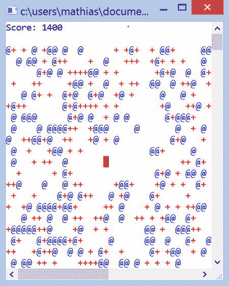
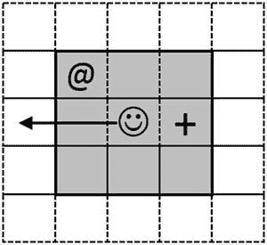
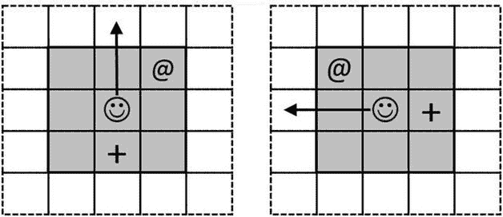
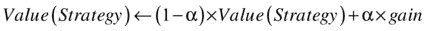
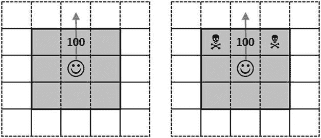
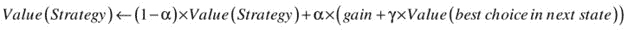

# 第 7 章 一场奇异的游戏

通过强化学习从经验中学习

想象你是一个身处大房间中央的生物。放眼望去，地板上铺满了五颜六色的瓷砖，一直延伸到视线尽头。你感到很好奇，向前迈出一步，踏上了一块蓝色瓷砖。嘶！你感到一阵剧痛。也许蓝色瓷砖不好？你左边是红色瓷砖，右边是蓝色瓷砖。这次试试红色吧。嗒哒！这次，好事发生了。看来红色瓷砖是好的，蓝色是坏的。默认情况下，你可能应该避开蓝色瓷砖，偏好红色瓷砖。或者情况稍微复杂一些，重要的是瓷砖的特定排列组合。只有一种方法可以知道——试错法。尝试各种事情，确认或推翻假设，总的来说，多做那些似乎有效的事情，少做那些似乎失败的事情。

现实世界当然比我刚才描述的彩色瓷砖宇宙要复杂得多。然而，仔细想想，我们的生活与那个虚构生物的生活并没有太大不同。我们在一个广阔的宇宙中进化，会遇到新的、未知的情况。当这种情况出现时，我们会尝试各种方法。有时，结果是立竿见影的。我清楚地记得我把手指伸进电源插座的那一天；我很快就明白这不是一个好决定。有些教训则需要更长的时间才能学会；例如，通常，当你对别人友善时，他们往往会以同样的方式回应。当你无礼时，通常效果不佳。但这并不总是正确的，而且有时需要时间才能观察到你的行为带来的影响，这使得得出结论不那么明显。

在本章中，我们将探讨如何为我们的生物构建一个大脑，使其在积累经验的过程中学会以某种合理的方式行事。就其本身而言，编写一个在彩色迷宫中移动的生物的程序，可能并非大多数开发人员的工作。然而，首先，这是一个有趣的问题；其次，它是一大类类似问题的简单、有代表性的版本，这将使我们能够探索一些更广泛适用的有趣问题和技术。我们将进行以下操作：

*   编写一个非常简单的游戏，模拟一个生物发现一个它一无所知的世界的行文。使用强化学习，我们将建立一个基本策略，使生物能够从其行动的结果中学习，并在积累经验的过程中做出更好的决策。

*   分析我们初始方法的缺点，并沿着两个主要方向改进学习算法。我们将看到如何通过同时考虑即时奖励和长期后果来克服短视的决策，以及如何通过在决策过程中注入一些随机性并鼓励探索来改进学习。

## 构建一个简单的游戏

作为热身，让我们从构建一个简单的游戏开始，遵循前面概述的场景，从一个没有头脑的生物开始，看看我们如何对世界进行建模，并让它即使不聪明，至少也不完全愚蠢。一旦我们掌握了事情的工作原理，我们将提升难度，尝试一个更复杂的版本。

这里的重点并非制作一款华丽的爆款电子游戏；但同时，拥有一款能让你看到实际变化的游戏是很有趣的，因此我们将采用非常复古的方式，制作一款基于控制台的游戏。那么，让我们先创建一个新的 F# 项目，类型选择“控制台应用程序”，并将其命名为`SimpleGame`。创建好项目后，你应该会看到一个名为`Program.fs`的文件，内容如下：

```fsharp
// Learn more about F# at http://fsharp.net
// See the 'F# Tutorial' project for more help.

[<EntryPoint>]
let main argv =
    printfn "%A" argv
    0 // return an integer exit code
```

这是一个最简的控制台应用程序，你可以直接按 F5 键运行或调试它。此时，程序将简单地运行`main`函数（应用程序的入口点），启动一个窗口，然后立即执行完毕并关闭窗口。让我们尝试让这个程序变得更有趣！

游戏涉及几个不同的方面。我们需要对规则进行建模，处理控制台中的渲染，并将游戏作为程序来运行。一旦将这些部分连接起来，我们还需要构建我们生物的“大脑”。

### 建模游戏元素

那么，让我们从一些建模工作开始。我们的游戏将有一个单一的生物，在一个由方形地块组成的地形上进化。“生物”这个词听起来有点贬义，所以我们从现在开始称它为英雄，这样既更讨喜也更简短。在每个回合中，英雄可以做三件事：继续直行、左转或右转。为了能够追踪英雄的状态，我们需要两个额外的信息：它的位置（例如，相对于世界顶部和左侧的距离）以及它的方向。

这与 F# 的可区分联合（discriminated unions）非常契合。让我们添加一个`Game.fs`文件，将其移动到项目文件列表的顶部，并开始一个`Game`模块。

***清单 7-1***.建模游戏元素

```fsharp
namespace Game
module Game =

type Dir =
        | North
        | West
        | South
        | East

type Act =
        | Left
        | Right
        | Straight

type Pos =  { Top:int; Left:int }

type Hero =  { Position:Pos; Direction:Dir }
```

到目前为止相当简单。接下来我们需要一个世界。为了简单起见，我们的世界将是方形的，并且没有边界，因此，例如，如果你一直向北走，你会越过边界并从最南端的位置重新出现。这简化了一些事情，因为我们不必处理到达“世界尽头”的情况：无论英雄在哪里，他都可以随时采取三种可用行动中的任何一种。

我们的世界很简单——每个格子要么是空的，要么包含一个宝藏，要么是一个陷阱。我们可以用几种方式来建模；现在我们将使用一个映射（大致相当于一个不可变字典）来存储格子，并且我们只存储非空的格子。为了稳妥起见，让我们也立即创建一个记录来保存整个“世界状态”，以及一个记录来保存该世界的大小。

***清单 7-2***.建模游戏世界

```fsharp
type Cell =
    | Treasure
    | Trap

type Board = Map<Pos,Cell>

type GameState =  { Board:Board; Hero:Hero; Score:int }

type Size =  { Width:int; Height:int }
```

### 建模游戏逻辑

现在我们有了构建模块，我们可以开始通过几个函数来定义世界如何运作。我们需要做的第一件事是能够移动我们的英雄：给定他的位置和方向，他（或她）在棋盘上的下一个位置将在哪里？我们不能简单地增加或减少位置，因为一旦我们越过世界的边缘，我们应该从另一边重新出现，可以这么说。让我们创建我们自己的自定义取模运算符`%%%`，它能按照我们想要的方式处理负数，再创建一个函数来“调整”位置并返回其等效位置，使其保持在棋盘大小的范围内，这样我们就准备好了——现在我们可以编写一个`moveTo`函数，当沿着四个可能方向之一移动时，该函数会将一个位置转换为下一个位置。

***清单 7-3***.在游戏世界中移动

```fsharp
let inline (%%%) (x:int) (y:int) =
    if x >= 0 then x % y
    else y + (x % y)

let onboard (size:Size) (pos:Pos) =
    { Top = pos.Top %%% size.Height;
      Left = pos.Left %%% size.Width; }

let moveTo (size:Size) (dir:Dir) (pos:Pos) =
    match dir with
    | North -> { pos with Top = (pos.Top - 1) %%% size.Height }
    | South -> { pos with Top = (pos.Top + 1) %%% size.Height }
    | West -> { pos with Left = (pos.Left - 1) %%% size.Width }
    | East -> { pos with Left = (pos.Left + 1) %%% size.Width }
```

我们几乎完成了建模。在英雄方面，我们需要应用决策（左转、右转或直行）来获得下一个位置。这很直接。

***清单 7-4***.实现英雄的移动

# 游戏世界与循环的建模与运行

## 更新世界

最后，我们需要对世界发生的变化进行建模。目前，每当英雄访问一个位置时，如果那里什么都没有，就什么也不会发生；如果有宝藏，就获得 100 分；如果有陷阱，就失去 100 分，并且该陷阱或宝藏会消失。同样，这相当直接。函数 `computeGain` 在棋盘上英雄所在位置查找可能的格子，并返回相应的得分（如果有的话），而 `updateBoard` 接收当前棋盘，并移除英雄所在位置的格子（如果有的话）。

***清单 7-5***. 更新世界

```fsharp
let treasureScore = 100
let trapScore = - 100

let computeGain (board:Board) (hero:Hero) =
    let currentPosition = hero.Position
    match board.TryFind(currentPosition) with
    | Some(cell) ->
        match cell with
        | Treasure -> treasureScore
        | Trap -> trapScore
    | None -> 0

let updateBoard (board:Board) (player:Hero) =
    let currentPosition = player.Position
    board
    |> Map.filter (fun position _ -> position <> currentPosition)
```

然后……我们完成了建模。接下来，让我们让游戏运行起来！

## 将游戏作为控制台应用程序运行

让我们连接起最基本、可能能工作的部分。游戏需要运行一个循环：让英雄做出决策，相应地更新世界，渲染它——然后重新开始。我们还需要一些代码来初始化世界。

在 `Program.fs` 文件中，让我们稍微修改一下默认代码，并创建一个 `Program` 模块，使用与游戏建模部分相同的命名空间 `Game`：

```fsharp
namespace Game

open System
open System.Threading
open Game

module Program =

    [<EntryPoint>]
    let main argv =
        0 // return an integer exit code
```

现在我们有了控制台应用程序的框架，让我们添加初始化代码。这里没有什么真正棘手的。我们需要决定世界的大小，以及英雄的初始位置。我们还需要为我们的世界设置一些陷阱和宝藏，以增加英雄冒险的趣味性！让我们随机填充这个映射，使得每个位置有 50% 的概率包含某种东西，并且陷阱和宝藏的概率相等。

***清单 7-6***. 初始化游戏世界

```fsharp
module Program =

    // world initialization
    let size = { Width = 40; Height = 20 }
    let player = { Position = { Top = 10; Left = 20 }; Direction = North }

    let rng = Random ()

    let board =
        [   for top in 0 .. size.Height - 1 do
                for left in 0 .. size.Width - 1 do
                    if rng.NextDouble () > 0.5
                    then
                        let pos = { Top = top; Left = left }
                        let cell = if rng.NextDouble () > 0.5 then Trap else Treasure
                        yield pos, cell ]
        |> Map.ofList

    let score = 0
    let initialGameState = { Board = board; Hero = player; Score = score }

    [<EntryPoint>]
    let main argv = // 等等...
```

另一个缺失的部分是让英雄做出决策的方式。目前我们让他保持无脑状态：像一只无头鸡一样，每回合随机决定是直行、左转还是右转（本章后面我们有足够的时间来修复这个问题）。

***清单 7-7***. 初始英雄决策

```fsharp
let initialGameState = { Board = board; Hero = player; Score = score }
// 决策函数
let choices = [| Straight; Left; Right |]
let decide () = choices.[rng.Next(3)]

[<EntryPoint>]
let main argv = // 等等...
```

现在进入主循环。我们先不关心渲染（下一节会讨论）——为了确保程序在运行，我们会在每一步打印当前分数。在这种情况下，我们的循环应该类似于清单 7-8 所示的内容。

***清单 7-8***. 在循环中运行游戏

```fsharp
[<EntryPoint>]
let main argv =

    let rec loop (state:GameState) =

        let decision = decide ()

        // 世界更新
        let player = state.Hero |> applyDecision size decision
        let board = updateBoard state.Board player
        let gain = computeGain state.Board player
        let score = state.Score + gain

        // 世界渲染
        printfn "%i" score

        let updated = { Board = board; Hero = player; Score = score }

        Thread.Sleep 20
        loop (updated)

    // 启动游戏
    let _ = loop (initialGameState)

    0 // 返回整数退出码
```

此时，如果你运行代码，应该会看到屏幕上打印出数字。英雄正在做出决策并在世界中移动，分数也在变化——但由于没有图形显示，这完全令人提不起兴趣。让我们来解决这个问题，为游戏添加一些图形。

## 渲染游戏

我们需要的最后一块拼图是渲染游戏。这相当简单——让我们创建另一个文件 `Rendering.fs`，将其移到 `Program.fs` 上方，并将所有渲染代码放入一个新模块中。我们的“图形”将依赖 `System.Console`，使用 `Console.SetCursorPosition` 来确定绘制位置，并使用 `Console.ForegroundColor` 来设置绘制颜色。这里唯一的微妙之处在于，除了表示英雄和他所处的世界之外，我们还想打印当前分数。为此，我们将所有坐标向下偏移两行，这样我们就可以使用控制台显示器的前两行来输出分数。

***清单 7-9***. 渲染游戏

## 渲染模块

```fsharp
namespace Game

open System
open Game

module Rendering =

    let offset (pos:Pos) = (pos.Left, pos.Top + 2)
    let writeAt (left,top) color (txt:string) =
        Console.ForegroundColor <- color
        Console.SetCursorPosition (left,top)
        Console.Write txt

    let prepareDisplay size =
        Console.SetWindowSize(size.Width, size.Height+2)

    let renderPlayer (before:Hero) (after:Hero) =
        writeAt (offset (before.Position)) ConsoleColor.Black "·"
        writeAt (offset (after.Position)) ConsoleColor.Yellow "·"

    let renderBoard (before:Board) (after:Board) =
        after
        |> Map.iter (fun pos item ->
            if (before |> Map.containsKey pos)
            then
                match item with
                | Treasure ->
                    writeAt (offset pos) ConsoleColor.Blue "@"
                | Trap ->
                    writeAt (offset pos) ConsoleColor.Red "+"
            else writeAt (offset pos) ConsoleColor.Black " ")

    let renderScore score =
        writeAt (0,0) ConsoleColor.White (sprintf "Score: %i   " score)
```

这里我想指出的一点是，F# 如何通过设计引导我们走向一条良性的道路。我们都见过一些项目开始时怀着最好的意图，但很快就退化成一大坨意大利面条式代码，所有东西都相互依赖。大多数人都同意，虽然渲染代码依赖于领域模型，但更改渲染不应该波及到领域。F# 的类型推断系统要求代码必须从上到下使用（我只能调用当前行上方已编写的代码），这自然强制实现了良好的关注点分离，并使依赖关系立即可见。`Rendering` 模块在项目中位于 `Game` 模块之下，因为它依赖于后者——我无法在这两个区域之间创建不健康的代码循环。

现在唯一剩下的事情就是将渲染代码整合到游戏循环中。在 `Program.fs` 文件中包含 `open Rendering`，并在清单 7-8 的 `loop` 函数中，将 `printfn "%i" score` 替换为清单 7-10。

`清单 7-10`。在主循环中渲染游戏

```fsharp
let score = state.Score + gain
// 世界渲染
renderScore score
renderPlayer state.Hero player
renderBoard state.Board board

let updated = { Board = board; Hero = player; Score = score }
```

此时，我们已经准备好运行游戏。如果你运行它，应该会看到类似于图 7-1 所示的内容。



图 7-1。运行游戏

 **注意** 实际游戏使用不同的配色方案，背景为黑色。

我们的英雄，由一个黄色小矩形表示，正在漫无目的地永远移动，随机碰到陷阱（`+`）和宝藏（`@`）。这个游戏当然不会在游戏展上赢得任何奖项，但现在我们有了一个基线，以及一种可视化正在发生的事情的方法。

## 构建一个原始大脑

现在是时候给我们的英雄一点大脑了。一开始不需要太花哨——只是一个能从错误和成功中学习的最小大脑。一旦我们掌握了这种原始方法，我们将看看在这个过程中学到了什么，并尝试让他变得更聪明，或者至少不那么愚蠢。

最初，我们的英雄对他所处的世界一无所知。他不知道陷阱应该避免，宝藏应该寻找。我们可以尝试显式地构建他的大脑，使用巧妙的预编程例程，给他一个预定的策略。然而，我们将采取不同的路线，至少有两个原因。首先，编写这样一个预定的策略既困难又脆弱。困难，是因为一开始并不明显应该如何设计这样的策略。脆弱，是因为如果我们决定在某个时候稍微改变游戏，比如修改宝藏的奖励，或者添加一个不同类型的元素到游戏中，比如另一种类型的陷阱，我们将不得不重写整个策略。

其次，这有点浪费。每当英雄移动时，他都在积累宝贵的经验，并且应该能够自己学习哪些事情有效，哪些无效。构建一个学习例程会更有趣，它观察采取了什么行动，结果是什么，并逐渐多做好的事情，少做坏的事情。毕竟，这或多或少就是我们学习的方式。作为一个额外的好处，这也将解决前面提到的问题：如果我们依赖经验，而不是硬编码策略，那么当我们修改游戏时，我们的英雄将能够学习和适应。

## 建模决策过程

那么，我们该如何解决这个问题呢？沿用我们已有的术语，目标如下：英雄在世界中移动，每一步都做出决策。每次，他处于某个**状态**（即他能从世界中看到的信息），执行一个**动作**（直行、左转或右转），并观察**结果**（该动作的收益或损失），以及他最终到达的新状态。一个合理的方法是，将每一步都视为一次**经验**，并尝试从每次经验中学习某个动作可能带来的结果。正如那句（出处存疑的）格言所说：“疯狂就是不断重复做同一件事，却期待不同结果”；反之，智慧或许就是不断重复做有效的事，并避免重复失败。

让我们分解问题，并建立一些术语。对于我们的游戏，我们假设英雄有些近视，只能看到自己的直接周边环境，如图 7-2 所示。在这种情况下，将**状态**（英雄可获得的信息）定义为他周围的直接环境——即他周围的八个格子——以及他当前的方向，是合理的。



图 7-2. 定义状态

我们需要一种方法，让英雄能根据他当前拥有的信息（即他的**状态**）来学习应该做出什么决策。在这种情况下，英雄可以在三个动作中选择：左转、右转或直行。我们将这些组合称为*策略*——因此，当英雄处于特定状态时，他有三种策略可供选择：

```fsharp
{ 当前状态；左转 }
{ 当前状态；右转 }
{ 当前状态；直行 }
```

是什么决定了一个策略的好坏？我们的目标是让英雄获得高分，因此一个好的策略应该能带来高分数。那么，我们该如何预测一个*策略*的收益呢？如果你将游戏视为逐步展开的过程，你可以将其看作一系列如下形式的移动：

```fsharp
状态 0 -> 动作 1 -> 奖励 1 -> 状态 1 -> 动作 2 -> 奖励 2 ...
```

我们可以重新组织这些信息，将游戏视为一系列“经验”：

```fsharp
{ 状态 0；动作 1；奖励 1；状态 1 }
{ 状态 1；动作 2；奖励 2；状态 3 }
...
```

 **注意** 我们在每次经验中都包含了结束状态。一开始我们不会用到这个信息，但它在后续章节中会变得有用。

随着游戏的进行，英雄每次做出决策时都会积累经验。最初，有些决策是好的，有些是坏的。我们希望利用这些经验来学习一个获胜策略，这样当他发现自己处于以前遇到过的情况（一个已知的*状态*）时，他就能预测从三种可用策略中每种策略应获得的*奖励*，并据此做出最佳决策（选择预期价值最高的策略对应的决策）。

## 从经验中学习获胜策略

此时，我们唯一需要的是一个评估策略的学习过程。一种可能性是记录所有积累的*经验*；当英雄进入一个*状态*时，我们可以简单地查找过去遇到相同*状态*的所有情况，并计算（例如）每个已执行*决策*的平均奖励。这显然不切实际：我们会积累大量数据，程序会逐渐变慢直至停滞。

一种更有效的方法是，为我们尝试过的每个策略维护一条记录，即一个*状态*和*决策*的组合，并根据迄今为止积累的所有*经验*，逐步建立对该策略好坏程度的估计。当我们遇到一个已知的*状态*时，我们只需在我们的策略目录（我们称之为*大脑*）中查找三个可能的匹配*策略*，并选择价值最高的策略。

我们几乎已经准备好了一个算法。剩下的只需处理两个小问题。第一个问题相当明显：当英雄遇到未知状态时该怎么办？如果我是他，我会简单地随机采取一个动作，看看会发生什么。

## 第二个问题稍微复杂一些：当英雄两次执行相同动作时该怎么办？

在我们的特定情况下，我们知道在相同条件下做相同的事会产生相同的结果——因此我们可以只执行一次动作，测量收益，然后停止学习。然而，我们之所以能这么说，仅仅是因为我们知道游戏是如何实现的；并不能保证这种情况会一直持续。例如，我们可以决定宝藏和陷阱会在世界中随机出现，或者宝藏或陷阱的奖励会随时间变化。在这种情况下，这种方法会非常糟糕：我们会依赖一次可能非常特殊的经验来形成策略，之后完全停止学习。

### 一种更好、更稳健的方法

一种更好、更稳健的方法（在游戏领域之外也建议使用）是持续学习。模仿我们在前几章的做法，有一种简单的方法可以实现：使用 `学习率 α`（介于 0 和 1 之间）来决定更新策略值的激进程度，从而逐步优化我们对策略应得奖励的估计。每当我们在某个状态下执行某个动作时，根据以下方案更新该策略的价值：


在深入实现之前，有两个简短的说明。首先，每当我遇到一个涉及速率的公式时，我喜欢用这个“古怪的老技巧”来解释公式的含义：将值设为 0 和 1，看看剩下什么。在这种情况下，将 `α` 设为 0 意味着“永不学习”，并保持初始估计不变。相反，将 `α` 设为 1 意味着“忘记你学到的一切”：无论你之前对策略价值的估计是什么，都忽略它，并用最新观察到的值（你刚刚获得的收益）替换。学习率 `α` 在 0 和 1 之间的任何值都在这两个极端之间取得平衡：越接近 0，调整越慢；值越高，对新观察的反应越快。

### 我们能验证这是否有效吗？

我们可以非正式地验证这个过程在一个小例子中是否收敛到正确值。假设收益始终为 100。使用初始估计值 0 和学习率 0.5，重复我们的更新过程会相当快地从 0 收敛到 100，即正确值：

```
let vs = Seq.unfold (fun x -> Some(x, 0.5 * x + 0.5 * 100.)) 0.

vs |> Seq.take 20 |> Seq.toList;;

val it : float list =
  [0.0; 50.0; 75.0; 87.5; 93.75; 96.875; 98.4375; 99.21875; 99.609375;
   99.8046875; 99.90234375; 99.95117188; 99.97558594; 99.98779297; 99.99389648;
   99.99694824; 99.99847412; 99.99961853; 99.99980927]
```

## 实现大脑

正如我们将渲染代码分离到自己的模块中一样，将学习算法清晰地分离到自己的区域也是合理的。因此，让我们在项目中添加一个新文件 `Brains.fs`，其中包含一个 `Brains` 模块，将其移到 `Game.fs` 下方，然后开始建模。

***清单 7-11***。对大脑建模

```
namespace Game
open System
open Game

module Brains =

    // 我当前的方向和周围的格子
    type State = Dir * (Cell option) list

    type Experience = {
        State: State;       // 我所在的位置
        Action: Act;        // 我执行的动作
        Reward: float;      // 我获得的奖励
        NextState: State; } // 我最终到达的位置

    // 当我处于该状态时，我可以采取的一种可能行动方案
    type Strategy = { State:State; Action:Act; }

    // 我尝试过的策略，以及我应从这些策略中预期的奖励
    type Brain = Map<Strategy,float>
```

该模型几乎逐字映射了我们对问题的描述。我们有一个 `状态`（`State`），包含当前方向和一个单元格选项列表（表示某些单元格可能为空）、`经验`（`Experience`），以及一个 `大脑`（`Brain`），它将每种可能的 `策略`（`Strategy`，即一个状态和可采取的动作）映射到一个预估奖励值。

现在对代码进行一些重构是合理的，将原本放在程序本身中的随机决策函数（清单 7-7）也移入大脑中：

```
let rng = Random ()
let choices = [| Straight; Left; Right |]
let randomDecide () = choices.[rng.Next(3)]
```

让我们进入学习过程。我们想要做的是融入一条新的经验，并相应地更新大脑。这相当直接：我们需要提取该经验中采用的策略，在大脑中查找对应的条目，并对其应用学习率 `α`。注意我们使用了 `brain.TryFind`，它返回一个 option 类型，从而让我们能够通过简单的模式匹配非常清晰地处理两种情况（键存在或不存在）（见清单 7-12）。

***清单 7-12***。用新经验更新大脑

```
let alpha = 0.2 // 学习率
let learn (brain:Brain) (exp:Experience) =
    let strat = { State = exp.State; Action = exp.Action }
    match brain.TryFind strat with
    | Some(value) ->
        brain.Add (strat, (1.0-alpha) * value + alpha * exp.Reward)
    | None -> brain.Add (strat, (alpha * exp.Reward))
```

 **注意**  `Map.Add` 实际上是“添加或更新”。如果键不存在，则添加新项；如果键已存在，则替换原值。

现在我们的英雄有了大脑，他可以做决策了。我们需要的是：当进入某个 `状态` 时，如果大脑从未见过它，我们就采取随机决策；否则，在三种可能的策略（从当前状态向前、向左或向右移动）中，我们将选择价值最大的策略，对于尚未评估的策略，假设其价值为 0。代码稍多一些，但仍然相当紧凑。

***清单 7-13***。使用大脑做决策

```
let decide (brain:Brain) (state:State) =
    let knownStrategies =
        choices
        |> Array.map (fun alt -> { State = state; Action = alt })
        |> Array.filter (fun strat -> brain.ContainsKey strat)
    match knownStrategies.Length with
    | 0 -> randomDecide ()
    | _ ->
        choices
        |> Seq.maxBy (fun alt ->
            let strat = { State = state; Action = alt }
            match brain.TryFind strat with
            | Some(value) -> value
            | None -> 0.0)
```

我们几乎准备好接入大脑了。最后缺失的部分是一个函数，它根据英雄在棋盘上的位置提取可见状态。以下三个函数的目的是提取英雄的方向以及他周围的八个单元格，这些单元格由八个偏移量列表标识，例如 `(-1,0)` 表示从顶部偏移 -1 个单元格，从左侧偏移 0 个单元格，即当前行向北移动一格。

***清单 7-14***。提取当前状态

```
let tileAt (board:Board) (pos:Pos) = board.TryFind(pos)

let offsets =
    [   (-1,-1)
        (-1, 0)
        (-1, 1)
        ( 0,-1)
        ( 0, 1)
        ( 1,-1)
        ( 1, 0)
        ( 1, 1) ]

let visibleState (size:Size) (board:Board) (hero:Hero) =
    let (dir,pos) = hero.Direction, hero.Position
    let visibleCells =
        offsets
        |> List.map (fun (x,y) ->
            onboard size { Top = pos.Top + x; Left = pos.Left + y }
            |> tileAt board)
    (dir,visibleCells)
```

## 测试我们的大脑

就是这样，我们有了一个大脑！让我们把它接入现有的程序模块。第一个改动是，我们现在使用大脑而不是随机决策——因此我们将大脑传入递归状态，并在每次循环开始时提取当前状态并做出决策。另一个小修改是，我们当然需要在某个时刻进行学习；这很容易实现，只需进行清单 7-15 中所示的更改。

清单 7-15。在游戏循环中融入学习

```
let rec loop (state:GameState,brain:Brain) =
    let currentState = visibleState size state.Board state.Hero
    let decision = Brains.decide brain currentState

// 世界更新
    let player = state.Hero |> applyDecision size decision
    let board = updateBoard state.Board player
    let gain = computeGain state.Board player
    let score = state.Score + gain

// 学习
    let nextState = visibleState size board player
    let experience = {
        State = currentState;
        Action = decision;
        Reward = gain |> float;
        NextState = nextState; }
    let brain = learn brain experience
```

最后，当我们启动游戏时，需要提供一个大脑，初始为空：

```
let _ = loop (initial,Map.empty)
```

我们准备就绪了——如果你运行这段代码，应该会看到一个与之前类似的游戏，但英雄犯错的次数似乎会随着时间推移而减少。那么……可以发布了？

别急！首先，数据在哪里？我们是科学家，我希望有比“它似乎犯更少的错误”这样模糊的说法更确凿的证据来评估我们的大脑是否在正确工作。进行这种评估最简单的方法可能是运行一次正面比较（抱歉，双关语），看看两种方法在相同长度的游戏中表现如何。由于两种方法都涉及随机性，我们希望在多次运行中进行比较。如果只依赖一局游戏，我们可能会因为纯粹的运气而观察到异常结果。运行多局游戏可以降低这种风险。

不过，这也带来了另一个小麻烦。显然，我们想要运行和记录的游戏次数越多，所需时间就越长。每帧渲染间隔为 20 毫秒（至少），一局 500 回合的游戏至少需要 10 秒。运行几次这样的游戏，很快就会变成几分钟。我们能稍微缩减一下吗？嗯，我们可以做一些显而易见的事情，比如采用无头模式（再次抱歉，我保证不再用双关语了）。移除所有渲染部分，在没有图形的情况下运行游戏，只记录最终得分——至少就我们这里的目的而言，这是我们唯一关心的。

这听起来是使用脚本的绝佳场景。我们不会真的在生产环境中发布这个实验，而且仅仅为此创建另一个控制台应用程序似乎有点傻。让我们向项目添加一个脚本文件，复制粘贴 `Program.fs` 的全部内容，并稍作修改，使其作为脚本运行（见清单 7-16）。

清单 7-16。模拟不同大脑的有效性

```
#load "Game.fs"
open Game.Game
#load "Brains.fs"
open Game.Brains
open System

let size = { Width = 40; Height = 20 }
let player = { Position = { Top = 10; Left = 20 }; Direction = North }

let rng = Random ()

let board =
    [   for top in 0 .. size.Height - 1 do
            for left in 0 .. size.Width - 1 do
                if rng.NextDouble () > 0.5
                then
                    let pos = { Top = top; Left = left }
                    let cell = if rng.NextDouble () > 0.5 then Trap else Treasure
                    yield pos, cell ]
    |> Map.ofList

let score = 0
let initialGameState = { Board = board; Hero = player; Score = score }

let simulate (decide:Brain -> State -> Act) iters runs =

// 循环现在包含迭代次数
    let rec loop (state:GameState,brain:Brain,iter:int) =


let currentState = visibleState size state.Board state.Hero
        let decision = decide brain currentState

// 世界更新
        let player = state.Hero |> applyDecision size decision
        let board = updateBoard state.Board player
        let gain = computeGain state.Board player
        let score = state.Score + gain

// 学习
        let nextState = visibleState size board player
        let experience = {
            State = currentState;
            Action = decision;
            Reward = gain |> float;
            NextState = nextState; }
        let brain = learn brain experience

let updated = { Board = board; Hero = player; Score = score }

if iter < iters
        then loop (updated,brain,iter+1)
        else score

[ for run in 1 .. runs -> loop (initialGameState,Map.empty,0) ]

// 模拟不同的大脑
printfn "随机决策"
let random = simulate (fun _ _ -> Game.Brains.randomDecide ()) 500 20
printfn "平均得分: %.0f" (random |> Seq.averageBy float)

printfn "原始大脑"
let crudeBrain = simulate Game.Brains.decide 500 20
printfn "平均得分: %.0f" (crudeBrain |> Seq.averageBy float)
```

关于这段代码我不打算过多评论，因为它与我们最初在 `Program.fs` 中的代码非常接近。第一个值得注意的区别是，我们在递归循环状态中增加了迭代次数，这样每局游戏只运行有限的、已知的长度。第二个区别是，我们没有在循环中硬编码决策函数，而是将其作为参数注入——一个必须符合签名 `decide:Brain -> State -> Act` 的函数。这本质上定义了一个决策接口——现在我们可以通过传入两种可能的决策方法，来测试我们的两种策略。

当我在自己的机器上运行这段代码时，结果如下：

```
随机决策
平均得分: 855
原始大脑
平均得分: 2235
```

每次运行脚本的结果都会有所不同；不过，你通常应该会观察到，有大脑的情况比没有大脑的情况表现更好，这很好。此外，如果你仔细查看每次运行的细节，会发现结果存在相当大的变异性；无论是否有大脑，有些游戏都会变成彻底的失败。换句话说，首先，我们确认了大脑确实在做正确的事情——但我们也看到，做正确的事情并不能保证每次都有好结果。有赢有输，但总体而言，从长远来看，采用这种策略会让你表现更好。

## 我们能更有效地学习吗？

我们已经证明，我们简单的大脑比没有大脑要好。这是一个成功。但同时，将我们英雄的行为描述为“智能”就有些牵强了。我们只是从“蠢得像块砖”进步到了“并非完全愚蠢”，但并没有好太多。例如，你可能会注意到，他有时会永远沿着一条直线走，即使不远处还有大量宝藏可以掠夺。一方面，这确实是避开陷阱的稳妥策略；另一方面，这肯定不是最佳行为，因为它完全牺牲了潜在的收益。

假设我们想要一个更聪明的英雄——我们能做得更好吗？希望如此——但要做到这一点，我们需要思考一下我们所说的“学习”和“知识”究竟意味着什么，以便更好地理解当前模型的问题所在，以及如何改进。

## 探索与利用

作为一名软件工程师，你可能经常面临这样一个问题：是应该使用自己熟悉且擅长的技术，还是应该尝试这个从未用过、听说很有趣但可能彻底失败的新奇想法？

这本质上就是探索与利用之间的张力；你可以选择利用已知的策略，这些策略你之前尝试过，结果可预测；或者你可以探索新的可能性，希望学到比当前做法更有效的新策略，但同时也面临失败的风险——实际表现可能比保守的“照常行事”方法更差。作为软件工程师，如果完全只利用，我们可能还在用穿孔卡片编程；如果完全只探索，我们就会一直彻底更换技术栈和流程。

这也是我们的英雄时不时会“追着自己尾巴跑”的原因。英雄唯一进行探索的时候，是他被迫这样做的时候——因为他从未遇到过某种情况，没有默认选择可以依赖。然而，一旦他找到了一种能带来正面结果的策略，他就会一遍又一遍地使用它，再也不尝试其他方法。

这为我们改进大脑指明了第一个方向：给英雄一点冒险精神，让他时不时尝试随机策略，即使已经有不错的策略可用。实现这一点的最简单方法称为 `ε-学习`：每回合，以很小的概率 `ε`，我们会做出一个随机决策，无论我们已经知道什么，从而进行探索。这将有助于确保我们不会满足于一个舒适的策略，而可能错过一个更好的策略。

## 红门和蓝门有区别吗？

愚蠢是一遍又一遍地重复同样的错误。聪明是认识到某些情况足够相似，应该以相同的方式对待。我第一次尝试打开厨房的门（恰好是红色的）时，可能会摸索一番，直到弄清楚它是怎么开的；下次再看到它时，我至少应该能重复上次成功的方法。然而，当我看到客厅的门（恰好是蓝色的）时，即使情况略有不同（是蓝门，不同的房间），我可能也会尝试在厨房里奏效的相同方法。

以智能的方式行事，涉及识别相似的状态，对其进行抽象，并将学到的知识应用到更广泛的场景中。让我们变得聪明的是，我们不仅能识别“红色的厨房门”，还能识别“门”。值得庆幸的是，我们不会每次看到一扇新门时都从头学习如何操作它。

我们的英雄和他当前的大脑正遭受着缺乏抽象能力的困扰。具体来说，如果你仔细想想，我们的游戏是对称的。举例来说，图 7-3 中显示的两种情况实际上是相同的，只是“世界状态”向右旋转了 90 度：



图 7-3. 旋转后的状态是相同的

在我们当前的实现中，这两个状态是不同的，在大脑中构成了两个不同的条目。如果我们把它们（连同另外两个等价状态）归并为一个状态，我们将在两个层面上获益。首先，我们的大脑将使用更少的内存；就像我不必精确记住我打开过的每一扇门是如何工作的一样，英雄只需要 25% 的大脑就能达到同样的效果。其次，他学习的速度也会快得多，因为适用于一个状态的知识会立即在其他三个情境中可用。

要实现这一点，我们唯一需要做的就是旋转并重新对齐可见状态，使其朝向`英雄`的视线方向。但请注意，在某种程度上，我们这里也在“作弊”。最初方法的美妙之处在于，我们确实没有对世界的运作方式做任何假设；我们只是根据所能观察到的一切创建了一个状态，将其视为一个黑盒——而且它确实有效。而在这里，我们利用了关于游戏机制的一些知识，这已经不完全是一个黑盒了。一个更困难的问题（我们在此不会涉及）是构建一个能够自行识别哪些状态是等价的大脑，并可能进一步减少相关状态。这会使我们偏离主题太远，因此我们将跳过这部分讨论。

## 贪婪 vs. 规划

我们英雄当前的行为可以被描述为贪婪——环顾四周，然后选择当下能带来最大可能回报的决策。这对它来说效果还不错——但贪婪并不总是最佳策略。现实世界中的一个经典例子是，决定上大学接受高等教育，而不是找一份不需要那么高学历的工作。这里的难点在于，贪婪的做法会导致选择一份低薪工作并立即开始赚钱，而不是承担教育成本，而教育（希望如此）会在几年后带来更有趣、报酬更丰厚的前景。

这两种选择本身都没有错，但我们的英雄永远不会考虑去上学。它只是即时做出决定，完全不考虑未来——然而，通常来说，提前规划并权衡短期收益与长期状况，正是被认为是智能决策的一部分。总是孤注一掷是一种冒险的做法！

我们想要的是一个能够平衡这两个方面的大脑。在当前形式下，我们评估一个策略时唯一考虑的因素是它能带来多少即时收益：



我们可以通过不仅考虑即时收益，还考虑策略执行后最终状态的价值，来使情况更加平衡，使用如下公式进行更新：


同样，`γ` 是一个介于 0 和 1 之间的系数。当前模型只是 `γ` 设为 0 的一个特例，完全忽略之后发生的一切。相反，将 `γ` 设为 1 则基本上意味着即时收益与最终状态同等重要。介于两者之间的值则在短期收益和长期规划之间达成折衷。这个方程被称为 `q-learning`：它推广了我们最初的方法，使我们用于确定在某个状态下采取每种可能决策的价值的过程，在即时奖励和长期收益之间达成折衷，并产生一种不那么“盲目孤注一掷”的策略行为。

 **注意** 如果你熟悉动态规划，前面的公式可能看起来很眼熟；`q-learning` 本质上是动态规划的一种应用。同样，如果你学过一些经济学，你可能会认为 `γ` 类似于贴现率——即你用来贴现未来奖励相对于即时奖励的“利率”。

## 一个永不终结的瓦片世界

我们将尝试所有这些对学习过程的改进。但为了让事情更有趣一些，首先我们将对游戏本身稍作修改。当前的游戏过于简单，我们讨论的大多数想法都不会产生什么影响，因为游戏太短了：一旦每个陷阱或宝藏被消耗掉，就没有什么可学习的了。我们需要为英雄创造一个更具挑战性的世界。

作为第一个变化，我们将通过引入任意数量的瓦片类型来增加趣味性，而不仅仅是陷阱和宝藏。每种类型的瓦片都有自己的颜色和奖励，这将让我们能够配置更难或更简单的世界来进行实验。作为更大的变化，我们不再让访问过的单元格内容消失，而是创建一个完全被瓦片覆盖的世界，一旦某个瓦片被访问并“消耗”，它会立即被一个随机瓦片替换。这样，虽然我们初始游戏中的棋盘会逐渐变空，最终一无所有，但这个新世界将不断变化并创造新状态，这样我们就可以更长时间地玩游戏，并且仍然有东西可学。一旦我们的游戏变体就位，我们将整合我们讨论过的三个修改，并评估它们能带来多大的不同。

我们想要实现的主要修改是，不再使用显式的可区分联合来表示单元格内容，而是将每个瓦片的内容编码为一个表示状态的整数，并将该状态映射到一个奖励数组和一个用于渲染的颜色数组。第一个需要的更改在 `Game.fs` 文件中，如列表 7-17 所示。

**列表 7-17**. 更新 Game 文件

```
// 代码省略
type Board = int[,]

// 代码省略

let tileValues = [| -100; -50; 50; 100 |]

let computeGain (board:Board) (hero:Hero) =
    let pos = hero.Position
    let cellType = board.[pos.Left,pos.Top]
    tileValues.[cellType]

let rng = System.Random ()

let updateBoard (board:Board) (player:Hero) =
    let pos = player.Position
    let updatedBoard = board |> Array2D.copy
    updatedBoard.[pos.Left,pos.Top] <- rng.Next(tileValues.Length)
    updatedBoard
```

换句话说，`tileValues` 数组定义了我们的世界中会有多少种瓦片，以及它们的价值；在这个特定例子中，我们将有四种瓦片，范围从“非常糟糕”（–100 分）到“非常好”（100 分）。我们现在也有了相当多的可能状态，一个单元格有四种可能的值而不是三种，这将使学习变得更加困难。`updateBoard` 函数只是创建一个新棋盘，将英雄刚刚访问过的瓦片替换为一个随机的新值。

`Brains` 模块中只需要更改两处：`State`，现在不再是 `Cell option` 列表，而是一个整数列表；以及 `tileAt` 函数，现在它将简单地返回数组的内容，无需检查该位置是否有任何东西，因为每个单元格都会被填充，如列表 7-18 所示。

**列表 7-18**. 更新 Brains 文件

# 实现大脑 2.0

现在我们有了一个良好的测试平台来评估大脑的表现，并测量了用于比较的基线，让我们尝试之前讨论过的三种可能的改进：减少状态数量、超越短期收益进行前瞻，以及为探索留出空间。

## 简化世界

鉴于我们刚才提到的状态维度庞大的问题，一个合理的初步做法是从简化状态开始，移除方向，将可见状态转换为英雄视线范围内的内容。

这并不复杂。需要改变的两件事是：`State` 的定义（它将只包含八个整数的列表，即八个相邻单元格），以及提取状态本身的 `visibleState` 函数。我们需要做的是旋转状态：如果英雄面向北方，保持状态不变。如果他面向西方，将所有内容顺时针旋转 90 度，就像英雄面向北方一样——以此类推。

这一切只需要对我们的偏移量进行变换。例如，列表中的第一个偏移量 `(-1,-1)` 表示位于当前位置左上角的单元格（顶部偏移 -1，左侧偏移 -1）。如果英雄面向西方而不是北方，我们不需要获取位于偏移量 `(-1,-1)` 处的单元格，而是需要获取偏移量 `(1,-1)` 处的单元格。类似地，位于英雄右上方的单元格，在面向北方时位于偏移量 `(-1,1)`，当面向西方时需要变换为偏移量 `(-1,-1)`。

通过一些脑力体操，我们可以根据当前方向推导出偏移量需要如何重新映射。代码清单 7-21 中的 `rotate` 函数执行了这种重新对齐，现在只需将该函数注入到我们的 `visibleState` 函数中，这样我们就不再直接应用原始偏移量，而是预先将其转换为反映当前英雄方向的偏移量：

```
代码清单 7-21. 通过旋转减少状态数量
```

```fsharp
let rotate dir (x,y) =
    match dir with
    | North -> (x,y)
    | South -> (-x,-y)
    | West -> (-y,x)
    | East -> (y,-x)

let visibleState (size:Size) (board:Board) (hero:Hero) =
    let (dir,pos) = hero.Direction, hero.Position
    offsets
    |> List.map (rotate dir)
    |> List.map (fun (x,y) ->
```

---

```fsharp
type State = int list
// 代码省略
let tileAt (board:Board) (pos:Pos) = board.[pos.Left,pos.Top]
```

类似地，我们现在可以通过进行以下修改来更新渲染代码，使用一个颜色数组根据其索引来表示每个瓦片。请注意，由于我们现在正在替换英雄之前所在位置的瓦片，渲染函数也可以简化，因为只有两个瓦片会发生变化：英雄的新位置和他之前的位置。

```
列表 7-19. 更新 Rendering 文件
```

```fsharp
module Rendering =
    let colors =
        [|
            ConsoleColor.DarkRed
            ConsoleColor.Red
            ConsoleColor.DarkYellow
            ConsoleColor.Yellow
        |]

let creatureColor = ConsoleColor.White

let offset (pos:Pos) = (pos.Left, pos.Top + 2)

let prepareDisplay size gameState =
    Console.SetWindowSize(size.Width, size.Height+2)
    let board = gameState.Board
    for x in 0 .. (size.Width - 1) do
        for y in 0 .. (size.Height - 1) do
            let pos = { Left = x; Top = y }
            Console.SetCursorPosition (offset (pos))
            let tileType = board.[x,y]
            Console.ForegroundColor <- colors.[tileType]
            Console.Write("")

let render (before:GameState) (after:GameState) =
    let oldPos = before.Hero.Position
    let newPos = after.Hero.Position
    // 上一帧玩家位置
    Console.SetCursorPosition (offset (oldPos))
    let tileType = after.Board.[oldPos.Left,oldPos.Top]
    Console.ForegroundColor <- colors.[tileType]
    Console.Write("")
    // 当前玩家位置
    Console.SetCursorPosition (offset (newPos))
    Console.ForegroundColor <- creatureColor
    Console.Write("")

let renderScore score =
    Console.SetCursorPosition(0,0)
    Console.ForegroundColor <- ConsoleColor.White
    printfn "Score: %i   " score
```

最后，只需对 `Program.fs` 稍作修改即可。需要改动的地方很少：我们修改了棋盘初始化，以填充每一个单元格，并将 `renderPlayer` 和 `renderBoard` 两个函数合并为一个 `render` 函数，如代码清单 7-20 所示。

```
代码清单 7-20. 更新 Program 文件
```

```fsharp
let board = Array2D.init size.Width size.Height (fun left top ->
    rng.Next(tileValues.Length))
// 省略的代码
// 世界渲染
    let updated = { Board = board; Hero = player; Score = score }
    renderScore score
    render state updated
    Thread.Sleep 20
    loop (updated,brain)
// 启动游戏
    prepareDisplay size initialGameState
    let _ = loop (initialGameState,Map.empty)
```

现在一切就绪。如果你此时运行游戏，应该会看到与之前版本略有不同的画面：英雄在铺满彩色瓷砖的棋盘上移动。我们需要做的最后一项修改是更新 `Headless.fsx` 模拟脚本，只需对棋盘初始化进行微小调整，方式与我们在 `Program.fs` 中所做的类似，将原来的棋盘初始化替换为：

```fsharp
let board = Array2D.init size.Width size.Height (fun left top ->  rng.Next(tileValues.Length))
```

说到模拟，让我们运行一次，看看我们的修改对“原始大脑”的表现有何影响。我在机器上运行了几次 500 步的模拟，结果发现随机决策和使用大脑之间没有太大差异。这并不完全令人意外，因为我们将可能的单元格状态从三种扩展到了四种。这看似是一个小改动，但实际上并非如此。现在每个单元格可以有四种状态，而不是三种，而可见状态包含 8 个相邻单元格，这意味着我们从 4 个方向 × 3 × 3 ... × 3 种状态，扩展到了 4 个方向 × 4 × 4 × ... × 4 种状态——即从 26,244 种状态扩展到 262,144 种状态需要学习。考虑到我们的英雄只有 500 步来学习这个世界，他表现不佳也就不足为奇了。让我们将每次模拟运行的步数增加到，比如说，100,000 步，这应该能给他更好的学习机会。显然，这将花费更长的时间来运行，但这是获得可靠结果的代价。在我的机器上，结果如下：

```
>

随机决策

平均值: -703

原始大脑

平均值: 12480
```

**强化学习：改进游戏AI**

---

## 初始模拟结果

代码片段：
```
onboard size { Top = pos.Top + x; Left = pos.Left + y }
|> tileAt board)
```

……这样就完成了。让我们运行无头模拟，看看这是否有所改进。在我的机器上，我得到了以下结果，显示出了非常明显的改进。当然，每次运行的结果会有所不同：

```
>

更好的大脑

平均值: 30220

```

与我们最初的随机决策（平均得分 -703）和原始大脑（平均得分 12,480）相比，这种方法似乎很有效。

---

## 提前规划

让我们看看是否可以通过让英雄不那么短视来进一步改进结果。首先，在进入实际实现之前，考虑多步前瞻如何能改善我们的结果？在其原始的粗糙形式中，我们的大脑实际上只考虑向前、向左或向右移动是否会带来即时收益。在这种框架下，以英雄面向北方为例，图 7-4 中描述的两种状态将以相同的方式被评估，因为在两种情况下，向前移动都会立即获得 100 分。



图 7-4. 两种状态具有相同的短期收益但截然不同的最终状态

不过，这里有一个问题。只允许三种移动方式：向前、向左和向右，这使得两种情况截然不同。在第一种情况（左侧显示）中，一旦英雄向前移动，无论发生什么，他都有两条开放路径：一条向左，一条向右。即使第三个当前未知的单元格中可能存在陷阱，他仍然有很多选择。

右侧描述的情况则大不相同。一旦收集到 100 分，无论左侧还是右侧都没有任何路径可走。唯一有利的情况是第三个格子（他当前无法看到）是打开的，但这可能发生也可能不发生——并且存在非零概率，英雄将完全没有任何好的行动可选。

这说明仅贪婪地关注即时收益的方法是不够的，因为它会导致我们在两种截然不同的情况下做出相同的决策，而这两种情况本应被截然不同地评估。这个问题通过引入我们之前描述的`γ`项直接得到了解决，它不仅会考虑我们采取行动后立即获得的收益，还会考虑后续发生的情况。

让我们实现这一改变，看看理论与实践是否一致。同样，我们唯一需要修改的是`Brains`模块。我们需要两样东西：一个能告诉我们给定状态下最佳行动价值的函数，以及将该函数项纳入我们的学习函数中。这只需要增加几行代码（参见清单 7-22）。

**清单 7-22**。将前瞻性纳入学习过程

```fsharp
let alpha = 0.2 // 学习率

let gamma = 0.5 // 折扣率

let nextValue (brain:Brain) (state:State) =

    choices

    |> Seq.map (fun act ->

        match brain.TryFind { State = state; Action = act } with

        | Some (value) -> value

        | None -> 0.)

    |> Seq.max

let learn (brain:Brain) (exp:Experience) =

       let strat = { State = exp.State; Action = exp.Action }

    let vNext = nextValue brain exp.NextState

    match brain.TryFind strat with

    | Some(value) ->

        let value' = (1. - alpha) * value + alpha * (exp.Reward + gamma * vNext)

        brain.Add (strat, value')

    | None -> brain.Add (strat, alpha * (exp.Reward + gamma * vNext))
```

那么效果如何呢？只有一种方法可以知道——模拟。同样，每次运行的结果都会有所不同，但在我的机器上，无头模拟产生了以下结果：

```
>

前瞻性大脑

平均值：38300

```

这是一个相当不错的改进。我们从大约 30,000 分跃升到了 38,000 分——比我们的贪婪策略提升了 25%。

---

## Epsilon 学习

我们还有一条路可以探索，即`ε`学习。这种方法背后的理念是通过偶尔做出随机决策来鼓励探索，即使我们已经拥有一个效果不错的已知策略。这有点反直觉——本质上，它说的是，为了发现潜在更好的策略，承担一定量的风险是值得的，尽管这有时也会导致在已有完美有效策略可用时做出糟糕的决策。

实现这一点的最直接方法就是每次做决策时都掷骰子。在特定比例的情况下，我们将完全忽略迄今为止学到的一切，并做出随机决策——这同样可以在`Brains`模块中快速实现（参见清单 7-23）。

**清单 7-23**。将探索纳入学习过程

```fsharp
let alpha = 0.2    // 学习率

let gamma = 0.5    // 折扣率

let epsilon = 0.05 // 随机学习

// 代码省略

let decide (brain:Brain) (state:State) =

        if (rng.NextDouble () < epsilon)

        then randomDecide ()

        else

            let eval =

                choices

                |> Array.map (fun alt -> { State = state; Action = alt })

                |> Array.filter (fun strat -> brain.ContainsKey strat)

            match eval.Length with

            | 0 -> randomDecide ()

            | _ ->

                choices

                |> Seq.maxBy (fun alt ->

                    let strat = { State = state; Action = alt }

                    match brain.TryFind strat with

                    | Some(value) -> value

                    | None -> 0.)
```

让我们再次运行模拟，看看这是否值得。同样存在所有之前的注意事项，在我的机器上，我观察到了以下结果：

```
>
功能完备的大脑
平均值：46500
```

又一次不错的提升：通过 `q-learning`，增加一些探索使我们的得分比之前提高了 20%。看来，勇于冒险并尝试学习新事物确实回报丰厚！

作为最终总结，表 7-1 回顾了我们每个连续大脑所取得的平均分数，展示了我们在每一步添加的每个学习特性所带来的提升。

表 7-1。每个新增学习特性的改进总结

| 大脑版本 | 平均分数 |
| --- | --- |
| 随机决策 | –703 |
| 基础学习 | 12,480 |
| 缩减空间 | 30,220 |
| 使用 `q-learning`（前瞻性） | 38,300 |
| 使用 `epsilon-learning`（探索） | 46,500 |

那么，我们学到了什么？

在本章中，我们采取了一条与之前章节略有不同的方向。我们并没有试图从数据集中构建一个模型，提取代表“重要事实”的特征，并将它们组合成描述某种现象如何运作的方程，而是简单地构建了一个机制：它接收新到来的经验，观察所做的决策及其结果，并强化那些带来积极结果的行为，同时避免那些导致负面结果的策略——甚至无需尝试理解其根本原因。

我们推导出的算法被称为 `q-learning`，它使用一个核心方程：



对于我们系统可能处于的每个状态，以及我们在每个状态下可以做出的每个决策，我们通过平衡该行动带来的短期收益以及采取该决策后我们最终进入的下一个状态的价值，逐步构建并完善对每个可能行动价值的评估。我们还通过 `ε` 学习引入了一个探索元素——即使我们可能已经为当前所处的情况制定了可靠的策略，我们仍然会时不时地做出一些随机决策，以确保我们探索了所有可能策略的空间。

## 一个符合直觉的简单模型

我发现 `q-learning` 最有趣的一个方面是，用我们关于知识和学习本质的理解来解释它是多么简单。支撑 `q-learning` 的基本思想是强化；用胡萝卜奖励你的驴子以鼓励良好行为，用棍子惩罚不良行为，你的驴子就会逐渐理解你想要它做什么，并做正确的事情。类似地，`q-learning` 让智能体做出决策并调整其行为，以最大化奖励并避免惩罚，而不必试图理解任务本身到底是什么。

除了这个基本思想，我们还讨论了更微妙的方面。我们最初的算法本质上是盲目地朝着即时奖励的方向前进。它运行得相当好，但我们也看到了采取一种不那么贪婪的方法，不仅考虑即时奖励，还考虑长期后果，如何产生了相当显著的改进，并且本质上模拟了一种规划行为。

我们还看到，在算法中引入随机性元素，虽然有些反直觉，却确实带来了另一个不错的改进。我觉得这个想法特别吸引人。我们的模型本应做出理性、机械的决策，因此引入一些混乱反而能改善效果，这多少有些出人意料。然而，如果从人类行为的角度来看，这一点就很容易理解了。首先，学习新事物确实需要走出舒适区，尝试那些可能成功也可能失败的事情。其次，每一种习得的行为既是优势也是障碍：好习惯固然有益，但我们形成的某些习惯实际上是有害的，如果想要进步，就必须摒弃它们——这正是 `ε` 学习所做的事情。这里还有一点值得注意：虽然冒险尝试可能带来好结果或坏结果，但从长远来看，至少对于可控的风险而言，这样做是值得的。如果你尝试某件事但没有成功，你就不会再做；如果效果很好，你就学到了一个可以反复应用的教训，从而获得终身的正向回报。

最后，或许值得指出的是，其核心理念与过拟合问题有些关联。描述过拟合的一种方式是：它是在高效应用某一种方法的过程中产生了盲点的结果——而这个问题可以通过引入随机性（例如随机装袋）来克服。

## 一种自适应机制

我认为这种方法中另一个有趣的方面是其自适应性。我们之前演示了如何通过应用学习系数 `α` 来权衡先前知识与新经验，并逐步更新我们的估计，最终收敛到正确的值。这里一个有趣的方面是，这种机制在变化的环境中也能很好地应对。想象一下，在游戏进行到一半时，我们改变了游戏规则，完全交换了每个格子的效果，也许给它们分配了新的随机奖励。美妙之处在于，我们的英雄会逐渐适应这个新世界：随着新经验的到来，他对每个状态的估计会逐渐改变，他的行为也会随之改变。

本质上，如果你考虑学习率的工作原理，就会发现，与较新的经验相比，较旧的记忆会逐渐变得不那么重要。这是一个相当不错的功能，因为它允许我们创建一个能够适应环境变化而无需确切了解其工作原理的智能体。相比之下，基于单一数据集构建的模型会脆弱得多：只要世界保持不变，这个方案就能奏效——但如果世界变了，你的模型就会系统性地出错，且无法自行纠正。

最后，你可能会想这到底有没有用。毕竟，我们本章中的例子是一个相当简单的游戏，可能与你专业编写的代码类型不太接近。在我看来，这是一种适用于多种情况的非常实用的方法，而且底层模型的简洁性使其很容易针对手头的问题进行调整。例如，我最近在完全不同的场景中使用了与我们这里极其相似的模型（更多信息请参见 [`vimeo.com/113597999`](https://vimeo.com/113597999)）。我需要弄清楚一台机器能同时处理多少任务，这个问题有点棘手。它取决于机器本身、有多少核心和内存等等——而且如果机器上启动了其他进程，这个数值还可能随时间变化。我没有试图根据机器内部的实际运行情况来构建一个复杂的模型，而是简单地改变正在处理的任务数量，并测量每个活动级别（我的状态）的吞吐量，使用学习率 `α` 更新估计值，并以概率 `ε` 随机尝试增加或减少并发任务的数量——这几乎与我们游戏中的做法完全一样，只不过最终我得到的不是一个简单的游戏，而是一台能够自动扩展以实现最大吞吐量、无需人工干预的服务器。