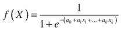
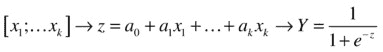
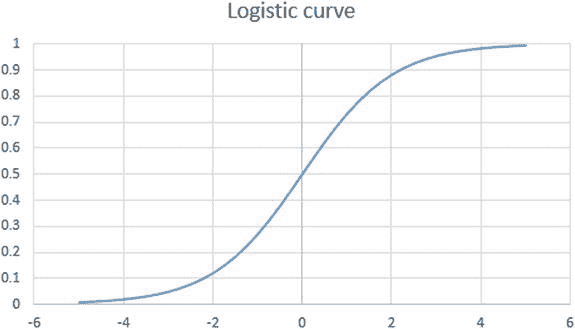
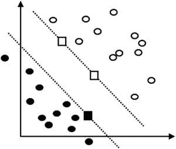
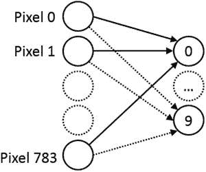
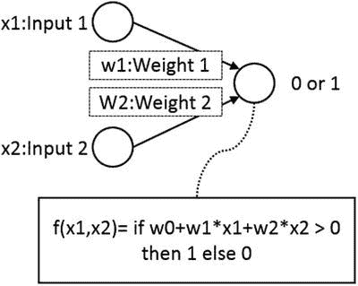
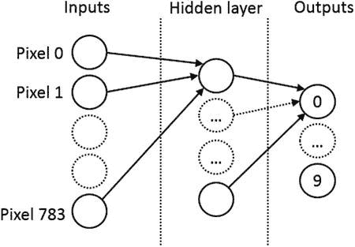
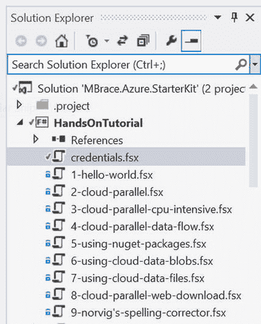
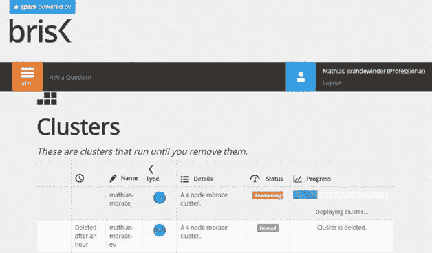

# 第 8 章 数字，再探

优化和扩展你的算法代码

在第 1 章中，我们一起探讨了数字识别器问题，并从头编写了一个分类器。在最后一章中，我们将从两个不同的角度重新审视这个问题：性能以及实用工具。第 1 章到第 7 章主要侧重于实现算法来解决各种问题，并在此过程中探索机器学习概念。相比之下，本章更像是一系列在各种情况下都可能有用的实用技巧。我们将使用第 1 章中创建的数字识别器模型作为熟悉的参考点，并用它来说明广泛适用于其他情况的技术。

在本章中，我们将执行以下操作：

*   分析我们在第 1 章中编写的代码，寻找调整代码、提高效率以及利用并行处理机会来提升性能的方法。
*   介绍 Accord.NET，这是一个 .NET 库，提供了许多经典机器学习算法的现成实现。我们将演示如何使用其中的三种（逻辑回归、支持向量机和人工神经网络），并讨论它们的一些基本思想。
*   介绍 m-brace.NET，这是一个旨在从 F# 脚本环境中在云端机器集群上以分布式方式运行计算的库。我们将演示如何使用该库处理更大的数据集，同时仍然保持利用 FSI 提供的快速反馈来探索和设计模型的能力。

调整你的代码

性能考虑在机器学习中很重要，可能比在日常业务线应用程序开发中更重要。就像任何其他代码一样，性能通常不是首先要关注的问题；首要任务应该是设计一个正确且能产生准确结果的模型。一旦完成，如果模型太慢，就该考虑调整它了。


用唐纳德·克努特的话来说：“程序员浪费大量时间思考或担忧程序中非关键部分的速度，而这些对效率的尝试在考虑调试和维护时实际上会产生强烈的负面影响。我们应该忘记小的效率提升，大约 97%的情况下都是如此：过早优化是万恶之源。然而，我们也不应放弃那关键的 3%所带来的机会。”

话虽如此，在机器学习中，这 3%往往相当重要。主要原因可以追溯到我们对机器学习本质的最初描述：一个程序，随着输入更多数据，其表现会更好。有经验证据表明，当用于训练的数据集变得庞大时，简单算法和复杂算法的预测能力往往趋于相似（例如，可参考彼得·诺维格的演讲“数据那不可思议的有效性”作为例子：[`www.youtube.com/watch?v=yvDCzhbjYWs`](https://www.youtube.com/watch?v=yvDCzhbjYWs)）。在这种情况下，无论你使用哪种特定算法，如果可能，你很可能希望从更大规模的数据中学习，而这会机械地拖慢速度。此时，低效的实现可能影响巨大，并直接影响你的生产力，甚至可能使某个算法在实践中无法使用。

**搜索什么**

那么，我们到底在寻找什么？改进现有代码的性能可能意味着几件事。最明显的是速度：我们希望得到相同的结果，但耗时更短。内存占用是另一个需要牢记的方面：一个在小数据集上表现良好的算法，当需要在内存中保存的数据量增加时，其表现可能会变差。

如果我们审视一下在第 1 章中编写的最近邻实现，其大致流程如下：

```
训练一个分类器 =
       在内存中加载 5000 个样本
分类一张图片 =
       对于分类器中的每个 5000 个样本
              基于 784 个像素计算图片与目标之间的距离
       找到最小距离
```

仅凭这个结构就有助于思考我们应该期望什么样的行为，以及在哪里集中精力可能更有意义：

*   随着我们使用更多的训练数据，预测速度会线性下降
*   高效计算距离直接影响速度
*   该算法非常消耗内存（我们需要将所有训练样本预加载到内存中）

除此之外，每当我们使用交叉验证时，都需要遍历 500 个验证样本中的每一个。这不会影响分类器的性能，但会影响我们高效评估不同变体的能力。如果我们将训练集和验证集都扩大 10 倍，那么验证模型的速度预计会慢大约 100 倍，因为我们现在需要处理两个嵌套循环。

另一种表述方式是，如果我们想通过提供更大的数据集来提高算法性能，我们应该预期速度会显著下降，并且可能还会出现内存问题。我们这里选择的算法有严重的后果：如果我们想要准确性，那么对于任何我们试图做出的预测，我们都必须在速度上付出代价。这是否是一个问题完全取决于业务背景。如果快速做出预测很重要，我们应该考虑选择一种不同的算法，在这种算法中，初始训练成本高昂，但仅是一次性成本，后续的预测会非常快。

我们将在下一节中介绍一些具有这些特性的分类器；目前，让我们假设我们可以接受可能较慢的预测，并开始探索如何改进我们现有的算法。

第一个也是最明显的方向是确保我们的代码足够高效。通常，作为第一步，你应该使用性能分析器来识别代码中的潜在热点。在这种情况下，我们将专注于距离计算，这是大部分工作发生的地方，以避免任何昂贵或不必要的操作。通常，这涉及到确保你使用了正确的数据类型和数据结构，并且可能使用命令式风格，更改变量而不是承担创建和分配新数据结构的成本。

第二个方向是采用并行化。无论我们如何改进距离计算，我们仍然需要计算 5000 个距离。好消息是，我们不需要顺序处理这些计算。两张图片之间的距离完全独立于其他所有距离，因此理论上，通过同时处理所有距离，无需等待其他计算完成，我们可以获得高达 5000 倍的加速。类似地，对于我们正在使用的距离函数，如果我们能并行处理每一对像素，理论上我们可以将计算速度提高多达 784 倍。

当然，期望如此巨大的加速是不现实的。然而，总体思路仍然有效：基本上，在你代码中看到 `map` 的任何地方，都存在并行化的潜力。

**调整距离**

让我们从分析距离函数开始，看看我们如何可能从中榨取一些性能。我们将从代码清单 8-1 开始，这是我们在第 1 章中最终得到的同一个脚本，使用相同的数据集，并尝试进行改进。

***代码清单 8-1***. 原始最近邻模型

```
open System
open System.IO

type Observation = { Label:string; Pixels: int[] }
type Distance = int[] * int[] -> int
type Classifier = int[] -> string

let toObservation (csvData:string) =
    let columns = csvData.Split(',')
    let label = columns.[0]
    let pixels = columns.[1..] |> Array.map int
    { Label = label; Pixels = pixels }

let reader path =
    let data = File.ReadAllLines path
    data.[1..]
    |> Array.map toObservation

let trainingPath = __SOURCE_DIRECTORY__ + @"..\..\..\Data\trainingsample.csv"
let training = reader trainingPath

let euclideanDistance (pixels1,pixels2) =
    Array.zip pixels1 pixels2
    |> Array.map (fun (x,y) -> pown (x-y) 2)
    |> Array.sum

let train (trainingset:Observation[]) (dist:Distance) =
    let classify (pixels:int[]) =
        trainingset
        |> Array.minBy (fun x -> dist (x.Pixels, pixels))
        |> fun x -> x.Label
    classify

let validationPath = __SOURCE_DIRECTORY__ + @"..\..\..\Data\validationsample.csv"
let validation = reader validationPath

let evaluate validationSet classifier =
    validationSet
    |> Array.averageBy (fun x -> if classifier x.Pixels = x.Label then 1\. else 0.)
    |> printfn "Correct: %.3f"

let euclideanModel = train training euclideanDistance
```

第一步，我们需要创建一个基准测试。让我们激活计时器，并执行 5000 次距离计算。我们并不真正关心输出，也不想承担任何与距离计算本身无直接关系的成本，因此我们将选择两张任意的图片，并添加一个 `ignore ()` 语句以避免在 FSI 窗口中产生杂乱输出：

```
#time "on"

let img1 = training.[0].Pixels
let img2 = training.[1].Pixels

for i in 1 .. 5000 do
    let dist = euclideanDistance (img1, img2)
    ignore ()
```

在我的工作站（一台拥有充足内存的四核 i7）上，我得到的结果如下：

```
>
Real: 00:00:00.066, CPU: 00:00:00.062, GC gen0: 22, gen1: 0, gen2: 0
val it : unit = ()
```


首先请注意，每次运行时，这个测量结果都会略有不同。我们在这里测量的是相当短的时间，而且很可能存在一些噪声干扰我们的观测。为了减轻这种影响，我们至少应该运行测试几次，并且可能对超过 5000 次计算进行测试。这个结果也并非完全准确；如果你使用编译成 dll 的相同代码，而不是在脚本中运行，由于可能发生的额外优化，你可能会得到更好的结果。不过，这是一个不错的起点。它提供的两条信息是：时间（完成耗时 66 毫秒，CPU 时间 62 毫秒）和垃圾回收（发生了 22 次第 0 代垃圾回收，没有更高代的回收）。垃圾回收作为我们创建了多少对象的一个指标，是很有趣的；而更高代的垃圾回收通常是不好的。

我们可以做的第一件事是检查使用 `pown` 是否会产生开销。让我们简化一下：

```
let d1 (pixels1,pixels2) =
    Array.zip pixels1 pixels2
    |> Array.map (fun (x,y) -> (x-y) * (x-y))
    |> Array.sum

for i in 1 .. 5000 do
    let dist = d1 (img1, img2)
    ignore ()

Real: 00:00:00.044, CPU: 00:00:00.046, GC gen0: 22, gen1: 0, gen2: 0
val it : unit = ()
```

也许令人惊讶的是，这实际上并非微不足道：我们从 CPU: 00:00:00.062 降到了 CPU: 00:00:00.046。在预测单个图像时，这可能只能算作微优化，但这一改动将使在 500 张验证图像上运行算法所需的 33 秒减少大约 11 秒。

我们仍然观察到一些垃圾回收在发生。罪魁祸首很可能是我们执行了 `zip` 和 `map` 操作，它们各自创建了一个新数组。让我们将其减少为一个操作 `map2`，它本质上是在一次遍历中完成这两个操作，只使用一个数组而不是两个：

```
let d2 (pixels1,pixels2) =
    (pixels1, pixels2)
    ||> Array.map2 (fun x y -> (x-y) * (x-y))
    |> Array.sum

for i in 1 .. 5000 do
    let dist = d2 (img1, img2)
    ignore ()

Real: 00:00:00.016, CPU: 00:00:00.015, GC gen0: 3, gen1: 0, gen2: 0
```

这是一个相当大的改进！我们仍然有一些垃圾回收在进行，但它显著减少了，从之前的 GC gen0: 22 降到了 GC gen0: 3；并且与初始版本相比，计算时间也减少了大约 75%。让我们看看能否完全消除垃圾回收，通过完全跳过中间数组，改用递归。我们将维护一个累加器 `acc`，并逐个索引地遍历像素，将差值加到累加器中，直到到达最后一个像素：

```
let d3 (pixels1:int[],pixels2:int[]) =
    let dim = pixels1.Length
    let rec f acc i =
        if i = dim
        then acc
        else
            let x = pixels1.[i] - pixels2.[i]
            let acc' = acc + (x * x)
            f acc' (i + 1)
    f 0 0

for i in 1 .. 5000 do
    let dist = d3 (img1, img2)
    ignore ()

Real: 00:00:00.005, CPU: 00:00:00.000, GC gen0: 0, gen1: 0, gen2: 0
```

现在我们将计算时间减少了 92%，并且全程没有任何垃圾回收。我们为这一改进付出的代价是代码明显变长，并且可能更难阅读。最后一次尝试：让我们完全采用命令式风格，直接改变一个变量，而不是传递累加器：

```
let d4 (pixels1:int[],pixels2:int[]) =
    let dim = pixels1.Length
    let mutable dist = 0
    for i in 0 .. (dim - 1) do
        let x = pixels1.[i] - pixels2.[i]
        dist <- dist + (x * x)
    dist

for i in 1 .. 5000 do
    let dist = d4 (img1, img2)
    ignore ()

Real: 00:00:00.004, CPU: 00:00:00.000, GC gen0: 0, gen1: 0, gen2: 0
```

与上一次尝试几乎没有区别。我们这里谈论的是毫秒级别，所以我建议在得出结论之前运行更多的计算。如果你这样做，比如运行 1,000,000 次迭代而不是 5,000 次，你将看不到明显的性能差异。在这一点上，两个版本之间的主要区别在于风格，选择哪一个更多是代码可读性而非性能的问题。

我对于使用可变变量的一般立场是双重的。我倾向于默认避免使用它，除非有明确的益处。可变性引入了复杂性；代码通常变得更难理解，也更难并行化。另一方面，如果你的算法涉及，比如说，大型数组（机器学习中的常见情况），那么使用 `map` 并到处复制数组将会带来严重的性能损失。在这种情况下，我会转而使用可变性，但几乎总是以一种对外部世界隐藏的方式来进行。在我们的例子中，虽然 `dist` 是可变的，但所有更改都发生在函数的作用域内，程序的其他部分无法更改它。在这种情况下，可变性是一个实现细节：对于任何调用我函数的人来说，一切看起来都是不可变的，因为没有共享状态可以被篡改。

 **注意**  还有另一种方向可以帮助加速算法。使用不同的数据结构，例如 KD-tree，而不是数组来存储样本，应该能够更快地搜索近邻。我们将忽略这种可能性，因为它的实现需要太多的代码。然而，请记住，为手头的任务使用正确的数据结构是加速算法或使其更节省内存的另一种方法。

使用 Array.Parallel

现在让我们来看第二个角度：并行性。在这里，我们将查看评估函数，该函数遍历 500 张验证图像，对图像进行分类，并将其与真实期望的标签进行比较。原始实现使用了 `Array.averageBy`，它将两个步骤合并为一个：首先，根据预测是否正确，将每张图像映射为 1.0 或 0.0，然后，对整个数组求平均值。`map` 函数并不是立即可见的，但它隐含在其中。

显然，每张图像可以独立于其他图像进行预测，因此我们应该能够并行执行该操作。我们想要的是对训练样本进行分治，例如，根据我们机器上可用的核心数均匀分割，分别运行每个块，并将结果重新组合成一个单一的数组。

事实证明，F# 在 `Array.Parallel` 模块中提供了一些开箱即用的有趣选项，该模块公开了 `Array` 函数的一个子集，并以并行方式实现。首先，让我们测量一下初始评估花费了多长时间，以及在我们调整距离函数之后的情况：

```
let original = evaluate validation euclideanModel
>
Correct: 0.944
Real: 00:00:31.811, CPU: 00:00:31.812, GC gen0: 11248, gen1: 6, gen2: 1

let updatedModel = train training d4
let improved = evaluate validation updatedModel
>
Correct: 0.944
Real: 00:00:02.889, CPU: 00:00:02.890, GC gen0: 13, gen1: 1, gen2: 0
```

现在让我们重写 `evaluate` 函数，将 `Array.averageBy` 拆分为 `Array.Parallel.map` 和 `Array.average`：

```
let parallelEvaluate validationSet classifier =
    validationSet
    |> Array.Parallel.map (fun x -> if classifier x.Pixels = x.Label then 1\. else 0.)
    |> Array.average
    |> printfn "Correct: %.3f"

>
Correct: 0.944
Real: 00:00:00.796, CPU: 00:00:03.062, GC gen0: 13, gen1: 1, gen2: 0
```


计算时间从 2.9 秒下降到 0.8 秒；同时请注意 CPU 时间，从 2.9 秒变为 3 秒：CPU 需要执行的工作量大致保持不变。我们将耗时缩短了约 3.6 倍；鉴于我的机器有四个核心，我最多能预期四倍的提升，因此这个结果相当不错，尤其是考虑到几乎不需要修改任何代码。

那么，为什么不在所有地方都使用 `Array.Parallel.map` 呢？回顾我们对并行化的描述，其中涉及一些开销：现在不再是对数组进行单次遍历，而是需要将其分割、传递给不同的线程，然后重新组合结果。因此，你应该预期性能提升与核心数呈次线性关系：例如，将工作分摊到 10 个核心上所能获得的加速比将小于 10 倍（可能远低于此）。只有当每个数据块中完成的工作量足够大，足以抵消分割与合并的开销时，这种方法才值得采用。举一个简单的例子，考虑以下情况：我们创建一个包含 1000 个元素的数组，每个元素值为 10，然后为每个元素加 1：

```
let test = Array.init 1000 (fun _ -> 10)

for i in 1 .. 100000 do
    test |> Array.map (fun x -> x + 1) |> ignore
>
Real: 00:00:00.098, CPU: 00:00:00.093, GC gen0: 64, gen1: 0, gen2: 0
for i in 1 .. 100000 do
    test |> Array.Parallel.map (fun x -> x + 1) |> ignore
>
Real: 00:00:00.701, CPU: 00:00:01.234, GC gen0: 88, gen1: 1, gen2: 1
```

在这个例子中，仅仅为了加 1 而将数组分割成多个块是不值得的，并行版本最终比原始版本更慢。通常，这种策略对于不可忽略的、CPU 密集型的任务才是有价值的。在这种情况下，我们可以在 `classify` 函数中以两种方式使用并行：可以在距离计算上使用并行，并行计算像素差异；也可以在样本上使用并行，并行计算分类结果。第二种方向更可能有用，因为一次分类确实需要相当的工作量，而计算两个像素之间的差异则可以忽略不计。

**NESSOS STREAMS**

`Array.Parallel` 以并行方式实现了 `Array` 模块函数的一个子集。如果你发现自己需要更多功能，可以查看 Streams 库（[`nessos.github.io/Streams/`](http://nessos.github.io/Streams/)）。它包含 `ParStream` 模块（用于并行流）中的附加函数，并提供了其他有趣的可能性。简而言之，该库区分了管道中的惰性操作和急切操作，并将惰性操作融合在一起，从而带来性能提升。

使用 Accord.NET 实现不同的分类器

在上一节中，我们讨论了几种改进现有算法性能的方法。然而，每个算法都有其基本特性，这些特性决定了程序的行为方式。在本节中，我们将转向一个完全不同的方向，介绍 Accord.NET，这是一个流行且优秀的库，包含丰富的机器学习和数值分析工具。

我们的目标有两个。首先，自己编写实现通常并不困难，并且有一些好处。特别是，你可以完全控制代码，这为与使用该代码的应用程序进行更紧密的集成提供了机会，也可能在全局层面留出一些优化空间。然而，开发机器学习算法涉及大量的实验和试错，有时你只需要快速检查某一类模型是否比另一类更好。在这种情况下，从头实现算法可能过于费力，而使用现成的实现可以加速筛选过程。因此，知道如何利用像 Accord 这样丰富的库是非常有用的。

此外，我们在前面的章节中介绍了多种技术，但也遗漏了许多其他经典且可能有用的技术。我们无法详尽地介绍每一个算法，但将以此节为契机，对其中一些算法进行高层次介绍，并演示如何使用该库。

逻辑回归

在第 4 章中，我们实现了一个经典的回归模型，尝试根据多个输入特征预测一个数值。这种方法与最近邻模型的不同之处在于，过程中有一个明显独立的训练阶段。训练集用于估计分类函数的参数，该函数比原始数据集紧凑得多。如果我想将我的最近邻分类函数发送给某人，我必须发送整个训练集。相比之下，回归模型只是一个形式为 Y = a0 + a1 * X1 + ... ak * Xk 的函数，我只需要传输 a0, a1, ... ak 这些值。同样，生成预测也会快得多：我们不再需要计算 5000 个距离，而只需进行一次非常简单的计算。为此付出的代价是找到 a0, a1, ... ak 的良好值，这是一个昂贵的训练操作。

逻辑回归本质上是相同的模型，但适用于分类。它的输出不是一个可以取任意实数的数值，而是一个介于 0 和 1 之间的值，表示一个观测值属于两个可能类别之一的概率。

对于一个特征值为 X = [X1; ... Xk] 的观测值，Y 的预测值由所谓的逻辑函数生成：



这与回归模型存在明显的关系：从 X 开始，我们首先计算线性组合的结果，得到一个值 z，然后使用逻辑函数 f 对 z 进行额外的变换：



最后这个变换的原因是为了解决以下问题：如果我们的目标是生成一个描述某个观测值是否属于某个类别的概率，那么输出最好在 [0 .. 1] 区间内。线性回归并非如此，它可以取负无穷到正无穷之间的任何值。然而，如果你绘制 1.0 / (1.0 + exp (-z)) 的图形，你会看到图 8-1 中的形状；该函数将任何值转换为 [0 ... 1] 区间，当 z = 0 时值为 0.5。当线性模型预测 z = 0 时，逻辑函数会认为观测值属于两个可能结果的机会各占 50%。距离 0 越远的值，表明观测值属于某一类别的置信度越高。



图 8-1. 逻辑曲线

换句话说，逻辑函数充当了一个**激活函数**。它接收一个可以是任何值的输入，并将其转换为一个二元信号：如果输入值大于 0，则处于状态 1，否则处于状态 0。

使用 Accord 进行简单逻辑回归

从技术上讲，估计逻辑函数参数的方式与我们在第 4 章中所做的非常相似，即使用梯度下降法并配合略微修改的成本函数。实现它实际上是一个有趣的练习（而且并不复杂），但我们将改用 Accord.NET 的版本。

作为起点，我们暂时搁置一个明显的问题：我们有十个类别需要识别，而逻辑模型只能区分两种情况。我们将首先通过一个演示示例来工作，创建一个仅区分两种情况的分类器，例如，数字 4 和数字 9。


让我们在解决方案中添加一个新的脚本文件 `logistic.fsx`，并添加本例及后续示例中将使用的两个 NuGet 包：`Accord.MachineLearning` 和 `Accord.Neuro`。

首先，我们需要一些数据。我们将沿用第 1 章中的相同思路，但有两个细微差别。首先，我们将值解析为浮点数而非整数，因为这是 Accord 所期望的格式；其次，我们将简单地使用元组来存储样本，其中标签作为第一个元素，特征作为第二个元素。

***清单 8-2***。读取逻辑回归数据集

```
#I @"../packages"
#r @"Accord.2.15.0\lib\net45\Accord.dll"
#r @"Accord.MachineLearning.2.15.0\lib\net45\Accord.MachineLearning.dll"
#r @"Accord.Math.2.15.0\lib\net45\Accord.Math.dll"
#r @"Accord.Statistics.2.15.0\lib\net45\Accord.Statistics.dll"

open Accord.Statistics.Models.Regression
open Accord.Statistics.Models.Regression.Fitting

let readLogistic fileName =
    let path = __SOURCE_DIRECTORY__ + @"/" + fileName
    path
    |> System.IO.File.ReadAllLines
    |> fun lines -> lines.[1..]
    |> Array.map (fun line ->
        let parsed = line.Split ',' |> Array.map float
        parsed.[0], parsed.[1..])

let training = readLogistic "trainingsample.csv"
let validation = readLogistic "validationsample.csv"
```

 **注意** Accord 库会定期更新，因此版本号会随时间变化。请根据最新版本相应地更新脚本中的引用！

现在，我们已将数据集加载到内存中，还需要做两件事。由于我们要学习识别数字 4 和 9，因此需要过滤数据集，只保留相关样本。此外，由于逻辑回归期望输出编码为 0.0 或 1.0，我们将创建一个小的实用函数来适当地转换标签。最后，我们将使用这些来创建新的学习样本（参见清单 8-3）。

***清单 8-3***。为逻辑回归准备 4 与 9 的数据集

```
let labeler x =
    match x with
    | 4. -> 0.
    | 9. -> 1.
    | _ -> failwith "unexpected label"

let fours = training |> Array.filter (fun (label,_) -> label = 4.)
let nines = training |> Array.filter (fun (label,_) -> label = 9.)

let labels,images =
    Array.append fours nines
    |> Array.map (fun (label,image) -> labeler label,image)
    |> Array.unzip
```

现在我们可以开始使用 Accord 的逻辑回归模型了。Accord 主要采用面向对象的风格，因此遵循以下模式：

1.  首先，创建一个模型，即定义如何进行预测的类。
2.  将其传递给一个学习器，即定义如何使用训练数据来拟合该模型的类。
3.  然后，向学习器提供数据，并“学习”直到拟合效果足够好。
4.  现在，您可以使用原始模型实例进行预测。

在我们的案例中，我们将使用一个 `LogisticRegression` 模型，该模型使用 28 * 28 个特征（对应于扫描图像的每个像素），并使用 `LogisticGradientDescent` 进行学习，直到模型的变化变得可以忽略不计。这非常适合递归循环（参见清单 8-4）。

***清单 8-4***。训练逻辑模型

```
let features = 28 * 28
let model = LogisticRegression(features)

let trainLogistic (model) =
    let learner = LogisticGradientDescent(model)
    let minDelta = 0.001
    let rec improve () =
        let delta = learner.Run(images,labels)
        printfn "%.4f" delta
        if delta > minDelta
        then improve ()
        else ignore ()
    improve ()

trainLogistic model |> ignore
```

如果您运行以下代码，应该会在 FSI 中看到一系列数字打印出来，这些数字表示学习过程中每一步模型参数的变化量；当变化量低于 `minDelta`（该值定义了您希望结果与最优值的接近程度）时，学习过程停止。此时，模型即可使用；例如，我们可以针对验证集运行该模型，过滤掉所有不是 4 或 9 的数据，并检查哪些预测是正确的（参见清单 8-5）。

***清单 8-5***。验证逻辑模型

```
let accuracy () =
    validation
    |> Array.filter (fun (label,_) -> label = 4. || label = 9.)
    |> Array.map (fun (label,image) -> labeler label,image)
    |> Array.map (fun (label,image) ->
        let predicted = if model.Compute(image) > 0.5 then 1. else 0.
        let real = label
        if predicted = real then 1. else 0.)
    |> Array.average

accuracy ()
```

在我的机器上，这产生了 95.4% 的正确率。这里需要注意一点：`model.Compute` 不一定返回 1.0 或 0.0，它返回一个介于 0.0 和 1.0 之间的数字，表示输出属于类别 1 的概率。这就是为什么我们检查该值是高于还是低于 50% 来确定分类器的决策。虽然这似乎引入了一些额外的工作，但实际上非常有价值：分类器不仅返回一个标签，还提供了对其预测置信度的估计。

一对一与一对多分类

我们如何使用二元分类器来区分十个类别？有两种经典方法可以解决这个问题。第一种方法是“一对多”，即为每个标签创建一个二元分类器，尝试将每个标签与其他所有标签区分开来。在这种情况下，我们将创建 10 个模型：“这是 0 还是其他”、“这是 1 还是其他”……然后运行这十个模型，并选择置信度最高的答案。第二种方法是“一对一”，即为每一对可能的标签创建一个二元分类器（“这是 0 还是 1”、“这是 0 还是 2”……），运行每个模型，并使用轮询投票进行预测，选择获得最多票数的标签。

让我们实现一个一对多模型，主要是为了说明这个过程。在我们的情况下，我们需要 10 个不同的模型：“是 0 或不是”、“是 1 或不是”，等等……如果我们以这样的方式组织数据，使得在每种情况下，我们试图识别的数字被标记为 1.0，其余数字被标记为 0.0，那么每个训练好的模型将返回一个数字，表示它认为该图像是该特定标签的强度。在这种框架下，要对图像进行分类，我们只需运行这 10 个模型，并选择输出最大的那个。

这并不太复杂：在清单 8-6 中，对于每个类别，我们创建一个新的训练样本，其中如果样本与我们训练的类别匹配，则标记为 1.0，否则标记为 0.0。对于每个标签，我们训练一个逻辑模型，就像我们在上一节中所做的那样（有一个小的修改：我们将学习过程限制为最多 1000 次迭代），并创建一个包含所有标签及其模型的列表。整体分类器函数返回对应于最“自信”模型的标签。

***清单 8-6***。一对多逻辑分类器

```
let one_vs_all () =


let features = 28 * 28
    let labels = [ 0.0 .. 9.0 ]
    let models =
        labels
        |> List.map (fun target ->
            printfn "学习标签 %.0f" target
            // 为目标标签创建训练集
            let trainingLabels,trainingFeatures =
                training
                |> Array.map (fun (label,features) ->
                    if label = target
                    then (1.,features)
                    else (0.,features))
                |> Array.unzip
            // 训练模型
            let model = LogisticRegression(features)
            let learner = LogisticGradientDescent(model)
            let minDelta = 0.001
            let max_iters = 1000
            let rec improve iter =
                if iter = max_iters
                then ignore ()
                else
                    let delta = learner.Run(trainingFeatures,trainingLabels)
                    if delta < minDelta then ignore ()
                    else improve (iter + 1)
            improve 0
            // 返回标签及对应模型
            target,model)

let classifier (image:float[]) =
        models
        |> List.maxBy (fun (label,model) -> model.Compute image)
        |> fun (label,confidence) -> label

classifier
```

最终得到的模型效果并不特别理想；在我的机器上，准确率接近 83%。我们不会在此实现另一种方法，因为代码差异不足以证明其必要性。一方面，这两种方法很有趣，因为它们提供了一种简单的技术，可以将二元分类器（你能创建的最简单的分类器）扩展为处理任意数量的标签。另一方面，请记住，这两种方法都只是启发式方法：思路合理，但无法保证效果良好。一对多法的优势在于所需模型更少（本例中为 10 个，而一对一法则需要 90 个），但两者都存在潜在问题。在一对多的情况下，我们将许多不同的情况归并到负例中，这可能会使训练变得困难（例如，你可能会认为，从 0 或 6 中识别出 5 应基于不同的特征）。训练一个专门从 6 中识别出 1 的模型（例如）比从九个不同数字中识别出 1 更容易。相反，在一对一的情况下，虽然训练单个模型可能更容易，但最终决策需要让那些专门区分两个特定数字的模型去识别一个两者都不是的数字，这可以说相当棘手（如果你将一个 0 输入给一个训练用来区分 1 和 2 的模型，你期望得到什么答案？）。

支持向量机

我们要看的下一个模型是支持向量机（以下简称 SVM），它是另一种经典的二元分类器。这个名字听起来有些吓人，而且该算法在概念上比之前的算法更复杂一些。我们将对其工作原理进行粗略介绍，并将解释限制在最低限度。

本质上，SVM 试图通过一条尽可能宽的带子将两个类别分开，使得一个类别的所有样本都在一侧，而另一个类别的所有样本都在另一侧。支持向量就是位于边界两侧或“支撑”边界的样本。图 8-2 用一个简单的例子说明了这一概念：两条虚线代表分隔带的边界。属于同一类别（黑色或白色）的每个观测值都在同一侧，而三个用方块表示的观测值则是定义边界位置的支持向量。



图 8-2. 支持向量

与逻辑回归一样，SVM 也是二元分类器。与逻辑回归的一个区别是，标签不是用 0 和 1 编码，而是用 -1 和 1 编码，输出只是一个类别，而不是“置信水平”。让我们看看如何使用 Accord SVM 对我们的数字进行分类。方便的是，Accord 内置了 SVM 的多类版本，这意味着我们可以直接将其用于 10 个类别，而无需构建额外的层：它将为我们处理一对一的过程。

为清晰起见，我们将 SVM 示例放在一个单独的脚本 `svm.fsx` 中，其中包含与逻辑回归示例相同的引用。首先，像往常一样，我们将读取数据集，但这次我们不会将标签转换为浮点数（参见清单 8-7）。

***清单 8-7***. 为 SVM 读取数据

```
let svmRead fileName =
    let path = __SOURCE_DIRECTORY__ + @"/" + fileName
    path
    |> System.IO.File.ReadAllLines
    |> fun lines -> lines.[1..]
    |> Array.map (fun line ->
        let parsed = line.Split ','
        parsed.[0] |> int, parsed.[1..] |> Array.map float)

let labels,images = svmRead "trainingsample.csv" |> Array.unzip
```

训练部分需要比逻辑回归稍微复杂一些的设置。大部分复杂性体现在算法函数中。如果你仔细检查代码，你会发现它接收一个 SVM、一个数据集（输入和输出）以及两个值 *i* 和 *j*，并返回一个学习策略。这是同时处理多个类别必须付出的代价：在训练期间，算法块将用于为后台生成的每个一对一分类器创建适当的数据集和学习策略；不过，这样做的好处是，可以为不同的标签对配置和使用不同的策略。代码的其余部分遵循与我们之前看到的类似的逻辑：我们创建一个模型、一个学习器，然后开始训练，这甚至比逻辑回归的情况更简单，因为它会自动终止，并直接返回在训练样本中观察到的错误率（参见清单 8-8）。

***清单 8-8***. 训练多类 SVM 模型

```
open Accord.MachineLearning.VectorMachines
open Accord.MachineLearning.VectorMachines.Learning
open Accord.Statistics.Kernels

let features = 28 * 28
let classes = 10

let algorithm =
    fun (svm: KernelSupportVectorMachine)
        (classInputs: float[][])
        (classOutputs: int[]) (i: int) (j: int) ->
        let strategy = SequentialMinimalOptimization(svm, classInputs, classOutputs)
        strategy :> ISupportVectorMachineLearning

let kernel = Linear()
let svm = new MulticlassSupportVectorMachine(features, kernel, classes)
let learner = MulticlassSupportVectorLearning(svm, images, labels)
let config = SupportVectorMachineLearningConfigurationFunction(algorithm)
learner.Algorithm <- config

let error = learner.Run()

let validation = svmRead "validationsample.csv"

validation
|> Array.averageBy (fun (l,i) -> if svm.Compute i = l then 1. else 0.)
```

这个特定模型正确分类了验证集中 92% 的样本，这已经相当不错了。如果你想改进结果，可以怎么做？第一个可以利用的杠杆是策略上定义的 `Complexity` 参数。其值会自动设置为通常接近 1 的水平，并且应该能正常工作。增加该值将迫使模型更好地拟合训练样本，但存在两个风险：可能导致过拟合，或者该值可能过高，导致算法无法找到解并抛出异常。


你可以使用的第二个杠杆是所谓的核技巧。你可能已经注意到，在 SVM 设置中，我们传入了一个线性核。这意味着我们正在寻找类别之间清晰、笔直的分隔。如果数据集中能找到这样的分隔，那就没问题。然而，很有可能虽然每个类别的样本被很好地分隔开了，但这种分隔可能不是一条直线（或超平面）。从非常高的层面来看，核技巧包括对观测值应用一个函数，将初始特征转换到更高维空间中的一组新特征，在这个空间中，样本实际上可能可以通过一个超平面来分隔。如果情况确实如此，那么我们就可以训练一个“标准”线性 SVM 来找到这种分隔，并对新的观测值进行分类，首先通过应用相同的核函数来转换它们。

如果这听起来不完全清楚，别担心！主要的实际意义是，如果默认的线性核不起作用，你可以尝试其他核，看看效果是否更好。Accord 内置了相当多的核，你可以通过探索 `Accord.Statistics.Kernels` 命名空间来找到它们。

神经网络

我们要看的最后一个 Accord 分类器是人工神经网络（以下简称 ANN）。这个名字的灵感来源于与大脑工作方式的一种粗略类比。大脑是一个由相互连接的神经元组成的庞大集合。当我们接收到来自外部世界的信号时，感受器会发送电脉冲，激活我们大脑中的神经元。接收到足够强信号的神经元又会向与之相连的神经元发送信号，最终，我们的大脑（或许）会理解这个信号并识别出某些东西。

人工神经网络的构建遵循类似的一般结构。它们可以有不同形态，但典型的 ANN 是一个由神经元组成的集合，这些神经元按层组织，每一层中的每个神经元都与下一层中的每个神经元相连。神经元本身是一个激活函数；它接收所有与之相连的神经元的输出作为输入，每个输入都有各自的权重，如果它接收到的输入加权和足够高，它就会继续向前发送信号。

神经网络是一个庞大的话题，我们不可能在一章中充分讨论。类似于我们为 SVM 所做的方式，我们将简单地说明如何使用 Accord 内置工具构建一个分类器，并在此过程中强调几个有趣的点。

在我们的特定情况下，我们有 784 个像素作为输入信号，而我们期望的输出是 0、1……9 这 10 个数字之一。就神经元而言，我们可以将其表示为一个包含 784 个输入神经元的层（每个神经元可以发送 0 到 255 之间的信号），以及一个包含 10 个神经元的最终层，每个神经元对应一个数字。我们能构建的最简单的网络是，在每个输入神经元和每个输出神经元之间建立直接连接，如图 8-3 所示。



图 8-3。浅层人工神经网络

我们想要的是一个模型，它接收一张图像，将其输入（每个像素值）送入网络，并将其转换为每个可能输出对应的 0 或 1 值。无论我们有数百个输入还是只有两个，都不会改变问题的本质，所以让我们看一个更简单的网络，只有两个输入和一个输出，并探索如何让它工作。一种可能性是构建一个模型，当输入信号的加权和超过某个阈值时，我们激活一个节点，如图 8-4 所示。



图 8-4。感知机

事实证明，这个模型有一个名字，叫做**感知机**。它由三个元素定义：分配给每个输入信号的权重 w1 和 w2（每个输入的重要性）、一个阈值 w0（所谓的偏置项），以及一个线性激活函数 f，该函数组合输入，并在输入信号高于阈值时将其转换为 1（一个信号）。训练这样一个分类器非常简单；我们只需要找到权重和偏置的值来最小化误差——例如，使用类似于我们在第 4 章中讨论的方法。

还要注意，如果我们改变激活函数，在我们的节点中使用逻辑函数而不是线性组合，那么我们就复制了整个一对多逻辑模型。这里的要点是，虽然单独的感知机看起来可能有点过于简单，但它构成了一个构建模块，可以轻松组合成有趣且复杂的模型。

那么，问题出在哪里，人工神经网络又有何不同呢？ANN 的一个关键见解是，如果简单的线性模型不能很好地拟合你的数据，与其使用更复杂的组件（创建新特征、使用非线性函数……），你可以继续使用类似感知机的简单节点，但通过将输入层和输出层之间堆叠一个或多个隐藏层，将它们组合成更深的模型，如图 8-5 所示。如果你对此问题感兴趣，有大量资源讨论如何使用感知机对逻辑门进行建模（例如，参见 [`www.cs.bham.ac.uk/~jxb/NN/l3.pdf`](http://www.cs.bham.ac.uk/~jxb/NN/l3.pdf)）；事实证明，虽然你可以毫无问题地建模 AND、OR 或 NOT，但除非添加一个隐藏层，否则无法建模 XOR 门。



图 8-5。带一个隐藏层的人工神经网络

在我们的案例中，如果我们想要一个与我们之前的一对多逻辑方法行为不同的模型，我们需要插入至少一个隐藏层。每个输入节点都连接到隐藏层中的每个节点（但不连接到下一层），并且隐藏层中的每个节点都连接到每个输出节点，如图 8-5 所示。

使用 Accord 创建和训练神经网络

经过大量粗略的解释，希望你已经相当确信，添加隐藏层是将简单感知机组合成强大分类器的一种有前途的方法。然而，这也带来了一些新问题。首先，虽然输入层和输出层的大小是明确设定的（每个特征一个神经元，每个类别一个神经元），但隐藏层应该包含多少个神经元？就此而言，为什么是一个隐藏层，而不是两个、三个或更多？

第二个且有些相关的问题是，如何训练这样的模型？这里有非常多的参数需要估计。例如，考虑将我们的 784 个输入连接到一个包含 10 个神经元的层，我们需要调整近 8000 个权重。这相当多。我们不能单独训练每个神经元，因为它们是相互连接的；如果我改变一个神经元的输入权重，它的输出就会改变，并可能需要调整同一层中的其他神经元。最后，还有另一个微妙的问题：我们应该如何初始化权重？如果你从每个连接的权重为零开始，因为每个神经元都是相同的，你就有风险为每个神经元学习到相同的参数。每个神经元不会从输入集中捕获不同的特征，而是会产生相同的输出，这样你就得到了一个被多次复制的单一模型。


详细解释如何训练人工神经网络本身就是一个庞大的话题；我们这里只做一个非常宽泛的概述。实现这一目标的主要方法称为反向传播。其方式类似于梯度下降：你向网络输入样本，将期望值与模型输出进行比较，然后在网络中逐层向后传播，调整每个神经元以减少误差。为了避免节点同质化的问题，权重会通过某种随机过程进行初始化。

在实践中，这意味着训练神经网络是一件耗时的事情。虽然增加网络深度和每层节点数在理论上可以产生更精细的模型，但这也会直接影响训练所需的时间，更不用说存在过拟合的风险了。

基于此，我们用一个单独的脚本来演示如何使用 Accord 创建并训练这样一个网络（参见**清单 8-9**）。像往常一样，我们首先加载所需的库，并编写一个读取函数来准备数据集。

***清单 8-9***. 使用 Accord 准备训练神经网络

```
#I @"../packages"
#r @"Accord.Math.2.15.0\lib\net45\Accord.Math.dll"
#r @"Accord.Neuro.2.15.0\lib\net45\Accord.Neuro.dll"
#r @"Accord.Statistics.2.15.0\lib\net45\Accord.Statistics.dll"
#r @"AForge.2.2.5\lib\AForge.dll"
#r @"AForge.Neuro.2.2.5\lib\AForge.Neuro.dll"

open Accord.Statistics
open Accord.Neuro
open Accord.Neuro.Learning
open AForge.Neuro

let nnRead fileName =
    let path = __SOURCE_DIRECTORY__ + @"/" + fileName
    path
    |> System.IO.File.ReadAllLines
    |> fun lines -> lines.[1..]
    |> Array.map (fun line ->
        let parsed = line.Split ','
        parsed.[0] |> int, parsed.[1..] |> Array.map float)
```

 **注意**  在我们的脚本中，我们引用了 AForge，这是一组被 Accord 使用的库。在撰写本文时，Accord 正在将这两个库合并为一个，这可能会使其中一些引用变得多余。

然后，我们可以设置神经网络，启动训练阶段，并验证结果（参见**清单 8-10**）。该方法大致遵循我们之前见过的模式，但有几点差异值得指出。

***清单 8-10***. 创建、训练和评估网络

```
let trainNetwork (epochs:int) =

let features = 28 * 28
    let labels,images = nnRead "trainingsample.csv" |> Array.unzip
    let learningLabels = Tools.Expand(labels,-1.0,1.0)

let network = ActivationNetwork(BipolarSigmoidFunction(), features, [| 100; 10 |])
    NguyenWidrow(network).Randomize()

let teacher = new ParallelResilientBackpropagationLearning(network)

let rec learn iter =
        let error = teacher.RunEpoch(images, learningLabels)
        printfn "%.3f / %i" error iter
        if error < 0.01 then ignore ()
        elif iter > epochs then ignore ()
        else learn (iter + 1)

learn 0

network

let ann = trainNetwork (50)

let validate = nnRead "validationsample.csv"
validate
|> Array.averageBy (fun (label,image) ->
    let predicted =
        ann.Compute image
        |> Array.mapi (fun i x -> i,x)
        |> Array.maxBy snd 
        |> fst
    if label = predicted then 1.0 else 0.0)
```

首先，我们需要转换输出，使得每个数字都成为一个独立的特征。为此，我们使用了 `Accord.Statistics.Tools.Expand`，这是一个内置工具，可以将一组标签扩展为一种新的表示形式，其中每个标签都变成一个单独的列，其二进制输出在此例中编码为 –1 或 1。我们选择这种特定的编码方式是因为所选的激活函数——`BipolarSigmoidFunction`：其值范围从 –1 到 1，其中 1 表示正例（“这是一个 1”），–1 表示负例（“这不是一个 1”）。另外，`AForge.Neuro` 中还包含其他几个内置的激活函数。

我们创建一个网络，传入激活函数、预期的输入数量（在我们的例子中是 28 × 28 像素），以及一个数组形式的每层节点数，数组的最后一个元素是预期的标签数量，这里是 10。还要注意 `NguyenWidrow` 的使用，它会为网络权重生成随机但合理的初始值。

在我的机器上，以下代码产生了近 82% 的正确分类率（由于初始权重的随机性，结果可能会有所不同）。这个结果不算太差，但也不算很好。如果你运行过它，可能也注意到了，它相当慢。话虽如此，我们这里将训练限制在 50 次迭代，而当我们达到第 50 次迭代时，误差（每次迭代后都会打印出来）仍在有规律地下降。当我把搜索范围扩大到 500 个周期时，我看到误差从 1775 进一步下降到 1200，正确率达到 82.6%。换句话说，学习过程虽然明显变慢，但仍在持续改进。

关于神经网络以及 Accord 库的讨论，我们就此打住。该库包含的内容远不止我们这里描述的算法，还有一些有趣的示例展示了它的部分能力。

## 使用 m-brace.net 进行扩展

你可以尽情调优代码，但到了某个节点，瓶颈就会是你的机器。这个问题之所以重要，又回到了我们对机器学习的初始定义。一个好的机器学习算法，如果输入更多的数据，其执行任务的能力应该会机械地变得更好。

这意味着，如果更多数据更好，那么你就会想要更多数据，这在一定程度上解释了最近围绕“大数据”的热潮。而且，随着数据集不断增长，使用简单的 F# 脚本进行数据探索和模型训练会变得越来越慢，甚至变得不可能，例如当数据集太大而无法在本地打开或保存时。在本节中，我们将简要介绍 m-brace.net，这是一个旨在解决该问题的库，它通过将脚本环境中的代码发送到云中的集群上执行来实现。

## 使用 Brisk 在 Azure 上开始使用 MBrace

如果我们的限制因素是计算机本身，那么一个方向就是投入更多的计算机来解决问题。正如弗雷德·布鲁克斯所说，“九个女人不能在一个月内生出一个孩子”，根据问题的不同，许多计算机并不总能加快速度。话虽如此，一般来说，只要我们在代码中识别出 `map` 操作，就应该有机会应用分治策略：将我们正在映射的集合分成多个块，在独立的计算机上分别对每个块执行 `map` 操作，然后将所有块的结果归约为一个最终结果。

这与我们之前在 `Array.Parallel.map` 中看到的模式相同。我们接下来要讨论的框架 MBrace（[www.m-brace.net](http://www.m-brace.net)）将这个想法大大扩展了：它不仅仅是在本地机器的多个核心上处理块，而是允许你在 Microsoft Azure 云中的机器集群上执行相同的操作。

其美妙之处在于，这一切都可以在脚本环境中完成。本质上，MBrace 的目标是让你在 Visual Studio 中使用 F# 脚本工作，从而保持快速的设计反馈循环，同时无缝地将代码发送到你的集群上远程执行。你可以按需创建一个集群，仅在你需要大量计算能力或数据时使用，而不受本地设备的限制，并在完成后将其关闭。

开始使用 MBrace 最简单的方法是遵循以下三个步骤：


1.  首先，如果你还没有 Azure 订阅，请先获取一个。你可以在 [`azure.microsoft.com`](http://azure.microsoft.com) 获取免费试用版。
2.  然后，在 [www.BriskEngine.com](http://www.BriskEngine.com) 注册一个免费账户。Brisk 是一项服务，允许你在 Azure 上轻松配置一个集群，该集群已完全配置好运行 MBrace 所需的一切，并在使用完毕后将其删除。Brisk 本身是免费的；你只需为 Azure 云服务的使用付费。
3.  最后，从 GitHub 上的 MBrace 仓库下载 MBrace Starter Kit：[`github.com/mbraceproject/MBrace.StarterKit`](https://github.com/mbraceproject/MBrace.StarterKit)。该项目包含一个预配置的解决方案，其中有许多示例说明如何使用 MBrace；你可以直接下载它，并将你的脚本添加进去，以便轻松上手。

此时，你的本地机器上应该有一个类似图 8-6 的 F# 项目。

我们先在 Azure 上部署一个机器集群。为此，只需访问 BriskEngine.com，登录，然后进入 Dashboard 菜单，在那里你可以查看最近创建的集群，并创建新的集群。让我们创建一个新集群，为 MBrace 选择 {m}，并选择其地理部署位置。你可能希望选择一个离你较近的位置，这样你的机器和集群之间的数据传输速度会尽可能快；如果你要访问已有的数据，数据所在的位置也很重要。最后，选择一个集群大小；你可以从一个微型的四核集群（两台中型机器）开始，每小时费用不到 0.50 美元，一直到 256 核集群，每小时费用大约 20 美元。



图 8-6. m-brace 启动项目

我们选择 16 核，这能提供强大的计算能力，每小时费用大约 1.50 美元。BriskEngine 仪表盘会显示部署进度，5 到 10 分钟后，你应该就能拥有一个随时可用的集群了（参见图 8-7）。



图 8-7. 通过 BriskEngine 在 Azure 上部署集群

我们现在已经准备好在该集群上运行代码了；我们只需要在 Visual Studio 的脚本会话中连接到它。我们将通过在 credentials.fsx 文件中为 MBrace 提供两个连接字符串来实现这一点。BriskEngine 让这变得简单：在仪表盘中，一旦集群处于活动状态，你可以点击集群名称，然后将两个连接字符串复制到 credentials 文件中。

最后，让我们在 Starter Kit 解决方案中添加一个新脚本 digits.fsx，内容如代码清单 8-11 所示。

***代码清单 8-11***. 连接到集群

```
#load "credentials.fsx"
open MBrace.Core
open MBrace.Azure.Client

let cluster = Runtime.GetHandle(config)
```

将该代码发送到 FSI，然后……就这样，你现在已连接到集群。你可以通过运行以下代码行来检查连接状态，该代码将显示集群中正在运行的工作节点的信息：

```
cluster.ShowWorkers ()

>

>

Workers

Id                     Status   % CPU / Cores  % Memory /
 --                     ------   -------------  --------------------
 MBraceWorkerRole_IN_2  Running     2.3 / 4        13.5 / 7167.0
 MBraceWorkerRole_IN_1  Running     1.4 / 4        14.1 / 7167.0
 MBraceWorkerRole_IN_0  Running     1.8 / 4        13.6 / 7167.0
 MBraceWorkerRole_IN_3  Running     1.5 / 4        13.6 / 7167.0
val it : unit = ()
```

那么，如何将工作发送到集群呢？通过使用云计算表达式 `cloud { ... }`。这个名字可能听起来有点吓人：但不要被它吓倒。云计算是 F# 中一种非常强大的机制，通常旨在提供一种更简单的方式来编写和管理复杂的代码工作流。它们使用一个构建器，该构建器定义了一个由 `{ }` 标记的“上下文”，在这个上下文中，F# 通过使用 `let!` 或 `return` 等关键字得到扩展，隐藏了操作中一些不太有趣的副作用，并强调了整个工作流的结构。因此，虽然理解如何编写一个新的计算表达式可能需要费点脑筋，但使用现有的计算表达式通常并不复杂，因为其全部意义就在于让你编写更简单的代码来实现目标。

就 MBrace 而言，在集群中执行代码涉及两个阶段：你在 `cloud { ... }` 计算表达式内部定义要在云中运行的代码，然后将其发送执行。例如，尝试将以下代码逐行发送到 FSI：

```
#time "on"
cluster.AttachClientLogger(MBrace.Azure.ConsoleLogger())

let localHello = "Hello"
let cloudHello = cloud { return "Hello" }
cloudHello |> cluster.Run
```

`localHello` 会立即求值，而 `cloudHello` 本身不做任何事情：它的类型是 `Cloud<string>`，是一段可以在云中运行并返回字符串的代码。当它被发送到 `cluster.Run` 时，会创建一个进程并将其加入执行队列；MBrace 会检查发送到 FSI 的代码，通过网络发送在集群上运行代码所需的类型和数据，并在 FSI 中返回结果，就好像这一切都是普通的本地脚本一样。

除了发送代码执行并等待结果可用之外，你还可以启动一个进程，然后等待其结果，如下所示：

```
let work = cloudHello |> cluster.CreateProcess
cluster.ShowProcesses ()
>
Processes

Name                        Process Id   Status   Completed   Execution Time
 ----                        ----------   ------   ---------   --------------
       c93fa4d3b1e04a0093cbb7287c73feea  Completed  True        00:00:00.8280729
       c833d511623745e2b375f729be25742b  Completed  True        00:00:00.1129141

// 询问工作是否已完成
work.Completed
>
val it : bool = true
// 完成后，获取结果
Let result = work.AwaitResult ()
> val result : string = "Hello"
```

这允许你将工作发送到集群执行，并在结果可用时检索结果，而不会阻塞 FSI。

使用 MBrace 处理大型数据集

在我们的初始示例中，与本地版本的“Hello, World”相比，我们从 MBrace 得到的只是性能下降。这并不奇怪：我们运行了与本地机器上相同的代码，没有任何性能提升的预期，但必须在过程中序列化所有内容。就像 `Array.Parallel` 可能不会为小任务带来收益一样，因为并行化的收益无法弥补协调成本，MBrace 通常也不会在小规模问题上带来好处，因为在机器之间移动数据和代码会产生开销。

幸运的是，数字识别器在这里是一个完美的例子。Kaggle 竞赛中使用的“真实”数据集包含 50,000 个样本。到目前为止，我们在所有示例中使用的训练集已缩减到 5,000 个样本，正是因为我们希望能够从脚本环境中探索想法，并快速获得反馈，了解这些想法是否值得研究。如果你想保持类似的工作流程，但使用整个数据集，你会怎么做？让我们先概述一下纯本地代码在缩减数据集上的运行方式。从代码清单 8-1 中的初始模型开始，我将采用优化后的距离函数，训练一个模型并对其进行评估，如代码清单 8-12 所示。


***清单 8-12***. 在精简数据集上评估模型

```
let optimizedDistance (pixels1:int[],pixels2:int[]) =
    let dim = pixels1.Length
    let mutable dist = 0
    for i in 0 .. (dim - 1) do
        let x = pixels1.[i] - pixels2.[i]
        dist <- dist + (x * x)
    dist

let optimizedModel = train training optimizedDistance

#time "on"
evaluate validation optimizedModel
```

现在设想一下，我们想要使用全部 50,000 个样本。这样做时，数据集大小仅增加了 10 倍，但评估运行速度却会慢大约 100 倍，因为所需操作数从 1,000 × 4,000 增加到了 10,000 × 40,000。

这类场景相当典型：你的数据集变得更大，这通常是件好事，但你的本地机器无法处理，开发节奏会突然陷入停滞。这正是 MBrace 大显身手的场景之一；让我们看看如何调整原始代码，在不牺牲脚本编写体验的前提下，将繁重计算任务交由云端处理。

我们没有理由改变模型本身。首先需要修改代码的地方是数据准备部分。我们现在从一个大型文件中读取数据，并且需要将数据拆分为训练集和验证集。评估函数是需要进行最多修改的地方。清单 8-13 描述了一种可行的处理方式。我们先来看代码，然后再进行注释。

***清单 8-13***. 在云端分布式执行评估

```
#load "credentials.fsx"

open MBrace.Core
open MBrace.Azure
open MBrace.Azure.Client
open MBrace.Store
open MBrace.Flow

let cluster = Runtime.GetHandle(config)
cluster.AttachClientLogger(ConsoleLogger())

let fullDataPath = __SOURCE_DIRECTORY__ + @"/large.csv"

let large =
    CloudFile.Upload(fullDataPath,"data/large.csv")
    |> cluster.RunLocally

let cloudValidation =
    cloud {
        let! data = CloudFile.ReadAllLines(large.Path)
        let training = data.[1..40000] |> Array.map toObservation
        let validation = data.[40001..] |> Array.map toObservation
        let model = train training optimizedDistance
        let! correct =
            validation
            |> CloudFlow.OfArray
            |> CloudFlow.withDegreeOfParallelism 16
            |> CloudFlow.averageBy (fun ex ->
                if model ex.Pixels = ex.Label then 1.0 else 0.0)
        return correct }
```

 **注意**  在撰写本文时，MBrace 仍在不断演进中。因此，API 在不久的将来很可能会发生变化。

这段代码可以稍微简化，但就目前而言，它突出了一些有趣的功能。首先，我们创建了一个 `CloudFile`。我们将整个数据集上传到集群，这样就可以使用 `CloudFile.ReadAllLines` 读取其内容，方式与我们之前使用 `File.ReadAllLines` 类似。注意 `cluster.runLocally` 的用法；其目的是让我们的本地机器（原始数据文件所在位置）执行上传操作，而不是由集群中的某个辅助角色来执行。

`cloudValidation` 函数也与原始的纯本地版本类似。主要修改在于：首先，我们将评估代码包裹在 `cloud { ... }` 中。因此，整个过程将在集群中运行。然后，我们没有使用 `Array.averageBy` 来评估验证样本上的模型，而是使用了 `CloudFlow`，它的行为本质上类似于序列，但能智能地在集群中分配工作。

那么……效果如何呢？在一个 16 核的集群上，评估部分大约在一分钟内完成。当然，我们不得不为初始数据上传付出代价，但这是一次性成本。此时，我们可以开始修改算法并测试其影响；每次修改后的代码评估只需一分钟，而如果我在没有 MBrace 的工作站上运行，则需要超过 5 分钟。这意义重大：在一天之内，运行十几次评估，我就能节省整整一个小时，更不用说能够保持专注，而不是每次想尝试新东西时都被 5 分钟的等待打断。

MBrace 的功能远不止我们在这一简单示例中展示的这些；然而，我希望这能让您了解它适用的场景类型——本质上，就是那些您希望保持交互式和灵活的工作流程，但需要显著增加数据处理能力的用例。我想特别指出，虽然这个示例完全是在脚本环境中驱动的，但从其他来源获取数据也完全可行。如果您需要处理非常大的数据集，这一点尤其重要；在这种情况下，在脚本环境中打开数据可能不切实际，甚至不可能。相反，您可以从集群内部访问数据所在的位置，在那里进行繁重的计算，然后将分析结果简单地发送回本地环境。

**那么，我们学到了什么？**

这最后一章与我们之前所做的工作截然不同。我们没有专注于一个特定问题，从头开始构建一个机器学习算法来解答问题，而是重新审视了我们在第一章中开发的模型，并将其作为参考点，探索了两个方向：提升代码性能，以及演示一些有用的建模技术。

我们首先分析了算法的结构，以了解哪些地方可以改进，以及随着用于训练和验证的数据量增加，我们应该期望怎样的性能。在这个特定案例中，我们确定了负责计算图像间距离的函数是一个潜在的瓶颈，可以进行优化。我们分离了这个函数，通过测量其速度和垃圾回收特性，成功调整了代码，在这两方面都得到了改善，实现了十倍的加速。为这一改进付出的代价是编写了更多代码，并且可能使用了递归或可变变量，使代码更复杂。这是一种常见的权衡。虽然以函数式风格编码，偏爱不可变数据结构和高级函数，有其自身的好处（清晰、安全的代码，能描述意图），但也可能有缺点，尤其是在性能方面。F# 的优势之一在于其混合特性：默认情况下，该语言倾向于函数式风格，但它也能很好地处理命令式风格的编码，这使得在需要时可以进行简单的局部优化。

我们还探索了并行化作为榨取额外性能的一种方式。函数式风格的好处之一是有助于发现可以进行此类改进的地方。具体来说，只要使用了 `map`，我们就有了加速的候选方案，因为 `map` 表示一个可以并行运行而非顺序执行的操作。我们首先用 `Array.Parallel.map` 说明了这一点，随后又使用了 `m-brace.net`，两者都利用这种模式，在本地机器的核心上或集群中的多台机器上，对资源进行分而治之的处理。


这在机器学习领域极为有用。机器学习旨在构建预测模型，这些模型会随着数据量的增加而不断优化；虽然增加模型使用的数据量是提升模型性能的重要因素，但这也会带来一个问题，因为更大的数据集需要更强的计算能力来处理。但在许多情况下，这种增长是可以缓解的，因为其在代码中的转化是通过映射（map）或类似的可并行化操作实现的，这意味着数据量的增长可以被分配到更多的资源上。我们在交叉验证中看到了一个典型的例子：尽管我们需要评估更多的观测值，但它们都可以彼此独立地处理，因此，我们只需配置一个大型集群并并行化映射操作，就能轻松处理更大的数据量。

本章的第二个主要方向是简要介绍 Accord.NET，这是一个功能丰富的 .NET 机器学习库。自己实现算法是完全可行的，而且通常比看起来要简单。然而，有时这并不实际。能够简单地尝试某个算法是否有效，并在无效时快速排除它，有助于避免浪费宝贵的时间，从而更快地专注于有前景的方向。Accord.NET 提供了大量实现良好的分类和回归模型，是实现这一目标的有用工具。此外，虽然 R 类型提供者提供了另一种尝试现成算法的途径，但 Accord.NET 的优势在于它是一个 .NET 库，这使得它与 .NET 代码库的集成更加简单。

最后，我们以介绍 Accord.NET 为契机，在非常高的层面上介绍了几种在前几章中未涉及的经典分类器——逻辑回归、支持向量机和人工神经网络——以及如何使用它们。Accord 还包含许多其他工具，我建议更深入地研究这个库。我们对这个库（以及我们用作示例的三个分类器）的介绍有些浅显；在这里试图详尽地涵盖所有内容并不现实，但我们希望，我们侧重于用法并说明 Accord.NET 遵循的通用模式，将有助于你进一步深入探索这个库！

**实用链接**

*   Accord.NET 是一个出色的库，包含众多机器学习算法，以及与计算机视觉和数值分析相关的工具：[`accord-framework.net`](http://accord-framework.net)
*   MBrace，一个用于可扩展云端数据脚本的库：[www.m-brace.net](http://www.m-brace.net)
*   Brisk，一个简化 MBrace 集群部署的网站：[www.briskengine](http://www.briskengine).com
*   Peter Norvig 的演讲“数据的非凡有效性”：[`www.youtube.com/watch?v=yvDCzhbjYWs`](https://www.youtube.com/watch?v=yvDCzhbjYWs)
*   使用单层感知器对逻辑门进行建模：[www.cs.bham.ac.uk/~jxb/NN/l3.pdf](http://www.cs.bham.ac.uk/~jxb/NN/l3.pdf)

