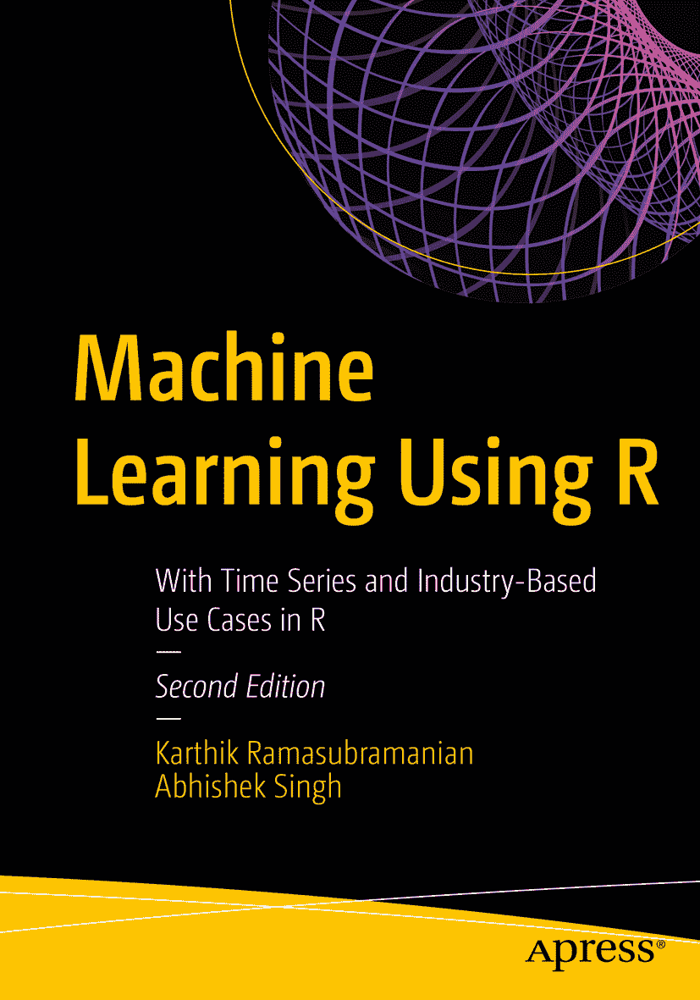

<!--

ISBN 978-1-4842-4214-8 e-ISBN 978-1-4842-4215-5 [doi.org/10.1007/978-1-4842-4215-5](https://doi.org/10.1007/978-1-4842-4215-5) 美国国会图书馆控制号：2018965407
© Karthik Ramasubramanian 和 Abhishek Singh 2019
本作品受版权保护。出版商保留所有权利，无论是涉及材料的全部或部分，特别是翻译、重印、重用插图、朗诵、广播、以缩微胶卷或任何其他物理方式复制，以及以电子方式改编、计算机软件或目前已知或以后开发的类似或不同方法进行传输或信息存储与检索的权利。
本作品受版权保护。出版商保留所有权利，无论是涉及材料的全部或部分，特别是翻译、重印、重用插图、朗诵、广播、以缩微胶卷或任何其他物理方式复制，以及以电子方式改编、计算机软件或目前已知或以后开发的类似或不同方法进行传输或信息存储与检索的权利。
尽管本书中的建议和信息在出版时被认为是真实和准确的，但作者、编辑和出版商均不对可能出现的任何错误或遗漏承担法律责任。出版商对本书所含内容不作任何明示或暗示的保证。
本书通过 Springer Science+Business Media New York 在全球图书贸易中发行，地址：233 Spring Street, 6th Floor, New York, NY 10013。电话：1-800-SPRINGER，传真：(201) 348-4505，电子邮件：orders-ny@springer-sbm.com，或访问 www.springeronline.com。Apress Media, LLC 是一家加利福尼亚有限责任公司，其唯一成员（所有者）是 Springer Science + Business Media Finance Inc (SSBM Finance Inc)。SSBM Finance Inc 是一家特拉华州公司。

*献给我们父母，他们是我们的指路明灯和坚强后盾。*

*也献给我们长久的友谊。*

-->

# 引言

在《使用 R 进行机器学习》第二版中，我们新增了一章关于时间序列建模的内容（第 9 章），这是一个源于统计学的传统主题。第二个新增章节是深度学习（第 11 章），它正迅速成为机器学习的一个子领域。除了这两个新章节外，本书中文本和代码的整体呈现也采用了新的、对读者更友好的格式。

新版继续专注于使用 R（一种流行的统计编程语言）构建用例。对于深度学习等主题，建议采用 Python 并结合 TensorFlow 等框架。然而，在本新版中，我们将向您展示如何使用 R 编程语言与 TensorFlow，从而避免在您只熟悉 R 的情况下学习 Python 的麻烦。

与第一版一样，我们通过各种真实世界的用例保持了机器学习理论与应用的良好平衡，为读者提供了一卷真正全面的机器学习主题合集。

您将学到：
*   使用 R 理解机器学习算法
*   掌握机器学习模型构建的流程
*   机器学习算法的理论基础
*   面向行业的真实世界用例
*   使用 R 进行时间序列建模
*   在 R 中使用 Keras 和 TensorFlow 进行深度学习

## 本书适合谁

本书适合数据科学家、数据科学专业人士以及学术界的研究人员，他们希望使用 R 在实践中理解机器学习方法/算法的细微差别。本书也有助于那些希望了解使用 Apache Hadoop、Hive、Pig 和 Spark 实现可扩展机器学习模型背后技术的读者。

对于任何希望从头到尾理解机器学习模型构建过程的人，本书都是一本全面的指南，包括：
*   R 中概念的实践演示
*   使用 Apache Hadoop 和 Spark 的机器学习模型
*   时间序列分析
*   使用 R 中的 Keras 和 TensorFlow 介绍深度学习模型

## 致谢

我们感谢我们的老师、开源社区和同事们，是他们用知识和信心丰富了我们的思想，使我们能够写出本书的第一版。感谢我们所有的读者。是你们让本书的第二版成为可能。本书中的知识是我们多年研究工作以及在母校和行业中获得专业经验的积累。我们感谢 PSG 理工学院（哥印拜陀）应用数学与计算科学系的 R. Nadarajan 教授和 R. Anitha 教授，感谢他们对我们数据科学领域工作的持续支持和鼓励。

在快速变化的世界中，机器学习领域发展非常迅速，大多数最新进展都是由开源平台驱动的。我们感谢全球所有自由分享知识的开发者和贡献者。我们还要感谢我们过去和现在所在公司的同事们——Snapdeal、德勤、Hike、保德信、Probyto 和马恒达——感谢他们提供了实验和创造尖端数据科学解决方案的机会。

Karthik 特别感谢他的父亲 S Ramasubramanian 先生，他一直是 Karthik 生活中的灵感源泉。他非常感谢他的主管、Snapdeal 数据科学团队总监 Nikhil Dwarakanath 先生，感谢他创造了机会，使 Karthik 成为最优秀的分析专业人士，并激励他承担具有挑战性的项目。

Abhishek 感谢他的父亲 Charan Singh 先生，他是印度气象局的高级科学家，感谢他在 Abhishek 成长时期向他介绍了数据在天气预报中的力量。在个人方面，Abhishek 感谢他的母亲 Jaya、姐姐 Asweta 和弟弟 Avilash 一直以来的精神支持。

我们感谢我们的出版商 Apress，特别是 Celestine 为我们提供了这个机会，感谢 Sanchita Prachi 管理本书的第一版，感谢 Aditee Mirashi 管理第二版，感谢 Poonam 和 Piyush 的审阅，以及制作团队中的每一位成员。

> ——Karthik Ramasubramanian
> 
> ——Abhishek Singh

### 关于作者与技术审稿人

#### 关于作者

#### 关于技术审稿人