# 2. 数据准备与探索

正如我们在介绍性章节中强调的，通过简化的流程应用机器学习算法，本章我们将深入探讨机器学习流程的第一个模块——数据探索与准备。

数据探索这一主题，大约在四十年前由约翰·W·图基在其著作《探索性数据分析》中正式提出。书中讨论的方法非常深刻，但很少有软件程序能涵盖全部内容。图基提出了一些非常有效的数据探索方法，这些方法在构建机器学习模型之前，对于理解数据至关重要。市面上有大量的书籍、文章和软件代码解释数据探索，但我们将重点关注那些能帮助我们更细致地审视数据，并带来有助于模型构建的有用见解的技术。图基在其著作《数据分析的未来》中，将数据分析定义为：

*   分析数据的程序、解释这些程序结果的技术、规划数据收集方式以使其分析更简单、更精确或更准确的方法，以及所有适用于数据分析的（数学）统计学机制和结果。[1]

我们将在本章中详细解读这一定义，但本质上，数据探索大体上涉及查看数据的统计属性，并尽可能绘制出一些非常吸引人的可视化图表，以揭示某些不那么明显的模式。从广义上讲，计算数据的统计属性和可视化是相辅相成的，但我们试图分别给予关注，以充分发挥两者的优势。此外，本章将超越数据探索，涵盖各种可用于准备数据以使其更适合分析和建模的技术，包括缺失数据插补、移除异常值和添加派生变量。这个数据准备过程通常被称为初始数据分析。

本章还探讨了数据整理的过程，以准备和转换数据。一旦数据结构化，我们就可以考虑各种描述性统计，这些统计能更深入地解释数据。为了构建理解数据语言的基本词汇，我们首先讨论变量的基本类型、数据格式和清洁程度。然后，将解释整个数据整理过程，接着是描述性统计。本章最后通过使用 R 语言的演示结束。这些示例有助于看到理论如何通过现实世界的例子变成实际形态。

广义上讲，本章将重点关注 IDA 和 EDA。尽管我们有一个专门讨论数据可视化的章节，而可视化在理解数据中起着关键作用，但 EDA 将在本章中给予可视化应有的重视。

## 2.1 规划数据收集

现实世界中的数据可以有多种类型和格式。它可以是结构化的或非结构化的、可读的或混淆的、小的或大的；然而，牢记最终目标，制定一个良好的数据收集计划，将被证明是有益的，并且可以在数据分析和预测建模过程中节省大量时间。这样的计划需要包含关于变量类型、数据格式和数据来源的大量信息。在本节中，我们描述了许多理解这些数据类型、格式和来源的基础知识。

如今，很多数据都是现成可用的，但一个真正的数据驱动型公司总会有一个战略计划，以确保数据按照他们想要的方式收集。来自商业智能的理念可以帮助设计数据模式、数据立方体和许多有洞察力的报告，但我们的重点是建立一个非常通用的框架，从理解数据类型的细微差别到识别数据来源。

### 2.1.1 变量类型

通常，在任何给定的数据中，我们有两种基本类型的变量：分类变量和连续变量。分类变量包括数据的定性属性，例如性别或国家名称。连续变量是定量的，例如公司员工的薪水。

#### 2.1.1.1 分类变量

分类变量可以分为*名义变量*、*二元变量*和*有序变量*。我们将更详细地解释每种类型。

*   *名义变量*

    这些是具有两个或多个类别，但没有任何顺序考虑的变量。例如，在调查的投票数据中，这可能是州或候选人名称变量。州和候选人的数量是确定的，我们选择呈现数据的顺序无关紧要。换句话说，州或候选人名称的顺序在解释数据的相对重要性方面没有意义。

*   *二元变量*

    名义变量的一种特殊情况，恰好有两个类别，例如性别、单次抛硬币的可能结果、调查问卷中电话号码是手机还是座机的复选框，或者选举输赢的结果（假设没有平局）。

*   *有序变量*

    与名义变量类似，有序变量可以有多个类别，但附加条件是这些类别是有序的。例如，客户对 Netflix 上电影或 Amazon 上产品的评分。评分变量在 1 到 5 的范围内具有相对重要性，1 表示特定客户对电影或产品的最低评分，5 表示最高评分。

#### 2.1.1.2 连续变量

连续变量细分为*间隔变量*和*比率变量*。

*   *间隔变量*

    基本的区别在于它们可以沿着连续范围进行测量，并且具有数值。例如，以摄氏度或华氏度为单位的温度就是一个间隔变量。请注意，0°C 的温度并不是绝对零度，这仅仅意味着 0°C 具有一定的温度度量，而不是说该值表示无或没有度量。

*   *比率变量*

    相比之下，比率变量包括距离、质量和高度。比率反映了你可以使用测量的比值。例如，10 米的距离是 5 米距离的两倍。比率变量的值 0 表示无或没有度量。

### 2.1.2 数据格式

日益增长的数字景观和软件系统的多样性，导致了用于在计算机文件中编码信息或数据的文件格式种类繁多。有许多数据格式被公认为存储信息的黄金标准，并且被广泛使用，独立于任何软件，但还有许多其他格式也在使用中，这通常是因为某个特定软件包的流行。此外，许多特定于科学应用或设备的数据格式也是可用的。

在本节中，我们将讨论常用的数据格式，并使用 R 语言演示如何读取、解析和转换数据。第 [1](http://dx.doi.org/10.1007/978-1-4842-4215-5_1) 章中描述的基本 R 数据类型——如向量、矩阵、数据框、列表和因子——将在本章的所有演示中使用。

#### 2.1.2.1 逗号分隔值

CSV 或 TXT 是最广泛使用的数据交换格式之一，用于存储包含大量行和列的表格数据。根据数据源的不同，行和列具有与之相关的特定含义。典型信息如下例所示，是一家公司的员工数据。在 R 语言中，`read.csv` 函数被广泛用于读取此类数据。参数 `sep` 指定分隔符，`header` 接受 `TRUE` 或 `FALSE`，具体取决于数据集是否包含列名。

```
read.csv("employees.csv", header =TRUE, sep =",")
Code First.Name Last.Name Salary.US.Dollar.
1 15421       John     Smith             10000
2 15422      Peter      Wolf             20000
3 15423       Mark   Simpson             30000
4 15424      Peter    Buffet             40000
5 15425     Martin    Luther             50000
```

#### 2.1.2.2 XLS 文件

Microsoft Excel 文件格式（.xls 或 .xlsx）在商业世界中无可争议地是最流行的数据文件格式。其主要用途与 CSV 文件相同，但 Excel 文件提供了许多丰富的数学计算和优雅的数据展示功能。Excel 具备计算、图表工具、数据透视表以及一种名为 Visual Basic for Applications 的宏编程语言。Excel 的编程功能已被许多行业用于自动化其数据分析和手动计算。Excel 的广泛普及使得许多数据分析软件程序提供了读取 Excel 数据的接口。在 R 语言中读取 Excel 文件有多种方法，但最便捷的方式是使用 `xlsx` 包。

```
library(xlsx)
read.xlsx("employees.xlsx",sheetName ="Sheet1")
Code First.Name Last.Name Salary.US.Dollar.
1 15421       John     Smith             10000
2 15422      Peter      Wolf             20000
3 15423       Mark   Simpson             30000
4 15424      Peter    Buffet             40000
5 15425     Martin    Luther             50000
```

#### 2.1.2.3 可扩展标记语言：XML

标记语言有着非常丰富的演变历史，最早由威廉·W·坦尼克利夫于 1967 年在一次会议上首次使用。随后，查尔斯·戈德法布在 1969 年至 1973 年间将 IBM 通用标记语言正式化。戈德法布通常被视为标记语言之父。标记语言有多种不同形式，包括 TeX、HTML、XML 和 XHTML，并且不断改进以适应众多应用。所有这些标记语言的基础是提供一种用特定句法结构注释文档的系统。

在创建文档时遵循标记语言，可以确保不违反语法规则，并且任何人类或软件阅读器都能准确知道如何解析给定文档中的数据。标记语言的这一特性有着广泛的应用，从设计用于在机器上配置软件的配置文件，到将其用于通信协议。

我们这里关注的是广为人知的可扩展标记语言 XML。任何标记语言都有两个基本结构：第一个是标记，第二个是内容。通常，构成标记的字符串要么以符号 `<` 开头并以 `>` 结尾，要么以字符 `&` 开头并以 `;` 结尾。除此之外的字符串通常是内容。有三种重要的标记类型——标签、元素和属性。

*   *标签*

    标签是一种标记结构，以 `<` 开头并以 `>` 结尾。它有三种类型。
    *   开始标签：`<employee_id>`

    *   结束标签：`</employee_id>`

    *   空标签：`</>`

*   *元素*

    元素是那些要么以开始标签开头并以结束标签结尾（解析时两者需匹配），要么仅包含一个空元素标签的组件。元素示例：
    *   `<employee_id>John </employee_id>`

    *   `<employee_name type=”permanent”/>`

*   *属性*

    在开始标签或空元素标签内，属性是一种由名称/值对组成的标记结构。在以下示例中，元素 `designation` 有两个属性：`emp_id` 和 `emp_name`。
    *   `<designation emp_id="15421" emp_name="John"> Assistant Manager </designation>`

    *   `<designation emp_id="15422" emp_name="Peter"> Manager </designation>`

考虑以下存储马拉松运动员信息的 XML 文件示例。

```

Mike

Two time world champion. Currently, worlds No. 3

Usain

Five time world champion. Currently, worlds No. 1

```

使用 R 语言中的 `XML` 和 `plyr` 包，你可以将此文件转换为 `data.frame`，如下所示：

```
library(XML)
library(plyr)
xml:data <-xmlToList("marathon.xml")
#Excluding "description" from print
ldply(xml:data, function(x) { data.frame(x[!names(x)=="description"]) } )
.id  name age
1 athletes  Mike  25
2 athletes Usain  29
awards titles
1  \n      Two time world champion. Currently, worlds No. 3\n            6
2  \n     Five time world champion. Currently, worlds No. 1\n           17
```

#### 2.1.2.4 超文本标记语言：HTML

超文本标记语言，通常称为 HTML，用于创建网页。一个 HTML 页面，当与层叠样式表（CSS）结合时，可以生成美观的静态网页。通过嵌入用 JavaScript 等语言编写的脚本，网页可以进一步变得动态和交互。当今的现代网站是 HTML、CSS、JavaScript 以及 Flash 播放器等许多更先进技术的结合。根据用途，网站可以利用所有这些元素变得丰富。即使现代网站变得越来越复杂，HTML 的核心网页设计仍然经受住了时间的考验，并不断加入新特性和高级功能。尽管 HTML 现在充满了丰富的样式和优雅，但内容仍然是核心。

不断激增的网站数量使得人们很难找到特定感兴趣主题的相关内容，这正是像谷歌这样的公司看到需求的地方：爬取、抓取网页并对其相关内容进行排名。这个过程会产生大量数据，谷歌利用这些数据来帮助用户进行搜索查询。这类过程利用了 HTML 页面具有独特结构来存储内容和指向外部网页的引用链接这一事实。

大多数网络爬虫和抓取工具会扫描 HTML 文件中的五个关键元素：

*   *页眉*

    一个简单的页眉可能看起来像这样

    ```
    使用 R 进行机器学习

    ```

*   *标题*

    有六个标题标签，从 h1 到 h6，字体大小递减。它们看起来像这样

    ```
    页眉
    标题
    表格
    锚点
    链接
    链接
    ```

*   *段落*

    一个段落可以在单个块中包含多个单词或句子。

    ```
    段落 1
    段落 2
    ```

*   *表格*

    行和列的表格数据可以通过以下标签嵌入到 HTML 表格中

    ```

    定义一行

     <table> 标签声明了主要的表格结构。
     <tbody> 标签指定了表格的主体。
     <th> 标签定义了表格的表头。
     <tr> 标签定义了表格中的每一行数据
    ```

*   *锚点*

    设计者可以使用锚点将 URL 锚定到网页上的某些文本。当用户在浏览器中查看网页时，他们可以点击文本来激活链接并访问该页面。这是一个例子

    ```
     <a href="https://www.apress.com/">欢迎使用 R 进行机器学习！</a>
    ```

有了所有这些元素，一个示例 HTML 文件将如下所示。

```

<html>
<head>
<title>使用 R 进行机器学习</title>
</head>
<body>
希望您阅读本书时玩得开心！！
<h1>第 2 章</h1>
<h2>数据探索与准备</h2>
<a href="https://www.apress.com/">Apress 网站链接</a>
</body>
</html>

```

Python 是用于构建网络抓取工具的最强大的脚本语言之一。尽管 R 也提供了许多包来完成同样的工作，但它并不十分健壮。像谷歌一样，你可以尝试构建一个网络抓取工具，从像上面那样的 HTML 网页中提取所有链接。以下 R 代码片段展示了如何从 HTML 文件中提取 URL。

```
library(XML)
url <- "html_example.html"
doc <-htmlParse(url)
xpathSApply(doc, "//a/@href")
href
"https://www.apress.com/"
```

#### 2.1.2.5 JSON

JSON 是一种在许多应用程序编程接口（如 Facebook Graph API、Google Maps 和 Twitter API）中广泛使用的数据交换格式。它特别用于在服务器和 Web 应用程序之间传输数据，作为 XML 的替代方案。

它也可能用于包含配置文件信息，这些信息可以使用简单的 JSON 格式轻松地在系统组件之间共享。

```
{
"data":[
{
"id": "A1_B1",
"from":{
"name": "Jerry", "id": "G1"
},
"message": "嘿！希望你到目前为止喜欢这本书",
"actions":[
{
"name": "评论",
"link": "http://www.facebook.com/A1/posts/B1"
},
{
"name": "赞",
"link": "http://www.facebook.com/A1/posts/B1"
}
],
"type": "status",
"created_time": "2016-08-02T00:24:41+0000",
"updated_time": "2016-08-02T00:24:41+0000"
},
{
"id": "A2_B2",
"from":{
"name": "Tom", "id": "G2"
},
"message": "是的。一本容易理解的书",
"actions":[
{
"name": "评论",
"link": "http://www.facebook.com/A2/posts/B2"
},
{
"name": "赞",
"link": "http://www.facebook.com/A2/posts/B2"
}
],
"type": "status",
"created_time": "2016-08-03T21:27:44+0000",
"updated_time": "2016-08-03T21:27:44+0000"
}
]
}
```

使用 `rjson` 库，你可以将此类 JSON 文件读入 R，并将数据转换为 `data.frame`。以下 R 代码显示了 `data.frame` 的前三列。

```
library(rjson)
url <- "json_fb.json"
document <-fromJSON(file=url, method="C")
as.data.frame(document)[,1:3]
data.id data.from.name data.from.id
1   A1_B1     Jerry                G1
```

### 2.1.3 数据源的类型

根据数据来源的不同，格式可能会有所不同。有时，识别数据的类型和格式并不直接，但大致分类，我们可能会收集到具有清晰结构的数据。有些可能是半结构化的，而另一些可能看起来完全是垃圾。大规模的数据收集不仅仅是一项工程工作，更是一项重要的技能。

#### 2.1.3.1 结构化数据

结构化数据无处不在，并且总是更容易理解、表示、存储、查询和处理。所以，如果你梦想一个理想的世界，所有数据都将以表格形式存储行和列。围绕各种业务应用、数据库技术、商业智能系统和电子表格工具的广泛发展，产生了大量干净且美观的数据。在数据库的关联模式表中，每一行和每一列都定义良好。来自 CSV 和 Excel 文件的数据通常具有这种内置结构。我们将在本书中展示许多此类数据的示例来解释相关概念。

#### 2.1.3.2 半结构化数据

尽管结构化数据为我们提供了大量的实验空间和易用性，但并非总是能够用行和列来表示信息。从 Twitter 和 Facebook 生成的数据类型已经显著地从传统的关系数据库管理系统（RDBMS）范式（其中一切都有预定义的模式）转向了 NoSQL 的世界（第 [9](http://dx.doi.org/10.1007/978-1-4842-4215-5_9) 章涵盖了一些 NoSQL 系统），其中数据是半结构化的。Twitter 和 Facebook 都严重依赖 JSON 或 BSON（二进制 JSON）。像 MongoDB 和 Cassandra 这样的数据库存储这种 NoSQL 数据。JSON 和 XML 格式是半结构化数据的一些例子。

#### 2.1.3.3 非结构化数据

数据工程中最大的挑战一直是处理非结构化数据，如图像、视频、网络日志和点击流。挑战主要在于处理这种数据生成过程的数据量和速度，更不用说还要寻找模式了。

尽管有许多复杂的软件系统用于处理此类数据，但并没有定义好的流程来将这些数据用于建模或洞察生成。与半结构化数据（我们有大量的 API 和工具将数据处理成所需格式）不同，这里需要花费巨大的精力将数据处理成结构化形式。像 Hadoop 和 Spark 这样的大数据技术经常被用于此类目的。在人类互动产生的非结构化文本数据方面已经取得了显著进展。例如，对推文进行 Twitter 情感分析（在第 [6](http://dx.doi.org/10.1007/978-1-4842-4215-5_6) 章中介绍）。

## 2.2 初始数据分析（IDA）

数据收集是任何数据科学项目中的首要艰巨任务，它构成了第[1](http://dx.doi.org/10.1007/978-1-4842-4215-5_1)章中介绍的机器学习流程的第一个构建模块。数据准备就绪后，接下来就是我们所说的初步调查，或者更正式地称为*初始数据分析*（IDA）。IDA 确保我们的数据干净、正确且完整，以便进行进一步的探索性分析。IDA 的过程包括：为变量准备正确的命名约定和数据类型、检查缺失值和异常值，以及合并来自多个来源的数据，以形成一个连贯的数据源，用于进一步的 EDA。IDA 通常被称为*数据整理*。

人们普遍认为，数据整理会消耗大量时间（约占工作量的 50-80%），并且这是不可忽视的。数据整理不仅仅是一项痛苦的活动，更是从数据中产生理解和洞察的关键步骤。它不仅仅是清理和转换数据的过程，还有助于在利用数据进行重要分析之前，对数据进行丰富和验证。

关于数据整理有许多不同的思路；我们将通过 R 语言的演示来大致解释这些思路。

### 2.2.1 辨别初步印象

整理过程始于从一开始就对数据进行明智且敏锐的审视。这种初步印象有助于建立对模式和趋势的直觉和理解。R 语言中有许多有用的函数，可以帮助你快速清晰地初步掌握数据。

#### 2.2.1.1 str( ) 函数

当你初次查看数据时，R 语言中的 `str()` 函数非常方便。回顾我们之前使用的员工数据，`str()` 的输出将类似于以下 R 代码片段所示。该输出显示了关于数据的四个有用信息。

*   数据中的行数和列数
*   数据中的变量名或列标题
*   每个变量的数据类型
*   每个变量的样本值

根据数据中包含的变量数量，花几分钟或一小时研究这个输出，将有助于对整个数据集产生深刻的理解。

```
emp <-read.csv("employees.csv", header =TRUE, sep =",")
str(emp)
'data.frame':    5 obs. of 4 variables:
$ Code             : int 15421 15422 15423 15424 15425
$ First.Name       : Factor w/ 4 levels "John","Mark",..: 1 4 2 4 3
$ Last.Name        : Factor w/ 5 levels "Buffet","Luther",..: 4 5 3 1 2
$ Salary.US.Dollar.: int 10000 20000 30000 40000 50000
```

#### 2.2.1.2 命名约定：make.names( )

为了在分析和准备阶段保持变量名的一致性，数据集中的变量名遵循标准的 R 命名约定非常重要。这一步至关重要，原因有二：

*   在合并多个数据集时，如果用于合并的公共列具有相同的变量名，将会非常方便。
*   对于任何编程语言来说，为变量使用简洁的名称（不含空格或特殊字符）也是一种良好的实践。

R 语言有一个名为 `make.names()` 的函数。为了演示它，我们先让变量名变得不规范，然后使用 `make.names` 来清理它们。请注意，`read.csv` 函数在将数据加载到 `data.frame` 之前，默认会清理变量名。但是，当我们在程序中对数据执行许多操作时，变量名可能会偏离约定。

```
#手动覆盖命名约定
names(emp) <-c('Code','First Name','Last Name', 'Salary(US Dollar)')

# 查看变量名
emp
Code First Name Last Name Salary(US Dollar)
1 15421       John        Smith           10000
2 15422      Peter         Wolf           20000
3 15423       Mark      Simpson           30000
4 15424      Peter       Buffet           40000
5 15425     Martin       Luther           50000

# 现在使用 make.names 进行清理
names(emp) <-make.names(names(emp))

# 查看清理后的变量名
emp
Code First.Name Last.Name Salary.US.Dollar.
1 15421       John        Smith           10000
2 15422      Peter         Wolf           20000
3 15423       Mark      Simpson           30000
4 15424      Peter       Buffet           40000
5 15425     Martin       Luther           50000
```

你也可以编写自定义的列名，而不是使用 `make.names()` 函数。

#### 2.2.1.3 Table( )：模式或趋势

提前仔细查看数据的另一个重要原因是寻找数据中的某种异常或模式。假设我们想查看员工数据中是否有重复项，或者想找出员工中的常见名字，以便进行一项有趣的 HR 活动来奖励他们。这些任务都可以使用 `table()` 函数来完成。它的基本作用是显示一维或二维表格格式的频率分布。

```
#查找重复项
table(emp$Code)
15421 15422 15423 15424 15425
1     1     1     1     1
#查找常见名字
table(emp$First.Name)
John   Mark Martin Peter
1      1      1     2
```

这清楚地表明没有重复项，而名字 `Peter` 出现了两次。这类模式对于判断数据是否对某些变量存在偏差可能非常有用，这将与我们最终希望从分析中得出的结论相关联。

### 2.2.2 将多个数据源整合为一个

通常，我们问题陈述中的数据并非来自一个地方。世界上丰富的资源和大量的信息总是让我们思考：到目前为止，可用的数据收集中是否缺少了什么？我们称之为数据丰富性与需求之间的权衡。并非所有数据都有用，也并非我们所有的需求都能得到满足。因此，当你认为无法再收集更多数据时，思路就转向了：现在如何将所有数据合并到一个单一的数据源中？这个过程可能是迭代的，意味着需要根据相关性添加或删除某些内容。

#### 2.2.2.1 Merge 和 dplyr 连接

在准备数据时，最有用的操作是将两个不同的数据集连接或合并成一个整体。这个想法很容易与 SQL 查询的各种连接联系起来。关于 SQL 查询的标准文本会详细解释不同形式的连接，但我们将重点介绍 R 语言中可用的函数。让我们讨论一下 R 语言中用于连接两个数据集的两个函数。

我们将使用员工示例的另一个扩展数据集，其中包含部门和学历信息，并将其与已有的员工数据集合并。让我们看看使用 `merge` 和 `dplyr` 实现的四种非常常见的连接类型。尽管输出相同，但 `merge` 和 `dplyr` 的实现之间存在许多差异。`dplyr` 在某种程度上被认为比 `merge` 更高效。`merge()` 函数通过公共列或行名合并两个数据框，或执行其他版本的数据库 `join` 操作，而 `dplyr` 提供了一种灵活的数据操作语法，专注于处理数据框的工具（因此名称中有 `d`）。

##### 2.2.2.1.1 使用 merge 函数

*内连接*：返回在 `emp` 和 `emp-equal` 两个数据框中变量 `code` 存在匹配值的行。

```
merge(emp, emp_qual, by ="Code")
Code First.Name Last.Name Salary.US.Dollar.     Qual
1 15421       John     Smith              10000 Masters
2 15422      Peter      Wolf              20000     PhD
3 15423       Mark   Simpson              30000     PhD
```

*左连接*：返回第一个数据框中的所有行，即使第二个数据框中没有找到变量 `Code` 的匹配值。

```
merge(emp, emp_qual, by ="Code", all.x =TRUE)
Code First.Name Last.Name Salary.US.Dollar.      Qual
1 15421       John     Smith              10000  Masters
2 15422      Peter      Wolf              20000      PhD
3 15423       Mark   Simpson              30000      PhD
4 15424      Peter    Buffet              40000     
5 15425     Martin    Luther              50000     
```

*右连接*：返回第二个数据框中的所有行，即使第一个数据框中没有找到变量 `Code` 的匹配值。

```
merge(emp, emp_qual, by ="Code", all.y =TRUE)
Code First.Name Last.Name Salary.US.Dollar.     Qual
1 15421       John     Smith              10000 Masters
2 15422      Peter      Wolf              20000     PhD
3 15423       Mark   Simpson              30000     PhD
4 15426                              NA     PhD
5 15429                              NA     Phd
```

*全连接*：返回第一个和第二个数据框中的所有行，无论是否找到变量 `Code` 的匹配值。

```
merge(emp, emp_qual, by ="Code", all =TRUE)
Code First.Name Last.Name Salary.US.Dollar.     Qual
1 15421       John     Smith              10000 Masters
2 15422      Peter      Wolf              20000     PhD
3 15423       Mark   Simpson              30000     PhD
4 15424      Peter    Buffet              40000    
5 15425     Martin    Luther              50000    
6 15426                              NA     PhD
7 15429                              NA     Phd
```

请注意，在这些输出中，如果未找到匹配项，相应的值会被填充为 `NA`，这只是一个缺失值。我们将在 IDA 中稍后讨论如何处理此类缺失值。

##### 2.2.2.1.2 dplyr

*内连接*：返回在 `emp` 和 `emp-equal` 两个数据框中变量 `Code` 存在匹配值的行。

```
library(dplyr)
```

```
inner_join(emp, emp_qual, by ="Code")
Code First.Name Last.Name Salary.US.Dollar.     Qual
1 15421       John     Smith              10000 Masters
2 15422      Peter      Wolf              20000     PhD
3 15423       Mark   Simpson              30000     PhD
```

*左连接*：返回第一个数据框中的所有行，即使第二个数据框中没有找到变量 `Code` 的匹配值。

```
left_join(emp, emp_qual, by ="Code")
Code First.Name Last.Name Salary.US.Dollar.     Qual
1 15421       John     Smith              10000 Masters
2 15422      Peter      Wolf              20000     PhD
3 15423       Mark   Simpson              30000     PhD
4 15424      Peter    Buffet              40000    
5 15425     Martin    Luther              50000    
```

*右连接*：返回第二个数据框中的所有行，即使第一个数据框中没有找到变量 `Code` 的匹配值。

```
Right_join(emp, emp_qual, by ="Code")
Code First.Name Last.Name Salary.US.Dollar.     Qual
1 15421       John     Smith              10000 Masters
2 15422      Peter      Wolf              20000     PhD
3 15423       Mark   Simpson              30000     PhD
4 15426                              NA     PhD
5 15429                              NA     Phd
```

*全连接*：返回第一个和第二个数据框中的所有行，无论是否找到变量 `Code` 的匹配值。

```
Full_join(emp, emp_qual, by ="Code",)
Code First.Name Last.Name Salary.US.Dollar.     Qual
1 15421       John     Smith              10000 Masters
2 15422      Peter      Wolf              20000     PhD
3 15423       Mark   Simpson              30000     PhD
4 15424      Peter    Buffet              40000    
5 15425     Martin    Luther              50000    
6 15426                              NA     PhD
7 15429                              NA     Phd
```

请注意，`merge` 和 `dplyr` 函数在各自对应的连接操作中输出完全相同。`dplyr` 在语法上更有意义，但我们不再使用单一的 `merge()` 函数，而是有了四个不同的函数。你还可以看到，`merge` 和 `dplyr` 分别类似于 SQL 查询中的*隐式*和*显式*连接语句。

### 2.2.3 数据清洗

数据整理的关键部分是消除数据中的不一致性，例如缺失值，并在缩写中遵循标准格式。这个过程是从数据中提取最佳信息质量的一种方法。

#### 2.2.3.1 修正因子变量

由于 R 是一种区分大小写的语言，每个具有确定值集合的分类变量（例如我们员工数据集中的变量 `Qual`，其值为 PhD 和 Masters）都需要检查是否存在任何不一致。在 R 中，此类变量被称为*因子*，其中 PhD 和 Masters 是其两个水平。因此，像 PhD 和 Phd 这样的值即使含义相同，也会被区别对待。使用 `table()` 函数进行手动检查将揭示此类模式。修正方法如下：

```
employees_qual <-read.csv("employees_qual.csv")
#不一致
employees_qual
Code    Qual
1 15421 Masters
2 15422     PhD
3 15423     PhD
4 15426     PhD
5 15429     Phd
employees_qual$Qual =as.character(employees_qual$Qual)
employees_qual$Qual <-ifelse(employees_qual$Qual %in%c("Phd","phd","PHd"),
"PhD", employees_qual$Qual)
```

一种更快的标准化值的方法是将每个字符串转换为大写。但是，对于希望保持大小写敏感的字符串，可以遵循前面的示例。

```
#修正后
employees_qual
Code    Qual
1 15421 Masters
2 15422     PhD
3 15423     PhD
4 15426     PhD
5 15429     PhD
```

#### 2.2.3.2 处理 NA 值

NA（“Not Available”的缩写）是缺失值，如果我们一直保留它们直到最后，将始终导致错误的解释、函数输出异常，并导致模型失败。处理 NA 的最佳方法是，如果我们拥有大量数据，则将其删除或忽略。然而，如果我们只有一个小数据集，我们可以考虑特征插补，即填充缺失值的过程。

插补技术吸引了许多研究人员提出新颖的想法，但没有什么能比得上对数据的完全理解所带来的简单性。让我们看看之前使用 merge 函数的一个例子，特别是右连接的输出。对 `First` 和 `Last Name` 进行插补是不可能的，因为这对于我们可能要对数据进行的任何聚合分析可能不相关。相反，对我们来说重要的变量是 `Salary`，我们不希望在其中看到 NA。因此，以下是我们如何为 `Salary` 变量输入一个值的方法。

```
emp                    25000     PhD
5 15429                           25000     PhD
```

这里，思路是特定的资格条件有资格获得类似金额的薪水，但我们确实采取了一定程度的假设，即行业不会根据员工获得学位的机构而对薪水存在偏见。然而，如果存在显著偏见，那么像平均值这样的度量可能不是正确的方法；相反，可以使用中位数之类的度量。我们将在描述性分析部分更详细地讨论这些类型的偏见。

#### 2.2.3.3 处理日期和时间

在许多机器学习模型中，日期和时间变量起着关键作用。日期和时间变量能揭示大量时间行为信息，例如超市或在线商店的销售数据。我们很可能找到诸如超市每日或每周最繁忙时段等信息。此外，我们还可以用不同的变量做同样的事情。通常，处理日期变量是一项痛苦的任务，这主要是因为许多可用的日期格式、时区以及少数国家实行的夏令时。这些挑战使得任何算术计算，例如计算两个日期之间的天数差或比较两个日期值，变得更加困难。

`lubridate` 包是 R 语言中最有用的包之一，它有助于应对这些挑战。由 Grolemund 发表在《*统计软件杂志*》上的论文《用 Lubridate 轻松处理日期和时间》描述了 `lubridate` 包所提供的功能。借用论文中的说法，`lubridate` 帮助用户：

*   识别和解析日期时间数据

*   提取和修改日期时间的组成部分，例如年、月、日、时、分、秒

*   对日期时间和时间跨度执行精确计算

*   处理时区和夏令时

该论文通过大量示例进行了详细描述，因此我们在这里只讨论两种不常见的日期转换，例如处理时区和夏令时。

##### 2.2.3.3.1 时区

如果我们想将标记为印度标准时间（IST）（运行代码的系统的本地时间标准）的日期和时间转换为协调世界时（UTC），我们使用以下代码：

```
library("lubridate")
date <-as.POSIXct("2016-03-13 09:51:48")
date
[1] "2016-03-13 09:51:48 IST"
with_tz(date, "UTC")
[1] "2016-03-13 04:21:48 UTC"
```

##### 2.2.3.3.2 夏令时

正如标准所述，“夏令时（DST）是一种在夏季月份开始时将时钟拨快一小时的做法，以便傍晚的日光延长一小时，同时牺牲正常的日出时间。”

例如，在美国，这一小时的调整发生在当地时间 02:00，因此在春季，时钟会在标准时间 01:59 的最后一刻被重置，向前拨快一小时至夏令时 03:00。那一天只有 23 小时。而在秋季，时钟会在夏令时 01:59 的最后一刻被重置，向后拨回一小时至标准时间 01:00，重复那一小时，因此那一天有 25 小时。数字时钟会跳过 02:00，正好在切换到夏令时的那一刻，从 01:59:59.9 直接跳到 03:00:00.0。

```
dst_time <-ymd_hms("2010-03-14 01:59:59")
dst_time <-force_tz(dst_time, "America/Chicago")
dst_time
[1] "2010-03-14 01:59:59 CST"
```

一秒钟后，芝加哥的时钟显示为：

```
dst_time +dseconds(1)
[1] "2010-03-14 03:00:00 CDT"
```

`force_tz()` 函数会根据我们传递的参数强制更改时区。

### 2.2.4 补充更多信息

最好的模型并非仅靠最初可用的原始数据构建，而是源于从现有变量中衍生新变量所展现的智慧。例如，来自超市销售数据的日期变量可以帮助构建诸如周末（1/0）、工作日（1/0）和银行假日（1/0）等变量，或者将收入和人口等多个变量组合起来可以得出人均收入。这种关于衍生变量的创造力通常来自于丰富的经验和领域专业知识。然而，对于日期等标准变量，可能存在一些通用方法，这里将详细讨论。

#### 2.2.4.1 衍生变量

衍生新变量需要大量的创造力。有时，它需要一个目的和情境，使得衍生变量有助于解释某些行为。例如，在查看任何在线商店的销售趋势时，我们看到某一天的销量突然激增，经过进一步调查，我们发现原因是季末销售的大幅折扣。因此，我们引入一个新的二元变量 `EOS_Sales`，如果存在季末销售，则取值为 `1`，否则为 `0`。这样做，我们可能有助于模型理解为什么销售额会出现突然激增。

#### 2.2.4.2 N 日平均值

另一种有用的衍生变量技术，特别是在股票市场的时间序列数据中，是衍生出诸如 `last_7_days`、`last_2_weeks` 和 `last_1_month` 等变量作为平均股价。这些变量有助于减少像股价这类数据中的变异性，这些变异性有时看起来像噪声，并且可能在很大程度上影响模型的性能。

### 2.2.5 数据重塑

在许多建模练习中，将数据重塑为更有意义和更可用的格式是一种常见做法。这里，我们展示一个来自世界银行的关于*世界发展指标（WDI）*的示例数据集。该数据包含从 1950 年到 2015 年解释发展各种属性的大量变量。这是一个非常丰富且庞大的数据集。

以下是津巴布韦国家 1995 年和 1998 年的一些发展指标及其数值的样本：

```
library(data.table)
WDI_Data <-fread("WDI_Data.csv", header =TRUE, skip =333555, select
=c(3,40,43))
setnames(WDI_Data, c("Dev_Indicators", "1995","1998"))
WDI_Data <-WDI_Data[c(1,3),]
```

发展指标（DI）：

```
WDI_Data[,"Dev_Indicators", with =FALSE]
Dev_Indicators
1: Women's share of population ages 15+ living with HIV (%)
2:  Youth literacy rate, population 15-24 years, female (%)
```

1995 年和 1998 年的 DI 值：

```
WDI_Data[,2:3, with =FALSE]
1995     1998
1: 56.02648 56.33425
2: NA             NA
```

该数据的每一行是一个发展指标，列代表从 1995 年到 1998 年每年的值。现在，使用 `tidyr` 包，我们将重塑这些数据，将 `1995` 和 `1998` 这两列合并为一列，称为 `Year`。当我们看到第 [4](http://dx.doi.org/10.1007/978-1-4842-4215-5_4) 章的数据可视化时，这种转换将非常有用。

```
library(tidyr)
gather(WDI_Data,Year,Value, 2:3)
Dev_Indicators Year     Value
1: Women's share of population ages 15+ living with HIV (%) 1995  56.02648
2:  Youth literacy rate, population 15-24 years, female (%) 1995        NA
3: Women's share of population ages 15+ living with HIV (%) 1998  56.33425
4:  Youth literacy rate, population 15-24 years, female (%) 1998        NA
```

重塑数据的方法有很多种，我们将在本书中通过许多案例研究来介绍这些方法。

## 2.3 探索性数据分析

探索性数据分析（EDA）为在各种数据分析需求中选择合适的描述性方法提供了一个框架。图基在其著作《*探索性数据分析*》（EDA）中强调，应更侧重于利用数据提出假设，而非陷入大量重复的统计假设检验。统计学中的假设检验是一种工具，用于根据数据做出某些确定性的论断，或更正式地说，用于从统计上证明某个见解的显著性。下一节将对此进行更详细的讨论。EDA 为数据探索提供了可视化技术和定量技术。

图基的 EDA 催生了统计理论中两项开创性的发展：稳健统计和非参数统计。这两种思想在重新定义人们对统计学的看法方面发挥了重要作用。统计学不再是一堆复杂的定理和公理，而是一个探索数据的强大工具。因此，在数据经过清洗达到最理想的格式后，我们已准备好深入分析。

表 2-1 展示了一个可用于理解统计学的简单示例。假设有一场大约 26 英里的马拉松比赛，以及 50 名马拉松运动员的完赛时间（以小时计）。参赛者既有世界级的精英马拉松选手，也有全程步行完赛的初次参赛者。

**表 2-1**

来自 marathon.csv 文件的数据片段

| ID | 类型 | 完赛时间 |
| --- | --- | --- |
| 1 | 专业选手 | 2.2 |
| 2 | 初次参赛者 | 7.5 |
| 3 | 常客 | 4.3 |
| 4 | 专业选手 | 2.3 |
| 5 | 常客 | 5.1 |
| 6 | 初次参赛者 | 8.3 |

本节将全程使用此数据集来解释各种探索性分析。

### 2.3.1 汇总统计

在统计学中，我们称之为数据集中任何数值变量的“汇总统计”是数据探索的起点。这些统计量包括最小值、第一四分位数、中位数、均值、第三四分位数和最大值。汇总统计有助于了解数据与均值的偏离程度、变量的平均值、数值范围，以及这些统计量在建模和预处理中可能产生的影响。在 R 中使用 `summary` 函数可以轻松计算所有这些统计量。

```
marathon <-read.csv("marathon.csv")
summary(marathon)
Id                  Type     Finish_Time
Min.   : 1.00   First-Timer :17   Min.   :1.700
1st Qu.:13.25   Frequents   :19   1st Qu.:2.650
Median :25.50   Professional:14   Median :4.300
Mean   :25.50                     Mean   :4.651
3rd Qu.:37.75                     3rd Qu.:6.455
Max.   :50.00                     Max.   :9.000
quantile(marathon$Finish_Time, 0.25)
25%
2.65
```

对于分类变量，`summary` 函数仅给出每个类别的计数，如变量 `Type` 所示。对于数值变量，除了易于理解的最小值和最大值外，我们还有均值、中位数、第一四分位数和第三四分位数。

#### 2.3.1.1 分位数

如果我们将数据总体根据特定数值变量的值分布划分为四个相等的组，那么创建这四个分组的三个值分别称为第一、第二和第三四分位数。换句话说，更通用的术语是*分位数*；q-分位数是将一个有限值集划分为 q 个大小相等的子集的值。

例如，分成四个相等的组意味着一个 3-分位数。在使用中，*百分位数*是一个更广泛使用的术语，它是一种统计度量，表示一组观测值中给定百分比的观测值所落在的值以下。如果我们将某事物分成 100 个相等的组，我们就得到了 99-分位数，这使我们能够将第一四分位数定义为第 25 百分位数，将第三四分位数定义为第 75 百分位数。简单来说，第 25 百分位数或第一四分位数是一个值，低于该值的观测值占 25%。类似地，第 75 百分位数或第三四分位数是一个值，低于该值的观测值占 75%。

第一四分位数：

```
quantile(marathon$Finish_Time, 0.25)
25%
2.65
```

第二四分位数或中位数：

```
quantile(marathon$Finish_Time, 0.5)
50%
4.3
median(marathon$Finish_Time)
[1] 4.3
```

第三四分位数：

```
quantile(marathon$Finish_Time, 0.75)
75%
6.455
```

*四分位距*是第 75 百分位数与第 25 百分位数之差，它包含了数据集中任何特定变量 50% 的数据。四分位距是统计离散程度的稳健度量。我们将在本节后面部分进一步讨论这一点。

```
quantile(marathon$Finish_Time, 0.75, names =FALSE)
-quantile(marathon$Finish_Time, 0.25, names =FALSE)
[1] 3.805
```

#### 2.3.1.2 均值

虽然*中位数*是任何数据分布中心趋势的稳健度量，但*均值*是解释数据分布统计特性的更传统统计量。中位数更稳健，因为一个大的观测值就可能使均值偏离。我们将在下一节正式定义这个统计量。

```
mean(marathon$Finish_Time)
[1] 4.6514
```

正如你所料，`summary` 函数输出列出的汇总统计量（均值和中位数通常被视为中心性度量）按其数值递增顺序排列。其原因从其定义方式来看显而易见。如果你觉得这些统计定义难以理解，别担心；我们将转向可视化来进行解释。虽然我们有一个专门的章节来讨论可视化，但这里我们讨论一些与任何探索性分析理论密不可分的基本图表。

#### 2.3.1.3 频率图

频率图有助于理解离散或连续变量中值的分布。如图 2-1 中的图表所示，我们可以看到有多少初次参赛者、常客和专业选手参加了马拉松比赛。

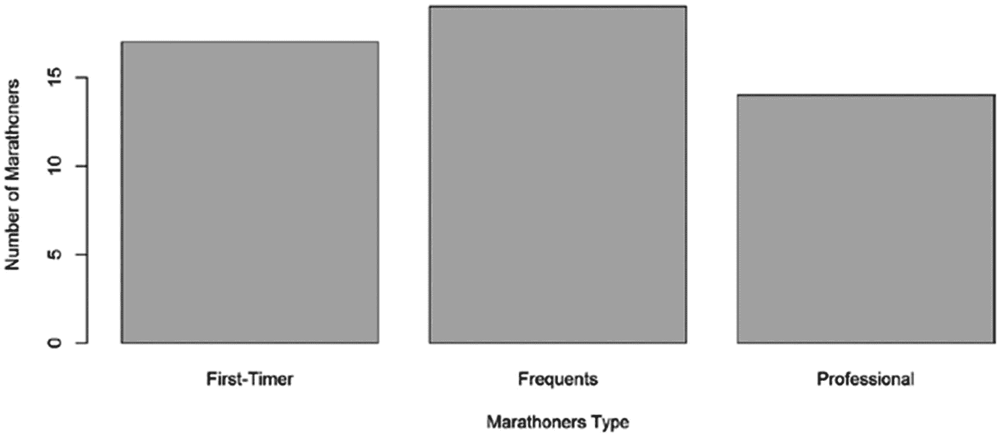

**图 2-1**

每种类型的运动员人数

```
plot(marathon$Type, xlab ="Marathoners Type", ylab ="Number of Marathoners")
```

#### 2.3.1.4 箱线图

*箱线图*是汇总统计的一种可视化形式。虽然查看数字总是有用的，但以视觉上吸引人的图表进行等效表示，可以作为更好地理解、生成见解和简化数据解释的绝佳工具。

在汇总统计中，我们看到了每个变量的值，但无法看出每种类型的跑步者的完赛时间是如何变化的。换句话说，就是类型和完赛时间是如何关联的。图 2-2 清晰地帮助说明了这种关系。正如预期的那样，箱线图清楚地显示，专业选手的完赛时间远优于常客和初次参赛者。

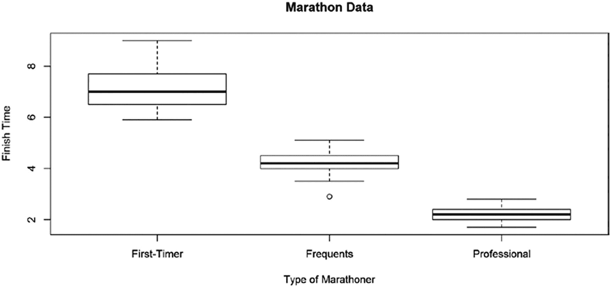

**图 2-2**

箱线图显示每种类型跑步者完赛时间的变化

```
boxplot(Finish_Time ~Type,data=marathon, main="Marathon Data", xlab="Type of
Marathoner", ylab="Finish Time")
```

在图 2-2 中，X 轴显示了参加马拉松比赛的三类人群。Y 轴显示了每类人群的完赛时间。在每个箱体中，上边、下边和粗线分别代表完赛时间的第一四分位数、第三四分位数和中位数。从箱体延伸出的上下两条线分别表示完赛时间的最大值和最小值。

### 2.3.2 矩

除了汇总统计量之外，我们还有其他统计量，如方差、标准差、偏度、峰度、协方差和相关性。这些统计量自然地引导我们去寻找数据中的某种分布。

更正式地说，我们感兴趣的是称为*矩*的定量度量。我们的数据点代表一个概率密度函数，它描述了随机变量取某个给定值的相对可能性。随机变量就是我们数据集中的属性。在马拉松的例子中，我们有`Finish_Time`变量，它描述了每位马拉松运动员的完赛时间。因此，对于概率密度函数，我们关注前五阶矩。

*   零阶矩是总概率（即 1）
*   一阶矩是均值
*   二阶中心矩是方差；其正平方根是标准差
*   三阶矩是偏度
*   四阶矩（经过归一化和平移）是峰度

让我们详细看看二阶、三阶和四阶矩。

#### 2.3.2.1 方差

*方差*是衡量给定一组数字离散程度的指标。方差越小，数字越接近均值；方差越大，数字离均值越远。方差是理解数据分布的重要度量，更正式地称为*概率分布*。在下一章讨论各种抽样技术时，我们将研究样本方差如何被视为总体方差的估计量，这构成了良好抽样方法的基础。根据我们的变量是离散的还是连续的，我们可以定义方差。

从数学上讲，对于一个离散随机变量的一组* n *个等可能数字，方差可以表示如下：

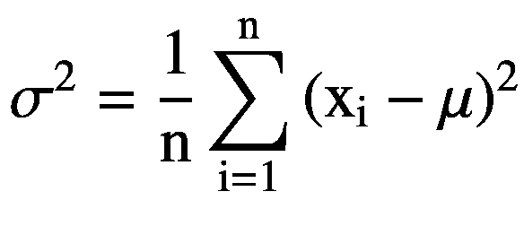

更一般地，如果分布中的每个数字以概率 p[i] 出现，则方差由下式给出：

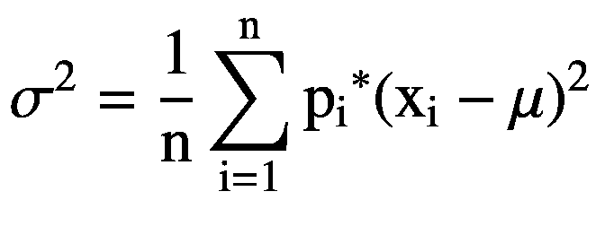

如公式所示，对于每个数据点，我们都在测量该数字与均值的距离，这转化为离散程度的度量。同样地，如果我们取方差的平方根，得到的度量称为*标准差*，通常写作 *sigma*。标准差与变量具有相同的度量单位，这使得它便于与均值进行比较。均值和标准差一起可以用来描述任何数据分布。让我们看看马拉松数据中变量`Finish_Time`的方差。

```
mean(marathon$Finish_Time)
[1] 4.6514
var(marathon$Finish_Time)
[1] 4.342155
sd(marathon$Finish_Time)
[1] 2.083784
```

观察均值和标准差值，我们可以说，平均而言，马拉松运动员的完赛时间为 4.65 ± 2.08 小时。此外，从下面的代码片段中很容易注意到，每种类型的跑者都有自己的跑步速度，因此完赛时间也不同。

```
tapply(marathon$Finish_Time,marathon$Type, mean)
First-Timer    Frequents Professional
7.154118     4.213158     2.207143
tapply(marathon$Finish_Time,marathon$Type, sd)
First-Timer     Frequents Professional
0.8742358     0.5545774    0.3075068
```

#### 2.3.2.2 偏度

正如方差是离散程度的度量，*偏度*衡量的是随机变量概率分布关于均值的不对称性。通常，正如标准定义所述，我们可以观察到两种类型的偏度：

*   *负偏态：* 左尾更长；分布的质量集中在右侧。该分布被称为左偏、左尾或向左偏斜。
*   *正偏态：* 右尾更长；分布的质量集中在左侧。该分布被称为右偏、右尾或向右偏斜。

数学家们围绕均值的二阶和三阶矩来讨论偏度。一个更易于解释的公式可以使用标准差来书写。

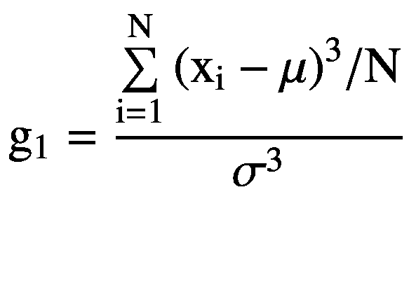

这个偏度公式被称为*费舍尔-皮尔逊偏度系数*。许多软件程序实际上计算的是调整后的费舍尔-皮尔逊偏度系数，可以将其视为一种归一化，以避免偏度值过高或过低：

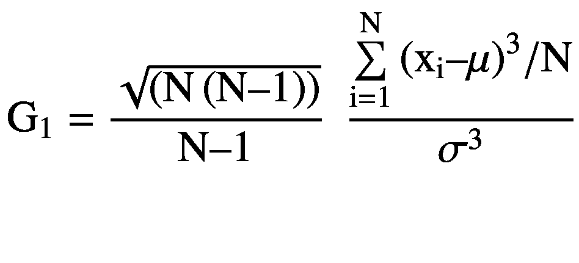

让我们使用 Beta 分布的直方图来演示偏度（见图 2-3）。

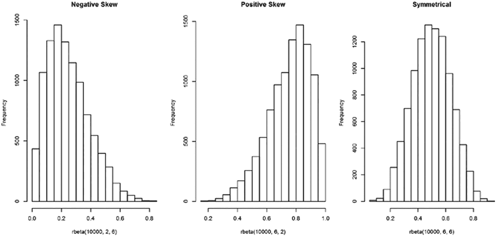

图 2-3

展示对称分布与负偏态和正偏态的分布图

```
library("moments")
par(mfrow=c(1,3), mar=c(5.1,4.1,4.1,1))

# 负偏态
hist(rbeta(10000,2,6), main ="Negative Skew" )
skewness(rbeta(10000,2,6))
[1] 0.7166848

# 正偏态
hist(rbeta(10000,6,2), main ="Positive Skew")
skewness(rbeta(10000,6,2))
[1] -0.6375038

# 对称
hist(rbeta(10000,6,6), main ="Symmetrical")
skewness(rbeta(10000,6,6))
[1] -0.03952911
```

对于我们的马拉松数据，偏度接近于 0，表明分布是对称的。见图 2-4。

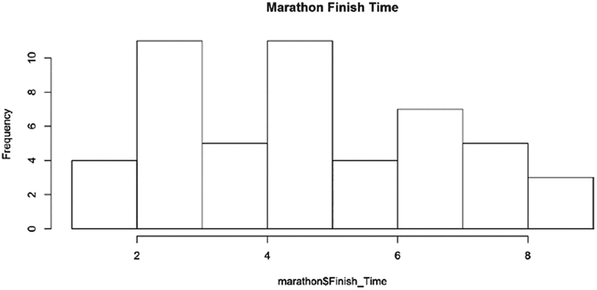

图 2-4

马拉松数据中运动员完赛时间的分布

```
hist(marathon$Finish_Time, main ="Marathon Finish Time")
skewness(marathon$Finish_Time)
[1] 0.3169402
```

#### 2.3.2.3 峰度

*峰度*是衡量随机变量概率分布*尖峭程度*和*尾部厚度*的指标。与偏度类似，峰度也用于描述概率分布函数的形状。换言之，峰度解释的是由少数与均值差异极大的数据点引起的变异性，而非大量与均值差异较小的数据点。数值越高，表示峰值越高越尖锐；数值越低，表示峰值越低越不明显。从数学上讲，峰度是用围绕均值的四阶矩来讨论的。很容易发现，标准正态分布的峰度为 3，这是一种以对称性著称的分布。由于峰度（如同偏度）衡量数据中的任何不对称性，许多人使用以下峰度定义：

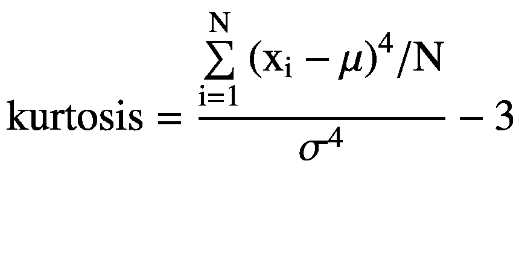

通常，峰度有三种类型：

*   *常峰态*：峰度值接近 3 的分布，这意味着在前述公式中，3 之前的项变为 0，即均值为 0、标准差为 1 的标准正态分布。

*   *低峰态*：峰度值小于 3 的分布。与正态分布相比，峰值较低，尾部较短。

*   *尖峰态*：峰度值大于 3 的分布。与正态分布相比，峰值较高，尾部较长。

尽管许多人经常使用峰度统计量来数值化描述样本，但据说“关于峰度的含义和解释似乎没有普遍共识”。图基建议，与方差和偏度一样，峰度应被视为一个“模糊概念”，可以通过多种方式形式化。参见图 2-5。

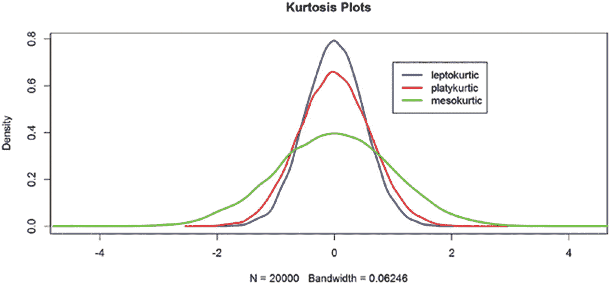

图 2-5

展示使用模拟数据绘制的峰度图

```
#尖峰态
set.seed(2)
random_numbers <-rnorm(20000,0,0.5)
plot(density(random_numbers), col ="blue", main ="Kurtosis Plots", lwd=2.5,
asp =4)
kurtosis(random_numbers)
[1] 3.026302
#低峰态
set.seed(900)
random_numbers <-rnorm(20000,0,0.6)
lines(density(random_numbers), col ="red", lwd=2.5)
kurtosis(random_numbers)
[1] 2.951033
#常峰态
set.seed(3000)
random_numbers <-rnorm(20000,0,1)
lines(density(random_numbers), col ="green", lwd=2.5)
kurtosis(random_numbers)
[1] 3.008717
legend(1,0.7, c("leptokurtic", "platykurtic","mesokurtic" ),
lty=c(1,1),
lwd=c(2.5,2.5),col=c("blue","red","green"))
```

将这些峰度图与马拉松完赛时间进行比较，它呈现低峰态，峰值非常低且尾部短（见图 2-6）。

```
plot(density(as.numeric(marathon$Finish_Time)), col ="blue", main ="KurtosisPlots", lwd=2.5, asp =4)
```

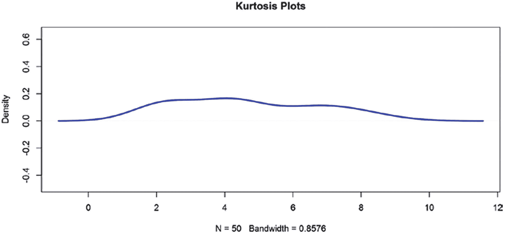

图 2-6

展示马拉松数据中完赛时间的峰度图

```
kurtosis(marathon$Finish_Time)
[1] 1.927956
```

## 2.4 案例研究：信用卡欺诈

为了应用本章迄今解释的概念，本节将介绍信用卡欺诈的模拟数据。该数据大约为 200MB，足以解释所讨论的大部分观点。本书将频繁引用此数据集。因此，如果您有任何跳过本节的想法，我们强烈建议您不要这样做。

### 2.4.1 数据导入

我们将使用`data.table`包。它提供大数据的快速聚合（例如，内存中的 100GB）、快速有序连接、无需复制即可按组快速添加/修改/删除列、列表列以及快速文件读取器（`fread`）。此外，它具有自然且灵活的语法，有助于更快的开发。让我们先看看这个信用卡欺诈数据的样子。

```
library(data.table)
data 
```

`str`函数显示数据集中的变量及少量样本值。以下是九个变量：

*   *custID*：每个客户的唯一标识符

*   *gender*：客户性别

*   *state*：客户居住的美国州

*   *cardholder*：客户持有的信用卡数量

*   *balance*：信用卡余额

*   *numTrans*：迄今为止的交易次数

*   *numIntlTrans*：迄今为止的国际交易次数

*   *creditLine*：金融服务公司，例如 Visa、MasterCard 和 American Express

*   *fraudRisk*：二元变量：`1`表示客户被欺诈，`0`表示其他情况

### 2.4.2 数据转换

此外，很明显像`gender`、`state`和`creditLine`这样的变量被映射为数字标识符。为了更好地理解数据，我们需要将这些数字重新映射回其原始含义。我们可以使用 R 中的`merge`函数来实现这一点。文件`US State Code Mapping.csv`包含每个美国州与数据集中州变量数字的映射。类似地，`Gender Map.csv`和`credit line map.csv`分别包含变量`gender`和`creditLine`的映射。

映射美国各州：

```
library(data.table)
US_state <-fread("US_State_Code_Mapping.csv",header=T, showProgress =FALSE)
data<-merge(data, US_state, by ='state')
```

映射性别：

```
library(data.table)
Gender_map<-fread("Gender Map.csv",header=T)
data<-merge(data, Gender_map, by ='gender')
```

映射信用额度：

```
library(data.table)
Credit_line<-fread("credit line map.csv",header=T)
data<-merge(data, Credit_line, by ='creditLine')
```

设置变量名称并显示新数据：

```
setnames(data,"custID","CustomerID")
setnames(data,"code","Gender")
setnames(data,"numTrans","DomesTransc")
setnames(data,"numIntlTrans","IntTransc")
setnames(data,"fraudRisk","FraudFlag")
setnames(data,"cardholder","NumOfCards")
setnames(data,"balance","OutsBal") setnames(data,"StateName","State")
str(data)
Classes 'data.table' and 'data.frame':   10000000 obs. of 11 variables:
$ creditLine : int  1 1 1 1 1 1 1 1 1 1 ...
$ CustomerID : int  4446 59161 136032 223734 240467 248899 262655 324670
390138 482698 ...
$ NumOfCards : int  1 1 1 1 1 1 1 1 1 1 ...
$ OutsBal    : int  2000 0 2000 2000 2000 0 0 689 2000 0 ...
$ DomesTransc: int  31 25 78 11 40 47 15 17 48 25 ...
$ IntTransc  : int  9 0 3 0 0 0 0 9 0 35 ...
$ FraudFlag  : int  0 0 0 0 0 0 0 0 0 0 ...
$ State      : chr  "Alabama" "Alabama" "Alabama" "Alabama" ...
$ Gender     : chr  "Male" "Male" "Male" "Male" ...
$ CardType   : chr  "American Express" "American Express" "American
Express" "American Express" ...
$ CardName   : chr  "SimplyCash® Business Card from American Express"
"SimplyCash® Business Card from American Express" "SimplyCash® Business Card
from American Express" "SimplyCash® Business Card from American Express" ...
-attr(*, ".internal.selfref")=
-attr(*, "sorted")= chr "creditLine"
```

### 2.4.3 数据探索

由于数据并非过于杂乱，我们设法跳过了本章前面描述的大部分数据整理步骤。然而，在实际问题中，数据转换任务并不容易；它需要付出艰苦的努力和数据工程。我们将在本书后续的案例研究中采用这些方法。在本案例中，我们的数据已准备好进行更详细的探索。让我们开始探索。

```
summary(data[,c("NumOfCards","OutsBal","DomesTransc",
"IntTransc"),with =FALSE])
NumOfCards      OutsBal       DomesTransc       IntTransc
Min.   :1.00   Min.   :    0   Min.   :  0.00   Min.   : 0.000
1st Qu.:1.00   1st Qu.:    0   1st Qu.: 10.00   1st Qu.: 0.000
Median :1.00   Median : 3706   Median : 19.00   Median : 0.000
Mean   :1.03   Mean   : 4110   Mean   : 28.94   Mean   : 4.047
3rd Qu.:1.00   3rd Qu.: 6000   3rd Qu.: 39.00   3rd Qu.: 4.000
Max.   :2.00   Max.   :41485   Max.   :100.00   Max.   :60.000
```

那么，如果我们想了解男性和女性之间交易数量的行为，看起来并没有差异。男性和女性购物频率相同，如图 2-7 所示。

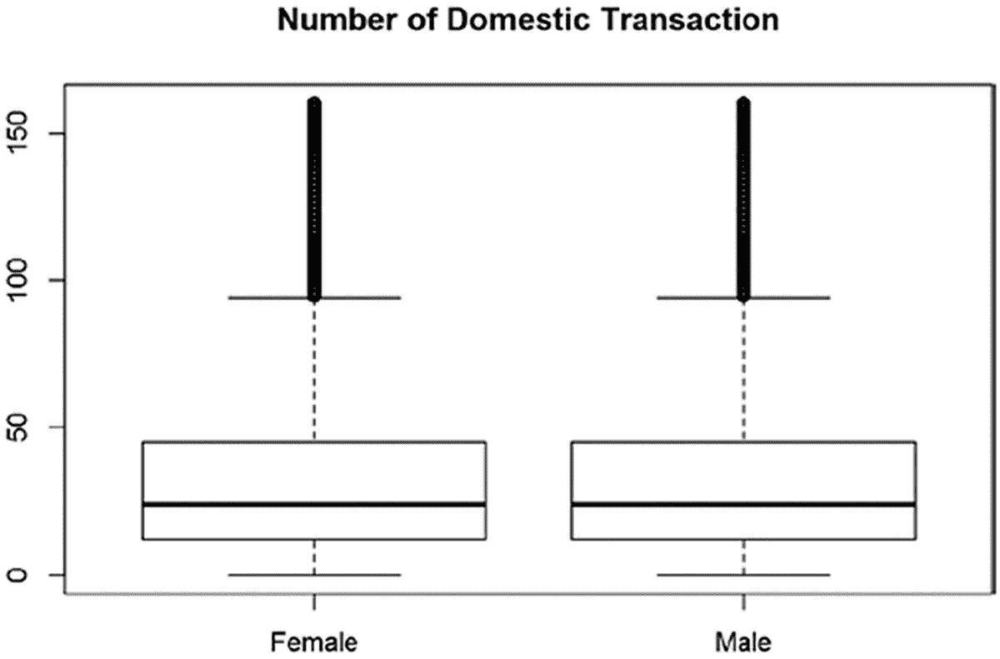

图 2-7

按男性和女性分类的境内交易数量

```
boxplot(I(DomesTransc +IntTransc ) ~Gender, data = data)
title("Number of Domestic Transaction")
```

```
tapply(I(data$DomesTransc +data$IntTransc),data$Gender, median)
Female   Male
24     24
tapply(I(data$DomesTransc +data$IntTransc),data$Gender, mean)
Female     Male
32.97612  32.98624
```

现在让我们看看分类变量的频率。

以下是按卡类型划分的欺诈分布情况。这种频率表告诉我们，对于欺诈案例，哪个分类变量最为突出。

```
table(data$CardType,data$FraudFlag)
0       1
American Express    2325707  149141
Discover             598246   44285
MasterCard          3843172  199532
Visa                2636861  203056
```

从频率表中可以看出，Visa 卡发生的欺诈最多，其次是 MasterCard 和 American Express。Discover 报告的欺诈最少。欺诈数量定义了用于建模的事件率。事件率是事件（即欺诈）数量与每个类别记录数的比例。

类似地，你可以查看欺诈与性别、欺诈与州的频率图。

```
table(data$Gender,data$FraudFlag)
0       1
Female 3550933  270836
Male   5853053  325178
```

男性报告的欺诈更多；男性类别中的欺诈事件率为 325178/(325178+5853053) = 5.2%。同样，女性类别中的事件率为 270836/(270836+3550933) = 7.1%。因此，虽然男性欺诈数量更多，但女性客户的事件率更高。在这两种情况下，事件率都很低，因此我们需要考虑抽样，以便在建模数据集中获得高事件率。

## 2.5 本章小结

在本章中，我们讨论了各种数据准备方法，例如处理缺失值、合并两个数据集、计算派生变量以及处理日期和时间变量。在实际数据集中，数据通常需要大量清洗才能用于获取洞察或构建模型。探索性数据分析提供了一种理解数据各种统计属性的方法，例如均值、方差、标准差、偏度和峰度，这有助于发现异常并生成有用的见解。

在接下来的章节中，我们将解释如何丰富这些数据，以便对其进行建模，并量化这些关系以用于预测模型。下一章将帮助你理解如何减少数据集，同时增强其属性，以便能够应用机器学习算法。

虽然通常认为数据越多意味着模型越好，但有时可能没有足够的数据量，或者计算能力有限，只能允许特定大小的数据集。在这种情况下，统计方法可以帮助抽样出一个精确且信息丰富的子集，而不会过多地影响模型质量。第 [3](http://dx.doi.org/10.1007/978-1-4842-4215-5_3) 章重点介绍了许多有助于实现这一目标的抽样技术。

