# 3. 抽样与重抽样技术

在第 [2](http://dx.doi.org/10.1007/978-1-4842-4215-5_2) 章中，我们介绍了数据导入和探索技术的概念。现在你已经掌握了从不同来源加载数据以及以适当格式存储数据的技能。在本章中，我们将讨论重要的数据抽样方法及其在机器学习算法中的重要性。抽样是我们机器学习流程中的一个重要模块，它服务于双重目的：在数据收集过程中节省成本，以及在不削弱机器学习模型能力的情况下降低计算成本。

> *“对正确问题的近似答案，远比对一个近似问题的精确答案有价值得多。”*
>
> ——约翰·图基

约翰·图基的这句话非常契合抽样的精神。随着技术进步带来了大规模数据存储能力，应用机器学习技术的增量成本是巨大的。抽样帮助我们在处理海量数据的成本与结果的边际改进之间取得平衡。与普遍认为抽样仅用于将海量数据缩减到可管理规模的看法相反，抽样对于改进从小样本中获取的统计信息也至关重要。通常，机器学习处理的是海量数据，但像自助抽样这样的概念也能帮助你从小样本情况中获取洞察。

本章的学习目标如下：

*   抽样简介

*   抽样术语

*   非概率抽样与概率抽样

*   抽样的商业意义

*   关于样本统计量的统计理论

*   重抽样简介

*   蒙特卡洛方法：接受-拒绝抽样

*   计算时间节省示例

不同的抽样技术将使用第 [2](http://dx.doi.org/10.1007/978-1-4842-4215-5_2) 章中介绍的信用卡欺诈数据进行说明。

## 3.1 抽样简介

抽样是一个从目标总体中选择单元的过程，使得样本能够以统计置信度推广至总体。例如，如果一家在线零售商想要了解过去 12 个月内在线购物的平均客单价，我们可能不想计算总体（对于大型零售商而言，这可能涉及数百万个数据点）的平均客单价，而是可以选取过去 12 个月内具有代表性的购买样本，并估算该样本的平均值。然后，样本平均值可以以一定的统计置信度推广至总体。统计置信度会根据所使用的抽样技术和样本量而变化。

通常，抽样技术应用于两种场景：一是为建模创建可管理的数据集，二是汇总总体统计量。以下两大分类可作为抽样的目标：

*   模型抽样

*   调查抽样

图 3-1 展示了这两个业务目标之间的区别。样本调查的设计与评估不在本书的讨论范围内，因此我们将只关注模型抽样。

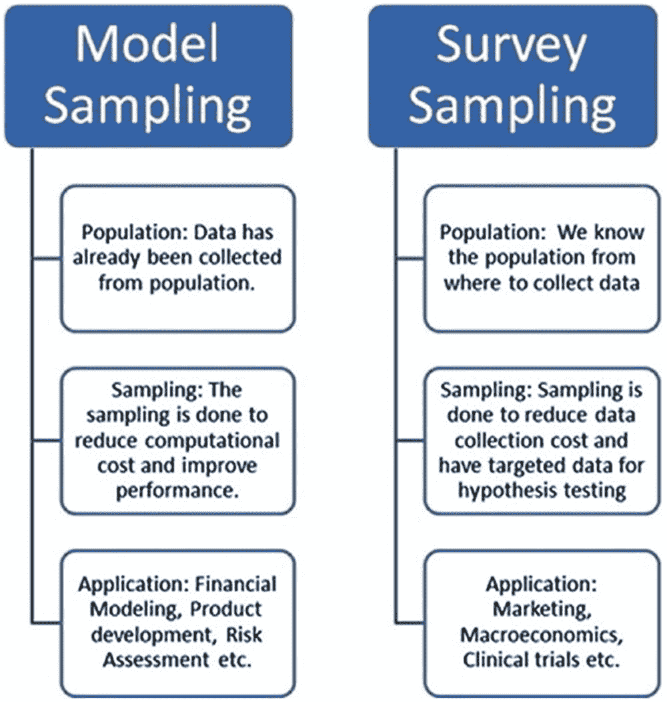

**图 3-1 抽样的目标**

这种分类也有助于确定抽样的最终目标。这有助于选择正确的抽样方法和合适的探索性技术。在机器学习模型构建流程的背景下，我们的重点将放在模型抽样上。假设数据已经收集完毕，我们的最终目标是从这些数据中获取洞察，而不是设计一个系统性的调查来收集数据。

## 3.2 抽样术语

在深入探讨抽样的细节之前，让我们先定义一些本书中将使用的基本抽样术语。第 [1](http://dx.doi.org/10.1007/978-1-4842-4215-5_1) 章讨论的统计学和概率概念将有助于理解这些抽样术语。本节列出了抽样中的定义和数学公式。

### 3.2.1 样本

*样本*是从母体总体中选择的一组单元或个体，用于提供关于该总体的一些有用信息。这些信息可以是分布的一般形态、基本统计量、总体分布参数的属性，或某些高阶矩的信息。此外，样本还可用于估计假设检验的检验统计量。一个具有代表性的样本可用于估计总体的属性或对总体参数进行建模。

例如，国家抽样调查组织（NNSO）通过联系有限的家庭来收集关于失业率的样本数据，然后利用该样本提供全国失业率数据。

### 3.2.2 抽样分布

特定大小样本的均值分布称为均值的*抽样分布*；类似地，相应样本方差的分布称为方差的抽样分布。这些分布是进行任何类型假设检验的基本要求。

### 3.2.3 总体均值与方差

*总体均值*是总体数据的算术平均值。所有数据点以相等的权重对总体均值做出贡献。类似地，总体方差是使用数据中所有数据点计算得出的方差。

总体均值：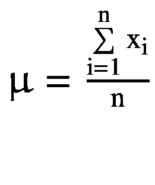

总体方差：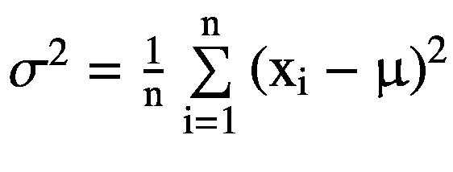

### 3.2.4 样本均值与方差

从总体中抽取的任何子集都是一个样本。从该样本中获得的均值和方差称为*样本统计量*。当使用样本估计分布参数时，会用到自由度的概念；因此，你会看到样本方差的公式中分母与总体方差不同。

样本均值：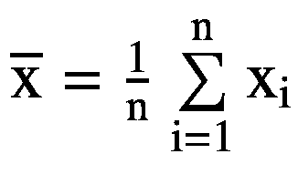

样本方差：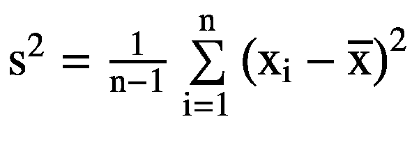

### 3.2.5 合并均值与方差

对于从同一总体中抽取的 `k` 个样本，其大小分别为 `n[1]`、`n[2]`、`n[3]`、…、`n[k]`，估计的总体均值和方差定义如下。

估计总体均值：


估计总体方差：


在现实情况中，我们通常可以在不同的空间/地点和时间点从同一总体中抽取多个样本。例如，假设我们需要估计一个城市中书店老板的平均收入。我们会在不同时间点从城市的不同区域获取书店老板收入的样本。在稍后的时间点，我们可以使用合并均值和方差，将来自不同样本的个体均值和方差结合起来，以得到总体的估计值。

### 3.2.6 样本点

抽样实验中的一个可能结果称为*样本点*。在许多类型的抽样中，总体中的所有数据点并非都是样本点。

当抽样设计变得复杂时，样本点就显得尤为重要。研究人员可能希望将某些观测值排除在抽样之外，或者抽样过程本身的设计可能会使不期望的数据点被选中的概率降低。例如，假设你有一个性别数据，其可能值为男、女和未知。你可能希望将所有“未知”值作为错误丢弃，这就是将观测值排除在抽样之外。或者，如果数据量很大且“未知”值占比非常小，那么抽样到它们的概率可以忽略不计。在这两种情况下，“未知”都不是一个样本点。

### 3.2.7 抽样误差

总体统计量的真实值与样本统计量之间的差异即为*抽样误差*。这一误差是由于估计值来自样本而产生的。

例如，假设根据人口普查数据，波士顿居民月平均收入为 3,000 美元（总体均值）。那么，我们可以说收入的真实均值为 3,000 美元。假设一家市场调研公司对波士顿居民进行了一次小型调查，发现该小型调查的样本平均收入为 3,500 美元。那么抽样误差即为 3,500 美元 - 3,000 美元，等于 500 美元。我们的样本估计高估了平均收入，这也表明该样本并非总体的真实代表。

### 3.2.8 抽样比

*抽样比*是样本量与总体量之比，即 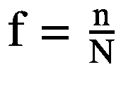。

例如，如果你的总体规模为 500,000，并且你想从中抽取一个 2,000 的样本，那么抽样比将为 f = 2,000/50,000 = 0.04。换句话说，即对总体的 4% 进行了抽样。

### 3.2.9 抽样偏差

当来自总体的样本单元不具备总体的特征（即不能反映总体）时，就会发生*抽样偏差*。抽样偏差会导致样本无法代表总体。

回到抽样误差的例子，我们发现样本平均收入远高于人口普查平均收入（真实平均值）。这意味着我们的抽样设计偏向于波士顿的高收入居民。在这种情况下，我们的样本并不能真实代表波士顿居民。

### 3.2.10 无放回抽样

无放回抽样需要满足两个条件：

- 每个单元/样本点被选中的概率是有限的非零概率
- 一旦某个单元被选中，它就会从总体中移除

换句话说，所有单元被抽中的概率是有限的，并且严格只能被抽中一次。

例如，如果我们有一个装有 10 个球的袋子，上面标有数字 1 到 10，那么在无放回的随机抽样中，每个球被选中的概率为 1/10。假设我们必须从袋子中选出三个球，那么每次选择后，随着袋中剩余球数的减少，被选中的概率会增加。因此，第一个球被选中的概率是 1/10，第二个是 1/9，第三个是 1/8。

### 3.2.11 有放回抽样

有放回抽样与无放回抽样的区别在于，同一个样本中一个单元可以被多次抽样。有放回抽样需要满足两个条件：

- 每个单元/样本点被选中的概率是有限的非零概率
- 一个单元可以被多次选中，因为抽样总体始终相同

在有放回抽样中，一个单元可以被多次抽样，并且每次被抽中的概率相同。这种抽样方式实际上将总体规模扩展到了无穷大，因为你可以通过这种方法创建任意数量、任意大小的样本。回到我们之前在无放回抽样中的例子，如果我们需要用有放回抽样选择三个球，每个球被抽中的有限概率完全相同，都是 1/10。

这里需要注意的重要一点是，有放回抽样在技术上使得总体规模无限大。在选择有放回抽样时要小心，因为在大多数情况下，每个观测值都是唯一的，重复计数会在数据中产生偏差。本质上，这意味着你允许观测值重复。例如，样本中有 100 个人具有相同的姓名、收入、年龄和性别，这将在数据集中产生偏差。

### 3.3 信用卡欺诈：总体统计量

信用卡欺诈数据集是说明如何为机器学习算法构建抽样计划的一个很好的例子。该数据集非常庞大，包含 1000 万行数据和多个特征。本节将展示如何针对该数据集计算和解释总体的关键抽样度量。将展示以下统计度量：

- 总体均值
- 总体方差
- 合并均值与方差

为了解释这些度量，我们选择未结余额特征作为我们关注的量。

### 3.4 数据描述

以下是第 [2](http://dx.doi.org/10.1007/978-1-4842-4215-5_2) 章的快速回顾，用于描述信用卡欺诈数据中的以下变量：

- `custID`：每个客户的唯一标识符
- `gender`：客户性别
- `state`：客户居住的美国州
- `cardholder`：客户持有的信用卡数量
- `balance`：信用卡上的余额
- `numTrans`：迄今为止的交易次数
- `numIntlTrans`：迄今为止的国际交易次数
- `creditLine`：金融服务公司，例如 Visa、MasterCard 或 American Express
- `fraudRisk`：二元变量：`1` 表示客户正在遭受欺诈，`0` 表示未遭受欺诈

从 CSV 文件读取后，`data.frame` 的结构可以使用 `str(data)` 进行查看。

```
str(data)
Classes 'data.table' and 'data.frame':   10000000 obs. of 14 variables:
$ creditLine : int  1 1 1 1 1 1 1 1 1 1 ...
$ gender     : int  1 1 1 1 1 1 1 1 1 1 ...
$ state      : int 1 1 1 1 1 1 1 1 1 1 ...
$ CustomerID : int 4446 59161 136032 223734 240467 248899 262655 324670
390138 482698 ...
$ NumOfCards : int 1 1 1 1 1 1 1 1 1 1 ...
$ OutsBal    : int 2000 0 2000 2000 2000 0 0 689 2000 0 ...
$ DomesTransc: int 31 25 78 11 40 47 15 17 48 25 ...
$ IntTransc  : int 9 0 3 0 0 0 0 9 0 35 ...
$ FraudFlag  : int 0 0 0 0 0 0 0 0 0 0 ...
$ State      : chr "Alabama" "Alabama" "Alabama" "Alabama" ...
$ PostalCode : chr "AL" "AL" "AL" "AL" ...
$ Gender     : chr "Male" "Male" "Male" "Male" ...
$ CardType   : chr "American Express" "American Express" "American Express" "American Express" ...
$ CardName   : chr "SimplyCash® Business Card from American Express"
"SimplyCash® Business Card from American Express" "SimplyCash® Business Card
from American Express" "SimplyCash® Business Card from American Express" ...
- attr(*, ".internal.selfref")=
- attr(*, "sorted")= chr "creditLine"
```

如前所述，我们选择未结余额作为我们关注的变量/特征。在数据描述的 `str()` 输出中，我们可以看到未结余额存储在一个名为 `OutsBal` 的变量中，其类型为 `integer`。作为一个连续变量，可以为此变量定义均值和方差。

### 3.5 总体均值

均值是衡量任何数据分布集中趋势的更传统统计量。在信用卡欺诈数据集中，我们客户的未结余额均值结果为 4,109.92 美元。这是我们对总体的初步了解。总体均值告诉我们，平均而言，客户卡上的未结余额为 4,109.92 美元。

```
Population_Mean_P <-mean(data$OutsBal)
```

卡上的平均未结余额为 4,109.92 美元。

### 3.6 总体方差

方差是衡量给定数字集合离散程度的指标。方差越小，数字越接近均值；方差越大，数字离均值越远。对于未结余额，方差为 15,974,788，标准差为 3,996.8。方差本身不能在不同总体或样本之间进行比较。方差需要结合分布的均值一起看待。标准差是另一个度量，它等于方差的平方根。

```
Population_Variance_P <-var(data$OutsBal)
```

平均未结余额的方差为 15,974,788。

未结余额的标准差为 3,996.847 美元。

### 3.7 合并均值与方差

当从同一总体中独立抽取多个样本时，合并均值与合并方差分别用于估计总体均值与总体方差。为了说明合并均值与方差与真实总体均值及方差的对比，我们将首先创建五个随机样本，其大小分别为 10K、20K、40K、80K 和 100K，并计算它们的均值与方差。

利用这些样本，我们将通过合并均值与方差公式来估计总体均值与方差。合并值之所以有用，是因为单个样本的估计可能产生较大的抽样误差，而如果我们从同一总体中抽取多个样本，抽样误差就会减小。以集合方式进行估计将更接近真实的总体统计量。

### R 代码实现

在以下 R 代码片段中，我们使用 `sample()` 函数创建五个随机样本。`sample()` 是一个内置函数，本书中已多次使用。另需注意，`sample()` 函数依赖于某个随机种子值，因此若希望生成与本书相同的样本观测值，请在 R 中使用 `set.seed(937)` 函数。这将确保每次运行代码时都能得到相同的随机样本。

```r
set.seed(937)
i<-1
n<-rbind(10000,20000,40000,80000,100000)
Sampling_Fraction<-n/nrow(data)
sample_mean<-numeric()
sample_variance<-numeric()
for(i in 1:5)
{
  sample_100K <-data[sample(nrow(data),size=n[i], replace =FALSE, prob
=NULL),]
  sample_mean[i]<-round(mean(sample_100K$OutsBal),2)
  sample_variance[i] <-round(var(sample_100K$OutsBal),2)
}
Sample_statistics <-cbind (1:5,c('10K','20K','40K','80K','100K'),sample_
mean,sample_variance,round(sqrt(sample_variance),2),Sampling_Fraction)
knitr::kable(Sample_statistics, col.names =c("S.No.", "Size","Sample_
Mean","Sample_Variance","Sample SD","Sample_Fraction"))
```

### 样本统计量

在表 3-1 中，展示了五个样本的基本属性。样本量最大的组其抽样分数最高。值得注意的一个良好现象是：随着样本量增大，样本方差逐渐减小。

表 3-1 样本统计量

| 序号 | 大小 | 样本均值 | 样本方差 | 样本标准差 | 抽样分数 |
| --- | --- | --- | --- | --- | --- |
| 1 | 10K | 4092.48 | 15921586.32 | 3990.19 | 0.001 |
| 2 | 20K | 4144.26 | 16005696.09 | 4000.71 | 0.002 |
| 3 | 40K | 4092.28 | 15765897.18 | 3970.63 | 0.004 |
| 4 | 80K | 4127.18 | 15897698.44 | 3987.19 | 0.008 |
| 5 | 100K | 4095.28 | 15841598.06 | 3980.15 | 0.01 |

### 计算合并统计量

现在，我们使用合并均值与方差公式，根据从总体中抽取的五个样本来计算总体均值，然后将其与总体均值及方差进行比较。

```r
i<-1
Population_mean_Num<-0
Population_mean_Den<-0
for(i in 1:5)
{
  Population_mean_Num =Population_mean_Num +sample_mean[i]*n[i]
  Population_mean_Den =Population_mean_Den +n[i]
}
Population_Mean_S<-Population_mean_Num/Population_mean_Den
cat("The pooled mean ( estimate of population mean) is",Population_Mean_S)
The pooled mean ( estimate of population mean) is 4108.814
```

合并均值为 $4,108.814。现在我们应用相同的过程，根据样本计算合并方差。此外，我们还将展示标准差作为额外列，以便使离散程度与均值度量具有可比性。

```r
i<-1
Population_variance_Num<-0
Population_variance_Den<-0
for(i in 1:5)
{
  Population_variance_Num =Population_variance_Num +(sample_
variance[i])*(n[i] -1)
  Population_variance_Den =Population_variance_Den +n[i] -1
}
Population_Variance_S<-Population_variance_Num/Population_variance_Den
Population_SD_S<-sqrt(Population_Variance_S)
cat("The pooled variance (estimate of population variance) is", Population_
Variance_S)
The pooled variance (estimate of population variance) is 15863765
cat("The pooled standard deviation (estimate of population standard
deviation) is", sqrt(Population_Variance_S))
The pooled standard deviation (estimate of population standard deviation)
is 3982.934
```

合并标准差为 $3,982.934。现在我们同时拥有了合并统计量和总体统计量。接下来，我们对两者进行比较，看看合并统计量对总体统计量的估计效果如何。

```r
SamplingError_percent_mean<-round((Population_Mean_P -sample_mean)/
Population_Mean_P,3)
SamplingError_percent_variance<-round((Population_Variance_P -sample_
variance)/Population_Variance_P,3)
Com_Table_1<-cbind(1:5,c('10K','20K','40K','80K','100K'),Sampling_
Fraction,SamplingError_percent_mean,SamplingError_percent_variance)
knitr::kable(Com_Table_1, col.names =c("S.No.","Size","Sampling_
Frac","Sampling_Error_Mean(%)","Sampling_Error_Variance(%)"))
```

表 3-2 展示了总体均值与方差相对于每个单独样本的比较。样本越大，均值估计越接近真实的总体估计。

表 3-2 样本与总体统计量对比

| 序号 | 大小 | 抽样分数 | 均值抽样误差(%) | 方差抽样误差(%) |
| --- | --- | --- | --- | --- |
| 1 | 10K | 1000 | 0.004 | 0.003 |
| 2 | 20K | 500 | -0.008 | -0.002 |
| 3 | 40K | 250 | 0.004 | 0.013 |
| 4 | 80K | 125 | -0.004 | 0.005 |
| 5 | 100K | 100 | 0.004 | 0.008 |

### 合并统计量与总体统计量对比

为合并统计量与总体统计量创建相同的对比视图。差异以合并/样本统计量与真实总体统计量之间的百分比差异表示。

表 3-3 总体均值与样本均值差异

| 总体均值 `_P` | 总体均值 `_S` | 均值抽样误差百分比 |
| --- | --- | --- |
| 4109.92 | 4108.814 | 0.000269 |

表 3-4 总体方差与样本方差

| 总体方差 `_P` | 总体方差 `_S` | 方差抽样误差百分比 |
| --- | --- | --- |
| 15974788 | 15863765 | 0.0069499 |

## 3.8 抽样的业务影响

抽样在模型开发和决策的多个阶段都有应用。抽样方法和解读由业务约束以及为推断检验所选择的统计方法共同驱动。数据科学家需要在业务影响与统计结果保持有效性和相关性之间寻求微妙的平衡。大多数情况下，问题由业务方提出，数据科学家必须有针对性地开展工作来解决问题。

例如，假设业务方想知道客户为何不再访问他们的网站。这个问题将决定抽样的具体方式。为了解客户为何不再回来，你真的需要从全体客户中抽取一个具有代表性的样本吗？还是只抽取那些未回访的客户样本？或者，你更倾向于只研究回访客户的样本，然后否定其结果？为什么不创建一个包含所有回访和未回访客户的定制混合样本？正如你所见，这些问题中的大部分，连同时间、成本、计算能力等实际限制，都将成为决定如何为此问题收集数据的关键因素。

合并均值接近总体的真实均值。这表明，在拥有多个样本的情况下，合并统计量更有可能捕获真实的统计值。你现在已经看到，与总体相比如此小的样本，是如何给出与总体估计如此接近的估计值的。

这个例子是否为你提供了一种通过使用小样本来处理大数据的工具？到现在，你可能已经开始思考使用抽样的成本效益分析。这对于处理数百万数据点的机器学习算法来说非常相关。更多的数据点并不一定意味着所有数据点都包含有意义的模式/趋势/信息。抽样将试图帮你摆脱数据杂草，并帮助你专注于对机器学习有意义的数据集。

```r
SamplingError_percent_mean<-(Population_Mean_P -Population_Mean_S)/
Population_Mean_P
SamplingError_percent_variance<-(Population_Variance_P -Population_
Variance_S)/Population_Variance_P
Com_Table_2 <-cbind(Population_Mean_P,Population_Mean_S,SamplingError_
percent_mean)
Com_Table_3 <-cbind(Population_Variance_P,Population_
Variance_S,SamplingError_percent_variance)
knitr::kable(Com_Table_2)
knitr::kable(Com_Table_3)
```

### 3.8.1 抽样的局限性

*   抽样偏差可能导致错误的推断

*   由于规模、类型和要求，代表性抽样并非总是可行

*   抽样并非精确科学，而是在一定置信区间内的近似

*   在抽样调查中，我们面临人为错误、回应不足以及受访者缺失等问题

## 3.9 概率抽样与非概率抽样

抽样方法在很大程度上取决于我们想用样本做什么：是想生成关于总体参数的假设，还是想检验一个假设。我们将抽样方法分为两大类——概率抽样和非概率抽样。图 3-2 中的对比展示了它们之间的主要区别。

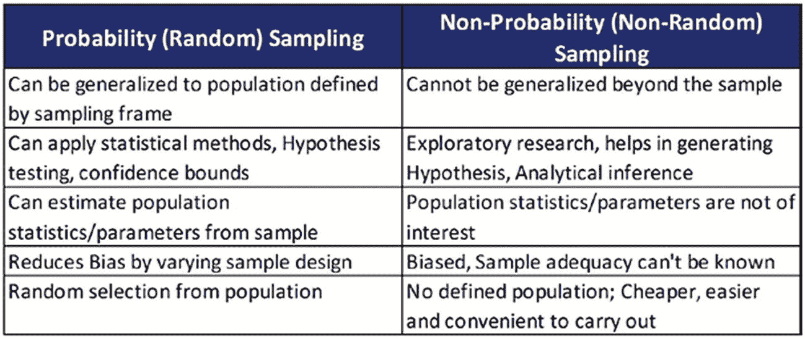

图 3-2

概率抽样与非概率抽样

在*概率抽样*中，抽样方法以某个有限概率抽取每个单元。将总体单元映射到样本单元的抽样框，是基于用于抽样的随机变量的概率分布创建的。这类方法常用于模型抽样，并且具有很高的可靠性来推断总体。它们消除了参数估计中的偏差，并且可以推广到总体。与非概率抽样相反，我们需要事先了解总体才能从中抽样。这使得该方法成本高昂，有时难以实施。

*非概率*抽样是基于专家和业务需求的主观判断进行的抽样。这是一种流行的方法，适用于业务需求无需与统计要求保持一致，或者难以创建概率抽样框的情况。非概率抽样方法不向总体单元分配概率，因此从样本中得出的推断变得非常不可靠。由于样本不能代表总体，非概率抽样会偏向于选定的类别。非概率方法更常用于对新总体特征的探索性研究，这些特征之后可以用更严格的统计方法进行检验。与概率技术相比，使用非概率技术无法准确估计总体参数。

### 3.9.1 非概率抽样的类型

在本节中，我们简要介绍三种主要的非概率抽样方法。由于这些技术更适用于调查样本，我们将不进行详细讨论。

#### 3.9.1.1 便利抽样

在便利抽样中，专家会选择容易获取的数据。这种技术成本最低，耗时也最少。就我们的案例而言，假设纽约州的数据可以获取，但其他州的数据不易获取。于是我们选择一个州的数据来研究整个美国。这个样本将不是总体的代表性样本，并且会存在偏差。其洞察结果也无法推广到整个总体。然而，该样本可能允许我们创建一些假设，之后可以使用来自所有州的随机样本进行检验。

#### 3.9.1.2 目的性抽样

当抽样由专家的主观判断驱动时，称为目的性抽样。在这种方法中，专家会抽取那些有助于他建立待检验假设的单元。就我们的案例而言，如果研究人员只对查看美国运通卡感兴趣，他就会简单地从该卡类型的记录池中选择一些单元。此外，目的性抽样方法有很多种，例如最大方差抽样、极端案例抽样、同质抽样等，但本书不讨论这些方法，因为它们缺乏总体的代表性，而无偏的机器学习方法需要这种代表性。

#### 3.9.1.3 配额抽样

顾名思义，配额抽样基于为每种案例类型预设的配额，该配额通常由专家决定。为抽样设定配额网格可以确保被抽样对象具有平等或成比例的代表性。这种技术在营销活动设计、A/B 测试和新功能测试中很流行。

在本章中，我们使用信用卡欺诈数据中的示例来介绍抽样方法。我们鼓励你结合手头的业务问题，探索更多的非概率抽样方法。有时经验可以胜过统计，因此非概率抽样在许多用例中同样重要。

## 3.10 关于抽样分布的统计理论

抽样技术的有效性源于统计学中成熟的定理和久经考验的方法。为了研究抽样分布，我们需要理解统计学中的两个重要定理：

*   大数定律

*   中心极限定理

本节将通过一些模拟来解释这两个定理。

### 3.10.1 大数定律：LLN

通常，随着测试中样本量的增加，我们期望结果更加准确，预期结果的偏差更小。大数定律借助概率论将这一点形式化。该概念最早由 16 世纪的意大利数学家吉罗拉莫·卡尔达诺提出，他观察并指出，随着试验次数的增加，经验统计值会趋近其真实值。

在后来的岁月里，人们做了大量工作来推导大数定律的不同形式。我们将要讨论的抛硬币示例最初由伯努利证明，随后他为其观察结果提供了证明。亚历山大·辛钦提出了大数定律最流行的表述，也称为弱大数定律。弱大数定律也被称为平均定律。

#### 3.10.1.1 弱大数定律

在概率空间中，当样本量趋于无穷大时，样本均值会收敛于期望值。换句话说，随着试验次数或样本量的增加，结果接近真实均值的概率也会增大。弱大数定律也被称为**辛钦定律**，以纪念他的贡献。

弱大数定律指出，样本均值依概率收敛于期望值 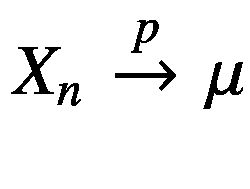 *当 n→∞ 时*。

或者，对于任意正数 ∈

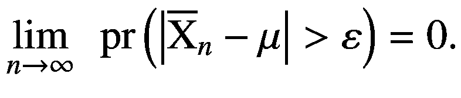

#### 3.10.1.2 强大数定律

理解弱大数定律与强大数定律之间的细微差别非常重要。强大数定律指出，样本均值将以概率 1 收敛于真实均值，而弱大数定律仅说明它们会收敛。因此，在通过样本均值估计总体均值时，强大数定律的表述更为有力。

强大数定律指出，样本均值几乎必然收敛于期望值 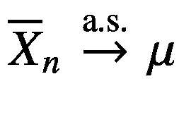 *当 n→∞ 时*。

等价于

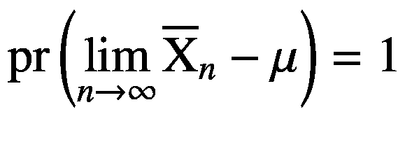

#### 3.10.1.3 使用 R 代码进行模拟的步骤

**注意**

大数定律有多种表述和证明方式。建议你参考任何研究生级别的概率论教材以了解更多。

在不深入探讨该定理的统计细节的情况下，我们将通过一个例子来理解它。考虑一个抛硬币的例子，其中抛硬币的结果服从二项分布。

假设你有一枚有偏的硬币，需要确定在任何一次抛掷中得到“正面”的概率。根据大数定律，如果你多次进行抛硬币实验，你将能够找到得到正面的实际概率。

请注意，对于一枚无偏的硬币，你可以使用经典概率论得到概率 `P(正面)= 有利结果总数/结果总数 = 1/2`。但对于有偏的硬币，每个事件对应的概率不相等，因此不能使用经典方法。我们将设置一个抛硬币实验来确定抛一次硬币得到正面的概率。

## 大数定律

步骤 1：假设二项分布参数的某个值，`p=0.60（假设）`，我们将使用大数定律来估计这个值。

```
# 设置二项分布 Binomial(n, p) 的参数
# n -> 抛掷次数
# p -> 得到正面的概率
library(data.table)
n <-100
p <-0.6
```

在上面的代码片段中，我们为实验设置了真实均值。也就是说，我们知道我们的总体来自一个 `p=0.6` 的二项分布。随着实验次数的增加，该实验将帮助我们估计这个值。

步骤 2：从二项分布 `(p)` 中抽取一个样本点。

```
# 创建一个包含从 Binomial(1,p) 中选取的 100 个样本值的数据框
set.seed(917);
dt <-data.table(binomial =rbinom(n, 1, p) ,count_of_heads =0, mean =0)

# 设置数据框中的第一个观测值
ifelse(dt$binomial[1] ==1, dt[1, 2:3] <-1, 0)
[1] 1
```

我们使用内置函数 `rbinom()` 来采样服从二项分布的随机变量，参数 `p=0.6`。选择这个概率值是为了使硬币有偏。如果硬币是无偏的，那么我们知道得到正面的概率是 `0.5`。

步骤 3：计算得到正面的概率，即正面次数/抛硬币总次数。

```
# 让我们进行大量次数的实验（直到 n），观察正面的平均值（即正面概率）如何收敛到一个值
for (i in 2 :n)
{
dt$count_of_heads[i] <-ifelse(dt$binomial[i] ==1, dt$count_of_heads[i]<- dt$count_of_heads[i -1]+1, dt$count_of_heads[i -1])
dt$mean[i] <-dt$count_of_heads[i] /i
}
```

在每一步，我们判断结果是正面还是反面。然后，我们统计正面次数并除以试验次数，得到正面比例的估计值。当你大量重复进行同一实验时，大数定律指出，你将收敛到实验中得到正面的概率（期望或均值）。例如，在第 30 次试验时，我们将统计到目前为止出现了多少次正面，然后除以 30 得到正面的平均次数。

步骤 4：绘制图表，观察样本均值如何收敛到 `p=0.60`。

```
# 绘制每个实验阶段正面的平均次数（即正面概率）
plot(dt$mean, type="l", main ="正面平均次数模拟",
xlab="样本大小", ylab="正面次数的样本均值")
abline(h = p, col="red")
```

图 3-3 显示，随着实验次数的增加，概率收敛到正面的真实概率（`0.6`）。建议你进行大量次数的实验以观察精确的收敛。该定理帮助我们通过实验方法估计未知概率，并创建用于推断检验的分布。

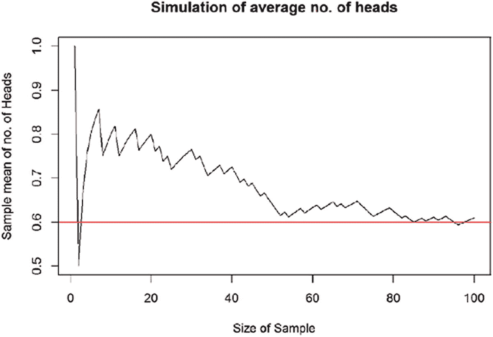

图 3-3 抛硬币实验的模拟

## 3.10.2 中心极限定理

中心极限定理是概率论中另一个非常重要的定理，它允许我们利用抽样分布进行假设检验。换句话说，中心极限定理指出，大量独立随机变量（每个变量都有明确的均值和方差）的样本均值，其分布近似于正态分布。

这一概念最早的文字解释由棣莫弗在 18 世纪早期的工作中提出，当时他使用正态分布来近似抛掷均匀硬币实验中出现正面的次数。皮埃尔-西蒙·拉普拉斯于 1812 年出版了《概率分析理论》，他在其中扩展了棣莫弗的思想，用正态分布来近似二项分布。中心极限定理的精确证明由亚历山大·李雅普诺夫于 1901 年完成，他给出了该定理的一般性定义，并精确证明了其数学原理。在概率论中，这是与大数定律齐名的最著名的定理之一。

在本书的背景下，我们将从数学上阐述迄今为止最流行的中心极限定理版本（林德伯格-莱维中心极限定理）。

对于一个具有明确期望和方差的独立同分布随机变量序列 {X1, X2, …}（E[Xi] = μ 且 Var[Xi] = σ² < ∞），当 n 趋于无穷大时，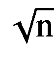 (S[n] - μ) 依分布收敛于正态分布 N(0, σ²)。

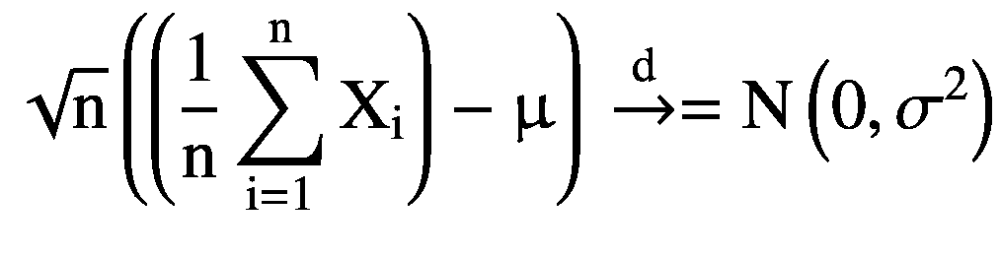

该定理还有其他版本，例如李雅普诺夫中心极限定理、林德伯格中心极限定理、鞅差中心极限定理等等。理解大数定律和中心极限定理在我们的抽样背景下如何相互关联非常重要。大数定律指出，随着样本量的增大，样本均值会收敛于总体均值，但它并未涉及样本均值的分布。中心极限定理则为我们提供了关于均值周围分布的洞察，并指出对于大量试验，该分布收敛于正态分布。了解分布后，我们就能进行推断性检验，因为我们可以为正态分布创建置信区间。

我们将再次设置一个简单的例子来解释该定理。作为一个简单的例子，我们将从一个指数分布开始抽样，并展示样本均值的分布。

### 3.10.2.1 使用 R 代码进行模拟的步骤

步骤 1：设置从混合总体中抽取的样本数量（例如 `r=5000`）。

```
#样本数量
r<-5000
#每个样本的大小
n<-10000
```

在上面的代码中，`r` 代表要抽取的样本数量，`n` 代表每个样本中的单位数量。根据中心极限定理，样本数量越大，收敛到正态分布的效果越好。

步骤 2：开始抽样，抽取大小为 `n` 的样本（例如每个样本 `n=10000`）。从正态分布、均匀分布、柯西分布、伽马分布和其他分布中抽取样本，以检验该定理在不同分布下的表现。这里，我们采用参数为 (`λ = 0.6`) 的指数分布。

```
#生成一个具有 n 列和 r 行的观测矩阵。每一行是一个样本
lambda<-0.6
Exponential_Samples =matrix(rexp(n*r,lambda),r)
```

现在，`Exponential_Samples` 数据框包含从参数 `λ = 0.6` 的指数分布中抽取的一系列独立同分布样本。

步骤 3：计算每个样本的总和、均值和方差。

```
all.sample.sums <-apply(Exponential_Samples,1,sum)
all.sample.means <-apply(Exponential_Samples,1,mean)
all.sample.vars <-apply(Exponential_Samples,1,var)
```

上一步计算了所有独立同分布样本的总和、均值和方差。现在，在下一步中，我们将观察这些总和、均值和方差的分布。根据中心极限定理，我们将观察到均值遵循正态分布。

步骤 4：绘制总和、均值和方差的组合图。

```
par(mfrow=c(2,2))
hist(Exponential_Samples[1,],col="gray",main="单个样本的分布")
hist(all.sample.sums,col="gray",main="总和的抽样分布")
hist(all.sample.means,col="gray",main="均值的抽样分布")
hist(all.sample.vars,col="gray",main="方差的抽样分布")
```

图 3-4 展示了一个指数样本以及所有 `r` 个样本的总和、均值和标准差的图形。

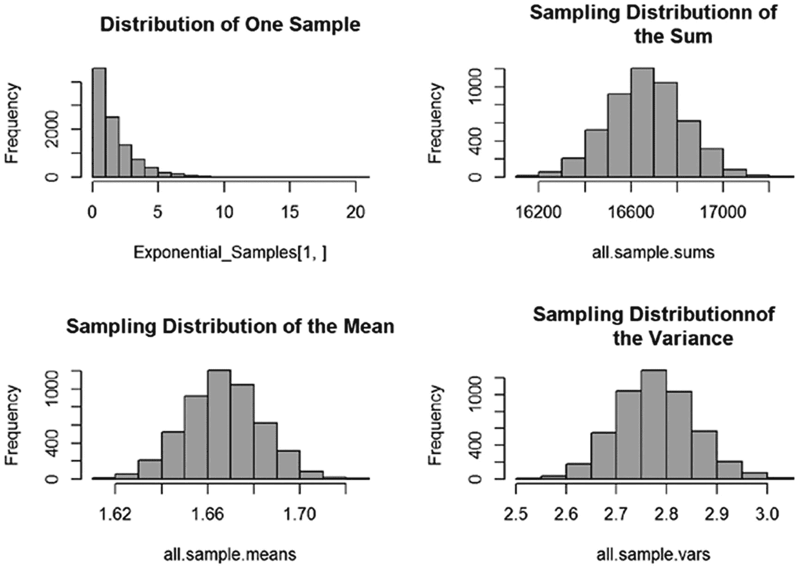

图 3-4 抽样分布图

图 3-4 展示了样本统计量（即总和、均值和方差）的分布。第一张图显示了来自指数分布的第一个样本的直方图。你可以看到样本中单位的分布是指数型的。目视检查表明，从独立同分布样本中估计出的统计量遵循接近正态分布的分布。

步骤 5：用其他分布重复此实验，并观察结果是否对所有分布都与中心极限定理一致。

还有一些其他标准分布可用于验证中心极限定理的结果。我们的例子仅讨论了指数分布；鼓励你使用以下分布来验证中心极限定理。

```
Normal_Samples <- matrix(rnorm(n * r, param1, param2), r),
Uniform_Samples <- matrix(runif(n * r, param1, param2), r),
Poisson_Samples <- matrix(rpois(n * r, param1), r),
Cauchy_Samples <- matrix(rcauchy(n * r, param1, param2), r),
Bionomial_Samples <- matrix(rbinom(n * r, param1, param2), r),
Gamma_Samples <- matrix(rgamma(n * r, param1, param2), r),
ChiSqr_Samples <- matrix(rchisq(n * r, param1), r),
StudentT_Samples <- matrix(rt(n * r, param1), r))
```

一个好的做法是不要仅依赖目视检查，而应执行正式的检验来推断分布的任何属性。直方图和正态性正式检验是一种很好的方法，可以通过可视化检验和参数检验来共同确定均值的分布确实是正态分布（正如中心极限定理所声称的那样）。

接下来，我们执行夏皮罗-威尔克检验，以检查均值分布的正态性。其他正态性检验在第[6](http://dx.doi.org/10.1007/978-1-4842-4215-5_6)章中简要讨论。最流行的非参数正态性检验之一是KS单样本检验，该检验在第[7](http://dx.doi.org/10.1007/978-1-4842-4215-5_7)章中讨论。

```r
# 对样本均值的分布进行正式的正态性检验
Mean_of_sample_means <- mean(all.sample.means)
Variance_of_sample_means <- var(all.sample.means)

# 通过夏皮罗-威尔克检验进行正态性检验
shapiro.test(all.sample.means)
```

```
Shapiro-Wilk normality test

data:  all.sample.means
W = 0.99979, p-value = 0.9263
```

你可以看到，夏皮罗-威尔克检验的p值显著（>0.05），这意味着我们不能拒绝分布为正态分布的原假设。该分布确实呈正态分布，均值为1.66，方差为0.00027。

可以通过绘制直方图进行视觉检查。此外，为了清晰起见，让我们在直方图上叠加正态密度函数，以确认分布是否为正态分布（见图3-5）。

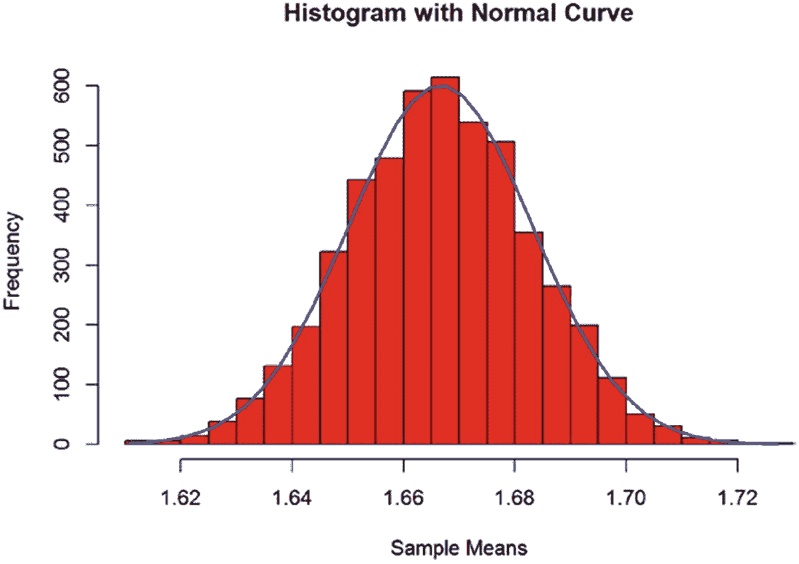

**图 3-5**

带有正态密度线的样本均值分布

```r
x <- all.sample.means
h <- hist(x, breaks = 20, col = "red", xlab = "Sample Means",
          main = "Histogram with Normal Curve")
xfit <- seq(min(x), max(x), length = 40)
yfit <- dnorm(xfit, mean = Mean_of_sample_means, sd = sqrt(Variance_of_sample_means))
yfit <- yfit * diff(h$mids[1:2]) * length(x)
lines(xfit, yfit, col = "blue", lwd = 2)
```

关于大数定律和中心极限定理，需要记住的最重要几点是：

*   随着样本量变大，你可以期望对总体/模型参数有更好的估计。也就是说，大样本量将为你提供无偏且更准确的假设检验估计值。
*   中心极限定理帮助你获得一个分布，从而允许你获得参数周围的置信区间并应用推断检验。重要的是，中心极限定理不假设从中抽取样本的总体有任何分布，这使你摆脱了分布假设的束缚。

## 3.11  概率抽样技术

在本节中，我们将介绍一些流行的概率抽样技术，并展示如何使用R语言执行这些技术。所有抽样技术都将使用我们的信用卡欺诈数据进行解释。作为解释各项技术的第一步，我们创建总体统计量和分布，然后将相同的样本属性与总体属性进行比较，以确定抽样输出。

### 3.11.1 总体统计量

我们将查看数据的一些基本特征。这些特征将被称为总体统计量/参数。然后，我们将展示不同的抽样方法，并将结果与总体统计量进行比较。

1.  总体数据维度

`str()`向我们展示了列名、类型以及列中的一些值。你可以看到数据集是整数和字符的混合。

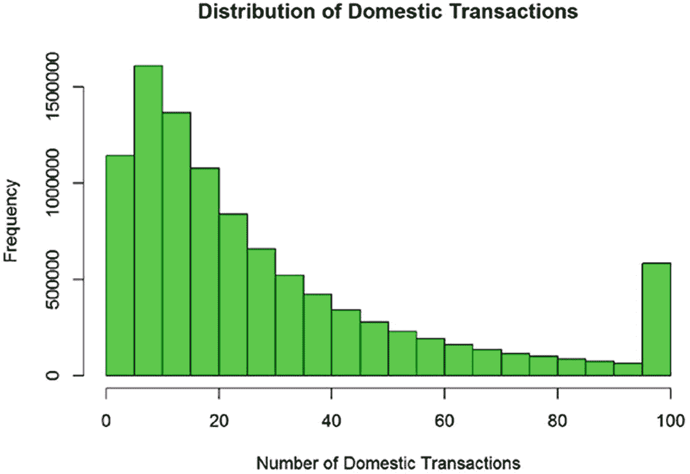

**图 3-8**

国内交易次数直方图

2.  度量指标的总体均值
    1.  *未结余额*：平均每张卡有4,109.92美元的未结余额。

```r
mean_outstanding_balance <- mean(data$OutsBal)
```

`mean_outstanding_balance`

```
[1] 4109.92
```

    2.  *国际交易次数*：平均国际交易次数为4.04。

```r
mean_international_trans <- mean(data$IntTransc)
```

`mean_international_trans`

```
[1] 4.04719
```

    3.  *国内交易次数*：与国际交易相比，平均国内交易次数非常高；次数为28.9~29次。

```r
mean_domestic_trans <- mean(data$DomesTransc)
```

`mean_domestic_trans`

```
[1] 28.93519
```

3.  度量指标的总体方差
    1.  *未结余额*：

```r
Var_outstanding_balance <- var(data$OutsBal)
```

`Var_outstanding_balance`

```
[1] 15974788
```

    2.  *国际交易次数*：

```r
Var_international_trans <- var(data$IntTransc)
```

`Var_international_trans`

```
[1] 74.01109
```

    3.  *国内交易次数*：

```r
Var_domestic_trans <- var(data$DomesTransc)
```

`Var_domestic_trans`

```
[1] 705.1033
```

4.  直方图
    1.  *未结余额*（见图3-6）：

```r
hist(data$OutsBal, breaks = 20, col = "red", xlab = "Outstanding Balance",
     main = "Distribution of Outstanding Balance")
```

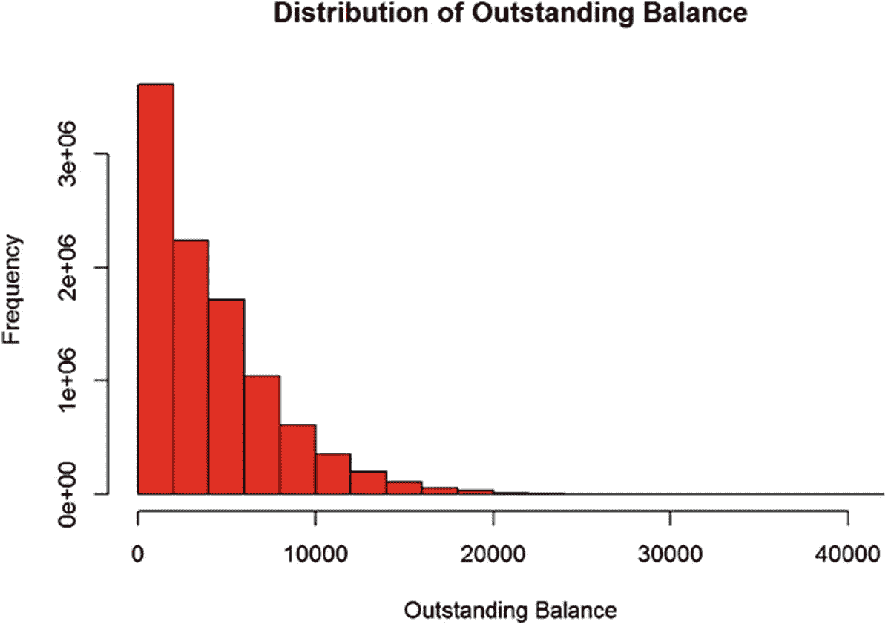

**图 3-6**

未结余额直方图

    2.  *国际交易次数*（见图3-7）：

```r
hist(data$IntTransc, breaks = 20, col = "blue", xlab = "Number of International Transactions",
     main = "Distribution of International Transactions")
```

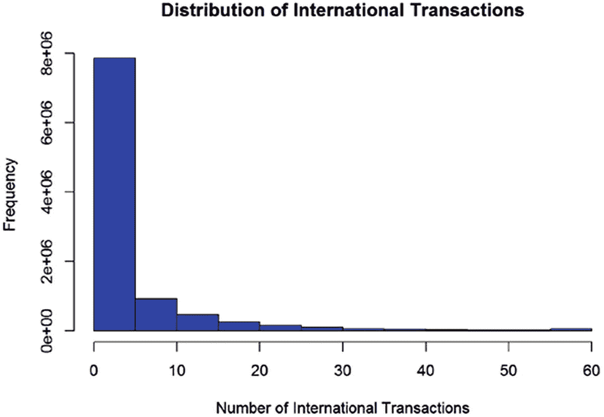

**图 3-7**

国际交易次数直方图

    3.  *国内交易次数*（见图3-8）：

```r
hist(data$DomesTransc, breaks = 20, col = "green", xlab = "Number of Domestic Transactions",
     main = "Distribution of Domestic Transactions")
```

# 抽样方法

```r
str(data)
Classes 'data.table' and 'data.frame':   10000000 obs. of 14 variables:
$ creditLine : int  1 1 1 1 1 1 1 1 1 1 ...
$ gender     : int  1 1 1 1 1 1 1 1 1 1 ...
$ state      : int  1 1 1 1 1 1 1 1 1 1 ...
$ CustomerID : int 4446 59161 136032 223734 240467 248899 262655 324670
390138 482698 ...
$ NumOfCards : int 1 1 1 1 1 1 1 1 1 1 ...
$ OutsBal    : int 2000 0 2000 2000 2000 0 0 689 2000 0 ...
$ DomesTransc: int 31 25 78 11 40 47 15 17 48 25 ...
$ IntTransc  : int 9 0 3 0 0 0 0 9 0 35 ...
$ FraudFlag  : int 0 0 0 0 0 0 0 0 0 0 ...
$ State      : chr "Alabama" "Alabama" "Alabama" "Alabama" ...
$ PostalCode : chr "AL" "AL" "AL" "AL" ...
$ Gender     : chr "Male" "Male" "Male" "Male" ...
$ CardType   : chr "American Express" "American Express" "American
Express" "American Express" ...
$ CardName   : chr "SimplyCash® Business Card from American Express"
"SimplyCash® Business Card from American Express" "SimplyCash® Business Card from American Express" "SimplyCash® Business Card from American Express" ...
- attr(*, ".internal.selfref")=
- attr(*, "sorted")= chr "creditLine"
```

图 3-8 展示了我们信用卡欺诈数据集中几个重要变量的均值、方差和分布。这些总体统计量将与样本统计量进行比较，以查看哪种抽样技术能提供具有代表性的样本。

## 3.11.2 简单随机抽样

`简单随机抽样`是一种从总体中选取样本的过程，其中总体的每个单元都是随机选取的。在抽样过程的任何阶段，每个单元被选中的个体概率相同，并且任意 k 个个体的子集被选为样本的概率与任何其他 k 个个体的子集相同。

简单随机抽样是基本的抽样类型，因此它可以成为更复杂抽样方法的组成部分。在接下来的主题中，您将看到简单随机抽样构成了其他概率抽样方法（如分层抽样和整群抽样）的重要组成部分。

简单随机抽样通常是无放回的，即通过抽样过程的设计，我们确保没有单元可以被选中超过一次。然而，简单随机抽样也可以是有放回的，但在这种情况下，抽样单元将不是独立的。如果您从一个大的总体中抽取一个小样本，无放回抽样和有放回抽样将给出大致相同的结果，因为每个单元被选中的概率非常小。表 3-5 比较了有放回和无放回简单随机抽样的统计量。由于总体规模非常大（约 1000 万），这些值是可比的。我们将在示例中看到这一事实。

表 3-5

总体有放回与无放回抽样对比表

| 卡类型 | 总体未结余额 | 无放回随机未结余额 | 有放回随机未结余额 |
| --- | --- | --- | --- |
| 美国运通 | 3820.896 | 3835.064 | 3796.138 |
| 发现卡 | 4962.420 | 4942.690 | 4889.926 |
| 万事达卡 | 3818.300 | 3822.632 | 3780.691 |
| 维萨卡 | 4584.042 | 4611.649 | 4553.196 |

优点：
- 没有分类误差
- 不需要太多关于总体的高级知识
- 样本数据易于解释

缺点：
- 需要完整的抽样框（总体）才能获得代表性样本
- 数据检索和存储会增加成本和时间
- 简单随机样本会携带总体中存在的偏差和误差，需要额外的干预措施来消除这些偏差和误差

`函数：Summarise`

`Summarise` 是 `dplyr` 库中的一个函数。此函数有助于按维度聚合数据。其工作方式类似于 Excel 中的数据透视表。
- `group_by`：此参数接受您想要聚合度量的分类变量。
- `mean(OutsBal)`：此参数给出聚合函数以及要进行聚合的字段名称。

```r
#总体数据：各卡类型未结余额分布
library (dplyr)
summarise (group_by (data,CardType),Population_OutstandingBalance=mean(OutsBal))
Source: local data table [4 x 2]
CardType Population_OutstandingBalance
1 American Express                      3820.896
2       MasterCard                      3818.300
3             Visa                      4584.042
4         Discover                      4962.420
```

按 `CardType` 调用 `summarise` 函数显示了按卡类型划分的平均未结余额。发现卡的平均未结余额最高。

接下来，我们使用 `base` 库中的内置函数 `sample()` 抽取一个包含 100,000 条记录的随机样本。此函数通过随机选择数据索引来创建一个抽样框。一旦我们获得抽样框，我们就从总体数据中提取相应的记录。

`函数：Sample`

注意 `sample()` 函数的一些重要参数：
- `nrow(data)`：这表示数据的大小。这里它是 10,000,000，因此它将创建一个从 1 到 10,000,000 的索引，然后随机选择用于抽样的索引。
- `size`：允许用户提供要从总体中抽取多少个数据点。在我们的例子中，我们将 `n` 设置为 100,000。
- `replace`：此参数允许用户说明抽样应该是无放回（`FALSE`）还是有放回（`TRUE`）。
- `prob`：这是用于获取抽样框的概率向量。我们将其设置为 `NULL`，以便它们都具有相同的权重/概率。

```r
set.seed(937)

# 无放回简单随机抽样
library("base")

sample_SOR_100K <-data[sample(nrow(data),size=100000, replace =FALSE, prob
=NULL),]
```

现在，让我们再次查看简单随机样本的平均余额情况。如您所见，平均余额的顺序保持不变。请注意，该平均值非常接近上一步中为总体计算的平均值。

```r
#样本数据：各卡类型未结余额分布
library(dplyr)

summarise(group_by(sample_SOR_100K,CardType),Sample_OutstandingBalance=mean (OutsBal))
```

```
Source: local data table [4 x 2]
CardType Sample_OutstandingBalance
1      MasterCard                  3822.632
2 American Express                 3835.064
3             Visa                 4611.649
4         Discover                 4942.690
```

`函数：KS.test()`

这是用于比较数据经验分布函数的非参数检验之一。此函数有助于确定数据点是否来自同一分布。它可以作为单样本检验，即数据经验分布函数（EDF）与某个预设的分布概率密度函数（如正态分布、柯西分布等）进行比较；也可以作为双样本检验，即当我们想要查看两个样本的分布是否相同时使用。

由于抽样的一个重要特征是确保抽样后数据的分布不变（除非有意为之），我们将使用双样本检验来查看样本是否真实代表了总体，即检查总体和样本是否来自同一分布。

重要的参数是两个数据序列以及要检验的假设（双尾或单尾）。对于此示例，我们选择更保守的双尾检验。双尾检验意味着我们要确保原假设中使用的是相等性。

# 检验抽样数据是否来自总体

这确保抽样不会改变原始分布。

```
#检验抽样数据是否来自总体。这确保抽样不会改变原始分布
ks.test(data$OutsBal,sample_SOR_100K$OutsBal,alternative="two.sided")
Two-sample Kolmogorov-Smirnov test
data: data$OutsBal and sample_SOR_100K$OutsBal
D = 0.003042, p-value = 0.3188
alternative hypothesis: two-sided
```

KS 检验结果清楚地表明样本和总体具有相同的分布。因此，我们可以说抽样没有改变分布。根据抽样的性质，无放回简单随机抽样保留了数据的分布。

为了进行可视化检查，图 3-9 显示了总体和样本的直方图。如您所见，两者的分布相同。

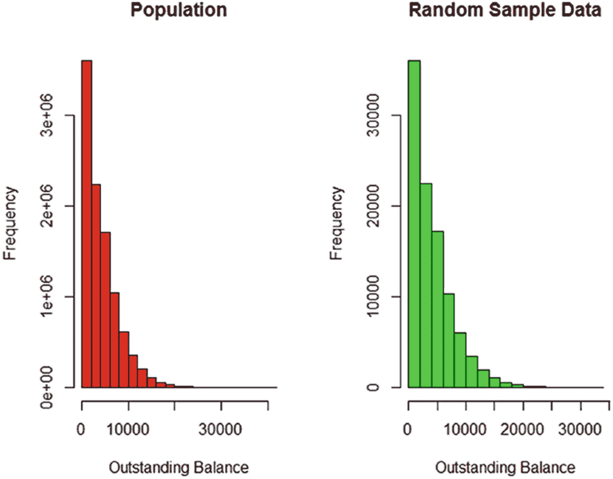

**图 3-9** 总体与样本（无放回）分布对比

```r
par(mfrow =c(1,2))
hist(data$OutsBal, breaks=20, col="red", xlab="未结余额",
main="总体数据直方图")
hist(sample_SOR_100K$OutsBal, breaks=20, col="green", xlab="未结余额",
main="样本数据直方图（无放回）")
```

现在，我们将对总体和随机样本的未结余额均值进行正式检验。理论上，我们期望对两者均值的 t 检验结果为 `TRUE`，因此我们可以说，在 95% 的置信水平下，样本和总体的均值相同。

```r
# 我们同样对总体和样本的均值进行 t 检验。
t.test(data$OutsBal,sample_SOR_100K$OutsBal)

	Welch Two Sample t-test

data:  data$OutsBal and sample_SOR_100K$OutsBal
t = -0.85292, df = 102020, p-value = 0.3937
alternative hypothesis: true difference in means is not equal to 0
95 percent confidence interval:
 -35.67498  14.04050
sample estimates:
mean of x mean of y 
 4109.920  4120.737 
```

这些结果表明，由于`t.test`的 p 值不显著，总体和样本的均值是相同的。我们无法拒绝均值相等的原假设。

### 3.11.2 有放回简单随机抽样

接下来，我们将展示对`有放回简单随机样本`进行的类似检验。如您所见，与无放回简单随机样本相比，结果没有显著变化，因为总体规模非常大，放回抽样实质上不会以任何实质性方式改变记录的抽样概率。

```r
set.seed(937)

# 有放回简单随机抽样
library("base")
sample_SR_100K <- data[sample(nrow(data), size=100000, replace = TRUE, prob = NULL),]
```

在这段代码中，对于有放回简单随机抽样，我们在`sample()`函数调用中将`replace`参数设置为`TRUE`。

以下代码展示了我们如何对总体分布和通过有放回抽样得到的样本分布执行 KS 检验。检验结果表明分布相同，且 p 值不显著，因此无法拒绝分布相等的原假设。

```r
ks.test(data$OutsBal, sample_SR_100K$OutsBal, alternative = "two.sided")

	Warning in ks.test(data$OutsBal, sample_SR_100K$OutsBal, alternative = "two.sided"): p-value will be approximate in the presence of ties

	Two-sample Kolmogorov-Smirnov test

data:  data$OutsBal and sample_SR_100K$OutsBal
D = 0.0037522, p-value = 0.1231
alternative hypothesis: two-sided
```

我们绘制了总体和有放回样本的直方图。图形看起来相同，再结合正式的 KS 检验，我们可以看出有放回样本和总体具有相同的分布（见图 3-10）。当总体规模较小时，对此需保持谨慎。

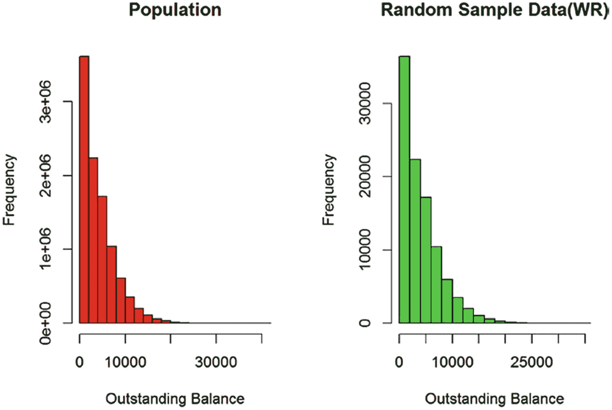

**图 3-10** 总体与样本（有放回）分布对比

```r
par(mfrow = c(1,2))
hist(data$OutsBal, breaks=20, col="red", xlab="未结余额",
     main="总体")
hist(sample_SR_100K$OutsBal, breaks=20, col="green", xlab="未结余额",
     main="随机样本数据（有放回）")
```

总体和有放回随机样本的分布相似。我们通过比较总体、无放回简单随机样本和有放回简单随机样本的汇总结果，对简单随机抽样进行总结。

```r
population_summary <- summarise(group_by(data, CardType), OutstandingBalance_Population = mean(OutsBal))
random_WOR_summary <- summarise(group_by(sample_SOR_100K, CardType), OutstandingBalance_Random_WOR = mean(OutsBal))
random_WR_summary <- summarise(group_by(sample_SR_100K, CardType), OutstandingBalance_Random_WR = mean(OutsBal))
compare_population_WOR <- merge(population_summary, random_WOR_summary, by="CardType")
compare_population_WR <- merge(population_summary, random_WR_summary, by="CardType")
summary_compare <- cbind(compare_population_WOR, compare_population_WR[, "OutstandingBalance_Random_WR"])
colnames(summary_compare)[which(names(summary_compare) == "V2")] <- "OutstandingBalance_Random_WR"
knitr::kable(summary_compare)
```

表 3-5 显示，无论是有放回还是无放回，简单随机抽样在不同卡类型上得到的均值都非常接近总体的真实均值。

### 要点

*   简单随机抽样能从总体中产生具有代表性的样本。
*   有放回和无放回抽样在不同样本量下可能产生不同结果，因此在总体规模较小时，选择方法需格外谨慎。
*   每个问题所需的适当样本量取决于我们期望的检验置信度、业务目的、成本效益分析及其他因素。您将深入理解每种抽样技术的原理，并能为手头问题选择最佳方案。

### 3.11.3 系统随机抽样

系统抽样是一种统计方法，其样本单元从一个按系统顺序排列的抽样框中选取。最流行的系统抽样形式基于一个圆形抽样框，即我们从总体起点遍历至终点，然后以循环方式再次从起点继续。在这种方法中，每个单元被选中的概率相同，因此有时也被称为等概率法。但您也可以根据自身需求创建其他系统抽样框来执行系统抽样。

本节我们将讨论最流行的圆形系统随机抽样方法。该方法首先从总体中随机选择一个单元，然后每隔 k 个元素选取一个。当列表结束时，抽样会从头开始。这里的 k 被称为跳跃因子，其计算公式如下：

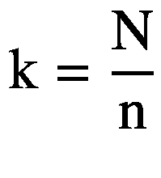

其中，`N`是总体规模，`n`是样本量。

这种系统抽样方法在功能上与简单随机抽样相似，但并不完全相同，因为并非所有特定大小的可能样本都具有相同的被选中概率（例如，种子值会确保相邻元素永远不会在抽样框中被选中）。然而，如果系统样本内的方差大于总体方差，这种方法会更有效率。

优点：

*   易于实施
*   可能更高效

缺点：

*   仅适用于总体逻辑上同质的情况
*   抽样框中可能存在隐藏模式，导致不必要的偏差

让我们从信用卡欺诈数据中创建一个系统抽样的示例。

# 系统抽样步骤与分层抽样

步骤 1：确定一个可以假定为同质的总体子集。一个可行的选择是按州划分子集。在本例中，我们使用美国最小的州——罗德岛州，来假设其同质性。

注意，第 [6](http://dx.doi.org/10.1007/978-1-4842-4215-5_6) 章讨论了如何根据某种属性从总体中创建同质子集。

为了便于说明，我们通过以下业务逻辑对总体进行子集划分，创建一个同质子集。对数据进行子集划分，提取国际交易等于 0 且国内交易小于或等于 3 的记录。

假设上述子集构成一个同质总体，那么子集划分的假设也部分成立，因为在国内不使用信用卡的客户，很可能在国际上也不会使用。

```
Data_Subset <-subset(data, IntTransc==0&DomesTransc<=3)
summarise(group_by(Data_Subset,CardType),OutstandingBalance=mean(OutsBal))
Source: local data table [4 x 2]
CardType OutstandingBalance
1 American Express           3827.894
2       MasterCard           3806.849
3             Visa           4578.604
4         Discover           4924.235
```

假设该子集按卡类型包含了同质的持卡人集合，我们可以继续进行系统抽样。如果该集合不是同质的，那么系统抽样极有可能产生有偏样本，从而无法真实代表总体。此外，我们知道数据是通过内部索引（与我们的客户 ID 相同）存储在 `R` 数据框中的，因此我们可以依赖内部有序索引进行系统抽样。

步骤 2：设定从总体中抽样的样本量。

```
#总体大小（此处为数据子集中持卡人的数量）
Population_Size_N<-length(Data_Subset$OutsBal)

# 设定要抽取的样本大小（应小于 N），记为 n。我们假设 n=5000
Sample_Size_n<-5000
```

步骤 3：使用以下公式计算跳跃因子：


跳跃因子将在创建系统抽样框架时给出跳跃间隔。本质上，给定一个起始索引 `c`，将按顺序跳过 `k` 个项目后选择项目。

```
#计算跳跃因子
k =ceiling(Population_Size_N/Sample_Size_n)
#ceiling(x) 向上取整到大于 x 的最近整数。
#这意味着 ceiling (2.3) = 3
cat("系统抽样的跳跃因子为 ",k)
系统抽样的跳跃因子为 62
```

步骤 4：设置一个随机的起始索引值，然后使用该起始值和跳跃因子创建一个序列向量（抽样框架）。这将选取一个起始索引值，比如 `i`，然后创建一个抽样框架，如 `i, i+k, i+2k …`，直到抽样框架中总共有 `n`（样本量）个索引。

```
r =sample(1:k, 1)
systematic_sample_index =seq(r, r +k*(Sample_Size_n-1), k)
```

步骤 5：根据抽样框架从总体中抽取记录。一旦抽样框架准备就绪，它实际上就是一个索引列表，因此我们提取与抽样框架对应的那些数据记录。

```
systematic_sample_5K<-Data_Subset[systematic_sample_index,]
```

现在，我们将系统样本与相同大小（5000）的简单随机样本进行比较。根据之前的讨论，我们知道简单随机抽样是总体的真实代表，因此我们可以将其用作总体属性的代理。

```
set.seed(937)

# 无放回简单随机抽样
library("base")
sample_Random_5K <-Data_Subset[sample(nrow(Data_Subset),size=5000, replace
=FALSE, prob =NULL),]
```

以下是按卡类型对未结余额进行汇总比较的结果。这种比较很重要，可以展示如果我们选择简单随机样本而非系统样本，均值会出现什么差异。

```
sys_summary <-summarise(group_by(systematic_sample_5K,CardType),OutstandingB
alance_Sys=mean(OutsBal))
random_summary<-summarise(group_by(sample_Random_5K,CardType),OutstandingBal
ance_Random=mean(OutsBal))
summary_mean_compare<-merge(sys_summary,random_summary, by="CardType")
print(summary_mean_compare)
Source: local data table [4 x 3]
CardType OutstandingBalance_Sys OutstandingBalance_Random
1 American Express               3745.873                  3733.818
2         Discover               5258.751                  4698.375
3       MasterCard               3766.037                  3842.121
4             Visa               4552.099                  4645.664
```

再次强调，我们将测试样本的经验分布函数与总体的经验分布函数，以确保抽样没有扭曲数据的分布。这一步骤将对所有抽样技术重复进行，因为这能确保抽样对于建模目的而言是稳定的。

```
ks.test(Data_Subset$OutsBal,systematic_sample_5K$OutsBal,alternative="two.
sided")
Warning in ks.test(Data_Subset$OutsBal, systematic_sample_5K$OutsBal,
alternative = "two.sided"): p-value will be approximate in the presence of
ties
Two-sample Kolmogorov-Smirnov test
data: Data_Subset$OutsBal and systematic_sample_5K$OutsBal
D = 0.010816, p-value = 0.6176
alternative hypothesis: two-sided
```

`KS` 检验结果表明分布相同，因此该样本在分布上是总体的一个代表。图 3-11 展示了直方图，以说明同质数据子集和系统样本的分布情况。我们可以看到分布没有发生剧烈变化。

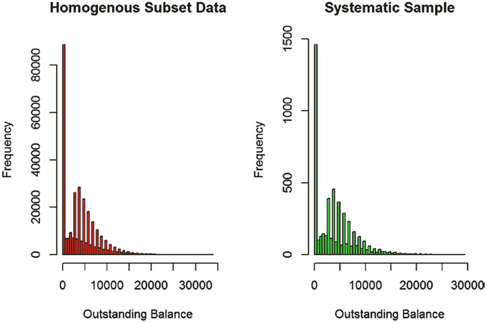

图 3-11

同质总体与系统样本分布

```
par(mfrow =c(1,2))
hist(Data_Subset$OutsBal, breaks=50, col="red", xlab="未结余额", main="同质子集数据")
hist(systematic_sample_5K$OutsBal, breaks=50, col="green", xlab="未结余额", main="系统样本")
```

关键点：

*   如果对同质数据点集进行系统抽样，则其等同于简单随机抽样。此外，较大的总体规模可以抑制较小抽样比例下系统抽样带来的偏差。

*   当总体规模较大时，业务和计算能力是选择抽样技术的重要标准。在我们的示例中，系统抽样以较低的计算成本提供了具有代表性的样本。（无需调用随机数生成器，因此也无需遍历完整的记录列表。）

## 3.11.4 分层随机抽样

当总体中存在差异显著的子群体时，抽样技术必须考虑子群体（层）层面的差异，并在该层面独立进行抽样。分层是指通过某个内在属性对群体进行特征化，从而识别出同质群体的过程。例如，居住在同一城市的客户可以被视为属于该城市层。各层之间应互斥且完全穷尽，即总体中的所有单元都应被分配到某个层，且每个单元只能属于一个层。

一旦形成层，就在层内独立进行简单随机抽样或系统抽样。这能提高样本的代表性，并通常能减少抽样误差。将总体分层还有助于计算总体的加权平均值，其变异性比合并后的总体更小。

确定分层样本量有两种公认的方法：

# 分层抽样的分配方法

*   **比例分配：** 从每个层中抽取相同比例的数据样本。在这种情况下，对总体中的所有层采用相同的抽样分数。例如，你的总体有四种类型的信用卡，并且你假设每种信用卡类型构成一个同质的客户群体。假设每个层中各类客户的数量为 `N1+N2+N3+N4=总数`，那么在比例分配中，你将得到一个从每个层中抽取比例相同的样本（`n1/N1=n2/N2=n3/N3=n4/N4=抽样分数`）。

*   **最优分配：** 样本比例与层变量分布的标准差成比例。这会导致从变异性最高的层中抽取较大的样本，从而降低样本方差。

## 分层抽样的另一个重要特点

分层抽样的另一个重要特点是，它能确保从每个层中至少抽取一个单元，即使该单元被选中的概率为零。建议限制层的数量，并确保每个层中有足够的单元可供抽样。

## 优点

*   比相同样本量的简单随机抽样精度更高
*   由于精度更高，可以使用较小的样本，从而降低成本
*   避免样本不具有代表性，因为该方法从每个层中至少抽取一个单元

## 缺点

*   并非总能将总体划分为不相交的组
*   抽样前识别同质层会增加管理成本
*   层内样本量过小会限制代表性样本的规模

# 使用信用卡欺诈数据进行分层抽样示例

为了用信用卡欺诈数据构建一个分层抽样的示例，我们首先需要检查各层，然后从各层中进行抽样。在我们的示例中，我们将基于 `CardType` 和 `State` 变量创建一个层。

下面，我们逐步解释如何进行分层抽样。

## 步骤 1：检查层变量及其在总体中的频率

假设 `CardType` 和 `State` 是层变量。换句话说，我们认为卡类型和州可以作为将客户分层到逻辑桶中的标准。以下是按层变量统计的频率。我们期望分层抽样在分层样本中保持相同的记录比例。

```
#总体中 CardType 的频率表
table(data$CardType)
American Express         Discover       MasterCard              Visa
2474848           642531          4042704           2839917
#总体中 State 的频率表
table(data$State)
Alabama American Samoa       Arizona      Arkansas      California
20137         162574        101740        202776         1216069
Colorado    Connecticut      Delaware       Florida         Georgia
171774         121802         20603         30333          608630
Guam         Hawaii         Idaho      Illinois         Indiana
303984          50438        111775         60992          404720
Iowa         Kansas      Kentucky     Louisiana           Maine
203143          91127        142170        151715          201918
Maryland  Massachusetts      Michigan     Minnesota     Mississippi
202444          40819        304553        182201          203045
Missouri        Montana      Nebraska        Nevada   New Hampshire
101829          30131         60617        303833           20215
New Jersey     New Mexico      New York North Carolina   North Dakota
40563         284428         81332          91326         608575
Ohio       Oklahoma        Oregon   Pennsylvania   Rhode Island
364531         122191        121846         405892          30233
South Carolina   South Dakota     Tennessee          Texas           Utah
152253          20449        203827         812638          91375
Vermont       Virginia    Washington  West Virginia      Wisconsin
252812          20017        202972         182557          61385
Wyoming
```

交叉表按层变量 `CardType` 和 `State` 划分了整个总体。每个层代表一组具有相似行为的客户，因为他们来自同一个层。为便于阅读，以下输出已做精简。

```
#总体数据的交叉表频率
table(data$State,data$CardType)
American Express Discover MasterCard   Visa
Alabama                    4983     1353       8072   5729
American Samoa            40144    10602      65740  46088
Arizona                   25010     6471      41111  29148
Arkansas                  50158    12977      82042  57599
California               301183    78154     491187 345545
Colorado                  42333    11194      69312  48935
Connecticut               30262     7942      49258  34340
Delaware                   4990     1322       8427   5864
```

## 步骤 2：从每个层中进行无放回随机抽样，考虑抽取层大小的 10%

我们选择最常用的分层抽样方法——比例抽样。我们将从每个层中抽取 10% 的记录。

函数：`stratified()`

`stratified` 函数从一个 `data.frame` 或 `data.table` 中抽样，其中一个或多个列可用作“分层”或“分组”变量。结果是一个新的 `data.table`，其中包含从每个组中抽取的指定数量的样本。标准函数语法如下所示：

```r
stratified(indt, group, size, select = NULL, replace = FALSE, keep.rownames
= FALSE, bothSets = FALSE, ...)
```

标准函数参数说明：

*   `group`：此参数允许用户定义层变量。这里我们选择了 `CardType` 和 `State` 作为层变量。因此，总共将有四个（卡类型）X 52（州）个层供抽样。

*   `size`：通常，size 可以作为一个数字（从每个层中抽取相同数量）或一个抽样分数传递。我们将使用 0.1 的抽样分数。其他选项请在控制台中输入 `?stratified` 查看。

*   `replace`：此参数允许你选择有放回或无放回抽样。我们将其设置为 `FALSE`，表示无放回抽样。

我们将使用此函数来执行分层随机抽样。

我们也可以使用标准的 `sample()` 函数，按照以下步骤进行分层抽样：

1.  按层变量创建数据的子集。
2.  计算每个层在抽样比例为 0.1 时的样本量。
3.  对每个层按计算出的样本量进行简单随机抽样。

先前的结果与`stratified()`函数的结果将保持一致。但`stratified()`函数的执行速度会更快。建议你自行实现该算法并尝试其他函数。

```r
set.seed(937)
#我们希望确保抽样保留样本中卡类型的相同比例
#从每个层中无放回地随机抽取占该层总规模 10%的样本
library(splitstackshape)
stratified_sample_10_percent<-stratified(data, group=c("CardType","State"),
size=0.1,replace=FALSE)
```

## 步骤 3：检查样本中数据点的比例是否与总体相同

以下是通过`CardType, State`进行分层抽样以及交叉制表的输出结果。数值显示，抽样已按相同比例在各层中完成。例如，阿拉巴马州和美国运通的记录数为 4980，在分层样本中，阿拉巴马州和美国运通持卡人的数量为总体的 1/10，即 498。对于所有其他层，比例均相同。

```
#样本中 CardType 的频率表
table(stratified_sample_10_percent$CardType)
American Express         Discover       MasterCard              Visa
247483            64250           404268            283988
#样本中 State 的频率表
table(stratified_sample_10_percent$State)
Alabama American Samoa       Arizona      Arkansas       California
2013          16257         10174         20278           121606
Colorado    Connecticut       Delaware      Florida          Georgia
17177          12180           2060         3032            60862
Guam         Hawaii          Idaho     Illinois          Indiana
30399           5044          11177         6099            40471
Iowa         Kansas       Kentucky    Louisiana            Maine
20315           9113          14218        15172            20191
Maryland  Massachusetts       Michigan    Minnesota      Mississippi
20245           4081          30455        18220            20305
Missouri        Montana       Nebraska       Nevada    New Hampshire
10183           3013           6061        30383             2022
New Jersey     New Mexico      New York North Carolina    North Dakota
4056          28442           8133          9132           60856
Ohio       Oklahoma         Oregon  Pennsylvania    Rhode Island
36453          12219          12184         40589            3023
South Carolina   South Dakota      Tennessee         Texas            Utah
15225           2046          20382         81264            9137
Vermont       Virginia     Washington West Virginia       Wisconsin
25281           2002          20297         18255            6138
Wyoming

#样本数据的交叉表频率
table(stratified_sample_10_percent$State,stratified_sample_10_percent$CardType)
American Express Discover MasterCard  Visa
Alabama                      498      135        807   573
American Samoa              4014     1060       6574  4609
Arizona                     2501      647       4111  2915
Arkansas                    5016     1298       8204  5760
California                 30118     7815      49119 34554
Colorado                    4233     1119       6931  4894
Connecticut                 3026      794       4926  3434
Delaware                     499      132       843    586
```

你可以看到比例保持不变。在此，我们比较样本和总体的属性。`summarise()`函数显示了各层平均未结余额。你可以执行成对`t.test`来验证抽样并未改变各层未结余额的均值。建议你按照简单随机抽样部分所示，使用`t.test()`对均值进行检验。

```
# 按分层变量计算的平均未结余额
summary_population<-summarise(group_by(data,CardType,State),OutstandingBalance_Stratum=mean(OutsBal))

# 下面我们可以看到，我们希望确保抽样保留样本中卡类型的相同比例
summary_sample<-summarise(group_by(stratified_sample_10_percent,CardType,State),OutstandingBalance_Sample=mean(OutsBal))

# 按层进行均值比较
summary_mean_compare<-merge(summary_population,summary_sample,by=c("CardType","State"))
```

再次，我们将进行 KS 检验来比较分层样本的分布。可以看到，KS 检验表明两者具有相同的分布。

```
ks.test(data$OutsBal,stratified_sample_10_percent$OutsBal,alternative="two.sided")
Two-sample Kolmogorov-Smirnov test
data:  data$OutsBal  and  stratified_sample_10_percent$OutsBal
D = 0.00073844, p-value = 0.7045
alternative hypothesis: two-sided
```

图 3-12 展示了样本和总体未结余额分布的直方图。视觉比较清晰地表明样本能够代表总体。

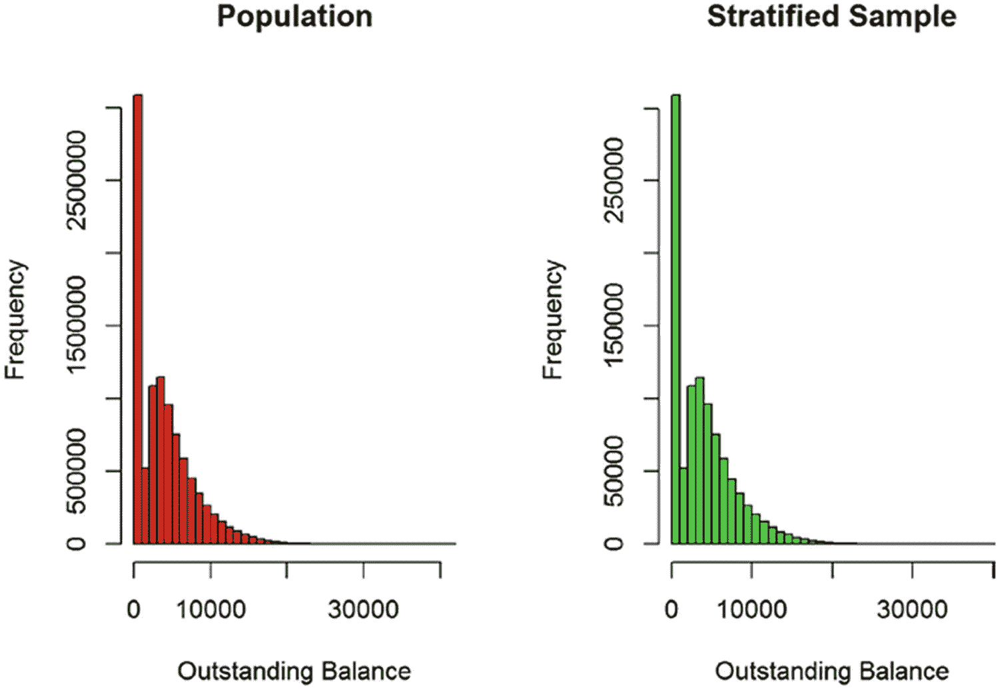

**图 3-12 总体与分层样本分布**

```
par(mfrow =c(1,2))
hist(data$OutsBal, breaks=50, col="red", xlab="Outstanding Balance", main="Population ")
hist(stratified_sample_10_percent$OutsBal, breaks=50, col="green", xlab="Outstanding Balance", main="Stratified Sample")
```

图 3-12 中的分布图再次强调了检验结果：总体和分层随机样本具有相同的分布。分层随机样本能够代表总体。

## 关键点

*   当你希望确保样本中数据点的比例与总体保持一致时，应使用分层抽样。这不仅保证了代表性，还确保了所有层在样本中都有体现。
*   分层抽样还可以帮助你系统地设计每个层的记录比例，从而可以根据业务需求设计分层抽样计划来改变代表性。例如，当你对二项响应函数进行建模，且数据集中事件率或 1 的比例非常小时，你可以从层（0 或 1 响应）中进行分层随机抽样，并尝试通过抽样提高 1 的比例，以方便建模。

### 3.11.5 整群抽样

很多时候，总体中包含在统计上显著的异质性群体。在这种情况下，首先识别这些异质性群体，然后规划抽样策略就显得尤为重要。这种技术在市场营销和活动策划人员中很受欢迎，因为他们经常处理总体中异质性群体的特征。

整群抽样可以通过两种方式进行：

# 整群抽样详解

## 抽样方法分类

### 单阶段抽样
所选群组中的所有元素都包含在样本中。例如，你想研究某个群组中占主导地位的特定总体特征，那么你可能需要先识别该群组及其元素，然后抽取该群组的所有单元。

### 两阶段抽样
从所选群组中随机抽取一部分元素纳入样本。这种方法类似于分层抽样，但区别在于，这里的群组是父级单元，而前者中的是层。层变量本身可能根据度量尺度被划分为多个群组。

对于固定的样本量，当总体中的大部分变异存在于组内而非组间时，整群抽样能获得更好的结果。选择抽样方法并非总是直截了当的。很多时候，整群抽样的每个样本点成本低于其他抽样方法。在这种成本约束下，整群抽样可能是一个不错的选择。

## 层与群组的区别

指出层与群组之间的区别很重要。虽然两者都是总体的重叠子集，但它们在许多方面有所不同。

- 在样本中，所有层都会被代表；而在整群抽样中，只有一部分群组被包含在样本中。
- 当层内单元在内部是同质时，分层抽样效果最佳。然而，对于整群抽样，当群组内元素在内部是异质时，效果最佳。

## 整群抽样的优缺点

### 优点
- 数据收集成本低于其他方法，因为关注的目标群组在收集和存储上成本更低，且管理成本也更低。
- 整群抽样以群组块的形式考虑大型总体。由于这些群组/集群规模很大，采用任何其他技术都会非常困难。只有当我们处理的是包含统计上显著群组的大型总体时，整群抽样才可行。
- 使用其他抽样方法可以观察到估计值变异性的降低，但这并非总是理想情况。

### 缺点
- **抽样误差**：由于抽样过程的设计，抽样误差较高。群组研究中受试者数量与同等可靠、随机抽样的非群组研究中受试者数量之比称为*设计效应*，这导致了较高的抽样误差。
- **抽样偏差**：在整群抽样中，所选样本将被视为整个总体的代表，如果该群组存在有偏见的意见，那么整个总体就会被推断为持有相同意见。实际情况可能并非如此。

## 数据模拟与示例

在向你展示整群抽样之前，让我们通过按国际交易对数据进行子集划分，人为地在数据中创建一些群组。我们将使用一个关于国际交易的条件语句来对数据进行子集划分。在这里，你可以看到我们人为地创建了五个群组。

```
# 在我解释整群抽样之前，让我们尝试对数据进行子集划分，以便有清晰的样本来解释整群抽样的重要性

# 将数据子集划分为 5 个子组
Data_Subset_Clusters_1 2&IntTransc 10&IntTransc 18&IntTransc 26&IntTransc 34)
Data_Subset_Clusters
```

我们明确地基于国际交易创建了群组。创建这些群组是为了展示整群抽样。

单阶段整群抽样意味着从五个群组中随机选择群组进行分析。而两阶段抽样则意味着随机选择几个群组，然后从中进行分层随机抽样。在图 3-13 中，我们首先使用`k-means`（在第 [6](http://dx.doi.org/10.1007/978-1-4842-4215-5_6) 章中详细讨论）创建群组，然后应用分层抽样，假设群组是层变量。

`k-means`函数基于基于质心的k-means聚类方法创建群组。由于我们明确创建了五个群组，我们将调用`k-means`根据国际交易值形成五个群组。我们已经知道该函数会像上一步那样精确地给出五个群组。这仅用于说明目的。在实际情况中，你需要找出总体数据中存在的群组。

```
# 现在我们将 Data_Subset_Clusters 视为我们的总体
library(stats)
kmeans_clusters <-kmeans(Data_Subset_Clusters$IntTransc, 5, nstart =25)
cat("群组中心是 ",kmeans_clusters$centers)
群组中心是 59.11837 22.02696 38.53069 47.98671 5.288112
```

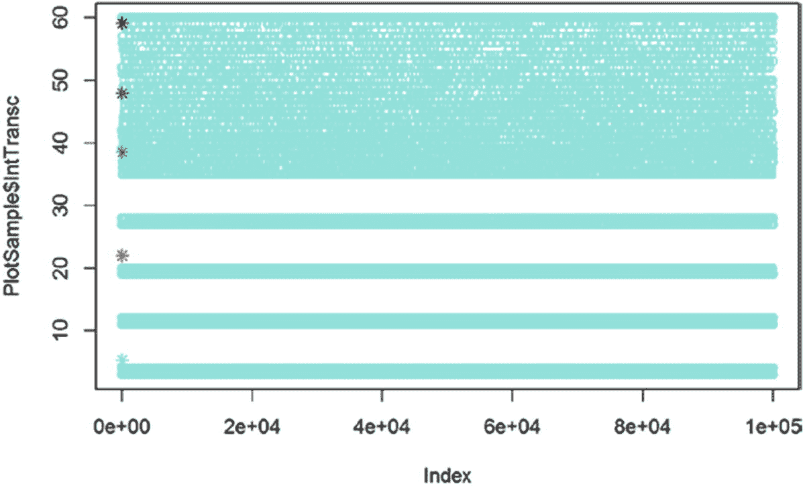

图 3-13 按国际交易数量划分的五类输入数据分段

接下来，我们随机抽取一部分记录以便清晰地绘图，因为绘制大量记录会不清晰（见图 3-13）。

```
set.seed(937)

# 为了绘图，我们只从总数据中随机选择 100000 条记录。
library(splitstackshape)
PlotSample<-Data_Subset_Clusters[sample(nrow(Data_Subset_ Clusters),size=100000, replace =TRUE, prob =NULL),]
plot(PlotSample$IntTransc, col = kmeans_clusters$cluster)
points(kmeans_clusters$centers, col =1:5, pch =8)
```

```
cluster_sample_combined<-cbind(Data_Subset_Clusters,kmeans_clusters$cluster)
setnames(cluster_sample_combined,"V2","ClusterIdentifier")
```

现在，我们向你展示每个群组汇总的记录数量。请注意这些数字，因为我们将在两阶段整群抽样中用到它们。样本在各群组中的比例将保持一致。

```
print("每个群组的记录数汇总")
[1] "每个群组的记录数汇总"
table(cluster_sample_combined$ClusterIdentifier)
1      2      3      4      5
67871 128219  75877  44771 974893
```

这里，我们假设群组标识符是层变量，并使用 `stratified()` 函数分别抽取占层总体 10% 的样本。

```
set.seed(937)
library(splitstackshape)
cluster_sample_10_percent<-stratified(cluster_sample_combined,group=c("Clust
erIdentifier"),size=0.1,replace=FALSE)
```

这一步创建了两阶段整群样本，即从每个群组中随机选择 10% 的记录。让我们绘制带有群组中心的群组图（见图 3-14）。

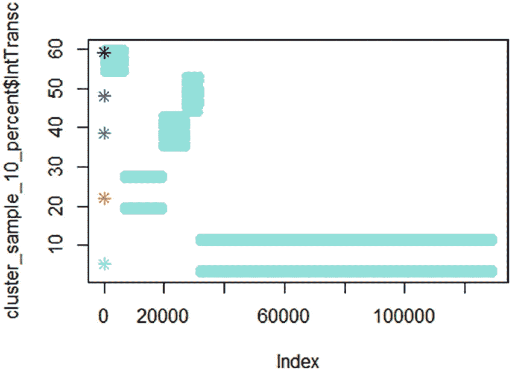

图 3-14 由 K-means 形成的群组（星号代表群组的质心）

```
print("绘制来自群组的随机样本的群组图")
[1] "绘制来自群组的随机样本的群组图"
plot(cluster_sample_10_percent$IntTransc, col = kmeans_clusters$cluster)
points(kmeans_clusters$centers, col =1:5, pch =8)
```

接下来是群组样本的频率分布。回头看看，它与用于聚类的总体比例相同。整群抽样第二阶段的分层抽样确保了数据点的比例保持不变，即层大小的 10%。

```
print("Summary of no. of records per clusters")
[1] "Summary of no. of records per clusters"
table(cluster_sample_10_percent$ClusterIdentifier)
1     2     3     4     5
6787 12822  7588  4477 97489
```

现在，我们展示整群抽样如何影响未结余额的分布，并与总体和整群样本进行比较。

### 3.11.5 整群抽样示例与分析

```
population_summary <- summarise(group_by(data, CardType), OutstandingBalance_Population = mean(OutsBal))
Warning in gmean(OutsBal): Group 1 summed to more than type 'integer'
can hold so the result has been coerced to 'numeric' automatically, for
convenience.
cluster_summary <- summarise(group_by(cluster_sample_10_percent, CardType), OutstandingBalance_Cluster = mean(OutsBal))
summary_mean_compare <- merge(population_summary, cluster_summary, by = "CardType")
print(summary_mean_compare)
Source: local data table [4 x 3]
CardType OutstandingBalance_Population
1 American Express                      3820.896
2         Discover                      4962.420
3       MasterCard                      3818.300
4             Visa                      4584.042
Variables not shown: OutstandingBalance_Cluster (dbl)
```

该摘要展示了基于国际交易的整群抽样如何影响未结余额的均值。为了进行可视化检查，我们将在图 3-15 中创建直方图。您将看到分布受到的影响微乎其微。这可能是因为我们创建的群组假设国际交易桶是同质的，因此对未结余额没有产生重大影响。为了确保这一点，建议您执行`t.test()`来检验均值是否显著相同。

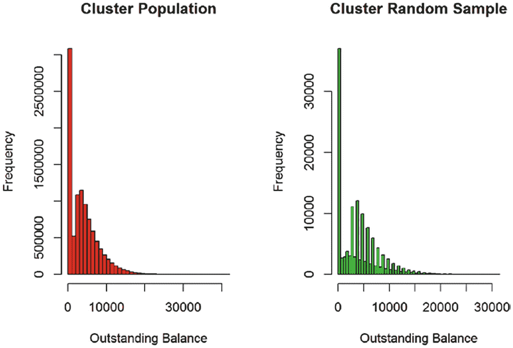

**图 3-15** 整群总体与整群随机样本分布

```
par(mfrow = c(1,2))
hist(data$OutsBal, breaks = 50, col = "red", xlab = "Outstanding Balance",
main = "Histogram for Population Data")
hist(cluster_sample_10_percent$OutsBal, breaks = 50, col = "green",
xlab = "Outstanding Balance",
main = "Histogram for Cluster Sample Data ")
```

换句话说，整群抽样与分层抽样相同；唯一的区别在于，分层变量存在于数据中，是数据的内在属性，而在整群抽样中，我们首先识别群组，然后从这些群组中进行随机抽样。

**关键点：**

*   仅当总体中存在强有力的群组证据，并且您有充分的业务理由来证明这些群组及其对建模结果的影响时，才应进行整群抽样。
*   不应将整群抽样与分层抽样混淆。在分层抽样中，层是根据数据集中的属性形成的，而群组则是基于总体中主体通过某种关系（例如，与质心的距离、相同的多变量特征等）的相似性创建的。在实施整群抽样时需特别注意，群组必须存在，并且应具有同质性的业务依据。

### 3.11.6 自助抽样法

在统计学中，自助法（Bootstrapping）是任何依赖于有放回随机抽样的抽样方法、检验或度量。理论上，你可以在自助法中创建无限大小的总体进行抽样。这是一个统计学中的高级主题，广泛应用于需要从样本估计值中计算统计抽样度量（例如均值、方差、偏差等）的情况。

自助法允许使用随机抽样方法估计几乎任何统计量的抽样分布。刀切法（Jackknife）先于现代自助法技术出现。参数的刀切法估计量是通过反复剔除一个观测值并计算估计值来获得的。当所有观测点都被遍历后，将这些估计值的平均值作为估计量。对于样本量为 `N` 的情况，也可以通过汇总样本中每个 `N-1` 估计值来得到刀切法估计量。理解刀切法很重要，因为它为样本度量估计的自助法方法提供了基本思路。

参数的刀切法估计量可以通过估计每个子样本的参数，并省略第 `i` 个观测值来估计先前未知的参数值（例如 `x̄_i` ）来获得。

`x̄_i = (1/(n-1)) * Σ_{j≠i}^n x_j`

刀切法技术可用于估计估计量的方差。

`Var_(jackknife) = ((n-1)/n) * Σ_{i=1}^n (x̄_i - x̄_(·))²`

其中 `x̄_i` 是基于省略第 `i` 个观测值的参数估计量，而 `x̄_(·)` 是基于所有子样本的估计量。

1977 年，斯坦福大学的 B. Efron 发表了他著名的论文《Bootstrap Methods: Another Look at the Jackknife》。这篇论文首次详细阐述了自助法在各种样本度量估计问题中的应用。从统计学角度看，该论文试图解决以下问题：给定一个来自未知概率分布 `F` 的随机样本 `X = (x[1],x[2],…X[n])`，根据观测数据 `x` 估计某个预先指定的随机变量 `R(X,F)` 的抽样分布。我们留待您自行探索该方法的统计细节。

当您不知道总体的分布（或者甚至没有总体）时，自助法可以方便地为抽样估计创建假设检验。自助法技术将从样本获得的经验分布中抽取数据。如果一组观测值可以被假定来自独立同分布的总体，则可以通过构建多个有放回的重采样（大小与观测数据集相等）来实现。当我们数据集较小且不确定估计量的分布以进行假设检验时，这种方法非常有用。

**优点：**

*   易于实现；它提供了一种简单的方法来计算复杂未知抽样分布的标准误差和置信区间。
*   随着计算能力的提高，自助法的结果会变得更好。
*   自助法的一个流行应用是检查估计值的稳定性。

**缺点：**

*   自助法是渐近一致的，但不能提供有限样本一致性。
*   这是一种高级技术，因此您需要充分了解从自助法方法得出的估计值的假设和性质。

在我们的 R 示例中，我们将展示如何使用自助法来估计总体参数，并围绕该估计值创建置信区间。这有助于检查参数估计的稳定性并执行假设检验。我们将基于一个与业务相关的线性回归方法创建示例。

**注意：** 当样本量非常小且难以找到实际总体分布时，自助法技术更适用于估计问题。

首先，我们在总体数据上拟合一个线性回归模型（不含截距）。该模型将以响应变量作为待研究变量，预测变量为国内交易次数进行拟合。商业直觉表明，未偿还余额应与国内交易次数呈正相关。自变量与因变量之间的正相关意味着线性回归系数的符号应为正。

我们得到的系数是来自总体的真实估计值。这是总体参数估计值，因为它是在计算整个总体。

# 3.11 自助法

```r
set.seed(937)
library(boot)
```

## 现在我们需要想要估计的函数

首先拟合一个线性模型，并从总体数据中获知真实估计值。

```r
summary(lm(OutsBal ~0 +DomesTransc, data = data))
```

```
Call:
lm(formula = OutsBal ~ 0 + DomesTransc, data = data)

Residuals:
     Min       1Q   Median       3Q      Max 
 -7713.2  -1079.6   1449.3   4430.2  39090.7 

Coefficients:
              Estimate Std. Error t value Pr(>|t|)    
DomesTransc  77.13469    0.03919    1968   <2e-16 ***
---
Signif. codes:  0 ‘***’ 0.001 ‘**’ 0.01 ‘*’ 0.05 ‘.’ 0.1 ‘ ’ 1

Residual standard error: 4867 on 9999999 degrees of freedom
Multiple R-squared:  0.2792,	Adjusted R-squared:  0.2792 
F-statistic: 3.874e+06 on 1 and 9999999 DF,  p-value: < 2.2e-16
```

你可以看到在总体数据上拟合的线性回归模型摘要。现在我们将抽取总体的一小部分样本（抽样比例 = 10000/10,000,000 = 1/1000）。因此，我们的挑战是从一个非常小的数据集中估计国内交易次数的系数。

在此背景下，抽样可以被视为一个过程，即从一组小值中创建更大的样本集，以获取估计值真实分布的估计。

```r
set.seed(937)
# 假设我们只有 10000 个数据点，并且必须对国内交易系数的重要性进行假设检验。
# 由于数据集很小，我们将使用自助法来创建系数的分布，
# 然后创建一个置信区间来检验假设。
sample_10000 <-data[sample(nrow(data),size=10000, replace =FALSE, prob =NULL),]
```

现在我们有一个小样本可供使用。让我们定义一个名为 `Coeff` 的函数，它将返回国内交易变量的系数。

它有三个参数：
*   `data`：这是你想要进行自助法处理的小数据集。在我们的例子中，这是包含 10,000 条记录的样本数据集。
*   `b`：一个随机的索引框架，每次调用函数时用于选择数据。这将确保每次从模型中选取数据集时，都是从输入数据中随机选择的。
*   `formula`：这是一个可选字段。但这将是模型的函数形式，将由线性回归进行估计。

这里我们只是将公式合并到了 `return` 语句中。

```r
# 返回 DomesTransc 系数的函数
Coeff =function(data,b,formula){
  # b 是自助法样本的随机索引
  d =data[b,]
  return(lm(OutsBal ~0 +DomesTransc, data = d)$coefficients[1])
  # 这是 beta 系数
}
```

现在我们可以开始自助法了，因此我们将使用 `boot` 库中的 `boot()` 函数。这是一个非常强大的函数，适用于参数和非参数自助法。我们认为这是一个高级主题，不会涵盖此函数的细节。感兴趣的读者建议阅读 CRAN 上的函数文档。

我们在此示例中使用的输入是：
*   `data`：这是我们在上一步创建的小样本数据。
*   `statistics`：这是一个函数，将返回感兴趣参数的估计值。这里，我们的函数 `Coeff` 将返回国内交易系数的值。
*   `R`：这是你想要创建的自助法样本数量。一个通用的经验法则是，你拥有的自助法样本越多，置信带就越窄。

### 注意
对于此示例，我们考虑使用较少的样本数量，以确保置信带较宽，并了解我们能在多大置信度下看到来自总体的原始估计值。

这里我们使用 `R=50` 调用该函数。

```r
set.seed(937)
# R 是自助法样本的数量
bootbet =boot(data=sample_10000, statistic=Coeff, R=50)
names(bootbet)
```

```
 [1] "t0"        "t"         "R"         "data"      "seed"      "statistic"
 [7] "sim"       "call"      "stype"     "strata"    "weights"  
```

现在绘制系数估计值的直方图和 QQ 图（见图 3-16）。

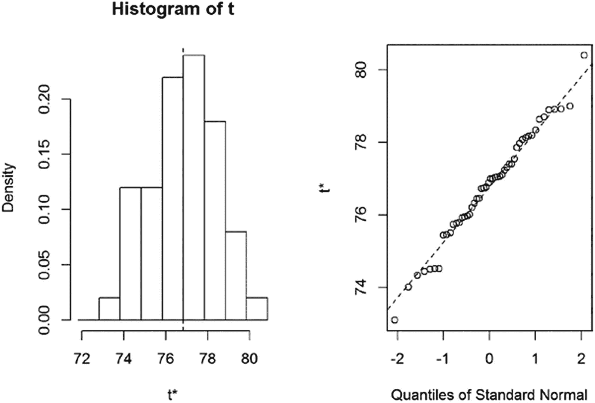

图 3-16 估计系数的直方图和 QQ 图

```r
plot(bootbet)
```

现在，我们绘制参数估计值的直方图。我们可以在图 3-17 中看到，自助法样本揭示了参数的分布。我们可以围绕此分布构建置信区间并进行假设检验。

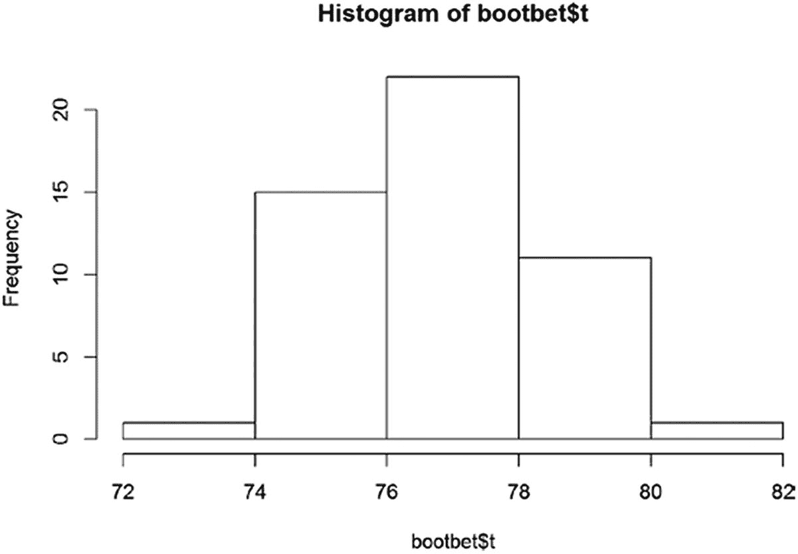

图 3-17 来自助法的参数估计值直方图

```r
hist(bootbet$t, breaks =5)
```

这里我们计算了自助法估计值的均值和方差。假设系数分布是正态分布，你可以围绕均值创建一个针对真实值的置信带。

```r
mean(bootbet$t)
```

```
[1] 76.77636
```

```r
var(bootbet$t)
```

```
          [,1]
[1,] 2.308969
```

此外，为了展示该分布叠加在先前参数的正态分布上的效果，请执行以下操作：

```r
x <-bootbet$t
h<-hist(x, breaks=5, col="red", xlab="自助法估计值",
    main="带正态曲线的直方图")
xfit<-seq(min(x),max(x),length=40)
yfit<-dnorm(xfit,mean=mean(bootbet$t),sd=sqrt(var(bootbet$t)))
yfit <-yfit*diff(h$mids[1:2])*length(x)
lines(xfit, yfit, col="blue", lwd=2)
```

在图 3-18 中，你可以看到我们已经能够找到系数的分布，因此可以对其进行假设检验。这也为我们提供了真实系数的近似估计。如果你仔细观察，这个想法与 Jackknife 最初提出的非常接近。借助更强的计算能力，我们只是将该方法的范围从均值和标准差扩展到了任何参数估计。

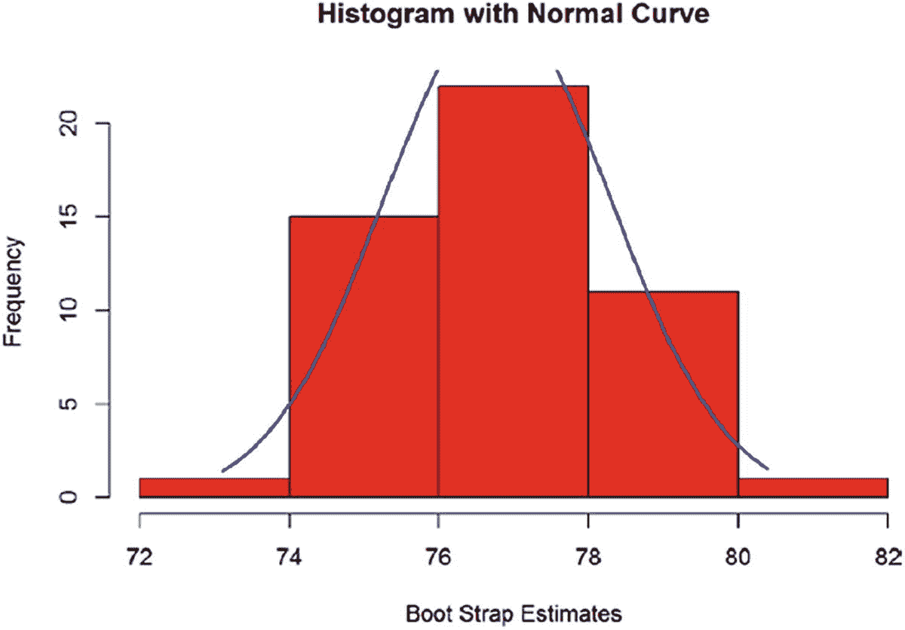

图 3-18 带正态密度函数的直方图

以下代码对系数的自助法值执行 `t.test()`，并与来自总体数据的真实系数估计值进行比较。这将告诉我们，从一个较小的样本中，我们得到的估计值与真实值有多接近，以及我们能在多大置信度下接受或拒绝自助法得到的系数。

```r
t.test(bootbet$t, mu=77.13)
```

```
	One Sample t-test

data:  bootbet$t
t = -1.6456, df = 49, p-value = 0.1062
alternative hypothesis: true mean is not equal to 77.13
95 percent confidence interval:
 76.34452 77.20821
sample estimates:
mean of x 
 76.77636 
```

关键点：
*   自助法是一种强大的技术，当我们对参数分布知之甚少且只有小数据集可用时，它会派上用场。
*   这种技术本质上是高级的，并涉及许多假设，因此需要适当的统计知识才能使用自助法技术。

## 3.12 蒙特卡洛方法：接受-拒绝法

在现代，蒙特卡洛方法已成为统计学中一个独立的研究领域。蒙特卡洛方法利用计算密集型的随机抽样技术来估计潜在参数。该技术对于无法求得精确解的随机方程至关重要。蒙特卡洛技术在金融领域非常流行，特别是在金融工具估值和预测方面。

在统计学中，接受-拒绝法是从某个分布中抽取观测样本的基本技术。该方法从一个分布中进行随机抽样，并根据预设条件决定接受或拒绝该观测值。因此，它属于蒙特卡洛方法的广泛范畴。

在此方法中，我们首先通过观察累积概率分布来估计数据集的**经验分布**（即经验密度函数：EDF）。得到 EDF 后，我们为另一个已知分布设定参数。这个已知分布将覆盖 EDF。

现在，我们开始从已知分布中抽样，如果观测值落在 EDF 范围内则接受，否则拒绝。换句话说，拒绝抽样可以通过以下步骤执行：

1.  从提议分布中抽取一个点（记为 `x`）。

2.  在该样本点 `x` 处画一条垂直线，直至提议分布的曲线（见图 3-19）。

3.  沿着这条线从 0 到最大值（PDF）均匀抽样，其中 PDF 代表概率密度函数。如果样本值大于最大值，则拒绝；否则接受。

该方法帮助我们根据已知分布抽取任意分布的样本。这些方法在金融产品估值和其他随机过程的随机微积分中非常流行。

为了说明此方法，我们将从参数为 (3,10) 的贝塔分布中抽取一个样本。贝塔分布如图 3-19 所示。

```
curve(dbeta(x, 3,10),0,1)
```

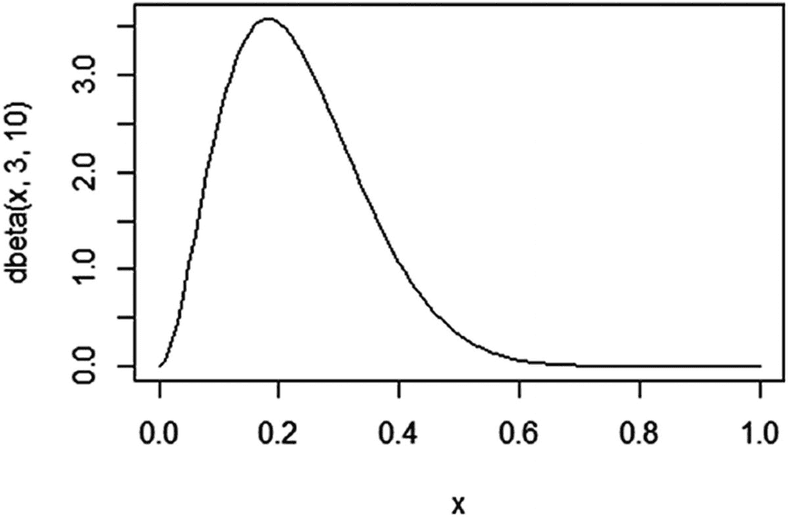

图 3-19

贝塔分布图

我们首先创建一个包含 5000 个介于 0 和 1 之间的随机值的样本。然后，我们计算这 5000 个随机值样本对应的贝塔密度。

```
set.seed(937)
sampled <-data.frame(proposal =runif(5000,0,1))
sampled$targetDensity <-dbeta(sampled$proposal, 3,10)
```

现在，我们计算提议分布（贝塔 PDF）的最大概率密度。一旦我们获得了 5000 个案例的最大密度和样本密度，我们就开始通过拒绝法进行抽样，如下所示。生成一个介于 0 和 1 之间的随机数：

```
如果该值大于我们为预先已知的贝塔分布计算的样本密度，则拒绝该值作为来自贝塔分布的样本
maxDens =max(sampled$targetDensity, na.rm = T)
sampled$accepted =ifelse(runif(5000,0,1) <sampled$targetDensity /maxDens,
TRUE, FALSE)
```

图 3-20 显示了贝塔(3,10)的 EDF 图以及样本数据集的直方图。我们可以看到，通过接受位于红线（即贝塔分布的 PDF）下方的随机数中的值，我们成功创建了所需的样本。

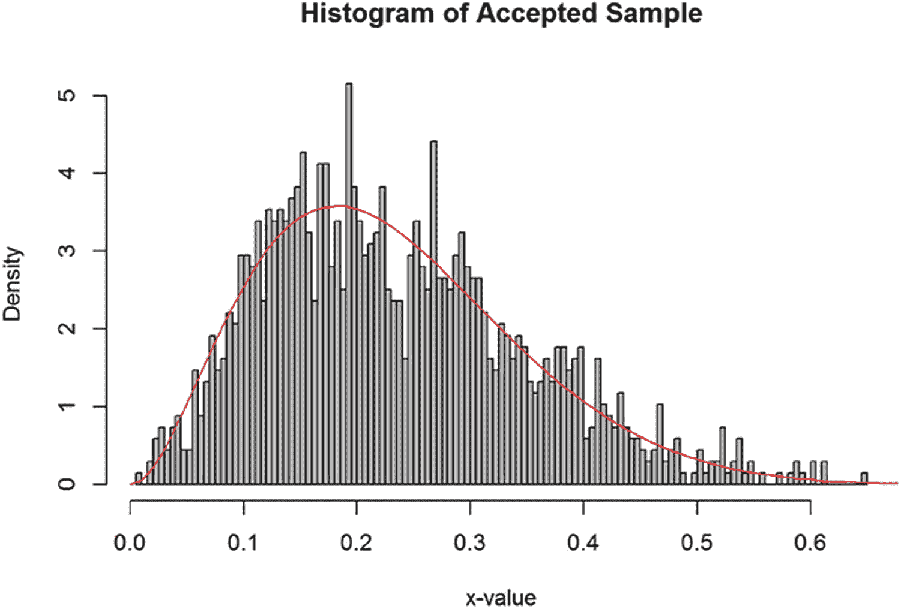

图 3-20

通过拒绝法抽样

```
hist(sampled$proposal[sampled$accepted], freq = F, col ="grey", breaks =100)
curve(dbeta(x, 3,10),0,1, add =T, col ="red")
```

## 3.13  本章小结

在本章中，我们介绍了不同的抽样技术，并展示了这些抽样技术如何减少需要处理的数据量，同时保留数据的属性。适用于任何总体的最佳抽样方法是简单随机无放回抽样。

我们还讨论了自助抽样法，这是一个重要的概念，因为你可以使用此方法估计任何参数的分布。最后，我们展示了通过拒绝法进行抽样的示例，该方法允许我们从已知分布创建任何分布。该技术基于蒙特卡洛模拟，在金融服务领域非常流行。

本章在减少应用于机器学习算法的数据量方面发挥着重要作用，从而保持总体方差不变。

在下一章中，我们将通过可视化来研究数据的属性。如果我们使用适当的抽样，从样本中观察到的可视化和趋势将与从总体中观察到的一致。