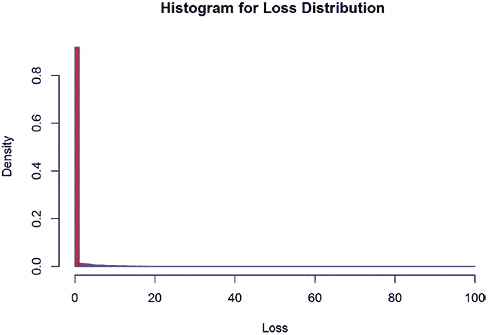
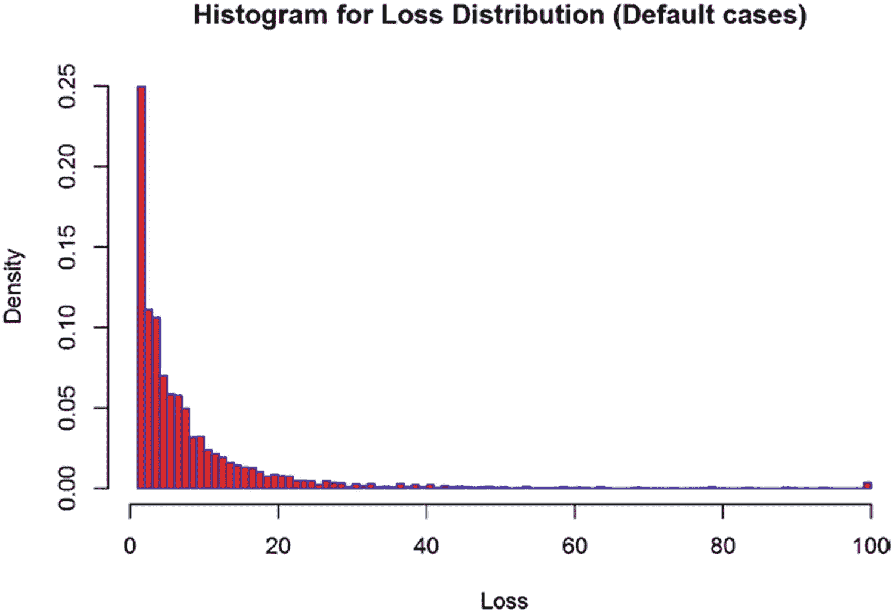
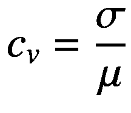
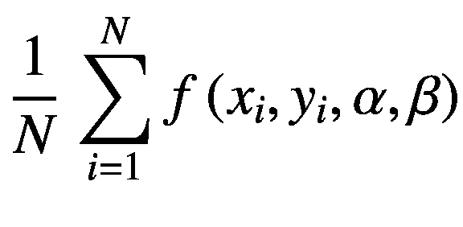
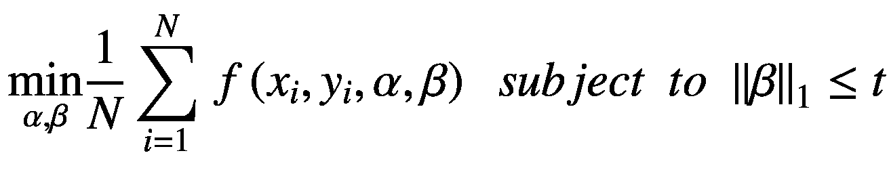
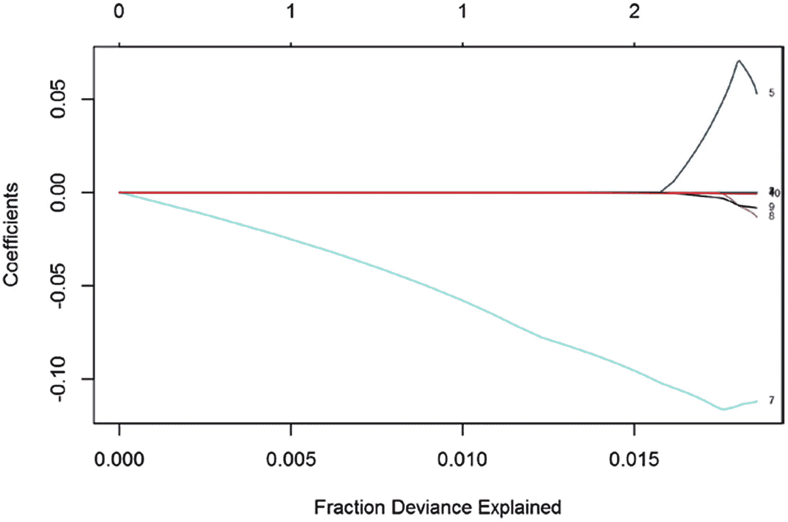
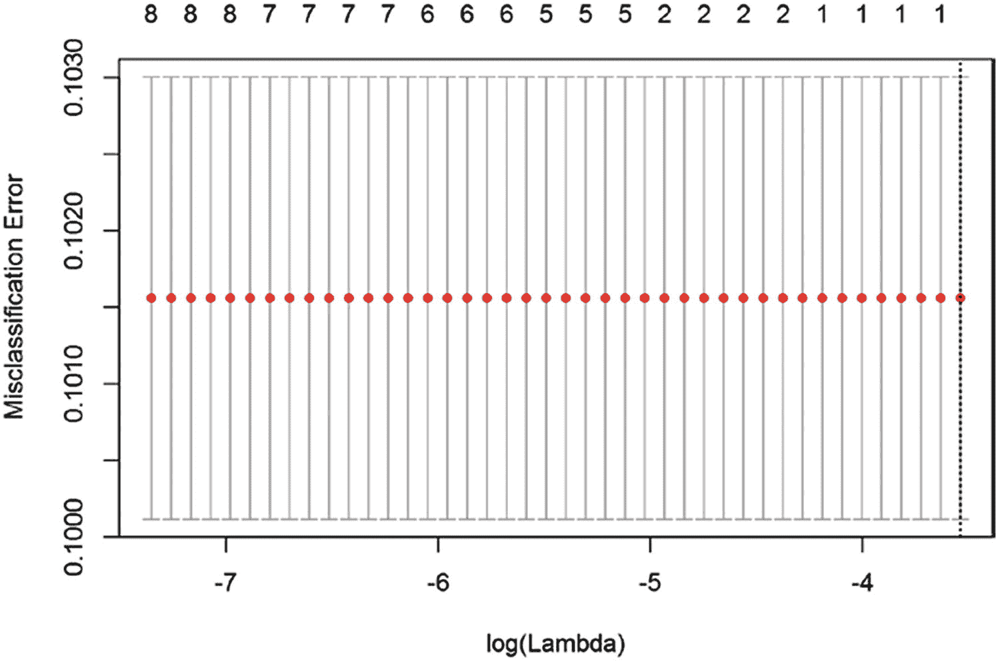
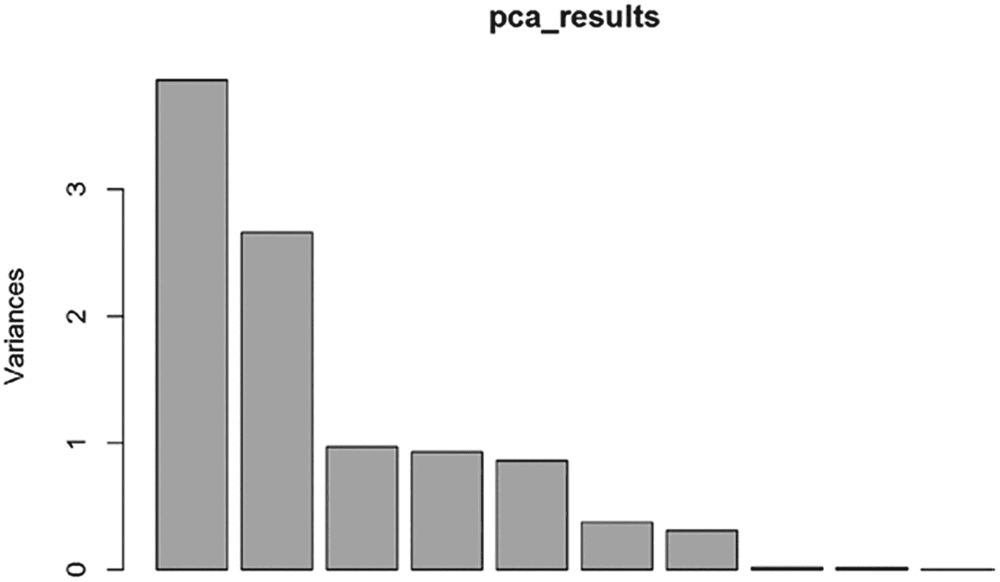
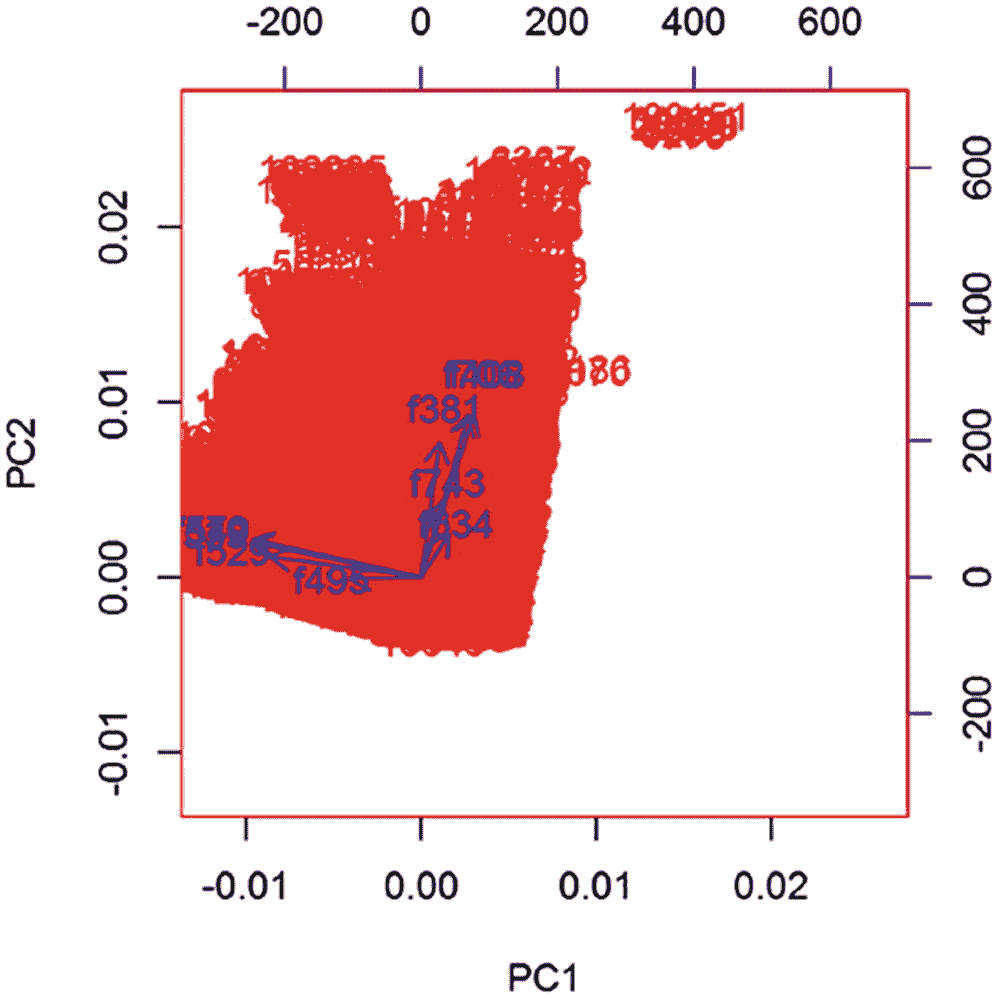

# 5. 特征工程

在机器学习中，特征工程是一个涵盖建模现实问题时统计和商业判断两方面的总括性术语。特征工程这个术语的提出，是为了强调为机器学习算法选择特征集所需的领域知识的重要性。这也是大多数机器学习专业人士称其为非正式流程的原因之一。

为了量化响应变量与预测变量之间有意义的关联，我们需要了解特征的个体属性以及它们之间如何相互作用。描述性统计和特征分布让我们深入了解它们是什么以及它们在数据集中如何表现。

本章的学习目标如下：
- 特征工程简介
- 特征排序
- 变量子集选择
- 降维

本章包含一些动手实践的例子，将通用的统计方法应用于特征工程领域内的这些概念。本章后半部分将讨论一些例子，展示商业批判性思维如何帮助特征选择。

本章中的示例基于贷款违约数据。数据包含给定贷款的损失。每笔贷款的损失按 1 到 100 分级。对于全额收回贷款的情况，贷款损失值设为 0，这意味着该贷款没有违约。损失为 60 意味着只收回了 40%的贷款。该数据用于构建违约预测模型。

数据特征名称已被匿名化，以便将重点放在特征间关系的统计量化上。在金融服务行业中，有一些与贷款违约相关的关键术语：违约概率（`PD`）、违约风险敞口（`EAD`）和违约损失率（`LGD`）。虽然本章的重点是展示统计方法如何运作，但我们鼓励你将其与你的业务问题进行类比，在这种情况下，贷款违约可以作为一个很好的参考点。

## 5.1 特征工程简介

随着技术的进步，现在只需花费很少的成本就能收集大量数据。在许多情况下，为了改进建模输出，我们会将来自第三方来源、外部开源数据的大量数据与内部数据合并。这为机器学习算法创造了庞大的特征集。从机器学习的角度来看，我们考虑集中的所有特征可能并非都重要，即使它们都很重要，也可能不需要全部特征就能达到模型预测的置信水平。

另一个方面是时间和复杂性；机器学习算法是资源密集型的，并且随着模型中每个特征的增加，时间呈指数级增长。数据科学家必须在复杂性与最终模型精度的收益之间取得平衡。

为了完全理解特征工程的概念，我们必须关注两个独立但相互支持的过程：
- 特征选择（或变量选择）
- 业务/领域知识

前者是统计密集型的，并提供经验证据，说明为什么某个特征或特征集对机器学习算法很重要。这是基于可量化且可比较的指标，这些指标要么独立于响应变量，要么不独立。后者则更多地是运用业务逻辑，以确保特征有意义，并提供业务所寻求的正确见解。

例如，假设失业率被用于识别某个地区的贷款违约。对于该数据集，失业率可能在 95% 的置信水平下不显著，但在 90% 的置信水平下显著。如果业务部门认为失业率是一个重要变量，那么我们可能希望在变量选择中创建一个例外，即在放宽统计约束的条件下纳入失业率。

一个稳健且结构化的变量选择所带来的主要好处是：
- 提高模型的预测性能
- 更快、更简单的机器学习过程
- 更好地理解底层数据关系
- 可解释且可实施的机器学习模型/解决方案

前三个好处是直观的，可以联系到我们之前的讨论。让我们花些时间来重视这里的第四点。业务洞察通常源自简单且可解释的模型。机器越复杂，就越难以解释。尝试将特征视为业务行动点。如果所构建的机器包含无法用清晰术语向业务部门解释的特征，那么业务就会失去价值，因为模型输出无法付诸行动。这意味着机器学习的全部目的就丧失了。

你开发的任何模型都必须部署到实际环境中供最终用户使用。对于实际环境，模型中每增加一个特征，就意味着向实际系统增加一个数据输入，而这反过来可能意味着要访问一个全新的数据库。这会在系统内部造成大量的 IT 系统变更和依赖关系。然后，实施和维护成本必须根据模型的不可替代性以及保留这么多变量的必要性来权衡。如果可以用更少的特征解释相同的基本行为，那么就应该用更少的特征来实施。计算和提供快速结果的敏捷性通常胜过拥有更多特征的更好模型。

特征选择方法大致分为三类：过滤法、包装法和嵌入法。在接下来的几节中，我们将在 5.4 节中通过示例解释这三种方法。

## 5.2 理解数据

本章使用的数据来自一个公开竞赛的信用风险数据。信用风险建模是银行业中最复杂的建模问题之一。构建信用风险模型的过程不仅在数据方面很复杂，还需要深入了解业务和市场动态。

> *信用风险*是指因借款人未能按时还款而可能产生的债务违约风险。

对信用风险建模中的关键术语多一些背景了解，将有助于你将这些数据问题与其他类似的领域问题联系起来。我们简要介绍信用风险建模中的几个关键概念。
- *还款意愿和还款能力*：信用风险模型试图量化任何借款人的这两个方面。还款能力可以通过研究借款人的财务状况（如收入、财富等变量）来量化，而困难的部分在于衡量还款意愿，我们使用捕捉行为属性的变量（如违约历史、欺诈活动等变量）。
- 违约概率 (`PD`)：`PD` 是一个衡量指标，表明借款人在下一时期违约的可能性有多大。该值越高，违约的可能性越大。它是一个介于 0 和 1 之间（包含边界）的度量。银行希望向 `PD` 较低的借款人放贷。
- 违约损失率 (`LGD`)：`LGD` 是衡量如果借款人在下一时期违约，贷款人可能损失多少的指标。通常，贷款人会持有某种形式的抵押品来限制违约的下行风险。简单来说，这个指标是贷款金额减去抵押品价值。这通常以百分比来衡量。具有高 `LGD` 的借款人是风险。
- 违约风险敞口 (`EAD`)：`EAD` 是银行/贷款人在当前时间点所面临的风险敞口金额。这是如果借款人现在违约，贷款人可能损失的金额。这是任何银行信用风险部门密切关注的指标之一。

这些术语将帮助你思考如何通过调整特征工程的方式，从相同的数据中挖掘出不同的信息。所有这些指标都可以从相同的贷款违约数据中预测出来，但我们选择特征的方式会有所不同。

### 5.2.1 数据摘要

输入数据的摘要将提供关于数据的重要信息。在本章中，我们需要在应用不同技术之前了解数据的一些特征。为了展示如何应用统计方法，我们选择用于建模的特征集。我们将关注的重要特征如下：
- 因变量的属性
- 特征可用性：连续型或分类型
- 设定数据假设

### 5.2.2 因变量的属性

在我们的数据集中，`loss` 是本章图表中用作因变量的变量。建模的目标是信用损失。贷款是信用的一种形式，我们将交替使用信用损失和贷款损失这两个术语。`loss` 变量的取值范围在 0 到 100 之间。我们将在本章中查看 `loss` 变量的分布情况。

以下代码加载数据并显示所创建数据集的维度。维度是指记录数乘以特征数。

```r
# Input the data and store in data table
library(data.table)
data <- fread("Dataset/Loan Default Prediction.csv", header = T, verbose = FALSE, showProgress = TRUE)
# Read 105471 rows and 771 (of 771) columns from 0.476 GB file in 00:01:02
dim(data)
# [1] 105471    771
```

共有 105,471 条记录，包含 771 个属性。在这 771 个属性中，有一个因变量序列和一个主键。我们有 769 个特征来为这个信用损失模型构建特征集。

我们知道因变量是损失，其范围在 0 到 100 之间。出于分析目的，我们将把因变量作为连续变量和离散变量进行分析。作为连续变量，我们将查看描述性统计；作为离散变量，我们将查看其分布。

```r
# Summary of the data
summary(data$loss)
#    Min.  1st Qu.  Median    Mean  3rd Qu.     Max.
#   0.0000   0.0000  0.0000  0.7996   0.0000 100.0000
```

记录到的最大损失是 100，这相当于说贷款的所有未偿信用额度都损失了。均值接近 0，第一和第三四分位数都是 0。显然，损失不能作为连续变量来处理，因为大部分值都集中在 0 附近。换句话说，违约案例的数量很少。



*图 5-1：损失分布（包含无违约情况）*

```r
hist(data$loss,
     main = "Histogram for Loss Distribution ",
     xlab = "Loss",
     border = "blue",
     col = "red",
     las = 0,
     breaks = 100,
     prob = TRUE)
```

图 5-1 中的损失分布显示，大部分分布中损失等于零。我们可以看到，在这种情况下，将损失作为连续变量是不可能的。因此，我们将把因变量转换为一个二分变量，其中 0 代表无违约，1 代表违约。问题将简化为违约预测，我们现在知道后续打算使用哪种机器学习算法。这些先验信息将有助于我们选择合适的特征选择方法以及用于特征选择的指标。

现在让我们看看在发生违约的情况下（即损失不为零），损失是如何分布的（回想一下违约损失率 `LGD` 的概念）。



图 5-2：损失分布（排除无违约情况）

```R
#Sub-set the data into NON Loss and Loss ( e.g., loss > 0)
subset_loss 0.
```

在超过 90% 的情况下，损失低于 25%，因此违约损失率 (`LGD`) 较低（见图 5-2）。公司可以收回大部分应付款项。为了进一步讨论特征选择，我们将创建一个名为 `default` 的二分变量，如果损失等于 0，则该变量为 0，否则为 1。

```R
default = 0 , there is no default and hence no lossdefault = 1, there is a
default
#Create the default variable
data[,default :=ifelse(data$loss ==0, 0,1)]
#Distribution of defaults
table(data$default)
0     1
95688  9783
#Event rate is defined as ratio of default cases in total population
print(table(data$default)*100/nrow(data))
0         1
90.724465  9.275535
```

因此，我们已经将因变量转换为一个二分变量，我们的特征选择问题将致力于为我们的数据找到最佳的特征集来建模这种违约行为。分布表显示，在我们的数据集中有 9.3% 的违约案例。这在模型开发数据中有时被称为事件率。

### 5.2.3 特征可用性：连续型或分类型

数据有 769 个特征用于为信用损失建模。我们必须识别出这些特征中有多少是连续型的，多少是分类型的。这将使我们能够恰当地设计特征选择过程，因为许多指标在排序方面不能直接比较，例如，连续变量的相关性度量与分类变量的相关性度量就不同。

**提示**：如果你对某个特征的有效值没有任何先验知识，可以将具有超过 30 个水平的变量视为连续变量，将具有少于 30 个水平的变量视为分类变量。

以下代码片段做了三件事，以确定变量需要被赋予哪种类型的处理方式，即连续型或分类型：

*   从本次分析中移除 `id`、`loss` 和 `default` 指示变量，因为这些变量是标识符或因变量。
*   找出每个特征中的唯一值；如果唯一值的数量小于或等于 30，则将该特征归入分类集。
*   如果唯一值的数量大于 30，则将其归为连续变量。

这个想法对我们来说是有效的；但是，你需要对诸如邮政编码（它是一个名义变量）、州（州的数量可能超过 30 个，并且它们是字符型）以及其他具有字符值的特征保持谨慎。

```R
continuous <-character()
categorical <-character()
#Write a loop to go over all features and find unique values
p<-1
q<-1
for (i in names(data))
{
unique_levels =length(unique(data[,get(i)]))
if(i %in%c("id","loss","default"))
{
next;
}
else
{
if (unique_levels <=30 |is.character(data[,get(i)]))
{

#    cat("The feature ", i, " is a categorical variable")
categorical[p] <-i
p=p+1

# Making the
data[[i]] <-factor(data[[i]])
}
else
{

#   cat("The feature ", i, " is a continuous variable")
continuous[q] <-i
q=q+1
}
}
}

# subtract 1 as one is dependent variable = default
cat("\nTotal number of continuous variables in feature set ",
length(continuous) -1)
Total number of continuous variables in feature set 717

# subtract 2 as one is loss and one is id
cat("\nTotal number of categorical variable in feature set ",
length(categorical) -2)
Total number of categorical variable in feature set 49
```

这些迭代将数据分成了分类变量和连续变量，分别包含 49 个和 717 个特征。我们将忽略这些特征的领域特定含义，因为我们的重点是特征选择的统计方面。

### 5.2.4 建立数据假设

为了解释特征选择的不同方面，我们将使用一些假设：

*   我们对特征重要性或领域特定限制没有任何先验知识。
*   我们想要创建的机器/模型将预测二分变量 `default`。
*   步骤的顺序仅用于说明；存在多种变体。

## 5.3 特征排序

特征排序是识别特征对模型设定目标解释能力的最常用方法之一。在本例中，目标是预测 0 或 1。解释能力必须通过预定义的指标来量化，这样我们才能对特征进行有序排列。

在我们的问题设定中，可以通过以下步骤获取特征排序：

*   对每个特征拟合一个逻辑模型（第 [6](http://dx.doi.org/10.1007/978-1-4842-4215-5_6) 章将更详细地讨论此主题），其中因变量为 `default`。
*   计算基尼系数。此处，基尼系数是我们定义的用于衡量特征解释能力的指标。
*   使用基尼系数对特征进行排序，基尼系数越高表示特征的解释能力越强。

`MLmetrics` 是一个评估指标集合——包括损失函数、评分函数和效用函数——用于衡量回归、分类和排序性能。这是一个用于计算分类器性能指标的有用包。我们将使用该包中的 `Gini()` 函数来获取基尼系数。

以下代码片段实现了以下步骤：

*   对数据中的每个特征，使用 `logit` 链接函数拟合一个逻辑回归模型。
*   计算所有数据的基尼系数（你也可以在训练数据上训练，并在测试数据上计算基尼系数）。
*   按基尼系数对所有特征进行排序（从高到低）。

```R
library(MLmetrics)
performance_metric_gini <-data.frame(feature =character(), Gini_value =numeric())
#编写循环遍历所有特征并查找唯一值
for (feature in names(data))
{
if(feature %in%c("id","loss","default"))
{
next;
}
else
{
tryCatch({glm_model <-glm(default ~get(feature),data=data,family=binomial(l
ink="logit"));
predicted_values <-predict.glm(glm_model,newdata=data,type="response");
Gini_value <-Gini(predicted_values,data$default);
performance_metric_gini <-rbind(performance_metric_
gini,cbind(feature,Gini_value));},error=function(e){})
}
}
performance_metric_gini$Gini_value <-as.numeric(as.character(performance_
metric_gini$Gini_value))
#按基尼系数值对特征进行排序
Ranked_Features <-performance_metric_gini[order(-performance_metric_
gini$Gini_value),]
print("按基尼系数排序的前 5 个特征\n")
[1] "按基尼系数排序的前 5 个特征\n"
head(Ranked_Features)
feature Gini_value
710    f766  0.2689079
389    f404  0.2688113
584    f629  0.2521622
585    f630  0.2506394
269    f281  0.2503371
310    f322  0.2447725
```

**提示**：当你在大型数据集上运行循环时，循环可能会因某些错误而停止。为避免这种情况，请考虑使用 R 语言中的 `trycatch()` 函数。

排序方法告诉我们，按单个预测能力排序的前六个特征分别是 `f766`、`f404`、`f629`、`f630`、`f281` 和 `f322`。基尼系数最高的特征为 0.268（即 26.8%）。现在，使用前五个特征集，让我们创建一个逻辑模型并查看相同的性能指标。

以下代码使用前六个特征对数据拟合一个逻辑模型。拟合模型后，它会输出模型的基尼系数。

```r
#使用前 6 个特征（f766、f404、f629、f630、f281 和 f322）创建逻辑模型
glm_model <- glm(default ~ f766 + f404 + f629 + f630 + f281 + f322, data = data, family = binomial())
summary(glm_model)
```

```
Coefficients:
            Estimate Std. Error z value Pr(>|z|)
(Intercept) -3.071639   2.160885  -1.421    0.155
f766        -1.609598   2.150991  -0.748    0.454
f404         0.351095   2.147072   0.164    0.870
f629        -0.505835   0.077767  -6.505 7.79e-11 ***
f630        -0.090988   0.057619  -1.579    0.114
f281        -0.004073   0.008245  -0.494    0.621
f322         0.262128   0.055992   4.682 2.85e-06 ***

Signif. codes:  0 '***' 0.001 '**' 0.01 '*' 0.05 '.' 0.1 ' ' 1
(Dispersion parameter for binomial family taken to be 1)

    Null deviance: 65044 on 105147 degrees of freedom
Residual deviance: 62855 on 105141 degrees of freedom
  (323 observations deleted due to missingness)
AIC: 62869

Number of Fisher Scoring iterations: 6
```

```r
#计算Gini系数
Gini_value <- 2 * auc(model = glm_model, response = data$default, predictor = predict(glm_model, type = "response")) - 1
print(Gini_value)
```

```
[1] 0.2824955
```

模型结果显示，四个特征（`f766`、`f404`、`f630` 和 `f281`）不显著。这些特征的标准误差非常高。这提示我们这些特征本身高度相关，因此加入模型并未增加价值。如你所见，即使添加了更多变量，基尼系数也没有提高。排名靠前的特征不显著的原因可能是它们都高度相关。为了研究这个多重共线性问题，我们将为这六个特征创建相关矩阵。

```r
#为 6 个特征（f766、f404、f629、f630、f281 和 f322）创建相关矩阵
top_6_feature <- data.frame(data$f766, data$f404, data$f629, data$f630, data$f281, data$f322)
cor_matrix <- cor(top_6_feature, use = "complete")
print(cor_matrix)
```

```
         data.f766 data.f404 data.f629 data.f630 data.f281 data.f322
data.f766 1.0000000 0.9996710 0.6830923 0.6420238 0.8067094 -0.7675846
data.f404 0.9996710 1.0000000 0.6827368 0.6416069 0.8065005 -0.7675819
data.f629 0.6830923 0.6827368 1.0000000 0.9114775 0.6515478 -0.5536863
data.f630 0.6420238 0.6416069 0.9114775 1.0000000 0.6102867 -0.5127184
data.f281 0.8067094 0.8065005 0.6515478 0.6102867 1.0000000 -0.7280321
data.f322 -0.7675846 -0.7675819 -0.5536863 -0.5127184 -0.7280321 1.0000000
```

从相关结构中可以清楚地看出，特征 `f766`、`f404`、`f630` 和 `f281` 高度相关，因此模型结果显示它们不显著。这个练习表明，虽然特征排序有助于衡量和量化变量的个体能力，但它可能不能直接用作模型开发的变量选择方法。

Guyon 和 Elisseeff 对这种变量排序方法提出了以下批评：

> *变量排序方法会导致选择冗余的子集。使用更小的互补变量子集可能也能达到相同的性能。*

你可以通过查看相关矩阵和模型中的显著变量来验证这一点。这两个显著变量是互补的，并提供了相似的基尼系数。

## 5.4 变量子集选择

变量子集选择是从中选取一个特征（或变量）子集用于机器学习模型的过程。在上一节中，我们尝试使用变量的个体排序来创建变量子集，但观察到了特征排序作为变量选择方法的局限性。现在，我们正式介绍变量子集选择的过程。我们将从每个大类中讨论一种方法，并使用信用损失数据展示一个示例。我们鼓励你比较结果并评估哪种方法最适合你的机器学习问题。

Isabelle Guyon 和 Andre Elisseeff 对各种变量（或特征）选择方法进行了全面介绍。他们将不同方法的衡量标准称为特征的“有用性”或“相关性”，以确定它们是否有资格成为变量子集的一部分。我们将使用信用损失数据来说明三种主要方法——过滤法、包装法和嵌入法。

### 5.4.1 过滤法

过滤法利用变量自身的固有属性，忽略机器学习方法本身。该方法适用于每个变量都能增加增量分类能力的分类问题。

**准则**：衡量特征/特征子集的“相关性”

**搜索**：根据单个特征排名或特征嵌套子集对特征进行排序

**评估**：使用统计检验

**统计方法**

1.  信息增益
2.  卡方检验
3.  费舍尔分数
4.  相关系数
5.  方差阈值

**结果**

1.  相对更稳健，不易过拟合
2.  可能无法选出最“有用”的特征集

对于此方法，我们将展示方差阈值方法，其基本概念是：变异性高的变量也包含更多信息。方差阈值是一种简单的基线方法。在此方法中，我们移除所有方差小于某个阈值的变量。此方法会自动移除方差为零的变量。

#### 注意

我们数据集中的特征未经标准化，因此无法直接比较方差。我们将使用变异系数（CV）来选择用于模型构建的前五个特征。此外，以下练习仅针对连续特征展示；对于分类变量，请使用卡方检验。

变异系数（CoV），也称为相对标准差，提供了变量离散程度的标准化度量。它定义为变量的标准差与均值的比值：



这里，我们计算每个连续变量的均值和方差，然后取它们的比值来计算变异系数（CoV）。然后，特征按变异系数降序排列。

```r
#计算每个变量的方差，并通过除以 mean() 来标准化方差
coefficient_of_variance <- data.frame(feature = character(), cov = numeric())

#编写循环遍历所有特征并计算方差
for (feature in names(data)) {
    if (feature %in% c("id", "loss", "default")) {
        next;
    } else if (feature %in% continuous) {
        tryCatch(
            {
                cov <- abs(sd(data[[feature]], na.rm = TRUE) / mean(data[[feature]], na.rm = TRUE));
                if (cov != Inf) {
                    coefficient_of_variance <- rbind(coefficient_of_variance, cbind(feature, cov));
                } else {
                    next;
                }
            },
            error = function(e) {}
        )
    } else {
        next;
    }
}

coefficient_of_variance$cov <- as.numeric(as.character(coefficient_of_variance$cov))

#按变异系数从高到低排序列表
Ranked_Features_cov <- coefficient_of_variance[order(-coefficient_of_variance$cov), ]
print("按变异系数排序的前 5 个特征\n")
head(Ranked_Features_cov)
```

```
[1] "按变异系数排序的前 5 个特征\n"
    feature       cov
295    f338 164.46714
378    f422 140.48973
667    f724  87.22657
584    f636  78.06823
715    f775  70.24765
666    f723  46.31984
```

变异系数按`CoV`值降序提供了前六个特征。出现在前六位的特征（`f338`、`f422`、`f724`、`f636`、`f775`和`f723`）随后被用于拟合二项逻辑模型。我们计算模型的基尼系数，以评估这些变量是否比单个特征更能提升基尼系数，如前所述。

```
#使用前 6 个特征（f338、f422、f724、f636、f775 和 f723）创建逻辑模型
glm_model |z|)
(Intercept) -2.206e+00  1.123e-02 -196.426  < 2e-16 ***
f338        -1.236e-25  2.591e-25   -0.477    0.633
f422         1.535e-01  1.373e-02   11.183  < 2e-16 ***
f724         1.392e+01  9.763e+00    1.426    0.154
f636        -1.198e-06  2.198e-06   -0.545    0.586
f775         6.412e-02  1.234e-02    5.197 2.03e-07 ***
f723        -5.181e+00  4.623e+00   -1.121    0.262

Signif. codes:  0 '***' 0.001 '**' 0.01 '*' 0.05 '.' 0.1 ' ' 1
(Dispersion parameter for binomial family taken to be 1)
Null deviance: 59064 on 90687 degrees of freedom
Residual deviance: 58898 on 90681 degrees of freedom
(14783 observations deleted due to missingness)
AIC: 58912
Number of Fisher Scoring iterations: 6
cat("拟合模型的基尼系数为 ",Gini_value);
拟合模型的基尼系数为   0.1445109
```

此方法并未显示前六个特征中显著变量的数量有所改善，即只有两个特征显著——`f422`和`f775`。此外，模型的整体性能更差，即基尼系数为0.144（仅14.4%）。为了分析的完整性，让我们为这六个特征创建相关矩阵。我们想看看变量之间是否相关，从而导致其不显著。

```
#为 6 个特征（f338、f422、f724、f636、f775 和 f723）创建相关矩阵
top_6_feature <-data.frame(as.double(data$f338),as.double(data$f422),as.
double(data$f724),as.double(data$f636),as.double(data$f775),as.
double(data$f723))
cor(top_6_feature, use="complete")
as.double.data.f338\. as.double.data.f422.
as.double.data.f338\.         1.000000e+00          0.009542857
as.double.data.f422\.         9.542857e-03          1.000000000
as.double.data.f724\.         4.335480e-02          0.006249059
as.double.data.f636\.        -6.708839e-05          0.011116608
as.double.data.f775\.         5.537591e-03          0.050666549
as.double.data.f723\.         5.048078e-02          0.005556227
as.double.data.f724\. as.double.data.f636.
as.double.data.f338\.         0.0433548003        -6.708839e-05
as.double.data.f422\.         0.0062490589         1.111661e-02
as.double.data.f724\.         1.0000000000        -1.227539e-04
as.double.data.f636\.        -0.0001227539         1.000000e+00
as.double.data.f775\.         0.0121451180        -7.070228e-03
as.double.data.f723\.         0.9738147134        -2.157437e-04
as.double.data.f775\. as.double.data.f723.
as.double.data.f338\.         0.005537591          0.0504807821
as.double.data.f422\.         0.050666549          0.0055562270
as.double.data.f724\.         0.012145118          0.9738147134
as.double.data.f636\.        -0.007070228         -0.0002157437
as.double.data.f775\.         1.000000000          0.0190753853
as.double.data.f723\.         0.019075385          1.0000000000
```

你可以清楚地看到，相关结构并未主导特征集，而是单个特征的相关性驱动它们被选入建模子集。这也是意料之中的，因为我们基于`CoV`选择了变量，而`CoV`独立于任何其他变量。

### 5.4.2 包装方法

包装方法使用搜索算法来探索可能的特征子集空间，并通过在子集上运行模型来评估每个子集。包装方法计算成本高，且存在对模型过拟合的风险。

`准则`：衡量特征子集的“有用性”

`搜索`：搜索所有特征子集的空间，并选择得分最高的子集

`评估`：交叉验证

`统计方法`

1. 递归特征消除

2. 序列特征选择算法

   1. 序列前向选择

   2. 序列后向选择

   3. 加减-r选择

   4. 双向搜索

   5. 序列浮动选择

3. 遗传算法

`结果`

1. 为模型构建提供最有用的特征

2. 可能导致过拟合

我们将以序列方法为例进行说明。最流行的序列方法是前向选择和后向选择。两者结合的一种类似变体称为逐步方法。

前向变量选择算法的步骤如下：

1. 选择一个仅包含一个变量的模型，该变量能使评估函数取得最大值。

2. 添加下一个能使评估函数值提升最大的变量。

3. 重复步骤2，直到添加新变量无法再带来提升。

如您所见，这种方法计算密集且需要迭代。重要的是，要针对问题仔细选择一组初始变量。使用所有可用特征可能并不划算。过滤方法有助于将变量列表缩短到包装方法可管理的规模。

为了设置示例，我们从总特征集中选取一个包含10个特征的子集。我们从过滤方法输出的连续变量中选取前五个，并从分类变量中随机选取五个。

```
#从变异系数最高的变量中提取 5 个变量（来自过滤方法）(f338,f422,f724,f636 和 f775)
predictor_set <-c("f338","f422","f724","f636","f775")
#从分类变量集中随机提取 5 个变量（读者也可以对分类变量应用过滤方法，并系统地选择这 5 个变量）
set.seed(101);
ind <-sample(1:length(categorical), 5, replace=FALSE)
p<-1
for (i in ind)
{
predictor_set [5+p] <-categorical[i]
p=p+1
}
#打印我们将使用的 10 个变量集
print(predictor_set)
[1] "f338" "f422" "f724" "f636" "f775" "f222" "f33" "f309" "f303" "f113"
#将 f33 替换为 f93，因为 f33 没有水平
predictor_set[7] <- "f93"
#打印最终变量列表
print(predictor_set)
[1] "f338" "f422" "f724" "f636" "f775" "f222" "f93" "f309" "f303" "f113"
```

我们准备预测某人在未来一年内违约的概率。我们的目标是根据以下特征选择模型：

- 更少的预测变量更优

- 惩罚包含大量预测变量的模型

# 惩罚拟合效果差的模型

为了衡量这些影响，我们将使用赤池信息准则（AIC）作为评估指标。AIC 基于信息论；它衡量一个模型相对于其他模型的质量。在与其他模型比较时，它处理的是模型拟合优度与模型复杂度之间的权衡。模型的复杂度由模型中的变量数量表示，变量越多意味着复杂度越高。

在统计学中，AIC 定义为：

`AIC = 2k – 2ln(L) = 2k + 偏差`

其中 `k` 是参数（或特征）的数量。

### 注意

AIC 是一个相对度量；因此，它不能告诉你模型在绝对意义上的质量。

为了通过前向选择说明特征选择，我们首先需要开发两个模型，一个包含所有特征，另一个不包含任何特征：

* `全模型`：包含所有变量的模型。该模型提供了模型复杂度的上限。

* `空模型`：不包含任何变量，仅包含截距项的模型。该模型提供了模型复杂度的下限。

一旦我们有了这两个模型，就可以基于 AIC 度量开始特征选择。这些模型对于 AIC 作为模型拟合度量至关重要，因为 AIC 将相对于模型中的这些极端情况进行衡量。让我们首先创建一个包含所有预测变量的全模型，并查看其摘要（输出已截断）：

```R
# 创建一个仅包含预测变量和因变量的小型建模数据集
library(data.table)
data_model[, .(default, f338, f422, f724, f636, f775, f222, f113, f303, f93, f309)] -> data_model_sub

# 使用 glm() 函数拟合全模型
full_model <- glm(default ~ ., data = data_model_sub, family = binomial(link = "logit"))

# 查看全模型的摘要
summary(full_model)
```

```
Coefficients:
             Estimate Std. Error z value Pr(>|z|)
(Intercept) -2.423e+00  3.146e-02 -77.023  < 2e-16 ***
f338        -1.379e-25  2.876e-25  -0.480 0.631429
f422         1.369e-01  1.387e-02   9.876  < 2e-16 ***
f724         3.197e+00  1.485e+00   2.152 0.031405 *
f636        -9.976e-07  1.851e-06  -0.539 0.589891
f775         5.965e-02  1.287e-02   4.636 3.55e-06 ***
......输出已截断

Signif. codes:  0 '***' 0.001 '**' 0.01 '*' 0.05 '.' 0.1 ' ' 1
(Dispersion parameter for binomial family taken to be 1)

Null deviance: 58874 on 90287 degrees of freedom
Residual deviance: 58189 on 90214 degrees of freedom
AIC: 58337
Number of Fisher Scoring iterations: 12
```

该输出显示了使用所有 10 个变量构建的全模型的摘要。现在，让我们类似地创建空模型：

```R
# 空模型不使用任何变量
null_model <- glm(default ~ 1, data = data_model_sub, family = binomial(link = "logit"))
summary(null_model)
```

```
Coefficients:
            Estimate Std. Error z value Pr(>|z|)
(Intercept) -2.19241    0.01107    -198   <2e-16 ***

Signif. codes:  0 '***' 0.001 '**' 0.01 '*' 0.05 '.' 0.1 ' ' 1
(Dispersion parameter for binomial family taken to be 1)

Null deviance: 58874 on 90287 degrees of freedom
Residual deviance: 58874 on 90287 degrees of freedom
AIC: 58876
Number of Fisher Scoring iterations: 4
```

在这个阶段，我们已经看到了极端模型的表现：一个包含所有变量的模型，以及一个没有任何变量的模型（基本上是因变量的历史平均值）。有了这些极端模型，我们将以 `空模型` 为基础执行前向选择，并开始向其添加变量。

前向选择将在变量子集上迭代进行。注意，第一次迭代的基础模型是 AIC 为 `58876` 的空模型。下面是可供选择添加到模型中的变量列表。

```
#summary of forward selection method
forwards        58874  58876
+ f636  1    58873  58877
+ f338  1    58874  58878
Iteration 1: The model added f222 in the model.
Step:  AIC=58538.39
default ~ f222
Df Deviance    AIC
+ f422  1    58405  58423
+ f113  7    58461  58491
+ f303 24    58434  58498
+ f775  1    58495  58513
+ f93   7    58486  58516
+ f309 23    58462  58524
+ f724  1    58518  58536
       58522  58538
+ f636  1    58522  58540
+ f338  1    58522  58540
Iteration 2: The model added f422 in the model.
Step:  AIC=58422.87
default ~ f222 + f422
Df Deviance    AIC
+ f113  7    58346  58378
+ f303 24    58323  58389
+ f93   7    58370  58402
+ f775  1    58383  58403
+ f309 23    58353  58417
+ f724  1    58401  58421
       58405  58423
+ f636  1    58404  58424
+ f338  1    58404  58424
Iteration 3: The model added f113 in the model.
Step:  AIC=58377.8
default ~ f222 + f422 + f113
Df Deviance    AIC
+ f303 24    58265  58345
+ f775  1    58325  58359
+ f309 23    58295  58373
+ f724  1    58342  58376
       58346  58378
+ f636  1    58345  58379
+ f338  1    58345  58379
+ f93   7    58338  58384
Iteration 4: The model added f303 in the model.
Step:  AIC=58345.04
default ~ f222 + f422 + f113 + f303
Df Deviance    AIC
+ f775  1    58245  58327
+ f724  1    58261  58343
       58265  58345
+ f636  1    58264  58346
+ f338  1    58265  58347
+ f309 23    58225  58351
+ f93   7    58257  58351
Iteration 5: The model added f775 in the model.
Step:  AIC=58326.96
default ~ f222 + f422 + f113 + f303 + f775
Df Deviance    AIC
+ f724  1    58241  58325
       58245  58327
+ f636  1    58244  58328
+ f338  1    58244  58328
+ f309 23    58202  58330
+ f93   7    58237  58333
Iteration 6: The model added f724 in the model.
Step:  AIC=58325.08
default ~ f222 + f422 + f113 + f303 + f775 + f724
Df Deviance    AIC
       58241  58325
+ f636  1    58240  58326
+ f338  1    58240  58326
+ f309 23    58199  58329
+ f93   7    58233  58331
```

在最后一次迭代（即第六次迭代）中，我们可以看到模型已经达到了最小的变量集合。下一个建议是`<none>`，这意味着我们最好不要向模型中添加任何变量。现在，让我们看看最终的前向选择模型是什么样的：

```R
#Summary of final model with forward selection process
formula(forwards)
```

```
default ~ f222 + f422 + f113 + f303 + f775 + f724
```

前向选择方法表明，使用这六个特征（`f222`、`f422`、`f113`、`f303`、`f775` 和 `f724`）可以创建出基于 `AIC` 准则的最佳模型。其他特征选择方法，如后向选择、逐步选择等，可以类似的方式进行。在下一节中，我们将介绍在计算上优于包装器方法的嵌入式方法。

### 5.4.3 嵌入式方法

嵌入式方法与包装器方法类似，因为它们也优化目标函数，通常是一个性能评估函数模型。与包装器方法的不同之处在于，它在模型学习过程中使用了一个内在的模型构建指标。本质上，这是一个搜索问题，但属于引导式搜索，因此计算成本较低。

- **准则**：衡量特征子集的“有用性”
- **搜索**：在学习过程的引导下，搜索所有特征子集的空间
- **评估**：交叉验证

**统计方法**

1.  `L1`（`LASSO`）正则化
2.  决策树
3.  基于 `Gram-Schmidt` 正交化的前向选择
4.  梯度下降法

**结果**

1.  与包装器类似，但采用引导式搜索
2.  计算成本更低
3.  更不容易过拟合

对于这种方法，我们将展示一种正则化技术。在机器学习领域，**正则化**是在搜索变量子集空间时引入额外信息以防止过拟合的过程。在本节中，我们将展示用于变量选择的 `L1` 正则化示例。

用于变量选择的 `L1` 正则化也称为 `LASSO`（最小绝对收缩和选择算子）。该方法由罗伯特·蒂布希拉尼在他 1996 年发表于《皇家统计学会杂志》的著名论文《通过 `Lasso` 进行回归收缩和选择》中提出。

在 `L1` 或 `LASSO` 回归中，我们通过添加偏差来增加一个针对复杂度的惩罚项，以降低过拟合程度或模型的方差。因此，要最小化的目标函数如下所示：

正则化成本 = 成本 + 正则化惩罚项

在 `LASSO` 正则化中，目标函数的一般形式如下：



该估计量的 `LASSO` 正则化版本将是以下问题的解：



其中只有 `β` 受到惩罚，而 `α` 可以自由取任何允许的值。添加正则化成本使得我们的目标函数最小化正则化成本。

惩罚逻辑回归的目标函数使用负二项对数似然，如下所示：

![$$ \underset{\left({\beta}_0,\beta \right)\in {\mathbb{R}}^{p+1}}{\min }-\left[\frac{1}{N}\sum \limits_{i=1}^N\kern0.125em {y}_i\cdot \left({\beta}_0+{x}_i^T\beta \right)-\log \left(1+{e}^{\left({\beta}_0+{x}_i^T\beta \right)}\right)\right]\kern0.5em +\lambda \left[\left(1-\alpha \right){\left|\left|\beta \right|\right|}_2²/2+\alpha {\left|\left|\beta \right|\right|}_1\right]. $$](images/416805_2_En_5_Chapter/416805_2_En_5_Chapter_TeX_Equd.png)

当 `p>N` 时，逻辑回归常常会出现退化问题，即使当 `N` 接近 `p` 时，其行为也可能非常不稳定；弹性网络惩罚项可以缓解这些问题，同时还能进行正则化和变量选择。

我们将在数据集中的一组 10 个连续变量上运行此示例。

```r
#创建包含因变量和自变量的数据框（移除缺失值）
data_model <-na.omit(data)
y <-as.matrix(data_model$default)
x <-as.matrix(subset(data_model, select=continuous[250:260]))
library("glmnet")
#我们将使用包 glmnet() 来展示
#拟合一个因变量为二项分布族的模型
fit =glmnet(x,y, family="binomial")
#拟合模型的摘要
summary(fit)
#Length Class     Mode
#a0           44    -none-    numeric
#beta        440    dgCMatrix S4
#df           44    -none-    numeric
#dim           2    -none-    numeric
#lambda       44    -none-    numeric
#dev.ratio    44    -none-    numeric
#nulldev       1    -none-    numeric
#npasses       1    -none-    numeric
#jerr          1    -none-    numeric
#offset        1    -none-    logical
#classnames    2    -none-    character
#call          4    -none-    call
#nobs          1    -none-    numeric
```

图 5-3 展示了这 10 个变量各自解释的偏差比例之间的关系。



图 5-3 每个特征/变量解释的系数和偏差比例

```r
#绘制 glmnet 拟合模型的输出
plot (fit, xvar="dev", label=TRUE)
```

在图 5-3 所示的包含 10 个变量的图中，你可以看到除了 `#7` 和 `#5` 变量外，所有变量的系数均为 0。作为下一步，我们将对我们的拟合进行交叉验证。对于逻辑回归，我们将使用 `cv.glmnet`，其参数和用法与高斯分布类似。例如，让我们使用误分类误差作为 10 折交叉验证的标准。

```r
#拟合一个交叉验证的二项分布模型
fit_logistic =cv.glmnet(x,y, family="binomial", type.measure ="class")
#拟合的交叉验证线性模型摘要
summary(fit_logistic)
#Length Class  Mode
#lambda     43     -none- numeric
#cvm        43     -none- numeric
#cvsd       43     -none- numeric
#cvup       43     -none- numeric
#cvlo       43     -none- numeric
#nzero      43     -none- numeric
#name        1     -none- character
#glmnet.fit 13     lognet list
#lambda.min  1     -none- numeric
#lambda.1se  1     -none- numeric
```

图 5-4 中的图解释了随着我们引入模型的特征集变化，误分类率如何变化。该图显示模型表现相当糟糕，因为我们提供的变量在数据上表现不佳。



图 5-4 误分类误差与惩罚因子（`lambda`）的对数

```r
#绘制结果
plot (fit_logistic)
```

对于一个好的模型，图 5-4 中的红点会呈现上升趋势。这时你就能知道你在数据集中测量的是何种变异性。

我们现在可以从 `glmnet()` 拟合模型中提取正则化因子。我们提取了变量系数和变量名称。

```
#打印最小 lambda - 正则化因子
print(fit_logistic$lambda.min)
[1] 0.003140939
print(fit_logistic$lambda.1se)
[1] 0.03214848
#根据 lambda 最小值，我们可以得到系数
param 0,]
print(param_embeded)
1 feature
f279 8.990477e-03    f279
f298 2.275977e-02    f298
f322 1.856906e-01    f322
f377 1.654554e-04    f377
f452 1.326603e-04    f452
f453 1.137532e-05    f453
f471 1.548517e+00    f471
f489 1.741923e-02    f489
```

LASSO 方法最终建议的特征是`f279`、`f298`、`f322`、`f377`、`f452`、`f453`、`f471`和`f489`。特征选择是一个统计学上非常密集的话题。我们鼓励你阅读更多关于这些方法的内容，并确保所选的方法论适合你试图解决的业务问题。在大多数实际场景中，数据科学家必须设计多种技术的组合，以获得机器学习所需的理想变量集。

## 5.5 主成分分析

近年来，数据科学家可用的数据量和数据类型都呈爆炸式增长。传统的机器学习算法部分因为数据量而失效，但更主要的原因是每个观测值所关联的变量数量。数据的*维度*是指数据中每个观测值所拥有的变量数量。

在机器学习问题中，数据集中每增加一个特征，训练模型所需的数据点数量就会呈指数级增长。学习算法需要海量数据才能在更高维的空间中搜索到正确的模型。在训练样本数量固定的情况下，随着维度的增加，预测能力会下降，这被称为*休斯*现象（以戈登·F·休斯命名）。

降维是一个特征提取的过程，而非特征选择的过程。特征提取是将高维空间中的数据转换到更低维空间的过程。数据转换可以是线性的，如主成分分析（PCA），但也存在许多非线性降维技术。对于多维数据，可以通过多线性子空间学习，利用张量表示进行降维。例如，通过使用 PCA，你可以将一组变量缩减为一组更少的变量（主成分）来建模，比如，与其使用原始形式的所有 100 个特征，不如使用前 10 个 PCA 因子来构建模型，其性能与完整的实际模型相似。

PCA 基于协方差矩阵；它是一种二阶方法。协方差矩阵是一个矩阵，其第 i 行第 j 列的元素是随机向量中第 i 个和第 j 个元素之间的协方差。

为了说明 PCA，我们将使用数据中随机选择的 10 个连续变量，创建主成分，并检查它们在解释数据方面的重要性。

以下是主成分分析的步骤：

1.  将数据加载为数据框。

2.  对数据进行归一化/缩放。

3.  应用`prcomp()`函数获取主成分。

这将对给定的数据矩阵执行主成分分析，并将结果作为`prcomp`类的对象返回。

```r
# 选取 10 个特征的子集
pca_data <-data[,.(f381,f408,f495,f529,f549,f539,f579,f634,f706,f743)]
pca_data <-na.omit(pca_data)
head(pca_data)
f381 f408   f495       f529  f549 f539   f579   f634    f706
1: 1598409    5 238.58 1921993.90 501.0  552 462.61  0.261  4.1296
2:  659959    6   5.98  224932.72 110.0   76  93.77 11.219  4.1224
3: 2036578   13  33.61  192046.42 112.0  137 108.60 16.775  9.2215
4:  536256    4 258.23  232373.41 161.0  116 127.84  1.120  3.2036
5: 2264524   26   1.16   52265.58  21.0   29  20.80 17.739 21.0674
6: 5527421   22  38.91  612209.01 375.9  347 317.27 11.522 17.8663
f743
1:    -21.82
2:    -72.44
3:    -79.48
4:     18.15
5: -10559.05
6:   8674.08

# 在应用 PCA 之前对数据进行归一化处理
analysis mean=0, and sd=1
scaled_pca_data <-scale(pca_data)
head(scaled_pca_data)
f381       f408       f495       f529       f549       f539
[1,] -0.5692025 -0.6724669  1.7551841  0.4825810  0.9085923  0.9507127
[2,] -0.6549414 -0.6186983 -0.9505976 -0.4712597 -0.5448800 -0.6449880
[3,] -0.5291705 -0.2423176 -0.6291842 -0.4897436 -0.5374454 -0.4404970
[4,] -0.6662432 -0.7262356  1.9837680 -0.4670777 -0.3552967 -0.5108955
[5,] -0.5083448  0.4566750 -1.0066675 -0.5683081 -0.8757215 -0.8025467
[6,] -0.2102394  0.2416004 -0.5675306 -0.2535894  0.4435555  0.2634886
f579        f634       f706       f743
[1,]  1.0324757 -0.30383519 -0.5885608 -0.1716417
[2,] -0.5546476  0.06876713 -0.5890247 -0.1751343
[3,] -0.4908339  0.25768651 -0.2604470 -0.1756200
[4,] -0.4080440 -0.27462681 -0.6482307 -0.1688839
[5,] -0.8686385  0.29046517  0.5028836 -0.8986722
[6,]  0.4070758  0.07906997  0.2966099  0.4283437
```

对缩放后的序列进行分解：

```
pca_results <-prcomp(scaled_pca_data)
print(pca_results)
Standard deviations:
[1] 1.96507747 1.63138621 0.98482612 0.96399979 0.92767640 0.61171578
[7] 0.55618915 0.13051700 0.12485945 0.03347933
Rotation:
PC1          PC2         PC3          PC4         PC5
f381  0.05378102  0.467799305  0.12132602 -0.42802089  0.126159741
f408  0.15295858  0.564941709 -0.01768741 -0.07653169  0.024978144
f495 -0.20675453 -0.006500783 -0.16011133 -0.40648723 -0.872112347
f529 -0.43704261  0.071515698  0.03229563  0.02515962  0.023404863
f549 -0.48355364  0.131867970  0.03001595  0.07933850  0.098468782
f539 -0.49110704  0.119977024  0.03264945  0.06070189  0.084331260
f579 -0.48599970  0.130907456  0.03066637  0.07796726  0.098436970
f634  0.08047589  0.148642810  0.80498132  0.42520275 -0.369686177
f706  0.13666005  0.563301330 -0.06671534 -0.04782415  0.003828164
f743  0.05999412  0.261771729 -0.55039555  0.66778245 -0.243211544
PC6         PC7          PC8         PC9          PC10
f381 -0.73377400 -0.14656999  0.020865868  0.06391263  2.449224e-03
f408  0.33818854  0.09731467  0.100148531 -0.71887123  1.864559e-03
f495  0.05113531 -0.05328517  0.010515158 -0.01387541  2.371417e-03
f529 -0.16222155  0.87477550  0.099118491  0.01647113  3.417335e-03
f549  0.10180105 -0.29558279  0.504078886  0.07149433 -6.123361e-01
f539  0.02135767 -0.16116039 -0.811700032 -0.13982619 -1.664926e-01
f579  0.09037093 -0.27164477  0.222859021  0.03262620  7.728324e-01
f634 -0.07273691 -0.01754913 -0.002658235  0.01905427 -2.230924e-05
f706  0.42035273  0.10600450 -0.130052945  0.67259788 -5.277646e-03
f743 -0.34249087 -0.04793683  0.007771732 -0.01404485  3.873828e-04
```

以下是应用`prcomp()`函数后得到的 10 个主成分的摘要。

```
summary(pca_results)
Importance of components:
PC1    PC2     PC3     PC4     PC5     PC6
Standard deviation      1.9651 1.6314 0.98483 0.96400 0.92768 0.61172
Proportion of Variance  0.3861 0.2661 0.09699 0.09293 0.08606 0.03742
Cumulative Proportion   0.3861 0.6523 0.74928 0.84221 0.92827 0.96569
PC7    PC8     PC9    PC10
Standard deviation      0.55619 0.1305 0.12486 0.03348
Proportion of Variance  0.03093 0.0017 0.00156 0.00011
Cumulative Proportion   0.99663 0.9983 0.99989 1.00000
```

图 5-5 中的图表展示了每个主成分解释的方差。你可以看到，前五个主成分能够呈现 10 个变量中约 90% 的信息。



图 5-5

主成分解释的方差

```
plot(pca_results)
```

图 5-6 中的图表展示了主成分 1 和主成分 2 之间的关系。我们知道，分解是正交的，通过观察 PC1 和 PC2 之间的 90 度角，我们可以在图中看到这种正交性。



图 5-6

主成分 1 和 2 的正交性

```
#创建主成分的双标图
biplot(pca_results, col =c("red", "blue"))
```

因此，在机器学习中，你可以使用这前五个主成分来训练模型，而不是使用 10 个变量，并且仍然保留 90% 的信息。

主成分分析的优点包括：

*   减少所需的时间和存储空间。

*   消除多重共线性，提升机器学习模型的性能。

*   当数据降至非常低的维度（如 2D 或 3D）时，更易于可视化。

我们进一步推荐 Isabelle Guyon 等人的研究论文《变量与特征选择导论》，其中包含涉及特征工程决策过程的全面清单。

## 5.6 总结

特征工程是机器学习模型开发中不可或缺的一部分。通过应用采样技术可以减少数据量。特征选择通过选取最有效的特征来帮助减少数据的宽度。我们深入理解了变量选择的三种核心方法——过滤法、包装法和嵌入法。在本章末尾，我们展示了主成分分析的示例，并学习了 PCA 如何在不丢失信息本质和价值的情况下降低维度。

下一章是本书的核心，即第[6](http://dx.doi.org/10.1007/978-1-4842-4215-5_6)章。该章将向你展示如何将业务问题引入 IT 系统，并尝试使用机器学习来解决这些问题。