# 6. 机器学习理论与实践

世界正在迅速适应机器学习（ML）的应用。无论是无人驾驶汽车、智能个人助理，还是像围棋和《危险边缘》这样与人类对弈的机器，机器学习无处不在。数据采集的便捷性和易得性，加上强大的计算能力，使得这一领域更有利于研究人员和企业为一些最具挑战性的问题探索数据驱动的解决方案。这引发了一场革命，催生了大量利用机器学习解决医疗、IT、人力资源、汽车、制造业等领域问题的新兴初创公司和工具，并且这个列表还在不断扩展。

在机器学习研究人员、工程师和开发者的共同努力下，复杂机器学习算法与其实现之间的抽象层已达到前所未有的高度。如今，你无需理解机器学习算法背后的统计学知识就能将其应用于真实世界的数据集，只需知道如何使用某个工具就足够了（这有其利弊），这需要你探索和清洗数据，并将其整理成合适的格式。许多大型企业已经推出了某些 API，提供分析即服务，具备使用机器学习构建预测模型的能力。这并未止步——像谷歌、Facebook 和 IBM 这样的公司已经率先将其部分系统完全开源，这意味着，就像安卓系统彻底改变了移动行业一样，这些机器学习系统也将为下一代全自动机器带来同样的变革。

因此，现在有待观察的是，下一个突破性的、价值数十亿美元的颠覆性创意将从何而来。尽管这一切听起来可能像是一个遥远的梦想，但它正在迅速逼近。过去的二十年里，我们在技术领域见证了谷歌、Twitter、WhatsApp、Facebook 以及众多其他公司的崛起。所有这些价值数十亿美元的企业都拥有数据，并利用数据创造出我们几年前还无法想象的种种可能。从计算机视觉到在线地图，已经改变了我们在这个世纪的工作方式。谁能想到，坐在一个地方，你就能找到从一个地方到另一个地方的最佳路线，或者一架无人机就能执行搜索并协助救援行动？这些可能性在几十年前并不存在，但现在它们已成为现实。这一切都是由数据以及我们从数据中学习到的知识所驱动的。未来属于那些拥抱数据力量的企业和个人。

在本章中，我们将深入探讨机器学习这个迷人且令人兴奋的世界，我们力求在理论知识和以工具为中心的实践方面之间保持一个良好的平衡。由于本章是整本书的核心，我们将采用一些真实的行业数据来阐述算法，同时让你理解前几章学到的概念与本章是如何关联的。这意味着，你将开始看到我们在第 1 章中提出的机器学习流程 `PEBE` 将如何发挥关键作用。第 2 章到第 5 章是有效且高效运行机器学习算法的基础和先决条件。我们学习了数据的属性、数据类型、通过可视化发现的隐藏模式、抽样以及创建最佳特征集来应用机器学习算法。本章之后的章节则更多地关注如何衡量模型性能、改进模型，以及哪些技术可以帮助你将机器学习部署到实际的可扩展环境中。

在本章中，我们将简要介绍每个算法的数学背景，然后向你展示如何运行 `R` 语言并解释结果。以下三种方式将使你能够快速入门机器学习，并以理论与实践的正确结合来学习：

*   **统计学背景：** 我们介绍机器学习概念/算法背后的核心公式/统计概念。由于统计概念会使讨论变得深入，对初学者和中级读者来说相当复杂，我们设计了这些概念的简化版本，并期望感兴趣的读者参考更详细的文献（我们在可能的地方提供了足够的参考资料）。
*   **`R` 语言演示：** 搭建 `R` 环境并编写 `R` 脚本，以处理针对真实世界问题提供的数据集。这种在问题理论和机器学习算法基础之后快速上手 `R` 编程的方法，是考虑到那些寻求快速原型开发的行业专业人士，以及希望开始机器学习算法实际实现的研究人员。行业专业人士可能倾向于识别其工作领域中的问题陈述，并采用蛮力方法尝试所有可能的机器学习算法，而研究人员则倾向于掌握基础要素，然后再进行实现方面的工作。本章对两者都适用。
*   **真实世界用例：** 我们选择用于解释的数据集。机器学习算法来自为解释概念而策划的真实场景。这意味着我们的示例建立在真实数据之上，确保我们模拟一个真实世界的场景，其中模型结果并不总是很好。有时你会得到好的结果，有时则非常差。一些算法效果最好，一些则在相同数据上不起作用。这种方法将帮助你以相同的基准比较所有同类型的算法，并根据手头的实际问题做出明智的决策。我们不鼓励使用那些在理想情况下解释概念、并制造关于性能的虚假印象的例子，例如，与其选择一个 `R` 平方（一种性能指标）为 90%的基于线性回归的例子，我们展示了一个真实案例，其中 `R` 平方可能低至 30%，并进一步讨论如何改进。这为如何在现实世界中构建机器学习模型提供了一个强有力的案例。然而，在必要之处，我们也从一些流行的数据集中选取了几个标准数据集，以便于解释某些概念。

我们在第 6.2 节中将机器学习算法非常宽泛地划分为不同的类别，并在本章及后续章节中讨论每个组中的一些精选算法。其中一些模块在前面的章节中也有提及，我们认为那些地方更相关。通常，关于该主题的其他书籍会用整本书来专门讨论这些组别；然而，基于我们为机器学习流程提出的 `PEBE` 框架，我们将所有机器学习算法整合到一章中，为你提供一份非常必要的机器学习综合指南。

## 6.1 机器学习类型

在机器学习文献中，有多种方式可以将算法分组以便进行集体研究。以下是两种分组方式：

*   **基于学习类型的分组**：这与训练数据中响应变量（或标签）的类型有关。主要的学习类型包括监督学习、无监督学习、半监督学习和强化学习。
*   **基于问题类型的分组**：这种分组由模型试图“达成”的目标驱动。每组都有相似的算法方法和原理。我们展示了这种分组及其中的一些流行技术。

机器学习算法应用于特定问题的方式多种多样。因此，对于同一个问题，可能存在许多不同的机器学习模型。第 7 章和第 8 章讨论了几种从中选择最佳模型的方法，以及组合多个模型以创建新集成模型的方法。因此，得出最佳的机器学习模型是一门需要大量耐心和反复试验的艺术。图 6-1 展示了不同类型的学习及其示例用例。

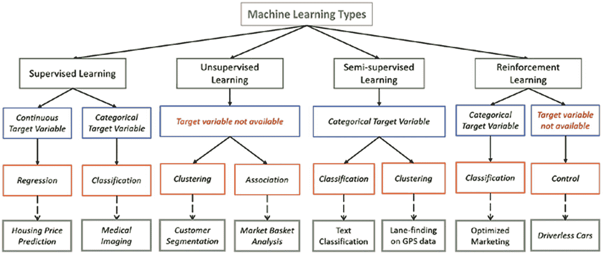

图 6-1 机器学习类型

### 6.1.1 监督学习

监督学习适用于具有响应变量（也称为标签）的数据集。响应变量可以是连续的，也可以是分类的。算法根据提供的预测变量集学习响应变量。例如，如果数据集属于一组患者，每个实例都会有一个响应变量来标识患者是否患有癌症（分类）。或者，在某个州或国家的房价数据集中，响应变量可能是房屋价格。

请记住，清晰地定义问题（当我们稍后在本章讨论实际用例时，定义问题会更清晰）对于我们从正确的方向开始至关重要。此外，如果响应变量是分类的，则问题是分类任务；如果是连续的，则是回归任务。尽管这条规则在大多数情况下基本成立，但某些问题同时包含分类和回归。在银行业，一个重要的模型是预测客户是否会拖欠贷款。使用客户过去的示例进行监督学习，将学习到违约客户与非违约客户的模式。我们将在解释*逻辑回归*（一种监督学习算法）时讨论这个例子。

### 6.1.2 无监督学习

对于没有响应变量的数据集，无法从预测变量中进行学习，换句话说，学习必须是无监督的。学习基于数据集中每行之间的某种相似性或距离度量进行。无监督学习中最常用的技术是*聚类*。其他方法，如关联规则挖掘（ARM），则基于事件的频率，例如市场购物篮中的购买、日志挖掘中的服务器崩溃等。无监督学习的一些应用包括市场营销中的客户细分、社交网络分析、图像分割、气候学等。在本书中，我们使用店铺面积、草坪面积等变量来解释房屋的价值（或价格）。这些数据将与 `k-means` 和层次聚类等算法一起使用。

### 6.1.3 半监督学习

在前两种类型中，数据集中要么所有观测值都没有标签，要么所有观测值都有标签。半监督学习处理的是响应变量部分填充的数据集。在许多实际情况下，标记成本相当高，因为这需要熟练的人类专家来完成。因此，当大多数观测值缺少标签而少数观测值有标签时，半监督算法是构建模型的最佳候选。这些方法利用了这样一个想法：即使未标记数据的组成员身份未知，这些数据也携带了关于组参数的重要信息。关于这个主题最广泛的文献由 Chapelle, O. 等人在《半监督学习》一书中提供（MIT Press, Cambridge, MA）^(¹)。

### 6.1.4 强化学习

监督学习和无监督学习算法都需要干净、准确的数据才能产生最佳结果。此外，数据需要全面，以便处理未见过的实例。例如，如果基于患者病史预测癌症的问题没有包含特定类型癌症的数据，那么该算法在实时部署时会产生许多误报。强化学习是理想的选择，适用于仅提供数据的初始状态作为输入，并且没有单一可能响应，而是有多种可能结果的情况。机器人技术和无人驾驶汽车的创新都源于这类机器学习算法。强化学习算法以迭代方式从环境中持续学习。在此过程中，它从与环境的交互经验中学习，直到探索完所有可能的状态范围。强化学习算法的一些应用包括计算机对弈棋盘游戏（国际象棋、围棋）、机械手和自动驾驶汽车。

对半监督学习和强化学习算法的详细讨论超出了本书的范围；但是，我们会在必要时引用它们。

## 6.2 机器学习算法分组

机器学习算法可根据方法相似性和算法输出进行分组。这将有助于你在同一组内为更多样化的问题创建用例。以这种方式组织算法的另一个好处是便于使用`R`语言库，这些库被设计为将所有相关/相似的函数包含在单个库中。这有助于用户使用单个库探索某个问题的所有选项/诊断方法。随着学术界和工业界不断涌现新的用例，这个列表也在不断扩展。我们指出了本书涵盖了其中哪些算法，并鼓励你从其他来源探索更多内容。

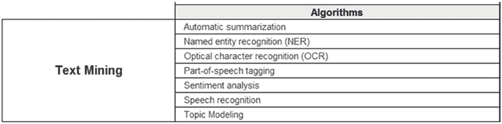

图 6-12

文本挖掘算法

*   *文本挖掘：* 也称为文本分析，是自然语言处理的一个子领域，而自然语言处理又是机器学习的一个子领域。它提供了某些算法和方法来处理非结构化的文本数据，这些数据通常来自呼叫中心日志、客户评论等。该组中的算法可以处理高度非结构化的文本数据，以提取洞察和/或创建用于应用机器学习算法的特征。我们将讨论文本摘要、情感分析、词云和主题识别。见图 6-12。

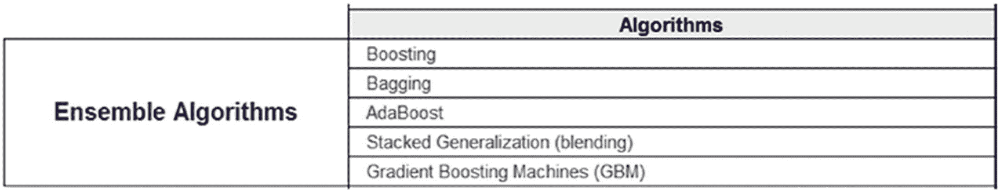

图 6-11

集成学习

*   *集成学习：* 这是一组通过组合多个机器学习算法的结果而构建的算法。这些方法因其能够提供优越的结果以及可以分解为独立模型在分布式网络上进行训练的可能性而变得非常流行。我们将在第 8 章讨论装袋、提升、堆叠和混合集成。见图 6-11。

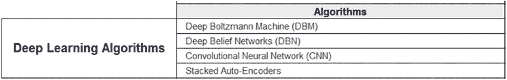

图 6-10

深度学习算法

*   *深度学习：* 这些算法基于复杂的神经结构，可以从海量数据集中抽象出更高级别的信息。它们计算量大且难以训练。简单来说，你可以将它们视为具有多个隐藏层的非常大的神经网络。我们专门用第 11 章来介绍深度学习。见图 6-10。

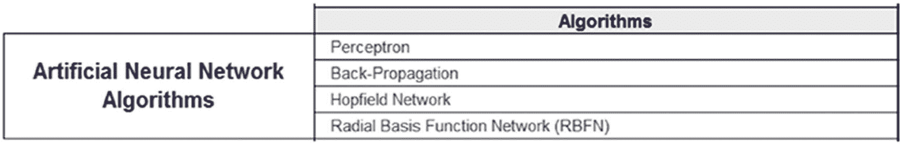

图 6-9

人工神经网络

*   *人工神经网络（`ANN`）：* 受生物神经网络启发，它们足够强大，可以学习非线性关系并识别变量之间的高阶关系。它们可以实现监督和无监督学习过程。传统神经网络与深度学习神经网络（本章稍后讨论）的复杂性之间存在显著差异。本章我们将讨论感知器和反向传播。见图 6-9。


图 6-8

关联规则挖掘

*   *关联规则挖掘：* 在这些算法中，观察变量之间的关系，并用于量化这种关系，以实现预测和探索性目标。这些方法已被证明对于构建和挖掘大型多维数据集之间的关系非常有用。流行的推荐系统基于关联规则挖掘算法的某些变体。本章我们将讨论`Apriori`和`Eclet`算法。见图 6-8。

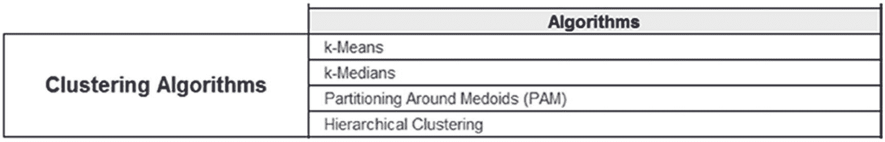

图 6-7

聚类算法

*   *聚类算法：* 这些算法通常基于最大化簇内相似性和最小化簇间相似性的简单原理。相似性的度量决定了簇的形成方式。它们在市场营销和人口统计学研究中非常有用。大多数情况下，这些是无监督算法，它们将数据分组以实现最大共性。我们将讨论`k-means`、期望最大化算法和层次聚类。我们还将讨论分布式聚类。见图 6-7。

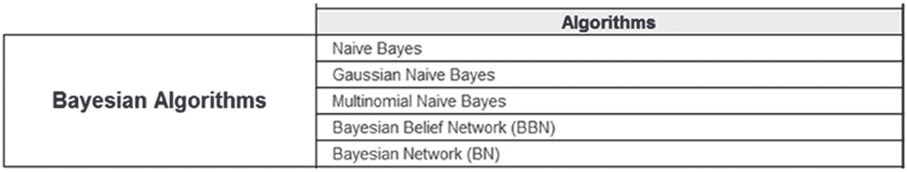

图 6-6

贝叶斯算法

*   *贝叶斯算法：* 这些算法可能不被称为学习算法，因为它们基于贝叶斯定理的先验和后验分布。机器本质上不是通过迭代过程学习，而是利用变量分布的推断。这些方法非常流行且易于解释，主要用于分类和推断测试。本章我们将介绍朴素贝叶斯模型，并引入概率的基本概念来解释它们。见图 6-6。

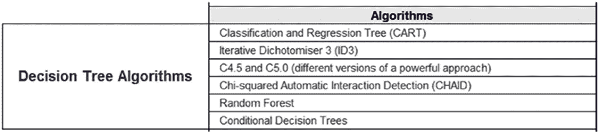

图 6-5

决策树算法

*   *基于树的算法：* 这些算法基于应用于实际数据的顺序条件规则。这些规则通常是串行应用的，当满足所有条件时，做出分类决策。这些方法在决策引擎和分类问题中非常流行。它们是快速且分布式的算法。本章我们将讨论`CART`、迭代二分器、`CHAID`和`C5.0`等算法，并在第 8 章中使用它们来训练我们的集成模型。见图 6-5。

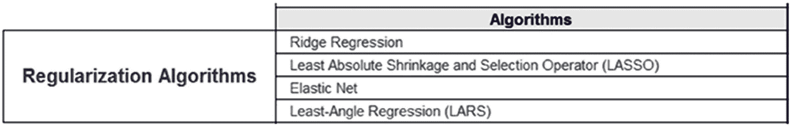

图 6-4

正则化算法

*   *正则化方法：* 正则化方法本质上是回归方法的扩展。正则化算法向损失函数（如第 5 章所述）引入一个惩罚项，以平衡模型的复杂度和结果的改进。在处理具有大量特征和大数据量的数据时，它们是非常强大且有用的技术。我们在第 5 章中介绍了`L1`正则化，作为变量子集选择的一种嵌入方法。见图 6-4。

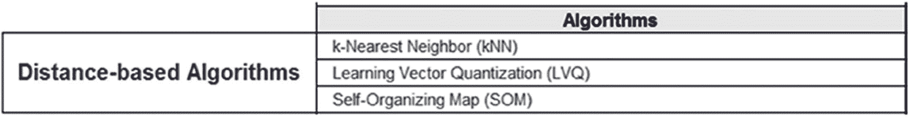

图 6-3

基于距离的算法

*   *基于距离的算法：* 基于距离或基于事件的算法用于学习数据的表示，并创建一种度量标准，以识别对象是否属于目标类别。它们有时被称为基于记忆的学习，因为它们从数据中捕获的一组实例/事件中学习。在第 8 章中，我们使用K近邻和学习向量量化来创建集成模型。见图 6-3。

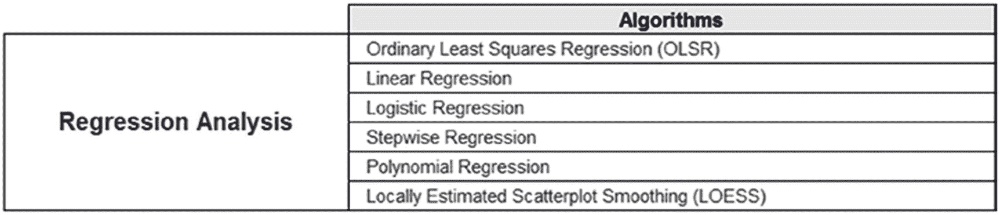

图 6-2

回归算法

*   *基于回归的方法：* 基于回归的方法在学术界和研究中最为流行且应用广泛。它们易于解释，也易于部署到实际生产环境中。在这类方法中，因变量与一组自变量之间的关系通过概率方法或误差函数最小化来估计。本章将涵盖线性回归、多项式回归和逻辑回归。见图 6-2。

所讨论的算法列表在`R`、`Python`和其他统计软件包中有多种实现。并非所有方法都有现成的`R`包可供实现。某些算法在`R`环境中未得到完全支持，必须通过调用API来使用，例如文本挖掘和深度神经网络。研究界正致力于通过软件包或API将所有最新算法引入`R`。

Torsten Hothorn 维护了一份详尽的`R`语言中可用于实现机器学习算法的软件包列表。（参考：CRAN 任务视图：机器学习与统计学习，网址为 [`https://cran.r-project.org/web/views/MachineLearning.html`](https://cran.r-project.org/web/views/MachineLearning.html) 。）

我们建议您密切关注此列表，并持续跟进最新的软件包发布。在下一节中，我们将简要分类介绍本章及后续章节中用于`R`演示的所有真实世界数据集。

## 6.3 真实世界数据集

在本章中，我们将使用许多真实世界数据集并构建用例，以演示各种机器学习算法。在开始使用`R`进行演示之前，本节将简要介绍与每个用例相关的数据集分类。

### 6.3.1 房屋销售价格

房屋的售价取决于许多变量；该数据集提供了一系列因素来预测售价。表 6-1 展示了该房屋销售价格数据集的元数据。

**表 6-1** *房屋销售价格数据集* 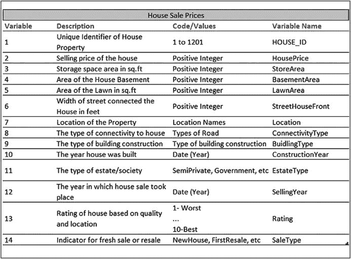

### 6.3.2 购买偏好

该数据包含购买了特定产品的客户的交易历史。对于每个`customer_ID`，模拟了多个数据点以捕捉购买行为。该数据最初用于解决多类模型问题，涉及保险行业的四种可能产品。这些特征具有足够的通用性，因此可以适用于其他行业，如汽车或零售业，在这些行业中，您可能拥有关于汽车购买、消费品等数据。见表 6-2。

**表 6-2** *购买偏好* 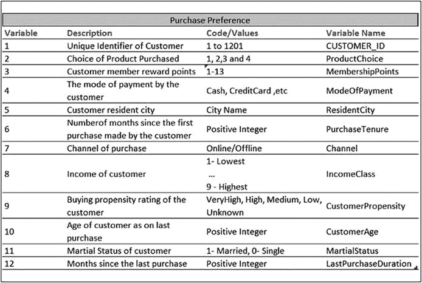

### 6.3.3 Twitter 推送与文章

我们收集了一些 Twitter 推送，以便为应用文本挖掘算法生成结果。这些推送取自截至 2016 年 9 月 30 日的国家新闻频道 Twitter 账户。使用的账户是`@TimesNow`和`@CNN`。互联网上的一篇文章被用于摘要生成。原文可在[`http://www.yourarticlelibrary.com/essay/essay-on-india-after-independence/41354/`](http://www.yourarticlelibrary.com/essay/essay-on-india-after-independence/41354/)找到。

### 6.3.4 乳腺癌

我们将使用来自 UCI 机器学习库的威斯康星州乳腺癌（诊断）数据集。该数据集中的特征是根据乳腺肿块细针穿刺（FNA）的数字化图像计算得出的。除第一个和最后一个变量外，每个变量都被转换为 11 个原始数值属性，其值范围从 0 到 10。它们描述了图像中存在的细胞核的特征。表 6-3 列出了可用的特征。

**表 6-3** *威斯康星州乳腺癌* 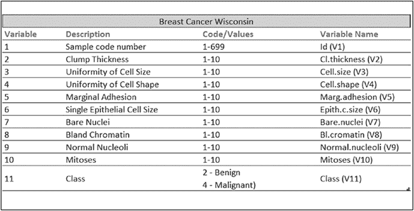

### 6.3.5 购物篮

我们将使用来自一家小超市的真实世界数据。该数据的每一行都包含一个客户交易，以及他们购买的产品列表（从现在起，我们将使用术语*物品*）。由于典型超市中的物品种类过多，我们已将其汇总到类别级别。例如，“烘焙用品”涵盖了多种不同的产品，如面团、小苏打、黄油等。为了便于说明，让我们取数据的一个小子集，该子集包含五笔交易和九种物品，如表 6-4 所示。

**表 6-4** *购物篮数据* 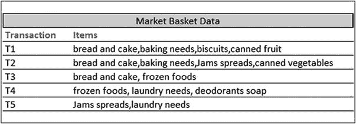

### 6.3.6 亚马逊食品评论

亚马逊美食评论数据集包含截至 2012 年 10 月亚马逊用户留下的 568,454 条食品评论。本章将使用该数据的一个子集进行文本挖掘方法，以展示文本摘要、分类和词性提取。表 6-5 包含了亚马逊美食评论数据集的元数据。

**表 6-5** *亚马逊食品评论* 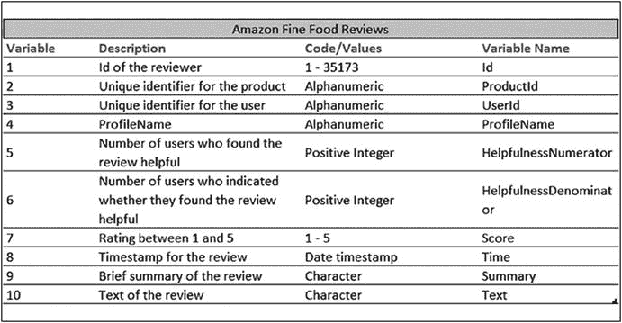

本章的其余部分将根据前面讨论的分组，讨论每一种机器学习算法，并通过讨论统计背景、在 R 中进行演示以及使用真实世界用例，对每种算法进行一致的阐述。

## 6.4 回归分析

在前面的章节中，我们一直在为建模技术能够服务于我们的预期目标奠定基础。本章将涉及统计学习和机器学习领域中一些开箱即用的技术。在这个阶段，你可能希望专注于算法方法，而不必过多担心统计假设在机器学习算法中扮演的角色。为了完整性，我们将在第 8 章讨论统计学习与机器学习的区别。

回归分析部分将侧重于构建一个思维过程，探讨建模技术如何建立并量化响应变量与预测变量之间的关系。我们将首先识别它们之间关系的强度和类型，并尝试判断这种关系是否可以用某种分布假设（如正态分布）来建模。我们还将讨论一些流行技术的重要诊断特征，并解释它们在模型选择中的意义。

这些技术的核心在于寻找具有统计显著性且不依赖于任何分布假设的关系。这些技术并不建立因果关系（最好用“强关联并非因果关系的证明”这一概念来理解），但能为数据科学家提供指示，说明在给定某些参数假设下数据序列是如何关联的。因果关系的建立取决于对过程的审慎判断和业务理解。

牢记因果关系的概念很重要，因为大多数时候我们的思维过程会偏离模型所量化关系的解释方式。例如，一个统计模型能够量化完全无关的度量之间的关系，比如发电量和啤酒消费量。线性模型能够量化它们之间的关系。但啤酒消费量与发电量有关吗？或者发电量增加意味着啤酒消费量增加吗？除非你非常努力地去证明，否则很难证实。因此，对讨论中的过程有清晰的理解以及具备领域知识至关重要。你必须质疑假设，才能从数据中获取真正的价值。在讨论回归中的相关性及其他概念时，必须牢记这种因果关系的“诅咒”。

任何回归分析都涉及三个关键变量集：

*   **因变量或响应变量 (Y)**：输入序列

*   **自变量或预测变量 (X)**：输入序列

*   **模型参数**：需要由回归模型估计的未知参数

对于多个自变量和一个因变量的情况，这些量可以被视为一个矩阵。

回归关系可以表示为一个函数，该函数从自变量空间映射到因变量空间。这种关系是预测/预报的基础：

```
Y ≈ f(X, β)
```

这种表示法看起来更像数学建模，而统计建模学者对同一关系使用略有不同的表示法：

```
E(Y | X) = f(X, β)
```

在统计建模中，回归分析估计的是在已知自变量值条件下因变量的条件期望，这本质上就是给定自变量值时因变量的平均值。在扩展回归概念之前，需要理解的另一个重要概念是参数方法和非参数方法。本节的讨论将基于参数方法，而还存在其他一系列非参数技术。

*   `参数方法` 假设样本数据是基于一组固定参数从已知的概率分布中抽取的。例如，线性回归假设正态分布，而逻辑回归假设二项分布等。这一假设使得这些方法也能应用于小数据集。

*   `非参数方法` 不预先假设任何概率分布，而是从底层数据中构建经验分布。这些方法需要大量数据来进行模型估计。存在一个单独的非参数回归分支，这超出了本书的范围，例如核回归、非参数乘法回归（NPMR）等。关于此主题的更多阅读资料，推荐 Stuart Russell 和 Peter Norvig 所著的《人工智能：一种现代方法》^(²)。

此外，使用参数方法可以让你轻松地围绕估计参数构建置信区间；我们将在模型诊断度量中使用这一点。在本书中，我们将处理两种类型的输入数据——具有正态性假设的连续输入和具有二项分布假设的逻辑回归。此外，还将提供一个关于广义框架的简要入门介绍，供进一步阅读。

## 6.5 相关分析

> 统计科学的目标在于发现一些方法，将关于大量相关事实的信息浓缩成简洁且便于讨论的表达形式。
>
> ——弗朗西斯·高尔顿爵士（1822-1911）

相关性可被视为一个更广义的术语，用于表示两个变量之间的统计关系。原则上，相关性提供了变量间关系的单一度量。由于关系量化的方式有多种，因此统计学中存在着多种类型的相关系数。

对于测量线性关系，皮尔逊相关系数是最佳度量。皮尔逊相关系数，也称为皮尔逊积矩相关系数，对线性关系敏感。它同样存在于非线性关系中，但在这种情况下无法提供任何有用信息。

假设有两个随机变量 X 和 Y，其均值分别为 μ_X 和 μ_Y，标准差分别为 σ_X 和 σ_Y。总体相关系数定义为：

```
ρ_{X,Y} = E[(X - μ_X)(Y - μ_Y)] / (σ_X σ_Y)
```

由此我们可以推断出该度量的两个重要特征：

*   其取值范围在 -1（负相关）到 +1（正相关）之间，这可由柯西-施瓦茨不等式推导得出。

*   该度量仅在标准差有限且非零时才有定义。

类似地，对于来自总体的样本，该度量定义如下：

```
r_{xy} = [Σ_{i=1}^n (x_i - x̄)(y_i - ȳ)] / (n s_x s_y) = [Σ_{i=1}^n (x_i - x̄)(y_i - ȳ)] / [√(Σ_{i=1}^n (x_i - x̄)² Σ_{i=1}^n (y_i - ȳ)²)]
```

让我们用房价数据创建一些散点图，看看能使用皮尔逊相关系数量化出什么样的关系。

*因变量：* `HousePrice`

*自变量：* `StoreArea`

```
```r
Data_HousePrice <- read.csv("Dataset/House Sale Price Dataset.csv", header = TRUE);
# Create a vectors with Y-Dependent, X-Independent
y <- Data_HousePrice$HousePrice;
x <- Data_HousePrice$StoreArea;
# Scatter Plot
plot(x, y, main = "Scatterplot HousePrice vs StoreArea", xlab = "StoreArea(sqft)", ylab = "HousePrice($)", pch = 19, cex = 0.3, col = "red")
# Add a fit line to show the relationship direction
abline(lm(y ~ x)) # regression line (y~x)
lines(lowess(x, y), col = "green") # lowess line (x,y)
```

图 6-13 展示了`HousePrice`与`StoreArea`之间的散点图。曲线是局部平滑拟合线。可以看出变量之间存在线性关系。

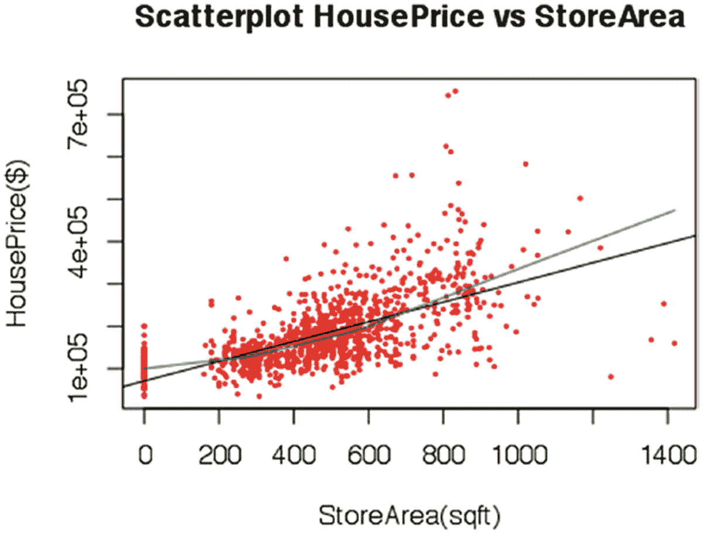

图 6-13

HousePrice 与 StoreArea 之间的散点图

```r
# Report the correlation coefficient of this relation
cat("The correlation among HousePrice and StoreArea is  ", cor(x, y));
```

```
The correlation among HousePrice and StoreArea is   0.6212766
```

从这些图中，我们可以得出以下观察结果：

*   关系呈正方向，因此平均而言，房价随商店面积的增加而上涨。这是一种直观的关系，因此我们可以推断出因果关系。商店空间越大，房屋品质越好，这意味着价格更高。

*   相关系数为 0.62。在线性尺度上，这是一个中等强度的关系。

*   曲线是`LOWESS`（局部加权散点图平滑）图，显示其与线性回归线差异不大。因此，线性关系值得在模型中进一步探索。

*   如果仔细观察，在`StoreArea`= 0 处有一条垂直线。这条垂直线表明，对于没有商店面积的房屋，价格存在差异。我们需要考察驱动房价的其他因素。

我们已经详细讨论了如何找到最适合数据的变量集。因此，在接下来的章节中，我们将不再关注如何得到该模型，而是更多地展示如何在 R 中运行和解释它们。

### 6.5.1 线性回归

线性回归是一种拟合线性预测函数的过程，用于从基础数据中估计未知参数。通常，该模型预测给定 X 条件下 Y 的条件均值，该均值被假定为 X 的仿射函数。

> *仿射函数：由于线性回归估计模型包含截距项，因此它不仅仅是 X 的线性函数，而是仿射函数。*

本质上，线性回归模型将帮助你实现以下目标：

*   预测或预报

*   量化变量之间的关系

前者涉及如果存在某些未知的 X，那么 Y 的期望值是多少；后者则处理历史数据，以可量化的术语（例如参数和 p 值）说明这些变量之间的关系。

在数学上，简单的线性关系如下所示：

对于一组 *n* 个二元组 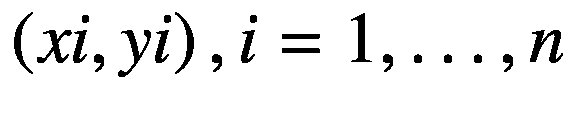，关系函数描述为：

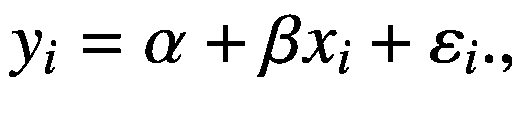

线性回归的目标是估计这条直线：

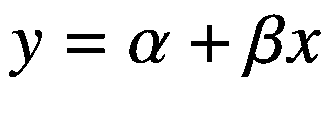

其中 *y* 是预测响应（或拟合值），α 是截距，即当自变量为零时的平均响应值，β 是 x 的参数，即 *x* 每变化一个单位时 *y* 的变化量。

有多种方法可以用给定的数据集拟合这条直线。这取决于我们想要最小化的损失函数类型，例如普通最小二乘法、最小绝对偏差法、岭回归等。让我们看看最常用的方法——普通最小二乘法（`OLS`）。

在`OLS`中，算法最小化平方误差。该最小化问题可以定义如下：

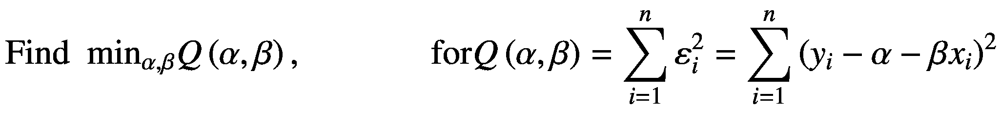

作为一种参数化方法，我们可以得到这个优化问题的闭式解。估计系数（或参数）的闭式解使用以下公式：

![$$ \overline{\beta}=\frac{\sum {x}_i{y}_i-\frac{1}{n}\sum {x}_i\sum {y}_i}{\sum {x}_i²-\frac{1}{n}{\left(\sum {x}_i\right)}²}=\frac{\mathrm{Cov}\left[x,y\right]}{\sigma_x²},\kern1.75em \overset{\frown }{\alpha }=\overline{y}-\overline{\beta}\overline{x}. $$](images/416805_2_En_6_Chapter/416805_2_En_6_Chapter_TeX_Equh.png)

其中，*σ*²[*x*] 是 x 的方差。该解的推导过程可在以下网址找到：

[`https://onlinecourses.science.psu.edu/stat414/node/278`](https://onlinecourses.science.psu.edu/stat414/node/278) 。

在对残差满足某些假设的条件下，`OLS`对线性回归模型具有特殊性质。卡尔·弗里德里希·高斯和安德雷·马尔可夫共同提出了高斯-马尔可夫定理，该定理指出，如果满足以下条件：

*   残差的期望（均值）为零（残差正态性）

*   残差不相关（无自相关）

*   残差具有相等方差（同方差性）

那么普通最小二乘估计能给出系数（或参数估计）的最佳线性无偏估计。我们现在解释构成最佳估计量的关键术语，即无偏性、一致性和有效性。

### 6.5.2 简单线性回归

现在我们可以继续使用`OLS`技术来估计线性模型。R 中的`lm()`包为我们提供了对线性回归运行`OLS`的能力。`lm()`函数可用于执行回归、单层方差分析和协方差分析。它是 R 基础`stats()`包的一部分。

现在，我们将创建一个简单线性回归，并理解如何解释这个简单案例中`lm()`的输出。这里我们使用`OLS`技术对以下内容拟合线性回归模型。

*因变量：* `HousePrice`

*自变量：* `StoreArea`

此外，我们的相关性分析表明这两个变量具有正线性关系，因此我们预期`StoreArea`的参数估计值为正。让我们运行并解释结果。

```r
# 拟合模型
fitted_Model <- lm(y ~ x)
```

```
Call:
lm(formula = y ~ x)

Coefficients:
(Intercept)            x
70677.227      232.723

> summary(fitted_Model)

Call:
lm(formula = y ~ x)

Residuals:
    Min      1Q  Median      3Q     Max
-200719  -43229  -10055   35745  423834

Coefficients:
            Estimate Std. Error t value Pr(>|t|)
(Intercept) 70677.227   4261.027   16.59   <2e-16 ***
x             232.723      8.147   28.57   <2e-16 ***

Signif. codes:  0 ‘***’ 0.001 ‘**’ 0.01 ‘*’ 0.05 ‘.’ 0.1 ‘ ’ 1
Residual standard error: 63490 on 1298 degrees of freedom
Multiple R-squared:  0.386,  Adjusted R-squared:  0.3855
F-statistic:   816 on 1 and 1298 DF,  p-value: < 2.2e-16
```

我们示例的估计方程为：

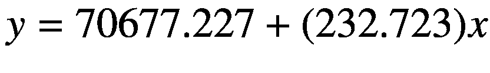

其中 *y* 是`HousePrice`，*x* 是`StoreArea`。这意味着 *x*（`StoreArea`）每增加一个单位，*y*（`HousePrice`）将增加 232.72 美元。截距是常数，告诉我们当`StoreArea`为零时的`HousePrice`，可以将其视为注册费。
```

让我们讨论一下 `lm()` 的摘要输出，以便更好地理解模型。同样的解释可以扩展到下一节中的多元线性回归。

*   `Call`：输出在 `lm()` 函数中拟合的模型方程。

*   `Residuals`：给出残差的四分位距，以及残差的最小值、最大值和中位数。中位数为负意味着至少一半的残差为负，即在超过 50% 的预测中，预测值大于实际值。

*   `Coefficients`：这是一个表格，给出模型参数估计值（或系数）、标准误差、t 值和学生 t 检验的 p 值。

*   `Diagnostics`：残差标准误差、多重 R 方、调整 R 方以及用于方差检验的 F 统计量。

扩展 `lm()` 摘要输出中的系数部分非常重要。该输出提供了关于模型预测变量及其系数的重要信息：

*   `Estimate`：该参数的拟合值。该值直接用于模型方程进行预测，并理解与因变量的关系。例如，在我们的模型中，预测变量 `x`（商店面积）的系数为 232.7。

*   `Standard Error (std. Error)`：参数估计分布的标准差。换句话说，估计值是系数的均值，其标准差就是标准误差。标准误差可以计算为：

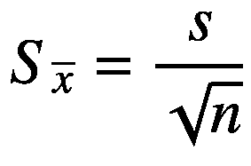

其中 `s` 是样本标准差，`n` 是样本大小。

相对于估计值，标准误差越小，模型估计越好。

*   `t-value and p-value`：学生 t 检验是一种假设检验，用于检验检验统计量是否服从 t 分布。从统计学上讲，针对每个参数报告的 p 值是单样本 t 检验的 p 值。

我们检验该参数的值在统计上是否显著不为零。如果我们无法拒绝原假设，那么我们可以说相应的参数在我们的模型中不显著。

*   单样本 t 检验的 t 统计量如下：

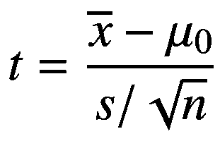

其中  是样本均值，`s` 是样本的标准差，`n` 是样本量。对于我们的线性模型，`x` 的 t 值为 28.57，p 值约为 0。这意味着 `x` 的估计值不为 0，因此它在模型中具有显著性。

一旦我们理解了模型的形式以及每个预测变量的显著性，我们就会继续查看模型对实际值的拟合情况。这通过绘制实际值与预测值的对比图来完成：

```r
res <- stack(data.frame(Observed = y, Predicted = fitted(fitted_Model)))
res <- cbind(res, x = rep(x, 2))
#使用 lattice 的 xyplot 函数绘图
library("lattice")
xyplot(values ~ x, data = res, group = ind, auto.key = TRUE)
```

图 6-14 展示了拟合值与实际值的对比。你可以看到，该图显示了模型预测的线性关系，并与原始数据的散点图叠加在一起。

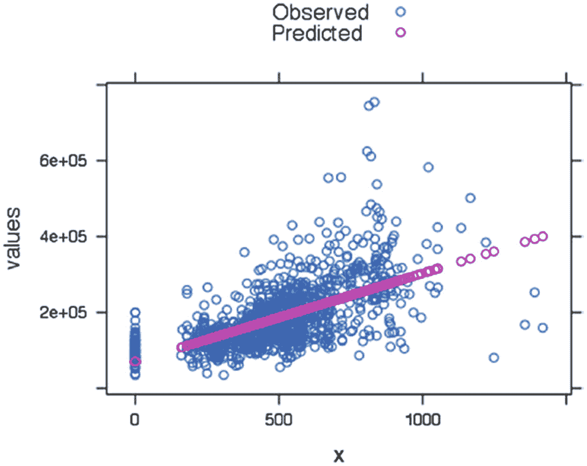

图 6-14

实际值与预测值的散点图

现在，这是一个仅包含一个解释变量（`StoreArea`）的模型，但还有其他可用变量与 `HousePrices` 显示出显著关系。回归框架允许我们在回归分析中添加多个解释变量或自变量。我们将在下一节介绍多元线性回归。

### 6.5.3 多元线性回归

简单线性回归的思想可以扩展到多个自变量。多元线性回归中的线性关系变为：

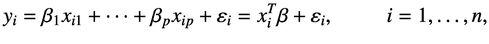

对于多元回归，矩阵表示法非常流行，因为它使得矩阵计算的概念易于解释。

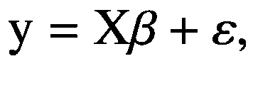

在我们之前的示例中，我们只使用了一个变量 `StoreArea` 来解释因变量。在多元线性回归中，我们将使用 `StoreArea`、`StreetHouseFront`、`BasementArea`、`LawnArea`、`Rating` 和 `SaleType` 作为自变量，来估计与 `HousePrice` 的线性关系。

最小二乘估计函数保持不变，只是会有新的变量作为预测变量。为了对多个变量进行分析，我们引入了一个额外的数据清洗步骤：缺失值识别。我们要么对缺失值进行插补，要么将其排除在分析之外。我们选择使用 R 中的 `na.omit()` 函数将其排除。以下代码首先查找缺失的案例，然后将其删除。

```r
# 使用 lm 创建多元线性回归
Data_lm_Model <- Data_HousePrice[, c("HOUSE_ID","HousePrice","StoreArea","StreetHouseFront","BasementArea","LawnArea","Rating","SaleType")];

# 下面的函数显示数据中每个变量的缺失值数量
sapply(Data_lm_Model, function(x) sum(is.na(x)))
HOUSE_ID       HousePrice        StoreArea StreetHouseFront
0                0                0              231
BasementArea         LawnArea           Rating         SaleType
0                0                0                0

# 我们选择删除 StreetHouseFront 中对应缺失值的 231 个案例。Na.omit 函数将删除这些缺失案例。
Data_lm_Model <- na.omit(Data_lm_Model)
rownames(Data_lm_Model) <- NULL

# 分类变量需要设置为因子
Data_lm_Model$Rating <- factor(Data_lm_Model$Rating)
Data_lm_Model$SaleType <- factor(Data_lm_Model$SaleType)
```

现在我们已经清理了数据中的缺失值，可以运行 `lm()` 函数来拟合我们的多元线性回归模型。

### 6.5.4 模型诊断：线性回归

模型诊断是模型选择过程中的一个重要步骤。第 7 章讨论的模型性能评估与模型选择过程之间存在差异。在模型评估中，我们检查模型在未见数据（测试数据）上的表现；而在模型诊断/选择中，我们观察模型拟合本身在数据上的表现。这包括检查参数估计的 p 值显著性、正态性、自相关性、同方差性、影响点/异常点以及多重共线性。还有其他一些检验方法，用于检查模型在多大程度上符合统计假设、严格外生性、方差分析表等，但在接下来的章节中，我们只关注其中几个。

#### 6.5.4.1 影响点分析

在线性回归中，极端值可能会在估计过程中引发问题。少数高杠杆值会在估计量中引入偏差，并在残差中产生其他异常。因此，识别数据中的影响点非常重要。如果影响点看起来过于极端，我们必须将其作为*异常值*从分析中剔除。

我们将展示的一个特定统计量（以及其他统计量）是库克距离。该方法用于在进行 OLS 估计时，找出数据点影响力的估计值。

库克距离定义如下：

![$$ {D}_i=\frac{e_i²}{s²p}\left[\frac{h_i}{{\left(1-{h}_i\right)}²}\right], $$](images/416805_2_En_6_Chapter/416805_2_En_6_Chapter_TeX_Equn.png)

估计的模型有六个自变量，包括四个连续变量（`StoreArea`、`StreetHouseFront`、`BasementArea` 和 `LawnArea`）和两个分类变量（`Rating` 和 `SaleType`）。从 `lm()` 函数的结果可以看出，`StoreArea`、`StreetHouseFront`、`BasementArea` 和 `LawnArea` 在 95% 的置信水平下是显著的，即统计上显著不为零。而 `SaleType` 的所有水平都不显著，因此统计上它们等于零。较高的评级是显著的，但较低的评级不显著。该模型应剔除 `SaleType` 并重新估计，以仅保留显著的变量。

现在，我们将通过按房价排序后的序列绘制实际值与预测值的对比图，来查看该模型的拟合效果。

```
# 获取拟合值并创建一个包含实际值和预测值的数据框
actual_predicted <-as.data.frame(cbind(as.numeric(Data_lm_Model$HOUSE_ID),as.numeric(Data_lm_Model$HousePrice),as.numeric(fitted(fitted_Model_multiple))))
names(actual_predicted) <-c("HOUSE_ID","Actual","Predicted")

# 按实际房价升序排列房屋
actual_predicted <-actual_predicted[order(actual_predicted$Actual),]

# 计算绝对残差，然后求其均值
library(ggplot2)

# 绘制测试案例的实际值与预测值对比图
ggplot(actual_predicted,aes(x =1:nrow(Data_lm_Model),color=Series)) +
geom_line(data = actual_predicted, aes(x =1:nrow(Data_lm_Model), y = Actual, color ="Actual")) +
geom_line(data = actual_predicted, aes(x =1:nrow(Data_lm_Model), y = Predicted, color ="Predicted"))  +xlab('房屋编号') +ylab('房屋销售价格')
```

图 6-15 展示了按 `HousePrice` 排序后的实际值和预测值。

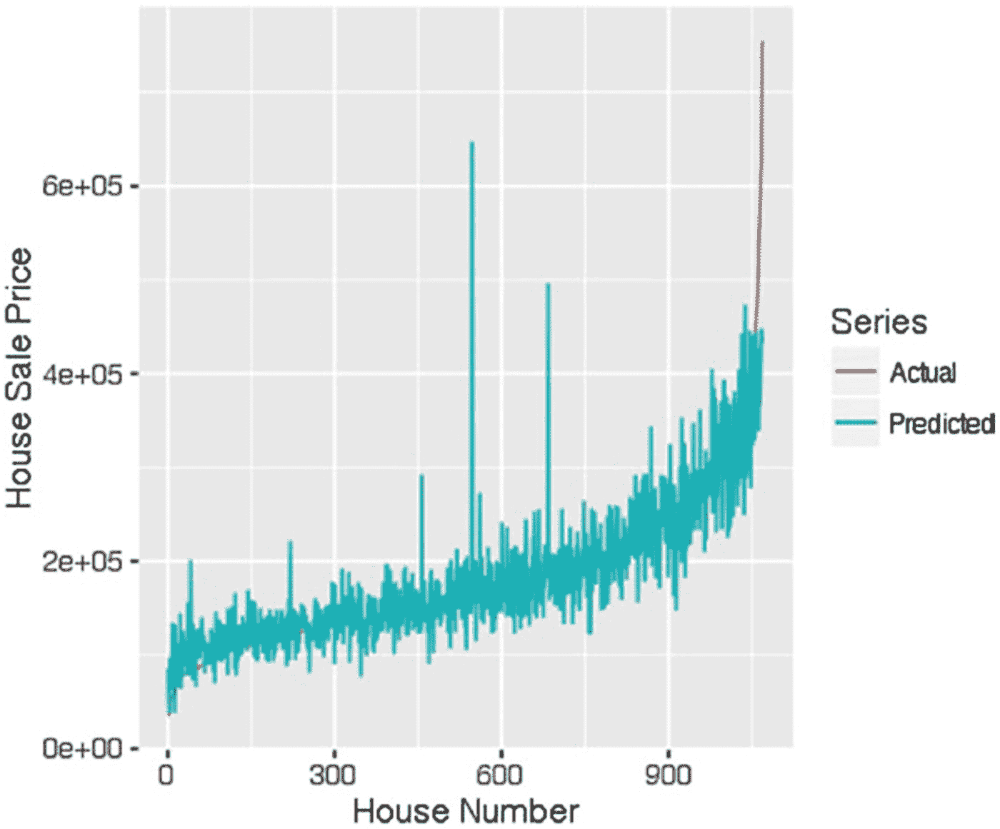

图 6-15 实际值与预测值对比图

我们按升序排列了房价，以便看到更清晰的实际值与预测值对比图。该图显示我们的模型紧密跟随实际价格。存在少数实际值中的异常值/高值情况，模型无法预测，但这没关系，因为我们的模型不受异常值影响。

```
fitted_Model_multiple <-lm(HousePrice ~StoreArea +StreetHouseFront +BasementArea +LawnArea +Rating +SaleType, data =Data_lm_Model)
summary(fitted_Model_multiple)
Call:
lm(formula = HousePrice ~StoreArea +StreetHouseFront +BasementArea +LawnArea +Rating +SaleType, data =Data_lm_Model)
Residuals:
Min       1Q   Median       3Q      Max
-155003   -24744    -3166    20789   199636
Coefficients:
Estimate Std. Error t value Pr(>|t|)
(Intercept)           2.507e+04  4.827e+04   0.519  0.60352
StoreArea             5.462e+01  7.550e+00   7.234 9.06e-13 ***
StreetHouseFront      1.353e+02  6.042e+01   2.240  0.02529 *
BasementArea          2.145e+01  3.004e+00   7.140 1.74e-12 ***
LawnArea              1.026e+00  1.721e-01   5.963 3.39e-09 ***
Rating2              -8.385e+02  4.816e+04  -0.017  0.98611
Rating3               2.495e+04  4.302e+04   0.580  0.56198
Rating4               3.948e+04  4.197e+04   0.940  0.34718
Rating5               5.576e+04  4.183e+04   1.333  0.18286
Rating6               7.911e+04  4.186e+04   1.890  0.05905 .
Rating7               1.187e+05  4.193e+04   2.830  0.00474 **
Rating8               1.750e+05  4.214e+04   4.153 3.54e-05 ***
Rating9               2.482e+05  4.261e+04   5.825 7.61e-09 ***
Rating10              2.930e+05  4.369e+04   6.708 3.23e-11 ***
SaleTypeFirstResale   2.146e+04  2.470e+04   0.869  0.38512
SaleTypeFourthResale  6.725e+03  2.791e+04   0.241  0.80964
SaleTypeNewHouse      2.329e+03  2.424e+04   0.096  0.92347
SaleTypeSecondResale -5.524e+03  2.465e+04  -0.224  0.82273
SaleTypeThirdResale  -1.479e+04  2.613e+04  -0.566  0.57160

Signif. codes:  0 '***' 0.001 '**' 0.01 '*' 0.05 '.' 0.1 ' ' 1
Residual standard error: 41660 on 1050 degrees of freedom
Multiple R-squared:  0.7644, Adjusted R-squared:  0.7604
F-statistic: 189.3 on 18 and 1050 DF,  p-value: < 2.2e-16
```

其中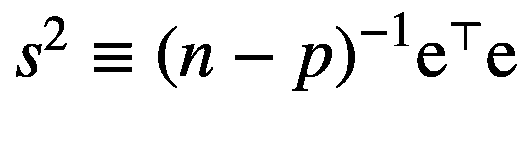是回归模型的均方误差，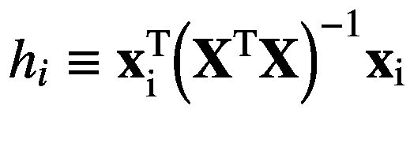，并且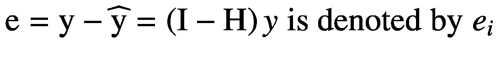

简单来说，库克距离衡量的是删除某个给定观测值所带来的影响。这样，如果删除某个观测值导致显著变化，就意味着这些点正在影响回归模型。这些点会被赋予一个较大的库克距离值，并被视为需要进一步调查的对象。

该统计量的临界值可以取为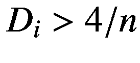，其中`n`是观测值的数量。如果根据模型中的参数数量进行调整，则临界值可以取为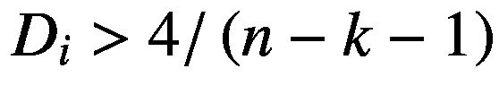，其中`k`是模型中的变量数量。

```r
library(car);
Influential Observations

# Cook's D plot

# identify D values > 4/(n-k-1)
cutoff <-4/((nrow(Data_lm_Model)-length(fitted_Model_multiple$coefficients)-2))
plot(fitted_Model_multiple, which=4, cook.levels=cutoff)
```

图 6-16 中的图表显示了数据集中每个观测值的库克距离。

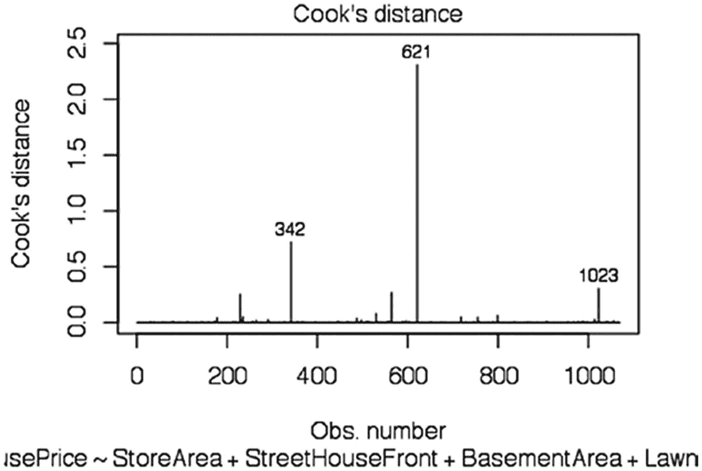

每个观测值的库克距离

您可以在图 6-16 的图表中看到，库克距离较高的观测值编号已被突出显示。这些观测值需要进一步调查。

```r
# Influence Plot
influencePlot(fitted_Model_multiple, id.method="identify", main="Influence Plot", sub="Circle size is proportional to Cook's Distance", id.location=FALSE)
```

图 6-17 中的图表展示了库克距离的另一种视图。圆圈大小与库克距离成正比。

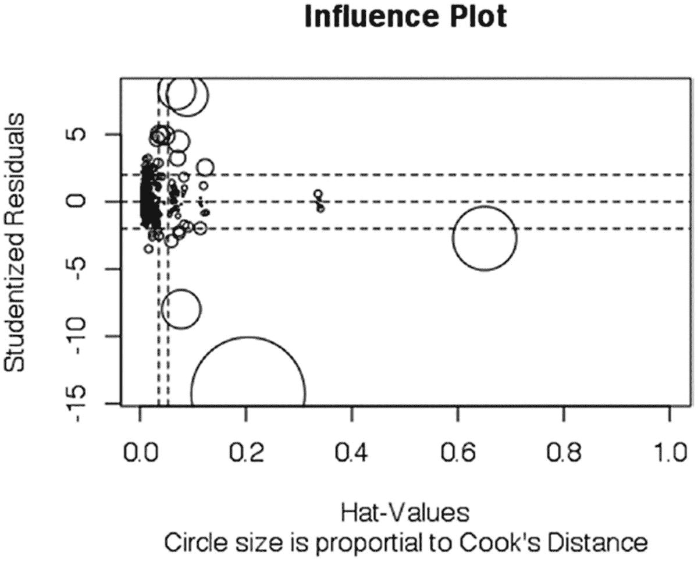

影响图

此外，异常值检验结果如下所示：

```
#Outlier Plot
outlier.test(fitted_Model_multiple)
rstudent unadjusted p-value Bonferonni p
621  -14.285067         1.9651e-42   2.0987e-39
229    8.259067         4.3857e-16   4.6839e-13
564   -7.985171         3.6674e-15   3.9168e-12
1023   7.902970         6.8545e-15   7.3206e-12
718    5.040489         5.4665e-07   5.8382e-04
799    4.925227         9.7837e-07   1.0449e-03
235    4.916172         1.0236e-06   1.0932e-03
487    4.673321         3.3491e-06   3.5768e-03
530    4.479709         8.2943e-06   8.8583e-03
```

如图 6-17 所示，观测值编号 342、621 和 1023（对应于 `HOUSE_ID` 412、759 和 1242）是三个主要的影响点。让我们提取这些记录，看看它们具有哪些值。

#Pull the records with highest leverage
Debug <-Data_lm_Model[c(342,621,1023),]
print(" The observed values for three high leverage points");
[1] " The observed values for three high leverage points"
Debug
HOUSE_ID HousePrice StoreArea StreetHouseFront BasementArea LawnArea
342       412     375000       513              150         1236   215245
621       759     160000      1418              313         5644    63887
1023     1242     745000       813              160         2096    15623
Rating     SaleType
342       7     NewHouse
621      10  FirstResale
1023     10 SecondResale
print("Model fitted values for these high leverage points");
[1] "Model fitted values for these high leverage points"
fitted_Model_multiple$fitted.values[c(342,621,1023)]
342      621     1023
441743.2 645975.9 439634.3
print("Summary of Observed values");
[1] "Summary of Observed values"
summary(Debug)
HOUSE_ID        HousePrice       StoreArea      StreetHouseFront
Min.   : 412.0   Min.   :160000   Min.   : 513.0   Min.   :150.0
1st Qu.: 585.5   1st Qu.:267500   1st Qu.: 663.0   1st Qu.:155.0
Median : 759.0   Median :375000   Median : 813.0   Median :160.0
Mean   : 804.3   Mean   :426667   Mean   : 914.7   Mean   :207.7
3rd Qu.:1000.5   3rd Qu.:560000   3rd Qu.:1115.5   3rd Qu.:236.5
Max.   :1242.0   Max.   :745000   Max.   :1418.0   Max.   :313.0
BasementArea     LawnArea          Rating          SaleType
Min.   :1236   Min.   : 15623   10     :2   FifthResale :0
1st Qu.:1666   1st Qu.: 39755   7      :1   FirstResale :1
Median :2096   Median : 63887   1      :0   FourthResale:0
Mean   :2992   Mean   : 98252   2      :0   NewHouse    :1
3rd Qu.:3870   3rd Qu.:139566   3      :0   SecondResale:1
Max.   :5644   Max.   :215245   4      :0   ThirdResale :0
(Other):0

请注意，这三个杠杆点的房价远高于平均值或高密度区域。其中两个观测值的房价分别对应数据集中的最高值和最低值。另一个有趣的现象是，第三个对应于房价中位数的观测值拥有非常高的草坪面积，这无疑是一个影响点。基于此分析，我们可以返回去检查这些是否为数据错误，或者选择在分析中忽略它们。

### 6.5.4.2 残差的正态性

残差是回归模型诊断的核心。残差的正态性是模型成为有效线性回归模型的重要条件。简单来说，正态性意味着误差/残差是随机噪声，并且我们的模型已经捕获了数据中的所有信号。

线性回归模型给出了在给定 X 值下函数 Y 的条件期望。然而，拟合方程会存在一些残差。我们需要残差的期望服从均值为 0 或可缩减为 0 的正态分布。正态残差意味着模型推断（置信区间、模型预测变量的显著性）是有效的。

学生化残差（可视为归一化值）的分布是判断正态性假设是否成立的一个好方法。但我们可能仍然希望通过正态性检验（如 KS 检验、Shapiro-Wilk 检验、Anderson Darling 检验等）来正式检验残差。

此处，我们展示了正态分布的学生化残差图，该图应呈钟形曲线。

```r
library(stats)
library(IDPmisc)
Loading required package: grid
library(MASS)
sresid <-studres(fitted_Model_multiple)
#Remove irregular values (NAN/Inf/NAs)
sresid <-NaRV.omit(sresid)
hist(sresid, freq=FALSE,
main="Distribution of Studentized Residuals",breaks=25)
xfit<-seq(min(sresid),max(sresid),length=40)
yfit<-dnorm(xfit)
lines(xfit, yfit)
```

图 6-18 中的图是使用学生化残差创建的。在上述代码中，残差通过 R 中的`studres()`函数进行学生化处理。

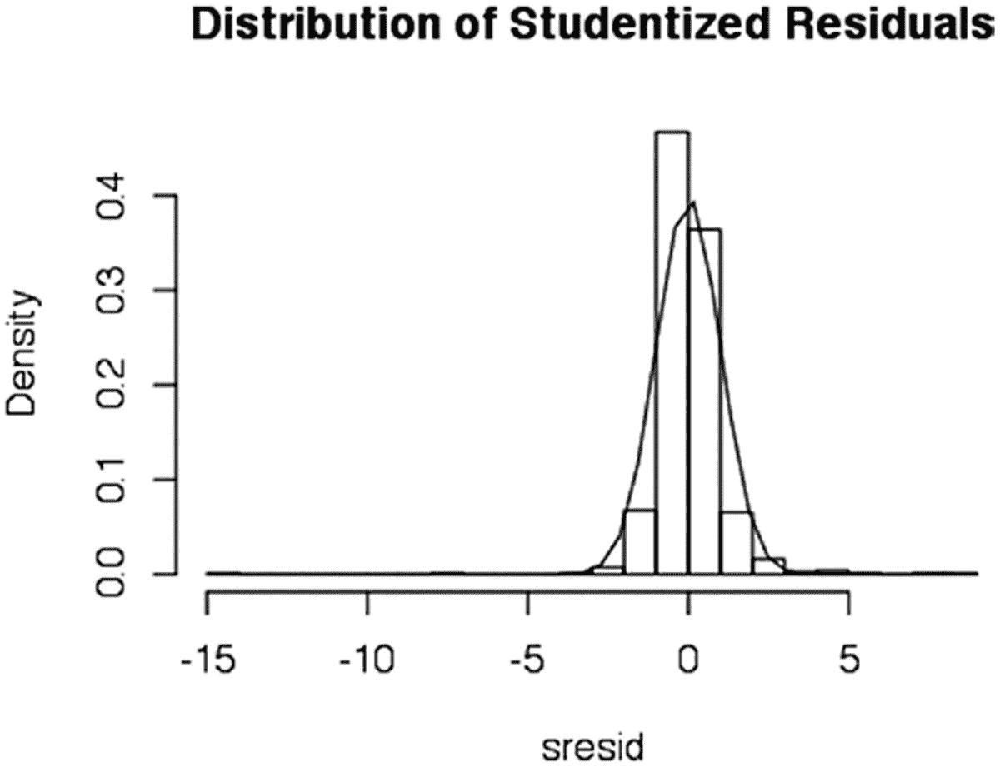

图 6-18

学生化残差的分布

残差图接近正态图，因为其分布呈钟形曲线。然而，我们仍然希望进行正态性的正式检验。我们将展示所有三种正态性检验的结果，但会正式介绍最流行的正态性检验——单样本 Kolmogorov-Smirnov 检验（KS 检验）的检验统计量。对于其余检验，我们鼓励您查阅此处所用函数的 R 小插图。它指向该主题最合适的参考资料。

现在，让我们正式介绍 KS 检验。对于给定的累积分布函数 F(x)，Kolmogorov–Smirnov 统计量定义为：

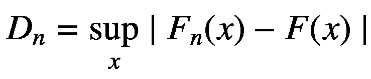

其中 sup x 是距离集合的最大值。

KS 统计量返回残差的经验分布与正态分布之间的最大差异。如果该最大值（`supremum`）大于某个临界值，则我们称该分布不是正态分布（使用检验统计量的 p 值）。这里我们进行了三个检验以验证结果的一致性：

```r
# test on normality
#K-S one sample test
ks.test(fitted_Model_multiple$residuals,pnorm,alternative="two.sided")
One-sample Kolmogorov-Smirnov test
data:  fitted_Model_multiple$residuals
D = 0.54443, p-value < 2.2e-16
alternative hypothesis: two-sided
#Shapiro Wilk Test
shapiro.test(fitted_Model_multiple$residuals)
Shapiro-Wilk normality test
data:  fitted_Model_multiple$residuals
W = 0.80444, p-value < 2.2e-16
#Anderson Darling Test
library(nortest)
ad.test(fitted_Model_multiple$residuals)
Anderson-Darling normality test
data:  fitted_Model_multiple$residuals
A = 29.325, p-value < 2.2e-16
```

这三个检验均认为残差不服从正态分布。p 值均小于 0.05，因此我们可以拒绝分布为正态的原假设。这意味着我们必须回到模型中，看看是什么导致了非正态行为，例如删除或添加某些变量、存在影响点以及其他问题。

### 6.5.4.3 多重共线性

*多重共线性*本质上是一对自变量中信息过多的问题。当两个或多个变量高度相关时，就会出现这种现象，从而导致模型拟合中的标准误膨胀。为了检验这种现象，我们可以使用相关矩阵，看看它们之间是否存在精度尚可的关系。如果存在，则添加一个变量就足以提供解释因变量所需的信息。

在本节中，我们将使用方差膨胀因子来确定自变量中多重共线性的程度。另一种流行的方法是使用 Colin 指数（条件指数）来检测多重共线性。

用于检测多重共线性的方差膨胀因子（`VIF`）定义如下：


其中 `R_j²` 是解释变量 `j` 对所有其他解释变量进行回归的判定系数。

通常，基于这些指标检测多重共线性存在的阈值如下：

*   容差小于 0.20
*   `VIF` 大于等于 5 表示存在多重共线性问题

解决此问题的简单方法是在模型构建过程中从这些阈值中删除该变量。

```R
library(car)

# calculate the vif factor

# Evaluate Collinearity
print(" Variance inflation factors are ");
[1] " Variance inflation factors are "
vif(fitted_Model_multiple);

# variance inflation factors
GVIF Df GVIF^(1/(2*Df))
StoreArea        1.767064  1        1.329309
StreetHouseFront 1.359812  1        1.166110
BasementArea     1.245537  1        1.116036
LawnArea         1.254520  1        1.120054
Rating           1.931826  9        1.037259
SaleType         1.259122  5        1.023309
print("Tolerance factors are ");
[1] "Tolerance factors are "
1/vif(fitted_Model_multiple)
GVIF        Df GVIF^(1/(2*Df))
StoreArea        0.5659106 1.0000000       0.7522703
StreetHouseFront 0.7353955 1.0000000       0.8575521
BasementArea     0.8028664 1.0000000       0.8960281
LawnArea         0.7971175 1.0000000       0.8928143
Rating           0.5176450 0.1111111       0.9640796
SaleType         0.7942043 0.2000000       0.9772220
```

现在我们在前面的表格中得到了 `VIF` 值和容差值。我们将按照讨论的 `VIF` 和容差阈值进行判断。

```R
# Apply the cut-off to Vif
print("Apply the cut-off of 4 for vif")
[1] "Apply the cut-off of 4 for vif"
vif(fitted_Model_multiple) >4
GVIF    Df GVIF^(1/(2*Df))
StoreArea        FALSE FALSE           FALSE
StreetHouseFront FALSE FALSE           FALSE
BasementArea     FALSE FALSE           FALSE
LawnArea         FALSE FALSE           FALSE
Rating           FALSE  TRUE           FALSE
SaleType         FALSE  TRUE           FALSE

# Apply the cut-off to Tolerance
print("Apply the cut-off of 0.2 for vif")
[1] "Apply the cut-off of 0.2 for vif"
(1/vif(fitted_Model_multiple)) <0.2
GVIF    Df GVIF^(1/(2*Df))
StoreArea        FALSE FALSE           FALSE
StreetHouseFront FALSE FALSE           FALSE
BasementArea     FALSE FALSE           FALSE
LawnArea         FALSE FALSE           FALSE
Rating           FALSE  TRUE           FALSE
SaleType         FALSE FALSE           FALSE
```

您可以观察到，对于我们为多重共线性设置的阈值，`GVIF` 列均为 `FALSE`。因此，我们可以有把握地说，我们的模型不存在多重共线性问题。因此，标准误没有膨胀，我们可以进行假设检验。

### 6.5.4.4 残差自相关

相关性定义于两个不同变量之间，而自相关（也称为序列相关）是指一个变量在不同时间点或序列中与自身的相关性。这种关系非常重要，在时间序列建模中相当常用。当观测值具有内在顺序时（例如，按时间、键等索引），自相关就更有意义。如果残差显示其与先前的残差存在确定的关系，即存在自相关，那么噪声并非纯粹随机，这意味着我们仍有更多信息可以提取并纳入模型。

为了检验自相关，我们将使用最流行的方法：德宾-沃森检验。

假设过程已定义均值和方差，德宾-沃森检验的自相关统计量可定义如下：

![$$ R\left(s,t\right)=\frac{\mathrm{E}\left[\left({X}_t-{\mu}_t\right)\left({X}_s-{\mu}_s\right)\right]}{\sigma_t{\sigma}_s} $$](images/416805_2_En_6_Chapter/416805_2_En_6_Chapter_TeX_Equq.png)

这可以针对我们的残差自相关重写为 `d`-德宾-沃森检验统计量：

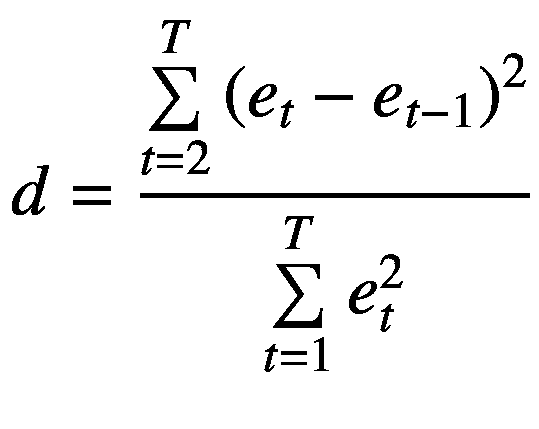

其中，`et` 是与时间 `t` 处的观测值相关的残差。

要解释该统计量，您可以遵循图 6-19 中概述的规则。

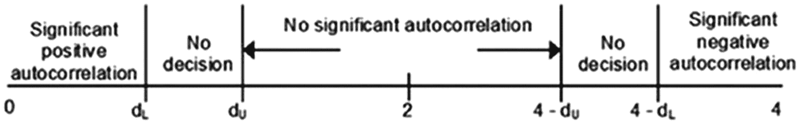

*图 6-19 德宾-沃森统计量界限*

正自相关意味着一个观测值的正误差会增加另一个观测值出现正误差的可能性。而负自相关则相反。在线性回归模型中，正自相关和负自相关都是不期望出现的。在图 6-20 中，很明显，如果 `d` 统计量的值接近 2，我们可以推断残差项中不存在自相关。

检测自相关的另一种方法是绘制 ACF 图并寻找尖峰。

```R
# 检验自相关误差
durbinWatsonTest(fitted_Model_multiple)
lag Autocorrelation D-W Statistic p-value
1     -0.03814535      2.076011   0.192
Alternative hypothesis: rho != 0

# ACF 图
plot(acf(fitted_Model_multiple$residuals))
```

图 6-20 中的图称为针对不同滞后的自相关函数（ACF）图。该图在时间序列分析中很流行，因为数据是按时间索引的，所以我们在此使用该图作为自相关解释的代理。

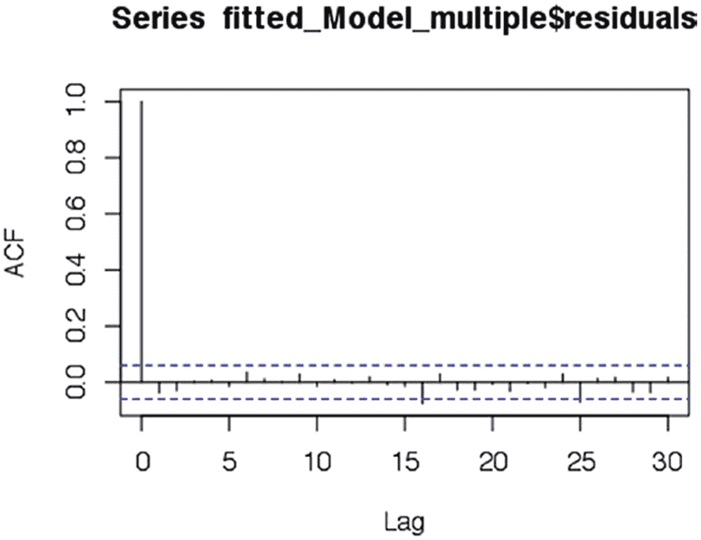

*图 6-20 自相关函数（ACF）图*

德宾-沃森统计量显示残差之间无自相关，`d` 等于 2.07。同时，ACF 图也未显示尖峰。因此，我们可以说残差不存在自相关。

### 6.5.4.5 同方差性

*同方差性* 意味着序列或向量中的所有随机变量具有有限且恒定的方差。这也称为方差齐性。在线性回归框架中，同方差误差/残差意味着误差的方差与 `x` 的值无关。这意味着无论 `x` 如何，`y` 的概率分布都具有相同的标准差。

有多种统计检验可用于检查同方差性假设，例如，布罗施-帕甘检验、ARCH 检验、巴特利特检验等。在本节中，我们重点关注由 Snedecor 和 Cochran 于 1989 年提出的巴特利特检验。

要执行巴特利特检验，首先我们在总体数据中创建子组。为了说明，我们创建了三个总体数据组，每组分别有 400、400 和 269 个观测值。

```
我们可以在数据中创建三个组，以查看方差是否在这三组之间变化
gp<-numeric()
for( i in 1:1069)
{
if(i<=400){
gp[i] <-1;
}else if(i<=800){
gp[i] <-2;
}else{
gp[i] <-3;
}
}
```

现在我们定义将在巴特利特检验中检验的假设：

`Ho`：所有三个总体方差相同。

`Ha`：至少有两个不同。

这里，我们使用函数 `Bartlett.test()` 执行巴特利特检验：

```
Data_lm_Model$gp <-factor(gp)
bartlett.test(fitted_Model_multiple$fitted.values,Data_lm_Model$gp)
Bartlett test of homogeneity of variances
data:  fitted_Model_multiple$fitted.values and Data_lm_Model$gp
Bartlett's K-squared = 1.3052, df = 2, p-value = 0.5207
```

巴特利特检验的 p 值大于 0.05，这意味着我们无法拒绝原假设。各子组具有相同的方差，因此方差是同方差的。

这里，我们展示更多用于检验方差的测试。这些仅供参考，以便您可以在需要时复制其他检验。

1.  布罗施-帕甘检验

```
# 非常数误差方差检验 - 布罗施-帕甘检验
ncvTest(fitted_Model_multiple)
Non-constant Variance Score Test
Variance formula: ~ fitted.values
Chisquare = 2322.866    Df = 1     p = 0
```

这些结果是一种流行的异方差性检验（称为布罗施-帕甘检验）的结果。p 值为 0，因此您可以拒绝方差是异方差的原假设。

1.  ARCH 检验

```
# 也展示 ARCH 检验 - 更适用于时间序列模型
library(FinTS)
ArchTest(fitted_Model_multiple$residuals)
ARCH LM-test; Null hypothesis: no ARCH effects
data:  fitted_Model_multiple$residuals
Chi-squared = 4.2168, df = 12, p-value = 0.9792
```

巴特利特检验和 ARCH 检验的结果清楚地表明残差是同方差的。图 6-21 中的图是残差与拟合值图。它是一个散点图，x 轴为残差，y 轴为拟合值（估计响应值）。该图用于检测非线性、不等误差方差和异常值。

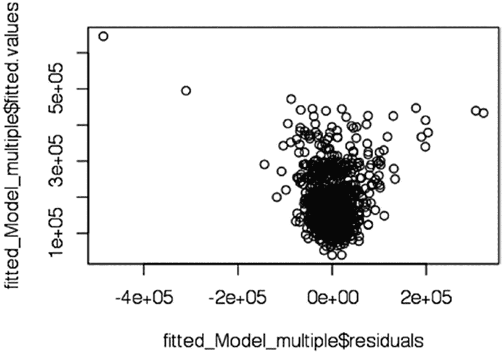

图 6-21

残差与拟合值图

```
# 绘制残差与拟合值图
plot(fitted_Model_multiple$residuals,fitted_Model_multiple$fitted.values)
```

拟合值与残差的图也未显示任何增加或减少的行为。这意味着残差是同方差的，因为它们不随 x 的值而变化。

在本节关于模型诊断的内容中，我们探讨了识别回归问题的重要检验和流程。影响点可能会给模型估计带来偏差，并降低模型的性能。我们可以探索几种方法来减轻这个问题，例如对数值进行封顶、创建分箱，或者可能只是将其从分析中移除。残差的正态性很重要，因为我们期望一个好的模型能够捕获数据中的所有信号，并将残差减少到仅为白噪声。自相关是索引数据的一个特征，在这种情况下，如果残差彼此不独立且存在自相关，那么模型性能将会下降。同方差性是另一个重要的诊断指标，它告诉我们因变量的方差是否与预测变量/自变量无关。所有这些诊断都需要在拟合回归模型后进行，以确保模型可靠且在统计上有效，能够应用于实际场景。

现在我们已经测试了线性回归的主要检验，可以继续学习多项式回归了。到目前为止，我们假设因变量和自变量之间的关系是线性的，但在现实生活中可能并非如此。线性关系在所有水平上都表现出相同的比例变化行为。例如，当店铺面积从 10 平方英尺变为 20 平方英尺时，`HousePrice` 的增加，与从 2000 平方英尺变为 2010 平方英尺这同样的 10 平方英尺变化所带来的增加并不相同。但线性回归忽略了这一事实，并假设在所有水平上变化相同。

下一节将把线性回归的思想扩展到更高次多项式的关系。

### 6.5.5 多项式回归

线性回归框架可以扩展到变量之间的多项式关系。在多项式回归中，自变量 `x` 和因变量 `y` 之间的关系被建模为 n 次多项式。

多项式回归模型可以表示如下：

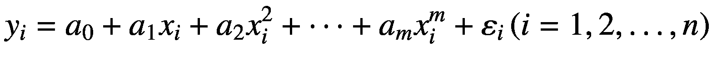

有许多例子表明数据并非遵循线性依赖关系，而是更高次的关系。一般来说，现实生活中的关系在真正意义上并非线性。线性回归假设因变量只能朝一个方向变化，且每单位自变量的边际变化相同。

例如，`HousePrice` 与 `StoreArea` 呈正相关。这意味着如果 `StoreArea` 增加，`HousePrice` 也会增加。因此，如果 `StoreArea` 持续增加，`HousePrice` 将以相同的速率（系数）上涨。但是，您是否相信如果 `StoreArea` 太大，`HousePrice` 能涨到 100 万？不会的，`StoreArea` 的效用会随着其增加而递减，最终您将看不到 `HousePrice` 有同样的增长。

经济学提供了许多这种二次行为的良好例子，例如价格弹性、收益递减等。同样，在常规规划中，我们也会用到二次及其他高次多项式关系，例如折扣生成、产品定价等。我们将展示一个例子，说明多项式回归如何帮助建模某些多项式关系。

*因变量：* 商品价格

*自变量：* 销售量

一般原则是，如果价格太便宜，人们会认为商品质量不好而不购买；但如果价格太高，人们会因成本考虑而不购买。让我们尝试使用线性和二次回归来量化这种关系。

```
#因变量：商品价格
y |t|)
(Intercept) 2.232652   0.445995   5.006  0.00024 ***
x           0.007546   0.005463   1.381  0.19046

Signif. codes:  0 '***' 0.001 '**' 0.01 '*' 0.05 '.' 0.1 ' ' 1
Residual standard error: 0.3836 on 13 degrees of freedom
Multiple R-squared:  0.128,  Adjusted R-squared:  0.06091
F-statistic: 1.908 on 1 and 13 DF,  p-value: 0.1905
```

模型摘要显示，多重 R 方仅为 12%，且变量 `x` 在模型中不显著。此外，`x` 的系数也不显著，因为 p 值为 0.19。图 6-22 显示了实际值与预测值的散点图，以查看数值是否拟合良好。

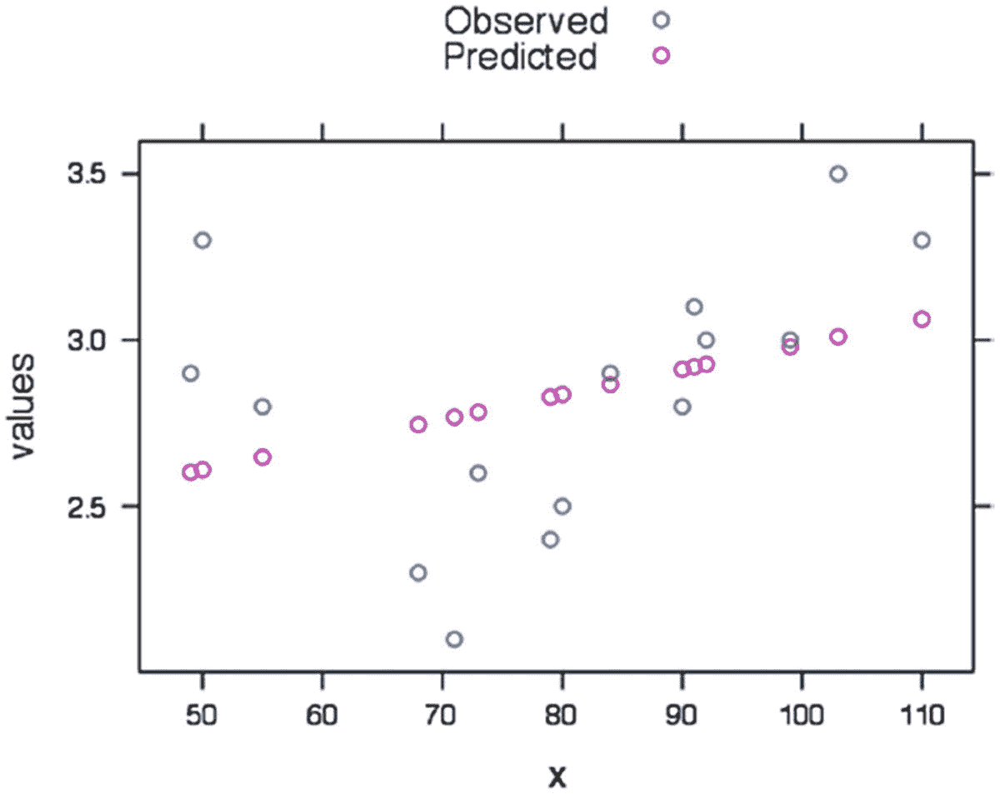

图 6-22

线性模型的实际值与预测值图

```
res <-stack(data.frame(Observed =as.numeric(y), Predicted =fitted(linear_reg)))
res <-cbind(res, x =rep(x, 2))
#使用 lattice 的 xyplot 函数绘图
library("lattice")
xyplot(values ~x, data = res, group = ind, auto.key =TRUE)
```

该图提供了额外的证据，表明从图中看不出线性关系。这些数值并不适合模型预测的线性直线。

现在，我们继续为数据拟合一条二次曲线，看看这是否有助于我们捕捉价格对数量的曲线行为。

# 绘制二次关系图

```
linear_reg |t|)
(Intercept)  6.8737010  1.1648621   5.901 7.24e-05 ***
x           -0.1189525  0.0309061  -3.849  0.00232 **
I(x²)       0.0008145  0.0001976   4.122  0.00142 **

Signif. codes:  0 '***' 0.001 '**' 0.01 '*' 0.05 '.' 0.1 ' ' 1
Residual standard error: 0.2569 on 12 degrees of freedom
Multiple R-squared:  0.6391, Adjusted R-squared:  0.5789
F-statistic: 10.62 on 2 and 12 DF,  p-value: 0.002211
```

模型摘要显示，在我们为`x`引入二次项后，多重R方提高到了63%，并且变量`x`和`x`平方在统计上均显著。让我们绘制散点图，看看这些值是否很好地拟合了数据。见图6-23。

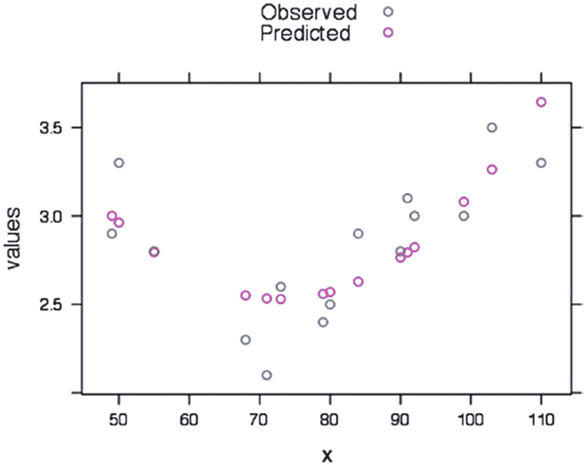

图6-23

二次多项式模型的实际值与预测值图

```
res <-stack(data.frame(Observed =as.numeric(y), Predicted =
fitted(linear_reg)))
res <-cbind(res, x =rep(x, 2))
#使用 lattice 的 xyplot 函数绘图
library("lattice")
xyplot(values ~x, data = res, group = ind, auto.key =TRUE)
```

该模型显示R方有所改善，且二次项在模型中显著。该图还显示，二次情况下的拟合效果优于线性情况。这个想法可以扩展到更高次的多项式，但这会导致过拟合。此外，许多过程通常不能用非常高次的多项式很好地表示。如果您计划使用次数超过四的多项式，在解释结果时要非常小心。

### 6.5.6 逻辑回归

在线性回归中，我们看到因变量是一个具有实数值的连续变量。同时，我们确定误差项需要服从正态分布，回归方程才有效。现在，假设因变量只有两个可能的值（0和1），换句话说，它服从二项分布，会发生什么？那么误差项就不能服从正态分布，如下所示：

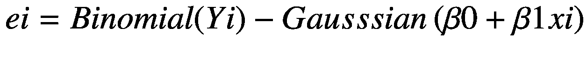

因此，我们需要转向不同的框架，以适应因变量不服从高斯分布而服从指数族分布的情况。在逻辑回归之后，我们将简要介绍指数分布，并展示如何通过链接函数将其简化为线性形式。逻辑回归对预测变量与分类响应/因变量之间的关系进行建模。例如，我们在第5章中看到的信用风险问题。预测变量被用来对“违约/未违约”这一二项结果进行建模。

根据分类（响应）变量的类型，逻辑回归可以分为三种类型：

*   **二项逻辑回归**：响应变量只有两个可能的值（0/1）。通常，我们估计其为1的概率，并根据某个阈值来预测响应变量的状态。

    二项分布的概率质量函数如下：

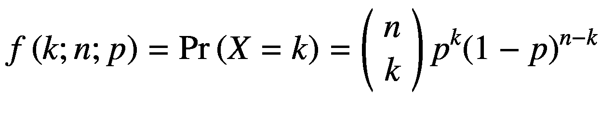

其中`k`是成功次数，`n`是总试验次数，`p`是单次成功的概率。

*   **多项逻辑回归**：分类响应变量有三个或更多个值/水平。通常，我们计算每个水平的概率，然后基于某种分类规则（例如，最大概率）来分配响应变量的状态。

    多项分布的概率质量函数如下：

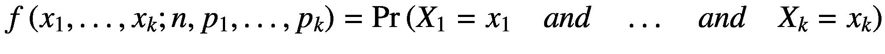

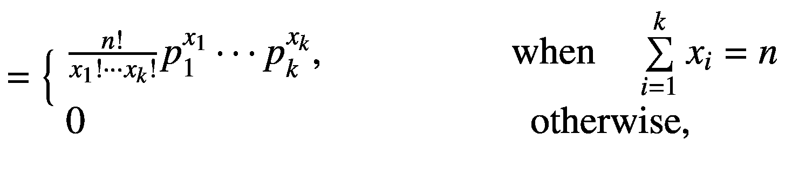

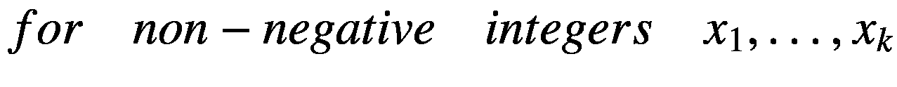

其中`xi`是预测变量集，`pk`是每个类别的概率（比例），`n`是试验次数（样本量）。

*   **有序逻辑回归**：响应变量是一个具有内在顺序的分类变量。该方法与多项逻辑回归相同，主要区别在于其具有内在的顺序。例如，一个介于1到5之间的评级变量。

让我们来看两个在解释逻辑回归时要用到的重要术语。

### 6.5.7 Logit 变换

对于逻辑回归，我们使用一个变换函数，也称为链接函数，它从自变量中的二项分布创建一个线性函数。用于二项分布的链接函数称为`logit`函数（见图6-24）。

`logit`函数`σ(t)`定义如下：

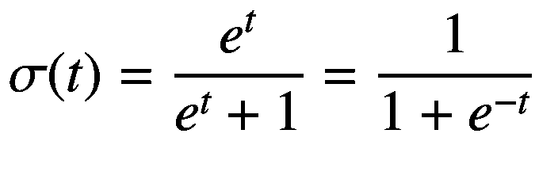

`logit`函数曲线如下所示：


图6-24

Logit 函数

```
curve((1/(1+exp(-x))),-10,10,col ="violet")
```

你可以观察到，`logit`函数的上限为1，下限为0。极高的x值对函数值影响很小，极低的x值也是如此。这样，我们可以看到边界在0到1的概率尺度之间，以便拟合模型。

在逻辑回归中，我们使用最大似然估计（MLE），而对于多项逻辑回归，我们使用迭代方法来优化`logLoss`函数。

然后，`logit`函数将这种关系转换为优势比的`logit`，作为自变量的线性组合。逻辑函数`g`的逆函数，即`logit`（对数优势比），将这种关系映射为线性关系：


在本节中，我们讨论具有二项分类变量的逻辑回归，在后面的部分中，我们将从高层次上探讨如何将此方法扩展到多项分类。

### 6.5.8 优势比

在第一章中，我们讨论了概率度量，它表示事件发生的可能性。概率值始终介于0和1之间，其中0表示事件绝对不会发生，1表示事件绝对会发生。

我们将概率优势（或简称为优势）定义为事件发生概率与不发生概率的比值。

```
事件 A 的优势比 = P(A)/1-P(A)
事件 A 的劣势比 = (1-P(A))/P(A) = 1/事件 A 的优势比
```

因此，事件A的优势比为2意味着事件A发生的可能性是不发生的2倍。该比值可以推广到任意数量的类别，此时其解释变为事件相对于所有可能事件发生的可能性。

优势比是一种表示事件“A”存在/不存在与事件“B”存在/不存在之间关系的方式。对于二元情况，我们可以创建一个示例如下所示：


例如，假设有两种事件结果，A和B。事件A发生的概率为0.4 (P(A))，事件B发生的概率为0.6 (P(B))。那么事件A的优势比为0.66 (P(A)/1-P(A))，类似地，事件B的优势比为1.5 (P(B)/1-P(B))。这意味着事件B发生的可能性是不发生的1.5倍。

现在，优势比被定义为这些优势的比值，即 B 的优势除以 A 的优势 = 1.5/0.66 = 2.27 ~ 2。这表示事件 B 发生的可能性是事件 A 发生的两倍。我们可以观察到这个量是一个相对度量，因此我们在逻辑回归中使用了基准水平的概念。模型中的优势比是相对于基准水平/类别的。

现在，我们可以介绍 `logit` 与优势比之间的关系。逻辑回归本质上对以下方程进行建模，该方程是对事件优势进行 `logit` 变换，然后将我们的问题转换为其线性形式，如下所示：

![$$ \mathrm{logit}\left(\mathrm{E}\left[{Y}_i|{x}_{1,i},\dots, {x}_{m,i}\right]\right)=\mathrm{logit}\left({p}_i\right)=\ln \left(\frac{p_i}{1-{p}_i}\right)={\beta}_0+{\beta}_1{x}_{1,i}+\cdots +{\beta}_m{x}_{m,i} $$](images/416805_2_En_6_Chapter/416805_2_En_6_Chapter_TeX_Equab.png)

因此，在逻辑回归中，优势比是变量的指数化系数，表示事件相对于参考类别/事件的相对可能性。在这里，你可以看到优势比如何转化为逻辑回归的指数化系数。


### 二项逻辑模型

让我们使用我们的购买预测数据来构建一个逻辑回归模型并查看其诊断结果。在我们的分析中，我们将对数据进行子集划分，仅将 `ProductChoice` 1 和 3 分别设为 1 和 0。

```r
#加载数据并准备用于逻辑回归的数据集
Data_Purchase_Prediction 
143893 106603      0
Data_Logistic$MembershipPoints <-factor(Data_Logistic$MembershipPoints)
Data_Logistic$IncomeClass <-factor(Data_Logistic$IncomeClass)
Data_Logistic$CustomerPropensity <-factor(Data_Logistic$CustomerPropensity)
Data_Logistic$LastPurchaseDuration <-as.numeric(Data_Logistic$LastPurchaseDuration)
```

在开始建模之前，让我们先看看分类变量在因变量上的分布情况。

```r
table(Data_Logistic$MembershipPoints,Data_Logistic$choice)
0     1
1  15516 13649
2  19486 15424
3  20919 15661
4  20198 14944
5  18868 13728
6  16710 11883
7  13635  9381
8   9632  6432
9   5566  3512
10  2427  1446
11   754   441
12   165    95
13    17     7
```

该分布表明，随着 `MemberShipPoints` 的增加，选择 0 和 1 的数量都减少了。

```r
table(Data_Logistic$IncomeClass,Data_Logistic$choice)
0     1
1   145   156
2   203   209
3  3996  3535
4 23894 18952
5 47025 36781
6 38905 27804
7 21784 14715
8  6922  3958
9  1019   493
```

该分布表明，大多数客户属于收入等级 4、5 和 6。在各个收入等级区间内，选择 0 和 1 的分布是均衡的。

```r
table(Data_Logistic$CustomerPropensity,Data_Logistic$choice)
0     1
High     26604 10047
Low      20291 19962
Medium   27659 17185
Unknown  36633 52926
VeryHigh 32706  6483
```

该分布很有趣，因为它表明具有非常高倾向的客户极不可能购买由类别 1 代表的产品。分布是初步了解数据的好方法。这个探索性任务也有助于为模型进行特征选择。

现在，我们已经加载了所有相关的库和函数，我们将逐步展示如何开发逻辑回归，并选择其中一个模型用于下一章的评估。我们将在完整数据上开发模型，下一章将详细讨论性能评估指标。

```r
library(dplyr)
#获取按评分分组的平均购买率并绘图
summarise(group_by(Data_Logistic,IncomeClass),Average_Rate=mean(choice))
print("按收入等级划分的平均购买率汇总")
[1] "按收入等级划分的平均购买率汇总"
summary_Rating

# A tibble: 9 × 2
IncomeClass Average_Rate

1           1    0.5182724
2           2    0.5072816
3           3    0.4693932
4           4    0.4423283
5           5    0.4388827
6           6    0.4167953
7           7    0.4031617
8           8    0.3637868
9           9    0.3260582
plot(summary_Rating$IncomeClass,summary_Rating$Average_Rate,type="b", xlab="收入等级", ylab="观察到的平均购买率", main="购买率与收入等级")
```

现在我们想看看产品 1 的平均购买率如何随收入等级变化。我们绘制了每个收入等级的平均购买率（选择 1 的比例），如图 6-25 所示。


图 6-25

购买率与收入等级

图 6-25 中的图表显示，随着收入等级的提高，购买产品 1 的倾向下降。可以为其他变量创建类似的图表，以查看拟合模型后模型概率的预期行为。

现在我们将清理数据中的缺失值（NA，即缺失值 0），并使用`glm()`函数拟合二元逻辑回归。GLM 代表广义线性回归，能够处理指数族分布。该函数要求用户指明因变量所属的分布族以及要使用的链接函数。我们使用了二项分布族，并以`logit`作为链接函数。

```r
#移除缺失值 - NAs
Data_Logistic <- na.omit(Data_Logistic)
#拟合模型
Model_logistic <- glm(choice ~ MembershipPoints + IncomeClass + CustomerPropensity + LastPurchaseDuration, 
                      family = binomial(link = "logit"), data = train)
summary(Model_logistic)
```

# 逻辑回归模型输出

```
调用:
glm(formula = choice ~ MembershipPoints + IncomeClass + CustomerPropensity + 
    LastPurchaseDuration, family = binomial(link = "logit"), 
    data = train)

偏差残差:
    最小值       1Q   中位数       3Q      最大值  
-2.57590  -1.10881  -0.00003   1.10881   2.57590

系数:
                          估计值   标准误差  z 值  Pr(>|z|)    
(Intercept)                 0.066989   0.145543   0.460 0.645323    
MembershipPoints2          -0.123408   0.020577  -5.997 2.01e-09 ***
MembershipPoints3          -0.185540   0.020359  -9.113  < 2e-16 ***
MembershipPoints4          -0.204938   0.020542  -9.977  < 2e-16 ***
MembershipPoints5          -0.237311   0.020942 -11.332  < 2e-16 ***
MembershipPoints6          -0.258884   0.021597 -11.987  < 2e-16 ***
MembershipPoints7          -0.291123   0.022894 -12.716  < 2e-16 ***
MembershipPoints8          -0.326029   0.025526 -12.773  < 2e-16 ***
MembershipPoints9          -0.387113   0.031572 -12.261  < 2e-16 ***
MembershipPoints10         -0.439228   0.044839  -9.796  < 2e-16 ***
MembershipPoints11         -0.357339   0.078493  -4.553 5.30e-06 ***
MembershipPoints12         -0.447326   0.164172  -2.725 0.006435 ** 
MembershipPoints13         -1.349163   0.583320  -2.313 0.020728 *  
IncomeClass2               -0.412020   0.190461  -2.163 0.030520 *  
IncomeClass3               -0.342854   0.146938  -2.333 0.019631 *  
IncomeClass4               -0.389236   0.144433  -2.695 0.007040 ** 
IncomeClass5               -0.373493   0.144169  -2.591 0.009579 ** 
IncomeClass6               -0.442134   0.144244  -3.065 0.002175 ** 
IncomeClass7               -0.455158   0.144548  -3.149 0.001639 ** 
IncomeClass8               -0.509290   0.146126  -3.485 0.000492 ***
IncomeClass9               -0.569825   0.160174  -3.558 0.000374 ***
CustomerPropensityLow       0.877850   0.018709  46.921  < 2e-16 ***
CustomerPropensityMedium    0.427725   0.018491  23.131  < 2e-16 ***
CustomerPropensityUnknown   1.208693   0.016616  72.744  < 2e-16 ***
CustomerPropensityVeryHigh -0.601513   0.021652 -27.781  < 2e-16 ***
LastPurchaseDuration       -0.063463   0.001211 -52.393  < 2e-16 ***

显著性标记:  0 '***' 0.001 '**' 0.01 '*' 0.05 '.' 0.1 ' ' 1

(二项分布族的离散参数取为 1)

零偏差: 235658  on 172985  degrees of freedom
残差偏差: 213864  on 172960  degrees of freedom
AIC: 213916

Fisher 评分迭代次数: 4
```

所有变量及其水平的 `p` 值都是显著的。这意味着我们拟合的模型中，变量与因变量之间存在显著关系。现在我们来计算该模型的分类矩阵。这是通过平衡特异性和敏感度的方法实现的。这些指标的详细信息在第 6 章中给出，我们在此进行简要说明，并利用这些指标为从概率到类别的分类找到一个良好的截断点。

```
#安装并加载包
library(pROC)
#应用 roc 函数
cut_off <-roc(response=train$choice, predictor=Model_logistic$fitted.values)
#找到使误差最小化的阈值
e <-cbind(cut_off$thresholds,cut_off$sensitivities+cut_off$specificities)
best_t <-subset(e,e[,2]==max(e[,2]))[,1]
#绘制 ROC 曲线
plot(1-cut_off$specificities,cut_off$sensitivities,type="l",
ylab="敏感度",xlab="1-特异性",col="green",lwd=2,
main ="训练数据的 ROC 曲线")
abline(a=0,b=1)
abline(v = best_t) #在 ROC 曲线上添加最优 t 值
```

图 6-26 中的图形展示了特异性和敏感度之间的关系。该图也称为 ROC 图。最优截断点是曲线上使敏感度最大化、特异性最小化的值。


图 6-26 训练数据的 ROC 曲线

```
cat(" 分类器的最优截断值为 ", best_t)
分类器的最优截断值为 0.4202652
```

观察图形，我们可以看到我们选择的截断点将在训练数据上提供最佳分类。我们需要在测试数据上检验这个假设，并使用 `0.42` 这个截断点记录分类率。

```
# 预测测试数据的概率并应用截断点
predict_prob <- predict(Model_logistic, test, type = "response")
class_pred <- ifelse(predict_prob > 0.41,1,0)
#分类表
table(test$choice,class_pred)
class_pred
     0     1
0 24605 18034
1  8364 23134
#分类率
sum(diag(table(test$choice,class_pred))/nrow(test))
[1] 0.6439295
```

该模型在测试数据上显示出 64% 的良好分类率。这表明模型能够很好地捕捉数据中的信号，以区分 `0` 和 `1`。

逻辑模型的诊断方法与线性回归模型不同。在以下小节中，我们将探讨逻辑回归的一些常见诊断指标。

### 6.5.9 模型诊断：逻辑回归

一旦我们拟合了模型，就需要对逻辑回归输出进行两步分析：
1.  如果我们对最终的类别分配感兴趣，则应关注分类器，并比较通过分类器对预测概率进行分配后得到的实际类别。
2.  如果我们对概率感兴趣，则应关注那些事件发生几率高且获得高概率的案例。

除此之外，我们还需要查看系数、`R` 平方等价指标以及其他检验，以验证我们的模型在统计上是否有效。在查看系数时，另一个需要牢记的重要事项是：逻辑回归系数表示预测变量每变化一个单位时 `logit` 的变化量，这与线性回归不同。

我们将展示如何执行三种诊断检验——沃尔德检验、似然比检验以及偏差/伪 `R` 平方——以及三种分离度量方法：双变量图、增益/提升图和一致性比率。

#### 6.5.9.1 沃尔德检验

# 沃尔德检验与模型评估

沃尔德检验类似于线性回归中的 t 检验。它用于评估给定模型中各个预测变量的贡献。

在逻辑回归中，沃尔德统计量为


其中 `β` 是系数，`SE` 是系数 `β` 的标准误差。

沃尔德统计量是回归系数平方与系数标准误差平方的比值，它服从卡方分布。显著的沃尔德统计量意味着该预测变量/自变量在模型中显著。

让我们对 `MembershipPoints` 执行沃尔德检验，看看它在模型中是否显著。

```
#沃尔德检验
library(survey)
regTermTest(Model_logistic, "MembershipPoints", method = "Wald")
MembershipPoints 的沃尔德检验
在 glm(formula = choice ~ MembershipPoints + IncomeClass + CustomerPropensity +
LastPurchaseDuration, family = binomial(link = "logit"),
data = train)中
F =  31.64653  on  12  and  172960  df: p= < 2.22e-16
```

p 值小于 0.05，因此在 95% 的置信水平下，我们可以拒绝系数值为零的原假设。因此，`MembershipPoints` 是模型中一个统计上显著的变量。

## 6.5.9.2 偏差

偏差是通过比较零模型和饱和模型计算得出的。零模型是不包含任何预测变量、仅含截距项的模型，而饱和模型则是包含若干预测变量的拟合模型。在逻辑回归中，偏差用于替代平方和计算。检验统计量（通常记为 `D`）是似然比对数的两倍，即两个对数似然值之差的两倍：

偏差


偏差统计量 (`D`) 服从卡方分布。数值越小表示拟合效果越好，因为拟合模型与饱和模型的偏差越小。

以下是偏差分析表。

```
#Anova table of significance
anova(Model_logistic, test = "Chisq")
Analysis of Deviance Table
Model: binomial, link: logit
Response: choice
Terms added sequentially (first to last)
Df Deviance Resid. Df Resid. Dev  Pr(>Chi)
NULL                                172985     235658
MembershipPoints     12    330.6    172973     235328 < 2.2e-16 ***
IncomeClass           8    339.1    172965     234989 < 2.2e-16 ***
CustomerPropensity    4  18297.4    172961     216691 < 2.2e-16 ***
LastPurchaseDuration  1   2826.9    172960     213864 < 2.2e-16 ***

Signif. codes:  0 '***' 0.001 '**' 0.01 '*' 0.05 '.' 0.1 ' ' 1
```

所有变量的卡方检验均显著，因为 p 值小于 0.05。所有预测变量对模型的贡献都是显著的。

## 6.5.9.3 伪 R 方

在线性回归中，我们有 R 方度量（详见第 7 章），它衡量模型独立解释的方差比例。逻辑回归中类似的度量称为伪 R 方。其中最流行的一种使用了似然比，表示如下：


它是零模型偏差与拟合模型偏差之差除以零模型偏差的比值。该度量值越高，模型的解释力越强。本章不讨论其他类似的度量，如 Cox 和 Snell R 方、Nagelkerke R 方、McFadden R 方以及 Tjur R 方。这里我们计算模型的伪 R 方。

```
# R square equivalent for logistic regression
library(pscl)
pR2(Model_logistic)
llh       llhNull            G2      McFadden          r2ML
-1.069321e+05 -1.178291e+05  2.179399e+04  9.248135e-02  1.183737e-01
r2CU
1.591199e-01
```

该函数输出的最后三个值分别是 `McFadden` 伪 R 方、最大似然伪 R 方（`Cox & Snell`）以及 `Cragg` 和 `Uhler` 或 `Nagelkerke` 伪 R 方。R 方值非常低，表明该模型的性能可能并不优于零模型。

## 6.5.9.4 双变量图

逻辑回归最重要的诊断方法是观察每个单一自变量各水平下实际概率与预测概率的表现。这些图被称为*双变量*图，因为有两个变量——实际值和预测值——针对单一自变量的各个水平进行绘制。该图包含三个重要输入：

*   *实际概率：* 自变量每个类别中目标水平的先验比例。
*   *预测概率：* 模型给出的概率。
*   *频数：* 分类变量的频数（观测数量）。

该图本质上告诉我们模型在分类变量不同水平上的表现如何。你也可以通过对连续变量进行分箱处理，将此思路扩展到连续变量。

这些图的另一个优点是，你可以确定数据集中模型在哪个群组上表现更好，以及哪个群组需要进一步研究。这种群组级别的诊断无法通过查看聚合图来实现。

```
#The function code is provided separately in the appendix
source("actual_pred_plot.R")
MODEL_PREDICTION <- predict(Model_logistic, Data_Logistic, type = 'response')
Data_Logistic$MODEL_PREDICTION <- MODEL_PREDICTION
#Print the plots MembershipPoints
actual_pred_plot(var.by = as.character("MembershipPoints"),
var.response = 'choice',
data = Data_Logistic,
var.predict.current = 'MODEL_PREDICTION',
var.predict.reference = NULL,
var.split = NULL,
var.by.buckets = NULL,
sort.factor = FALSE,
errorbars = FALSE,
subset.to = FALSE,
barline.ratio = 1,
title = "Actual vs. Predicted Purchase Rates",
make.plot = TRUE
)
```

图 6-27 展示了实际值与预测值相对于 `MembershipPoints` 频数图的对比。


*图 6-27 实际值与预测值相对于 MembershipPoints 的对比图*

对于 `MembershipPoints`，实际概率和预测概率相互吻合。这意味着模型预测的概率接近实际值。此外，你可以看到，在这两种情况下，拥有较高 `MembershipPoints` 的客户选择 `product = 1` 的可能性较低，这与实际和预测结果一致。

#Print the plots IncomeClass
```r
actual_pred_plot  (var.by=as.character("IncomeClass"),
var.response='choice',
data=Data_Logistic,
var.predict.current='MODEL_PREDICTION',
var.predict.reference=NULL,
var.split=NULL,
var.by.buckets=NULL,
sort.factor=FALSE,
errorbars=FALSE,
subset.to=FALSE,
barline.ratio=1,
title="Actual vs. Predicted Purchase Rates",
make.plot=TRUE
)
```

图 6-28 展示了实际值与预测值相对于 `IncomeClass` 频数图的对比。


图 6-28 实际值与预测值相对于 `IncomeClass` 的对比图

同样，模型在 `IncomeClass` 上的表现符合预期。该模型能够像实际观测到的比率一样，预测不同收入阶层下的概率。

#Print the plots CustomerPropensity
```r
actual_pred_plot  (var.by=as.character("CustomerPropensity"),
var.response='choice',
data=Data_Logistic,
var.predict.current='MODEL_PREDICTION',
var.predict.reference=NULL,
var.split=NULL,
var.by.buckets=NULL,
sort.factor=FALSE,
errorbars=FALSE,
subset.to=FALSE,
barline.ratio=1,
title="Actual vs. Predicted Purchase Rates",
make.plot=TRUE
)
```

图 6-29 展示了实际值与预测值相对于 `CustomerPropensity` 频数图的对比。


图 6-29 实际值与预测值相对于 `CustomerPropensity` 的对比图

模型在 `CustomerPropensity` 上也与观测概率表现出良好的一致性。在对模型中的连续变量进行适当分箱后，也可以绘制类似的图。至少在分类变量上，模型表现良好。

该模型在不同分类变量水平上均显示出良好的预测值与实际值匹配度。从概率尺度来看，这是一个好模型！

# 6.5.9.5 累积增益图与提升图

累积增益图和提升图是衡量预测模型有效性的可视化方法。它们包含一条基线以及由预测模型生成的提升曲线。基线与预测（提升）曲线之间的分离程度越大，模型效果越好。

在增益图中：
- X 轴：客户百分比
- Y 轴：正向预测百分比
- 基线：随机线（x%的客户产生 x%的正向预测）
- 增益：对应客户百分比的正向响应百分比

在提升图中：
- X 轴：客户百分比
- Y 轴：实际提升度（模型预测结果与无模型结果之比）

```r
library(gains)
library(ROCR)
library(calibrate)
MODEL_PREDICTION <-predict(Model_logistic, Data_Logistic, type ='response');
Data_Logistic$MODEL_PREDICTION <-MODEL_PREDICTION;
lift =with(Data_Logistic, gains(actual = Data_Logistic$choice, predicted = Data_Logistic$MODEL_PREDICTION , optimal =TRUE));
pred =prediction(MODEL_PREDICTION,as.numeric(Data_Logistic$choice));

# 用于创建性能对象的函数。所有类型的预测器评估均通过此函数执行。
gains =performance(pred, 'tpr', 'rpp');

# tpr: 真正率
# rpp: 正向预测率
auc =performance(pred, 'auc');
auc =unlist(slot(auc, 'y.values')); # 等同于：auc@y.values[[1]]
auct =paste(c('AUC = '), round(auc, 2), sep =")
#par(mfrow=c(1,2), mar=c(6,5,4,2));
plot(gains, col="red", lwd=2, xaxs="i", yaxs="i", main =paste('Gains Chart ', sep ="),ylab='% of Positive Response', xlab='% of customers/population');
axis(side =1, pos =0, at =seq(0, 1, by =0.10));
axis(side =2, pos =0, at =seq(0, 1, by =0.10));
lines(x=c(0,1), y=c(0,1), type="l", col="black", lwd=2,
ylab='% of Positive Response', xlab='% of customers/population');
legend(0.6, 0.4, auct, cex =1.1, box.col ='white')
gains =lift$cume.pct.of.total
deciles =length(gains);
for (j in 1:deciles)
{
x =0.1;
y =as.numeric(as.character(gains[[j]]));
lines(x =c(x*j, x*j),
y =c(0, y),
type ='l', col ='blue', lwd =1);
lines(x =c(0, 0.1*j),
y =c(y, y),
type ='l', col ='blue', lwd =1);

# 在指定十分位处添加真正率的精确数值以标注图表。
textxy(0, y, paste(round(y,2)*100, '%',sep="), cex=0.9);
}
```

图 6-30 是我们模型的增益图。该图以正向响应百分比为 Y 轴，以总体百分比为 X 轴绘制。


图 6-30 含 `AUC` 的增益图

```r
plot(lift,
xlab ='% of customers/population',
ylab ='Actual Lift',
main =paste('Lift Chart \n', sep =' '),
xaxt ='n');
axis(side =1, at =seq(0, 100, by =10), las =1, hadj =0.4);
```

图 6-31 是我们模型的提升图。该图以实际提升度为 Y 轴，以总体百分比为 X 轴绘制。


图 6-31 提升图

增益图显示模型线与基线之间存在良好的分离。这表明模型具有良好的区分能力。此外，`AUC` 值为 0.7 意味着该模型能够大致区分 70%的案例。

提升图显示，对于前 10%的总体，提升度接近 70%。该值应与我们在增益图中观察到的结果一致，只是呈现方式不同。

# 6.5.9.6 一致性与不一致性比率

在任何基于原始概率的分类模型中，都需要一种分类方法来区分这些概率案例。在二元逻辑回归中，这通常通过选择一个临界值，然后创建一个不等式将对象分类为 0 或 1 来实现。

为了确保存在这样的临界值且具有良好的区分能力，我们必须检查数据中实际状态为 1 的对象是否比实际状态为 0 的对象具有更高的概率。例如，一对(Yi,Yj)为(0,1)，则预测值(Pi,Pj)应满足 Pj>Pi，这样我们就可以在 `Pj` 和 `Pi` 之间选择一个数值，从而正确地将 1 分类为 1，0 分类为 0。基于此理解，我们可以将数据中所有可能的配对分为三类：
- 一致对：对于(0,1)或(1,0)，对应的概率中 1 的概率大于 0 的概率

# 逻辑回归模型诊断与多类分类

## 模型评估：一致性比率

*   *不一致对：* 对于`(0,1)`或`(1,0)`，对应的概率中 0 的概率大于 1 的概率。
*   *结：* `(0,0)`和`(1,0)`配对。

一致性比率定义为一致对数量与总配对数的比值。如果我们的模型产生较高的一致性比率，那么它将能够更准确地将对象分类到各个类别中。

```R
# 函数代码单独提供在第六章的 R 代码中
source("concordance.R")

# 调用一致性函数获取这些比率
concordance(Model_logistic)
$Concordance
[1] 0.7002884
$Discordance
[1] 0.2991384
$Tied
[1] 0.0005731122
$Pairs
[1] 7302228665
```

一致性为 69.9%，表明模型概率在约 70%的案例上具有良好的区分度。这是一个用于创建 0 和 1 分类器的良好模型。

## 本节小结

在本节关于逻辑回归模型诊断的内容中，我们大致从两个维度讨论了诊断方法：模型拟合统计量和模型分类能力。

*   **模型拟合统计量**：讨论了 Wald 检验（参数估计的显著性检验）、偏差（类似于线性回归中的残差）以及伪 R 平方（相当于线性回归中的 R 平方）。
*   **模型分类能力**：用于识别模型是否可用于创建强大的分类器。所包含的检验包括：双变量图（实际概率与预测概率的图）、累积增益图和提升图（展示模型区分两个类别的能力），以及一致性比率（告诉我们是否为分类器找到了良好的临界值）。

这些诊断方法为我们提供了模型的重要属性，并帮助建模者改进或重新估计模型。

## 多类分类问题概述

在下一节中，我们将转向多类分类问题。多类问题是最难解决的问题之一，因为类别数量越多，模糊性越强。在许多情况下，很难创建良好的分类器。我们将讨论使用机器学习进行多类分类的多种方法。多项逻辑回归是进行多类分类的流行方法之一。

### 6.5.10 多项逻辑回归

当分类问题涉及多个类别时，我们使用多项逻辑回归。在这种情况下，因变量服从多项分布。在后台，我们为每个类别创建一个逻辑模型，然后通过将所有概率之和约束为 1 的概率条件，将这些模型合并成一个单一的方程。多项逻辑回归的方程设置如下所示：


估计过程对单个`logit`变换有额外的约束，所有`logit`函数的概率之和必须为 1。由于估计必须考虑这个约束，因此估计方法是一个迭代过程。模型的最佳系数是通过对`logLoss`函数进行迭代优化来找到的。

对于我们的购买预测问题，首先我们将在数据上拟合一个逻辑模型。`nnet`包中的`multinom()`函数将用于为我们的多类问题（`ProductChoice`有四个可能的选项）估计逻辑方程。一旦我们得到每个类别的概率，我们将创建一个分类器来为各个案例分配类别。

这里将演示两种分类器方法：

*   *选取最高概率：* 在所有可能的类别中选取概率最高的那个。然而，这种技术存在类别不平衡问题。当高比例类别的先验分布驱动预测概率时，就会出现类别不平衡，从而导致低比例类别永远无法通过预测概率的最大值被分配到该类别。
*   *概率比率：* 我们可以计算预测概率与先验分布的比率，然后根据最高比率选择一个类别。最高比率意味着模型捕捉到了最强的信号，因为概率已经通过先验比例进行了归一化。

让我们拟合一个模型并应用这两种分类器。

```R
#移除包含 NA 的数据。NA 在建模算法中被忽略
Data_Purchase<-na.omit(Data_Purchase_Prediction)
rownames(Data_Purchase)<-NULL
#为简化计算进行随机抽样
Data_Purchase_Model <-Data_Purchase[sample(nrow(Data_Purchase),10000),]
print("产品的分布如下")
[1] "产品的分布如下"
table(Data_Purchase_Model$ProductChoice)
1    2    3    4
2192 3883 2860 1065
#拟合一个多项逻辑回归模型
library(nnet)
mnl_model <-multinom (ProductChoice ~MembershipPoints +IncomeClass +CustomerPropensity +LastPurchaseDuration +CustomerAge +MartialStatus, data = Data_Purchase)

# weights:  44 (30 variable)
initial  value 672765.880864
iter  10 value 615285.850873
iter  20 value 607471.781374
iter  30 value 607231.472034
final  value 604217.503433
converged
#显示模型统计摘要
mnl_model
Call:
multinom(formula = ProductChoice ~ MembershipPoints + IncomeClass +
CustomerPropensity + LastPurchaseDuration + CustomerAge +
MartialStatus, data = Data_Purchase)
Coefficients:
(Intercept) MembershipPoints IncomeClass CustomerPropensityLow
2  0.77137077      -0.02940732  0.00127305            -0.3960318
3  0.01775506       0.03340207  0.03540194            -0.8573716
4 -1.15109893      -0.12366367  0.09016678            -0.6427954
CustomerPropensityMedium CustomerPropensityUnknown
2               -0.2745419                -0.5715016
3               -0.4038433                -1.1824810
4               -0.4035627                -0.9769569
CustomerPropensityVeryHigh LastPurchaseDuration CustomerAge
2                  0.2553831           0.04117902 0.001638976
3                  0.5645137           0.05539173 0.005042405
4                  0.5897717           0.07047770 0.009664668
MartialStatus
2  -0.033879645
3  -0.007461956
4   0.122011042
Residual Deviance: 1208435
AIC: 1208495
```

模型结果显示它在 30 次迭代后收敛。现在让我们查看模型分配的一组样本概率，然后应用第一个分类器，即选取最高概率。

这里，我们应用最高概率分类器，并观察它如何对案例进行分类。

## 预测概率
```r
predicted_test <- as.data.frame(predict(mnl_model, newdata = Data_Purchase, type="probs"))
head(predicted_test)
1         2         3          4
1 0.21331014 0.3811085 0.3361570 0.06942438
2 0.05060546 0.2818905 0.4157159 0.25178812
3 0.21017415 0.4503171 0.2437507 0.09575798
4 0.24667443 0.4545797 0.2085789 0.09016690
5 0.09921814 0.3085913 0.4660605 0.12613007
6 0.11730147 0.3624635 0.4184053 0.10182971

# 基于最高概率进行预测
test_result <- apply(predicted_test, 1, which.max)
result <- as.data.frame(cbind(Data_Purchase$ProductChoice, test_result))
colnames(result) <- c("实际类别", "预测类别")
table(result$`实际类别`, result$`预测类别`)
1      2      3
1    302  91952  12365
2    248 150429  38028
3    170  90944  51390
4     27  32645  16798
```

模型对类别 1、2 和 3 的分类效果良好，但对于类别 4，模型甚至没有正确分类一个案例。这是因为分类器（选取最高概率）对绝对概率非常敏感。这被称为`类别不平衡`，在本节开头已讨论过。

现在让我们应用本节开头讨论的第二种方法——概率比率——来进行分类。我们将根据预测概率与先验概率/比例的比率来选择类别。通过这种方式，我们将确保分类器分配的是能提供最大概率提升的类别。换句话说，该比率将通过先验几率对概率进行归一化，从而减少由于先验分布造成的偏差。

```r
prior <- table(Data_Purchase_Model$ProductChoice) / nrow(Data_Purchase_Model)
prior_mat <- rep(prior, nrow(Data_Purchase_Model))
pred_ratio <- predicted_test / prior_mat

# 基于最高比率进行预测
test_result <- apply(pred_ratio, 1, which.max)
result <- as.data.frame(cbind(Data_Purchase$ProductChoice, test_result))
colnames(result) <- c("实际类别", "预测类别")
table(result$`实际类别`, result$`预测类别`)
1      2      3      4
1  21251  64410  18935     23
2  28087 112480  48078     60
3  13887  77090  51476     51
4   4620  27848  16958     44
```

现在你可以看到类别不平衡问题在一定程度上得到了缓解。我们鼓励你尝试其他采样方法来进一步减少这个问题。多项模型在多类分类问题中非常流行；其他用于多类分类的替代算法往往比多项模型更复杂。与朴素贝叶斯分类器相比，多项逻辑回归分类器更常用于自然语言处理和多类问题。

### 6.5.11 广义线性模型

广义线性模型将普通线性回归的思想扩展到指数族中响应变量的其他分布。

在 GLM 框架中，我们假设因变量由指数族分布生成。指数族包括正态分布、二项分布、泊松分布和伽马分布等。在这种情况下，期望值定义为：


其中`E(Y)`是`Y`的期望值；`X`β 是线性预测器，是未知参数 β 的线性组合；`g`是链接函数。

模型参数 β 通常使用最大似然估计、最大拟似然估计或贝叶斯技术进行估计。

`glm`函数是一个非常通用的函数，可以容纳响应变量中的多种分布类型：

```
glm(formula, family=familytype(link=linkfunction), data=)
```

*   `binomial, (link = "logit")`

    二项分布在现实世界中非常常见。任何具有两种可能结果的问题都可以视为二项分布。一个简单的例子是今天是否会下雨（=1）或不会下雨（=0）。

*   `gaussian, (link= "identity")`

    高斯分布是一种连续分布，即正态分布。线性回归中的所有问题都假设因变量服从高斯分布。

*   `Gamma, (link= "inverse")`

    一个例子是：“N 个人在等待外卖。服务完他们需要多长时间？”或者工业中机器的故障时间。

*   `poisson, (link = "log")`

    这是排队问题中的常见分布。一个例子是“呼叫中心今天会接到多少个电话？”

R 中的`glm()`函数也支持以下指数族分布。然而，这些分布在日常活动中并不常见。

```
inverse.gaussian, (link = "1/mu²")
quasi, (link = "identity", variance = "constant")
quasibinomial, (link = "logit")
quasipoisson, (link = "log")
```

### 6.5.12 结论

回归是最早的学习算法之一，深受统计学影响，但设计却非常简洁优雅。多年来，随着新应用的出现，回归技术的复杂性和多样性成倍增加。在本书中，我们用了大量篇幅介绍回归，以充分展示广泛使用的回归技术。我们从最基本的简单回归讨论到高级的多项式回归，并重点在 R 中进行了演示。建议有兴趣的读者进一步参考该主题的一些高级文献，以便更深入地研究回归理论。

我们还详细讨论了回归的模型诊断，这是在实际开发模型时最容易被忽视的主题，但如果处理不当，可能会对应用它的行业造成巨大损害。

在下一节中，我们将介绍一种基于距离的算法——支持向量机，它在高维数据集上可以成为一个非常好的二分类模型。

## 6.6 支持向量机 SVM

在 R 函数`libsvm`的文档（标题为“支持向量机”，作者 David Meyer）中，对 SVM 进行了简洁清晰的描述，涵盖了类别分离、处理重叠类别、处理非线性以及问题解决方案的建模。以下是该文档的摘录：

1.  类别分离

    SVM 寻找分离两个类别的最优超平面。（在二维空间中，超平面是一条直线；在 p 维空间中，超平面是一个维度为 p-1 的平坦仿射子空间。）它通过最大化两个类别最近点之间的间隔来找到最优超平面（见图 6-57）。在二维空间中，如图 6-32 所示，位于间隔边界上的点称为支持向量，穿过间隔中点的直线就是最优超平面。

    对于线性可分的数据，一个简单的二维超平面由以下两个方程表示：


和


并满足以下约束条件，以确保每个观测值都位于间隔的正确一侧：


2.  重叠类别

    如果数据点位于判别间隔的错误一侧，可以降低其权重以减少其影响（在这种情况下，该间隔称为软间隔）。

    可以引入以下称为铰链损失函数的函数来处理这种情况：


如果  位于间隔的正确一侧，则该函数值为 0；否则，函数值与到间隔的距离成正比。

### 6.6.1 线性 SVM

如果找不到线性分类器，通常使用核函数将观测值投影到更高维的空间，在该空间中观测值变得线性可分。

一种流行的高斯族核函数是径向基函数。径向基函数（RBF）是一个实值函数，其值仅取决于到原点的距离。该函数可以定义如下：


其中  称为观测值`x`和`y`之间的欧几里得距离的平方。根据数据的不同，还可以使用其他线性、多项式和 sigmoid 核函数。

能够执行所有这些任务的程序称为*支持向量机*。参见图 6-32。


图 6-32 使用支持向量机进行分类

该问题可以表述为一个二次优化问题，可以通过许多已知技术求解。以下表达式可以转换为二次函数（此主题的讨论超出了本书的范围）。

#### 6.6.1.1 硬间隔

对于硬间隔，最小化 ，满足约束条件 

#### 6.6.1.2 软间隔

对于软间隔，最小化 ![$$ \left[\frac{1}{n}\sum \limits_{i=1}^n\max \left(0,1-{y}_i\left(\overrightarrow{w}\cdot \overrightarrow{x_i}+b\right)\right)\right]+\lambda {\overrightarrow{w}}², $$](images/416805_2_En_6_Chapter/416805_2_En_6_Chapter_TeX_IEq12.png)

其中参数`λ`决定了在增大间隔与确保`{\overrightarrow{x}}_i`位于间隔正确一侧之间的权衡。

### 6.6.2 二分类 SVM 分类器

让我们来看一下乳腺癌数据集中良性和恶性细胞的分类。我们要创建一个二分类器，将细胞分为良性和恶性。

1. 数据摘要

```r
library(e1071)
library(rpart)
breast_cancer_data <-read.table("Dataset/breast-cancer-wisconsin.data.txt",sep=",")
breast_cancer_data$V11 =as.factor(breast_cancer_data$V11)
summary(breast_cancer_data)
    V1               V2              V3              V4
    Min.   :  61634  Min.   : 1.000  Min.   : 1.000  Min.   : 1.000
    1st Qu.: 870688  1st Qu.: 2.000  1st Qu.: 1.000  1st Qu.: 1.000
    Median :1171710  Median : 4.000  Median : 1.000  Median : 1.000
    Mean   :1071704  Mean   : 4.418  Mean   : 3.134  Mean   : 3.207
    3rd Qu.: 1238298 3rd Qu.: 6.000  3rd Qu.: 5.000  3rd Qu.: 5.000
    Max.   :13454352 Max.   :10.000  Max.   :10.000  Max.   :10.000
    V5               V6               V7            V8
    Min.   : 1.000   Min.   : 1.000   1      :402   Min.   : 1.000
    1st Qu.: 1.000   1st Qu.: 2.000   10     :132   1st Qu.: 2.000
    Median : 1.000   Median : 2.000   2      : 30   Median : 3.000
    Mean   : 2.807   Mean   : 3.216   5      : 30   Mean   : 3.438
    3rd Qu.: 4.000   3rd Qu.: 4.000   3      : 28   3rd Qu.: 5.000
    Max.   :10.000   Max.   :10.000   8      : 21   Max.   :10.000
                                       (Other): 56
    V9              V10         V11
    Min.   : 1.000   Min.   : 1.000   2:458
    1st Qu.: 1.000   1st Qu.: 1.000   4:241
    Median : 1.000   Median : 1.000
    Mean   : 2.867   Mean   : 1.589
    3rd Qu.: 4.000   3rd Qu.: 1.000
    Max.   :10.000   Max.   :10.000
```

2. 数据准备

3. 模型构建

```r
index <-1:nrow(breast_cancer_data)
test_data_index <-sample(index, trunc(length(index)/3))
test_data <-breast_cancer_data[test_data_index,]
train_data <-breast_cancer_data[-test_data_index,]
```

4. 模型评估

通常，只有当所使用的特征和数据与真实世界非常匹配时，才有可能达到如此高的准确率。在实际场景中，构建这样的数据集很困难，然而，在医疗诊断领域，对准确率的期望总是非常高，因为错误会对人的生命带来重大风险。

训练集准确率 = 100%

### 6.6.3 多分类 SVM

我们介绍了 SVM 作为二分类器。然而，SVM 的思想也可以扩展到多分类问题。多分类 SVM 可以通过创建多个二分类器来用作多分类器。这种方法的工作原理类似于多项逻辑回归的思想，即我们为每一对类别构建一个带有基函数的逻辑模型。

按照同样的思路，我们可以创建一组二分类 SVM 来进行多分类。实现该方法的步骤如下：

1.  创建二分类器：
    *   在一个类别与其余类别之间
    *   在每一对类别之间（所有可能的配对）

2.  对于任何新案例，SVM 分类器采用“胜者全得”策略，即分配输出最高的类别。

要实现这种方法，重要的是输出函数经过校准以生成可比较的分数，否则分类会产生偏差。

还有其他用于多分类 SVM 的方法。Crammer 和 Singer 提出了其中一种。他们提出了一种多分类 SVM 方法，该方法将多分类问题转化为一个单一的优化问题，而不是将其分解为多个二分类问题。

我们用房屋价值数据来展示一个简单的例子。房屋净值被分为三类——高、中、低。多分类 SVM 必须将房屋分类到这些类别中。以下是 SVM 多分类器的 R 实现：

```r
# Read the house Worth Data
Data_House_Worth <-read.csv("Dataset/House Worth Data.csv",header=TRUE);
library( 'e1071' )
#Fit a multiclass SVM
svm_multi_model <-svm( HouseNetWorth ~StoreArea +LawnArea, Data_House_Worth )
#Display the model
svm_multi_model
Call:
svm(formula = HouseNetWorth ~ StoreArea + LawnArea, data = Data_House_Worth)
Parameters:
SVM-Type:  C-classification
SVM-Kernel:  radial
cost:  1
gamma:  0.5
Number of Support Vectors:  120
#get the predicted value for all the set
res <-predict( svm_multi_model, newdata=Data_House_Worth )
#Classification Matrix
table(Data_House_Worth$HouseNetWorth,res)
res
High Low Medium
High    122   1      7
Low       6 122      7
Medium    1   7     43
#Classification Rate
sum(diag(table(Data_House_Worth$HouseNetWorth,res)))/nrow(Data_House_Worth)
[1] 0.9082278
```

多分类 SVM 在房屋价值数据上给出了 90% 的良好分类率。所有类别的预测效果都很好。

### 6.6.4 结论

支持向量机最初是一种非概率二元分类器，后来经过变体也能解决多类问题，已被证明是机器学习中最成功的算法之一。多年来，SVM 涌现出大量应用，其中一些值得关注的应用包括超文本分类、图像分类、字符识别，以及在生物科学领域的众多应用。

本节简要介绍了 SVM，包括其在乳腺癌和房屋价值数据上的二元及多类版本。下一节，我们将讨论决策树算法，这是另一种分类与回归模型，也是许多研究领域中非常流行的方法。

## 6.7 决策树

与基于统计技术的其他机器学习算法不同，决策树是一种非参数模型，对模型没有潜在假设。然而，我们应当谨慎识别哪些问题适合使用决策树，哪些不适合。决策树易于解释和理解的特点使其在众多应用中得以使用，从农业（可根据各种环境变量预测降雨概率）到软件开发（可根据模块细节估算开发工作量）。多年来，基于树的方法在适用性和复杂性方面都发展到了更广泛的范畴。它们既适用于离散响应变量，也适用于连续响应变量，这使其成为分类和回归问题的合适解决方案。

更正式地说，决策树 `D` 由两种类型的节点组成：

*   **叶节点**，表示由响应变量定义的类别/区域。
*   **决策节点**，指定对单个属性（预测变量）的某种测试，每个可能的测试结果对应一个分支和子树。

构建好的决策树可用于对观测值进行分类：从顶部的决策节点（称为根节点）开始，采用递归分治方法向下经过其他决策节点，直到遇到叶节点。在深入探讨算法工作原理的细节之前，让我们先熟悉一些度量标准及其在决策树构建过程中的重要性（见图 6-33）。


包含两个属性和一个类别的决策树

## 6.7.1 决策树的类型

决策树提供两种实现方式，一种用于回归问题，另一种用于分类问题。这意味着你可以将决策树用于分类响应变量和连续响应变量，这使其在机器学习世界中成为一种广受欢迎的方法。接下来，我们简要描述如何使用决策树对这两种问题进行建模。

### 6.7.1.1 回归树

在响应变量为连续值的问题中，回归树非常有用。它们提供了与线性回归同等的可解释性，除此之外，它们对最终输出具有非常直观的理解，这与问题的领域紧密相关。在图 6-33 的先前示例中，构建回归树是为了基于各种阈值递归地将两个特征向量空间分割成不同区域。我们在每次迭代中分割区域的目标是最小化由以下方程定义的残差平方和（RSS）：


总体而言，回归树构建和对新测试数据进行预测涉及以下两个步骤：

*   递归地将特征向量空间（`X[1]`, `X[2]`, …, `X[p]`）分割成不同且不重叠的区域。

*   对于落入同一区域的新观测值，其预测值等于该区域中所有训练观测值的平均值。

在 n 维特征向量中，可以使用基尼指数或熵（衡量节点分类能力的指标）来选择正确的特征，以将空间分割成不同区域。方差缩减（本书未涉及）是另一种流行方法，它适当地离散化连续响应变量的范围，以便选择正确的分割阈值。见图 6-34。


二维特征空间的递归二元分割及其对应的树

我们将在本章后面，使用一种称为分类与回归树（CART）的回归树算法，对本章前面描述的房屋数据集进行演示。

### 6.7.1.2 分类树

分类树更适用于分类或离散响应变量。以下是分类树与回归树之间的主要区别：

*   在分类树中，我们使用分类错误率来进行分割。

*   在预测时，我们不使用特定区域中响应变量的平均值，而是使用训练观测值中出现频率最高的类别作为预测方法。

同样，我们可以使用基尼指数或熵作为衡量标准，来选择将观测值分割成不同类别的最佳特征或属性。

在接下来的章节中，我们将讨论一些流行的分类决策树算法，如 `ID3` 和 `C5.0`。

## 6.7.2 决策度量

某些度量标准对于构建决策树至关重要。在本节中，我们讨论与节点纯度（随机性或异质性的度量）相关的几个度量标准。在决策树的上下文中，较小的值表示该节点包含来自单个类别的大部分观测值。有两种广泛使用的节点纯度度量标准，以及另一种称为信息增益的度量标准，它使用基尼指数或熵来做出节点分割的决策。

### 6.7.2.1 基尼指数

基尼指数的计算公式为：


其中，`p[mk]` 是第 `m` 个区域中来自第 `k` 个类别的训练观测值的比例。

为了演示，请看图 6-35。假设你有两个类别，其中 `P1` 比例的所有训练观测值属于类别 `C[1]`（三角形），那么 `P2 = 1-P1` 属于类别 `C[2]`（圆形）。基尼指数呈现一条曲线，如图 6-35 所示。


基尼指数函数

```r
curve(x *(1-x) +(1 -x) *x, xlab ="P", ylab ="Gini-Index", lwd =5)
```

### 6.7.2.2 熵

熵的计算公式如下：


熵的曲线大致如下：


熵函数

```r
curve(-x *log2(x) -(1 -x) *log2(1 -x), xlab ="x", ylab ="Entropy", lwd =5)
```

请注意，这两种度量非常相似，但也存在一些差异：

*   基尼指数更适合连续属性，而熵则更适用于离散数据。

*   基尼指数在最小化误分类方面表现良好。

*   熵的计算速度略慢于基尼指数，因为它涉及对数运算（尽管在当今计算速度很快的机器上，这一点影响不大）。

### 6.7.2.3 信息增益

信息增益是一种衡量分裂前后熵变化的指标。它是一种简洁优雅的度量方式，用于判断某个属性的相关性。通常，我们可以将信息增益表示为：


其中，`G(Parent)` 是分裂前由某个属性表示的父节点的基尼指数（我们也可以使用熵），`G(Children)` 是分裂后将生成的子节点的基尼指数。例如，在图 6-33 中，所有满足父节点条件 `x < 0.43` 的观测值都是其左子节点，其余的是右子节点。

## 6.7.3 决策树学习方法

在本节中，我们将讨论四种广泛应用于实际数据集的决策树算法。

1.  数据概览

    ```r
    library(C50)
    library(splitstackshape)
    library(rattle)
    library(rpart.plot)
    library(data.table)
    Data_Purchase 
    #Check the distribution of data before grouping
    table(Data_Purchase$ProductChoice)
    1      2      3      4
    106603 199286 143893  50218
    ```

2.  数据准备

### 6.7.3.1 迭代二分器 3

```r
#Pulling out only the relevant data to this chapter
Data_Purchase <-Data_Purchase[,.(CUSTOMER_ID,ProductChoice,MembershipPoints,IncomeClass,CustomerPropensity,LastPurchaseDuration)]
#Delete NA from subset
Data_Purchase <-na.omit(Data_Purchase)
Data_Purchase$CUSTOMER_ID <-as.character(Data_Purchase$CUSTOMER_ID)
#Stratified Sampling
Data_Purchase_Model<-stratified(Data_Purchase, group=c("ProductChoice"),size=10000,replace=FALSE)
print("The Distribution of equal classes is as below")
[1] "The Distribution of equal classes is as below"
table(Data_Purchase_Model$ProductChoice)
1     2     3     4
10000 10000 10000 10000
Data_Purchase_Model$ProductChoice <-as.factor(Data_Purchase_Model$ProductChoice)
Data_Purchase_Model$IncomeClass <-as.factor(Data_Purchase_Model$IncomeClass)
Data_Purchase_Model$CustomerPropensity <-as.factor(Data_Purchase_Model$CustomerPropensity)
#Build the decision tree on Train Data (Set_1) and then test data (Set_2) will be used for performance testing
set.seed(917);
train <-Data_Purchase_Model[sample(nrow(Data_Purchase_Model),size=nrow(Data_Purchase_Model)*(0.7), replace =TRUE, prob =NULL),]
train <-as.data.frame(train)
test <-Data_Purchase_Model[!(Data_Purchase_Model$CUSTOMER_ID %in%train$CUSTOMER_ID),]
```

数据挖掘和决策理论领域的计算机科学研究人员 J. Ross Quinlan 发明了最流行的决策树算法 C4.5 和 ID3。以下是 ID3 算法工作原理的简要说明：
1.  使用训练观测值计算每个属性的熵。
2.  使用熵最小或信息增益最大的属性将观测值分割成子集。
3.  选定的属性成为决策节点。
4.  对子集上的剩余属性重复此过程。

为了演示，我们将使用一个名为 `RWeka` 的 R 包，它是基于 Weka 工具构建的封装器。Weka 是一个用 Java 编写的、用于数据挖掘任务的机器学习算法集合，包含数据预处理、分类、回归、聚类、关联规则和可视化等工具。`RWeka` 包包含接口代码，而 Weka 的 jar 文件则位于一个名为 `RWekajars` 的独立包中。有关 Weka 的更多信息，请参阅 [`http://www.cs.waikato.ac.nz/ml/weka/`](http://www.cs.waikato.ac.nz/ml/weka/) 。

在使用 `RWeka` 包中的 `ID3` 函数之前，请遵循以下说明：
1.  安装 `RWeka` 包。
2.  将环境变量 `WEKA_HOME` 设置为驱动器上您具有足够访问权限的文件夹位置（例如 `D:\home`）。
3.  在 R 控制台中，运行以下两个命令：

    1.  **模型构建**

```r
library(RWeka)
WPM("refresh-cache")
WPM("install-package", "simpleEducationalLearningSchemes")
make classifier
ID3 <-make_Weka_classifier("weka/classifiers/trees/Id3")
ID3Model <-ID3(ProductChoice ~CustomerPropensity +IncomeClass ,
data = train)
summary(ID3Model)
=== Summary ===
Correctly Classified Instances       9423           33.6536 %
Incorrectly Classified Instances    18577           66.3464 %
Kappa statistic                          0.1148
Mean absolute error                      0.3634
Root mean squared error                  0.4263
Relative absolute error                 96.9041 %
Root relative squared error             98.4399 %
Total Number of Instances            28000
=== Confusion Matrix ===
a    b    c    d   <-- classified as
4061  987  929 1078 |    a = 1
3142 1054 1217 1603 |    b = 2
2127  727 1761 2290 |    c = 3
2206  859 1412 2547 |    d = 4
```

    2.  **模型评估**

```r
WPM("refresh-cache")
#looks for a package providing id3
WPM("install-package", "simpleEducationalLearningSchemes")
#load the package
```

训练集准确率已作为 ID3 模型输出的一部分给出（33% 的实例被正确分类），因此我们在此无需重复。让我们来看看测试集的准确率。

测试集准确率 = 32%。如您所见，准确率并非特别出色。此外，由于数据有四个类别，准确率甚至可能更低。训练集和测试集准确率几乎相等这一事实告诉我们，不存在过拟合的情况。

library(gmodels)
purchase_pred_test <- predict(ID3Model, test)
CrossTable(test$ProductChoice, purchase_pred_test,
prop.chisq = FALSE, prop.c = FALSE, prop.r = FALSE,
dnn = c('actual default', 'predicted default'))
Cell Contents
|-------------------------|
|                       N |
|         N / Table Total |
|-------------------------|
Total Observations in Table:  20002
| predicted default
actual default |      1 |         2 |         3 |         4 | Row Total |
---------------|--------|-----------|-----------|-----------|-----------|
1 |   2849 |       758 |       625 |       766 |      4998 |
|  0.142 |     0.038 |     0.031 |     0.038 |           |
---------------|--------|-----------|-----------|-----------|-----------|
2 |   2291 |       681 |       872 |      1151 |      4995 |
|  0.115 |     0.034 |     0.044 |     0.058 |           |
---------------|--------|-----------|-----------|-----------|-----------|
3 |   1580 |       545 |      1151 |      1759 |      5035 |
|  0.079 |     0.027 |     0.058 |     0.088 |           |
---------------|--------|-----------|-----------|-----------|-----------|
4 |   1594 |       590 |      1066 |      1724 |      4974 |
|  0.080 |     0.029 |     0.053 |     0.086 |           |
---------------|--------|-----------|-----------|-----------|-----------|
Column Total |   8314 |      2574 |      3714 |      5400 |     20002 |
---------------|--------|-----------|-----------|-----------|-----------|

ID3 算法的准确率并不理想。一个可能的原因是响应变量中存在多个类别。通常，ID3 算法在处理多类别问题时表现并不出色。

## 6.7.3.2 C5.0 算法

J. Ross Quinlan[3] 在其著作 *C4.5: Programs for Machine Learning* 中，为使用这些算法进行分类任务提出了一系列关键要求，具体如下：

*   *属性-值描述*：一个案例的所有信息都应能通过一组固定的属性（特征）来表达，并且这些属性在不同案例之间不应发生变化。
*   *预定义类别*：与任何监督学习方法一样，案例所属的类别必须预先定义。
*   *离散类别*：类别必须界限分明；一个案例要么属于某个特定类别，要么不属于，并且案例数量必须远多于类别数量。因此，显然，具有连续响应变量的问题并不适合此算法。
*   *充足的数据*：所需数据量受属性数量和类别数量等因素影响。随着这些数量的增加，需要更多数据来构建可靠的模型。
*   *逻辑分类模型*：类别的描述应为逻辑表达式，其基本元素是关于特定属性值的陈述。例如，`IF Outlook = "sunny" AND Windy = "false" THEN class = "Play"`。

这里，我们将在购买预测数据集上使用 `C5.0` 算法，该算法是 C4.5 的扩展，用于构建决策树。C4.5 是一组用于构建分类模型的计算机程序的统称。以下是 `C5.0` 的一些新特性，这些特性在 Ross Quinlan 的网页（[`http://www.rulequest.com/see5-comparison.html`](http://www.rulequest.com/see5-comparison.html)）中有说明。

在经典著作 *Experiments in Induction* 中，Hunt 等人[4] 描述了概念学习系统的多种实现方式。以下是 Hunt 方法的工作原理。

给定一组包含 `C[1]`、`C[2]`、…、`C[k]` 类别的 `T` 个训练观测值，从宏观层面看，构建决策树涉及以下三种可能性：

1.  `T` 中的所有观测值都属于单个类别 `C[i]`，则 `T` 的决策树 `D` 是一个标识类别 `C[i]` 的叶节点。
2.  `T` 中不包含任何类别。`C5.0` 使用该节点父节点中出现频率最高的类别。
3.  `T` 包含混合类别的观测值。基于单个属性（该属性根据信息增益选择）选择一个节点条件（测试），该条件生成一个划分后的集合 `T[1]`、`T[2]`、…、`T[n]`。

第三种可能性中的分裂在算法中是递归的，重复进行直到所有观测值都被正确分类，或者算法没有更多属性可用于分裂。由于这种分治策略是一种贪心方法，仅根据当前步骤决定分裂，因此可能导致过拟合等情况。为了避免这种情况，采用了一种称为*剪枝*的技术，它可以减少过拟合，并更好地泛化到未见过的数据。幸运的是，您无需担心剪枝问题，因为 `C5.0` 算法在构建决策树后，会进行反向迭代，并替换那些不能增加信息增益的分支。

这里，我们将使用购买偏好数据集，基于 `ProductChoice` 响应变量，构建一个 `C5.0` 决策树模型，用于产品选择预测。

### 1. 模型构建

```r
model_c50 <- C5.0(train[,c("CustomerPropensity","LastPurchaseDuration", "MembershipPoints")],
    train[,"ProductChoice"],
    control = C5.0Control(CF = 0.001, minCases = 2))
```

### 2. 模型摘要


图 6-37

购买预测数据集上的 C5.0 决策树

```r
summary(model_c50)
Call:
C5.0.default(x = train[, c("CustomerPropensity",
"LastPurchaseDuration", "MembershipPoints")], y =
train[, "ProductChoice"], control = C5.0Control(CF = 0.001,
minCases = 2))
C5.0 [Release 2.07 GPL Edition]      Sun Oct 02 16:09:05 2016
```

由属性 `outcome` 指定的类别

从 undefined.data 读取了 28000 个案例（4 个属性）

决策树：

CustomerPropensity 在 {High,VeryHigh} 中：

:...MembershipPoints  1：

:   :...LastPurchaseDuration  6：

:       :...CustomerPropensity = High：3 (1665/1083)

:           CustomerPropensity = VeryHigh：4 (2140/1259)

CustomerPropensity 在 {Low,Medium,Unknown} 中：

:...MembershipPoints  1：

:...CustomerPropensity = Unknown：1 (8004/4891)

CustomerPropensity 在 {Low,Medium} 中：

:...LastPurchaseDuration  2：

:...LastPurchaseDuration > 13：2 (1083/773)

LastPurchaseDuration  3：1 (1575/1124)

对训练数据（28000 个案例）的评估：

决策树

大小 | 错误数 | |
|---|---|---|
| 11 1756(62.8%) | `<<` | |
| (a) | (b) | (c) | (d) | <-分类为 |
| 4304 | 374 | 1345 | 1032 | (a): 类别 1 |
| 3374 | 577 | 1759 | 1306 | (b): 类别 2 |
| 2336 | 484 | 2691 | 1394 | (c): 类别 3 |
| 1722 | 498 | 1952 | 2852 | (d): 类别 4 |

属性使用情况：
100.00% `CustomerPropensity`
100.00% `MembershipPoints`
55.54% `LastPurchaseDuration`

时间：0.1 秒

`plot(model_c50)`

你可以尝试调整 `C5.0` 的参数，观察决策树如何变化。如图 6-37 所示，如果你沿着任意路径遍历，就会形成一条决策规则。例如，`规则：CustomerPropensity 在 {High,VeryHigh} 中 且 MembershipPoints <= 1` 就是一条终止于决策节点的路径，如图 6-37 所示。

## 评估

训练集准确率 = 37%

```r
library(gmodels)
purchase_pred_train <- predict(model_c50, train, type = "class")
CrossTable(train$ProductChoice, purchase_pred_train,
           prop.chisq = FALSE, prop.c = FALSE, prop.r = FALSE,
           dnn = c('actual default', 'predicted default'))
```

Cell Contents
|-------------------------|
|                       N |
|         N / Table Total |
|-------------------------|

Total Observations in Table:  28000

|                    | predicted default | | | | |
|--------------------|-------------------|---|---|---|---|
| actual default     |                 1 |                 2 |                 3 |                 4 |   Row Total |
|--------------------|-------------------|---|---|---|---|
|                  1 |              4304 |               374 |              1345 |              1032 |        7055 |
|                    |             0.154 |             0.013 |             0.048 |             0.037 |             |
|--------------------|-------------------|---|---|---|---|
|                  2 |              3374 |               577 |              1759 |              1306 |        7016 |
|                    |             0.120 |             0.021 |             0.063 |             0.047 |             |
|--------------------|-------------------|---|---|---|---|
|                  3 |              2336 |               484 |              2691 |              1394 |        6905 |
|                    |             0.083 |             0.017 |             0.096 |             0.050 |             |
|--------------------|-------------------|---|---|---|---|
|                  4 |              1722 |               498 |              1952 |              2852 |        7024 |
|                    |             0.061 |             0.018 |             0.070 |             0.102 |             |
|--------------------|-------------------|---|---|---|---|
|       Column Total |             11736 |              1933 |              7747 |              6584 |       28000 |

测试集准确率 = 36%

```r
purchase_pred_test <- predict(model_c50, test)
CrossTable(test$ProductChoice, purchase_pred_test,
           prop.chisq = FALSE, prop.c = FALSE, prop.r = FALSE,
           dnn = c('actual default', 'predicted default'))
```

Cell Contents
|-------------------------|
|                       N |
|         N / Table Total |
|-------------------------|

Total Observations in Table:  20002

|                    | predicted default | | | | |
|--------------------|-------------------|---|---|---|---|
| actual default     |                 1 |                 2 |                 3 |                 4 |   Row Total |
|--------------------|-------------------|---|---|---|---|
|                  1 |              3081 |               279 |               895 |               743 |        4998 |
|                    |             0.154 |             0.014 |             0.045 |             0.037 |             |
|--------------------|-------------------|---|---|---|---|
|                  2 |              2454 |               321 |              1317 |               903 |        4995 |
|                    |             0.123 |             0.016 |             0.066 |             0.045 |             |
|--------------------|-------------------|---|---|---|---|
|                  3 |              1730 |               344 |              1843 |              1118 |        5035 |
|                    |             0.086 |             0.017 |             0.092 |             0.056 |             |
|--------------------|-------------------|---|---|---|---|
|                  4 |              1176 |               349 |              1382 |              2067 |        4974 |
|                    |             0.059 |             0.017 |             0.069 |             0.103 |             |
|--------------------|-------------------|---|---|---|---|
|       Column Total |              8441 |              1293 |              5437 |              4831 |       20002 |

# 6.7.3.3 分类与回归树：CART

如你所见，准确率并非特别高。此外，由于数据有四个类别，准确率往往会更低。训练集和测试集准确率几乎相等，这一事实告诉我们，不存在过拟合的情况。

CART 是一种基于回归树的方法，如第 6.8.1.1 节所述，它使用离均差平方和（残差平方和）作为节点不纯度的度量指标。请记住，CART 也可用于分类问题，在这种情况下（见图 6-38），基尼指数是更合适的不纯度度量选择。大致上，该算法的简短伪代码如下：

1.  从根节点开始算法。
2.  对于每个属性 X，找到能够最小化两个子节点残差平方和（RSS）的子集 S，并选择能带来最大信息增益的分裂点。
3.  检查不纯度的相对下降是否低于预设阈值。
4.  如果是，则停止分裂；否则重复步骤 2。

让我们通过 `rpart` 函数来演示 `CART`，该函数可在最常用的 `rpart` 包中找到。它还提供了构建决策树（如随机森林）的方法，我们将在本章后面介绍这些内容。

我们还会在函数调用中使用一个额外的参数 `cp`（复杂度参数），这意味着任何不能将整体拟合不足降低 `cp` 倍的分裂，模型都不会尝试。

1.  模型评估

```
Training set Accuracy = 27%

library(gmodels)

purchase_pred_train <- predict(CARTModel, train, type = "class")

CrossTable(train$ProductChoice, purchase_pred_train,
    prop.chisq = FALSE, prop.c = FALSE, prop.r = FALSE,
    dnn = c('actual default', 'predicted default'))

Cell Contents
|-------------------------|
|                       N |
|         N / Table Total |
|-------------------------|

Total Observations in Table:  28000

|                  |         predicted default |                  |
|------------------|---------------------------|------------------|
| actual default   |         1 |         3 |         4 | Row Total |
|------------------|-----------|-----------|-----------|-----------|
|                 1 |      4253 |      1943 |       859 |      7055 |
|                  |     0.152 |     0.069 |     0.031 |           |
|------------------|-----------|-----------|-----------|-----------|
|                 2 |      3452 |      2629 |       935 |      7016 |
|                  |     0.123 |     0.094 |     0.033 |           |
|------------------|-----------|-----------|-----------|-----------|
|                 3 |      2384 |      3842 |       679 |      6905 |
|                  |     0.085 |     0.137 |     0.024 |           |
|------------------|-----------|-----------|-----------|-----------|
|                 4 |      1901 |      3152 |      1971 |      7024 |
|                  |     0.068 |     0.113 |     0.070 |           |
|------------------|-----------|-----------|-----------|-----------|
|     Column Total |     11990 |     11566 |      4444 |     28000 |
|------------------|-----------|-----------|-----------|-----------|
```


2.  构建模型

```
CARTModel <- rpart(ProductChoice ~ IncomeClass + CustomerPropensity + LastPurchaseDuration + MembershipPoints, data = train)

summary(CARTModel)

Call:
rpart(formula = ProductChoice ~ IncomeClass + CustomerPropensity +
LastPurchaseDuration + MembershipPoints, data = train)

n= 28000 

          CP nsplit rel error    xerror        xstd
1 0.09649081      0 1.0000000 1.0034376 0.003456583
2 0.02582955      1 0.9035092 0.9035092 0.003739335
3 0.02143710      2 0.8776796 0.8776796 0.003793749
4 0.01000000      3 0.8562425 0.8562425 0.003833608

Variable importance
CustomerPropensity     MembershipPoints LastPurchaseDuration 
                  53                   37                    8 
        IncomeClass 
                  - 

Node number 1: 28000 observations,    complexity param=0.09649081
  predicted class=1  expected loss=0.7480357  P(node) =1
    class counts:  7055  7016  6905  7024
   probabilities: 0.252 0.251 0.247 0.251 
  left son=2 (14368 obs) right son=3 (13632 obs)
  Primary splits:
      CustomerPropensity   splits as  RLRLR,     improve=408.0354, (0 missing)
      MembershipPoints     < 1.5 to the right,   improve=269.2781, (0 missing)
      LastPurchaseDuration < 5.5 to the left,    improve=194.7965, (0 missing)
      IncomeClass         splits as  LRLLLLRRRL, improve= 24.2665, (0 missing)
  Surrogate splits:
      LastPurchaseDuration    < 5.5 to the left, agree=0.590, adj=0.159, (0 split)
      IncomeClass        splits as  LLLLLLLRRR, agree=0.529, adj=0.032, (0 split)
      MembershipPoints     < 9.5 to the left, agree=0.514, adj=0.002, (0 split)
      ....
Node number 7: 2066 observations
  predicted class=4  expected loss=0.5382381  P(node) =0.07378571
    class counts:   291   408   413   954
   probabilities: 0.141 0.197 0.200 0.462
```

library(`rpart.plot`)

library(`rattle`)

`fancyRpartPlot(CARTModel)`

对于这个数据集来说，这似乎是一个表现不佳的模型。如果你观察一下，训练模型甚至没有预测出任何类别 3 的实例。我们将跳过测试集的评估。建议你尝试在线性回归中使用的房价数据集，以便更好地理解 CART 算法。

## 6.7.3.4 卡方自动交互检测：CHAID

在此方法中，用于演示的 R 代码仅接受名义型或有序型分类预测变量。对于每个预测变量，该算法通过合并不显著的类别来工作，其中如果算法选择 `X`（基于调整后的 `p` 值）来分割节点，则 `X` 的每个最终类别将产生一个子节点。

以下算法借鉴自 R 语言中 CHAID 包的文档以及 G. V. Kass（1980）的经典论文《一种用于调查大量分类数据的探索性技术》。

1.  如果 `X` 只有一个类别，则停止并将调整后的 `p` 值设为 1。
2.  如果 `X` 有两个类别，则转到步骤 8。
3.  否则，找到 `X` 的允许类别对（对于有序型预测变量，允许的类别对是两个相邻类别；对于名义型预测变量，则是任意两个类别），该对在统计上差异最小（即最相似）。最相似的一对是指其检验统计量相对于因变量 `Y` 给出最大 `p` 值的类别对。如何在各种情况下计算 `p` 值将在后续章节中描述。
4.  对于具有最大 `p` 值的类别对，检查其 `p` 值是否大于用户指定的 `alpha` 水平 `alpha2`。如果是，则将该对合并为一个复合类别，从而形成一组新的 `X` 类别。如果不是，则转到步骤 7。
5.  （可选）如果新形成的复合类别包含三个或更多原始类别，则在该复合类别内找到 `p` 值最小的最佳二元分割。如果其 `p` 值不大于 `alpha` 水平 `alpha3`，则执行此二元分割。
6.  转到步骤 2。
7.  （可选）任何观测值过少（与用户指定的最小分段大小相比）的类别，将与根据最大 `p` 值衡量的最相似的其他类别合并。
8.  通过应用将在后面讨论的 Bonferroni 调整，为合并后的类别计算调整后的 `p` 值。

**分割**：在合并步骤中为每个预测变量找到最佳分割。分割步骤选择使用哪个预测变量来最佳地分割节点。通过比较与每个预测变量相关的调整后 `p` 值来完成选择。调整后的 `p` 值在合并步骤中获得。

1.  选择具有最小调整后 `p` 值（即最显著）的预测变量。
2.  如果此调整后的 `p` 值小于或等于用户指定的 `alpha` 水平 `alpha4`，则使用此预测变量分割节点。否则，不进行分割，该节点被视为终端节点。

**停止**：停止步骤检查是否应根据以下停止规则停止树生长过程。

1.  如果节点变得纯净，即节点中的所有案例都具有相同的因变量值，则该节点将不再分割。
2.  如果节点中的所有案例对于每个预测变量都具有相同的值，则该节点将不再分割。
3.  如果当前树的深度达到用户指定的最大树深度限制值，则树生长过程将停止。
4.  如果节点的大小小于用户指定的最小节点大小值，则该节点将不再分割。
5.  如果分割一个节点导致其子节点的大小小于用户指定的最小子节点大小值，则案例过少（与此最小值相比）的子节点将与根据最大 `p` 值衡量的最相似子节点合并。但是，如果由此产生的子节点数量为 1，则该节点将不再分割。
6.  如果树的高度为正值且等于最大高度。

现在，让我们在我们的购买预测数据集上进行演示。

### 注意

要使用本节中的代码，请执行以下步骤：

1.  根据您的机器从 [`https://r-forge.r-project.org/R/?group_id=343`](https://r-forge.r-project.org/R/%253Fgroup_id%253D343) 下载 `.zip` 或 `.tar.gz` 文件。
2.  将压缩文件的内容解压到一个名为 `CHAID` 的文件夹中，并将其放置在 R 的安装文件夹中。安装文件夹可能类似于 `C:\Program Files\R-3.2.2\library`。
3.  完成。您现在可以在 R 脚本中调用该库（`CHAID`）。

### 1. 构建模型

由于 `CHAID` 接受所有分类输入，我们使用属性 `CustomerPropensity` 和 `IncomeClass` 作为预测变量。

```r
library("CHAID")

Loading required package: partykit

Loading required package: grid

ctrl <-chaid:control(minsplit =200, minprob =0.1)

CHAIDModel <-chaid(ProductChoice ~CustomerPropensity +IncomeClass, data = train, control = ctrl)

print(CHAIDModel)

Model formula :

ProductChoice ~ CustomerPropensity + IncomeClass

Fitted party:

[1] root

|   [2] CustomerPropensity in High

|   |   [3] IncomeClass in , 1, 2, 3, 9: 2 (n = 169, err = 68.6%)

|   |   [4] IncomeClass in 4: 3 (n = 628, err = 65.0%)

|   |   [5] IncomeClass in 5: 4 (n = 1286, err = 70.2%)

|   |   [6] IncomeClass in 6: 3 (n = 1192, err = 67.0%)

|   |   [7] IncomeClass in 7: 3 (n = 662, err = 63.4%)

|   |   [8] IncomeClass in 8: 4 (n = 222, err = 59.9%)

|   [9] CustomerPropensity in Low: 2 (n = 4778, err = 72.0%)

|   [10] CustomerPropensity in Medium

|   |   [11] IncomeClass in , 1, 2, 3, 4, 5, 7: 3 (n = 3349, err = 73.5%)

|   |   [12] IncomeClass in 6, 8: 4 (n = 1585, err = 71.0%)

|   |   [13] IncomeClass in 9: 3 (n = 36, err = 44.4%)

|   [14] CustomerPropensity in Unknown

|   |   [15] IncomeClass in : 2 (n = 18, err = 0.0%)

|   |   [16] IncomeClass in 1: 4 (n = 15, err = 53.3%)

|   |   [17] IncomeClass in 2, 3, 4, 5, 6, 7, 8: 1 (n = 9524, err = 63.6%)

|   |   [18] IncomeClass in 9: 1 (n = 33, err = 39.4%)

|   [19] CustomerPropensity in VeryHigh

|   |   [20] IncomeClass in , 1, 3, 4, 5, 6, 9: 3 (n = 3484, err = 64.5%)

|   |   [21] IncomeClass in 2, 8: 4 (n = 268, err = 48.5%)

|   |   [22] IncomeClass in 7: 4 (n = 751, err = 58.2%)

Number of inner nodes:     5

Number of terminal nodes: 17

#plot(CHAIDModel)
```

### 2. 模型评估

与 `C5.0` 或 `ID3` 相比，准确率没有显著提升。然而，有趣的是，尽管只使用了两个属性，其准确率却接近 `C5.0` 算法。

训练集准确率：32%

```r
library(gmodels)

purchase_pred_train <-predict(CHAIDModel, train)

CrossTable(train$ProductChoice, purchase_pred_train,

prop.chisq =FALSE, prop.c =FALSE, prop.r =FALSE,

dnn =c('实际默认值', '预测默认值'))

单元格内容

|-------------------------|

|                       N |
```

表格总观测数：28000

| 预测默认值\实际默认值 | 1 | 2 | 3 | 4 | 行总计 |
| :--- | :--- | :--- | :--- | :--- | :--- |
| **1** | 3487 | 1367 | 1610 | 591 | 7055 |
| | 0.125 | 0.049 | 0.058 | 0.021 | |
| **2** | 2617 | 1410 | 2047 | 942 | 7016 |
| | 0.093 | 0.050 | 0.073 | 0.034 | |
| **3** | 1669 | 1031 | 3001 | 1204 | 6905 |
| | 0.060 | 0.037 | 0.107 | 0.043 | |
| **4** | 1784 | 1157 | 2693 | 1390 | 7024 |
| | 0.064 | 0.041 | 0.096 | 0.050 | |
| **列总计** | 9557 | 4965 | 9351 | 4127 | 28000 |

测试集准确率：32%


图 6-39 CHAID 决策树

```r
purchase_pred_test <- predict(CHAIDModel, test)

CrossTable(test$ProductChoice, purchase_pred_test,
           prop.chisq = FALSE, prop.c = FALSE, prop.r = FALSE,
           dnn = c('实际默认值', '预测默认值'))
```

单元格内容：

| 预测默认值\实际默认值 | 1 | 2 | 3 | 4 | 行总计 |
| :--- | :--- | :--- | :--- | :--- | :--- |
| **1** | 2493 | 1003 | 1048 | 454 | 4998 |
| | 0.125 | 0.050 | 0.052 | 0.023 | |
| **2** | 1929 | 901 | 1502 | 663 | 4995 |
| | 0.096 | 0.045 | 0.075 | 0.033 | |
| **3** | 1263 | 747 | 2034 | 991 | 5035 |
| | 0.063 | 0.037 | 0.102 | 0.050 | |
| **4** | 1318 | 776 | 2008 | 872 | 4974 |
| | 0.066 | 0.039 | 0.100 | 0.044 | |
| **列总计** | 7003 | 3427 | 6592 | 2980 | 20002 |

与 `C5.0` 或 `ID3` 相比，准确率没有显著提升。不过，有趣的是，尽管只使用了两个属性，其准确率却与 `C5.0` 算法非常接近。

`C5.0` 算法的训练集和测试集准确率分别为 37% 和 36%，在所有算法中表现最佳。虽然这个准确率可能不足以用于任何实际应用，但本示例足以让你充分理解决策树算法的工作原理。我们鼓励你从给定数据集中创建一个仅包含两个类别的子集，然后观察每种算法的表现。

### 6.7.4 集成树

机器学习中的集成模型是大幅提升模型准确率的绝佳方法。在 Kaggle 竞赛中获胜的最佳机器学习算法大多采用了集成方法。其思路很简单：不是在一组观测数据上训练一个模型，而是结合多个模型（或同一模型在训练数据的不同子集上的多次迭代）的力量，共同对同一组观测数据进行训练。第 8 章将详细介绍如何使用集成方法提升模型性能；不过，本节我们将重点放在基于决策树的集成模型上。

#### 6.7.4.1 提升法

提升法是一种机器学习中的集成元算法，有助于减少偏差和方差，并在不同加权训练观测值上拟合一系列弱学习器（更多内容请参见第 8 章）。

我们将使用 `C5.0` 集成模型来演示此技术，该模型是本章前面讨论内容的扩展，通过在 `C50` 函数调用中添加参数 `trials = 10` 实现。这会在模型构建过程中执行 10 次提升迭代。

```r
library(gmodels)
purchase_pred_train <- predict(ModelC50_boostcv10, train)
CrossTable(train$ProductChoice, purchase_pred_train,
           prop.chisq = FALSE, prop.c = FALSE, prop.r = FALSE,
           dnn = c('actual default', 'predicted default'))
```

表格总观测数：28000

| 预测默认值\实际默认值 | 1 | 2 | 3 | 4 | 行总计 |
| :--- | :--- | :--- | :--- | :--- | :--- |
| **1** | 3835 | 903 | 1117 | 1200 | 7055 |
| | 0.137 | 0.032 | 0.040 | 0.043 | |

## 6.7.4.2 装袋法

这是另一类机器学习元算法，也称为自助聚合。它同样有助于减少训练观测值上的方差和过拟合。接下来解释装袋法的过程：

1.  给定一组 N 个训练观测值，通过有放回的均匀采样生成 m 个新的训练集 D[i]，每个训练集大小为 n（其中 n << N）。这种采样称为自助采样。（更多详情请参见第 3 章。）
2.  使用这 m 个训练集，拟合 m 个模型，并通过平均输出（回归）或多数投票（分类）来合并输出结果。

某些版本的算法可能使用比原始数据集更少的属性样本集，例如随机森林。下面我们使用装袋 CART 和随机森林算法进行演示。

### 注意

以下代码可能会消耗大量时间和内存。如果需要，您可以减小训练集的大小以加快执行速度。

### 6.7.4.2.1 Bagging CART

```
control <-trainControl(method="repeatedcv", number=5, repeats=2)

# Bagged CART
set.seed(100)
CARTBagModel <-train(ProductChoice ~CustomerPropensity +LastPurchaseDuration +MembershipPoints, data=train, method="treebag", trControl=control)

Loading required package: ipred
Loading required package: plyr
Warning: package 'plyr' was built under R version 3.2.5
Loading required package: e1071
Warning: package 'e1071' was built under R version 3.2.5
```

训练集准确率 = 42%

测试集准确率 = 34%

尽管训练集准确率提升到了 42%，但测试集准确率却下降了，这表明该模型存在轻微的过拟合。

训练集准确率：

```
library(gmodels)

purchase_pred_train <-predict(CARTBagModel, train)

CrossTable(train$ProductChoice, purchase_pred_train,
 prop.chisq =FALSE, prop.c =FALSE, prop.r =FALSE,
 dnn =c('actual default', 'predicted default'))

Cell Contents
|-------------------------|
|                       N |
|         N / Table Total |
|-------------------------|

Total Observations in Table:  28000

| predicted default
actual default |      1 |         2 |         3 |         4 | Row Total |
---------------|--------|-----------|-----------|-----------|-----------|
            1 |   3761 |      1208 |       885 |      1201 |      7055 |
              |  0.134 |     0.043 |     0.032 |     0.043 |           |
```

## 6.7.4.2.2 随机森林

随机森林是最流行的基于决策树的集成模型之一。这些模型的准确率往往高于大多数其他决策树。以下是随机森林算法工作原理的简要总结：

1. 设 `N` = 观测数量，`n` = 决策树数量（用户输入），`M` = 数据集中的变量数量。
2. 从 `M` 中选择一个包含 `m` 个变量的子集，其中 `m << M`，并使用随机选择的 `m` 个变量构建 `n` 棵决策树。
3. 让每棵树尽可能生长到最大。
4. 使用多数投票法来决定观测的类别。

每棵决策树的构建都使用从 `N` 个观测中随机抽取的一个子集（不放回，通常为 2/3）。现在，我们再次使用“购买偏好”数据集，通过 R 语言进行演示。

```
# Random Forest
set.seed(100)
rfModel <-train(ProductChoice ~CustomerPropensity +LastPurchaseDuration +MembershipPoints, data=train, method="rf", trControl=control)
```
```
Loading required package: randomForest
randomForest 4.6-10
Type rfNews() to see new features/changes/bug fixes.
Attaching package: ‘randomForest’
The following object is masked from ‘package:ggplot2’:
    margin
```

训练集准确率 = 41%
测试集准确率 = 36%

在我们所有其他模型的试验中，该模型似乎拥有迄今为止最好的训练集和测试集准确率。可以观察到，与 CART 相比，随机森林在解决过拟合问题上表现稍好。

**训练集准确率：**

```
library(gmodels)
purchase_pred_train <-predict(rfModel, train)
CrossTable(train$ProductChoice, purchase_pred_train,
           prop.chisq =FALSE, prop.c =FALSE, prop.r =FALSE,
           dnn =c('actual default', 'predicted default'))
```

```
Cell Contents
|-------------------------|
|                       N |
|         N / Table Total |
|-------------------------|

Total Observations in Table:  28000

| predicted default
actual default |      1 |         2 |         3 |         4 | Row Total |
---------------|--------|-----------|-----------|-----------|-----------|
1 |   4174 |       710 |      1162 |      1009 |      7055 |
|  0.149 |     0.025 |     0.042 |     0.036 |           |
---------------|--------|-----------|-----------|-----------|-----------|
2 |   2358 |      1970 |      1096 |      1592 |      7016 |
|  0.084 |     0.070 |     0.039 |     0.057 |           |
---------------|--------|-----------|-----------|-----------|-----------|
3 |   1685 |      1054 |      2547 |      1619 |      6905 |
|  0.060 |     0.038 |     0.091 |     0.058 |           |
---------------|--------|-----------|-----------|-----------|-----------|
4 |   1342 |       885 |      1291 |      3506 |      7024 |
|  0.048 |     0.032 |     0.046 |     0.125 |           |
---------------|--------|-----------|-----------|-----------|-----------|
Column Total |   9146 |      5117 |      5819 |      7918 |     28000 |
```

**测试集准确率：**

```
purchase_pred_test <-predict(CARTBagModel, test)
CrossTable(test$ProductChoice, purchase_pred_test,
           prop.chisq =FALSE, prop.c =FALSE, prop.r =FALSE,
           dnn =c('actual default', 'predicted default'))
```

```
Cell Contents
|-------------------------|
|                       N |
|         N / Table Total |
|-------------------------|

Total Observations in Table:  20002

| predicted default
actual default |      1 |         2 |         3 |         4 | Row Total |
---------------|--------|-----------|-----------|-----------|-----------|
1 |   2331 |      1071 |       657 |       939 |      4998 |
|  0.117 |     0.054 |     0.033 |     0.047 |           |
---------------|--------|-----------|-----------|-----------|-----------|
2 |   1844 |      1012 |       928 |      1211 |      4995 |
|  0.092 |     0.051 |     0.046 |     0.061 |           |
---------------|--------|-----------|-----------|-----------|-----------|
3 |   1348 |       875 |      1320 |      1492 |      5035 |
|  0.067 |     0.044 |     0.066 |     0.075 |           |
---------------|--------|-----------|-----------|-----------|-----------|
4 |    979 |       759 |      1066 |      2170 |      4974 |
|  0.049 |     0.038 |     0.053 |     0.108 |           |
---------------|--------|-----------|-----------|-----------|-----------|
Column Total |   6502 |      3717 |      3971 |      5812 |     20002 |
```

测试集准确率 = 34%

尽管训练集准确率提升到了 42%，但测试集准确率却下降了，这再次表明该模型存在轻微的过拟合。

### 测试集准确率评估

以下是使用随机森林模型对测试集进行预测，并与实际值进行对比的混淆矩阵结果。

```r
purchase_pred_test <- predict(rfModel, test)

CrossTable(test$ProductChoice, purchase_pred_test,
           prop.chisq = FALSE, prop.c = FALSE, prop.r = FALSE,
           dnn = c('actual default', 'predicted default'))
```

Cell Contents

|-------------------------|
|                       N |
|         N / Table Total |
|-------------------------|

Total Observations in Table: 20002

| predicted default |          1 |          2 |          3 |          4 | Row Total |
|-------------------|------------|------------|------------|------------|-----------|
| **actual default**|            |            |            |            |           |
| 1                 |   2774     |    611     |    845     |    768     |   4998    |
|                   |   0.139    |    0.031   |    0.042   |    0.038   |           |
| 2                 |   2210     |    639     |   1194     |    952     |   4995    |
|                   |   0.110    |    0.032   |    0.060   |    0.048   |           |
| 3                 |   1531     |    602     |   1774     |   1128     |   5035    |
|                   |   0.077    |    0.030   |    0.089   |    0.056   |           |
| 4                 |   1100     |    462     |   1389     |   2023     |   4974    |
|                   |   0.055    |    0.023   |    0.069   |    0.101   |           |
| **Column Total**   |   7615     |   2314     |   5202     |   4871     |  20002    |

# 还有一种称为*堆叠*的方法，我们将在第 8 章中更详细地介绍。

在我们尝试的所有其他模型中，该模型似乎具有迄今为止最好的训练和测试准确率。可以观察到，与 CART 相比，随机森林在解决过拟合问题上表现稍好。

总体而言，在决策树方法下，集成方法似乎在预测产品偏好方面表现最佳。

## 6.7.5 结论

这些监督学习算法在工业界和许多研究工作中具有广泛的适应性。决策树的底层设计使其易于解释，并且该模型非常直观地与现实世界问题相关联。像 Boosting 和 Bagging 这样的方法催生了基于决策树的高精度模型。特别是，随机森林现在是许多分类问题中使用最广泛的模型之一。

我们详细讨论了决策树，从最早的决策树模型（如 ID3）开始，然后介绍了当前的 Bagging CART 和随机森林算法。

在下一节中，我们将讨论本书中的第一个概率模型。贝叶斯模型易于实现，并且足够强大，能够从给定的观测集及其类别标签中捕获大量信息。

# 6.8 朴素贝叶斯方法

朴素贝叶斯是一种基于概率模型的机器学习算法，在其早期用例中用于文本分类。这些方法属于机器学习中贝叶斯算法的广泛类别。文档分类和电子邮件垃圾邮件过滤器等应用是朴素贝叶斯作为分类器算法证明其非常有效的首批领域。该算法的名称源于它依赖于概率论中最强大的概念之一——*贝叶斯定理*、贝叶斯规则或贝叶斯公式。在接下来的章节中，我们将正式介绍理解朴素贝叶斯所需的背景知识，并演示其在我们的购买预测数据集上的应用。

## 6.8.1 条件概率

条件概率在确定一个事件对另一个事件的影响方面起着重要作用。如果已知另一个事件对所研究的事件有影响，它可能会增加或减少该事件的概率。回想一下我们在第 1 章中关于 Facebook 附近功能的讨论，我们计算了这个概率：


换句话说，“你的朋友在电影院附近”这一信息如何影响你去电影院的可能性。

## 6.8.2 贝叶斯定理

贝叶斯定理（或贝叶斯规则、贝叶斯公式）将两个事件之间的条件概率定义为


其中

`P(A)` 是先验概率，

 是后验概率，读作在事件 B 发生的条件下事件 A 发生的概率。

`P(B)` 是边际似然

 是似然

 也可以看作是联合概率，表示事件 A 与事件 B 的交集概率；换句话说，就是事件 A 和事件 B 同时发生的概率。

重新排列贝叶斯定理，我们可以将其写为


其中项  表示事件 B 对事件 A 发生概率的影响。

这将构成我们朴素贝叶斯算法的核心。因此，在进入该算法之前，让我们简要理解贝叶斯定理中讨论的三个术语。

## 6.8.3 先验概率

先验概率或*先验*表示在考虑某些证据之前，某个事件发生的确定性。以同样的 Facebook 附近功能为例，如果你对朋友当前的位置一无所知，他去电影院的可能性有多大？

## 6.8.4 后验概率

以另一个事件为条件的事件 A 发生的概率给出了后验概率。因此，在 Facebook 附近功能中，如果我们知道你的朋友在电影院一英里范围内（定义为附近），他去电影院的可能性如何变化。这种额外的证据有助于提高特定事件的确定性。我们将利用这一基本原理来设计朴素贝叶斯算法。

## 6.8.5 似然与边际似然

如果我们稍微修改第 1 章中的表 1-2，其中你看到了一个关于 Facebook 附近示例的二维列联表（也称为频率表），并将其转换为一个似然表，如表 6-6 所示，其中每个单元格中的条目现在是一个条件概率。

**表 6-6** *一个似然表*


查看表 6-6，现在很容易计算出边际似然`P(Nearby)`为 12/25 = 0.48。以及似然`P(Nearby | Visit Cineplex)`为 10/12 = 0.83。正如你所观察到的，边际似然不依赖于另一个事件。

## 6.8.6 朴素贝叶斯方法

综上所述，我们得到了朴素贝叶斯的最终形式：


进一步推广，假设我们有一个数据集，由向量  表示，包含 n 个相互独立的特征（这是朴素贝叶斯中的一个强假设，任何违反此性质的数据集在朴素贝叶斯中表现都会很差），那么一个给定的观测值可以以概率  被分类到 K 个类别`C[k]`中的某一个。

现在，使用贝叶斯定理，我们可以将条件概率写为：


分子  表示联合概率，可以使用链式法则展开。不过，我们将把这个讨论留给更高级的专题文本。

至此，我们已经讨论了贝叶斯定理如何作为建模现实世界问题的强大工具。此外，可以证明，如果预先计算好似然表，那么实时实现只需进行表查找即可快速计算，朴素贝叶斯会非常有效。朴素贝叶斯简洁优雅，但在建模问题时若能认真考虑其假设，则功能强大。

现在，让我们将此技术应用于我们的购买偏好数据集，看看结果如何。

1.  数据准备

```
```

# 数据准备

```r
library(data.table)
library(splitstackshape)
library(e1071)
```

```r
str(Data_Purchase)
```

```
Classes 'data.table' and 'data.frame':   500000 obs. of  12 variables:
 $ CUSTOMER_ID         : chr  "000001" "000002" "000003" "000004" ...
 $ ProductChoice       : int  2 3 2 3 2 3 2 2 2 3 ...
 $ MembershipPoints    : int  6 2 4 2 6 6 5 9 5 3 ...
 $ ModeOfPayment       : chr  "MoneyWallet" "CreditCard" "MoneyWallet" "MoneyWallet" ...
 $ ResidentCity        : chr  "Madurai" "Kolkata" "Vijayawada" "Meerut" ...
 $ PurchaseTenure      : int  4 4 10 6 3 3 13 1 9 8 ...
 $ Channel             : chr  "Online" "Online" "Online" "Online" ...
 $ IncomeClass         : chr  "4" "7" "5" "4" ...
 $ CustomerPropensity  : chr  "Medium" "VeryHigh" "Unknown" "Low" ...
 $ CustomerAge         : int  55 75 34 26 38 71 72 27 33 29 ...
 $ MartialStatus       : int  0 0 0 0 1 0 0 0 0 1 ...
 $ LastPurchaseDuration: int  4 15 15 6 6 10 5 4 15 6 ...
 - attr(*, ".internal.selfref")=<externalptr>
```

## 检查数据分组前的分布

```r
table(Data_Purchase$ProductChoice)
```

```
     1      2      3      4 
106603 199286 143893  50218 
```

## 仅提取本章相关数据

```r
Data_Purchase <- Data_Purchase[, .(CUSTOMER_ID, ProductChoice, MembershipPoints, IncomeClass, CustomerPropensity, LastPurchaseDuration)]
```

## 删除子集中的`NA`

```r
Data_Purchase <- na.omit(Data_Purchase)
Data_Purchase$CUSTOMER_ID <- as.character(Data_Purchase$CUSTOMER_ID)
```

## 分层抽样

```r
Data_Purchase_Model <- stratified(Data_Purchase, group = c("ProductChoice"), size = 10000, replace = FALSE)
print("The Distribution of equal classes is as below")
```

```
[1] "The Distribution of equal classes is as below"
```

```r
table(Data_Purchase_Model$ProductChoice)
```

```
    1     2     3     4 
10000 10000 10000 10000 
```

```r
Data_Purchase_Model$ProductChoice <- as.factor(Data_Purchase_Model$ProductChoice)
Data_Purchase_Model$IncomeClass <- as.factor(Data_Purchase_Model$IncomeClass)
Data_Purchase_Model$CustomerPropensity <- as.factor(Data_Purchase_Model$CustomerPropensity)
```

## 数据分割

```r
set.seed(917);
train <- Data_Purchase_Model[sample(nrow(Data_Purchase_Model), size = nrow(Data_Purchase_Model) * 0.7, replace = TRUE, prob = NULL), ]
train <- as.data.frame(train)
test <- as.data.frame(Data_Purchase_Model[!(Data_Purchase_Model$CUSTOMER_ID %in% train$CUSTOMER_ID), ])
```

## 朴素贝叶斯模型

```r
model_naiveBayes <- naiveBayes(train[, c(3, 4, 5)], train[, 2])
model_naiveBayes
```

```
Naive Bayes Classifier for Discrete Predictors

Call:
naiveBayes.default(x = train[, c(3, 4, 5)], y = train[, 2]) 

A-priori probabilities:
train[, 2]
        1         2         3         4 
0.2519643 0.2505714 0.2466071 0.2508571 

Conditional probabilities:
    MembershipPoints
train[, 2]     [,1]     [,2]
        1 4.366832 2.385888
        2 4.212087 2.354063
        3 4.518320 2.391260
        4 3.659596 2.520176

    IncomeClass
train[, 2]                       1           2           3          4
        1 0.000000000 0.001417434 0.001842665 0.033451453 0.171651311
        2 0.002993158 0.001710376 0.002423033 0.032354618 0.173175599
        3 0.000000000 0.001158581 0.001737871 0.029543809 0.166980449
        4 0.000000000 0.001566059 0.001850797 0.019219818 0.151480638

    IncomeClass
train[, 2]           5           6           7           8          9
        1 0.337774628 0.265910702 0.142735648 0.040113395 0.005102764
        2 0.328962372 0.265250855 0.143529076 0.046465222 0.003135690
        3 0.325416365 0.275452571 0.148153512 0.046777697 0.004779146
        4 0.318479499 0.280466970 0.161161731 0.060791572 0.004982916

    CustomerPropensity
train[, 2]       High        Low     Medium    Unknown   VeryHigh
        1 0.09992913 0.17987243 0.16328845 0.49666903 0.06024096
        2 0.14438426 0.18258267 0.17901938 0.36944128 0.12457241
        3 0.18580739 0.13714699 0.19608979 0.25561188 0.22534395
```

## 3. 模型评估

训练集准确率：41%

```r
model_naiveBayes_pred <- predict(model_naiveBayes, train)

library(gmodels)

CrossTable(model_naiveBayes_pred, train[,2],
    prop.chisq = FALSE, prop.t = FALSE,
    dnn = c('predicted', 'actual'))
```

```
Cell Contents
|-------------------------|
|                       N |
|           N / Row Total |
|           N / Col Total |
|-------------------------|

Total Observations in Table:  28000

|                 |
|      actual     |
| predicted |       1 |         2 |         3 |         4 | Row Total |
|-----------|-----------|-----------|-----------|-----------|-----------|
|         1 |    4016 |      3077 |      2187 |      2098 |     11378 |
|           |   0.353 |     0.270 |     0.192 |     0.184 |     0.406 |
|           |   0.569 |     0.439 |     0.317 |     0.299 |           |
|-----------|-----------|-----------|-----------|-----------|-----------|
|         2 |     622 |       702 |       500 |       489 |      2313 |
|           |   0.269 |     0.304 |     0.216 |     0.211 |     0.083 |
|           |   0.088 |     0.100 |     0.072 |     0.070 |           |
|-----------|-----------|-----------|-----------|-----------|-----------|
|         3 |    1263 |      1635 |      2336 |      1890 |      7124 |
|           |   0.177 |     0.230 |     0.328 |     0.265 |     0.254 |
|           |   0.179 |     0.233 |     0.338 |     0.269 |           |
|-----------|-----------|-----------|-----------|-----------|-----------|
|         4 |    1154 |      1602 |      1882 |      2547 |      7185 |
|           |   0.161 |     0.223 |     0.262 |     0.354 |     0.257 |
|           |   0.164 |     0.228 |     0.273 |     0.363 |           |
|-----------|-----------|-----------|-----------|-----------|-----------|
| Column Total |    7055 |      7016 |      6905 |      7024 |     28000 |
|           |   0.252 |     0.251 |     0.247 |     0.251 |           |
|-----------|-----------|-----------|-----------|-----------|-----------|
```

测试集准确率：34%

```r
model_naiveBayes_pred <- predict(model_naiveBayes, test)

library(gmodels)

CrossTable(model_naiveBayes_pred, test[,2],
    prop.chisq = FALSE, prop.t = FALSE,
    dnn = c('predicted', 'actual'))
```

```
Cell Contents
|-------------------------|
|                       N |
|           N / Row Total |
|           N / Col Total |
|-------------------------|

Total Observations in Table:  20002

|                 |
|      actual     |
| predicted |       1 |         2 |         3 |         4 | Row Total |
|-----------|-----------|-----------|-----------|-----------|-----------|
|         1 |    2823 |      2155 |      1537 |      1493 |      8008 |
|           |   0.353 |     0.269 |     0.192 |     0.186 |     0.400 |
|           |   0.565 |     0.431 |     0.305 |     0.300 |           |
|-----------|-----------|-----------|-----------|-----------|-----------|
|         2 |     496 |       548 |       388 |       407 |      1839 |
|           |   0.270 |     0.298 |     0.211 |     0.221 |     0.092 |
|           |   0.099 |     0.110 |     0.077 |     0.082 |           |
|-----------|-----------|-----------|-----------|-----------|-----------|
|         3 |     885 |      1164 |      1746 |      1358 |      5153 |
|           |   0.172 |     0.226 |     0.339 |     0.264 |     0.258 |
|           |   0.177 |     0.233 |     0.347 |     0.273 |           |
|-----------|-----------|-----------|-----------|-----------|-----------|
|         4 |     794 |      1128 |      1364 |      1716 |      5002 |
|           |   0.159 |     0.226 |     0.273 |     0.343 |     0.250 |
|           |   0.159 |     0.226 |     0.271 |     0.345 |           |
|-----------|-----------|-----------|-----------|-----------|-----------|
| Column Total |    4998 |      4995 |      5035 |      4974 |     20002 |
|           |   0.250 |     0.250 |     0.252 |     0.249 |           |
|-----------|-----------|-----------|-----------|-----------|-----------|
```

训练集和测试集的准确率存在显著差异，表明可能存在过拟合现象。

### 6.8.7 结论

本节讨论的技术基于概率模型，通常称为贝叶斯模型。这些模型易于解释，并且在垃圾邮件过滤和文本分类等应用中非常流行。贝叶斯模型提供了增量添加数据的灵活性，使得当新的观测数据到达时可以轻松更新模型。因此，像贝叶斯这样的概率方法已在许多实际应用场景中得到应用。模型对数据变化的适应能力远比其他模型简单。

在下一节中，我们将讨论无监督学习算法，这类算法在标记数据较少或完全没有标记数据的许多实际应用中非常有用。这些算法最著名的身份是模式识别算法，它们基于某种相似性或距离方法进行工作。

## 6.9 聚类分析

聚类分析涉及将一组对象分组为有意义且有用的簇，使得簇内的对象具有同质性，而不同簇的对象之间具有异质性。聚类分析的指导原则在不同算法中保持一致，即通过某种度量（例如距离连通性、均值方差等）最小化组内变异并最大化组间变异。

聚类并非指特定的算法，而是基于相似性度量创建分组的过程。聚类分析使用无监督学习算法来创建簇。聚类分析有时被呈现为更广泛的数据特征分析的一部分。一些研究人员将特征发现工作分解为数据的聚类分析：

*   因子分析：首先降低数据的维度
*   聚类：在数据中创建簇
*   判别分析：衡量数据属性被捕获的程度

聚类分析将作为独立过程包含全部或部分上述三个步骤。这将提供对数据分布的洞察，可用于制定更好的数据决策，或者其结果可用于输入到进一步的算法中。

在机器学习中，我们并不总是针对某个预定义的目标变量进行求解，探索性数据挖掘为我们提供了大量关于数据本身的信息。聚类在工业中有许多应用，以下列举其中一些：

1.  市场营销：聚类算法可以提供关于客户中不同群体存在的有用见解。它有助于回答诸如“这个群体是否共享某些共同的人口统计特征？”或“在创建有针对性的营销活动时，应关注哪些特征？”等问题。
    *   保险：识别具有最高平均索赔成本的群体特征。该簇是否由特定人群组成？是否有某些特定特征导致了高索赔成本？
    *   地震学：地震震中显示沿大陆断层呈簇状分布。聚类有助于识别那些发生更大地震概率高于其他断层的断层簇。
    *   政府规划：聚类可以帮助识别特定家庭群体以实施社会计划，并且可以根据多个属性（如规模、收入、类型等）对家庭进行分组。
    *   分类学：生物学家非常流行使用聚类来创建相似物种的群体和子群体的分类树。

还有其他方法可以识别和创建相似群体，例如 Q 分析、多维尺度分析和潜在类别分析。建议你在任何市场营销研究方法教科书中进一步阅读相关内容。

### 6.9.1 聚类分析简介

本章我们将讨论并演示一些常见的聚类算法。聚类的定义较为宽泛，主要取决于我们用来衡量聚类质量的指标。聚类算法在很大程度上取决于我们为底层数据假定的“聚类模型”类型。

聚类模型是一个概念，用于表示我们试图识别的是哪种类型的簇。以下是一些常见的聚类模型及其基础上构建的流行算法。

*   连通性模型：以观测值之间的距离连通性为衡量指标，例如层次聚类。

*   质心模型：以每个观测值/簇与均值之间的距离为衡量指标，例如 K 均值聚类。

*   分布模型：以数据集中变量统计分布的显著性为衡量指标，例如期望最大化算法。

*   密度模型：以数据空间中的密度为衡量指标，例如 DBSCAN 模型。

此外，聚类可分为两种类型：

*   硬聚类：每个对象恰好属于一个簇。

*   软聚类：每个对象有一定概率属于不同的簇。

在下一节中，我们将通过 R 语言演示这些算法，以帮助理解其输出结果。

### 6.9.2 聚类算法

聚类算法无法区分相关变量与无关变量。研究人员需要仔细选择变量，算法将基于这些变量开始识别数据中的模式/分组。这一点非常重要，因为形成的簇可能在很大程度上依赖于所包含的变量。

一个好的聚类算法可以根据两个主要目标进行评估：

*   高类内相似性

*   低类间相似性

聚类算法中另一个常见概念是聚类的质量度量。所使用的相似性度量及其实现方式成为决定聚类质量的重要因素。衡量聚类质量的另一个重要因素是其发现隐藏模式的能力。

首先，我们加载房价数据集并查看其数据描述。为了进行后续分析（构建模型后），我们在数据中附加了 `HouseNetWorth` 列。该房屋净值是 `StoreArea` 和 `LawnArea` 的函数。

通过市场调研，我们将获得原始格式的数据，其中不包含任何目标变量。聚类算法将向我们展示，我们是否可以通过不同的聚类算法，根据价值尺度对数据进行划分。

```
# 读取房屋价值数据
Data_House_Worth <- read.csv("Dataset/House Worth Data.csv", header=TRUE);
str(Data_House_Worth)
'data.frame':    316 obs. of  5 variables:
 $ HousePrice   : int  138800 155000 152000 160000 226000 275000 215000 392000 325000 151000 ...
 $ StoreArea    : num  29.9 44 46.2 46.2 48.7 56.4 47.1 56.7 84 49.2 ...
 $ BasementArea : int  75 504 493 510 445 1148 380 945 1572 506 ...
 $ LawnArea     : num  11.22 9.69 10.19 6.82 10.92 ...
 $ HouseNetWorth: Factor w/ 3 levels "High","Low","Medium": 2 3 3 3 3 1 3 1 1 3 ...
# 移除我们不会使用的额外列
Data_House_Worth$BasementArea <- NULL
```

对图 6-40 中的散点图进行快速分析表明，`LawnArea` 和 `StoreArea` 之间存在某种关系。由于这是一个小型数据集且校准良好，我们可以观察并解释这些簇（如果手动进行聚类，这也是一个过程）。然而，我们假设事先没有这些信息，让聚类算法告诉我们这些簇的存在。


图 6-40 每个 `HouseNetWorth` 组的 `StoreArea` 与 `LawnArea` 散点图

```r
library(ggplot2)
ggplot(Data_House_Worth, aes(StoreArea, LawnArea, color = HouseNetWorth)) + geom_point()
```

### 层次聚类与基于质心的聚类算法演示

让我们使用这些数据来演示不同的聚类算法。

## 层次聚类

层次聚类基于簇的连通性模型。聚类过程涉及的步骤如下：

1.  从 N 个簇开始，N 是元素的数量（即，将每个元素分配给它自己的簇）。换句话说，簇之间的距离（相似度）等于它们所包含项之间的距离（相似度）。
2.  现在，合并距离最近（最相似）的簇对（例如，第一次迭代会将簇的数量减少到 N - 1）。
3.  再次计算距离（相似度），并与最近的簇合并。
4.  重复步骤 2 和 3，直到所有数据点都归入一个簇。

现在，你将获得所有层次的聚类树状图。通过在适当的位置停止迭代，选择你想要拥有的簇数量作为截止点。

在 R 语言中，我们使用 `hclust()` 函数。该函数用于对一组不相似性进行层次聚类分析，并提供分析方法。它是 `stats` 包的一部分。

这里使用的另一个重要函数是 `dist()`；该函数计算并返回距离矩阵，该矩阵通过使用指定的距离度量来计算数据矩阵各行之间的距离。默认情况下，它使用欧几里得距离。

在笛卡尔坐标系中，欧几里得空间中的两个向量 p = (p1, p2,…, pn) 和 q = (q1, q2,…, qn) 是两个点。数学上，n 维空间中的欧几里得距离由下式给出：


让我们应用 `hclust` 函数并创建我们的簇。


**图 6-41 簇树状图**

```r
# 应用层次聚类算法
clusters <- hclust(dist(Data_House_Worth[,2:3]))

# 绘制树状图
plot(clusters)
```

现在我们可以看到，有许多可能的位置可以选择簇。我们将展示包含两个、三个和四个簇的交叉图。

```r
# 创建不同数量的簇
clusterCut_2 <- cutree(clusters, 2)
# 将聚类分布与实际净值制成表格
table(clusterCut_2, Data_House_Worth$HouseNetWorth)

# clusterCut_2 High Low Medium
# 1  104 135     51
# 2   26   0      0

clusterCut_3 <- cutree(clusters, 3)
# 将聚类分布与实际净值制成表格
table(clusterCut_3, Data_House_Worth$HouseNetWorth)

# clusterCut_3 High Low Medium
# 1    0 122      1
# 2  104  13     50
# 3   26   0      0

clusterCut_4 <- cutree(clusters, 4)
# 将聚类分布与实际净值制成表格
table(clusterCut_4, Data_House_Worth$HouseNetWorth)

# clusterCut_4 High Low Medium
# 1    0 122      1
# 2   34   9     50
# 3   70   4      0
# 4   26   0      0
```

这三个独立的表格显示了簇能够捕捉净值特征的程度。我们将自己限制在三个簇，因为我们从额外信息中知道，房屋按净值可分为三组。用统计术语来说，最佳簇数可以通过肘部法和/或半偏 R 方、有效性指数伪 F 统计量来选择。更多细节可参考 Timm, Neil H. 所著的《*应用多元分析*》，Springer, 2002。


**图 6-42 LawnArea 和 StoreArea 的簇图**

```r
ggplot(Data_House_Worth, aes(StoreArea, LawnArea, color = HouseNetWorth)) +
  geom_point(alpha = 0.4, size = 3.5) + geom_point(col = clusterCut_3) +
  scale_color_manual(values = c('black', 'red', 'green'))
```

你可以看到，我们的大部分“高”、“中”和“低”`NetHouseworth`数据点与`hclust`生成的三个聚类存在重叠。事后看来，如果我们不知道实际的净值规模，我们本可以从这个聚类分析中获取这些信息。

在下一节中，我们将对同一数据应用另一种聚类算法，并观察结果如何。

## 基于质心的聚类

以下文字摘自 Hartigan 等人的原始论文《A K-Means Clustering Algorithm》[6]，该文对 k-means 算法的工作原理给出了最精炼和准确的描述：

*   K-means 算法的目标是将 N 维空间中的 M 个点划分为 K 个聚类，使得聚类内平方和最小化。要求解在所有划分中具有最小平方和的方案是不切实际的，除非 M、N 很小且 K = 2。我们转而寻求“局部”最优解，即满足以下条件的解：将任何一个点从一个聚类移动到另一个聚类都不会减少聚类内平方和。

其中，聚类内平方和（WCSS）是每个聚类中每个观测值到其质心的距离之和。更技术性地讲，对于一组观测值 (x[1], x[2], …, x[n]) 和一组 k 个聚类 C = {C[1], C[2], …, C[k]}：


`μ[i]` 是 `C[i]` 中点的均值。

算法：

在该算法的最简形式中，包含两个步骤：

*   **分配**：将每个观测值分配到能使其聚类内平方和（WCSS）最小的聚类。
*   **更新**：通过计算聚类中所有观测值的均值来更新质心。

这两个步骤会迭代执行，直到连续两次迭代中的分配不再发生变化，这意味着达到了局部或全局最优点（但并不总是保证）。

**注意**
对于感兴趣的读者，Hartigan 等人在其原始论文中描述了一个七步流程。

让我们使用 `HouseNetWorth` 数据来展示 k-means 聚类。与层次聚类不同，为了找到 k（聚类数量）的最优值，我们将使用肘部曲线。该曲线展示了作为聚类数量函数的方差解释百分比。


**图 6-43 x 轴上为不同 k 值（聚类数量）的肘部曲线**

```r
# 肘部曲线
wss <- (nrow(Data_House_Worth)-1)*sum(apply(Data_House_Worth[,2:3],2,var))
for (i in 2:15) {
  wss[i] <- sum(kmeans(Data_House_Worth[,2:3],centers=i)$withinss)
}
plot(1:15, wss, type="b", xlab="聚类数量",ylab="组内平方和")
```

肘部曲线表明，使用三个聚类时，我们能够解释数据中的大部分方差。超过四个聚类后，增加更多聚类对解释分组没有帮助（如图 6-43 所示，WCSS 在三个聚类后趋于饱和）。因此，我们将再次选择 k=3 个聚类。

```r
set.seed(917)
#对数据集运行 k-means 聚类
```

`Cluster_kmean <- kmeans(Data_House_Worth[,2:3], 3, nstart =20)`

### 制成交叉分布表

`table(Cluster_kmean$cluster, Data_House_Worth$HouseNetWorth)`

```
  High Low Medium
1   84   0      0
2   46  13     50
3    0 122      1
```

该表显示，聚类 1 仅包含“高”净值点，而聚类 2 和 3 则包含了所有类型。同时，聚类 3 除了一个点之外，仅代表低净值点。以下是聚类与实际净值的对比图。


图 6-44 使用 k-means 的聚类图

```r
Cluster_kmean$cluster <- factor(Cluster_kmean$cluster)

ggplot(Data_House_Worth, aes(StoreArea, LawnArea, color = HouseNetWorth)) +
  geom_point(alpha =0.4, size =3.5) + geom_point(col = Cluster_kmean$cluster) +
  scale_color_manual(values =c('black', 'red', 'green'))
```

在图 6-44 中，我们可以看到 k-means 很好地捕捉到了聚类。

#### 6.9.2.3 基于分布的聚类

分布方法是迭代方法，用于优化数据集中聚类的分布。高斯分布就是正态分布。该方法分三步进行：

1.  首先随机选择高斯参数并将其拟合到一组数据点。
2.  迭代优化分布参数，以尽可能多地拟合数据点。
3.  一旦收敛到局部最小值，就可以将数据点分配到更接近该聚类分布的位置。

尽管该算法会创建复杂的模型，但它确实能捕捉属性之间的相关性和依赖性。其缺点是这些方法通常存在过拟合问题。这里，我们在房屋净值数据上展示一个算法示例。


图 6-45 基于 EM 算法的聚类图

```r
library(EMCluster, quietly =TRUE)

ret <- init.EM(Data_House_Worth[,2:3], nclass =3)
ret
# 输出：Method: em.EMRnd.EM
# n = 316, p = 2, nclass = 3, flag = 0, logL = -1871.0336.
# nc:
# [1]  48 100 168
# pi:
# [1] 0.2001 0.2508 0.5492

ret.new <- assign.class(Data_House_Worth[,2:3], ret, return.all =FALSE)
# 这为每个案例分配了一个类别
str(ret.new)
# List of 2
# $ nc   : int [1:3] 48 100 168
# $ class: num [1:316] 1 3 3 1 3 3 3 3 3 3 ...

# 绘制结果
plotem(ret, Data_House_Worth[,2:3])
```

该算法很好地捕捉到了低净值和高净值点，而中等净值点则分散得多，在聚类中未能得到很好的体现。现在让我们看看使用此方法进行聚类后散点图的效果。


图 6-46 EM 算法的聚类图

```r
ggplot(Data_House_Worth, aes(StoreArea, LawnArea, color = HouseNetWorth)) +
  geom_point(alpha =0.4, size =3.5) + geom_point(col = ret.new$class) +
  scale_color_manual(values =c('black', 'red', 'green'))
```

同样，该图对高和低类别效果良好，但对中等类别表现不佳。在 `LawnArea` 值较高的区域也有一些散落的点，但相比之下，这些点在高聚类中仍然被更好地捕捉到了。如果你观察一下，这种方法不如我们在 `hclust` 或 k-means 中看到的那样好，因为两个聚类之间的点重叠要多得多。

#### 6.9.2.4 基于密度的聚类

具有噪声的基于密度的空间聚类应用（DBSCAN）是一种数据聚类算法，由 Martin Ester、Hans-Peter Kriegel、Jörg Sander 和徐晓伟于 1996 年提出。

该算法采用参数化方法。其涉及的两个参数如下：

*   `eps`：数据点 *p* 邻域的半径。
*   `minPts`：定义一个簇时，邻域内所需的最小数据点数量。

一旦定义了这些参数，算法会将数据点分为三类：

*   核心点：如果距离点 *p* 的 ε 范围内（包括 *p* 本身）至少有 `minPts` 个点，则点 *p* 为核心点。
*   边界点：如果存在一条路径 p1, …, pn，其中 p1 = p 且 pn = q，并且每个 pi+1 都可以从 *pi* 直接到达（路径上的所有点（*q* 可能除外）都必须是核心点），则点 *q* 是点 *p* 的边界点。
*   离群点：所有无法从任何其他点到达的点都是离群点。

在定义了上述步骤之后，DBSCAN 的步骤很简单：

1.  随机选择一个未分配到任何簇的点，并计算其邻域。如果该点的邻域内包含 `minPts` 个点，则围绕该点创建一个簇；否则，将其标记为离群点。
2.  找到所有核心点后，开始扩展簇以包含边界点。
3.  重复这些步骤，直到所有点都被分配到某个簇或被标记为离群点。


图 6-47 EM 算法的凸簇壳图

```r
library(dbscan)
# Warning: package 'dbscan' was built under R version 3.2.5

cluster_dbscan <- dbscan(Data_House_Worth[,2:3], eps=0.8, minPts =10)
cluster_dbscan
# 输出：DBSCAN clustering for 316 objects.
# Parameters: eps = 0.8, minPts = 10
# The clustering contains 5 cluster(s) and 226 noise points.
# 0   1   2   3   4   5
# 226  10  25  24  15  16
# Available fields: cluster, eps, minPts

# Display the hull plot
hullplot(Data_House_Worth[,2:3], cluster_dbscan$cluster)
```

结果显示，DBSCAN 找到了五个簇，并将 226 个案例分配为噪声/离群点。壳图显示分离效果良好，因此我们可以调整参数以获得更泛化或更特化的簇。

### 6.9.3 内部评估

当基于被聚类的数据来评估聚类结果时，这被称为内部评估。这些方法通常将最高评分分配给能够生成簇内相似度高、簇间相似度低的聚类算法。

#### 6.9.3.1 邓恩指数

J. Dunn 于 1974 年在其发表于《控制论杂志》的论文《良好分离的簇与最优模糊划分》中提出了该指数。[7]

邓恩指数旨在识别密集且分离良好的簇。它被定义为最小簇间距离与最大簇内距离之比。对于每个簇划分，可以使用以下公式计算邓恩指数。


其中 *d(i,j)* 表示簇 *i* 和 *j* 之间的距离，*d’(k)* 衡量簇 *k* 的簇内距离。

```r
library(clValid)
# Showing for hierarchical cluster with clusters = 3
```

dunn(`dist`(`Data_House_Worth`[,2:3]), `clusterCut_3`)

[1] 0.009965404

邓恩指数的取值范围在 0 到无穷大之间，且应最大化。高值的邓恩分数更理想；此处该值过低，表明这不是一个好的聚类。

#### 6.9.3.2 轮廓系数

轮廓系数将同一簇内元素之间的平均距离与其他簇内元素之间的平均距离进行对比。轮廓值高的对象被认为是良好聚类的；轮廓值低的对象可能是离群点。


```
library(cluster)

#Showing for k-means cluster with clusters = 3

sk <- `silhouette`(`clusterCut_3`, `dist`(`Data_House_Worth`[,2:3]))

`plot`(sk)
```

图 6-48 中的轮廓图展示了三个簇在轮廓宽度上的表现。

### 6.9.4 外部评估

外部评估类似于对测试数据进行的评估。用于测试的数据不用于训练模型。然后，由专家或某些第三方基准对测试数据进行评估并分配标签。接着，对这些已标记项进行聚类的结果为我们提供了衡量聚类效果优劣的指标。由于该指标依赖于外部输入，因此被称为外部评估。

如果我们知道实际簇的样子，那么该方法很简单。然后我们就可以进行这些评估。在我们的案例中，我们已经知道房屋价值指标，因此可以计算这些评估指标。实际上，我们的数据在聚类之前已经标记好了，因此我们可以对用于聚类的同一数据进行外部评估。

#### 6.9.4.1 兰德指数

兰德指数类似于多类分类问题中的分类率。它衡量的是聚类返回的项与专家（标记）项有多少是共同的，有多少是不同的。如果我们假设专家标签（或外部标签）是正确的，那么该指标衡量的是正确分类率。可以使用以下公式计算[8]：

```
$$ \mathrm{RI}=\frac{\mathrm{TP}+\mathrm{TN}}{\mathrm{TP}+\mathrm{FP}+\mathrm{FN}+\mathrm{TN}} $$
```

其中 `TP` 是真阳性数量，`TN` 是真阴性数量，`FP` 是假阳性数量，`FN` 是假阴性数量。

```
#Unsign result from EM Algo

library(EMCluster)

clust <- `ret.new`$class

`orig` <- `ifelse`(`Data_House_Worth`$HouseNetWorth == "High", 2,

    `ifelse`(`Data_House_Worth`$HouseNetWorth == "Low", 1, 2))

`RRand`(orig, clust)

  Rand adjRand  Eindex
0.7653  0.5321  0.4099
```

兰德指数值较高，为 0.76，表明我们的 EM 方法聚类拟合效果良好。

#### 6.9.4.2 杰卡德指数

杰卡德指数与兰德指数类似。杰卡德指数衡量的是外部标签与聚类算法生成的标签之间的重叠程度。杰卡德指数值在 0 到 1 之间变化，0 表示无重叠，1 表示数据集完全相同。杰卡德指数由以下公式定义：

```
$$ \mathrm{J}\left(\mathrm{A},\mathrm{B}\right)=\frac{\left|\mathrm{A}\cap \mathrm{B}\right|}{\left|\mathrm{A}\cup \mathrm{B}\right|}=\frac{\mathrm{TP}}{\mathrm{TP}+\mathrm{FP}+\mathrm{FN}} $$
```

其中 `TP` 是真阳性数量，`FP` 是假阳性数量，`FN` 是假阴性数量。

```
#Unsign result from EM Algo

library(EMCluster)

clust <- `ret.new`$class

`orig` <- `ifelse`(`Data_House_Worth`$HouseNetWorth == "High", 2,

    `ifelse`(`Data_House_Worth`$HouseNetWorth == "Low", 1, 2))

`Jaccard.Index`(orig, clust)

[1] 0.1024096
```

该指数值较低，表明只有 10% 的值是共同的。这意味着原始标签与聚类标签的重叠程度较低。这不是一个好的聚类形成。

### 6.9.5 结论

这些监督学习算法在工业界和研究中具有广泛的适应性。决策树的基础设计使其易于解释，并且该模型非常直观，易于与现实世界问题建立联系。像提升法和装袋法这类方法，催生了基于决策树的高精度模型。特别是，随机森林如今已成为许多分类问题中广泛使用的模型之一。

我们详细讨论了决策树，从最初的决策树模型（如 ID3）开始，接着介绍了当代的装袋 CART 和随机森林算法。

在下一节中，我们将看到关联规则挖掘，它处理事务数据，已在市场购物篮分析中得到应用，并催生了许多强大的推荐算法。

## 6.10 关联规则挖掘

关联规则学习是一种用于发现大型数据库中变量之间有趣关系的方法。它旨在通过使用某些兴趣度度量来识别在数据库中发现的有力规则。基于强规则的概念，Rakesh Agrawal 等人引入了关联规则，用于发现超市销售点（`POS`）系统记录的大规模交易数据中产品之间的规律性。

例如，在超市销售数据中发现的规则  表明，如果顾客同时购买洋葱和土豆，他们很可能也会购买汉堡肉。图书馆是另一个很好的例子，其中规则挖掘在图书管理和库存补充方面发挥着重要作用。Hossain 和 Rashedur 的论文《基于关联规则挖掘的图书馆资料采购》是一篇很好的读物，可以扩展关联规则挖掘在实际场景中应用的理念。

### 6.10.1 关联概念介绍

事务数据通常是企业丰富的信息来源。在传统模式下，企业从报告和生成仪表盘的角度审视这些数据，以便高管了解其业务健康状况。在 Agrawal 等人的开创性研究论文《挖掘大型数据库中项集之间的关联规则》中，他们提出了使用这些数据的替代方案：

*   提升商店中某个产品（商品）的销量
*   停产某个产品的影响
*   将多个产品捆绑在一起进行促销
*   在实体超市中更好地规划货架
*   基于购买模式的客户细分

考虑市场购物篮数据，其中项集  {面包和蛋糕、烘焙用品、饼干、罐装水果、罐装蔬菜、冷冻食品、洗衣用品、除臭皂、果酱涂抹酱}

数据库 

并且 {面包和蛋糕、烘焙用品、果酱涂抹酱} 是项集 `I` 的一个子集，而  是一个典型的规则。

以下部分描述了一些有用的度量，可以帮助我们迭代算法。

#### 6.10.1.1 支持度

支持度是一个项集出现在事务中的比例。我们将其表示为 `supp(X)`，其中 `X` 是一个项集。例如，

 且 。

#### 6.10.1.2 置信度

支持度有助于理解项集的强度，而置信度则指示规则的强度。例如，在规则  中，置信度是在事务同时包含 {面包和蛋糕、烘焙用品}（左侧）的条件下，找到项集 {果酱涂抹酱}（右侧）的条件概率。

更技术性地讲，置信度定义为


规则  的置信度为 ，这意味着当顾客购买 {面包和蛋糕、烘焙用品} 时，有 50% 的概率他们也会购买 {果酱涂抹酱}。

#### 6.10.1.3 提升度

如果一条规则的左侧（`LHS`）和右侧（`RHS`）相互独立，即购买一个商品不依赖于另一个商品，那么提升度就是观察到的支持度与预期支持度之间的比值。因此，如果提升度 = 1，则 `LHS` 和 `RHS` 相互独立，这样的规则毫无意义；而如果提升度 > 1，则表明这两个事件相互依赖的程度。

更技术性的表述如下：


规则  的提升度为 ，这意味着购买{面包和蛋糕、烘焙用品}的顾客购买{果酱涂抹酱}的可能性是普通顾客的 1.25 倍。

还有其他一些度量指标，如确信度、杠杆率和集体强度；然而，这三个指标在所有文献中被广泛使用，并且足以理解 `Apriori` 算法。

对于像这样的小例子，事情可能进展顺利，但在实际应用中，典型的交易数据库非常庞大。Agrawal 等人提出了一种简单而快速的算法来处理大型数据库。

1.  第一步，生成所有可能的候选项集。
2.  然后，使用这些候选项集形成规则。
3.  通常，提升度最高的规则是首选。

后来，`Apriori` 算法衍生出许多变体，但其原始形式如下。以下是 `Apriori` 算法生成候选项集的步骤：

1.  确定单元素项集（即单个项）的支持度，并丢弃不频繁的项/项集。
2.  形成包含两个项的候选项集（两个项都必须频繁），确定它们的支持度，并丢弃不频繁的项集。
3.  形成包含三个项的候选项集（所有包含的项对都必须频繁），确定它们的支持度，并丢弃不频繁的项集。
4.  继续形成包含四个、五个等项的候选项集，直到没有频繁的候选项集为止。

### 6.10.2 规则挖掘算法

我们将使用市场购物篮数据在 `R` 中演示此算法。


图 6-49：市场购物篮数据中的商品频率图

```
```

## 市场购物篮分析

### 数据准备

加载`arules`包并读取交易数据。

```r
library(arules)
MarketBasket <- read.transactions("Dataset/MarketBasketProcessed.csv", sep = ",")
```

### 数据摘要

查看数据摘要信息。

```r
summary(MarketBasket)
```

输出：
```
transactions as itemMatrix in sparse format with
4601 rows (elements/itemsets/transactions) and
100 columns (items) and a density of 0.1728711

most frequent items:
         bread and cake                  fruit         vegetables           milk cream       baking needs
                 3330                 2962                 2961                 2939                 2795
             (Other)
element (itemset/transaction) length distribution:
sizes
 1   2   3   4   5   6   7   8   9  10  11  12  13  14  15  16  17  18
30  15  14  36  44  75  72 111 144 177 227 227 290 277 286 302 239 247
19  20  21  22  23  24  25  26  27  28  29  30  31  32  33  34  35  36
193 191 170 199 160 153 108 125  90  94  59  43  45  35  36  27  16  11
37  38  39  40  41  42  43  47
11   6   4   5   4   1   1   1

Min. 1st Qu.  Median    Mean 3rd Qu.    Max.
 1.00   12.00   16.00   17.29   22.00   47.00

includes extended item information - examples :
              labels
1 canned vegetables
2     750ml red imp
3      750ml red nz
```

查看前两条交易记录。

```r
#Transactions - First two
inspect(MarketBasket[1:2])
```

输出：
```
    items                          transactionID
[1] {baking needs,                              1
     beef,
     biscuits,
     bread and cake,
     canned fruit,
     dairy foods,
     fruit,
     health food other,
     juice sat cord ms,
     lamb,
     puddings deserts,
     sauces gravy pkle,
     small goods,
     stationary,
     vegetables,
     wrapping}
[2] {750ml white nz,                             2
     baby needs,
     baking needs,
     biscuits,
     bread and cake,
     canned vegetables,
     cheese,
     cleaners polishers,
     coffee,
     confectionary,
     dishcloths scour,
     frozen foods,
     fruit,
     juice sat cord ms,
     margarine,
     mens toiletries,
     milk cream,
     party snack foods,
     razor blades,
     sauces gravy pkle,
     small goods,
     tissues paper prd,
     vegetables,
     wrapping}
```

### 可视化分析

绘制交易数据中物品出现频率的Top 20图表。

```r
# Top 20 frequently bought product
itemFrequencyPlot(MarketBasket, topN = 20)
```


图 6-50 市场购物篮数据交易中的稀疏性可视化

绘制样本数据的图像以观察稀疏性（白色空间越多表示越稀疏）。

```r
# Scarcity in the data - More white space means, more scarcity
image(sample(MarketBasket, 100))
```

### Apriori算法建模

#### 模型构建

可以修改支持度和置信度，以便在此模型中提供灵活性。我们使用 `arules` 包中的 `apriori` 函数来演示市场购物篮分析，其中 `support` 和 `confidence` 为常量值：

```r
library(arules)
MarketBasketRules <- apriori(MarketBasket, parameter = list(support = 0.2, confidence = 0.8, minlen = 2))
MarketBasketRules
```

输出：
```
Parameter specification:
 confidence minval smax arem  aval originalSupport support minlen maxlen
        0.8    0.1    1 none FALSE          TRUE    0.2       2     10
  target   ext
  rules FALSE

Algorithmic control:
 filter tree heap memopt load sort verbose
    0.1 TRUE TRUE  FALSE TRUE    2    TRUE

writing ... [190 rule(s)] done [0.00s].
creating S4 object  ... done [0.00s].
```

#### 模型摘要

查看前五条规则及其提升度：

```
{beef,fruit} => {vegetables}                 - 1.291832
{biscuits,bread and cake,frozen foods,vegetables} => {fruit} - 1.288442
{biscuits,milk cream,vegetables} => {fruit}   - 1.275601
{bread and cake,fruit,sauces gravy pkle} => {vegetables} - 1.273765
{biscuits, bread and cake,vegetables} => {fruit} - 1.270252
```

查看规则集的完整摘要信息：

```r
summary(MarketBasketRules)
```

输出：
```
set of 190 rules

rule length distribution (lhs + rhs):
sizes
  2   3   4   5
  4  93  84   9

   Min. 1st Qu.  Median    Mean 3rd Qu.    Max.
  2.000   3.000   3.000   3.516   4.000   5.000

summary of quality measures:
    support         confidence          lift
 Min.   :0.2002   Min.   :0.8003   Min.   :1.106
 1st Qu.:0.2082   1st Qu.:0.8164   1st Qu.:1.138
 Median :0.2260   Median :0.8299   Median :1.160
 Mean   :0.2394   Mean   :0.8327   Mean   :1.169
 3rd Qu.:0.2642   3rd Qu.:0.8479   3rd Qu.:1.187
 Max.   :0.3980   Max.   :0.8941   Max.   :1.292

mining info:
        data ntransactions support confidence
 MarketBasket          4601     0.2        0.8
```

按提升度对生成的杂货规则进行排序，并查看前5条：

```r
inspect(sort(MarketBasketRules, by = "lift")[1:5])
```


### 6.10.2.2 Eclat 算法

lhs                    rhs            support confidence     lift

1 {beef,

fruit}             => {vegetables} 0.2143012  0.8313659 1.291832

2 {biscuits,

bread and cake,

frozen foods,

vegetables}        => {fruit}      0.2019126  0.8294643 1.288442

3 {biscuits,

milk cream,

vegetables}        => {fruit}      0.2206042  0.8211974 1.275601

4 {bread and cake,

fruit,

sauces gravy pkle} => {vegetables} 0.2184308  0.8197390 1.273765

5 {biscuits,

bread and cake,

vegetables}        => {fruit}      0.2642904  0.8177539 1.270252

`MarketBasketRules_df` `{bread and cake}",..: 189 106 163 174 60 116 115 118 16 120 ...`

`$ support   : num  0.203 0.226 0.223 0.398 0.201 ...`

`$ confidence: num  0.835 0.811 0.804 0.8 0.815 ...`

`$ lift      : num  1.15 1.12 1.11 1.11 1.13 ...`

```
```

Eclat 是另一种用于关联规则挖掘的算法。该算法使用简单的交集运算进行等价类聚类，并采用自底向上的格遍历。以下两篇参考文献详细介绍了该算法：

1.  模型构建

    ```

    `library(arules)`

    With support = 0.2

    `MarketBasketRules_Eclat`<-`eclat(MarketBasket, parameter =list(support =0.2, minlen =2))`

    parameter specification:

    tidLists support minlen maxlen            target   ext

    FALSE     0.2      2     10 frequent itemsets FALSE

    algorithmic control:

    sparse sort verbose

    7   -2    TRUE

    writing  ... [531 set(s)] done [0.00s].

    Creating S4 object  ... done [0.00s].

    With support = 0.1

    `MarketBasketRules_Eclat`<-`eclat(MarketBasket, parameter =list(supp =0.1, maxlen =15))`

    parameter specification:

    tidLists support minlen maxlen            target   ext

    FALSE     0.1      1     15 frequent itemsets FALSE

    algorithmic control:

    sparse sort verbose

    7   -2    TRUE

    writing  ... [7503 set(s)] done [0.00s].

    Creating S4 object  ... done [0.00s].

    Observe the increase in the number of rules by decreasing the support. Experiment with the support value to see how the rules are changing.

    ```

2.  模型摘要

*   Mohammed J. Zaki, Srinivasan Parthasarathy, Mitsunori Ogihara, and Wei Li, 1997, “New Algorithms for Fast Discovery of Association Rules,” Technical Report 651, Computer Science Department, University of Rochester, Rochester, NY 14627.

*   Christian Borgelt (2003), “Efficient Implementations of Apriori and Eclat,” Workshop of Frequent Item Set Mining Implementations (FIMI), Melbourne, FL, USA.

支持度最高的前五条规则：

```

{bread and cake,milk cream} 0.5079331

{bread and cake,fruit} 0.5053249

{bread and cake,vegetables} 0.4994566

{fruit,vegetables} 0.4796783

{baking needs,bread and cake} 0.4762008

`summary(MarketBasketRules_Eclat)` # the model with support = 0.1

set of 531 itemsets

most frequent items:

bread and cake     vegetables          fruit   baking needs   frozen foods

196            137            136            130            122

(Other)

element (itemset/transaction) length distribution:sizes

2   3   4   5

187 260  81   3

Min. 1st Qu.  Median    Mean 3rd Qu.    Max.

2.000   2.000   3.000   2.812   3.000   5.000

summary of quality measures:

support

Min.   :0.2002

1st Qu.:0.2118

Median :0.2378

Mean   :0.2539

3rd Qu.:0.2768

Max.   :0.5079

includes transaction ID lists: FALSE

mining info:

data ntransactions support

MarketBasket          4601     0.2

```

按支持度对杂货规则进行排序：

```

`inspect(sort(MarketBasketRules_Eclat, by ="support")[1:5])`

items              support

1 {bread and cake,

milk cream}     0.5079331

2 {bread and cake,

fruit}          0.5053249

3 {bread and cake,

vegetables}     0.4994566

4 {fruit,

vegetables}     0.4796783

5 {baking needs,

bread and cake} 0.4762008

# store as  data frame

`groceryrules_df` <-`as(groceryrules, "data.frame")`

`str(groceryrules_df)`

'data.frame':    531 obs. of  2 variables:

$ items  : Factor w/ 531 levels "{baking needs,beef,bread and cake}",..: 338 250 239 358 357 302 96 334 426 341 ...

$ support: num  0.203 0.213 0.226 0.203 0.2 ...


结果基于项集的支持度而非提升度（lift）进行展示。这是因为 Eclat 仅挖掘频繁项集，不输出提升度指标，而 Apriori 算法更适合输出提升度。尽管如此，该输出显示了支持度最高的前五个项集，这些项集可进一步用于生成规则。

### 6.10.3 推荐算法

在前一节中，我们了解了关联规则挖掘，它可用于根据客户的购买历史生成产品推荐。对于 `n` 种产品，每个客户将由一个 `n` 维的 0-1 向量表示，其中 `1` 表示客户已购买该产品，`0` 表示未购买。基于提升度最高的规则，我们可以向所有购买了规则左侧（LHS）产品的客户推荐规则右侧（RHS）的产品。

如果数据稀疏性不高，这种方法可能有效；然而，还有更稳健、更高效的算法，统称为 `推荐算法`。最初，这些算法的应用场景因亚马逊的产品推荐和 Netflix 的电影推荐系统而流行起来。在过去几年中，该领域已有大量研究。一个最优雅的推荐算法实现可以在 R 语言的 `recommenderlab` 包中找到，该包由 Michael Hahsler 开发。CRAN 上有一篇题为“`recommenderlab: A Framework for Developing and Testing Recommendation Algorithms`”的文章对其进行了详细说明（`https://cran.r-project.org/web/packages/recommenderlab/vignettes/recommenderlab.pdf`）。这篇文章不仅详细阐述了该包的用法，还对各种推荐算法进行了很好的介绍。

在本书中，我们将讨论基于协同过滤的方法，使用亚马逊美食评论数据集进行食品推荐。如前文文本挖掘部分所述，该数据集中每一行对应一个用户及其 1 到 5 分（最低到最高）的评分。本书将介绍两种最流行的推荐算法：基于用户的协同过滤和基于物品的协同过滤。我们鼓励您参考 CRAN 上的 `recommenderlab` 文章，以获取更详细的讨论。

#### 6.10.3.1 基于用户的协同过滤（UBCF）

`UBCF` 算法基于一个假设：具有相似偏好的用户会给出相似的评分。例如，如果用户 `A` 给意大利面条的评分为 `4`，而用户 `B` 与用户 `A` 口味相似，那么他给意大利面条的评分也会接近 `4`。如果只考虑两个用户，这种方法可能效果不佳；然而，如果我们找到与用户 `A` 最相似的三个用户，并以协同方式（可以简单到取平均值）考虑他们对意大利面条的评分，我们就能更准确地预测用户 `B` 对意大利面条的评分。对于给定的用户-产品（项目）评分矩阵，如图 6-51 所示，该算法的工作流程如下：

1. 我们使用余弦相似度或皮尔逊相关系数（两种最常用的向量比较方法）来计算两个用户之间的相似度。


2. 基于相似度度量，选择与待推荐用户最相似的 `k` 个近邻。
3. 计算这 `k` 个近邻评分的平均值。
4. 根据评分向量推荐评分最高的 `N` 个产品。

关于上述算法的一些补充说明：


图 6-51 `UBCF` 示意图

- 我们可以对评分矩阵进行归一化处理，以消除用户偏差。
- 在这种方法中，我们在相似度方面平等对待每个用户；然而，邻域中的某些用户可能与 `U[a]` 的相似度高于其他用户。在这种情况下，我们可以分配一定的权重以提供一些灵活性。

### 注意

`NA` 评分被视为 `0`。

如图 6-51 所示，对于新用户 `U[a]`，其评分向量为 `<2.0,NA,2.0,NA,5.0,NA,NA,3.0,3.0>`，我们希望找出缺失的评分。基于皮尔逊相关系数，当 `k = 3` 时，用户 `U[4]`、`U[8]` 和 `U[5]` 是 `U[a]` 的最近邻。取这些用户评分的平均值，你将得到 `<2.7,3.3,3.0,1.0,5.0,1.3,2.0,2.7,2.0>`。根据这些评分向量，我们可能会向 `U[a]` 推荐产品 `P5` 和 `P2`。

#### 6.10.3.2 基于项目的协同过滤（IBCF）

`IBCF` 与 `UBCF` 类似，但这里是将项目与项目进行比较，这种比较基于从评分矩阵推断出的项目间关系。因此，再次使用余弦相似度或皮尔逊相关系数来获得相似度矩阵。

由于 `IBCF` 消除了用户偏差并且可以预先计算，通常认为它更高效，但已知其产生的结果略逊于 `UBCF`。

现在，让我们使用亚马逊美食评论数据集，并应用 R 语言中 `recommenderlab` 包提供的 `UBCF` 和 `IBCF` 算法。


图 6-52 评分分布

1. 加载数据

```r
library(data.table)

fine_food_data <- read.csv("Food_Reviews.csv", stringsAsFactors = FALSE)

fine_food_data$Score <- as.factor(fine_food_data$Score)

str(fine_food_data[-10])

'data.frame':	35173 obs. of  9 variables:
 $ Id                    : int  1 2 3 4 5 6 7 8 9 10 ...
 $ ProductId             : chr  "B001E4KFG0" "B00813GRG4" "B000LQOCH0" "B000UA0QIQ" ...
 $ UserId                : chr  "A3SGXH7AUHU8GW" "A1D87F6ZCVE5NK" "ABXLMWJIXXAIN" "A395BORC6FGVXV" ...
 $ ProfileName           : chr  "delmartian" "dll pa" "Natalia Corres \"Natalia Corres\"" "Karl" ...
 $ HelpfulnessNumerator  : int  1 0 1 3 0 0 0 0 1 0 ...
 $ HelpfulnessDenominator: int  1 0 1 3 0 0 0 0 1 0 ...
 $ Score                 : Factor w/ 5 levels "1","2","3","4",..: 5 1 4 2 5 4 5 5 5 5 ...
 $ Time                  : int  1303862400 1346976000 1219017600 1307923200 1350777600 1342051200 1340150400 1336003200 1322006400 1351209600 ...
```

## 2. 数据准备

```R
library(caTools)

# 随机分割数据，仅使用数据集的 10%

set.seed(90)

split = sample.split(fine_food_data$Score, SplitRatio =0.05)

fine_food_data = subset(fine_food_data, split ==TRUE)

select_col <- c("UserId","ProductId","Score")

fine_food_data_selected <- fine_food_data[,select_col]

rownames(fine_food_data_selected) <- NULL

fine_food_data_selected$Score = as.numeric(fine_food_data_selected$Score)

# 移除重复项

fine_food_data_selected <- unique(fine_food_data_selected)
```

## 3. 创建评分矩阵

我们将使用一个名为 `dcast` 的函数，根据亚马逊美食评论数据集中的评论评分来创建评分矩阵：

```R
library(recommenderlab)

# 评分矩阵

RatingMat <- dcast(fine_food_data_selected,UserId ~ProductId, value.var ="Score")

User= RatingMat[,1]

Product= colnames(RatingMat)[2:ncol(RatingMat)]

RatingMat[,1] <- NULL

RatingMat <- as.matrix(RatingMat)

dimnames(RatingMat) = list(user = User , product = Product)

realM <- as(RatingMat, "realRatingMatrix")
```

## 4. 探索评分矩阵

```R
# 评分分布

hist(getRatings(realM), breaks=15, main ="评分分布", xlab ="评分", col ="grey")
```


图 6-53

用户的原始评分

```R
# 稀疏矩阵表示

head(as(realM, "data.frame"))
```

```
user       item rating
467  A10012K7DF3SBQ B000SATIG4      3
1381 A10080F3BO83XV B004BKP68Q      5
428  A1031BS8KG7I02 B000PDY3P0      5
1396 A1074ZS6AOHJCU B004JQTAKW      1
951   A107MO1RZUQ8V B001RVFDOO      5
1520 A108GQ9A91JIP4 B005K4Q1VI      1
```

```R
# realRatingMatrix 可以强制转换回与原始矩阵相同的矩阵

identical(as(realM, "matrix"),RatingMat)
```

```
[1] TRUE
```

```R
# 评分矩阵的稀疏性

image(realM, main ="原始评分")
```


图 6-54

真正率与假正率

## 1. UBCF 推荐模型

```R
# UBCF 模型

r_UBCF <- predict(realM, n=5)

as(r_UBCF, "list")
```

```
$A10001320CPKDT
 [1] "B000084EK5" "B000084EKL" "B000084ETV" "B00008DF91" "B00008JOL0"

$A100158319TVR0
 [1] "B000084EK5" "B000084EKL" "B000084ETV" "B00008DF91" "B00008JOL0"

$A100331308T7X8H
 [1] "B000084EK5" "B000084EKL" "B000084ETV" "B00008DF91" "B00008JOL0"

$AY6MB5S44GMH4
 [1] "B000084EK5" "B000084EKL" "B000084ETV" "B00008DF91" "B00008JOL0"

$AYOMAHLWRQHUG
 [1] "B000084EK5" "B000084EKL" "B000084ETV" "B00008DF91" "B00008JOL0"

$AYX86RC7QV2UT
 [1] "B000084EK5" "B000084EKL" "B000084ETV" "B00008DF91" "B00008JOL0"

$AZ4IFJ01WKBTB
 [1] "B000084EK5" "B000084EKL" "B000084ETV" "B00008DF91" "B00008JOL0"
```

同样，你可以为 IBCF 提取此类推荐。

## 2. 评估

```R
set.seed(2016)

scheme <- evaluationScheme(realM, method="cross", k=3, given=15)

algorithms <- list(
 "随机项目" = list(name="RANDOM", param=NULL),
 "热门项目" = list(name="POPULAR", param=NULL),
 "基于用户的协同过滤" = list(name="UBCF", param=list(nn=50)),
 "基于项目的协同过滤" = list(name="IBCF", param=list(k=50))
)

results <- evaluate(scheme, algorithms, type ="topNList",
 n=c(1, 3, 5, 10, 15, 20))
```

```
RANDOM 运行 折/样本 [模型时间/预测时间]
  1  [0 秒/0.91 秒]
POPULAR 运行 折/样本 [模型时间/预测时间]
  1  [0.03 秒/2.14 秒]
UBCF 运行 折/样本 [模型时间/预测时间]
  1  [0 秒/71.13 秒]
IBCF 运行 折/样本 [模型时间/预测时间]
  1  [292.13 秒/0.46 秒]
```

```R
plot(results, annotate=c(1,3), legend="bottomright")
```

你可以看到，ROC 曲线显示这些推荐在此数据上的准确率较低。这可能是由于评分的稀疏性和高偏差造成的。

### 6.10.4 结论

关联规则挖掘也可以被视为概率模型（如朴素贝叶斯）的一种频繁版本。尽管我们不直接将这些术语称为概率，但它们具有相同的根源。这些算法尤其以处理超市或电商平台中的交易数据而闻名，在这些场景中，客户通常在一次交易中购买多种商品。

在这些交易中发现一些有趣的模式，有助于为企业揭示全新的发展方向，或通过产品推荐提升客户体验。在本节中，我们从 Apriori 等关联规则挖掘算法开始，接着讨论了推荐算法，这些算法密切相关但采用了不同的方法。尽管许多文献将推荐算法归类为独立主题，但我们将其归入关联规则挖掘之下，以展示其演变过程。

在下一章中，我们将讨论人工智能领域最广泛使用的模型之一，该模型源于人类生物神经网络结构。

## 6.11 人工神经网络

我们开始构建本节关于神经网络的内容，并在最后介绍深度学习，这是神经网络的扩展。近年来，深度学习因其高精度而受到研究界和工业界的广泛关注。基于神经网络的算法近年来变得非常流行，并在机器学习算法中占据核心地位。从统计学习的角度来看，它们在机器学习中变得非常流行，主要有两个原因：

*   我们不再需要对数据做出任何假设；任何类型的数据（分类数据和数值数据）都适用于神经网络。
*   它们是可扩展的技术，可以处理数十亿个数据点，并能捕捉到非常高层次的抽象。

这里需要指出的是，神经网络的灵感来源于人脑的学习方式。这些领域的最新发展使得训练更密集的神经网络成为可能，从而能够捕捉到其他机器学习技术无法捕捉的信号。

### 6.11.1 人类认知学习

人工神经网络源于生物神经网络。人脑就是这样一个大型神经网络，神经元是这个大型网络中的处理单元。要理解信号在大脑中是如何处理的，我们需要了解大脑神经网络的基本构建块——`神经元`的结构。

在图 6-55 中，你可以看到神经元的解剖结构。神经元的结构及其功能将帮助我们在计算机系统中构建人工神经网络。


图 6-55

神经元解剖结构

神经元是神经网络的最小单位，可以被电信号激发。它可以通过电信号和化学信号处理并传递信息。神经元的激发状态可以看作是晶体管中的 1 状态，未激发状态则是 0 状态。神经元通过树突接收输入，并通过轴突传递在细胞体中产生（处理）的信号。每个轴突随后连接到网络中的其他神经元。下一个神经元再次处理信息并将其传递给另一个神经元。

其他重要问题包括信号传递的过程。该过程通过突触进行。存在化学突触和电突触的概念，电突触工作速度非常快，传递连续信号，而化学突触则基于激活能概念工作。只有当信号强度超过阈值时，神经元才会传递信号。这些重要特征使神经元能够区分信号和噪声。

由这些微小神经元组成的大型网络构建了我们的神经系统，由大脑中密集的神经网络驱动。我们的大脑在该密集的神经网络中学习和存储所有信息。科学家们开始研究我们大脑的工作方式，并开始使用人工神经元进行学习过程的实验。

现在你已经了解了大脑架构的结构，让我们尝试理解我们人类是如何学习东西的。我将以高尔夫为例，说明高尔夫球手如何学习击球的最佳力度。

学习步骤：

1.  你用一定的力度击球（力度的初始值，F1）。
2.  球未到达球洞，比如差了 3 米（误差为 3 米）。
3.  你知道球打短了，所以在下一次击球时，你增加一个增量 `delta`（即 `F2 = F1 + delta`）。
4.  球再次短了 50 厘米（误差为 50 厘米）。
5.  你再次发现球打短了，所以你再次增加一个增量 `delta`（即 `F3 = F2 + delta`）。
6.  现在你会观察到球飞过了球洞 2 米（误差为 -2 米）。
7.  现在你知道力度过大了，所以你改变了力度增加的速率（学习率），比如 `delta2`。
8.  你再次用新的力度击球，以 `delta2` 作为对第二次击球的改进（`F4 = F2 + delta2`）。
9.  现在球非常接近球洞，比如 25 厘米。
10. 现在你知道之前的 `delta2` 有效，所以你用相同的 `delta` 再次尝试，这次球进洞了。

这个过程仅仅是基于学习和自我更新以获得更好结果。可能有很多方法可以学习如何纠正以及以多大的幅度进行改进。这种从大量事件中学习的生物学思想，已被研究人员成功转化为人工神经网络学习，这是数据科学家拥有的最强大的工具。

Warren McCulloch 和 Walter Pitts（1943 年）发表的论文《神经活动中内在思想的逻辑演算》[12]，为神经网络的计算框架奠定了基础。在他们开创性的工作之后，神经网络的进一步发展分化为生物过程与机器学习（应用神经网络）。

在阅读后续神经网络内容时，回顾生物架构和学习方法将大有裨益。

### 6.11.2 感知机

`感知机`是人工神经网络的基本单元，它接收多个输入并产生二进制输出。在机器学习术语中，它是一种监督学习算法，可以将输入分类为二进制 0 或 1 类。简单来说，它是一种分类算法，能够基于结合特征向量权重（参数）的线性预测函数进行分类。参见图 6-56。


图 6-56

感知机的工作原理（数学表示）

在机器学习中，感知机被定义为一个二元分类器函数，它将输入 `x`（一个实值向量）映射到输出值 `f(x)`（一个单一的二进制值）：


其中 `w` 是一个实值权重向量， 是点积 ，这里 `m` 是感知机的输入数量，`b` 是偏置。偏置独立于输入值，有助于确定决策边界。

单个感知机的学习算法可以描述如下：

1.  将权重初始化为一些可行的值。
2.  对于训练集中的每个数据点，执行步骤 3 和 4。
3.  使用上一步的权重计算输出。

![$$ {\displaystyle \begin{array}{l}{y}_j(t)=f\left[w(t)\cdot {x}_j\right]\\ {}\kern5.25em =\kern1em f\left[{w}_0(t){x}_{j,0}+{w}_1(t){x}_{j,1}+{w}_2(t){x}_{j,2}+\cdots +{w}_n(t){x}_{j,n}\right]\end{array}} $$](images/416805_2_En_6_Chapter/416805_2_En_6_Chapter_TeX_Equbf.png)

这是使用感知机当前权重得到的输出。
4.  更新权重：


你注意到这与我们高尔夫示例的相似之处了吗？
5.  通常，有三种停止准则：
    *   训练集中的所有点都已用完
    *   预设的迭代次数
    *   迭代误差小于用户指定的误差阈值 `γ`

迭代误差定义如下：


现在，让我们用一个简单的感知机示例来解释，以阐明它可以成为一个多么强大的分类器。

与非门是一个布尔运算符，当且仅当所有操作数的值都为 1 时，其输出值为 0，否则输出值为 1（等价于“非与”）。


图 6-57

与非门运算符

现在，我们将尝试用图 6-58 中的感知机来重现这个与非门，并通过应用权重逻辑，看看它是否给出与之前输出相同的结果。


图 6-58

与非门感知机

感知机有两个输入 `x1` 和 `x2`，其可能取值为 0 和 1。因此，共有四种输入类型，并且根据图 6-58，我们也知道与非门的输出。

感知机是权重的函数，如果权重的点积大于 1，则输出为 1。在我们的示例中，我们选择权重 `w1=w2= -2`，偏置 = 3。现在让我们计算输入对应的感知机输出。

1.  00 (`-2`)0 + (`-2`)0 + 3 = 3 >0，输出为 1
2.  01 (`-2`)0 + (`-2`)1 + 3 = 1 >0，输出为 1
3.  10 (`-2`)1 + (`-2`)0 + 3 = 1 >0，输出为 1
4.  11 (`-2`)1 + (`-2`)1 + 3 = -1 <0，输出为 0

我们的感知机刚刚实现了一个与非门！

现在，神经网络的基本概念已经确立，我们可以转向增加复杂性，为这些基本概念赋予更强大的能力。

### 6.11.3 S 型神经元

神经网络有一种特殊的神经元，称为`S 型神经元`。它们允许连续输出，这是感知机所不具备的。S 型神经元的输出在一个连续的尺度上。

S 型函数是一个具有 S 形曲线（一条 S 型曲线）的数学函数。该函数定义如下：


S 型函数的其他示例/变体包括 ogee 曲线、Gompertz 曲线和逻辑曲线。S 型函数在神经网络中用作激活函数（回想一下化学突触）。参见图 6-59。


图 6-59

S 型函数

在神经网络中，一个 S 型神经元有多个输入 `x1, x2,.. , xn`。但输出在 0 到 1 的范围内。与感知机类似，S 型神经元对每个输入都有权重，即 `w1,w2,…`，以及一个整体偏置。为了与感知机进行类比，观察当输入（输入与权重的点积加上偏置）非常大时，S 型感知机的输出趋近于 1，与感知机相同，但这是渐近的。对于非常大的负值也是如此。

现在我们已经涵盖了神经网络的基本组成部分，接下来在下一节中讨论神经网络的架构。

### 6.11.4 神经网络架构

简单的感知机无法很好地处理线性分类之外的问题，因此图 6-60 中的示例将展示我们所说的线性可分性。


图 6-60

线性可分性

在左侧的图 6-60(a) 中，你可以画一条线（权重和偏置的线性函数）来区分 + 和 -，但请看右侧的图。在图 6-60(b) 中，+ 和 - 不是线性可分的。我们需要扩展我们的神经网络架构，加入更多感知机来进行非线性分离。

与生物系统中学习复杂事物的过程类似，我们将神经元网络的概念作为感知机网络应用于我们的人工神经网络。图 6-61 展示了从单个感知机到感知机网络的一个简单扩展。


图 6-61

人工网络架构

这种网络有时被称为多层感知机（`MLP`）。最左边的层称为输入层，最右边的层称为输出层，而输入层和输出层之间的层称为隐藏层。

隐藏层与输入层不同，因为它没有任何直接输入。虽然输入层和输出层的设计和数量分别由输入和输出决定，但确定隐藏层的设计和数量并非易事。研究人员已经为隐藏层开发了许多设计启发式方法；这些不同的启发式方法有助于网络按照期望的方式运行。在本节中，有必要讨论神经网络的另外两个特性：

*   `前馈神经网络（FFNN）`：从简单的架构可以看出，如果每一层的输入都是单向的，我们称这种网络为前馈神经网络。这种网络确保神经网络内部没有循环。还有许多其他类型的神经网络，尤其是深度学习极大地扩展了这个列表，但这是最通用的框架。
*   `特化与泛化`：这是一个与架构复杂性（隐藏层的大小和数量）相关的通用概念。如果你有太多隐藏层或过于复杂的架构，神经网络往往会变得非常特化；用机器学习的术语来说，就是过拟合。这被称为特化神经网络。另一个极端是，如果你使用简单的架构，模型会非常泛化，无法很好地拟合数据。数据科学家在设计神经网络时必须牢记这种平衡。

人工神经网络有三个主要组成部分来设置训练过程：

*   `架构`：层数、权重矩阵、偏置、连接等。
*   `规则`：指神经元根据彼此信号做出响应的机制。
*   `学习规则`：神经网络权重随时间变化的方式。

在下一节中，我们将涉及监督学习和无监督学习，这将与我们书中一直在学习的关于因变量和无因变量（如聚类）的概念相关联。

### 6.11.5 监督式与无监督式神经网络

我们通过 Andrew NG 在 Coursera 课程中的一个图示来快速回顾这个主题。我们展示一个简单直观的例子来区分监督学习和无监督学习（见图 6-62）。


图 6-62

监督学习与无监督学习

左侧的图像将数据标记为两种不同的类型，因此算法知道这些对象是不同的；而右侧的图像有相同的对象，但没有告诉算法哪个是哪个。

所以，用非常简单的话来说，监督学习就是我们为机器学习算法提供每个输入对应的输出。而无监督学习则是我们不提供输出，算法必须自己找出不同的输出集合。

示例：

*   **监督学习**：在我们的数据中，每个输入变量都对应给出了 `HousePrice`。我们的学习算法将尝试经过多次迭代，学习如何根据底层特征（例如，线性回归）来确定房价。
*   **无监督学习**：我们只提供房屋特征数据，没有目标变量。在这种情况下，算法将基于相似的特征集进行归类（例如，聚类）。

在下一节中，我们将介绍一种用于神经网络的监督学习算法，并展示一个在 R 语言中使用神经网络的示例。R 语言并非神经网络和深度学习的首选平台之一。我们将仅限于简单的示例。

### 6.11.6 神经网络学习算法

学习算法决定了我们的机器学习过程将如何为底层数据选择一个模型。其一般原则是选择使成本函数最小化的模型。学习算法通过控制神经网络的训练来找到问题的最佳解决方案。大多数学习算法都基于非线性优化和统计估计的原理。

接下来，我们将介绍更广泛的神经网络学习算法类别。

#### 6.11.6.1 进化方法

进化方法源于生物学中的进化过程，进化可以体现在繁殖、突变、选择和重组方面。使用适应度函数来确定模型的性能，并根据此函数选择最终模型。

这种学习方法涉及的步骤如下：

1.  创建一个解的种群（即所有输入上的权重）。
2.  应用适应度函数，观察这个初始种群在初始条件下的表现。
3.  从步骤 2 中选择最佳的解集，然后与其他解进行杂交（例如，将一个变量上的权重与另一个解交换）。
4.  再次在适应度函数上进行评估，并继续执行步骤 3 和 4，直到获得一个解。

遗传算法的灵感就来源于这种进化过程。

#### 6.11.6.2 基因表达式编程

基因表达式编程也是一种进化学习算法。其学习方法的灵感来源于生物体内基因表达的发生方式。基因表达式学习程序被实现为复杂的树状结构，能够适应大小、形状和组成的变化。

尽管这被认为是对遗传算法的一种改进，但普遍观点认为它并未能显著改善学习结果。在计算机编程中，基因表达式编程（`GEP`）是一种进化算法。

#### 6.11.6.3 模拟退火

模拟退火是一种与进化方法截然不同的方法。该方法采用概率论方法逼近代价函数的全局最优解，通过模拟过程在广阔空间中搜索解决方案。

该方法包含以下步骤：

1.  以随机值/解权重开始迭代。
2.  在每次迭代中，算法获取概率以决定是停留在当前状态还是转移到某个相邻状态。
3.  如果转移到下一个状态，则检查代价函数的值。若该值低于前一个状态，则转移成功。
4.  重复步骤 2 和 3，直到获得期望结果或希望停止迭代。

该方法需要强大的计算能力。然而，它很好地解决了因缺乏概率跳跃而导致模型收敛于局部最优的问题。

#### 6.11.6.4 期望最大化

期望最大化是一种统计学习方法，它使用迭代方法寻找最大似然或最大后验估计。该算法通常分两步进行：

1.  使用参数的当前估计值（为开始迭代取一些随机种子值）生成对数似然的期望函数。
2.  通过调整参数来最大化期望函数，然后在下次迭代中使用这些参数。

这两个步骤迭代进行，会使算法收敛到使函数对数似然最大化的参数。

#### 6.11.6.5 非参数方法

非参数方法与期望最大化方法正好相反。在非参数方法中，我们不对底层数据分布做任何假设。由于没有来自分布的限制，这使得函数能够进行复杂表示。

在神经网络中，模型由多个 S 型函数的加权和（每个 S 型函数都是解释变量的函数）的未知函数表示。然后，算法进行非线性最小二乘优化，以获得底层目标函数的最终权重。

#### 6.11.6.6 粒子群优化

粒子群优化算法是通过观察鸟群或鱼群如何找到阻力最小、速度最快的移动形状而开发的。在该算法中，我们有粒子的位置和速度概念。粒子是候选解的种群。

该算法尝试在广阔空间中搜索解集，每个粒子的运动由关于速度（群体能移动多快？）和位置（群体中粒子的位置如何影响速度？）的数学公式控制。虽然这是一种非常强大的学习方法，但它不能保证得到全局最优解。

### 6.11.7 前馈反向传播

反向传播学习是神经网络中最流行的学习方法之一。这也被称为“误差反向传播”方法。结合一些优化方法（如梯度下降法），它可以用于训练人工神经网络。

顾名思义，这是一种监督学习方法，涉及误差的传播。回想一下高尔夫的例子。虽然该方法可用于无监督学习，但它仍然是训练前馈神经网络的最佳方法。

另一个需要考虑的重要点是，该方法通常基于梯度下降原理，因此神经元函数（激活函数）必须是可微的。否则无法计算梯度下降，该方法将失效。见图 6-63。


图 6-63

反向传播方法的工作原理

该算法可以通过以下步骤简单执行。我们将给出当使用 S 型函数作为激活函数时误差校正的数学表示：

1.  将输入前馈到网络并获取输出。
2.  反向传播输出，以计算每个神经元处的增量（误差）。
3.  将增量与输入激活函数相乘，得到权重的梯度。
4.  通过从权重梯度中减去一个比率来更新权重。

该算法将在每次迭代中校正误差，并收敛到没有更多可减少误差的点。

数学上，对于每个神经元 `j`，其输出 `o[j]` 定义为


要使用梯度下降更新权重 `w[ij]`，必须选择一个学习率 `α`。权重的变化量（加到旧权重上）等于学习率与梯度的乘积，再乘以 -1：

![$$ \varDelta {\mathrm{w}}_{ij}=-\alpha \frac{\partial E}{\partial {w}_{ij}}=\Big\{{\displaystyle \begin{array}{cc}-\alpha {\mathrm{o}}_i\left({o}_j-{t}_j\right){\mathrm{o}}_j\left(1-{\mathrm{o}}_j\right)&amp; \mathrm{if}\kern0.28em j\kern0.28em \mathrm{is}\ \mathrm{an}\ \mathrm{output}\ \mathrm{neuron},\\ {}-\alpha {o}_i\left(\sum \limits_{l\in L}{\delta}_{\mathrm{l}}{w}_{jl}\right){\mathrm{o}}_j\left(1-{\mathrm{o}}_j\right)&amp; \mathrm{if}\kern0.28em j\kern0.28em \mathrm{is}\ \mathrm{an}\ \mathrm{inner}\ \mathrm{neuron}.\end{array}} $$](img/416805_2_En_6_Chapter_TeX_Equbk.png)

需要 -1 是为了朝着误差函数的最小值方向更新，而不是最大值方向。

#### 6.11.7.1 购买预测：基于神经网络的分类

让我们使用 R 语言中的 `nnet` 包来运行购买预测数据，看看神经网络与我们之前在回归章节讨论的逻辑回归示例相比表现如何。

```
# 示例代码框架（此处为占位）
library(nnet)
# ... 加载数据和模型构建代码 ...
```

# 加载数据并准备用于逻辑回归的数据集

`Data_Purchase_Prediction <- read.csv("Dataset/Purchase Prediction Dataset.csv", header=TRUE)`

`Data_Purchase_Prediction$choice <- ifelse(Data_Purchase_Prediction$ProductChoice == 1, 1, ifelse(Data_Purchase_Prediction$ProductChoice == 3, 0, 999))`

`Data_Neural_Net <- Data_Purchase_Prediction[Data_Purchase_Prediction$choice %in% c("0", "1"),]`

# 移除缺失值

`Data_Neural_Net <- na.omit(Data_Neural_Net)`
`rownames(Data_Neural_Net) <- NULL`

通常，将连续变量缩放到区间 [0,1] 或 [-1,1] 会得到更好的结果。将分类变量转换为二元变量。

# 转换连续变量

```r
cont <- Data_Neural_Net[, c("PurchaseTenure", "CustomerAge", "MembershipPoints", "IncomeClass")]
maxs <- apply(cont, 2, max)
mins <- apply(cont, 2, min)
scaled_cont <- as.data.frame(scale(cont, center = mins, scale = maxs - mins))
```

# 因变量

```r
dep <- factor(Data_Neural_Net$choice)
Data_Neural_Net$ModeOfPayment <- factor(Data_Neural_Net$ModeOfPayment)
flags_ModeOfPayment <- data.frame(Reduce(cbind, lapply(levels(Data_Neural_Net$ModeOfPayment), function(x){(Data_Neural_Net$ModeOfPayment == x)*1})))
names(flags_ModeOfPayment) <- levels(Data_Neural_Net$ModeOfPayment)

Data_Neural_Net$CustomerPropensity <- factor(Data_Neural_Net$CustomerPropensity)
flags_CustomerPropensity <- data.frame(Reduce(cbind, lapply(levels(Data_Neural_Net$CustomerPropensity), function(x){(Data_Neural_Net$CustomerPropensity == x)*1})))
names(flags_CustomerPropensity) <- levels(Data_Neural_Net$CustomerPropensity)

cate <- cbind(flags_ModeOfPayment, flags_CustomerPropensity)
```

# 将所有数据合并为单个建模数据集

`Dataset <- cbind(dep, scaled_cont, cate)`

# 将数据分为训练集和测试集

```r
set.seed(917)
index <- sample(1:nrow(Dataset), round(0.7*nrow(Dataset)))
train <- Dataset[index,]
test <- Dataset[-index,]
```

现在我们将使用 R 中 `nnet()` 包内置的反向传播算法。

```r
library(nnet)
i <- names(train)
form <- as.formula(paste("dep ~", paste(i[!i %in% "dep"], collapse = " + ")))
nn <- nnet.formula(form, size=10, data=train)
```

```
# 权重:  181
初始值 151866.965727
迭代 10 次后值 108709.305804
迭代 20 次后值 107666.702615
迭代 30 次后值 107382.819447
迭代 40 次后值 107267.937386
迭代 50 次后值 107203.589847
迭代 60 次后值 107138.952084
迭代 70 次后值 107084.361878
迭代 80 次后值 107037.998279
迭代 90 次后值 107003.328743
迭代 100 次后值 106970.152142
最终值 106970.152142
在 100 次迭代后停止
```

```r
predict_class <- predict(nn, newdata=test, type="class")
```

# 分类表

```r
table(test$dep, predict_class)
```

```
     predict_class
          0     1
  0 28776 13863
  1 11964 19534
```

# 分类率

```r
sum(diag(table(test$dep, predict_class))/nrow(test))
```

```
[1] 0.6516314
```

在上一个架构中，我们在一个隐藏层中使用了 10 个神经元。准确率达到 65%，比我们在逻辑回归中看到的提高了 1%。神经网络改进了对 0 的预测，但对 1 的预测有所下降。（你想尝试集成方法吗？我们将在第 8 章讨论。）

看看这个有 10 个隐藏神经元的神经网络；它能够改进对 0 的预测。如果你将这种训练扩展到深度学习，即使是微弱的信号也能被捕捉到。在深度学习中，我们将使用多层深度架构运行相同的示例。见图 6-64 至 6-66。

```r
library(NeuralNetTools)
```

```
警告: 加载'NeuralNetTools'时替换了之前的导入'scales::alpha'
```

```r
# 绘制神经网络图
plotnet(nn)
```


图 6-64 单隐藏层神经网络

```r
# 获取神经网络的权重
neuralweights(nn)
```

```
$struct
[1] 16 10  1

$wts
$wts$`hidden 1 1`
[1]  -1.7688041 -20.6924206   2.3683340   0.3254776   0.3755354
[6]  -0.4381737  -0.9342264  -0.4396708   0.2488121  -0.8040053
[11]  -0.2513980   1.1595037  -0.5800809   0.9427963  -0.5210107
[16]  -0.5680854   0.9942396

$wts$`hidden 1 2`
[1]  0.3785581  2.7997630  0.0419642 -1.8159788 -2.0329127  0.2695198
[7]  0.3923006 -2.1276359  0.3242286  0.4522314  0.5254541  1.2197842
[13] -0.1996586  2.2651791  0.4066352  3.6192206 -5.2330743

$wts$`hidden 1 3`
[1]  -1.4357242 -12.9881898 -12.3360008   1.1062240   3.6054822
[6]   1.5317392   0.6969328  -6.2048082   0.9177840  -0.1734451
[11]   0.1648537   2.1053240   0.6816542  -2.9358718  -1.0474676
[16]  -0.4098642   1.5974077

$wts$`hidden 1 4`
[1] -5.30486658  2.93556841 -9.97245085  0.30268208  6.59471280
[6]  1.95089306  0.69071825  0.31481250 -0.06330620 -1.00934374
[11]  0.93998141 -9.14052075 -6.52385269 -1.32746226 -1.07514308
[16]  0.06271666  3.52729817

$wts$`hidden 1 5`
[1]   2.24357572  -7.90629807  -2.19299184   0.78657421 -13.42029541
```


## 6.11.8 结论

神经网络是非常强大的工具，可以在不对输入数据做任何假设的情况下从任何数据集中学习。此外，在其架构和学习方法方面的新研究催生了深度神经网络。这推动了深度学习在各个领域的整体发展，特别是在数据量大且抽象程度高的领域。深度神经网络使得计算机视觉、语音识别、基因匹配以及其他复杂问题成为可能。

在下一节中，我们将深入探讨非结构化数据的世界。你将看到一些简单的技术如何将完全非结构化的文本数据转换为数值观测矩阵，然后该矩阵可与许多其他算法一起用于分类、聚类等。

## 6.12 文本挖掘方法

近年来，文本数据成倍增长。特别是，数字生成或数字存储的文本数据增长了很多。大数据世界的一个重要组成部分是，这些文本数据被大量生成和存储。文本数据的另一个重要方面是，它可以由任何人生成，并对企业产生影响。

例如，一个差评可能会损害产品的市场形象，或者一个关于社会议题的社交媒体帖子可能会发起一场运动。在所有这些情况下，文本数据在影响行为方面都起着关键作用。在 21 世纪，组织投资于文本数据并了解其对消费者行为或产品性能的洞察已变得至关重要。

Brandwatch ([`https://www.brandwatch.com/2016/05/44-twitter-stats-2016/`](https://www.brandwatch.com/2016/05/44-twitter-stats-2016/)) 发布了关于 Twitter 统计数据的数据；让我们看看其中的一些数据。

*   Twitter 拥有 3.1 亿活跃用户（每个用户都是文本数据的来源）
*   全球 83%的领导人都在使用 Twitter（领导人的推文是影响市场、民众、政策等的文本数据）
*   每天发送 5 亿条推文（这难道不是大数据吗？）
*   65.8%拥有 100 名以上员工的美国公司使用 Twitter 进行营销（我们如何利用这些数据来管理和在营销项目中脱颖而出？）
*   80%的 Twitter 用户曾在推文中提及某个品牌（这难道不促使我们去审视隐藏在文本数据中的信息宝库吗？）

这些统计数据告诉我们，在当今世界，分析文本数据非常重要。由于其规模庞大，我们需要先进的机器学习方法和增强的自然语言处理技术来利用文本数据的力量。一些统计数据显示，我们今天存储的信息中有 80%是文本格式，这凸显了文本挖掘的商业价值。

从形式上讲，文本分析涉及信息检索、用于研究词频分布的词汇分析、标记/注释、信息提取、包括链接和关联分析在内的数据挖掘技术、可视化、模式识别和预测分析。最终目标是利用自然语言处理和其他数学方法（例如频率图、奇异值分解等）的强大技术，处理文本中的非结构化数据，并将其转换为可用于分析的数据。

在本节中，我们将介绍使用 R 进行文本分析的基础知识。在本章末尾，我们将展示一个如何使用 Microsoft API 来解锁当前 R 中尚不可用的强大文本挖掘工具的示例。

### 6.12.1 文本挖掘简介

非结构化数据量的激增带来了众多文本挖掘用例。快速处理文本数据并将其转换为数值特征矩阵的能力，为在此类数据上使用大量机器学习算法开辟了道路。自然语言处理（NLP）领域虽然广阔，但可以被视为机器学习的一个子领域。另一种观点是，文本挖掘方法通过应用 NLP 和分析方法，帮助将文本转化为可用于分析的数据。

在接下来的部分中，我们将更深入地探讨文本挖掘概念，如文本分类、摘要、TF-IDF、词性标注以及使用 WordCloud 进行简单可视化。

我们将使用亚马逊美食评论数据集来演示几种文本挖掘方法。

让我们先简要查看一下数据，然后选择一个较小的子集用于所有演示。

1.  数据摘要

    ```
    library(data.table)

    fine_food_data <-read.csv("Dataset/Food_Reviews.csv",
    stringsAsFactors =FALSE)

    fine_food_data$Score <-as.factor(fine_food_data$Score)

    str(fine_food_data[-10])

    'data.frame':    35173 obs. of  9 variables:

    $ Id                    : int  1 2 3 4 5 6 7 8 9 10 ...
    $ ProductId             : chr  "B001E4KFG0" "B00813GRG4" "B000LQOCH0" "B000UA0QIQ" ...
    ```

$wts$`hidden 1 6`

[1] -3.7195678  1.5885211  0.9809355 -0.8999143 -3.3623349 -1.6354780

[7] -1.0924695  0.3577909 -0.4331445 -0.9332748 -0.6803754  1.4831636

[13]  0.1024139 -5.6953417  0.8179687 -3.9350386  4.9241476

$wts$`hidden 1 7`

[1] -0.8225491 -4.8242434 -2.9266563  2.5035607  0.1378938 -0.3450762

[7] -0.6713392  1.0763017 -0.2546451 -0.8533341 -0.5570266 -0.2484610

[13]  1.3856182 -1.1600616  1.2339496 -1.2949715 -0.7762755

$wts$`hidden 1 8`

[1] -3.86805085  2.35232847 -2.48545877 -0.14794972  0.07481260

[6]  0.70845847  0.38961887 -2.34134097 -2.32810205 -0.80392872

[11] -0.08502893 -1.81432815  0.05929793 -0.19809056 -0.27217330

[16]  0.47082670 -4.67137272

$wts$`hidden 1 9`

[1]   0.80066147   2.72835254  -6.01889627 -10.63057306   7.63526853

[6]  -1.85188181  -0.59883189   0.86011432   2.28279639  -0.80140313

[11]  -3.41439405   4.47209147   3.98812529   0.05217016   1.42120448

[16]  -2.87977768  -1.80152670

$wts$`hidden 1 10`

[1]  -1.41326881 -16.86494495  -0.25563167   0.02405375  -5.82554392

[6]   0.20502350   0.68081754  -4.30017547   0.24592770   0.94533019

[11]   0.51276882  -0.10970560   1.52611041   1.41750276   2.40763017

[16]  -1.56584208  -5.13504576

$wts$`out 1`

[1] -2.0906131 -0.8660608  2.5900163 -0.9717815  1.1467203 -0.8147543

[7]  2.3220405  1.7924673 -3.5013152  0.2313364 -2.3259027

## 绘制重要性图

```
olden(nn)
```


图 6-66 通过 Garson 方法得到的属性重要性


图 6-65 通过 olden 方法得到的属性重要性

## 通过 garson 算法计算变量重要性

```
garson(nn)
```

我们展示了如何创建神经网络并测试其权重和预测。R 语言库在神经网络方面扩展得非常快。建议你及时了解研究社区创建的新工具。*《人工智能：一种现代方法》*（Stuart Russell 和 Peter Norvig 著）是一本深入探讨人工神经网络的优秀书籍。


# 数据结构与文本摘要

## 数据结构

以下是数据集的结构概览：

-   `$ UserId`：字符型，如 `"A3SGXH7AUHU8GW"`。
-   `$ ProfileName`：字符型，如 `"delmartian"`。
-   `$ HelpfulnessNumerator`：整数型。
-   `$ HelpfulnessDenominator`：整数型。
-   `$ Score`：因子型，有5个等级。
-   `$ Time`：整数型。
-   `$ Summary`：字符型。
-   最后一列是客户评论的自由文本。

查看自由文本列的前两行：

```r
head(fine_food_data[,10],2)
```

```
[1] "I have bought several of the Vitality canned dog food products and have found them all to be of good quality. The product looks more like a stew than processed meat and it smells better. My Labrador is finicky and she appreciates this product better than most."
[2] "Product arrived labeled as Jumbo Salted Peanuts...the peanuts were actually small sized unsalted. Not sure if this was an error or if the vendor intended to represent the product as \"Jumbo\"."
```

## 数据准备

```r
library(caTools)

# 随机拆分数据，仅使用数据集的 10%
set.seed(90)
split <- sample.split(fine_food_data$Score, SplitRatio = 0.10)
fine_food_data <- subset(fine_food_data, split == TRUE)

select_col <- c("Id", "HelpfulnessNumerator", "HelpfulnessDenominator", "Score", "Summary", "Text")
fine_food_data_selected <- fine_food_data[, select_col]
```

## 6.12.2 文本摘要

该方法借鉴了 Gong & Liu (2001) 通过潜在语义分析对文本文档 `D` 进行通用文本摘要的思路：

1.  将文档 `D` 分解为单个句子，并用这些句子构成候选句子集 `S`，设 `k = 1`。
2.  为文档 `D` 构建术语-句子矩阵 `A`。
3.  对 `A` 执行奇异值分解，得到奇异值矩阵和右奇异向量矩阵 `V^t`。在奇异向量空间中，每个句子 `i` 由列向量表示。
4.  从矩阵 `V^t` 中选择第 `k` 个右奇异向量。
5.  选择与第 `k` 个右奇异向量具有最大索引值的句子，并将其纳入摘要。
6.  如果 `k` 达到预设值，则终止操作；否则，将 `k` 增加 1 并返回步骤 4。

(直接引自 Gong & Liu, 2001, 第 21 页)[9]

让我们看看在我们的亚马逊美食评论数据集中，摘要效果如何。为了比较结果，我们使用数据集中的摘要属性，并对输出进行定性评估。

### 1. 原始文本

```r
fine_food_data_selected[2,6]
```

```
[1] "McCann’s Instant Oatmeal is great if you must have your oatmeal but can only scrape together two or three minutes to prepare it. There is no escaping the fact, however, that even the best instant oatmeal is nowhere near as good as even a store brand of oatmeal requiring stovetop preparation. Still, the McCann’s is as good as it gets for instant oatmeal. It’s even better than the organic, all-natural brands I have tried. All the varieties in the McCann’s variety pack taste good. It can be prepared in the microwave or by adding boiling water so it is convenient in the extreme when time is an issue.<br /><br />

McCann’s use of actual cane sugar instead of high fructose corn syrup helped me decide to buy this product. Real sugar tastes better and is not as harmful as the other stuff. One thing I do not like, though, is McCann’s use of thickeners. Oats plus water plus heat should make a creamy, tasty oatmeal without the need for guar gum. But this is a convenience product. Maybe the guar gum is why, after sitting in the bowl a while, the instant McCann’s becomes too thick and gluey."
```

### 2. 由 `genericSummary` 生成的摘要

```r
library(LSAfun)
genericSummary(fine_food_data_selected[2,6], k=1)
```

```
[1] "There is no escaping the fact, however, that even the best instant oatmeal is nowhere near as good as even a store brand of oatmeal requiring stovetop preparation."
```

### 3. 由 `genericSummary` 生成的多个摘要

```r
library(LSAfun)
genericSummary(fine_food_data_selected[2,6], k=2)
```

```
[1] "There is no escaping the fact, however, that even the best instant oatmeal is nowhere near as good as even a store brand of oatmeal requiring stovetop preparation."
[2] "It can be prepared in the microwave or by adding boiling water so it is convenient in the extreme when time is an issue."
```

### 4. 数据集中的摘要

```r
fine_food_data_selected[2,5]
```

观察文本上下文与函数生成的摘要之间的惊人相似性。文本摘要具有广泛的应用。谷歌用它来在从给定网页返回查询结果时显示最相关的信息片段；许多自然语言处理方法处理文本摘要，而不是处理大量文本数据；脸书可以构建用例来自动总结用户帖子（确保匿名性），以定位正确的广告，以及许多其他此类应用。

### 6.12.3 `TF-IDF`

词频-逆文档频率（`TF-IDF`）是词的频率，它是将词袋转换为数值矩阵的关键，从而允许许多机器学习算法应用于这些数据。

1.  *词频* `tf[i,j]`：统计术语 `t[i]` 在文档 `d[j]` 中出现的次数 `n[i,j]`。在归一化的情况下，词频 `tf[i,j]` 除以 `∑k n[k,j]`。

2.  *逆文档频率：* `idf[i]`，对于术语 `t_i` 定义为

    `$$ id{f}_{\mathrm{i}}={\log}_2\frac{\left|\mathrm{D}\right|}{\left|\left\{\mathrm{d}|{\mathrm{t}}_{\mathrm{i}}\in \mathrm{d}\right\}\right|} $$`

    其中 `|D|` 表示文档总数，`$$ \mid \left\{\mathrm{d}|{\mathrm{t}}_{\mathrm{i}}\in \mathrm{d}\right\}\mid $$` 是术语 `t[i]` 出现的文档数量。

直观地说，如果你观察，`I` 有两个属性：

1.  *词频-逆文档频率（`TF-IDF`）：* `$$ t{f}_{\mathrm{i},\mathrm{j}}\cdot id{f}_{\mathrm{i}} $$` 的乘积

*   某些出现过于频繁的术语在确定文档相关性方面作用很小。`idf[i]` 对过于频繁出现的词进行降权。

*   在文档中仅出现几次的术语具有更高的相关性。`idf[i]` 对较少出现的词进行升权。

    例如，在一组与体育相关的文档中，“比赛”这个词可能过于频繁，然而任何包含“板球”一词的文章可能显示出很高的相关性，从而将文章归类到特定的比赛中。

让我们从文本挖掘中的词袋方法创建一个 `tf-idf` 矩阵。`tf-idf` 矩阵是文档集合（由行表示）及其包含的词（由列表示）的数值表示。

```r
library(tm)

Warning: package 'tm' was built under R version 3.2.3

Loading required package: NLP

fine_food_data_corpus >

Non-/sparse entries: 8/42

Sparsity           : 84%

Maximal term length: 6

Weighting          : term frequency (tf)

Terms

Docs also bag buy can coffee dog eat find flavor food

1    1   0   0   0     0   0   0    0      0    0

2    0   0   1   2     0   0   0    0      0    0

3    0   0   0   0     2   0   0    0      0    0

4    0   0   0   0     0   0   1    1      0    0

5    0   0   0   0     0   0   0    1      2    0

#Create a tf-idf matrix

fine_food_data_tfidf >

Non-/sparse entries: 8/42

Sparsity           : 84%

Maximal term length: 6

Weighting          : term frequency - inverse document frequency (tf-idf)

Terms

Docs    also bag      buy      can   coffee dog      eat     find   flavor

1 3.04583   0 0.000000 0.000000 0.00000   0 0.000000 0.000000 0.000000

2 0.00000   0 2.635882 4.525741 0.00000   0 0.000000 0.000000 0.000000

3 0.00000   0 0.000000 0.000000 5.82035   0 0.000000 0.000000 0.000000

4 0.00000   0 0.000000 0.000000 0.00000   0 2.960361 2.992637 0.000000

5 0.00000   0 0.000000 0.000000 0.00000   0 0.000000 2.992637 4.024711

Terms

Docs food

1    0

2    0

3    0

4    0

5    0
```

### 6.12.4 词性标注

词性是文本中识别人名或组织等命名实体以及其他信息提取任务的有用特征。这有助于将文本中的命名实体分类为人名、公司、地点、时间表达等类别。这一技术在分子生物学、生物信息学和医学领域有许多应用。

我们将使用亚马逊食品评论数据集，通过 R 语言提取词性标签。图 6-67 展示了 R 脚本生成的词性缩写与英语词性之间的映射关系。


图 6-67

词性映射

1.  预处理

```r
library("NLP")

library(tm)

fine_food_data_corpus i keep it in a dry cool place because is not recommended it to put it in the fridge. according to the guinness book of records, the longest licorice twist ever made measured 1.200 feet (370 m) and weighted 100 pounds (45 kg) and was made by y & s candies, inc. this record-breaking twist became a guinness world record on july 19, 1998\. this product is kosher! thank you"

fine_food_data_cleaned  keep    dry cool place    recommended   put    fridge. according   guinness book  records,  longest licorice twist ever made measured 1.200 feet (370 m)  weighted 100 pounds (45 kg)   made  y & s candies, inc. record-breaking twist became  guinness world record  july 19, 1998\. product  kosher! thank "

fine_food_data_cleaned <-tm_map(fine_food_data_cleaned, removePunctuation)

fine_food_data_cleaned[[1]]
```

## 2. 词性提取

```R
fine_food_data_cleaned <- tm_map(fine_food_data_cleaned, removeNumbers)

fine_food_data_cleaned[[1]]

[1] "twizzlers strawberry  childhood favorite candy made  lancaster pennsylvania  y  s candies inc one   oldest confectionery firms   united states now  subsidiary   hershey company  company  established    young  smylie  also make apple licorice twists green color  blue raspberry licorice twists  like  br br  keep    dry cool place    recommended   put    fridge according   guinness book  records  longest licorice twist ever made measured  feet  m  weighted  pounds  kg   made  y  s candies inc  recordbreaking twist became  guinness world record  july    product  kosher thank "
```

```R
fine_food_data_cleaned <- tm_map(fine_food_data_cleaned, stripWhitespace)

fine_food_data_cleaned[[1]]

[1] "twizzlers strawberry childhood favorite candy made lancaster pennsylvania y s candies inc one oldest confectionery firms united states now subsidiary hershey company company established young smylie also make apple licorice twists green color blue raspberry licorice twists like br br keep dry cool place recommended put fridge according guinness book records longest licorice twist ever made measured feet m weighted pounds kg made y s candies inc recordbreaking twist became guinness world record july product kosher thank "
```

### 词性标注

```R
library(openNLP)

Warning: package 'openNLP' was built under R version 3.2.3

library(NLP)

fine_food_data_string_an2w <- subset(fine_food_data_string_an2, type == "word")

tags <- sapply(fine_food_data_string_an2w$features, `[`, "POS")

table(tags)

tags

,  CC  CD  IN  JJ JJS  NN NNS  RB  VB VBD VBG VBN VBP VBZ

1   2   1   1  10   2  28   9   5   1   6   2   4   2   3
```

确定词性标签在单词标记中的分布。

```R
plot(table(tags), type = "h", xlab = "Part-Of_Speech", ylab = "Frequency")
```


提取所有标记/词性对。

```R
head(sprintf("%s/%s", fine_food_data_string[fine_food_data_string_an2w], tags), 15)

[1] "twizzlers/NNS"    "strawberry/VBP"   "childhood/NN"

[4] "favorite/JJ"      "candy/NN"         "made/VBD"

[7] "lancaster/NN"     "pennsylvania/NN"  "y/RB"

[10] "s/VBZ"            "candies/NNS"      "inc/CC"

[13] "one/CD"           "oldest/JJS"       "confectionery/NN"
```

在此数据中，名词（NN）似乎是使用频率最高的词性，其次是形容词（JJ）。这非常符合直觉，因为在评论相关数据中，人们会谈论餐厅、食物及其特征，例如“好”、“差”、“棒极了”等。这种词性识别有助于比阅读整个文本信息更好地理解评论。

### 6.12.5 词云

词云有助于可视化评论中最常使用的词语（见图 6-69）。


```R
library(SnowballC)

library(wordcloud)

fine_food_data_corpus <- VCorpus(VectorSource(fine_food_data_selected$Text))

fine_food_data_text_tdm <- TermDocumentMatrix(fine_food_data_corpus, control = list(

tolower = TRUE,

removeNumbers = TRUE,

stopwords = TRUE,

removePunctuation = TRUE,

stemming = TRUE

))

wc_tdm <- rollup(fine_food_data_text_tdm, 2, na.rm = TRUE, FUN = sum)

matrix_c <- as.matrix(wc_tdm)
```

```
wc_freq <-sort(rowSums(matrix_c))

wc_tmdata <-data.frame(words=names(wc_freq), wc_freq)

wc_tmdata <-na.omit(wc_tmdata)

wordcloud (tail(wc_tmdata$words,100), tail(wc_tmdata$wc_freq,100), random.order=FALSE, colors=brewer.pal(8, "Dark2"))
```

词云是一个简单的探索性工具，用于理解词语使用的总体趋势，这有助于进一步构建直觉和洞察。

### 6.12.6 文本分析：微软认知服务

在本节中，我们将通过从 R 语言内部调用第三方 API，向您介绍强大的文本分析世界。我们使用微软认知服务 API，对一家新闻机构的 Twitter 推送内容进行实时文本分析。

#### 注意

我们选择微软认知服务来展示一些文本分析的真实案例。我们并不推荐任何第三方工具或服务。

微软认知服务是微软提供的一项机器智能服务，其前身为 Project Oxford。该服务为开发者提供了基于云的 API，用于实现人脸识别、语音识别、文本挖掘、视频流分析等众多高级功能。我们使用其免费开发者服务来展示以下文本分析功能：

*   `情感分析：` 推文的情感倾向是什么？是正面、负面还是中性？
*   `主题检测：` 讨论的主题是什么？
*   `语言检测：` 能否根据输入的文本判断其语言？
*   `摘要生成：` 能否自动将长篇文档总结为易于阅读的摘要？

我们将使用 Twitter 信息流进行情感分析和主题检测，使用某种语言的随机文本进行语言检测，并使用一篇文章进行摘要生成。

要开始这个示例，我们需要在微软认知服务上注册一个账户，并获取一个 API 密钥来使用其 REST API。该密钥可以通过在 [`https://www.microsoft.com/cognitive-services/`](https://www.microsoft.com/cognitive-services/) 注册获得。

你还需要一个 Twitter 开发者账户，以便在 R 中设置应用程序来提取推文。你可以通过在 [`https://apps.twitter.com/`](https://apps.twitter.com/) 注册来获取 Twitter API 密钥。

首先，我们将使用从 Twitter 应用获取的 API 密钥来设置 `TwitterR` 包。`twitterR()` 包提供了与 Twitter Web API 的接口。

```
library("stringr")

library("dplyr")

library("twitteR")

#getTwitterOAuth(consumer_key, consumer_secret)

consumerKey  https://t.co/dUx77VDXGj

4                                    IN PICS: Union Minister Venkaiah Naidu pays tribute to Mahatma Gandhi #GandhiJayanti https://t.co/7gbSV4hHTN

5                           IN PICS:  Union Minister Venkaiah Naidu flags off the 'Swachhta Rally' from India Gate, Delhi https://t.co/X0w0xJRoSG

created.orig

1   1475379487

2   1475380198

3   1475380803

4   1475380922

5   1475381398
```

现在我们已经设置好 Twitter 账户，可以将信息流拉取到系统中。接下来，我们同样设置一个微软认知服务账户。用于调用微软服务的包是 `mscstexta4r`。这个 R 客户端用于微软认知服务文本分析 REST API，包括情感分析、主题检测、语言检测和关键短语提取。`必须`在微软认知服务网站 [`https://www.microsoft.com/cognitive-services/`](https://www.microsoft.com/cognitive-services/) 注册一个账户，才能获得（免费的）API 密钥。没有 API 密钥，这个包将无法正常工作。

```
#install.packages("mscstexta4r")

library(mscstexta4r)

Warning: package 'mscstexta4r' was built under R version 3.2.5

#Put the authentication APi keys you got from Microsoft

Sys.setenv(MSCS_TEXTANALYTICS_URL ="https://westus.api.cognitive.microsoft.com/text/analytics/v2.0/")

Sys.setenv(MSCS_TEXTANALYTICS_KEY ="YOUR KEY")

#Initialize the service

textaInit()
```

现在，我们还需要一篇新闻文章来演示摘要生成功能。我们使用的是这篇文章：[`http://www.yourarticlelibrary.com/essay/essay-on-india-after-independence/41354/`](http://www.yourarticlelibrary.com/essay/essay-on-india-after-independence/41354/) 。

```
# Load Packages

require(tm)

require(NLP)

require(openNLP)

#Read the Forbes article into R environment

y <-paste(scan("Dataset/india_after_independence.txt", what="character", sep=" "),collapse=" ")

convert_text_to_sentences <-function(text, lang ="en") {

# Function to compute sentence annotations using the Apache OpenNLP Maxent sentence detector employing the default model for language 'en'.

sentence_token_annotator <-Maxent_Sent_Token_Annotator(language = lang)

# Convert text to class String from package NLP

text <-as.String(text)

# Sentence boundaries in text

sentence.boundaries <-annotate(text, sentence_token_annotator)

# Extract sentences

sentences <-text[sentence.boundaries]

# return sentences

return(sentences)

}

# Convert the text into sentences

article_text =convert_text_to_sentences(y, lang ="en")
```

现在所有输入都已准备就绪，我们将展示样本数据中前面列出的四个主要分析项目。

1.  情感分析

情感分析会告诉我们推文承载了何种情绪。微软 API 返回一个介于 0 和 1 之间的值，其中 1 表示高度正面的情感，而 0 表示高度负面的情感。

```
    document_lang  practice,the curators vision,the commerce of the auction house,the best of the indian art world on https://t.co/gbxzgzydzt

    37      the artists practice,the curators vision,the commerce of the auction house,the best of the indian art world on https://t.co/tqx07ytmku

    43                           prime minister narendra modi extends new year greetings to jewish community around the world https://t.co/xzpoqq4npd
```

## 情感分析与主题检测示例

情感分析器对来自 `@TimesNow` 账号的最新 100 条推文处理得非常好。你可以用这个相同的应用程序做很多事情，例如衡量主要新闻频道播出了多少正面新闻和负面新闻。这可以让你一窥国家的总体情绪。

## 主题检测

对于主题检测，让我们尝试看看 `@CNN` 官方 Twitter 账号在其最近 100 条推文中讨论了什么。主题检测算法会尝试将这 100 条推文视为一次对话来读取，并提取出这些文本（或推文）中讨论的主题。

```R
handle <- "@CNN"  

topic_text <- GetTweets(handle, 150)  

write.csv(topic_text, "Dataset/Twitter Feed from CNN.csv", row.names=FALSE)  

tryCatch({
    # 检测文档组中的热门主题  
    output_2 <- textaDetectTopics(  
        topic_text$text,                  # 至少 100 篇文档（仅限英文）  
        stopWords = NULL,           # 停用词列表（可选）  
        topicsToExclude = NULL,     # 需排除的主题（可选）  
        minDocumentsPerWord = NULL, # 排除稀有主题的阈值（可选）  
        maxDocumentsPerWord = NULL, # 排除普遍主题的阈值（可选）  
        resultsPollInterval = 30L,  # 轮询间隔（单位：秒，默认 30 秒，设为 0L 表示异步）  
        resultsTimeout = 1200L,     # 超时放弃时间（单位：秒，默认 1200 秒=20 分钟）  
        verbose = FALSE              # 若设为 TRUE，则每次轮询状态输出到 stdout  
    )  
}, error = function(err) {
    # 打印错误  
    geterrmessage()  
})  

output_2
```

```
textatopics [https://westus.api.cognitive.microsoft.com/text/analytics/v2.0/topics?]  

status: Succeeded  

operationId: 726edfccabdd4acb87a90716d7165343  

operationType: topics  

topics (first 20):  

-----------------------------  

keyPhrase        score  

--------------------- -------  

clinton          17  

trump           15  

donald trump        10  

water            8  

rudy giuliani        8  

hillary clinton       7  

president          5  

trump tax          4  

reporter           4  

water monitor lizards    4  

famous parks         4  

beer corpse         4  

iconic talking bear     4  

teddy ruxpin         4  

daymond john         3  

police officer        3  

president obama       3  

bernie sanders        3  

defend trump         3  

tax             3  

-----------------------------
```

推文列表中的主题检测告诉我们，CNN 新闻频道在 2016 年美国总统大选期间一直在讨论唐纳德·特朗普和希拉里·克林顿。

## 语言检测

如今，数字内容以多种语言生成。为了扩大文本挖掘的范围，我们需要自动识别书面语言，并从中提取集体语义。语言检测方法帮助我们识别和翻译语言。这里，我使用谷歌翻译器创建了五种不同语言的五条消息（见图 6-70 和 6-71）。你也可以创建自己的示例。


图 6-70

语言检测输入


图 6-71

语言检测输出

```R
tryCatch({
    # 检测文档中使用的语言  
    output_3 <- textaDetectLanguages(  
        lang_detect,                      # 输入的句子或文档  
        numberOfLanguagesToDetect = 1L    # 默认值：1L  
    )  
}, error = function(err) {
    # 打印错误  
    geterrmessage()  
})  

output_3
```

```
texta [https://westus.api.cognitive.microsoft.com/text/analytics/v2.0/languages?numberOfLanguagesToDetect=1]
```

微软能够正确检测所有语言。当我们知道同一主题的内容以不同语言生成，并需要将它们整合到同一平台时，这项服务非常强大。

## 摘要生成

对于摘要生成，我们将使用从网站加载的文章。算法会尝试逐句对文档进行上下文挖掘，然后从文档中创建一个有序的句子列表，以概括其内容。

```
article_lang s growth story since its independence, some others think the countryâs performance in the six decades has been abysmal."  

[2] "Itâs arguably true that the Five-Year Plans did target specific sectors in order to quicken the pace of development, yet the outcome hasnât been on expected lines."
```

## 6.12.7 结论

> [3] "And, the country is taking its own sweet time to catch up with the developed world."
>
> [4] "All efforts are frustrated by lopsided strategies and inept implementation of policies."
>
> [5] "India is the world’s largest democracy."

摘要表明，这篇文章讨论了印度及其发展之路，并强调了印度的民主制度。

在本章中，我们看到了文本分析在监测人类行为方面的强大能力。我们学习了 R 语言的基础知识，并学会了使用强大的 API。你可以在自然语言处理领域进行更多探索。

我们看到了一个机会：通过基于文本挖掘的预处理和基于 NLP 算法的模型构建，将结构混乱的字符流和数据批次转化为有意义的信息集。尽管文本挖掘最恰当地归属于自然语言处理（NLP）范畴，而 NLP 本身被视为机器学习的子领域，但用于文本摘要、词性标注的算法大量使用了统计技术。

现在我们进入本章的最后一个主题，讨论如何使机器学习算法更适用于处理数据流这一最前沿的理念。换句话说，算法能够从持续进入系统的数据流中学习，而不是使用一批训练数据。

## 6.13 在线机器学习算法

在许多实际机器学习模型中，适应现实世界中不断变化的数据是一项关键需求。应对这种变化需求有两种可能的方式：

*   **定期手动更新模型**：根据模型部署后业务变化的速度和频率，定期（可能每周、每月或每年）手动更新模型。例如，用于癌症预测的医学诊断模型。正如你所料，癌症类型随时间变化并不迅速。因此，即使没有更新，这类模型也可以长期使用。然而，当有新的癌症患者数据出现时，可以手动更新模型并重新部署到系统中。
*   **实时更新模型**：随着数据在系统中流动，实时更新模型。例如，如果谷歌完全转向基于机器学习模型的搜索引擎，那么当前使用的启发式算法可能会根据用户输入的搜索查询实时调整。图 6-72 展示了新数据流进入系统时在线更新的过程。


图 6-72 *在线机器学习算法* *(来源：* [*http://www.doyensahoo.com/introduction.html*](http://www.doyensahoo.com/introduction.html) *)*

图 6-72 展示了预测器如何接收连续输入数据流并从中学习，以及学习模型如何接收反馈更新。

这种基于在线实时学习的方法有许多优点和挑战，主要包括：

*   **高效且节省空间**：由于无需将大量数据作为批次传递给学习模型，我们可以每次用一个观测值训练模型并更新。这加快了模型训练速度，并优化了存储。如果数据不能提升模型性能，则将其丢弃。
*   **难以构建管道**：构建这样的在线学习数据管道是一项具有挑战性的任务。一方面，如果数据量和数据流速很高，模型训练可能成为瓶颈。然而，如果模型管道受到控制，则需要大量存储空间。
*   **模型评估困难**：与批处理不同，批处理中我们有受控的训练和测试数据集，可以用测试数据评估模型；而在在线数据场景下，这是不可能的。在任何给定时刻，我们无法知道模型是否已经见过足够多种类的观测值，从而能够真正按照预期表现。

尽管存在诸多挑战，但随着越来越多的系统成为数据的实时消费者，且适应速度成为首要任务，在线机器学习正成为一个新兴的研究领域。我们将使用 `HouseWorth` 数据集，并应用无监督模糊竞争学习的在线更新方法。虽然对该主题的详细讨论超出了本书的范围，但我们将通过一个示例来演示该方法在聚类问题上的出色表现。该方法通过在每次输入信号后（即每个单一观测值后）立即执行更新来工作。

### 6.13.1 模糊 C 均值聚类

这是已知的 k 均值聚类算法的模糊版本，也是一种在线变体（无监督模糊竞争学习）。我们将使用 R 语言中的 `e1071` 包，该包在名为 `cmeans` 的函数中实现了该算法。

正如 R 语言文档对该主题的描述，由 *x* 给出的数据通过模糊 c 均值算法的广义版本进行聚类，该算法使用固定点或在线启发式方法来最小化目标函数。


其中

`w[i]` 是观测值 `i` 的权重

`u[ij]` 是观测值 `i` 在聚类 `j` 中的隶属度

`d[ij]` 是观测值 `i` 与聚类 `j` 中心之间的距离

1.  数据准备

```r
library(ggplot2)

Warning: package 'ggplot2' was built under R version 3.2.5

library(e1071)

Warning: package 'e1071' was built under R version 3.2.5

Data_House_Worth <-read.csv("Dataset/House Worth Data.csv",header=TRUE);

str(Data_House_Worth)

'data.frame':    316 obs. of  5 variables:

 $ HousePrice   : int  138800 155000 152000 160000 226000 275000 215000 392000 325000 151000 ...

 $ StoreArea    : num  29.9 44 46.2 46.2 48.7 56.4 47.1 56.7 84 49.2 ...

 $ BasementArea : int  75 504 493 510 445 1148 380 945 1572 506 ...

 $ LawnArea     : num  11.22 9.69 10.19 6.82 10.92 ...

 $ HouseNetWorth: Factor w/ 3 levels "High","Low","Medium": 2 3 3 3 3 1 3 1 1 3 ...

#remove the extra column that are not required for the model

Data_House_Worth$BasementArea <-NULL
```

2.  模糊 C 均值聚类

请注意，我们向参数 `method` 传递了值 `ucfl`，该值使用无监督模糊竞争学习（UCFL）对模型进行在线更新。

```r
online_cmean <-cmeans(Data_House_Worth[,2:3],3,20,verbose=TRUE,method="ufcl",m=2)

Iteration:   1, Error: 465.1579393478

Iteration:   2, Error: 444.0414997086

Iteration:   3, Error: 424.6549206588

Iteration:   4, Error: 406.6721061449

Iteration:   5, Error: 389.8788008700

Iteration:   6, Error: 374.1842570779

Iteration:   7, Error: 359.5913592120

Iteration:   8, Error: 346.1483860876

Iteration:   9, Error: 333.9078002276

Iteration:  10, Error: 322.9024279730

Iteration:  11, Error: 313.1374056984

Iteration:  12, Error: 304.5921263137

Iteration:  13, Error: 297.2268898905

Iteration:  14, Error: 290.9907447391

Iteration:  15, Error: 285.8286344099

Iteration:  16, Error: 281.6870892396
```

Iteration: 17, Error: 278.5183573747
Iteration: 18, Error: 276.2831875877
Iteration: 19, Error: 274.9525794936
Iteration: 20, Error: 274.5088021136

```
print(online_cmean)
```

Fuzzy c-means clustering with 3 clusters

Cluster centers:
   StoreArea  LawnArea
1  21.44992  9.584415
2  43.59627  9.916090
3  11.04677 11.214669

Memberships:
           1            2            3
[1,] 0.6250584893 2.446492e-01 1.302923e-01
[2,] 0.0004209086 9.993824e-01 1.966837e-04
[3,] 0.0110012372 9.835467e-01 5.452043e-03
[4,] 0.0254099375 9.620333e-01 1.255677e-02
[5,] 0.0344305970 9.474942e-01 1.807525e-02

Closest hard clustering :
  [1] 1 2 2 2 2 2 2 2 2 2 1 2 3 1 2 3 3 2 2 1 1 2 2 2 1 2 2 1 2 1 3 2 2 2 2
 [36] 2 2 2 1 1 2 1 2 1 2 1 3 2 2 2 1 1 1 2 1 2 2 2 2 2 3 2 2 1 2 2 2 1 2 1
 [71] 2 1 1 2 1 3 2 2 2 1 2 2 2 2 2 2 2 2 2 1 3 2 1 2 2 1 1 2 2 2 1 2 2 2 2
[106] 1 2 2 2 2 2 1 2 2 1 1 2 1 3 2 2 1 2 2 1 2 1 1 2 2 1 2 2 2 1 2 2 1 2 2
[141] 2 2 2 2 2 1 1 1 2 2 1 1 1 2 2 2 3 2 2 1 2 2 1 1 2 2 1 1 1 2 1 1 2 3 1
[176] 2 2 2 2 2 1 2 2 2 2 2 2 1 1 1 1 2 2 2 2 1 2 1 1 2 2 2 2 2 2 2 2 2 2 1
[211] 2 2 3 1 3 2 1 1 2 1 2 1 3 2 1 2 1 2 1 1 2 1 1 2 2 2 2 2 1 2 2 1 1 1 1
[246] 2 2 2 2 2 2 2 3 2 2 3 3 2 1 2 1 2 2 2 2 1 1 1 2 2 2 2 2 2 2 2 2 1 2 1
[281] 1 1 2 1 2 2 1 1 2 1 2 1 2 2 1 1 2 1 2 2 1 3 2 2 2 2 2 2 2 1 2 2 2 2 2
[316] 3

Available components:
[1] "centers"     "size"        "cluster"     "membership"  "iter"
[6] "withinerror" "call"

### 3. 聚类准确性的可视化评估
该图展示了在线模糊 C 均值算法形成的聚类与我们手动创建的分类变量之间的重叠情况。图中显示近乎完美的重叠，这表明聚类效果良好。

```r
ggplot(Data_House_Worth, aes(StoreArea, LawnArea, color = HouseNetWorth)) + geom_point(alpha =0.4, size =3.5) + geom_point(col = online_cmean$cluster) + scale_color_manual(values =c('black', 'red', 'green'))
```

图 6-73 中的图表显示，这些聚类与我们事先的分类基本重叠。这充分证明了在线机器学习的能力。


**图 6-73 使用模糊 C 均值聚类的聚类图**

### 6.13.2 结论
在当今快节奏的世界中，决策速度比决策质量更重要。这在一定程度上是由竞争格局驱动的，部分原因也在于延迟的成本。未来，在线机器学习工具和技术在机器学习领域的重要性必将日益凸显。我们的行业和研究人员必须共同努力，创造出优雅的算法，以及能够以高数据量和高数据流速实现这些算法的硬件/软件。

## 6.14 模型构建检查清单
在本章结束之前，我们整理了一份检查清单，列出了你在着手任何机器学习项目之前需要解决的问题。每当需要选择机器学习算法或决定将机器学习应用于新问题时，对可用数据的评估是整个过程中最重要的部分。在进一步行动之前，请先过一遍这份全面的检查清单：

*   你在这个问题中想要实现什么？目标是预测、估算一个值、寻找模式，还是仅仅进行探索？
*   数据集中每个变量的类型是什么？是全部数值型、分类型，还是混合型？
*   你是否已经确定了响应（输出）变量和预测（输入）变量？
*   数据中是否存在大量缺失值和异常值？
*   假设不使用机器学习算法，你会如何解决这个问题？是否有可能通过简单的统计和可视化来探索数据，从而在不使用机器学习的情况下找到问题的答案？
*   箱线图、直方图或散点图是否揭示了数据中的任何有趣见解？
*   你是否计算了所有数值变量的标准差、四分位数、均值和相关性度量？它们是否显示了任何有趣的信息？
*   你的数据集有多大？你的问题需要使用全部数据，还是一个小样本就足够了？
*   是否有足够的计算资源（内存、存储和 CPU）来运行任何机器学习算法？
*   你认为当前的数据是否会很快过时，机器学习模型在构建后不久是否需要更新？
*   是否有计划基于最终的机器学习模型构建一个数据产品？

这份检查清单听起来可能有点长；然而，如果你在开始构建机器学习模型之前就弄清楚这些问题的答案，你可能会节省 40%-60%的时间。

## 6.15 总结
像机器学习这样的领域之所以广阔，是因为多年来它在许多学科和行业中得到了应用。多年来工具和技术的进步，使得机器学习更接近甚至是没有太多统计学背景的普通用户。这促进了机器学习中方法的实际应用，以及许多以机器学习为中心的产品和设计的发展。我们正处在一个激动人心的时代，身处机器学习领域，它提供了无限的机会。精通机器学习的专家在许多行业都备受青睐。机器学习成为每个行业和产品核心的时代已经不远了，届时不仅仅是使用一组逻辑语句编写软件，而是融入一个能够适应不断变化需求的学习算法。

脚注 1   2