# 7. 机器学习模型评估

模型评估是开发任何机器学习解决方案中最重要的步骤。在模型开发的这个阶段，我们衡量模型性能，并决定是继续使用该模型，还是像我们在第[1](http://dx.doi.org/10.1007/978-1-4842-4215-5_1)章中描述的机器学习流程 PEBE 那样，重新审视之前的所有步骤。在许多情况下，我们甚至可能根据性能指标完全放弃整个模型。PEBE 的这一阶段对于任何基于机器学习的项目的成功都起着非常关键的作用。

模型评估的核心思想是最小化测试数据上的误差，而误差可以通过多种方式定义。在最直观的意义上，误差是数据中预测变量的实际值与机器学习模型预测值之间的差异。误差指标并非总是通用的，某些特定问题需要创造性地使用适合该问题和领域知识的误差指标。

这里需要强调的是，用于训练模型的误差指标可能与评估误差指标不同。例如，对于一个分类模型，你可能使用了 `LogLoss` 误差指标，但在评估模型时，你可能希望使用混淆矩阵来查看分类率。

在本章中，我们将阐述评估模型背后的基本思想，并详细讨论一些方法。

本章的学习目标如下：

*   模型性能与评估简介
*   群体稳定性指标
*   连续输出的模型评估
*   离散输出的模型评估
*   概率技术
*   高级指标（如 Kappa 误差指标）的说明

## 7.1 数据集

本章使用的数据集与我们在第[6](http://dx.doi.org/10.1007/978-1-4842-4215-5_6)章中介绍的数据集相同，用于解释基于回归的方法和分类问题的机器学习技术。让我们快速回顾一下它们，然后就可以进入概念部分了。

### 7.1.1 房屋销售价格

我们将使用第[6](http://dx.doi.org/10.1007/978-1-4842-4215-5_6)章中详述的房屋销售价格数据集。让我们快速浏览一下这个数据集。

```
library(data.table)
Data_House_Price 
```

这些是变量及其类型。可以看出，数据是字符型和数值型数据的混合。

以下代码和图 7-1 展示了 `House Sale Price` 的摘要。这是我们在本书中构建的所有建模示例中的因变量。

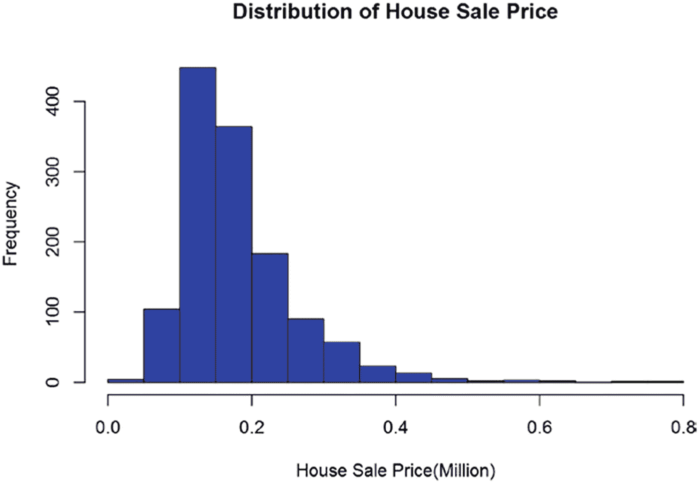

图 7-1

房屋销售价格分布

```
dim(Data_House_Price)
[1] 1300   14
检查因变量（房屋价格）的分布。我们绘制一个
直方图来查看房屋价格在数据集中的分布情况。
hist(Data_House_Price$HousePrice/1000000, breaks=20, col="blue", xlab="房屋
销售价格（百万）",
main="房屋销售价格分布")
```

这里，我们调用 `summary()` 函数来查看 `HousePrice` 数据的基本属性。输出结果给出了最小值、第一四分位数、中位数、均值、第三四分位数和最大值。

```
#同时查看因变量的摘要
summary(Data_House_Price$HousePrice)
最小值 第一四分位数 中位数 均值 第三四分位数 最大值
34900  129800  163000  181500  214000  755000
#提取相关列并在数据集中分配所需字段
Data_House_Price <-Data_House_Price[,.(HOUSE_ID,HousePrice,StoreArea,StreetH
ouseFront,BasementArea,LawnArea,Rating,SaleType)]
```

以下代码片段从数据集中移除缺失值。这对于确保数据在整个过程中保持一致非常重要。

```
#忽略任何缺失值
Data_House_Price <-na.omit(Data_House_Price)
Data_House_Price$HOUSE_ID <-as.character(Data_House_Price$HOUSE_ID)
```

这些统计信息让我们对房屋价格在数据集中的分布有了一些了解。平均销售价格为 181,500 美元，最高销售价格为 755,000 美元。

### 7.1.2 购买偏好

该数据包含购买了特定产品的客户的交易历史。对于每个 `customer_ID`，模拟了多个数据点来捕捉购买行为。该数据最初是为解决保险行业中四种可能产品的多类问题而设置的。这里，我们展示了购买预测数据的摘要。

```
Data_Purchase 
```

此数据输出显示了购买预测数据中变量的混合情况。请仔细查看此数据集中的因变量 `PurchaseChoice`，它是以整数形式加载的。我们必须确保在将其用于建模之前将其转换为因子类型。

与连续因变量类似，我们将从购买预测数据中为离散情况创建因变量。为简单易懂，我们仅将产品偏好 `ProductChoice` 作为具有四个级别（即 1、2、3 和 4）的因变量。见图 7-2。

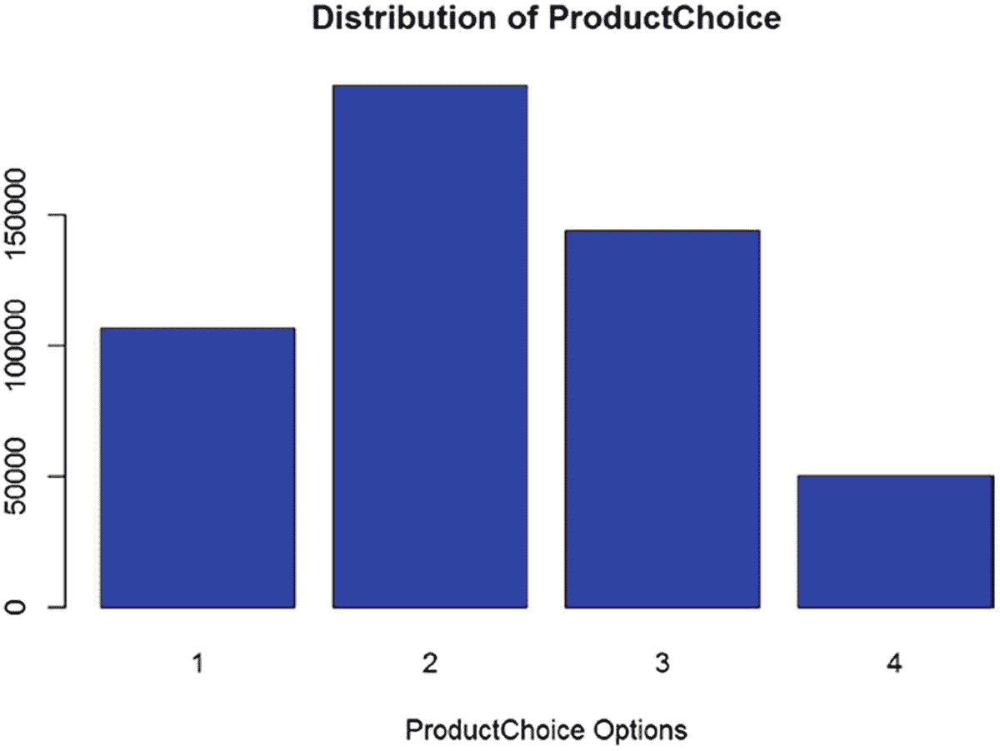

图 7-2

产品选择选项的分布

```
dim(Data_Purchase);
[1] 500000     12
#在分组前检查数据分布
table(Data_Purchase$ProductChoice)
1      2      3      4
106603 199286 143893  50218
下面的条形图显示了 ProductChoice 的分布。数量最多的是
ProductChoice = 2，其次是 3，然后是 1 和 4。
barplot(table(Data_Purchase$ProductChoice),main="ProductChoice 分布", xlab="ProductChoice 选项", col="蓝色")
```

在以下代码中，我们对数据进行子集化，仅选择本章将使用的列。同时，我们移除所有缺失值 (NA)，以保持不同选项之间的数据一致性。

```
#仅提取与本章相关的数据
Data_Purchase  <- Data_Purchase[,.(CUSTOMER_ID,ProductChoice,MembershipPoints,
IncomeClass,CustomerPropensity,LastPurchaseDuration)]
#从子集中删除 NA
Data_Purchase <-na.omit(Data_Purchase)
Data_Purchase$CUSTOMER_ID <-as.character(Data_Purchase$CUSTOMER_ID)
```

这个数据子集将在本章中用于解释各种概念。

## 7.2 模型性能与评估简介

模型性能与评估是在你开发完模型并希望了解模型在测试数据/验证数据上的表现时进行的。在开始模型开发之前，你通常会将数据分为三类：

*   *训练数据*：该数据集用于训练模型/机器。在此阶段，机器学习算法的重点是优化一些能反映模型拟合度的明确定义的指标。例如，在普通最小二乘法中，我们将使用训练数据通过最小化平方误差来训练线性回归模型。

*   *测试数据*：测试数据集包含机器学习算法从未见过的数据点。我们应用该数据集来查看模型在新数据上的表现。大多数模型性能与评估都是在这一步计算并对照阈值进行评价的。在此，建模者可以决定模型是否需要改进，并据此进行修改和调整。

*   *验证数据*：在许多情况下，由于多种原因（例如数据有限、时间周期短、测试集较大等），建模者不会保留该数据集。本质上，该数据集的目的是检查模型的过拟合情况，并为校准需求提供见解。一旦建模者认为机器学习模型在测试数据上表现良好并开始使用验证数据，就不能再回头修改模型。他们只能尝试校准模型并检查过拟合。如果模型未能达到标准，我们只能放弃该模型并重新开始整个过程。

根据问题和其他统计约束，将决定这些数据集的比例。通常，对于足够大的数据，我们可能会对训练、测试和验证数据集采用 60:20:20 的比例。

模型性能使用测试数据进行衡量，建模者决定哪些阈值是可接受的以验证模型。性能指标通常基于模型拟合的基本标准生成，即模型输出与实际值之间的差异程度。实际值与预测值之间的这种误差，就是为获得良好性能而应最小化的误差。

在本节范围内，我们将讨论如何对两种类型的模型输出（预测变量）使用一些常用的性能和评估指标：

*   *连续输出*：针对模型中的连续因变量给出连续预测值的模型或模型系列。例如，房价是连续的，当使用模型进行预测时，会给出连续的预测值。

*   *离散输出*：针对模型中的离散因变量给出离散预测值的模型或模型系列。例如，对于信用卡申请，借款人的风险等级在用于分类预测模型时，会给出一个离散的预测值（即预测的风险等级）。

我们可以根据其他复杂的建模技术以及我们想要如何评估它们来扩展这个列表。例如，考虑一个逻辑模型；因变量是一个二项分布变量，但输出是在概率尺度上（0 到 1）。根据业务的最终目的，我们必须决定评估什么以及在过程的哪个步骤进行评估。为了完整性，你可以使用一致-不一致比率来评估模型在 0 和 1 之间的区分能力。一致-不一致比率在第 [6](http://dx.doi.org/10.1007/978-1-4842-4215-5_6) 章中讨论。鼓励你深入研究模型性能度量概念的统计基础。

## 7.3 模型性能评估的目标

业务利益相关者在定义性能指标方面扮演着重要角色。模型对业务的成本有直接影响。简单地最小化一个复杂的统计度量并不总是对业务最有利的模型。为了说明，假设一个用于新申请者信用评分的信用风险模型。其中一些输入变量是内部的，另一些是从外部来源购买的。通过使用来自多个方的外部数据，模型表现非常好，但这需要成本。在这种情况下，仅仅拥有一个分类误差最小的模型是不够的；模型输出还应对业务具有经济意义。

通常，我们可以将模型性能和评估关注点的目的分为三类。这三类是使用统计方法及其解释的通用框架的一部分。

*   *准确性*：模型的准确性反映了正确预测的比例——在连续情况下，是残差最小；在离散情况下，是正确分类预测。连续情况下的最小残差或离散情况下的少量错误分类意味着更高的准确性和更好的模型。

*   *增益*：增益统计量让我们了解模型本身的性能。该方法适用于不同的建模技术，并且非常直观。它将模型输出与不使用模型（或随机模型）得到的结果进行比较。因此，本质上，它会告诉你与产生随机结果的随机模型相比，你的模型有多好。在比较两个模型时，在指定百分位数上具有更高增益统计量的模型更受青睐。

*   *认证*：模型认证反映了模型实际使用的可信度。该方法确保应用模型的数据与训练数据相似。群体稳定性指数是在使用模型前确保认证的衡量指标之一。群体稳定性指数是一个用于确定模型训练数据集是否与使用模型的数据相似，或者群体相对于模型中使用的特征是否稳定的度量。该指数值从 0 到 1 不等，高值表示两个数据集中的预测变量之间具有更大的相似性。稳定的群体确认了模型可用于预测。

关于群体稳定性指数的更多细节见第 7.4 节。

这类场景在实际应用中比比皆是。在本书中，我们将讨论用于评估模型性能的基本统计方法。我们还将探讨思考模型性能的直观方式。直观的思考方式有助于在衡量模型性能时创建新的误差度量并增加业务背景。

## 7.4 群体稳定性指数

模型开发者在不同数据集上测试模型性能时，很少会忽略群体稳定性。其核心理念是确保测试数据集与训练数据集保持一致。如果两者一致，那么在此数据上测试的模型性能将为你提供模型表现如何的洞察；否则，你的模型性能结果将毫无用处。

举个例子。你使用 2000 年至 2009 年的数据集开发了一个预测美国消费者平均收入的模型。你通过 2000 年至 2007 年的数据集训练模型，并保留最后两年用于测试模型。测试结果会怎样？训练出的模型可能是最佳模型，但测试结果中的模型性能仍然很差。为什么？因为训练集和测试集之间的群体特征发生了变化。美国经济在 2007 年第四季度至 2008 年第四季度经历了一次严重衰退。用统计术语来说，这两个时期的基础群体并不稳定。

在时间序列数据中，群体稳定性非常重要，需要持续跟踪群体的潜在变化，以确保模型保持相关性。金融服务行业长期以来一直使用这一指标，以确保金融模型与市场保持相关。

让我们用连续分布来阐述群体稳定性的概念。我们将群体数据分为两部分，例如 `set_1` 和 `set_2`。在机器学习性能测试中，可以将 `set_1` 视为训练数据，`set_2` 视为测试数据。

### 注意

当因变量和自变量的基础关系结构受到外部未知因素影响时，群体稳定性的概念非常重要。

```
#创建 set_1 和 set_2：前 2/3 作为 set_1，剩余 1/3 作为 set_2
summary(Data_House_Price$HousePrice)
Min. 1st Qu.  Median    Mean 3rd Qu.    Max.
34900  127500  159000  181300  213200  755000
set_1 <-Data_House_Price[1:floor(nrow(Data_House_Price)*(2/3)),]$HousePrice
summary(set_1)
Min. 1st Qu.  Median    Mean 3rd Qu.    Max.
34900  128800  160000  180800  208900  755000
set_2 <-Data_House_Price[floor(nrow(Data_House_Price)*(2/3) +1):nrow(Data_
House_Price),]$HousePrice
summary(set_2)
Min. 1st Qu.  Median   Mean 3rd Qu.    Max.
52500  127000  155000 182200  221000  745000
```

对于连续情况，我们可以使用双样本科尔莫戈罗夫-斯米尔诺夫检验（KS 检验）来检查稳定性。KS 检验是一种非参数检验，用于比较两个样本的累积分布。

对于 n 个独立同分布观测值 Xi，经验分布函数 Fn 定义为：

![$$ {F}_n(x)=\frac{1}{n}\kern0.125em \sum \limits_{i=1}^n{I}_{\left[-\infty, x\right]}\kern0.125em \left({X}_i\right) $$](images/416805_2_En_7_Chapter/416805_2_En_7_Chapter_TeX_Equa.png)

其中 *I*[[-∞, x ]]( *X*[i]) 是指示函数，如果 *X*[i] ≤ *x* 则等于 1，否则等于 0。

对于给定的累积分布函数 F(x)，科尔莫戈罗夫-斯米尔诺夫统计量为：

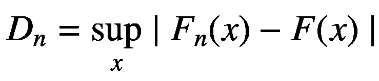

其中 *sup x* 是距离集合的最大值。

本质上，KS 统计量会获取两个样本经验分布比较中的最大差异点，如果该值过高，我们就认为这两个样本不同。就群体稳定性而言，这意味着你的模型性能无法在新样本上进行衡量，并且基础样本并非来自模型训练时所使用的同一分布。

以下代码首先定义了一个函数 `ks_test()`，该函数绘制经验累积分布函数（ECDF）并显示 KS 检验结果。

```
#定义一个函数，用于给出 KS 检验结果并在对数尺度上绘制 ECDF 图
library(rgr)
ks_test <-function (xx1, xx2, xlab ="House Price", x1lab
=deparse(substitute(xx1)),x2lab =deparse(substitute(xx2)), ylab ="Empirical
Cumulative Distribution Function",log =TRUE, main ="Empirical EDF Plots -
K-S Test", pch1 =3, col1 =2, pch2 =4, col2 =4, cex =0.8, cexp =0.9, ...)
{
temp.x <-remove.na(xx1)
x1 <-sort(temp.x$x[1:temp.x$n])
nx1 <-temp.x$n
y1 <-((1:nx1) -0.5)/nx1
temp.x <-remove.na(xx2)
x2 <-sort(temp.x$x[1:temp.x$n])
nx2 <-temp.x$n
y2 <-((1:nx2) -0.5)/nx2
xlim <-range(c(x1, x2))
if (log) {
logx <- "x"
if (xlim[1] <=0)
stop("\n Values cannot be .le. zero for a log plot\n")
}
else logx <- ""
plot(x1, y1, log = logx, xlim = xlim, xlab = xlab, ylab = ylab,
main = main, type ="n", ...)
points(x1, y1, pch = pch1, col = col1, cex = cexp)
points(x2, y2, pch = pch2, col = col2, cex = cexp)
temp <-ks.test(x1, x2)
print(temp)
}
```

这里，我们调用自定义函数，该函数对 `set_1` 和 `set_2` 执行 KS 检验，并显示经验累积分布图（ECDF）——见图 7-3：

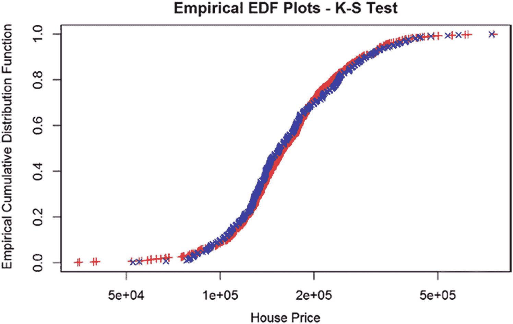

图 7-3

Set_1 和 Set_2 的 ECDF 图

```
#对 set_1 和 set_2 执行 K-S 检验，并显示经验累积分布图
ks_test(set_1,set_2)
```

这里，我们展示 KS 检验的假设检验结果。这是针对两个分布是否来自同一基础分布这一假设的科尔莫戈罗夫-斯米尔诺夫检验。

```
双样本科尔莫戈罗夫-斯米尔诺夫检验
数据: x1 和 x2
D = 0.050684, p 值 = 0.5744
备择假设: 双尾
```

如您所见，p 值大于 0.05，因此我们无法拒绝原假设。这样我们就可以继续进行，在测试数据上检验模型性能。此外，观察经验累积分布函数（ECDF）图，我们可以看到两个样本的 ECDF 看起来相同，因此它们来自同一个总体分布。

当总体变得不稳定时，结果会如何？让我们操作一下 `set_2` 来展示这种情况。

假设 `set_2` 受到了一项新法规的影响，该法规规定 `set_2` 中的房屋需由地方机构征收额外税款，因此房价上涨了。我们面临的问题是，现有的模型在这个新数据集上还能表现良好吗？

```
#操作 set 2
set_2_new <-set_2*exp(set_2/100000)

# 现在再次进行 K-S 检验
ks_test(set_1,set_2_new)
```

现在，让我们再次绘制 `set_1` 和 `set_2` 的 ECDF 图，看看它们对比起来如何（见图 7-4）。

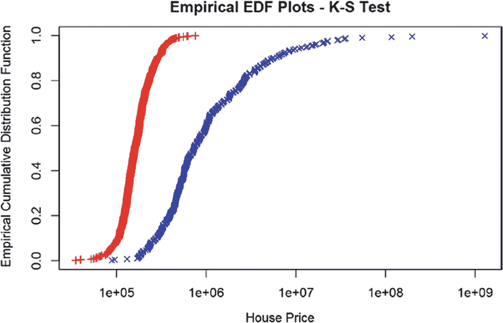

图 7-4

Set_1 和 Set_2（经操作后）的 ECDF 图

我们再次执行 KS 检验来检查假设结果。

```
Two-sample Kolmogorov-Smirnov test
data:  x1 and x2
D = 0.79957, p-value < 2.2e-16
alternative hypothesis: two-sided
```

KS 检验的 p 值小于 0.05，因此检验拒绝了两个样本来自同一总体的原假设。从视觉上看，ECDF 图彼此差异很大。因此，该模型不能用于新的数据集，尽管该数据集具有相同的模式（schema）和业务来源。

我们可以快速展示如何对 `ProductChoice` 的购买预测这一离散情况进行总体稳定性检验。该检验通过计算统计量——总体稳定性指数（PSI）来完成，其定义如下：

PSI=∑((n1i/N1)−(n2i/N2))*ln((n1i/N1)/(n2i/N2))

其中 *n1i, n2i* 是总体 1 和总体 2 中第 i 个分箱的观测值数量，N1, N2 是总体 1 和总体 2 的总观测值数量。

由于离散情况下的总体稳定性指数不服从某种分布，因此我们使用阈值。作为经验法则，低于阈值的值可用于解释总体稳定性指数：

*   PSI < 0.1 表示总体变化极小。

*   PSI 在 0.1 到 0.2 之间表示需要进一步调查的变化。

*   PSI > 0.2 表示总体发生了显著变化。

以下代码片段使用此公式计算总体稳定性指数。

```
#让我们从购买预测数据中创建 set 1 和 set 2
print("分区前 ProductChoice 值的分布")
[1] "分区前 ProductChoice 值的分布"
table(Data_Purchase$ProductChoice)
1      2      3      4
104619 189351 142504  49470
set_1 <-Data_Purchase[1:floor(nrow(Data_Purchase)*(2/3)),]$ProductChoice
table(set_1)
set_1
1      2       3       4
69402 126391   95157   33012
set_2 <-Data_Purchase[floor(nrow(Data_Purchase)*(2/3) +1):nrow(Data_
Purchase),]$ProductChoice
table(set_2)
set_2
1      2       3       4
35217  62960   47347   16458
```

现在，我们将 `set_1` 视为总体 1，`set_2` 视为总体 2，并计算 PSI。可以使用不同参数重复类似练习，以查看总体相对于其他离散分布是否保持稳定。

```
#PSI=Summation((n1i/N1)(n2i/N2))ln((n1i/N1)/(n2i/N2))
temp1 =0.1 & psi <=0.2) {
cat("该总体需要进一步调查，PSI 为      "  ,psi)
} else {
cat("该总体经历了显著变化，PSI 为   " ,psi)
}
该总体是稳定的，PSI 为 0.002147654
```

正如您从这些示例中观察到的，我们本质上是在比较两个分布，并确保分布相似。这个检验有助于我们确定模型在新数据上的可信度。

## 7.5 连续输出的模型评估

因变量的分布是选择模型评估方法时的一个重要考虑因素。直观上，我们最终会将残差分布（实际值与预测值之差）与正态分布（即随机噪声）或基于所选指标的其他分布进行比较。

本节专门讨论残差为连续尺度的情况。在本章范围内，我们将重点关注线性回归模型并计算一些基本指标。这些指标各有优缺点，我们将尝试从业务解释的角度关注其中一些指标。

让我们在房价数据上拟合一个线性回归模型，变量通过前向选择法进行子集选择。然后，使用此模型，我们将展示不同的模型性能指标。

```

# 在 Set 1 = 训练数据上创建模型
linear_reg_model |t|)
(Intercept)            -8.003e+04 3.262e+04  -2.454 0.014387 *
StoreArea               5.817e+01 9.851e+00   5.905 5.48e-09 ***
StreetHouseFront        1.370e+02 8.083e+01   1.695 0.090578 .
BasementArea            2.362e+01 3.722e+00   6.346 3.96e-10 ***
LawnArea                7.746e-01 1.987e-01   3.897 0.000107 ***
Rating                  3.540e+04 1.519e+03  23.300  < 2e-16 ***
SaleTypeFirstResale     1.012e+04 3.250e+04   0.311 0.755651
SaleTypeFourthResale   -3.221e+04 3.678e+04  -0.876 0.381511
SaleTypeNewHouse       -1.298e+04 3.190e+04  -0.407 0.684268
SaleTypeSecondResale   -2.456e+04 3.248e+04  -0.756 0.449750
SaleTypeThirdResale    -2.256e+04 3.485e+04  -0.647 0.517536

Signif. codes:  0 '***'   0.001 '**' 0.01 '*' 0.05 '.' 0.1 ' ' 1
残差标准误：44860，自由度：701
多重 R 方：0.7155，调整后 R 方：0.7115
F 统计量：176.3，分子自由度：10，分母自由度：701，p 值：< 2.2e-16
```

模型摘要显示了几点信息：

*   拟合模型的多重 R 方为 71.5%，这是一个拟合良好的模型。

*   `SaleType` 变量在所有水平上都不显著（但我们将其保留在模型中，因为我们相信它是 `HousePrice` 的一个重要元素）。

*   整体显著性检验的 F 检验 p 值小于 0.05，因此我们可以拒绝原假设，并得出结论：该模型比仅含截距的模型拟合得更好。

现在，我们将继续讨论连续因变量的性能度量指标。

### 7.5.1 平均绝对误差

平均绝对误差（MAD）是用于评估模型的最基本误差指标之一。MAD 直接源于残差的一阶范数，即绝对误差的平均值。

在统计学中，平均绝对误差是绝对误差的平均值

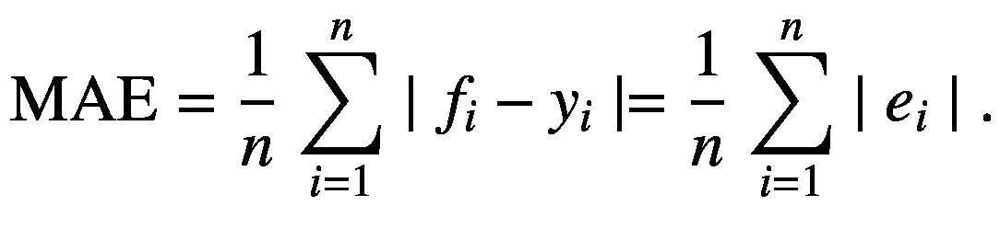

其中 *f*[*i*] 是预测值，*y*[*i*] 是真实值。

还有其他类似的度量指标，如平均绝对缩放误差（MASE）和平均绝对百分比误差（MAPE）。在所有这些度量中，性能总结的方式是同等对待低估和高估，而忽略平均符号差异。这是一个特定的缺点，因为它忽略了对高估或低估的考量。在业务问题中，我们通常可以接受一个方向的误差，但不能接受另一个方向。例如，计算信用卡的信用损失。如果业务高估了损失，从而多预留一些准备金，这是可以接受的。然而，另一个方向则代价高昂，在极端情况下可能引发破产。

```
#创建测试数据，即数据集 2
test <-Data_House_Price[floor(nrow(Data_House_Price)*(2/3) +1):nrow(Data_
House_Price),]
#在此数据上拟合线性回归模型并获取预测值
predicted_lm <-predict(linear_reg_model,test, type="response")
actual_predicted <-as.data.frame(cbind(as.numeric(test$HOUSE_ID),as.
numeric(test$HousePrice),as.numeric(predicted_lm)))
names(actual_predicted) <-c("HOUSE_ID","Actual","Predicted")
#计算绝对残差，然后取其平均值
library(ggplot2)
#绘制测试用例的实际值与预测值对比图
ggplot(actual_predicted,aes(x = actual_predicted$HOUSE_ID,color=Series)) +
geom_line(data = actual_predicted, aes(x = actual_predicted$HOUSE_ID,
y =Actual, color ="Actual")) +
geom_line(data = actual_predicted, aes(x = actual_predicted$HOUSE_ID, y =
Predicted, color ="Predicted")) +xlab('HOUSE_ID') +ylab('House Sale Price')
```

从图 7-5 中可以清楚地看到，实际值非常接近预测值。现在让我们看看我们的模型在均方误差指标上的表现如何。

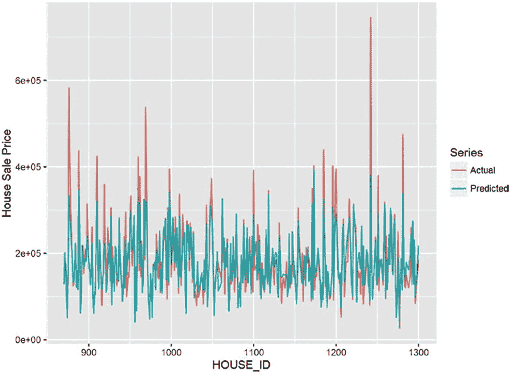

图 7-5

实际值与预测值对比图

```
#从测试数据中移除 NA 值，因为我们没有对 NA 进行任何处理
actual_predicted <-na.omit(actual_predicted)
#首先计算实际值减去预测值，然后取绝对误差（残差）的平均值
mae <-sum(abs(actual_predicted$Actual -actual_predicted$Predicted))/nrow(ac
tual_predicted)
cat("测试用例的平均绝对误差为  ", mae)
测试用例的平均绝对误差为   29570.3
```

MAE 表明平均误差为 29,570 美元。这相当于说，在美元尺度上，对于平均值为 180,921 美元的情况，预期误差为 17%。

该指标也可用于拟合线性模型。正如最小二乘法与均方误差相关一样，平均绝对误差与最小绝对偏差相关。

### 7.5.2 均方根误差

均方根误差（RMSE）是用于评估连续误差模型最流行的指标之一。顾名思义，它是均方误差的平方根。该指标最重要的特点是，通过平方的方式对误差进行加权。

例如，假设预测值为 5.5，而实际值为 4.1。那么误差为 1.4 (5.5 - 4.1)。该误差的平方为 1.4 x 1.4 = 1.96。假设另一种情况，预测值为 6.5，那么误差为 2.4 (6.5 - 4.1)，误差的平方为 2.4 x 2.4 = 5.76。如您所见，虽然误差仅变化了 2.4/1.4 = 1.7 倍，但平方误差却变化了 5.76/1.96 = 2.93 倍。因此，RMSE 对远离的误差惩罚比邻近的误差更严厉。

对于回归因变量 *y*[*t*] 在时间 t 的预测值 *ŷ*[*t*]，其 RMSE 是针对 *n* 个不同预测值计算的，即偏差平方的平均值的平方根：

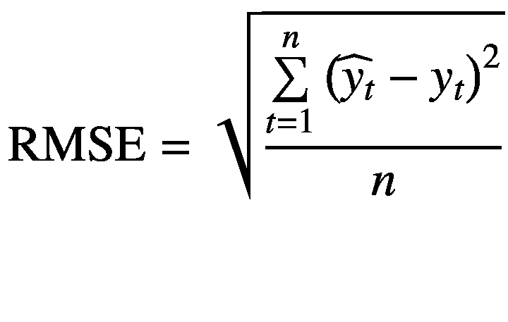

理解指标中的运算如何改变其解释方式非常重要。假设我们的因变量是房价，以美元数值表示。让我们看看指标维度如何演变以解释该度量。

预测值和实际值都以美元为单位，因此它们的差值（误差）也以美元为单位。然后对误差进行平方，维度变为美元的平方。您不能将美元的平方值与美元值进行比较。因此，我们对其开平方根，将维度恢复为美元，现在可以用美元来解释 RMSE。需要注意的是，通常用于模型比较的指标是无量纲的，但对于模型本身，我们更倾向于使用具有某种维度的指标，以便为指标提供业务背景。

```
#由于我们已经有了实际值和预测值，可以直接计算 RMSE 值
rmse <-sqrt(sum((actual_predicted$Actual-
actual_predicted$Predicted)²)/nrow(actual_predicted))
cat("测试用例的均方根误差为  ", rmse)
测试用例的均方根误差为   44459.42
```

现在您可以看到误差已放大至 44,459 美元。这是因为我们通过平方误差的方式惩罚了模型的远距离预测。

如前所述，如果您想使用一个指标来比较不同尺度的数据集或模型，则需要将该指标转化为无量纲形式。我们可以通过归一化 RMSE 来实现这一点。最常见的方法是将 RMSE 除以范围或均值：

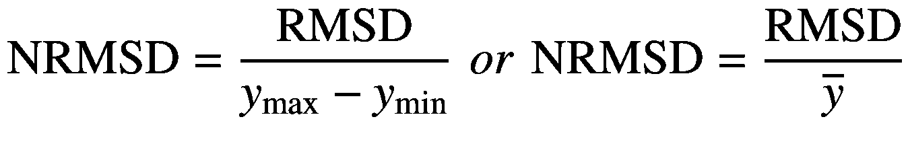

该值称为归一化均方根偏差或误差（NRMSD 或 NRMSE），通常以百分比表示。较低的值表示残差方差较小，因此是一个好模型。

### 7.5.3 R 方

R 方是一种常用于基于线性回归技术的流行度量指标。统计学家对 R 方的恰当术语是决定系数。决定系数指示了因变量 (y) 与一组自变量 (x) 之间的关系。在数学形式上，它是残差平方和与总平方和之比。再次注意，该度量也源于使用实际值和预测值的残差（误差指标）。在此，我们解释 *R*^(*2*) 指标如何为模型计算，以及我们如何解释该指标。

### 注意

大写 *R*² 和小写 *r*² 常被混用，但它们并不相同。*R*² 是多元回归模型中的多重 *R*²。在双变量线性回归中，不存在多重 *R*，此时 *R*² = *r*²。因此，关键区别在于术语（或符号）的适用性：多重 *R* 意味着多个回归变量，而 *R*² 则不然。

一个数据集包含 *n* 个值，记为 *y1…yn*（统称为 *yi* 或向量 y = [y1…yn]），每个值对应一个预测（或建模）值 *f1…fn*（称为 *fi*，有时记为 ŷi，作为向量 f）。

残差（预测误差）定义为 ei = yi - fi（构成向量 e）。

如果 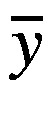 是观测数据的均值 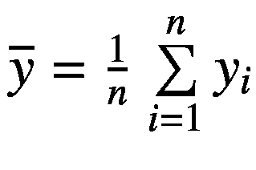，则数据集的变异性可通过以下三个平方和公式来衡量：

*   总平方和（与数据方差成正比）：

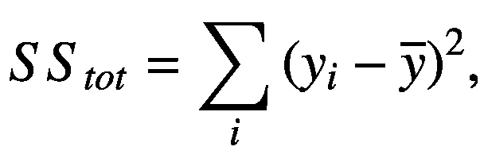

*   回归平方和，也称为可解释平方和：

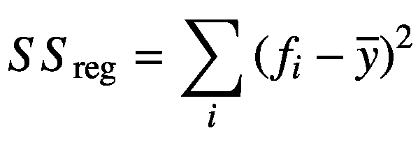

*   残差平方和，也称为剩余平方和：

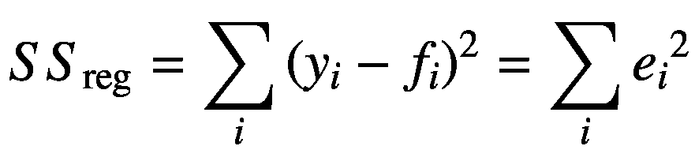

*   决定系数或 *r*² 的通用定义是：

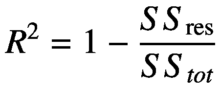

在图 7-6 中，我们可以看到平方和的解释，以及它们如何共同构成决定系数的定义。

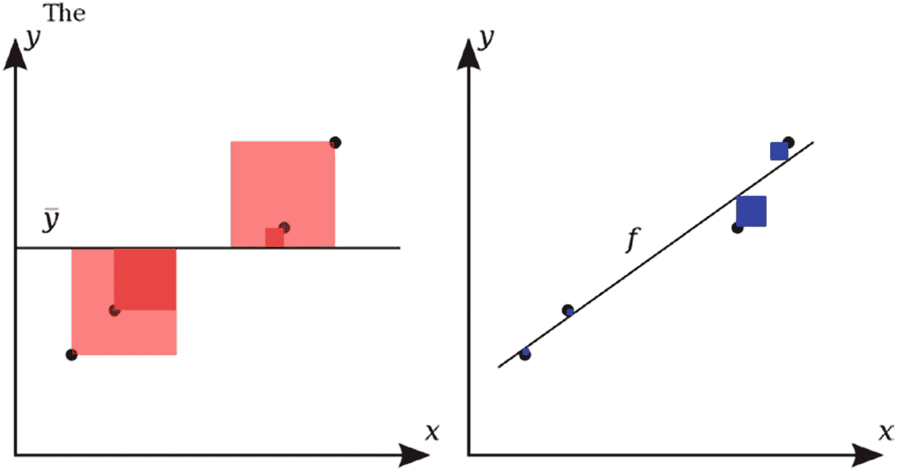

图 7-6

解释平方误差的图片（取自 [*https://en.wikipedia.org/wiki/Coefficient_of_determination*](https://en.wikipedia.org/wiki/Coefficient_of_determination)）

*R*² = 1 - 蓝色/红色

这些小方块代表相对于线性回归的平方残差。大方块的面积代表相对于平均值的平方残差。

左侧的线性回归与简单平均值相比更能拟合数据，而右侧则拟合数据的实际值。*R*² 是两者之间的比率，表明如果你使用此模型而不是简单平均值，你能多解释多少变异。毋庸置疑，完美值 1 意味着所有变异都被模型解释了。

由于 *R*² 是一个比例，它始终是介于 0 和 1 之间的数字。

*   如果 R² = 1，所有数据点都完美落在回归线上（即预测变量 x 解释了 y 的所有变异）
*   如果 R² = 0，估计的回归线完全水平（即预测变量 x 没有解释 y 的任何变异）
*   如果 R² 介于 0 和 1 之间，它解释了 y 的方差（使用模型比不使用模型更好）

尽管 R 平方是所有标准线性回归包的默认输出，但我们也会向您展示其计算过程。您还需要了解的另一个术语是调整后的 R 平方。它对模型中预测变量的数量进行了修正。换句话说，它考虑了因预测变量过多而导致的模型过拟合问题，并且只有当新项对模型的改进程度超过随机预期时，它才会增加。

```
#模型训练数据（我们将在此数据集上进行分析）
train <-Data_House_Price[1:floor(nrow(Data_House_Price)*(2/3)),.(HousePrice
,StoreArea,StreetHouseFront,BasementArea,LawnArea,StreetHouseFront,LawnArea
,Rating,SaleType)];
#从数据集中移除 NA 值
train <-na.omit(train)
#获取线性回归模型
linear_reg_model <-lm(HousePrice ~StoreArea +StreetHouseFront +BasementArea
+LawnArea +StreetHouseFront +LawnArea +Rating +SaleType ,data=train)
#显示函数调用以识别我们将要处理的模型
print(linear_reg_model$call)
lm(formula = HousePrice ~ StoreArea + StreetHouseFront + BasementArea +
LawnArea + StreetHouseFront + LawnArea + Rating + SaleType,
data = train)
#系统生成的 R 平方值
cat("系统生成的 R 平方值为 " , summary(linear_reg_model)$r.squared)
系统生成的 R 平方值为  0.7155461
```

您可以看到默认模型输出为我们计算了 R 平方。当前线性模型的 R 平方为 0.72。这可以解释为房价变异的 72% 被预测变量 `StoreArea`、`StreetHouseFront`、`BasementArea`、`LawnArea`、`StreetHouseFront`、`LawnArea`、`Rating` 和 `SaleType` 的变异所“解释”。

在这里，我们逐步计算该度量，以得到相同的 R 平方值。

```
#计算总平方和
SST <-sum((train$HousePrice -mean(train$HousePrice))²);
#计算回归平方和
SSR <-sum((linear_reg_model$fitted.values -mean(train$HousePrice))²);
#计算残差（误差）平方和
SSE <-sum((train$HousePrice -linear_reg_model$fitted.values)²);
```

这三个平方和之间的一个重要关系是：

```
SST = SSR + SSE
```

您可以自行验证这一点。现在我们将使用这些值来计算 R 平方模型评估：我们模型的 R 平方：

```
#计算 R 平方
R_Sqr <-1-(SSE/SST)
#显示计算出的 R 平方
cat("计算出的 R 平方为  ", R_Sqr)
计算出的 R 平方为   0.7155461
```

您可以看到计算出的 R 平方与 `lm()` 函数的输出相同。现在您已经了解了 R 平方背后的计算过程。

在本节中，您了解了一些围绕误差（残差）创建的基本度量指标，并将它们解释为衡量模型在实际数据上表现如何的指标。在下一节中，我们将介绍针对离散情况的技术。

## 7.6 离散输出的模型评估

在上一节中，我们介绍了针对因变量和预测值均为连续类型的模型的度量指标。在本节中，我们将介绍一些针对分布为离散情况的度量指标。

在本节中，我们将回到我们的购买预测数据，生成这些度量指标并讨论其解释。我们将利用之前为群体稳定性创建的设置。

### 7.6.1 分类矩阵

分类矩阵是查看分类器性能最直观的方式。有时也称为混淆矩阵。从视觉上看，这是一个双向矩阵，一个轴显示实际类别的分布，另一个轴显示预测类别（见图 7-7）。

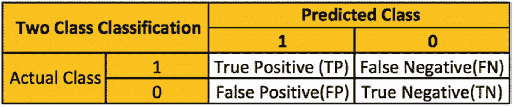

图 7-7

二分类分类矩阵

模型的准确率通过分类矩阵的对角线元素计算，因为它们代表了分类器的正确分类，即实际值和预测值相同。

```
分类率 = (真正例 + 真负例) / 总样本数
```

现在我们将向您展示分类矩阵，并为我们的购买预测数据计算分类率。我们用于建模概率的方法是多项逻辑回归，分类器将选择概率最高的类别。

### 注意

为避免类别不平衡问题，我们将采用分层抽样来创建大小相等的类别，以说明模型性能概念。类别不平衡问题会导致概率偏向高频类别，从而使分类器无法将类别分配给低频类别。

```
#移除含有缺失值的数据。建模算法会忽略缺失值
Data_Purchase<-na.omit(Data_Purchase)
#从 Data_Purchase 中抽取等量样本以减少类别不平衡问题
library(splitstackshape)
Data_Purchase_Model<-stratified(Data_Purchase, group=c("ProductChoice"),size
=10000,replace=FALSE)
print("等量类别的分布如下")
[1] "等量类别的分布如下"
table(Data_Purchase_Model$ProductChoice)
1     2     3     4
10000 10000 10000 10000
在训练数据（Set_1）上构建多项模型，然后测试数据（Set_2）将用于性能测试
set.seed(917);
train <-Data_Purchase_Model[sample(nrow(Data_Purchase_Model),size=nrow(Data_Purchase_Model)*(0.7), replace =TRUE, prob =NULL),]
dim(train)
[1] 28000     6
test <-Data_Purchase_Model[!(Data_Purchase_Model$CUSTOMER_ID
%in%train$CUSTOMER_ID),]
dim(test)
[1] 20002     6
拟合多项逻辑回归模型
library(nnet)
mnl_model <-multinom (ProductChoice ~MembershipPoints +IncomeClass
+CustomerPropensity +LastPurchaseDuration, data = train)

# 权重：68 (48 个变量)
初始值 38816.242111
迭代 10 值 37672.163254
迭代 20 值 37574.198380
迭代 30 值 37413.360061
迭代 40 值 37327.695046
迭代 50 值 37263.280870
迭代 60 值 37261.603993
最终值 37261.599306
已收敛
显示模型统计摘要
mnl_model
调用:
multinom(formula = ProductChoice ~ MembershipPoints + IncomeClass +
CustomerPropensity + LastPurchaseDuration, data = train)
系数:
(Intercept) MembershipPoints IncomeClass1 IncomeClass2 IncomeClass3
2   11.682714      -0.03332131  -11.4405637   -11.314417   -11.307691
3   -1.967090       0.02730530    0.9855891     1.644233     2.224430
4   -1.618001      -0.12008110    1.5710959     1.692566     2.062924
IncomeClass4 IncomeClass5 IncomeClass6 IncomeClass7 IncomeClass8
2   -11.547647   -11.465621   -11.447368   -11.388917   -11.367926
3     2.023594     2.119750     2.201136     2.169300     2.241395
4     1.911509     2.062195     2.296741     2.249285     2.509872
IncomeClass9 CustomerPropensityLow CustomerPropensityMedium
2   -12.047828            -0.4106025               -0.2580652
3     1.997350            -0.8727976               -0.5184574
4     2.027252            -0.6549446               -0.5105506
CustomerPropensityUnknown CustomerPropensityVeryHigh
2                -0.5689626                  0.1774420
3                -1.1769285                  0.4646328
4                -1.1494067                  0.5660523
LastPurchaseDuration
2           0.04809274
3           0.05624992
4           0.08436483
残差偏差：74523.2
AIC：74619.2
预测概率
predicted_test <-as.data.frame(predict(mnl_model, newdata = test,
type="probs"))
显示预测概率
head(predicted_test)
1         2         3          4
1 0.3423453 0.2468372 0.2252361 0.18558132
2 0.2599605 0.2755778 0.2546863 0.20977542
3 0.4096704 0.2429370 0.2482094 0.09918326
4 0.2220821 0.2485851 0.3188838 0.21044894
5 0.4163053 0.2689046 0.1763766 0.13841355
6 0.4284514 0.2626000 0.1948703 0.11407836
基于最高概率进行预测
test_result <-apply(predicted_test,1,which.max)
table(test_result)
test_result
1    2    3     4
8928 1265 3879  5930
合并预测值与实际值至同一位置
result <-as.data.frame(cbind(test$ProductChoice,test_result))
colnames(result) <-c("实际类别", "预测类别")
head(result)
实际类别 预测类别
1            1               1
2            1               2
3            1               1
4            1               3
5            1               1
6            1               1
```

现在我们有了实际值与预测值的矩阵，接下来将创建分类矩阵。现在我们将计算分类矩阵的一些关键特征：

*   *案例数量*：测试集中案例的总数或行数（`n`）

*   *类别数量*：进行预测的类别总数（`nc`）

*   *正确分类数量*：分类矩阵对角线元素之和（`diag`）

*   *每个类别的实例数量*：实际值中所有案例的总和（`rowsums`）

*   *每个预测类别的实例数量*：预测值中所有案例的总和（`colsums`）

*   *实际值分布*：行总和除以总数

*   *预测值分布*：`colsums`的总和除以总数

```
创建分类矩阵
cmat <-as.matrix(table(实际值 = result$`实际类别`, 预测值 =
result$`预测类别`))
按顺序计算上述度量指标
n <-sum(cmat) ;
cat("案例数量  ", n);
案例数量   20002
nclass <-nrow(cmat);
cat("类别数量  ", nclass);
类别数量   4
correct_class <-diag(cmat);
cat("正确分类数量  ", correct_class);
正确分类数量   3175 395 1320 2020
rowsums <-apply(cmat, 1, sum);
cat("每个类别的实例数量  ", rowsums);
每个类别的实例数量   4998 4995 5035 4974
colsums <-apply(cmat, 2, sum);
cat("每个预测类别的实例数量  ", colsums);
每个预测类别的实例数量   8928 1265 3879 5930
actual_dist  <-rowsums  /n;
cat("实际值分布  ", actual_dist);
实际值分布   0.249875 0.249725 0.2517248 0.2486751
predict_dist <-colsums /n;
cat("预测值分布  ", predict_dist);
预测值分布   0.4463554 0.06324368 0.1939306 0.2964704
```

这些数量是根据分类矩阵计算得出的。建议您验证这些数字并深入理解这些量。以下是我们的分类器的分类矩阵和分类率：

```
打印分类矩阵 - 基于测试数据
print(cmat)
预测值
实际值    1    2    3    4
1 3175  312  609  902
2 2407  395  825 1368
3 1791  284 1320 1640
4 1555  274 1125 2020
打印分类率
classification_rate <-sum(correct_class)/n;
print(classification_rate)
[1] 0.3454655
```

该分类器的分类率较低。35%的分类率意味着模型在超过 50%的情况下对案例进行了错误分类。建模人员需要深入探究分类器性能低下的原因。原因可能包括预测概率、底层变量的解释力、不平衡类别的抽样，或者仅仅是选取最高概率的方法本身。

这里的模型性能帮助我们判断模型是否真正达到了我们的标准。我们真的能在实际环境中使用它吗？是什么导致了性能低下？这一步对于任何机器学习实践都至关重要。

### 7.6.2 敏感性与特异性

敏感性和特异性分别用于衡量模型在正类和负类上的表现。这些指标能够帮助你了解模型在正类和负类群体中的表现情况。结合分类矩阵，数学符号有助于阐明这些指标：

*   *敏感性*：测试将实际为`True`的类判定为`True`的概率。也称为真正例率（TPR），在模式识别中称为精确率。敏感性可通过分类矩阵计算（见图 7-7）。

    *敏感性，真正例率 = 正确识别的正例数 / 总正例数 = TP/(TP+FN)*

*   *特异性*：测试将实际为`False`的类判定为`False`的概率。也称为真负例率（TNR），在模式识别中称为召回率。特异性可通过分类矩阵计算（见图 7-7）。

    *特异性，真负例率 = 正确拒绝的负例数 / 总负例数 = TN/(TN+FP)*

敏感性和特异性是测试本身的特性，底层群体不会影响结果。对于一个好的模型，我们力求最大化 TPR 和 TNR，而受试者工作特征曲线（ROC）有助于实现这一目标。受试者工作曲线是敏感性与（1-特异性）之间的关系图，该曲线上的最高点提供了能最大化分类率的截断点。我们将在下一节讨论 ROC 曲线，并将其与优化敏感性和特异性联系起来。

### 注意

敏感性和特异性是按类别计算的。对于多类别问题，我们通常会对各类别的指标取平均值，从而为整个模型得到一个单一数值。为便于说明，我们将通过将类别合并为二分类问题来展示分析过程。鼓励读者将此概念扩展到完整模型。

```
分析针对 ProductChoice == 1 进行展示
Actual_Class <-ifelse(result$`Actual Class` ==1,"One","Rest");
Predicted_Class <-ifelse(result$`Predicted Class` ==1, "One", "Rest");
ss_analysis <-as.data.frame(cbind(Actual_Class,Predicted_Class));
为 ProductChoice == 1 创建分类矩阵
cmat_ProductChoice1 <-as.matrix(table(Actual = ss_analysis$Actual_Class,
Predicted = ss_analysis$Predicted_Class));
print(cmat_ProductChoice1)
Predicted
Actual  One Rest
One  3175 1823
Rest 5753 9251
classification_rate_ProductChoice1 <-sum(diag(cmat_ProductChoice1))/n;
cat("ProductChoice 1 的分类率为 ", classification_rate_
ProductChoice1)
ProductChoice 1 的分类率为   0.6212379
计算 TPR 和 TNR
TPR <-cmat_ProductChoice1[1,1]/(cmat_ProductChoice1[1,1] +cmat_
ProductChoice1[1,2]);
cat(" 敏感性或真正例率为 ", TPR);
敏感性或真正例率为  0.6352541
TNR <-cmat_ProductChoice1[2,2]/(cmat_ProductChoice1[2,1] +cmat_
ProductChoice1[2,2])
cat(" 特异性或真负例率为 ", TNR);
特异性或真负例率为  0.6165689
```

结果显示，对于`ProductChoice == 1`，我们的模型能够正确分类总计 63%的案例，其中，它能够从“One”群体中识别出 61%的“One”，并从“Rest”群体中识别出 62%的“Rest”。模型在从群体中预测“Rest”方面表现更好。

### 7.6.3 ROC 曲线下面积

受试者工作特征曲线（ROC）是一种图形化表示，展示了二分类器在分类阈值或截断点变化时的性能。如前一节所述，对于一个好的模型，我们希望最大化两个相互依赖的指标——TPR 和 TNR——而 ROC 曲线将展示这种关系。该曲线通过在不同截断点或阈值设置下绘制真正例率（TPR）与假正例率（FPR）的关系图来生成。

然而，由于我们使用的是多类分类器，我们并未使用截断点进行分类。鼓励读者针对其他 ProductChoices/类别，将多类模型重建为二分类模型（一类与其余类），然后使用 ROCR 包的内置函数。

这里我们展示 ROC 曲线和曲线下面积（AUC）值，假设模型只有两个类别：ProductChoice “One” 和 “Rest”。如果我们仅使用类别“One”/1 的概率，这将为我们提供一系列截断点尺度。请注意，在以下代码中，我们正在重新创建模型，将多类问题转化为二分类问题。本质上，概率尺度的多项分布以总和为 1 的方式在各类别间分配概率，而对于 ROC，我们需要某个类别的全范围概率来调整分类的阈值/截断点值。

为便于说明，我们将使用仅包含两个选择类别（0 或 1）的购买预测数据，定义如下：

*   如果客户从包含四种产品的目录中选择产品 1，则定义为 1；这构成我们的正类
*   如果客户选择除产品 1 以外的任何其他产品，则定义为 0；这构成我们的负类

我们根据此定义创建二元逻辑模型。

```

# 根据上述定义创建变量 Choice_binom
train$ProductChoice_binom |z|)
(Intercept)                -13.360676  71.621773  -0.187    0.852
MembershipPoints             0.038574   0.005830   6.616 3.68e-11 ***
IncomeClass1                12.379912  71.622606   0.173    0.863
IncomeClass2                12.142239  71.622424   0.170    0.865
IncomeClass3                11.881615  71.621801   0.166    0.868
IncomeClass4                12.086976  71.621763   0.169    0.866
IncomeClass5                11.981304  71.621759   0.167    0.867
IncomeClass6                11.874714  71.621761   0.166    0.868
IncomeClass7                11.879708  71.621765   0.166    0.868
IncomeClass8                11.759389  71.621792   0.164    0.870
IncomeClass9                12.214044  71.622000   0.171    0.865
CustomerPropensityLow        0.650186  0.054060   12.027   < 2e-16 ***
CustomerPropensityMedium     0.435307  0.054828    7.939  2.03e-15 ***
CustomerPropensityUnknown    0.952099  0.048078   19.803   < 2e-16 ***
CustomerPropensityVeryHigh  -0.430576  0.065156   -6.608  3.89e-11 ***
LastPurchaseDuration        -0.062538  0.003409  -18.347   < 2e-16 ***

Signif. codes:  0 '***' 0.001 '**' 0.01 '*' 0.05 '.' 0.1 ' ' 1
(Dispersion parameter for binomial family taken to be 1)
Null deviance: 31611  on 27999  degrees of freedom
Residual deviance: 29759  on 27984  degrees of freedom
AIC: 29791
Number of Fisher Scoring iterations: 11
```

我们将使用 R 语言中的 ROCR 库来计算曲线下面积（AUC）并创建受试者工作曲线（ROC）。ROCR 包有助于可视化评分分类器的性能。

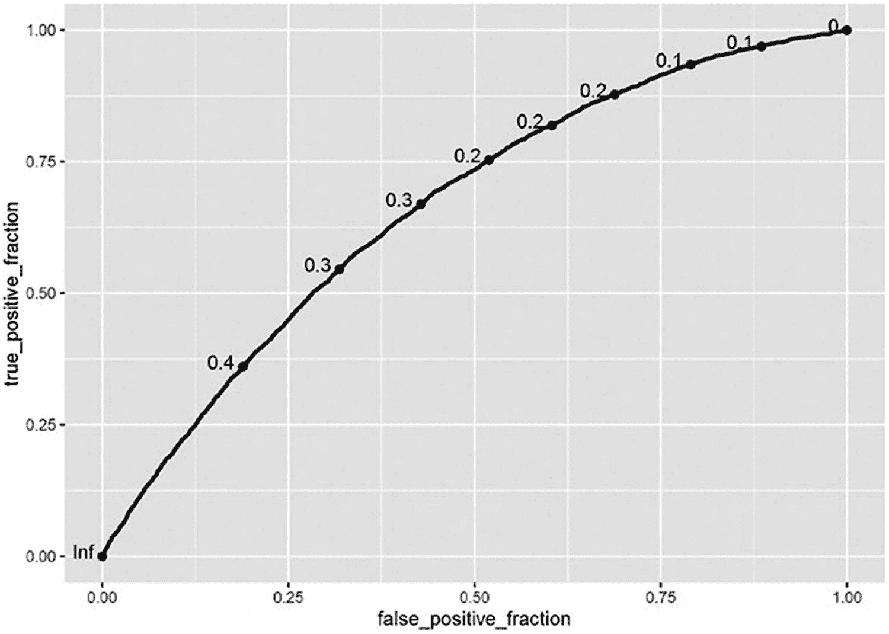

图 7-8

ROC 曲线

```
Now create the performance dataset to create AUC curve
library(ROCR)
test_binom <-predict(glm_ProductChoice_binom,newdata=test, type ="response")
pred <-prediction(test_binom, test$ProductChoice_binom)
perf <-performance(pred,"tpr","fpr")
Calculating AUC
auc <-unlist(slot(performance(pred,"auc"),"y.values"));
cat("The Area Under ROC curve for this model is  ",auc);
The Area Under ROC curve for this model is   0.6699122
Plotting the ROCcurve
library(ggplot2)
library(plotROC)
debug <-as.data.frame(cbind(test_binom,test$ProductChoice_binom))
ggplot(debug, aes(d = V2, m = test_binom)) +geom_roc()
```

我们使用了一个 `ggplot()` 对象和 `plotROC` 库来绘制 ROC 曲线，并在图中高亮显示了截断值，以便于阅读（见图 7-8）。

在图中，我们希望在真正例和假正例之间取得平衡，并最大化真正例的同时最小化假正例。这个点就是你应该用来创建分类器的最佳截断值/阈值。在这里，你可以看到该值接近 0.2——真正例约为 74%，而假正例约为 48%。

第 [6](http://dx.doi.org/10.1007/978-1-4842-4215-5_6) 章讨论了如何使用这个最优值（即 0.2）作为二分类器的截断值。请参考该章关于逻辑回归的讨论。ROCR R 包的详细信息可在 [`https://cran.r-project.org/web/packages/ROCR/ROCR.pdf`](https://cran.r-project.org/web/packages/ROCR/ROCR.pdf) 获取。

## 7.7 概率技术

一般来说，并没有将模型性能技术明确划分为概率技术和其他技术的分类。然而，理解更复杂的方法是如何涌现出来用于模型性能测试的，对你是有帮助的。概率技术是基于抽样和模拟的技术。这些技术与我们之前章节讨论的不同；在之前的章节中，我们利用残差来创建指标。而在概率技术中，我们将通过模拟和抽取子集来获得一个稳健且稳定的模型。

在本节中，我们将从非常高的层面简要介绍两种技术，它们对应于数据科学家可以使用的两大类概率工具，尽管这两种技术都是基于重抽样的：

*   基于模拟：K 折交叉验证
*   基于抽样：Bootstrap 抽样

斯坦福大学的 Ron Kohavi 在其一篇备受赞誉的论文《A Study of Cross-Validation and Bootstrap for Accuracy Estimation and Model Selection》（发表于 *International Joint Conference on Artificial Intelligence* (IJCAI), 1995）中，对这些概念进行了非常透彻的阐述。对此主题感兴趣的读者应阅读这篇论文。在本节中，我们将从在 R 语言中应用这些方法的角度来探讨这些概念。

### 7.7.1 K 折交叉验证

交叉验证是模型评估中最常用的技术之一，并且近来已被认为是一种优于基于残差指标的技术。基于残差方法的问题在于，你需要保留一个测试集，而仅凭一个测试集，它无法准确告诉你模型在未见数据上的表现。因此，尽管训练、测试和验证方法很好，但概率模拟和抽样为我们提供了更多测试模型的方法。

K 折交叉验证在机器学习社区中非常流行。折数越多，解释性越好（回想一下大数定律）。执行 K 折交叉验证的步骤包括：

步骤 1：将数据集划分为 k 个子集。
步骤 2：在 k-1 个子集上训练模型。
步骤 3：在剩余的一个子集上测试模型并计算误差。
步骤 4：重复步骤 1-3，直到所有子集都恰好被用作一次测试集。
步骤 5：通过这种场景模拟练习，对误差进行平均，得到交叉验证误差。

这种方法的优点是，与训练/测试（或留出交叉验证）方法中的相同情况相比，你创建 k 个子集的方法并不那么重要。此外，该方法确保每个数据点恰好一次进入测试集，并 k-1 次进入训练集。随着 k 的增加，所得估计值的方差会减小。

这种方法的缺点是，模型需要被估计 k 次，然后进行 k 次测试，这意味着更高的计算成本（计算成本与折数成正比）。一种变体是随机分割数据并控制每折的大小。这样做的好处是，你可以独立选择每个测试集的大小以及进行平均的试验次数。

### 注意

在交叉验证技术中，我们不会保留训练和测试子集。通常，数据科学家会在交叉验证之外保留一个验证集，以测试模型的最终拟合效果。在我们的示例中，我们将把训练集视为训练集，测试集视为验证数据集。

让我们用房屋销售价格问题来展示一个示例。鼓励你也在分类问题上应用相同的技术。

```
library(caret)
library(randomForest)
set.seed(917);
模型训练数据（我们将在此数据集上展示我们的分析）
train <-Data_House_Price[1:floor(nrow(Data_House_Price)*(2/3)),.(HousePrice
,StoreArea,StreetHouseFront,BasementArea,LawnArea,StreetHouseFront,LawnArea
,Rating,SaleType)];
创建测试数据，即集合 2
test <-Data_House_Price[floor(nrow(Data_House_Price)*(2/3) +1):nrow(Data_
House_Price),.(HousePrice,StoreArea,StreetHouseFront,BasementArea,LawnArea,S
treetHouseFront,LawnArea,Rating,SaleType)]
从数据集中移除 NA
train <-na.omit(train)
test <-na.omit(test)
创建 k 个子集，我们取 k 为 10（即 10 折交叉验证）
k_10_fold <-trainControl(method ="repeatedcv", number =10, savePredictions
=TRUE)
在折上拟合模型，并使用 rmse 作为拟合模型的指标
model_fitted <-train(HousePrice ~StoreArea +StreetHouseFront +BasementArea
+LawnArea +StreetHouseFront +LawnArea +Rating +SaleType, data=train, family
= identity,trControl = k_10_fold, tuneLength =5)
显示交叉验证的摘要
model_fitted
Random Forest
712 samples
6 predictor
No  pre-processing
Resampling: Cross-Validated (10 fold, repeated 1 times)
Summary of sample sizes: 642, 640, 640, 641, 640, 641, ...
Resampling results across tuning parameters:
mtry  RMSE      Rsquared
2    40235.04  0.7891003
4    37938.62  0.7961153
6    38049.31  0.7927441
8    38132.67  0.7914360
10    38697.45  0.7858166
RMSE was used to select the optimal model using the smallest value.
The final value used for the model was mtry = 4.
```

从摘要中可以看出，通过交叉验证选择的模型具有比我们之前创建的模型更高的 *R*²。新的 R 平方为 80%，而旧的是 72%。另外，请注意，选择最佳模型的默认指标是 RMSE。你可以根据需求和优化函数更改指标和函数类型。

### 7.7.2 自助采样法

我们已经在第[3](http://dx.doi.org/10.1007/978-1-4842-4215-5_3)章中讨论过自助采样的概念。这里只是将该思想扩展到当前问题。基于数据中的随机样本，我们将尝试估计模型，并观察能否降低误差，从而获得高性能模型。当我们将这些技术用作性能评估方法时，可以看到模型（即预测变量）已经固定，我们正尝试从概率角度找出哪种方案性能最佳及其具体程度。

为了展示自助采样的示例，我们将扩展之前交叉验证的演示内容。

```
创建自助采样实验，我们取样本数为 10（即 10 个样本的自助采样集）
boot_10s <-trainControl(method ="boot", number =10, savePredictions =TRUE)
在自助采样集上拟合模型，并使用 rmse 作为拟合模型的评估指标
model_fitted <-train(HousePrice ~StoreArea +StreetHouseFront +BasementArea
+LawnArea +StreetHouseFront +LawnArea +Rating  +SaleType, data=train, family = identity,trControl = boot_10s, tuneLength =5)
显示自助采样模型的摘要
model_fitted
随机森林
712 个样本
6 个预测变量
无预处理
重采样：自助采样法（10 次重复）
样本量摘要：712, 712, 712, 712, 712, 712, ...
不同调参参数下的重采样结果：
mtry  RMSE      R 平方
2    40865.52  0.7778754
4    38474.68  0.7871019
6    38818.70  0.7819608
8    39540.90  0.7742633
10    40130.45  0.7681462
使用最小值选择最优模型时采用了 RMSE 指标。
模型最终使用的参数值为 mtry = 4。
```

在自助采样情况下，可以看到最佳模型的*R*²为 79%，这仍然高于之前案例中的 72%，但低于 10 折交叉验证的结果。需要注意的一个重要点是，自助采样样本会反复运行以进行模型估计，而交叉验证在每次运行中保持了子集的互斥性。

概率方法复杂且难以理解。建议只有经验丰富的数据科学家使用它们，因为需要深入理解机器学习算法才能正确设置这些实验并进行合理解释。下一章关于参数调优的内容，正是我们在此讨论的概率技术的延伸。

## 7.8 Kappa 误差指标

近年来，机器学习从业者尝试了大量新颖且复杂的误差指标用于评估和模型创建。这些新的误差指标之所以重要，是因为它们能解决特定的业务问题/目标。借助强大的计算能力，我们可以构建自己的优化函数，并利用数据应用迭代算法。

Kappa 或 Cohen's Kappa 系数是一种统计量，用于衡量观测准确率与期望准确率之间的关系。Jacob Cohen 在 1960 年发表于《教育心理测量杂志》的一篇论文中引入了 Kappa。Scott（1955）提出了一个类似的统计量，称为 Pi。Cohen's Kappa 和 Scott's Pi 在期望概率的计算方式上有所不同。该方法最初用于评估不同评分者对同一案例进行不同分类时的评分者间一致性。

在机器学习领域，Kappa 被用于比较纯随机机会与模型的表现。这种指标在类别不平衡的分类问题中非常有效。例如，假设你的训练数据包含 80%的“是”和 20%的“否”。即使没有模型，如果你简单地将所有样本都标记为“是”，分类准确率（对角线）仍可达到 80%。

下面给出 Kappa 更正式的定义。

Cohen's Kappa 衡量随机方法与建模方法之间的一致性，其中每种方法将*N*个项目分类到*C*个互斥类别中。

κ的公式为：

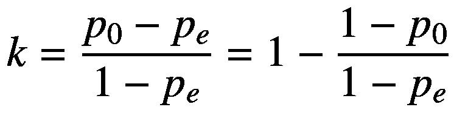

其中，*po*是两种方法之间的相对观测一致性，*pe*是随机重叠的假设概率，利用观测数据计算每种方法随机选择每个类别的概率。如果两种方法完全一致，则κ = 1。在极少数情况下，Kappa 可能为负值。这表明两个观测者的一致性低于仅凭随机预期的一致性。

如需更详细的阅读，请参考 Fleiss, J. L. (1981) *Statistical Methods for Rates and Proportions*，第 2 版（纽约：John Wiley）以及 Banerjee, M.; Capozzoli, Michelle; McSweeney, Laura; Sinha, Debajyoti (1999)，“Beyond Kappa: A Review of Interrater Agreement Measures”，来自*The Canadian Journal of Statistics*。

我们将使用购买预测数据配合一个非常简单的模型来演示 Kappa 和准确率指标。使用`caret()`包来展示此示例。该包提供了统一的方法来训练和评估近 270 种不同类型的模型。该包的详细信息在第[8](http://dx.doi.org/10.1007/978-1-4842-4215-5_8)章中提供。

```
library(caret)
library(mlbench)
下面我们随机抽取 5000 个案例以加快计算速度。
set.seed(917);
train_kappa A, 2->B, 3-> C 和 4->D
train_kappa$ProductChoice_multi  NIR] : < 2.2e-16
Kappa : 0.1377
McNemar 检验 P 值 : < 2.2e-16
按类别统计：
类别: A 类别: B 类别: C 类别: D
灵敏度            0.6530   0.1069   0.2413   0.4106
特异度            0.5830   0.9228   0.8602   0.7717
阳性预测值         0.3480   0.3144   0.3676   0.3685
阴性预测值         0.8314   0.7573   0.7709   0.8014
患病率             0.2542   0.2488   0.2520   0.2450
检出率             0.1660   0.0266   0.0608   0.1006
检出患病率         0.4770   0.0846   0.1654   0.2730
平衡准确率         0.6180   0.5149   0.5507   0.5911
```

从解释的角度来看，可以使用以下指导原则：

*   Kappa 为 0.20 或更低时，一致性较差
*   Kappa 在 0.20 至 0.40 之间时，一致性一般
*   Kappa 在 0.40 至 0.60 之间时，一致性中等
*   Kappa 在 0.60 至 0.80 之间时，一致性良好
*   Kappa 在 0.80 至 1.00 之间时，一致性非常好

在此模型输出中，Kappa 值为 0.1377，这表明随机模型与我们的模型之间一致性较差。我们的模型结果与随机模型不同。现在，存在两种可能性——模型表现比随机模型更差，或者表现异常出色。观察准确率指标——35.4%意味着我们的模型在分类方面表现不佳。我们需要更多的数据和特征才能获得良好的模型。

## 7.9 总结

模型评估是一个非常复杂的主题。本章仅触及了表面，旨在帮助你初步了解模型评估的概念。模型评估这一主题为我们用于评估性能的度量标准带来了许多深度。在这个不断变化的分析领域中，企业出于不同目的使用模型，有时会以定制化的方式对问题进行建模，以帮助制定业务决策。行业中的这一趋势催生了评估度量标准的竞争性。

要在真实环境中解决业务问题，你必须优化两个不同的目标函数：

*   **统计度量**，即我们在本章中讨论的内容
*   **业务约束**，即特定问题/业务的度量标准

让我们通过一个例子来理解这些对模型性能的约束。假设你需要构建一个模型，将客户分为八个类别。然而，处理每个类别客户的成本是不同的。为第 8 类客户服务的成本是为第 1 类客户服务的 10 倍。与此类似，每个类别的成本会随着类别编号及其他因素而变化。

现在，如果企业决定使用一个模型将对象分类到这些类别中，你将如何评估该模型的性能？纯粹的统计性能度量可能并不适用。我们该如何考虑创建混合性能指标，或一个序列依赖矩阵？评估的概念非常深入且相当复杂。数据科学家必须提出既富有创造性又在统计上有效的度量标准，以适应业务问题。

本章介绍了总体稳定性指数的概念，它确认了我们是否可以使用该模型进行预测。然后，我们将评估指标分为连续型和离散型两种情况。讨论的连续型指标是残差的不同函数，即平均绝对误差、均方根误差和 R 平方。离散型度量指标包括分类率、敏感性与特异性，以及 ROC 曲线下面积。我们使用房价数据和购买预测数据来展示评估指标的示例。

这些评估技术更适用于统计学习模型。先进的机器学习模型没有任何分布约束，无法用传统指标进行评估和解释。我们介绍了评估机器学习模型的概率方法，即交叉验证和自助采样。这两种方法构成了机器学习模型性能评估的基石。

最后，我们讨论了多类问题的一个重要指标——Kappa 指标。该指标越来越受欢迎，因为在分类问题中，每次错误分类都伴随着不同的成本。因此，我们需要以相对的方式衡量性能。

模型性能与评估技术正在快速发展。性能指标正成为多目标优化问题，因此也帮助算法采用新的方式来拟合数据。我们将在下一章继续探讨一些更高级的主题，届时将介绍统计学习与机器学习之间的区别，包括这种区别如何让我们更充分地利用数据，以及如何通过集成技术来提升模型性能。下一章将介绍偏差与方差之间的权衡，以帮助我们理解在给定约束条件下性能所能达到的极限。

