# 8. 模型性能提升

模型性能是一个广义术语，通常用于衡量模型在新数据集（通常是测试数据集）上的表现。性能指标还扮演着阈值的角色，用于决定模型是否可以投入实际的决策系统，还是需要改进。在上一章中，我们讨论了一些适用于连续型和离散型情况的性能指标。在本章中，我们将讨论如何通过改变建模过程来帮助我们在这些指标上提升模型性能。

特征选择在建模开发过程中扮演着重要角色。正是特征包含了用于解释因变量的信息。数据科学家花费大量时间选择和创建特征，以拟合预测模型。特征工程过程涉及选择最佳特征集及其变换。然后将这些特征集输入算法以量化关系。算法从数据中学习并创建一个预测模型。随后应用模型性能提升方法，以在关注的误差指标上提升性能。模型的高级属性，例如复杂度和学习速度，也会影响模型性能。这些高级参数被称为超参数。我们将在后续章节中进一步讨论超参数。广义上讲，有两种方法可以提升模型性能，尤其是在机器学习算法中：

*   增加更多特征并提高数据质量
*   优化超参数

第一点正是本书迄今为止一直在讨论的内容。然而，我们也讨论了一些算法，其中学习过程受到超参数的影响，例如在决策树中，树的深度、交叉验证的折数等。这些参数独立于特征，并影响模型性能。例如，你可以使用相同的预测变量集但不同的超参数来训练两个不同的决策树模型。为了理解性能优化过程，我们需要理解偏差与方差之间的权衡。偏差指的是真实值与预测值之间的差异，而方差指的是预测值均值周围的离散程度。偏差和方差是预测模型中不精确性/性能的两个关键组成部分，并且通常它们之间存在权衡关系。这种权衡是非线性的，这意味着通常减少一个会导致另一个增加。

本章将探讨这些问题，并提供 R 语言中的示例，以帮助你掌握如何使用 R 实现一些流行的性能提升技术。

本章使用的数据集与上一章相同（购买预测和房屋销售价格），我们将展示本章的概念如何影响上一章指标的结果。

### 注意

本章中的 R 语言示例计算量较大，因此建议你在运行这些示例之前检查机器配置。

虽然我们在本章中力求在简洁性和完整性之间取得平衡，但我们期望使用这些技术的用户对数值计算和机器学习算法有良好的理解。我们将提供研究论文的参考文献，供你详细阅读统计基础。

本章的学习目标如下：

*   机器学习与统计建模
*   Caret 包概述
*   超参数简介
*   超参数调优示例
*   偏差与方差的权衡
*   集成学习简介
*   集成学习中的高级方法
*   高级主题：贝叶斯优化

## 8.1 Caret 包概述

Caret 包是 R 语言中最强大的包之一。该包允许用户充分发挥机器学习算法的潜力。Caret 包（分类与回归训练的缩写）包含用于复杂回归和分类问题的函数。该包拥有专门的 Git 页面，是 R 语言中积极更新且有完善文档的包之一。Caret 包由辉瑞公司的 Max Kuhn 创建并维护。

Caret 包拥有众多用于模型开发和性能评估指标的函数。作为一个综合性包，它还可用于其他采样技术以及复杂的特征选择过程。Caret 包中有两个最重要的函数/工具：

*   `trainControl()`

*   `train()`

`trainControl()` 函数就像一个包装器，定义了模型训练的规则以及采样和网格搜索的执行条件。`train()` 函数非常强大，支持 Caret 包中提供的 230 种模型类型（见图 8-1）。主要函数/工具 `train()` 可用于：

*   **模型评估**，使用交叉验证、重采样和其他常规指标。它还可用于衡量调参对性能的影响。
*   **模型选择**，通过基于最优参数选择最佳模型，从而计算多个指标以选定最终模型。
*   **模型估计**，使用训练模型列表中列出的 230 种模型类型中的任何一种，并采用默认参数或调优后的参数。

默认情况下，该函数会自动选择与最佳值相关的调优参数，尽管也可以使用不同的算法来调整参数（来源：[`http://topepo.github.io/caret/model-training-and-tuning.html`](http://topepo.github.io/caret/model-training-and-tuning.html)）。

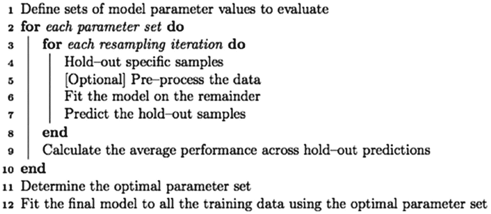

图 8-1

Caret 包中的 train() 函数算法

通常，Caret 包的基本用法包括首先定义 `trainControl()`，然后调用 `train()` 函数。这里我们展示调用这两个函数以使用 Caret 功能的通用语法。

还有其他方法可用，例如重复 K 折交叉验证、留一法等。`trainControl` 函数可用于指定重采样的类型。默认情况下，使用简单的自助法重采样：

```
rfControl <-trainControl(# 示例：10 折交叉验证
method ="repeatedcv",   # 其他方法可用，例如重复 K 折交叉验证、留一法等
number =10,             # 折数
repeats =10             # 重复十次
)
```

`train` 函数的前两个参数分别是预测变量和结果数据对象。第三个参数 `method` 指定模型类型（请参阅训练模型列表或按标签训练模型）。以下是一个通过 `randomForest` 包拟合 `randomForest` 模型的示例，该模型使用 10 折交叉验证进行测试：

```
set.seed(917)
randomForectFit1 <-train(Class ~.,   # 定义模型公式
data = training,                     # 定义建模数据
method ="rf",                        # 列出要使用的模型，caret 在训练模型列表中提供了选项
trControl = rfControl,               # 定义控制训练的条件
...  )               # 特定于建模技术的其他选项
randomForectFit1
```

关于 `trainControl` 的更多信息将在后续章节中给出。详细信息可查阅 [`http://topepo.github.io/caret/model-training-and-tuning.html`](http://topepo.github.io/caret/model-training-and-tuning.html)。

由于这是 R 语言的核心包，它几乎涵盖了所有的机器学习技术。因此，牢记其功能非常重要。

### 注意

在本章中，我们不会使用完整的数据集。示例将基于较小的数据集，以确保您能在性能较低的机器上复现结果。

## 8.2 超参数简介

在机器学习中，我们处理两种参数：一种是标准模型参数，另一种是超参数。这两类参数的核心区别在于，模型参数可以直接从底层数据中学习得到，而超参数则不能。机器学习模型的训练过程用于学习数据，然后拟合模型参数。

然而，超参数并非直接从数据中学习得到，但它们对模型性能有着至关重要的影响。超参数描述了模型的“高层”属性，例如其复杂度、学习速度以及应达到的深度。另一个重要点是，超参数在训练开始前就已固定，因此模型的标准参数是在此基础上学习得到的。我们可以说，超参数决定了模型训练的规则，而模型的标准参数则是通过这些规则估算出来的。

那么，超参数是如何确定的呢？哪些因素会影响超参数的选择过程？这一领域被总结为*超参数优化*，将在后续章节中进行高层次探讨。

另一种理解超参数的方式是，将其视为贝叶斯统计学习方法的前提条件，该方法涉及在给定训练数据集的情况下，寻找模型参数的概率分布。例如，一个人工神经网络的训练需要预设四个超参数来从数据中学习：选择带有算法的模型类型、选择网络架构、分配训练参数以及学习模型参数。通常，在用数据训练模型之前，我们可以将超参数分为四个决策点：

*   **模型类型**：决定你在机器学习中选择哪种类型的模型，例如前馈或循环神经网络、支持向量机、线性回归等。

*   **架构**：一旦确定了模型类型，你就需要输入模型学习过程的边界条件，例如隐藏层数量、每层隐藏节点数、批量归一化和池化层等。

*   **训练参数**：确定模型类型和架构后，你需要决定模型应该如何学习，例如学习率和动量率、批量大小等。这些参数有时被称为训练参数。

*   **模型参数**：提供这些输入后，模型训练过程开始，模型参数（例如神经网络中的权重和偏置）被估算出来。

超参数的一些示例如下：

*   树的深度或叶子数量
*   矩阵分解中的潜在因子
*   学习率（基于神经网络的方法中）
*   深度神经网络中的隐藏层
*   k-means 聚类中的聚类数量

为了说明超参数对模型性能的影响，我们将创建一个使用不同超参数的示例，并检查模型的性能。在此示例中，我们将使用购买预测数据的一个子集。

在下面的示例中，我们创建了两个随机森林模型，它们使用相同的底层数据和相同的预测变量，但超参数（树的数量）采用了两个不同的值：

*   ntree = 20
*   ntree = 50

以下是两种情况的准确率结果：

*   模型 1：树的大小 = 20

```
setwd("C:/Personal/Machine Learning/Run Chap 8");
library(caret)
library(randomForest)
set.seed(917);

# 加载数据集
Purchase_Data <-read.csv("Purchase Prediction Dataset.csv",header=TRUE)

# 移除缺失值
data <-na.omit(Purchase_Data)

# 选取记录样本
Data <-data[sample(nrow(data),size=10000),]
```

以下是使用随机森林算法中 20 棵树的结果。

```
fit_20 <-randomForest(factor(ProductChoice) ~MembershipPoints +CustomerAge +PurchaseTenure +CustomerPropensity +LastPurchaseDuration,
data=Data,
importance=TRUE,
ntree=20)

# 打印 ntree=20 的结果
print(fit_20)
```

以下是使用随机森林算法中 20 棵树的结果。

*   模型 1：树的大小 = 50

```
Call:
randomForest(formula = factor(ProductChoice) ~ MembershipPoints
+      CustomerAge + PurchaseTenure + CustomerPropensity
+ LastPurchaseDuration,  data = Data, importance = TRUE, ntree = 20)
Type of random forest: classification
Number of trees: 20
No. of variables tried at each split: 2
OOB estimate of  error rate: 64.27%
Confusion matrix:
1    2    3   4 class.error
1 550 1035  495 104   0.7481685
2 730 1927 1051 199   0.5067827
3 449 1300 1005 165   0.6557040
4 149  450  300  91   0.9080808
```

以下是使用随机森林算法中 50 棵树的结果。

```
fit_50 <-randomForest(factor(ProductChoice) ~MembershipPoints +CustomerAge +PurchaseTenure +CustomerPropensity +LastPurchaseDuration,
data=Data,
importance=TRUE,
ntree=50)

# 打印 ntree=50 的结果
print(fit_50)
Call:
randomForest(formula = factor(ProductChoice) ~ MembershipPoints
+      CustomerAge + PurchaseTenure + CustomerPropensity
+ LastPurchaseDuration,   data = Data, importance = TRUE, ntree = 50)
Type of random forest: classification
Number of trees: 50
No. of variables tried at each split: 2
OOB estimate of  error rate: 63.35%
Confusion matrix:
1    2    3   4 class.error
1 502 1153  472  57   0.7701465
2 712 2065  994 136   0.4714615
3 427 1329 1029 134   0.6474820
4 147  467  307  69   0.9303030
```

我们可以看到，仅仅改变超参数，结果就有所不同。ntree=50 时的总体错误率从 64.27% 下降到了 63.35%。在各个类别的分类中，类别 1 和类别 4 的分类率提高了约 3%，而类别 2 和类别 3 的分类率则有所下降。现在需要回答的下一个重要问题是，找到超参数最优值的最具成本效益和时间效益的方法是什么。

## 8.3 超参数优化

在机器学习中，超参数优化或模型选择是为机器学习算法选择一组超参数的过程。会选择使模型性能最大化的那组超参数用于实际的模型训练和测试。通常使用交叉验证来衡量模型性能，具体指标可以是交叉验证错误率或其他用户自定义的方法，例如自助法误差、留一法等。

简而言之，学习算法学习的是能够良好建模/拟合输入数据的模型参数，而超参数优化则是通过调整（例如正则化）来确保模型不会过拟合数据。有多种算法被提出用于优化任何算法的超参数。同时也有多种流行的软件包和付费服务可用于参数优化。它们大多基于贝叶斯方法的某种变体。我们将通过在同一模型上使用不同方法来说明参数调优。这将帮助你对比理解结果如何变化以及哪些因素可能影响结果。

下面列出最流行的方法，并附上一些背景说明。我们不直接比较这些方法，因为方法的选择受多种因素影响，包括但不限于模型类型、计算能力、时空复杂度等。

*   *手动搜索：* 根据最佳判断/经验创建一组参数，并在模型上进行测试。选择对模型性能效果最好的那组参数。

*   *手动网格搜索：* 创建一个等间距网格或自定义网格，包含超参数的组合。在每个网格点上评估模型，并选择模型性能最佳的那组参数。

*   *自动网格搜索：* 让程序为你决定一个网格，并在该空间中搜索最佳超参数。

*   *最优搜索：* 在此方法中，我们通常不预先固定网格，而是允许机器在需要时扩展网格。

*   *随机搜索：* 通常，在超参数搜索空间中选择一些随机点，其工作速度更快，效果也更好。虽然这节省了大量的空间和时间成本，但它可能并不总能提供最佳/最优的超参数集。

*   *自定义搜索：* 用户可以定义自己的函数，并指导算法如何找到最佳的超参数集。

### 注意

大多数这些参数调优/优化技术都是高维空间中的搜索问题。搜索是在迭代和有指导的基础上进行的，通常仅限数值计算。以下各节将介绍流行的优化方法。

### 8.3.1 手动搜索

本节讨论用于手动搜索优化的模型细节。

*   *响应变量：* `ProductChoice`

*   *预测变量：* `MembershipPoints`、`CustomerAge`、`PurchaseTenure`、`CustomerPropensity` 和 `LastPurchaseDuration`

*   *误差计算：* 交叉验证

*   *模型类型：* 随机森林

```

# 手动搜索参数
library(data.table)

# 加载包
library(randomForest)
library(mlbench)
library(caret)

# 加载数据集
dataset <-Data
metric <- "Accuracy"
```

这里，我们设置 `trainControl` 函数，其中 `method="repeatedCV"` 表示使用重复交叉验证，搜索 `method = "grid"` 表示在 `tunegrid` 定义的网格中搜索。

```

# 手动搜索
trainControl <-trainControl(method="repeatedcv", number=10, repeats=3, search="grid")
tunegrid <-expand.grid(.mtry=c(sqrt(ncol(dataset)-2)))
modellist <-list()
```

这里，我们设置 `train` 函数，其中 `method="rf"` 表示使用随机森林算法拟合模型，`ntree` 为循环变量中的树的数量。

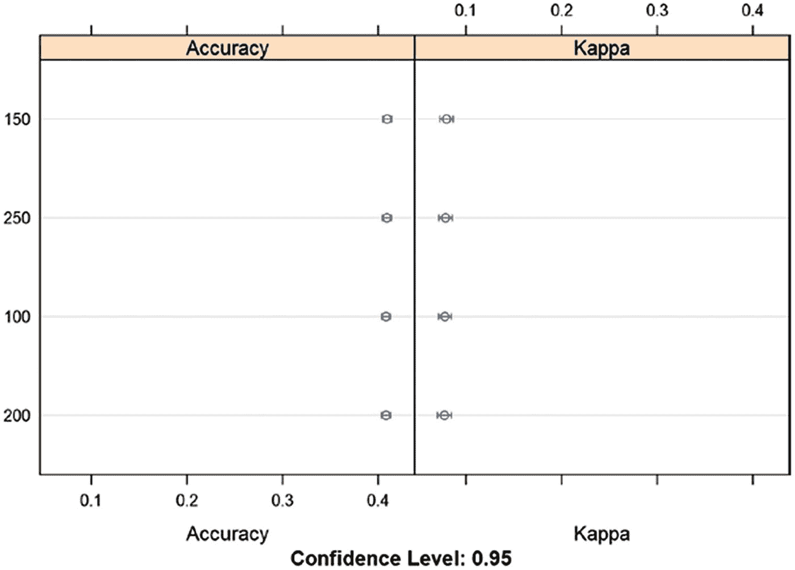

图 8-2

性能图准确率指标

```
for (ntree in c(100, 150, 200, 250)) {
set.seed(917);
fit <-train(factor(ProductChoice) ~MembershipPoints +CustomerAge +PurchaseTenure +CustomerPropensity +LastPurchaseDuration, data=dataset, method="rf", metric=metric, tuneGrid=tunegrid, trControl=trainControl, ntree=ntree)
key <-toString(ntree)
modellist[[key]] <-fit
}

# 通过重采样比较结果
results <-resamples(modellist)

# 结果摘要
summary(results)
Call:
summary.resamples(object = results)
Models: 100, 150, 200, 250
Number of resamples: 30
Accuracy
Min. 1st Qu. Median   Mean 3rd Qu.   Max. NA's
100 0.3880  0.3990 0.4107 0.4081  0.4134 0.4364    0
150 0.3890  0.3996 0.4117 0.4094  0.4147 0.4390    0
200 0.3864  0.3974 0.4095 0.4081  0.4139 0.4360    0
250 0.3884  0.4013 0.4097 0.4090  0.4167 0.4390    0
Kappa
Min. 1st Qu.  Median    Mean 3rd Qu.   Max. NA's
100 0.04385 0.06549 0.08044 0.07803 0.08661 0.1209    0
150 0.05301 0.06481 0.08014 0.07977 0.08831 0.1235    0
200 0.04243 0.06214 0.07847 0.07757 0.08953 0.1196    0
250 0.04427 0.06311 0.08145 0.07873 0.08884 0.1244    0

# 结果的点图
dotplot(results)
```

你可以在图 8-2 中看到，不同参数值之间的准确率变化不大。这可能意味着我们的搜索不够全面，或者模型能够在少于 100 棵树的随机森林模型下学习到数据的大部分特征。此外，应该增加自变量的列表。

### 8.3.2 手动网格搜索

本节将讨论用于手动网格搜索优化的模型细节。

*   *响应变量*：`ProductChoice`

*   *预测变量*：`MembershipPoints`、`CustomerAge`、`PurchaseTenure`、`CustomerPropensity` 和 `LastPurchaseDuration`

*   *误差计算*：交叉验证

*   *模型类型*：学习向量量化（LVQ）

```

# Tune algorithm parameters using a manual grid search.
seed <-917;
dataset <-Data
```

此处，我们设置 `trainControl` 函数，其中 `method="repeatedCV"` 表示使用重复交叉验证，搜索 `method = "grid"` 表示在 `grid` 定义的网格中进行搜索。

```

# prepare training scheme
control <-trainControl(method="repeatedcv", number=10, repeats=3)

# design the parameter tuning grid
grid <-expand.grid(size=c(5,10,20,50), k=c(1,2,3,4,5))

# train the model
model <-train(factor(ProductChoice) ~MembershipPoints +CustomerAge +PurchaseTenure +CustomerPropensity +LastPurchaseDuration, data=dataset, method="lvq", trControl=control, tuneGrid=grid)

# summarize the model
print(model)
Learning Vector Quantization
10000 samples
5 predictor
4 classes: '1', '2', '3', '4'
No pre-processing
Resampling: Cross-Validated (10 fold, repeated 3 times)
Summary of sample sizes: 9001, 9000, 9000, 9001, 8999, 9000, ...
Resampling results across tuning parameters:
size  k  Accuracy   Kappa
5    1  0.3403649  0.01508857
5    2  0.3443983  0.02464750
5    3  0.3582986  0.03118553
5    4  0.3556306  0.02933887
5    5  0.3510002  0.03342766
10    1  0.3375292  0.02790863
10    2  0.3387723  0.03024152
10    3  0.3398577  0.03016096
10    4  0.3484939  0.04030847
10    5  0.3457038  0.04743415
20    1  0.3403710  0.04013057
20    2  0.3321322  0.02956459
20    3  0.3380415  0.03934963
20    4  0.3422641  0.04213952
20    5  0.3449026  0.04611466
50    1  0.3353654  0.03588394
50    2  0.3358704  0.03255331
50    3  0.3428662  0.04369310
50    4  0.3421693  0.04713980
50    5  0.3437377  0.04756819
Accuracy was used to select the optimal model using  the largest value.
The final values used for the model were size = 5 and k = 3.

# plot the effect of parameters on accuracy
plot(model)
```

调优算法显示了最佳调优参数。图 8-3 也显示了准确率图中达到峰值的顶线，该顶线对应最佳模型。

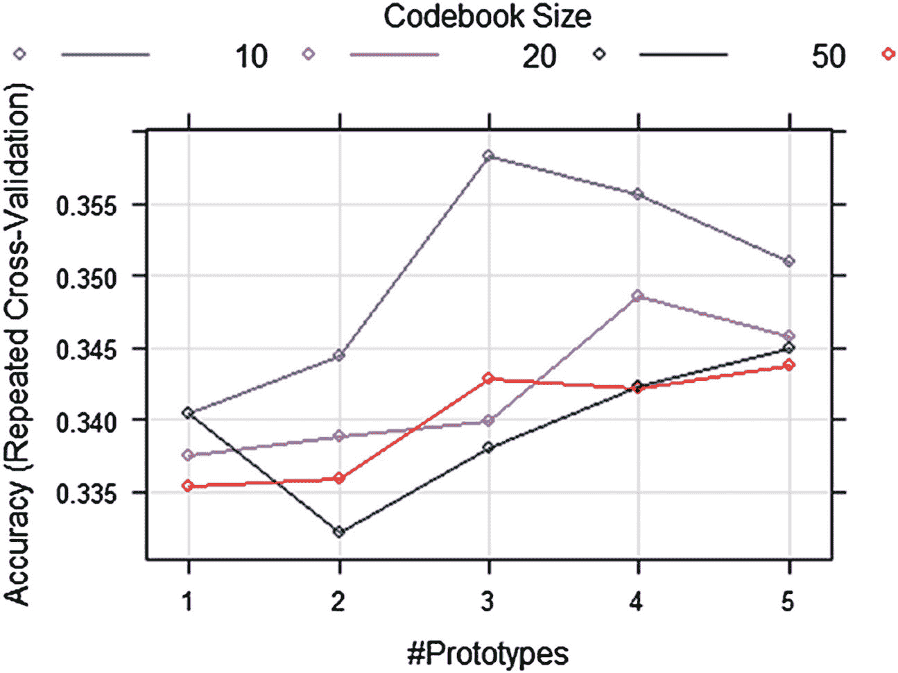

图 8-3

交叉验证样本的准确率

### 8.3.3 自动网格搜索

本节将讨论用于自动网格搜索优化的模型细节。

*   *响应变量*：`ProductChoice`

*   *预测变量*：`MembershipPoints`、`CustomerAge`、`PurchaseTenure`、`CustomerPropensity` 和 `LastPurchaseDuration`

*   *误差计算*：交叉验证

*   *模型类型*：学习向量量化（LVQ）

```

# Tune algorithm parameters using an automatic grid search.
set.seed(917);
dataset <-Data
```

此处，我们设置 `trainControl` 函数，其中 `method="repeatedCV"` 表示使用重复交叉验证，搜索方法为 `default`，即自动网格搜索。

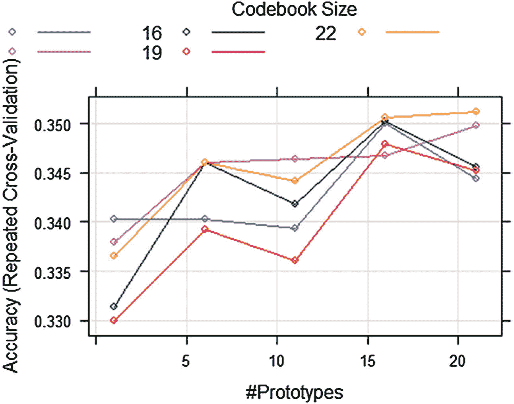

图 8-4

自动网格搜索的交叉验证样本准确率

```

# prepare training scheme
control <-trainControl(method="repeatedcv", number=10, repeats=3)

# train the model
model <-train(factor(ProductChoice) ~MembershipPoints +CustomerAge +PurchaseTenure +CustomerPropensity +LastPurchaseDuration, data=dataset, method="lvq", trControl=control, tuneLength=5)

# summarize the model
print(model)
Learning Vector Quantization
10000 samples
5 predictor
4 classes: '1', '2', '3', '4'
No pre-processing
Resampling: Cross-Validated (10 fold, repeated 3 times)
Summary of sample sizes: 9000, 8999, 9001, 9001, 9000, 9000, ...
Resampling results across tuning parameters:
size  k   Accuracy   Kappa
11     1  0.3402322  0.03666635
11     6  0.3402335  0.03518447
11    11  0.3394009  0.04093310
11    16  0.3499678  0.04415707
11    21  0.3444298  0.04208990
13     1  0.3379881  0.03523337
13     6  0.3459702  0.04826571
13    11  0.3464008  0.05010497
13    16  0.3467346  0.05055072
13    21  0.3497683  0.05600358
16     1  0.3313684  0.03813657
16     6  0.3460655  0.05013518
16    11  0.3417672  0.04646887
16    16  0.3502685  0.04977277
16    21  0.3456003  0.04755585
19     1  0.3299696  0.03229510
19     6  0.3392352  0.04576555
19    11  0.3361026  0.03859754
19    16  0.3479016  0.05067015
19    21  0.3451598  0.04997000
22     1  0.3365661  0.03454596
22     6  0.3459982  0.04399154
22    11  0.3441293  0.04592163
22    16  0.3506335  0.05187679
22    21  0.3512329  0.05437707
Accuracy was used to select the optimal model using  the largest value.
The final values used for the model were size = 22 and k = 21.

# plot the effect of parameters on accuracy
plot(model)
```

图 8-4 中的自动网格搜索优化显示，最佳模型的参数为 size=22 和 k=21，对应的准确率为 0.3512。这与我们的手动网格搜索结果不同，手动网格搜索的最优参数为 size=5 和 k=3，准确率为 0.3581。

### 8.3.4 最优搜索

本节讨论最优搜索优化模型的细节。

*   *响应变量*：`ProductChoice`

*   *预测变量*：`MembershipPoints`、`CustomerAge`、`PurchaseTenure`、`CustomerPropensity` 和 `LastPurchaseDuration`

*   *误差计算*：交叉验证

*   *模型类型*：递归划分与回归树

观察我们在 `train` 函数的 `tuneGrid` 参数中使用的以下三个 `expand.grids`。

*   *手动搜索*：`expand.grid(.mtry=c(sqrt(ncol(dataset)-2)))`

*   *手动网格搜索*：`expand.grid(size=c(5,10,20,50), k=c(1,2,3,4,5))`

*   *最优搜索*：`expand.grid(.cp=seq(0,0.1,by=0.01))`

在最优搜索中，`expand.grid` 的参数更加精细，这意味着算法能够比其他方法更好地收敛到全局最优解。例如，通过修改 `seq` 函数中的 `by = 0.01` 以增加小数位数，可以进一步提高精细度。但请记住，提高精细度会增加计算开销。

```

# 选择最佳调优配置
dataset <-Data
```

这里，我们设置 `trainControl` 函数，其 `method="repeatedCV"`，表示使用重复交叉验证，并在 `tunegrid` 上进行参数调优。

```

# 准备训练方案
control <-trainControl(method="repeatedcv", number=10, repeats=3)

# CART
set.seed(917);
tunegrid <-expand.grid(.cp=seq(0,0.1,by=0.01))
fit.cart <-train(factor(ProductChoice) ~MembershipPoints +CustomerAge +PurchaseTenure +CustomerPropensity +LastPurchaseDuration, data=dataset, method="rpart", metric="Accuracy", tuneGrid=tunegrid, trControl=control)
Loading required package: rpart
fit.cart
CART
10000 samples
5 predictor
4 classes: '1', '2', '3', '4'
No pre-processing
Resampling: Cross-Validated (10 fold, repeated 3 times)
Summary of sample sizes: 9000, 8999, 9001, 9001, 9000, 9000, ...
Resampling results across tuning parameters:
cp    Accuracy   Kappa
0.00  0.3557312  0.05943192
0.01  0.4014336  0.04179296
0.02  0.3966989  0.02481739
0.03  0.3907000  0.00000000
0.04  0.3907000  0.00000000
0.05  0.3907000  0.00000000
0.06  0.3907000  0.00000000
0.07  0.3907000  0.00000000
0.08  0.3907000  0.00000000
0.09  0.3907000  0.00000000
0.10  0.3907000  0.00000000
Accuracy was used to select the optimal model using  the largest value.
The final value used for the model was cp = 0.01.

# 显示最佳配置
print(fit.cart$bestTune)
cp
2 0.01
plot(fit.cart)
```

图 8-5 中的图表清晰地显示，准确率的峰值出现在 cp 值等于 0.01 时，对应的准确率为 0.41，高于我们之前优化的模型。同时请注意，本例中的模型是递归划分与回归树。

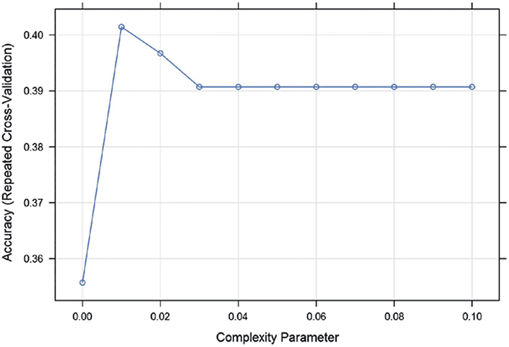

图 8-5

跨交叉验证样本和复杂度参数的准确率

### 8.3.5 随机搜索

本节讨论随机搜索优化模型的细节。

*   *响应变量*：`ProductChoice`

*   *预测变量*：`MembershipPoints`、`CustomerAge`、`PurchaseTenure`、`CustomerPropensity` 和 `LastPurchaseDuration`

*   *误差计算*：交叉验证

*   *模型类型*：随机森林

```

# 随机搜索算法参数

# 选择最佳调优配置
dataset <-Data
```

这里，我们设置 `trainControl` 函数，其 `method="repeatedCV"`，表示使用重复交叉验证，并将预测变量搜索设置为 `random`。

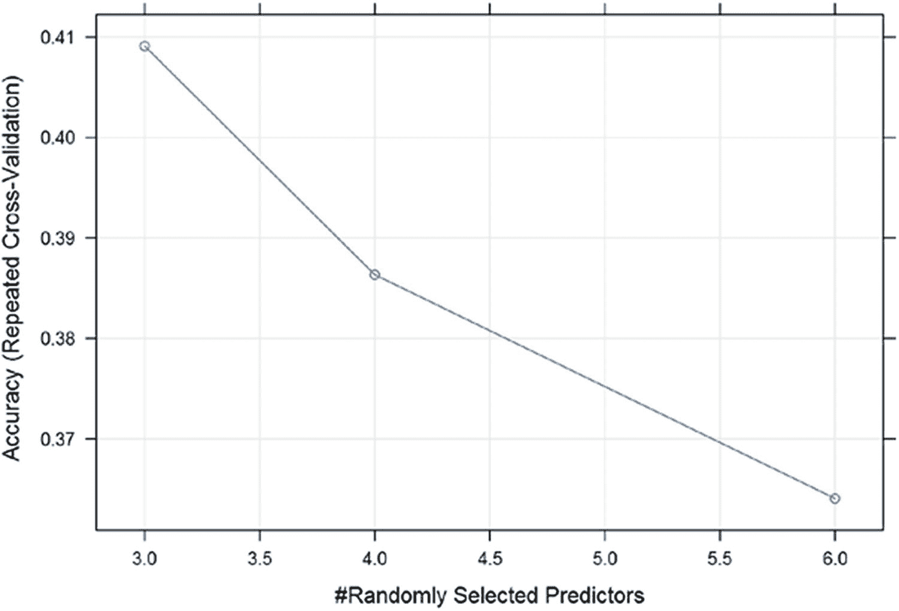

图 8-6

跨交叉验证集和随机选择预测变量的准确率

```

# 准备训练方案
control <-trainControl(method="repeatedcv", number=10, repeats=3, search="random")

# 训练模型
model <-train(factor(ProductChoice) ~MembershipPoints +CustomerAge +PurchaseTenure +CustomerPropensity +LastPurchaseDuration, data=dataset, method="rf", trControl=control)

# 总结模型
print(model)
Random Forest
10000 samples
5 predictor
4 classes: '1', '2', '3', '4'
No pre-processing
Resampling: Cross-Validated (10 fold, repeated 3 times)
Summary of sample sizes: 9000, 9000, 9002, 9000, 9000, 8999, ...
Resampling results across tuning parameters :
mtry  Accuracy   Kappa
3     0.4091006  0.07772332
4     0.3863345  0.08039752
6     0.3640687  0.06873901
Accuracy was used to select the optimal model using  the largest value.
The final value used for the model was mtry = 3.

# 绘制参数对准确率的影响
plot(model)
```

随机搜索算法通常在调优时更快、更高效。在本例中，图 8-6 中的图表显示，该算法能够以更少的迭代次数优化问题。此示例中使用了随机森林模型。随机森林通过随机搜索可以快速优化。这为调优随机森林模型节省了大量时间。

### 8.3.6 自定义搜索

自定义搜索算法提供了引导算法优化调优参数的高级方法。机器学习的高级用户可以创建自己的搜索算法来优化超参数。在本例中，我们展示了一种这样的搜索优化方法。

*响应变量：* `ProductChoice`

*预测变量：* `MembershipPoints`、`CustomerAge`、`PurchaseTenure`、`CustomerPropensity` 和 `LastPurchaseDuration`

*误差计算：* 交叉验证

*模型类型：* 自定义随机森林

```
setwd("C:/Personal/Machine Learning/Chapter 8/");
library(caret)
library(randomForest)
library(class)

# 加载数据集
Purchase_Data <-read.csv("Purchase Prediction Dataset.csv",header=TRUE)
data <-na.omit(Purchase_Data)

# 创建一个包含 1 万条记录的样本
set.seed(917);
Data <-data[sample(nrow(data),size=10000),]

# 选择最佳调优配置
dataset <-Data

# 自定义参数搜索

# 加载包
library(randomForest)
library(mlbench)
library(caret)
```

在本例中，我们提出了一个用于评估的自定义函数。`randomForest` 的算法被继承用于分类问题。这是一种创建自定义搜索函数的高级方法。

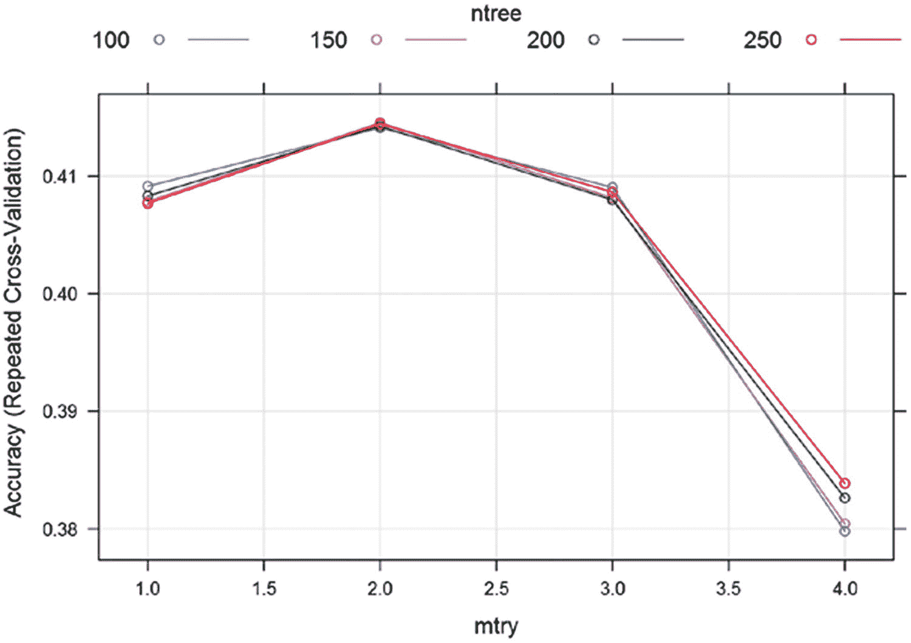

图 8-7

跨交叉验证样本和参数 mtry 的准确率

```

# 定义自定义 caret 算法（随机森林的封装器）
customRF <-list(type="Classification", library="randomForest", loop=NULL)
customRF$parameters <-data.frame(parameter=c("mtry", "ntree"), class=rep("numeric", 2), label=c("mtry", "ntree"))
customRF$grid <-function(x, y, len=NULL, search="grid") {}
customRF$fit <-function(x, y, wts, param, lev, last, weights, classProbs, ...) {
randomForest(x, y, mtry=param$mtry, ntree=param$ntree, ...)
}
customRF$predict <-function(modelFit, newdata, preProc=NULL, submodels=NULL) {  predict(modelFit, newdata)}
customRF$prob <-function(modelFit, newdata, preProc=NULL, submodels=NULL) {   predict(modelFit, newdata, type ="prob")}
customRF$sort <-function(x){ x[order(x[,1]),]}
customRF$levels <-function(x) {x$classes}

# 加载数据集
dataset <-Data
metric <- "Accuracy"

# 训练模型
trainControl <-trainControl(method="repeatedcv", number=10, repeats=3)
tunegrid <-expand.grid(.mtry=c(1:4), .ntree=c(100, 150, 200, 250))
set.seed(917)
custom <-train(factor(ProductChoice) ~MembershipPoints +CustomerAge +PurchaseTenure +CustomerPropensity +LastPurchaseDuration, data=dataset, method=customRF, metric=metric, tuneGrid=tunegrid, trControl=trainControl)
print(custom)
10000 samples
5 predictor
4 classes: '1', '2', '3', '4'
No pre-processing
Resampling: Cross-Validated (10 fold, repeated 3 times)
Summary of sample sizes: 9000, 8999, 9001, 9001, 9000, 9000, ...
Resampling results across tuning parameters:
mtry  ntree  Accuracy   Kappa
1     100    0.4091336  0.05088226
1     150    0.4078343  0.04944209
1     200    0.4082998  0.04973571
1     250    0.4076663  0.04861050
2     100    0.4141003  0.07256969
2     150    0.4145340  0.07306897
2     200    0.4142334  0.07232983
2     250    0.4144336  0.07289516
3     100    0.4090333  0.07980804
3     150    0.4081328  0.07744357
3     200    0.4079661  0.07782225
3     250    0.4086323  0.07818017
4     100    0.3797990  0.07244785
4     150    0.3804304  0.07231228
4     200    0.3826303  0.07566550
4     250    0.3838646  0.07796204
Accuracy was used to select the optimal model using  the largest value.
The final values used for the model were mtry = 2 and ntree = 150.
plot(custom)
```

自定义搜索优化目前为我们提供了最高 0.415 的准确率。对于这个问题，这似乎是最佳准确率。再次强调，我们使用的是相同的数据和相同的变量，并观察了性能如何不断变化。下一节将讨论模型性能中的一个非常重要的概念：偏差与方差。

## 8.4 偏差与方差的权衡

任何机器学习算法中的误差都可以归因于偏差、方差和不可约误差。偏差与方差的权衡或困境，是指在任何机器学习算法中同时最小化偏差和方差的问题。通常，减少其中一个往往会增加另一个。

在性能度量中，我们说偏差导致欠拟合，而方差导致过拟合。图 8-8 展示了一个非常好的图形表示，由 Scott Fortmann-Roe 在其博客中使用靶心图提供。

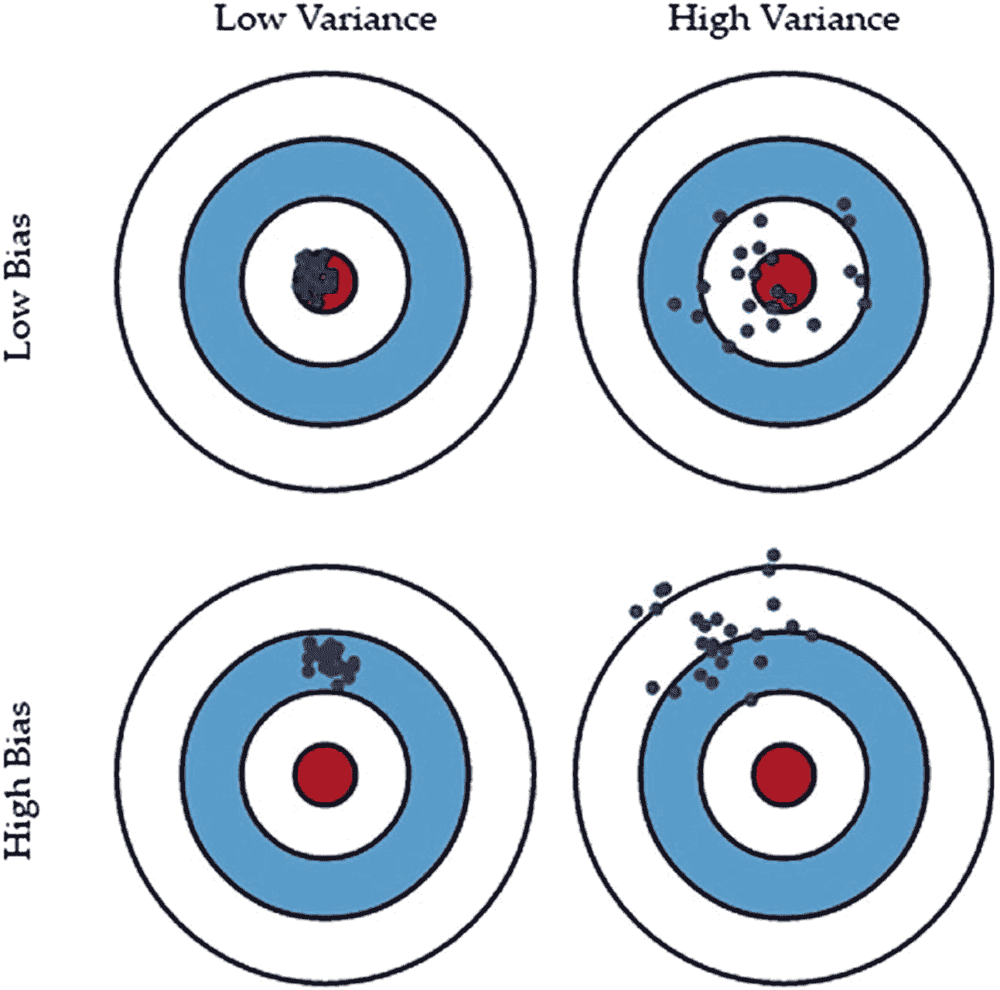

图 8-8

使用靶心图说明偏差与方差

Fortmann 进一步提供了由偏差和方差引起的误差的概念性定义。查看图 8-8 中的图像，可以很容易地想象出由偏差和方差引起的误差如何影响结果。Fortmann-Roe 提供了简单的定义：

*   *由偏差引起的误差：* 由偏差引起的误差被视为我们模型的预期（或平均）预测值与我们要预测的正确值之间的差异。

*   *由方差引起的误差：* 由方差引起的误差被视为模型对给定数据点预测的可变性。再次想象一下，你可以多次重复整个模型构建过程。方差就是给定点的预测在不同模型实现之间的变化程度（来源：[`http://scott.fortmann-roe.com/docs/BiasVariance.html`](http://scott.fortmann-roe.com/docs/BiasVariance.html)）。

机器学习算法中泛化误差的分解称为偏差-方差分解，它将误差分解为三个组成部分：

*   *偏差的平方*

*   *方差*

*   *不可约误差*

数学上，分解后的方程如下所示：

![$$ \mathrm{E}\left[{\left(y-\hat{f}(x)\right)}²\right]=\mathrm{Bias}{\left[\hat{f}(x)\right]}²+\mathrm{Var}\left[\hat{f}(x)\right]+{\sigma}² $$](images/416805_2_En_8_Chapter/416805_2_En_8_Chapter_TeX_Equa.png)

其中

![$$ \mathrm{Bias}\left[\hat{f}(x)\right]=\mathrm{E}\left[\hat{f}(x)-f(x)\right] $$](images/416805_2_En_8_Chapter/416805_2_En_8_Chapter_TeX_Equb.png)

且

![$$ \mathrm{Var}\left[\hat{f}(x)\right]=\mathrm{E}\left[\hat{f}{(x)}²\right]-\mathrm{E}{\left[\hat{f}(x)\right]}² $$](images/416805_2_En_8_Chapter/416805_2_En_8_Chapter_TeX_Equc.png)

这个方程的推导也很简单，可以针对一般情况进行，如下所示。

对于任何随机变量，方差定义为

![$$ \mathrm{Var}\left[X\right]=\mathrm{E}\left[{X}²\right]-\mathrm{E}{\left[X\right]}² $$](images/416805_2_En_8_Chapter/416805_2_En_8_Chapter_TeX_Equd.png)

等价地

![$$ \mathrm{E}\left[{X}²\right]=\mathrm{Var}\left[X\right]+\mathrm{E}{\left[X\right]}² $$](images/416805_2_En_8_Chapter/416805_2_En_8_Chapter_TeX_Eque.png)

假设 *f* = *f*(*x*) 且 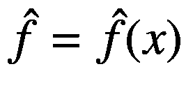，由于 *f* 是确定性的。

![$$ \mathrm{E}\left[f\right]=f $$](images/416805_2_En_8_Chapter/416805_2_En_8_Chapter_TeX_Equf.png)

因此，*y* = *f*+∈ 且 E[∈] = 0 意味着

![$$ \mathrm{E}\left[\mathrm{y}\right]=\mathrm{E}\left[f+\in \right]=\mathrm{E}\left[f\right]=f. $$](images/416805_2_En_8_Chapter/416805_2_En_8_Chapter_TeX_Equg.png)

同样地，

![$$ \mathrm{Var}\left[\in \right]={\sigma}² $$](images/416805_2_En_8_Chapter/416805_2_En_8_Chapter_TeX_Equh.png)

因此，

![$$ \mathrm{Var}\left[y\right]=\mathrm{E}\left[{\left(y\hbox{-} \mathrm{E}\left[y\right]\right)}²\right]=\mathrm{E}\left[{\left(y-f\right)}²\right]=\mathrm{E}\left[{\left(f+\in -f\right)}²\right]=\mathrm{E}\left[{\in}²\right]=\mathrm{Var}\left[\in \right]+\mathrm{E}{\left[\in \right]}²={\sigma}² $$](images/416805_2_En_8_Chapter/416805_2_En_8_Chapter_TeX_Equi.png)

由于 *ϵ* 和 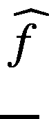 相互独立，我们有

![$$ \mathrm{E}\left[{\left(y-\hat{f}\right)}²\right]{\displaystyle \begin{array}{c}=\mathrm{E}\left[{y}²+{\widehat{f}}²-2y\widehat{f}\right]\\ {}=\mathrm{E}\left[{y}²\right]+\mathrm{E}\left[{\widehat{f}}²\right]-\mathrm{E}\left[2y\widehat{f}\right]\\ {}=\mathrm{Var}\left[y\right]+\mathrm{E}{\left[y\right]}²+\mathrm{Var}\left[\widehat{f}\right]+\mathrm{E}{\left[\widehat{f}\right]}²-2f\mathrm{E}\left[\widehat{f}\right]\\ {}\begin{array}{l}=\mathrm{Var}\left[y\right]+\mathrm{Var}\left[\widehat{f}\right]+\mathrm{E}\left(f-\mathrm{E}\left[\widehat{f}\right]\right)\\ {}=\mathrm{Var}\left[y\right]+\mathrm{Var}\left[\widehat{f}\right]+\mathrm{E}\left[f-\widehat{f}\right]\\ {}={\sigma}²+\mathrm{Var}\left[\widehat{f}\right]+\mathrm{Bias}\left[\widehat{f}\right]\end{array}\end{array}} $$](images/416805_2_En_8_Chapter/416805_2_En_8_Chapter_TeX_IEq3.png)

不可约误差是真实关系中的噪声项，任何模型都无法从根本上减少它。在线性回归设定下的这一推导过程，在 Shakhnarovich, Greg (2011) 的《线性回归中偏差-方差分解推导笔记》中有详细解释。其他机器学习算法中也可以进行类似的分解。

此外，这里展示了权衡关系。这种权衡关系的图形表示也让我们了解到，如何调整机器学习算法，以在给定权衡约束下达到方差和偏差最小的最佳点。

以下代码片段在一个真实模型原型上展示了这种权衡关系。在下面的示例中，我们计算了假设数据的均方误差、偏差和方差，然后绘制了改变 `shrink`（一个数值向量）的值如何改变这些量。

```
mu <-2
Z <-rnorm(20000, mu)
MSE <-function(estimate, mu) {
return(sum((estimate -mu)²) /length(estimate))
}
n <-100
shrink <-seq(0,0.5, length=n)
mse <-numeric(n)
bias <-numeric(n)
variance <-numeric(n)
for (i in 1:n) {
mse[i] <-MSE((1 -shrink[i]) *Z, mu)
bias[i] <-mu *shrink[i]
variance[i] <-(1 -shrink[i])²
}
```

现在，我们使用 `plot` 函数绘制偏差-方差权衡图；也可以使用 `ggplot` 函数。

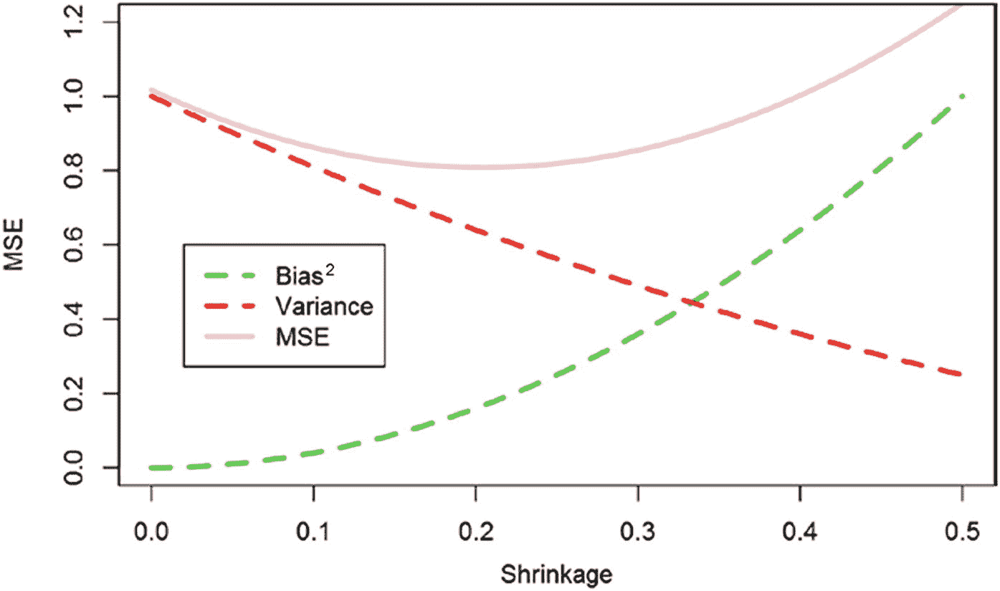

图 8-9

偏差与方差权衡图

```

# 偏差-方差权衡图
plot(shrink, mse, xlab="收缩量", ylab="均方误差", type="l", col="pink", lwd=3, lty=1, ylim=c(0,1.2))
lines(shrink, bias², col="green", lwd=3, lty=2)
lines(shrink, variance, col="red", lwd=3, lty=2)
legend(0.02,0.6, c('偏差²', '方差', '均方误差'), col=c('green', 'red', 'pink'), lwd=rep(3,3), lty=c(2,2,1))
```

你可以在图 8-9 中看到，方差和偏差具有相反的行为。模型的最佳最优点存在于偏差和方差交汇之处。这也是我们试图用于最终模型的那个点。模型性能早期受到偏差或方差影响的迹象，可以通过在测试数据上拟合模型来观察。模型未曾见过测试数据，因此我们可以衡量其在测试数据/留出数据上的真实性能或误差。

*   **受方差影响的模型**：当模型在训练数据上拟合良好，但在测试数据上拟合不佳时。这表明预测的变异性很高，高方差误差占主导地位。

*   **受偏差影响的模型**：当模型在训练数据和测试数据上都拟合不佳时。由偏差引起的误差导致了模型的糟糕性能。

充分理解偏差-方差权衡有助于你决定采用哪些方法来纠正模型中的偏差或方差问题。但在我们进入通过处理偏差和方差来提升性能的主要方法之前，我们列出一些可能采取的常见步骤来改进模型性能：

*   向模型引入更多数据

*   引入更多特征

*   重新审视特征选择并创建更强的特征

*   使用正则化方法进行特征选择以提供帮助

*   探索采样（上采样/下采样/重采样）

*   尝试其他学习算法

一旦你对这些步骤感到满意，就可以考虑应用它们来改进模型性能。

## 8.5 集成学习简介

集成学习的总体理念是利用集体智慧做出更好的决策。集成技术无疑是机器学习领域的游戏规则改变者。在统计学和机器学习中，集成学习意味着从多个算法中学习，以提高模型性能。

通常，监督学习算法执行在假设/参数空间中搜索解决方案的任务，并找到适合当前问题的合适假设/参数。与任何搜索问题一样，我们无法在有限的迭代中总是找到最佳解决方案。在这种情况下，可以使用集成方法来组合多个假设，以形成一个（通常）更好的假设。

由于集成过程中涉及多个模型，它们显然计算量较大，并且难以在单一参数上进行评估。通常，建议在集成方法中使用快速算法，例如决策树集成（`randomForest`）；然而，较慢的算法同样能从集成方法中受益。类似地，你也可以将集成学习应用于无监督学习算法。集成学习从底层模型中学习，因此它本身就是一个监督学习算法。

我们将通过投票集成的一个示例来理解集成学习的好处。

### 8.5.1 投票集成

投票集成是分类问题中最流行的集成方法。这种集成方法将多个模型的最终分类结果结合起来，并选择得票最多的那个结果。它不一定非得是多数投票；你也可以根据其他多种因素（例如单个模型的性能、复杂度等）对它们进行加权。为了解释集成的一个示例，图 8-10 展示了多数投票的示意图。

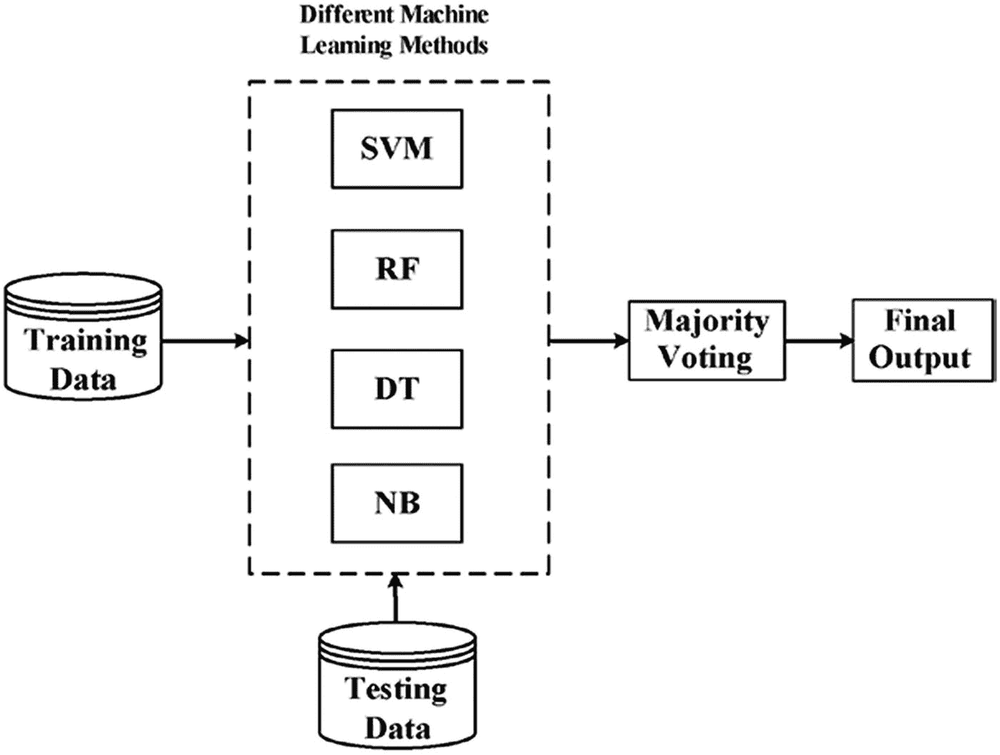

图 8-10

分类问题的投票集成学习

（来源：Saha, Zubek 等人所著《使用蛋白质功能注释进行蛋白质相互作用的集成学习预测》）

现在，为了帮助内化投票集成的概念，让我们通过一个假设的例子来理解，如下所示。

*   *问题*：在一批制造出的灯泡中找出缺陷灯泡（=1）。
*   *集成模型*：我们有三位检查专家（可理解为模型）——A、B 和 C——来识别缺陷产品。你可以使用其中任何一个，或者全部使用。
*   *附加信息*：A 的准确率为 0.7，B 的准确率为 0.6，C 的准确率为 0.65。它们的决策相互独立。

我们有三个二元分类器模型（A、B 和 C），其准确率分别为 0.7、0.6 和 0.65。现在我们将展示，如果所有这些模型在一个采用多数投票的集成模型中被一起使用，会发生什么。

对于三个模型的多数投票，我们可以预期四种结果：

*   三个模型都错误
    1.  *0.3 * 0.32 * 0.35 = 0.0336*

*   两个模型错误
    1.  *0.3 * 0.32 * 0.65*

    2.  *0.3 * 0.68 * 0.35*

    3.  *0.7 * 0.32 * 0.35 = 0.2122*

*   两个模型正确
    1.  *0.7 * 0.68 * 0.35*

    2.  *0.7 * 0.32 * 0.65*

    3.  *0.3 * 0.68 * 0.65 = 0.4448*

*   *三个模型都正确*
    1.  *0.7 * 0.68 * 0.65 = 0.3094*

在场景 2（两个模型正确）中，我们可以看到，平均而言，多数投票集成能纠正约 44% 的情况。这个由三个模型组成的集成将为我们提供约 75.4%（0.4448 + 0.3094）的平均准确率，这高于任何一个单独的模型。然而，要实现这种提升，一个重要的考虑因素是假设模型之间相互独立，并且它们的预测也相互独立。这种独立性条件通常不成立，因此有时即使使用高维集成，你可能也难以看到模型性能的提升。

### 8.5.2 集成学习的高级方法

广义上讲，有两种集成方法有助于降低方差和偏差。围绕同一思想存在一些变体，例如混合、堆叠和自定义集成，但其核心思想可以通过装袋和提升这两种方法来解释。

#### 8.5.2.1 装袋

自助聚合，也称为*装袋*，是一种集成元算法。该算法提高了模型的稳定性和准确性，并减少了过拟合问题。该方法可以与任何方法一起使用；在连续函数的情况下，它取模型输出的加权平均值；在分类问题中，它对输出进行加权，以集成成一个单一输出。

装袋由 Leo Breiman 于 1994 年提出，用于改进分类问题的结果。他原始工作的详细信息可以在他的技术论文《装袋预测器》（技术报告编号 421，1994 年，统计系）中找到。

图 8-11 展示了装袋集成的流程。装袋的步骤大致分为四个部分：

1.  从训练数据中创建样本；样本数量应适当（不宜过多或过少）。
2.  在单个样本上训练模型。
3.  从每个模型创建分类器并存储结果。
4.  根据集成类型（加权、多数投票或某种自定义方式），结合结果来预测测试数据。

图 8-11 中的图像说明了前面提到的装袋的四个步骤（来源：[`http://cse-wiki.unl.edu/`](http://cse-wiki.unl.edu/)）。

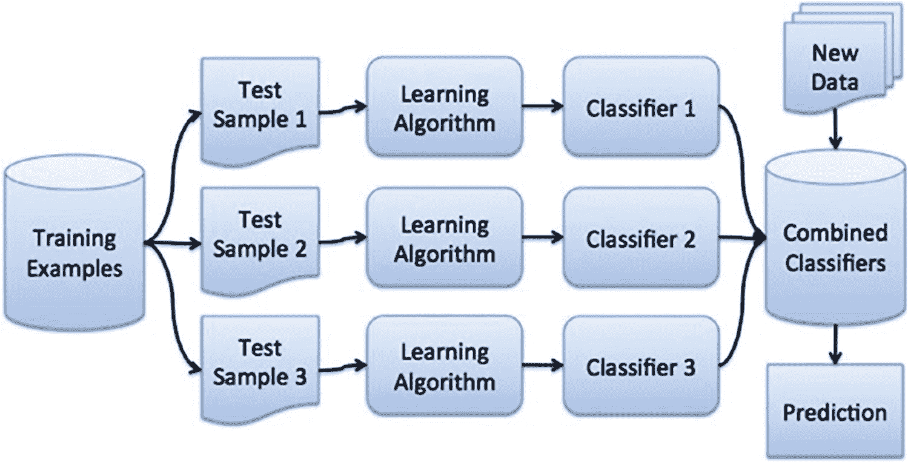

图 8-11

装袋集成流程

考虑装袋的这些重要特性：

*   每个模型并行开发，且相互独立
*   有助于降低方差，但对减少偏差无效
*   最适合高方差、低偏差的模型（复杂模型）
*   随机森林是一个很好的例子（`randomForest` 算法通过剪枝来减少相关性）

#### 8.5.2.2 提升

与装袋类似，提升也是一种旨在减少监督学习模型中偏差的集成元算法。从历史上看，提升试图回答这样一个问题：假设我们有一个分类器，其分类准确率总是低于 50%（弱分类器）。我们能否构建一个模型序列以达到零误差（最小误差）？从理论上讲，通过将残差依次传递给后续模型，这是可能的。通常，后续模型会在最终模型中创建许多复杂的关系，以至于模型难以解释；因此，提升有时被认为会创建一个黑箱，一个非常难以解释和理解的东西。

例如，如果你设计一个三轮提升，并假设分类器的正确率始终为 40%，那么对于第一轮中的 100 个对象，你将得到 60 个错误分类。在第二轮中，只传递错误分类的对象，因此 36% 将被错误分类（60 的 60%）。同样在第三轮中，你传递错误分类的对象，得到 22% 的错误分类。所以本质上，通过使用一个准确率仅为 40% 的分类器，你可以创建一个误差仅为 22%（22/100）的集成，或者说一个准确率为 78% 的模型。

然而，在现实中，理论基础保持不变，但改进并不那么显著，因为许多其他因素开始起作用，例如，每一轮模型都会变弱、重新加权、相关性等。

图 8-12 展示了提升集成的流程。提升的步骤如下所述：

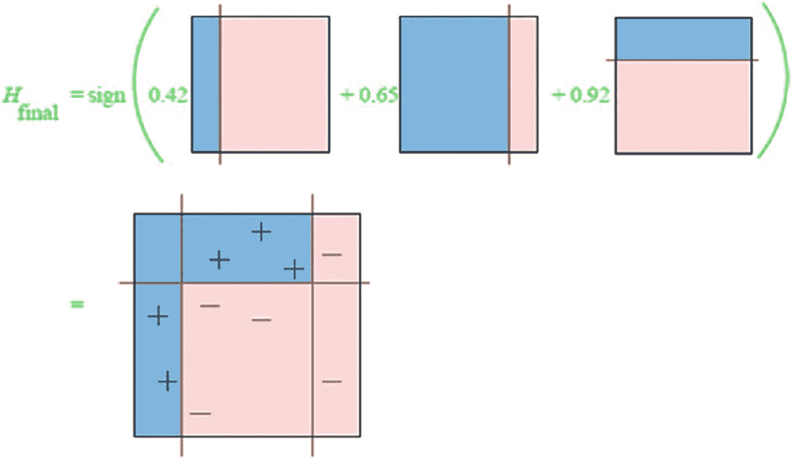

图 8-12

提升集成流程

1.  首先在完整的训练数据集上拟合一个模型。在图 8-12 中，第一个模型获得了 42% 的准确率。
2.  拟合另一个分类器以获得 65% 的准确率。
3.  拟合第三个模型以获得 92% 的准确率。
4.  现在，你将这些不同的分类器组合起来，形成一个强分类器。

（来源：[`https://alliance.seas.upenn.edu`](https://alliance.seas.upenn.edu) 。）你可以在这里看到，提升后的机器，即组合分类器，其性能远优于单个分类器。

这里列出了提升的一些重要特性：

*   每个模型是顺序开发的，因此每个后续模型都建立在先前模型的不足之处上。
*   有助于降低偏差，但对减少方差无效。
*   最适合低方差、高偏差的模型。
*   梯度提升机是一种使用提升集成的强大算法。

在接下来的章节中，我们将在我们的购买预测数据上分别展示装袋、提升、混合和堆叠的一个示例。输出表格易于阅读，图表将使模型改进的过程更加清晰。

请注意，这些示例中的参数未经调优。

## 8.6 R 语言中的集成技术示例

集成训练大致分为两种类型：装袋（bagging）和提升（boosting）。不过，研究人员还提出了许多其他变体。在本节中，我们将使用购买预测数据展示一些 R 语言示例。

本节展示了一段 R 代码，这些代码可复用于任何你想要使用的数据集。具体的函数调用及其选项可在 Caret 包及其他依赖包的文档中查阅。

在以下所有示例中，每种技术都有三个重要的校准函数：

*   `trainControl()`：设置采样方法、汇总方式及其他训练参数。

*   `train()`：使用`trainControl()`的参数训练模型；建模方法也在该函数中定义。

*   集成方法：使用自定义函数、重采样或`caretEnsemble`函数，将不同模型的结果进行组合。

现在，让我们开始使用 R 环境构建集成模型。

### 8.6.1 装袋树

这里使用两种最流行的装袋算法：

*   装袋 CART（回归树）

*   随机森林

以下代码基于这些技术创建了两个模型，并展示了这两种树方法的比较结果。

```
library(caret)
library(randomForest)
library(class)
library(ipred)

# 加载数据集
Purchase_Data <-read.csv("Purchase Prediction Dataset.csv",header=TRUE)
data <-na.omit(Purchase_Data)

# 创建包含 1 万条记录的样本
set.seed(917);
Data <-data[sample(nrow(data),size=10000),]

# 选择最佳调优配置
dataset <-Data

# 装袋算法示例
control <-trainControl(method="repeatedcv", number=10, repeats=3)
metric <- "Accuracy"
```

以下代码片段拟合了一个装袋树模型。

```

# 装袋 CART
set.seed(917)
fit.treebag <-train(factor(ProductChoice) ~MembershipPoints +CustomerAge +PurchaseTenure +CustomerPropensity +LastPurchaseDuration, data=dataset, method="treebag", metric=metric, trControl=control)
Loading required package: plyr
Loading required package: e1071
```

以下代码片段拟合了一个随机森林模型。

```

# 随机森林
set.seed(917)
fit.rf <-train(factor(ProductChoice) ~MembershipPoints +CustomerAge +PurchaseTenure +CustomerPropensity +LastPurchaseDuration, data=dataset, method="rf", metric=metric, trControl=control)
```

以下代码使用 Caret 包中的`resamples()`函数汇总了这两种方法的装袋结果。

```

# 汇总结果
bagging_results <-resamples(list(treebag=fit.treebag, rf=fit.rf))
summary(bagging_results)
Call:
summary.resamples(object = bagging_results)
Models: treebag, rf
Number of resamples: 30
Accuracy
Min. 1st Qu. Median   Mean 3rd Qu.  Max. NA's
treebag 0.327  0.3444 0.3505 0.3518  0.3583 0.384    0
rf      0.395  0.4095 0.4167 0.4151  0.4216 0.435    0
Kappa
Min. 1st Qu.  Median    Mean 3rd Qu.   Max. NA's
treebag 0.02242 0.04812 0.05498 0.05786 0.06759 0.1044    0
rf      0.04252 0.06536 0.07513 0.07387 0.08290 0.1032    0
dotplot(bagging_results)
```

随机森林的准确率优于装袋 CART。图 8-13 中的图表展示了两种算法在 Kappa 值和准确率上的比较。

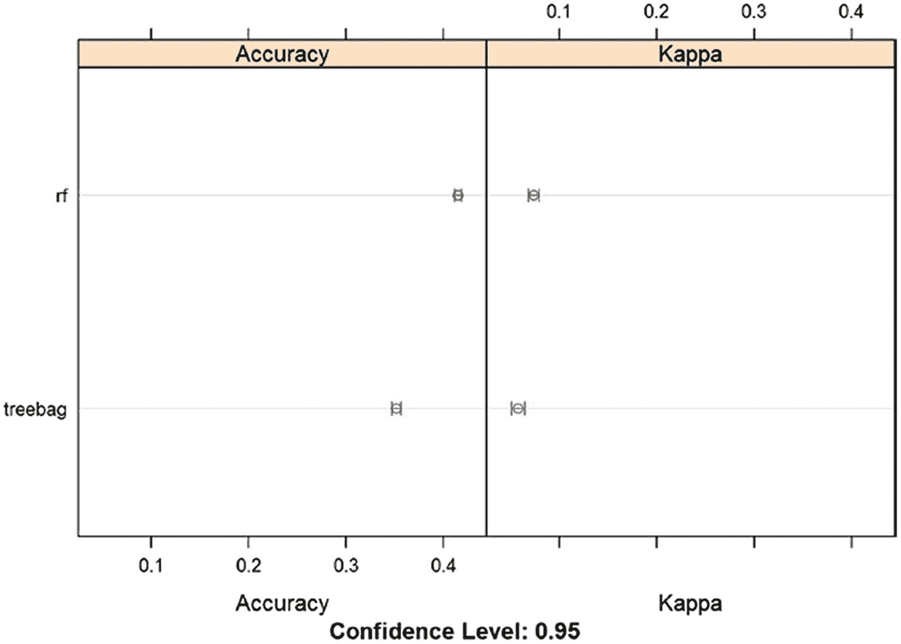

图 8-13

装袋树的准确率与 Kappa 值

### 8.6.2 基于决策树的梯度提升

对于提升方法，我们将介绍两种最流行的算法：

*   C5.0：由 Ross Quinlan 开发的决策树

*   梯度提升机

以下代码首先创建了一个 C5.0 决策树模型，然后创建了一个 GBM 模型。两个模型准备就绪后，我们将这两个模型组合起来创建一个提升集成模型。

```
library(C50)
library(gbm)
dataset <-Data;

# 提升算法示例
control <-trainControl(method="repeatedcv", number=10, repeats=3)
metric <- "Accuracy"
```

这里，我们拟合了一个 C5.0 决策树模型。

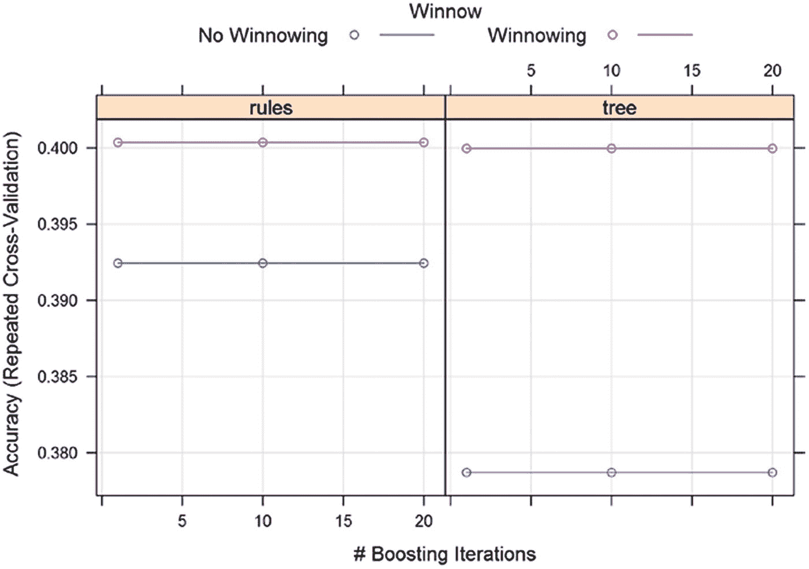

图 8-14

各提升迭代次数下的准确率：C5.0

```

# C5.0
set.seed(917)
fit.c50 <-train(factor(ProductChoice) ~MembershipPoints +CustomerAge +PurchaseTenure +CustomerPropensity +LastPurchaseDuration, data=dataset, method="C5.0", metric=metric, trControl=control)
fit.c50
C5.0
10000 samples
5 predictor
4 classes: '1', '2', '3', '4'
No pre-processing
Resampling: Cross-Validated (10 fold, repeated 3 times)
Summary of sample sizes: 9000, 8999, 9001, 9001, 9000, 9000, ...
Resampling results across tuning parameters:
model  winnow  trials  Accuracy   Kappa
rules  FALSE    1      0.3924345  0.07807159
rules  FALSE   10      0.3924345  0.07807159
rules  FALSE   20      0.3924345  0.07807159
rules   TRUE    1      0.4003660  0.03854515
rules   TRUE   10      0.4003660  0.03854515
rules   TRUE   20      0.4003660  0.03854515
tree   FALSE    1      0.3786998  0.06855999
tree   FALSE   10      0.3786998  0.06855999
tree   FALSE   20      0.3786998  0.06855999
tree    TRUE    1      0.3999658  0.03799627
tree    TRUE   10      0.3999658  0.03799627
tree    TRUE   20      0.3999658  0.03799627
Accuracy was used to select the optimal model using  the largest value.
The final values used for the model were trials = 1, model = rules
and winnow = TRUE.
plot(fit.c50)
```

该模型使用准确率的最大值来选择最优模型。见图 8-14。

这里，我们使用相同的数据集创建了一个梯度提升机（GBM）。见图 8-15。

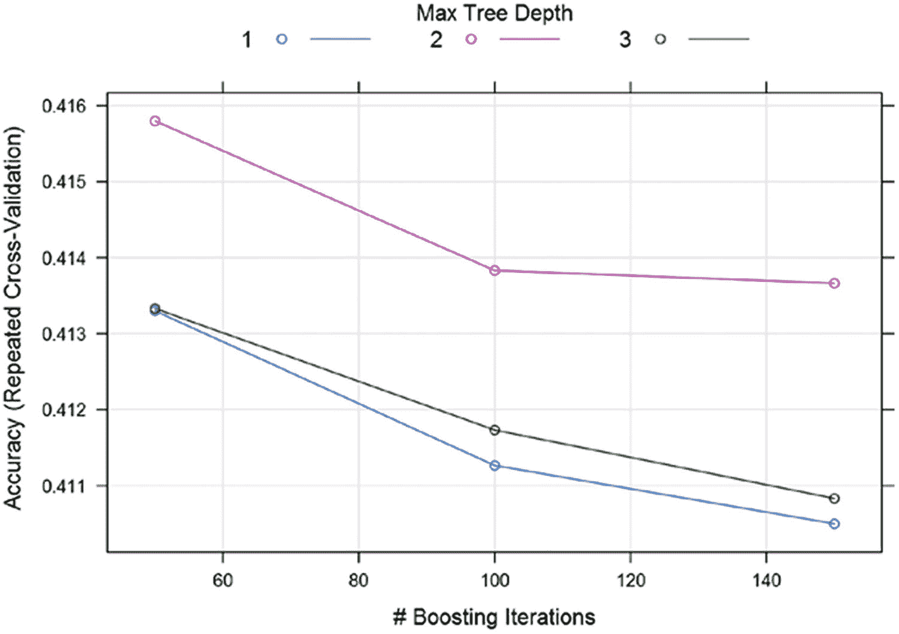

图 8-15

各提升迭代次数下的准确率：GBM

```

# 随机梯度提升
set.seed(917)
fit.gbm <-train(factor(ProductChoice) ~MembershipPoints +CustomerAge +PurchaseTenure +CustomerPropensity +LastPurchaseDuration, data=dataset, method="gbm", metric=metric, trControl=control, verbose=FALSE)
fit.gbm
Stochastic Gradient Boosting
10000 samples
5 predictor
4 classes: '1', '2', '3', '4'
No pre-processing
Resampling: Cross-Validated (10 fold, repeated 3 times)
Summary of sample sizes: 9000, 8999, 9001, 9001, 9000, 9000, ...
Resampling results across tuning parameters:
interaction.depth  n.trees  Accuracy   Kappa
1                   50      0.4133000  0.07395657
1                  100      0.4112656  0.07721806
1                  150      0.4104981  0.07825744
2                   50      0.4157985  0.08170535
2                  100      0.4138310  0.08341336
2                  150      0.4136634  0.08690728
3                   50      0.4133309  0.08146098
3                  100      0.4117326  0.08628274
3                  150      0.4108320  0.08948114
Tuning parameter 'shrinkage' was held constant at a value of 0.1
Tuning parameter 'n.minobsinnode' was held constant at a value of 10
Accuracy was used to select the optimal model using  the largest value.
The final values used for the model were n.trees = 50, interaction.depth
= 2, shrinkage = 0.1 and n.minobsinnode = 10.
plot(fit.gbm)
```

现在，我们使用 Caret 包中的`resamples()`函数，将 GBM 和 C5.0 模型的结果进行汇总。

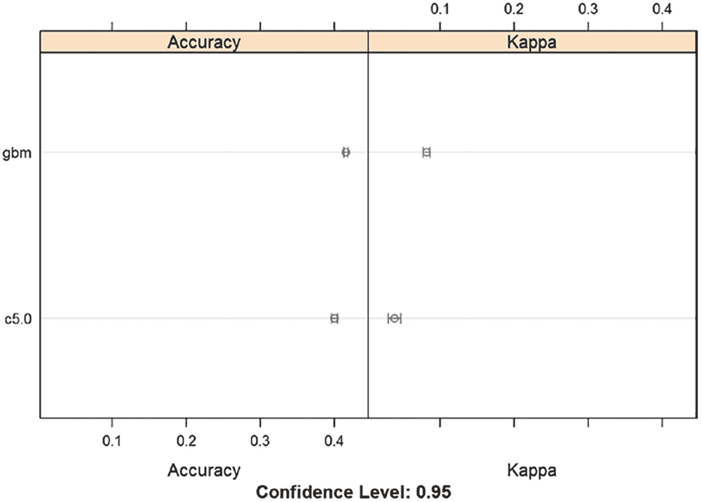

图 8-16

提升集成模型的准确率

```

# 汇总结果
boosting_results <-resamples(list(c5.0=fit.c50, gbm=fit.gbm))
summary(boosting_results)
Call:
summary.resamples(object = boosting_results)
Models: c5.0, gbm
Number of resamples: 30
Accuracy
Min. 1st Qu. Median   Mean 3rd Qu.   Max. NA's
c5.0 0.376  0.3917 0.4008 0.4004  0.4088 0.4226    0
gbm  0.398  0.4112 0.4153 0.4158  0.4209 0.4286    0
Kappa
Min. 1st Qu.  Median    Mean 3rd Qu.    Max. NA's
c5.0 0.00000 0.02886 0.04001 0.03855 0.05701 0.07496    0
gbm  0.05248 0.07366 0.08241 0.08171 0.08875 0.10530    0
dotplot(boosting_results)
```

我们可以看到，C5.0 算法的最佳模型准确率为 40.5%，而 GBM 模型的准确率为 41.5%（见图 8-16）。梯度提升似乎能更好地拟合数据。

### 8.6.3 混合 KNN 与 Rpart

混合是一种集成方法，其中不同模型的输出以一定权重进行组合，并非所有模型输出都被同等对待。以下示例使用了两种技术进行混合：

*   `knn`

*   `rpart`

在本例中，我们将把 `knn` 和 `rpart` 方法作为模型的线性组合进行混合。这些模型将通过 `caretEmseble()` 函数进行组合。

`caretEnsemble` 是一个用于创建 Caret 模型集成的 R 包。该包的详细信息可访问 [`https://cran.r-project.org/web/packages/caretEnsemble/vignettes/caretEnsemble-intro.html`](https://cran.r-project.org/web/packages/caretEnsemble/vignettes/caretEnsemble-intro.html) 获取。

```
混合（模型的线性组合）

# 加载库
library(caret)
library(caretEnsemble)
library(MASS)
set.seed(917);
Data <-data[sample(nrow(data),size=10000),];
dataset <-Data;
dataset$choice <-ifelse(dataset$ProductChoice ==1 |dataset$ProductChoice ==2 ,"A","B")
dataset$choice <-as.factor(dataset$choice)

# 定义训练控制参数
train_control <-trainControl(method="cv", number=4, savePredictions=TRUE, classProbs=TRUE)

# 训练模型列表
methodList <-c('knn','rpart')
models <-caretList(choice ~MembershipPoints +CustomerAge +PurchaseTenure +CustomerPropensity +LastPurchaseDuration, data=dataset, trControl=train_control, methodList=methodList)

# 创建已训练模型的集成
ensemble <-caretEnsemble(models)

# 汇总集成结果
summary(ensemble)
The following models were ensembled: knn, rpart
They were weighted:
-1.9876 0.4849 3.4433
The resulting Accuracy is: 0.6416
The fit for each individual model on the Accuracy is:
method  Accuracy  AccuracySD
knn 0.5924004 0.007451753
rpart 0.6397990 0.005863011
```

此输出显示，`knn` 和 `rpart` 的单独准确率分别为 59% 和 63%，而混合模型的准确率为 64%。这表明混合使我们能够略微改善分类结果。通常，集成技术（如 KNN 和 Rpart 的混合）带来的改进幅度甚至可以达到 10%。

接下来的堆叠方法与混合非常相似。唯一的区别在于，在堆叠中，我们将模型一个接一个地堆叠起来，然后对每个模型的输出进行加权，以创建一个集成模型。

### 8.6.4 使用 caretEnsemble 进行堆叠

堆叠与混合类似，唯一的区别在于为后续模型提取数据的方式。其一般原则是不使用训练数据本身进行提升。

因此，我们应用诸如使用交叉验证（使用折外数据训练下一层）——*堆叠*——和/或使用留出验证（部分训练数据用于第一层，部分用于第二层）——*混合*——等规则。

例如，我们以之前拟合用于集成的 `knn` 和 `rpart` 模型为例。假设训练集有 100 个案例需要分类。那么在混合中：

1.  `knn` *基于 100 个案例构建。*
2.  `rpart` *基于 100 个案例构建。*
3.  集成模型 = `c1*Knn + c2*Rpart`，*其中* `c1` *和* `c2` *是组合前赋予每个模型的*权重。这就是我们混合这两种方法的方式。

堆叠的示例如下：

1.  `knn` 基于 100 个案例构建，正确分类了 60 个。
2.  在前一个模型*分类错误的 40 个*案例上构建 `rpart`，这使你能够再正确分类 20 个案例。（这是一种理想情况。实际上，训练集中的 100 个案例会被加权，使得在堆叠的前一个模型中，分类错误的案例在训练中获得比正确分类案例更高的权重。）
3.  *现在将两次模型运行的结果组合到集成中。换句话说，你将一个模型的结果堆叠到另一个模型上。*

这个例子以简化的方式展示了混合和堆叠在原理上的区别。通常，这两种方法都会生成多个模型，我们通过加权将它们组合成一个单一的集成模型。

我们可以使用 `caretEnsemble` 包来组合（或堆叠）多个 Caret 模型的预测。在本例中，我们将在购买预测数据上堆叠五种不同的算法：

*   线性判别分析 (LDA)
*   分类与回归树 (CART)
*   逻辑回归（通过广义线性模型或 GLM）
*   k-最近邻 (KNN)
*   带径向基核函数的支持向量机 (SVM)

```

# 堆叠算法示例
library(kernlab);

# 创建子模型
control <-trainControl(method="repeatedcv", number=10, repeats=3, savePredictions=TRUE, classProbs=TRUE)
```

以下是算法为堆叠列出的设置。五种算法存储在 `algorithmList` 变量中，该变量将用作训练函数中的参数。

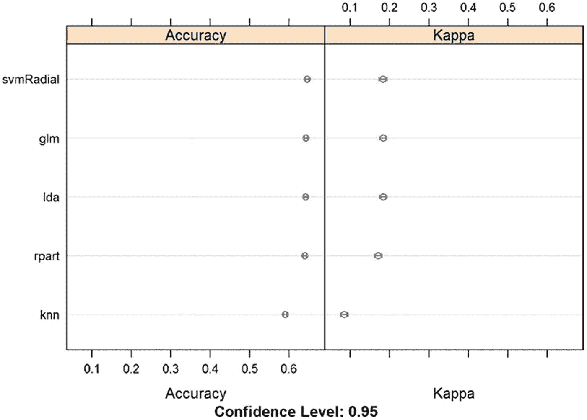

图 8-17

各模型的准确率与 Kappa 值

```
algorithmList <-c('lda', 'rpart', 'glm', 'knn', 'svmRadial')
set.seed(917)
models <-caretList(choice ~MembershipPoints +CustomerAge +PurchaseTenure +CustomerPropensity +LastPurchaseDuration, data=dataset, trControl=control, methodList=algorithmList)
results <-resamples(models)
summary(results)
Call:
summary.resamples(object = results)
Models: lda, rpart, glm, knn, svmRadial
Number of resamples: 30
Accuracy
Min. 1st Qu. Median   Mean 3rd Qu.   Max. NA's
lda       0.6240  0.6330 0.6443 0.6424  0.6510 0.6600    0
rpart     0.6260  0.6315 0.6383 0.6403  0.6470 0.6640    0
glm       0.6270  0.6336 0.6447 0.6432  0.6518 0.6580    0
knn       0.5710  0.5825 0.5940 0.5908  0.5990 0.6070    0
svmRadial 0.6226  0.6381 0.6470 0.6462  0.6558 0.6683    0
Kappa
Min. 1st Qu.  Median    Mean 3rd Qu.   Max. NA's
lda       0.14170 0.16630 0.18680 0.18430  0.2038 0.2357    0
rpart     0.12510 0.15430 0.16750 0.17140  0.1859 0.2319    0
glm       0.14290 0.16440 0.18650 0.18430  0.2010 0.2282    0
knn       0.03609 0.06526 0.09152 0.08519  0.1047 0.1255    0
svmRadial 0.13230 0.16290 0.18680 0.18370  0.2019 0.2319    0
dotplot(results)
```

从图 8-17 的散点图可以看出，通过将多个算法堆叠在一起，性能已提升至 60%。同时请注意，模型训练非常消耗资源，且模型复杂度不适合生产环境。

现在，我们来看一下每个堆叠模型结果之间的相关性。相关性将显示各模型之间有多少结果是相同的。如果预测重叠的数量很高，那么堆叠可能不会带来结果的改善。

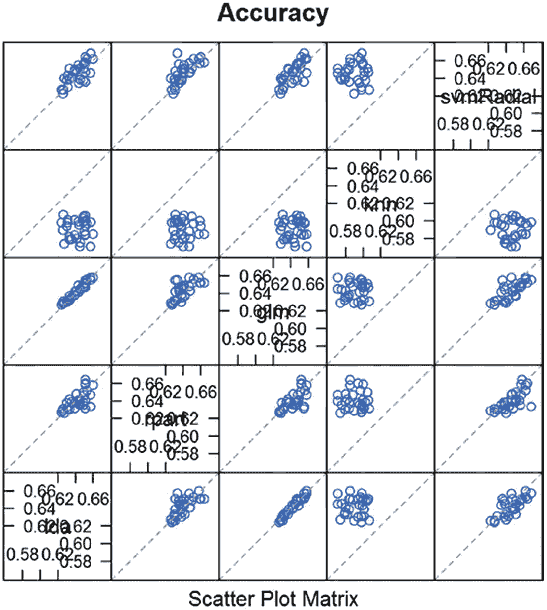

图 8-18

展示堆叠模型结果之间相关性的散点图

```

# correlation between results
modelCor(results)
lda       rpart         glm           knn     svmRadial
lda        1.00000000  0.65576463 0.974747749 -0.0145770069  0.7366291336
rpart      0.65576463  1.00000000 0.675976986 -0.0350947255  0.6936118174
glm        0.97474775  0.67597699 1.000000000  0.0039610564  0.7336378830
knn       -0.01457701 -0.03509473 0.003961056  1.0000000000 -0.0008377878
svmRadial  0.73662913  0.69361182 0.733637883 -0.0008377878  1.0000000000
splom(results)
```

部分模型之间的相关性似乎很高——例如`lda`和`glm`、`lda`和`svmradial`等。正如前文所述，这会影响集成能力。

在前面的例子中，`knn`是基础模型，其他模型堆叠在其之上。实际上，我们可以通过使用`caretStack()`函数来改变堆叠顺序。这里我们通过重新排列堆叠顺序来展示相同的例子。在第一种情况下，我们从`glm`模型开始；在第二种情况下，我们从随机森林开始，然后比较堆叠是否改善了结果。

使用 GLM 进行堆叠：

```

# stack using glm
stackControl <-trainControl(method="repeatedcv", number=10, repeats=3, savePredictions=TRUE, classProbs=TRUE)
set.seed(917)
stack.glm <-caretStack(models, method="glm", metric="Accuracy", trControl=stackControl)
print(stack.glm)
A glm ensemble of 2 base models: lda, rpart, glm, knn, svmRadial
Ensemble results:
Generalized Linear Model
30000 samples
5 predictor
2 classes: 'A', 'B'
No pre-processing
Resampling: Cross-Validated (10 fold, repeated 3 times)
Summary of sample sizes: 27000, 26999, 27000, 27000, 27000, 27001, ...
Resampling results:
Accuracy   Kappa
0.6441887  0.1845648
```

使用`glm`进行堆叠得到了 64%的准确率。在下一节中，我们使用`randomForest`进行了相同的堆叠。

```

# stack using random forest
set.seed(917)
stack.rf <-caretStack(models, method="rf", metric="Accuracy", trControl=stackControl)
print(stack.rf)
A rf ensemble of 2 base models: lda, rpart, glm, knn, svmRadial
Ensemble results:
Random Forest
30000 samples
5 predictor
2 classes: 'A', 'B'
No pre-processing
Resampling: Cross-Validated (10 fold, repeated 3 times)
Summary of sample sizes: 27000, 26999, 27000, 27000, 27000, 27001, ...
Resampling results across tuning parameters :
mtry  Accuracy   Kappa
2     0.6372440  0.1944063
3     0.6356217  0.1927612
5     0.6335549  0.1885745
Accuracy was used to select the optimal model using  the largest value.
The final value used for the model was mtry = 2.
```

使用`randomForest`，我们得到了接近 63.7%的准确率，这与`glm`的准确率相近，但略低一些。因此，对于这个实验，使用`glm`进行堆叠效果最好。再次强调，某些方法之间的相关性很高，因此将它们添加到堆叠中不会有利于模型准确率的提升。

## 8.7 高级主题：机器学习模型的贝叶斯优化

在机器学习中，超参数调优扮演着重要角色。数据科学家现在在将最终模型投入生产之前，会关注参数的调优。因此，简要介绍一种最重要的优化技术——贝叶斯优化——是很重要的。Yachen Yan 最近发布了一个用于 R 语言贝叶斯优化的新包。我们将展示如何将此包应用于房价数据。

贝叶斯优化是一种为黑箱函数（模型评估指标作为超参数的函数）寻找全局最优点的方法，且无需导数。Jonas Mockus 的工作在学术界广受好评；关于此主题的全面介绍可参见《贝叶斯方法在全局优化中的应用：理论与应用》，Jonas Mockus，Kluwer Academic (2013)。

对于这个例子，我们将首先通过随机调优获得一组初始超参数。这将为我们生成在广泛范围内分布的多个值。这里我们创建了 20 个随机参数。该示例的灵感来源于辉瑞公司总监 Max Kuhn 在 revolutions 上发表的文章。文章可通过[`http://blog.revolutionanalytics.com/2016/06/bayesian-optimization-of-machine-learning-models.html`](http://blog.revolutionanalytics.com/2016/06/bayesian-optimization-of-machine-learning-models.html)访问。

```
setwd("C:/Personal/Machine Learning/Chapter 8/");
library(caret)
library(randomForest)
library(class)
library(ipred)
library(GPfit)

# Load Dataset
House_price <-read.csv("House Sale Price Dataset.csv",header=TRUE)
dataset <-na.omit(House_price)
#Create a sample of 10K records
set.seed(917);
rand_ctrl <-trainControl(method ="repeatedcv", repeats =5, search ="random")
rand_search <-train(HousePrice ~StoreArea +BasementArea +SellingYear +SaleType +ConstructionYear +Rating, data = dataset, method ="svmRadial",
Create 20 random parameter values
tuneLength =20,
metric ="RMSE",
preProc =c("center", "scale"),
trControl = rand_ctrl)
rand_search
Support Vector Machines with Radial Basis Function Kernel
1069 samples
6 predictor
Pre-processing: centered (10), scaled (10)
Resampling: Cross-Validated (10 fold, repeated 5 times)
Summary of sample sizes: 961, 962, 963, 962, 963, 962, ...
Resampling results across tuning parameters:
sigma        C            RMSE      Rsquared
0.005245534   22.6530619  43909.17  0.7456410
0.013918538    0.9927528  42284.81  0.7655819
...  0.730177279   90.8484676  57009.90  0.5687722
1.858138939    0.5329669  63431.60  0.4909382
```

RMSE was used to select the optimal model using the smallest value. The final values used for the model were sigma = 0.04674319 and C = 3.112494.

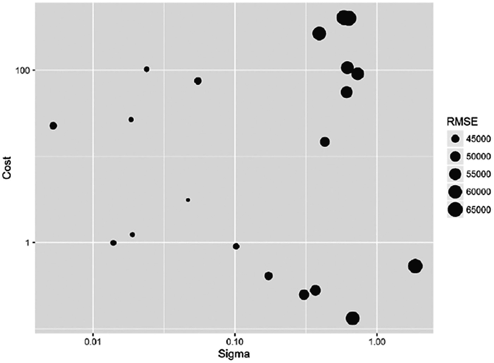

图 8-19

成本与 Sigma 空间中的 RMSE

```
ggplot(rand_search) +scale_x_log10() +scale_y_log10()
```

```
getTrainPerf(rand_search)
TrainRMSE TrainRsquared    method
1  41480.77     0.7706348 svmRadial
```

这个例子是一种优化，它假设贝叶斯模型基于高斯过程来预测良好的调优参数。因此，本次贝叶斯分析使用了线性回归类型的框架。

对于成本与 Sigma 的组合，我们可以计算预测 RMSE 的边界。由于预测的不确定性，有可能找到更好的优化方向。

```

# Define the resampling method
ctrl <-trainControl(method ="repeatedcv", repeats =5)
```

使用此函数来优化模型。这两个参数根据其范围和规模在对数尺度上进行评估。

```
svm_fit_bayes <-function(logC, logSigma) {
使用相同的模型代码，但仅针对单个 (C, sigma) 对。
txt <-capture.output(
mod <-train(HousePrice ~StoreArea +BasementArea +SellingYear +SaleType +ConstructionYear +Rating , data = dataset,
method ="svmRadial",
preProc =c("center", "scale"),
metric ="RMSE",
trControl = ctrl,
tuneGrid =data.frame(C =exp(logC), sigma =exp(logSigma)))
)
该函数希望 _ 最大化 _ 结果，因此我们返回
重采样 RMSE 值的负值。`Pred` 可用于
返回预测值，但我们将避免使用它，并返回零
list(Score = -getTrainPerf(mod)[, "TrainRMSE"], Pred =0)
}
```

定义搜索的边界。

```
lower_bounds <-c(logC = -5, logSigma = -9)
upper_bounds <-c(logC =20, logSigma = -0.75)
bounds <-list(logC =c(lower_bounds[1], upper_bounds[1]),
logSigma =c(lower_bounds[2], upper_bounds[2]))
创建一个值网格，作为贝叶斯优化代码的输入
initial_grid <-rand_search$results[, c("C", "sigma", "RMSE")]
initial_grid$C <-log(initial_grid$C)
initial_grid$sigma <-log(initial_grid$sigma)
initial_grid$RMSE <--initial_grid$RMSE
names(initial_grid) <-c("logC", "logSigma", "Value")
```

使用初始网格并运行 30 次迭代进行优化。

```
library(rBayesianOptimization)
set.seed(917)
ba_search <-BayesianOptimization(svm_fit_bayes,
bounds = bounds,
init_grid_dt = initial_grid,
init_points =0,
n_iter =30,
acq ="ucb",
kappa =1,
eps =0.0,
verbose =TRUE)
在超参数空间中预先采样了 20 个点
elapsed = 7.02   Round = 21  logC = -0.6296  logSigma = -3.2325  Value = -
4.260364e+04
找到的最佳参数：
Round = 43   logC = 3.5271   logSigma = -3.3272  Value = -4.106852e+04
ba_search
$Best_Par
logC  logSigma
3.527062 -3.327152
$Best_Value
[1] -41068.52
$History
Round         logC   logSigma     Value
1:     1  3.120295026 -5.2503783 -43909.17
2:     2 -0.007273577 -4.2745337 -42284.81
49:    49  1.765610990 -2.6130250 -41510.91
50:    50  3.286583098 -3.4811229 -41876.16
Round         logC   logSigma     Value
$Pred
V1 V2 V3 V4 V5 V6 V7 V8 V9 V10 V11 V12 V13 V14 V15 V16 V17 V18 V19 V20
1:  0  0  0  0  0  0  0  0  0   0   0   0   0   0   0   0   0   0   0   0
V21 V22 V23 V24 V25 V26 V27 V28 V29 V30
1:   0   0   0   0   0   0   0   0   0   0
```

找到的最佳值如下：

```
Round = 43
logC = 3.5271
logSigma = -3.3272
Value = -4.106852e+04
```

现在，让我们使用这些参数开发一个模型，以验证优化是否确实有效。

```
final_search <-train(HousePrice ~StoreArea +BasementArea +SellingYear +SaleType +ConstructionYear +Rating, data = dataset,
method ="svmRadial",
tuneGrid =data.frame(C =exp(ba_search$Best_Par["logC"]),
sigma =exp(ba_search$Best_Par["logSigma"])),
metric ="RMSE",
preProc =c("center", "scale"),
trControl = ctrl)
final_search
使用径向基函数核的支持向量机
1069 个样本
6 个预测变量
预处理：中心化 (10)，缩放 (10)
重采样：交叉验证 (10 折，重复 5 次)
样本量摘要：962, 961, 964, 961, 964, 963, ...
重采样结果：
RMSE      Rsquared
41595.45  0.7671211
调优参数 'sigma' 保持恒定，值为 0.0358952
调优参数 'C' 保持恒定，值为 34.02386
```

以下命令将提供模型间的比较。比较使用单样本 t 检验进行。

```
compare_models(final_search, rand_search)
单样本 t 检验
data:  x
t = 0.061836, df = 49, p-value = 0.9509
备择假设：真实均值不等于 0
95% 置信区间：
-3612.507  3841.883
样本估计：
x 的均值
114.6878
```

新配置上的模型拟合在重采样 RMSE 和测试集 RMSE 方面与随机搜索相当。这表明优化效果良好。

## 8.8 总结

与统计模型相比，机器学习模型非常复杂。机器学习模型及其集成方法增加了模型的复杂性。模型变得难以解释，并且更难分离各个特征的贡献。集成模型进一步增加了机器学习模型所量化的因变量和预测变量之间关系的复杂性。另一方面，机器学习算法使得可以在没有任何假设的情况下使用任何数量的数据。这使得机器学习有别于统计学习，并为几乎任何数据问题的建模开辟了众多可能性。

统计学习和机器学习之间的主要区别之一在于两者从给定数据集中提取/学习的方式。机器学习算法本质上是迭代的，并依赖于一些“高级参数”，这些参数定义了模型的复杂度、学习率等。这些参数通常被称为超参数。超参数在很大程度上影响模型性能，因为它们定义了模型应如何从数据中学习的高维参数。我们学习了一些优化这些超参数的方法。本章中的所有优化模型拟合都是使用 R 中一个非常强大的包完成的，该包名为 Caret，代表分类和回归训练。它可以在单个函数调用中容纳近 230 多个模型。

在本章中，在介绍了各种类型的超参数优化方法之后，我们引入了偏差与方差权衡这一非常重要的主题。这种权衡是所有统计模型都存在的局限性，并且是任何模型性能优化问题的核心。该权衡指出，你无法同时减少偏差和方差。随后介绍了集成方法，以创建能够减少偏差（提升集成）和减少方差（装袋集成）的模型。装袋和提升都是强大的技术，并且近年来变得非常流行。

本章还使用 R 代码说明了四个非常流行的集成示例：装袋、提升、混合和堆叠。比较了结果，并讨论了结果中的相关性等问题。最后，我们介绍了一种非常先进的超参数优化技术，称为贝叶斯优化。这是一个热门的研究课题，因为机器学习模型已经变得如此庞大，以至于网格搜索不再是超参数优化的可行解决方案。

近年来，机器学习方法对计算能力的要求也越来越高。通过注意到本章仅使用了数据样本这一事实，你可以感受到我们所需的巨大计算能力。添加更多数据并扩展搜索网格可以增强结果。为了满足机器学习算法在数据量和计算能力方面的需求，我们需要探索可扩展的机器学习基础设施和算法。

下一章将介绍时间序列分析，这是一种经典的预测技术，深受统计学影响。在许多实际业务用例中，时间序列分析被广泛使用并已获得广泛认可。

