# 9. 时间序列建模

按时间索引记录数据是一种古老的数据收集分析方法。时间索引数据主要用于观察与时间高度相关的事件，且其方差中相当一部分是由时间变化引起的。时间序列分析入门将帮助你理解如何计算随时间变化的波动。

时间序列分析在金融、经济和调查领域具有广泛的适用性。虽然时间序列方法被气象学、海洋学和天文学等研究自然过程的领域所采用，但许多其他领域也发现其具有实用价值。本章介绍时间序列的基础知识，并解释如何分析底层数据。

本章涵盖的核心要点包括：

*   时间序列的组成部分
*   平稳性检验
*   ACF 与 AR 模型
*   PACF 与 MA 模型
*   ARIMA 模型
*   含 AR 误差的线性回归

为了讨论这些概念，本章将使用每小时电力消耗数据集。

每小时电力消耗数据来自 PJM 网站，单位为兆瓦（MW）。PJM Interconnection LLC（PJM）是美国的一家区域输电组织（RTO）。它是东部互联电网的一部分，运营着一个输电系统，服务于特拉华州、伊利诺伊州、印第安纳州、肯塔基州、马里兰州、密歇根州、新泽西州、北卡罗来纳州、俄亥俄州、宾夕法尼亚州、田纳西州、弗吉尼亚州、西弗吉尼亚州以及哥伦比亚特区的全部或部分地区。

该数据集经过加载和精简，以适合解释相关概念。所有假设（如有应用）将在相应章节中说明。

## 9.1 时间序列的组成部分

时间序列数据是在一段时间内以通常固定的时间间隔收集的。*单变量时间序列*定义为同一变量等间隔的时间测量。这一特性使得数据的本质与我们在线性回归模型中看到的不同。关键区别在于，数据不一定是独立同分布的，且数据的顺序非常重要。

我们在时域中构建的模型大多涉及基于过去值和过去预测误差来预测序列的值。在某些情况下，时间分量也被用作回归中的普通 x 变量。

在提出建模方法之前，理解时间序列数据非常重要。需要关注的一些关键点包括：

*   趋势——时间序列总体上是否呈上升或下降趋势
*   季节性——序列是否显示出相似规模的季节性变化
*   时间序列中是否存在突变
*   在时间维度上是否存在无明显解释的明显异常值
*   周期性——能否发现重复出现的长期模式

现在让我们来看一下数据集。

### 注

该序列已缩减为月度聚合数据，但你可以按不同的时间步长进行分析，例如每日、每季度等。

```
library(reshape)
library(ggplot2)
library(dplyr)
library(lubridate)
Power_Consumption % group_by(Datetime) %>%  summarise(Average_Consumption=mean(DOM_MW))
#在开始可视化之前，了解时间序列的描述性元素是很好的。
#记录数量
dim(Power_Consumption)

## [1] 160   2
#序列的开始日期和时间
min(Power_Consumption$Datetime)

## [1] "2005-05-01"
#序列的结束日期和时间
max(Power_Consumption$Datetime)

## [1] "2018-08-01"
#记录消耗的时间间隔 - 假设所有间隔相等
Power_Consumption$Datetime[3]-Power_Consumption$Datetime[2]

## Time difference of 30 days
#记录的最高消耗量
max(Power_Consumption$Average_Consumption)

## [1] 14236.33
#记录的最低消耗量
min(Power_Consumption$Average_Consumption)

## [1] 8681.653
#序列中的平均消耗量
mean(Power_Consumption$Average_Consumption)

## [1] 10962.52
start_Date <- as.Date("2006-01-01")
end_Date <- as.Date("2018-01-01")
#简单折线图
ggplot(data = Power_Consumption, aes(x = Datetime, y = Average_Consumption)) +
geom_line(color = 'red', size = 1) +
scale_x_date(limits = c(start_Date, end_Date))+
theme(legend.title=element_text(family="Times",size=20),
legend.text=element_text(family="Times",face = "italic",size=15),
plot.title=element_text(family="Times", face="bold", size=20),
axis.title.x=element_text(family="Times", face="bold", size=12),
axis.title.y=element_text(family="Times", face="bold", size=12)) +
xlab("时间") +
ylab("电力消耗（兆瓦）") +
ggtitle("2005 年至 2018 年每月电力消耗随时间变化")
```

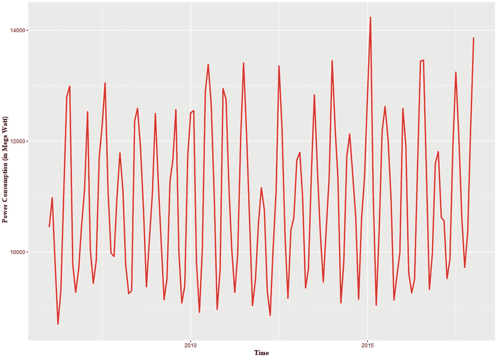

图 9-1

2005 年至 2018 年每月电力消耗随时间变化

图 9-1 的一些要点：

*   似乎没有趋势。平均消耗量在均值附近徘徊。
*   可以观察到一个周期，每个周期为一年。
*   每个周期中可见季节性模式。

为了进一步分析，我们将仅查看 2015 年至 2017 年的电力消耗数据，并尝试利用时间序列特征来构建时间相关的单变量模型。以下代码分析了叠加在 2015 年至 2017 年时间序列数据趋势上的平滑曲线。

```
#让我们仅关注 2015 年以后的时间序列分析，通过设置坐标轴限制
start_Date = start_Date & as.Date(Power_Consumption$Datetime) <= end_Date,]
ggplot(data = Power_Consumption, aes(x = Datetime, y = Average_Consumption)) +
geom_line(color = "red", size = 1) +
stat_smooth(  color = "blue", fill = "yellow", method = "loess" )
```

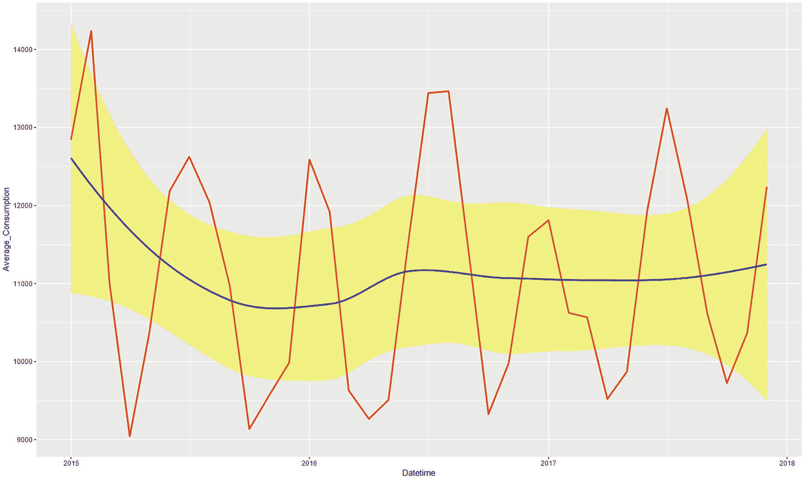

图 9-2

2015 年至 2017 年时间序列数据的趋势

图 9-2 中的平滑处理向我们显示，数据具有强烈的时间依赖性。你可以看到，平均消耗量的水平并非单调变化；它们或多或少与 2015 年初至 2017 年底的水平保持一致。平均消耗量的变化是时间序列分析的一个很好的用例。

## 9.2 平稳性检验

时间序列的平稳性是使用自相关函数（ACF）对时间序列进行推断的重要假设。平稳性意味着任何特定滞后的自相关不随时间变化。

*自相关*是随机过程中不同时间点时间序列值之间的相关性。

设 `X` 为一个随机过程，`t` 为任意时间点（对于离散时间过程，`t` 可以是整数；对于连续时间过程，`t` 可以是实数）。那么 `Xt` 是该过程在时间 `t` 时某次运行产生的值（或实现值）。假设该过程在时间 `t` 的均值为 *μ*[*t*]，方差为 *σ*[*t*]²。则时间 `s` 和 `t` 之间的自相关定义为：

![$$ R\left(s,t\right)=\frac{\mathrm{E}\left[\left({X}_t-{\mu}_t\right)\left({X}_s-{\mu}_s\right)\right]}{\sigma_t{\sigma}_s}, $$](images/416805_2_En_9_Chapter/416805_2_En_9_Chapter_TeX_Equa.png)

其中 `E` 是期望值算子。

更正式地说，如果序列 *X*[*t*] 满足以下性质，则称其为（弱）平稳序列：

1.  对于所有 `t`，均值 E(*x*[*t*]) 相同。
2.  对于所有 `t`，*x*[*t*] 的方差相同。
3.  对于所有 `t`，*x*[*t*] 与 *x*[*t* − *h*] 之间的协方差（以及相关性）相同。

设 *x*[*t*] 表示时间序列在时间 `t` 的值。该序列的 ACF 给出了 *x*[*t*] 与 *x*[*t* − *h*] 在 h = 1, 2, 3 等时的相关性。理论上，*x*[*t*] 与 *x*[*t* − *h*] 之间的自相关等于：

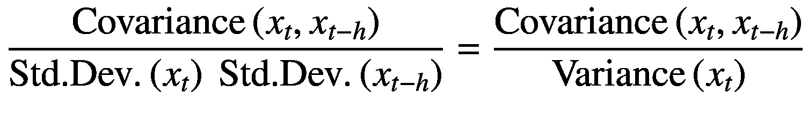

第二个公式中的分母之所以成立，是因为平稳序列的标准差在所有时间点上都相同。

现在我们将介绍用于检验平稳性的迪基-富勒检验，并将其应用于我们的数据集。在应用任何时间序列建模技术之前，必须检查时间序列的平稳性。

一个简单的 AR(1) 模型是：

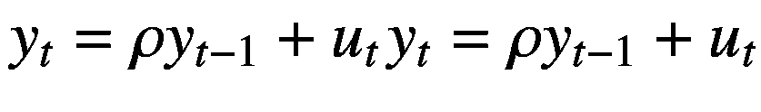

其中 *y*[*t*] 是感兴趣的变量，*t* 是时间索引，*ρ* 是系数，*u*[*t*] 是误差项。如果 *ρ* = `1`，则存在单位根。在这种情况下，模型是非平稳的。

迪基-富勒检验用于检验原假设，以确定自回归模型中是否存在单位根。

该检验主要有三种形式：

1.  检验单位根：

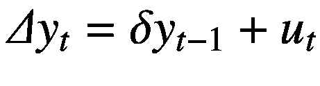

1.  检验带漂移项的单位根：

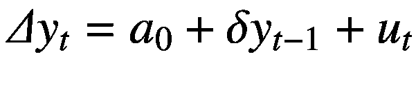

1.  检验带漂移项和确定性时间趋势的单位根：

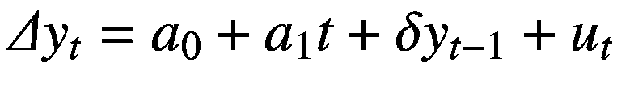

还有其他用于检验平稳性的统计检验。常用的有克维亚特科夫斯基-菲利普斯-施密特-辛（KPSS）检验和菲利普斯-佩龙检验。

```

# 我们将对数据集应用所有三种检验，并查看三种检验的结果
library(aTSA)

# 增广迪基-富勒检验
stationary.test(Power_Consumption$Average_Consumption, method = c("adf"), nlag = 12, type = c("Z_rho", "Z_tau"), lag.short = TRUE, output = TRUE)

## 增广迪基-富勒检验

## 备择假设：平稳

##
## 类型 1：无漂移项无趋势项

##       滞后     ADF  p 值

##  [1,]   0 -0.46154   0.505

##  [2,]   1 -0.69338   0.423

##  [3,]   2  0.00634   0.639

##  [4,]   3 -0.02059   0.631

##  [5,]   4 -0.19808   0.580

##  [6,]   5 -0.18173   0.585

##  [7,]   6 -0.01851   0.632

##  [8,]   7  0.10667   0.668

##  [9,]   8  0.09127   0.663

## [10,]   9  0.15219   0.681

## [11,]  10 -0.17595   0.587

## [12,]  11  0.40941   0.755

## 类型 2：带漂移项无趋势项

##       滞后   ADF  p 值

##  [1,]   0 -3.59  0.0136

##  [2,]   1 -9.39  0.0100

##  [3,]   2 -5.09  0.0100

##  [4,]   3 -3.63  0.0121

##  [5,]   4 -2.55  0.1269

##  [6,]   5 -2.06  0.3076

##  [7,]   6 -1.97  0.3401

##  [8,]   7 -3.10  0.0397

##  [9,]   8 -3.80  0.0100

## [10,]   9 -3.46  0.0184

## [11,]  10 -2.26  0.2347

## [12,]  11 -1.64  0.4638

## 类型 3：带漂移项和趋势项

##       滞后   ADF  p 值

##  [1,]   0 -3.48  0.0616

##  [2,]   1 -9.15  0.0100

##  [3,]   2 -5.01  0.0100

##  [4,]   3 -3.56  0.0499

##  [5,]   4 -2.51  0.3650

##  [6,]   5 -2.05  0.5380

##  [7,]   6 -1.98  0.5666

##  [8,]   7 -3.09  0.1474

##  [9,]   8 -3.83  0.0292

## [10,]   9 -3.59  0.0481

## [11,]  10 -2.82  0.2480

## [12,]  11 -1.97  0.5717

## ----

## 注意：实际上，p.value = 0.01 表示 p.value <= 0.01
```

检验结果表明，用电量序列通过了类型 2 和类型 3 的平稳性检验，而类型 1（迪基-富勒检验）的检验结果不显著。我们可以认为该序列适用于包含漂移项和趋势项的时间序列模型。

## 9.3 自相关函数与 AR 模型

假设过程在时间 `t` 具有均值 *μ*[*t*] 和方差 *σ*[*t*]²，对于每个 `t`。那么时间 `s` 和 `t` 之间的自相关定义为

![$$ R\left(s,t\right)=\frac{\mathrm{E}\left[\left({X}_t-{\mu}_t\right)\left({X}_s-{\mu}_s\right)\right]}{\sigma_t{\sigma}_s}, $$](images/416805_2_En_9_Chapter/416805_2_En_9_Chapter_TeX_Equg.png)

ACF 可以在 ACF 图中呈现。ACF 图量化了不同滞后下的自相关。

```

# ACF
acf_values <- acf(Power_Consumption$Average_Consumption,type = c("correlation"))
```

```
print(acf_values)

##
## Autocorrelations of series 'Power_Consumption$Average_Consumption', by lag

##
##      0      1      2      3      4      5      6      7      8      9

##  1.000  0.443 -0.390 -0.659 -0.272  0.318  0.544  0.221 -0.368 -0.614

##     10     11     12     13     14     15

## -0.263  0.368  0.542  0.155 -0.311 -0.465
```

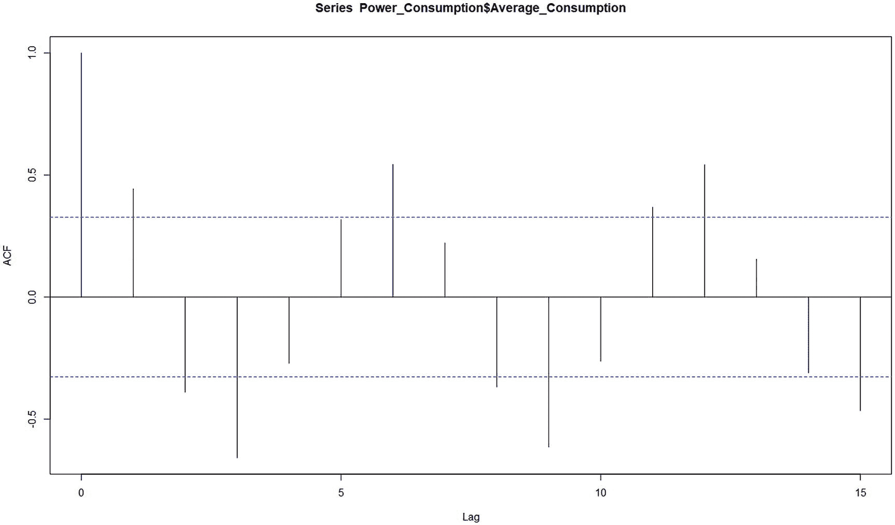

图 9-3

ACF 图

ACF 图（见图 9-3）显示了不同时间滞后下相关性的模式。现在我们将尝试对该序列拟合一个自回归（AR）模型。通过探索性数据分析，我们知道数据是按月聚合的，并且模式看起来每年重复。我们可以创建一个阶数为 12 的 AR 模型；但是，我们将使用 AIC 准则来为我们的 AR 模型找到最佳阶数。

符号 *AR*(*p*) 表示阶数为 `p` 的自回归模型。AR(p) 模型定义为

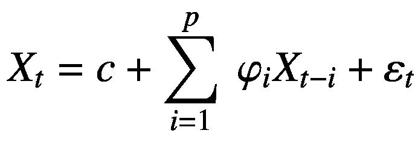

其中 *φ*[1],…,*φ*[*p*] 是模型的参数，*c* 是常数，*ε*[*t*] 是白噪声。

白噪声是独立同分布且均值为零的噪声。在白噪声中，所有变量具有相同的方差，并且与序列中的所有其他值不相关。

任何时间序列都可以包含两个组成部分：信号和白噪声：

y(t) = signal(t) + noise(t)

时间序列建模的目的是通过建模来减少信号部分，从而使残差变为白噪声。白噪声无法建模，因此检验残差确实是白噪声非常重要。

现在我们将对电力消耗时间序列拟合一个 AR 模型。见图 9-4 和 9-5。

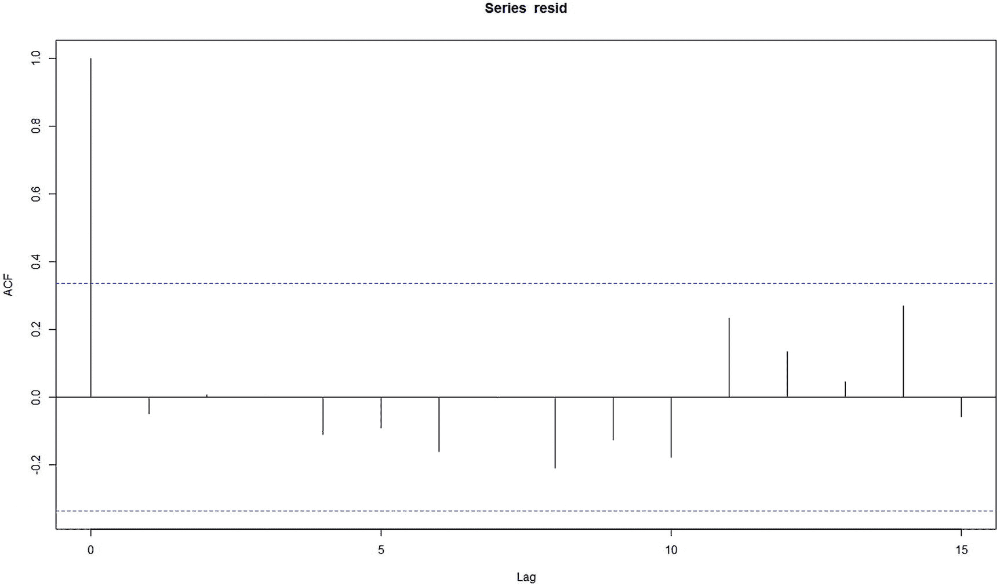

图 9-4

残差的 ACF 图

```
library(stats)
ar_model <- ar(Power_Consumption$Average_Consumption, aic = TRUE, order.max = NULL,method=c("yule-walker"))
print(ar_model)

##
## Call:

## ar(x = Power_Consumption$Average_Consumption, aic = TRUE, order.max = NULL,     method = c("yule-walker"))

##
## Coefficients:

##       1        2

##  0.7669  -0.7297

##
## Order selected 2  sigma² estimated as  816100
library(forecast)
fit <- Arima(Power_Consumption$Average_Consumption,order=c(ar_model$order,0,0))
#Plot acf plot for the residual to see if the AR model is able to handle time variations
resid <- na.omit(ar_model$resid)
acf(resid,type = c("correlation"))
```

```
#Plot the fit of Ar(12) process
plot(fit$x,col="red", type="l")
lines(fitted(fit),col="blue")
```

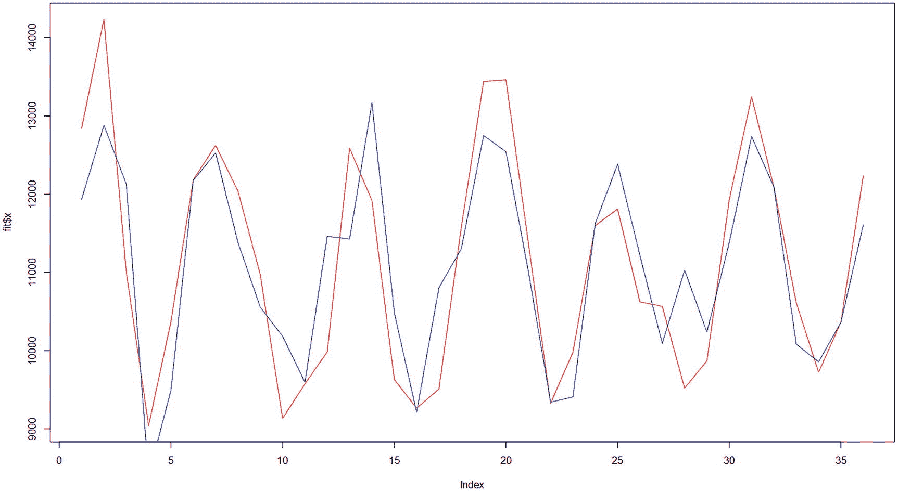

图 9-5

拟合阶数为 12 的 AR 模型

你可以观察到，最佳 AR 过程被选为阶数 12，这表明该时间序列最好被表示为 12 个时间滞后的过程。这相当于一年的重复周期。ACF 图也显示了 ACF 值的减少，因此表明 AR 过程解释了 ACF 的尖峰。

## 9.4 偏自相关函数与 MA 模型

在时间序列分析中，自相关函数不控制其他滞后，而偏自相关函数（PACF）给出了时间序列与其自身滞后值的偏相关，同时控制了所有更短滞后时间序列的值。

给定一个时间序列 *z*[*t*]，滞后 `k` 的偏自相关，记为 *α*(*k*)，是在去除 *z*[*t*] 对 *z*[*t*+1] 到 *z*[*t*+*k* − 1] 的线性依赖后，*z*[*t*] 与 *z*[*t*+*k*] 之间的自相关。等价地，它是 *z*[*t*] 与 *z*[*t*+*k*] 之间未被滞后 `1` 到 `k`（含 `1`）所解释的自相关。

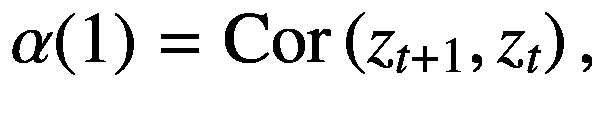

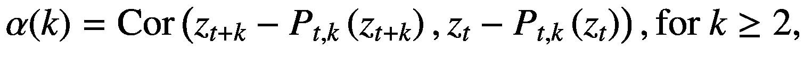

其中 *P**t*, *k* 表示 *x* 在由 *x*[*t*+1], …, *x*[*t*+*k* − 1] 张成的空间上的投影。

偏自相关图是识别自回归模型阶数的常用工具。见图 9-6。

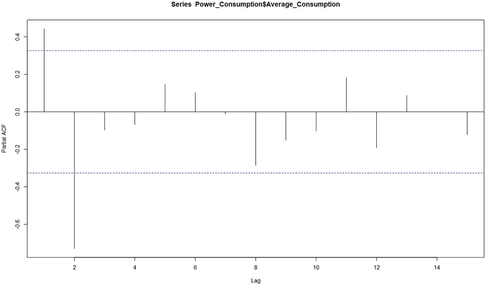

图 9-6

PACF 图

```
#Pacf(x, lag.max = NULL, plot = TRUE, na.action = na.contiguous,demean = TRUE, ...)
pacf_values <- pacf(Power_Consumption$Average_Consumption)
```

```
print(pacf_values)

##
## Partial autocorrelations of series'Power_Consumption$Average_Consumption', by lag

##
##      1      2      3      4      5      6      7      8      9     10

##  0.443 -0.730 -0.097 -0.068  0.147  0.103 -0.011 -0.285 -0.151 -0.102

##     11     12     13     14     15

##  0.181 -0.191  0.087  0.001 -0.122
```

在图 9-6 中，你可以看到为什么上一节中的 AR 模型选择了阶数 12 来拟合自回归模型。在电力消耗时间序列中，PACF 因子在 12 个滞后之后变得不显著。

时间序列模型中的移动平均项是一个过去的误差（乘以一个系数）。移动平均也用于平滑序列。它通过连续平均项来去除时间序列中的噪声。

设 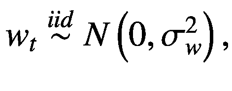 这意味着 *w*[*t*] 是独立同分布的，每个都服从均值为 `0` 且方差相同的正态分布。

q 阶移动平均模型，记为 `MA(q)`，定义为

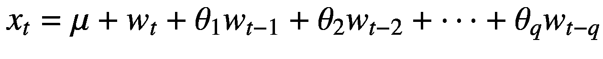

*MA 模型的可逆性*表明，一个 MA 模型在代数上等价于一个收敛的无限阶 AR 模型。所谓收敛，是指随着时间向后推移，AR 系数减小到 `0`。见图 9-7 和 9-8。

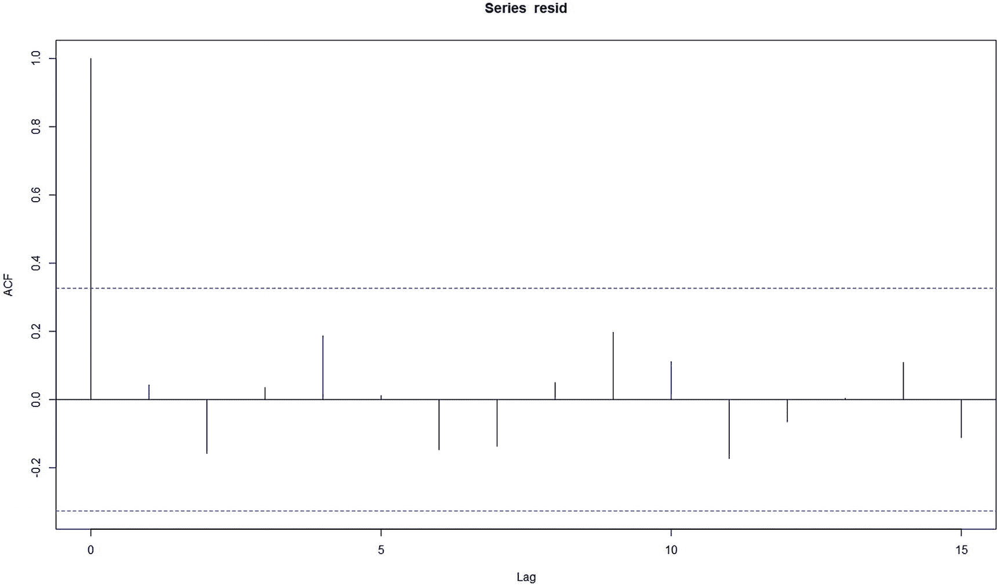

图 9-7

MA 模型残差的 ACF 图

```
library(forecast)
fit_ma <- Arima(Power_Consumption$Average_Consumption,order=c(12,0,1),method="ML")
#Plot acf plot for the residual to see if the AR model is able to handle time variations
resid <- na.omit(fit_ma$residuals)
acf(resid,type = c("correlation"))
```

```
pacf(resid,type = c("correlation"))
```

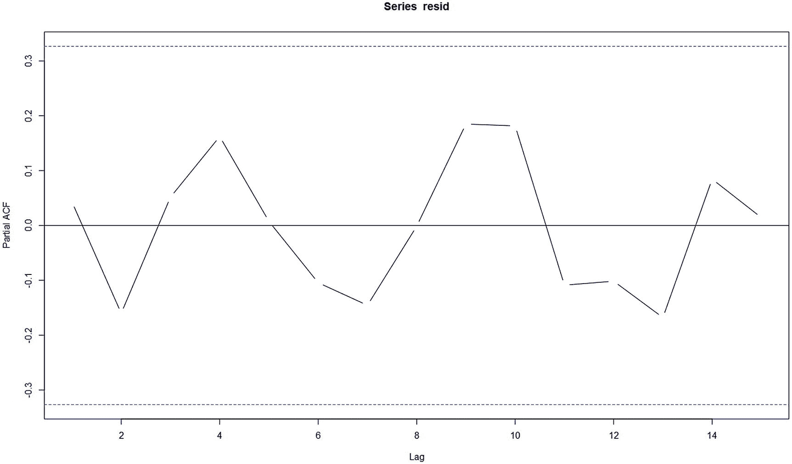

图 9-8

MA 模型残差的 PACF 图

```
#Plot the fit AR(12) process
plot(fit_ma$x,col="red", type="l")
lines(fitted(fit_ma),col="blue")
```

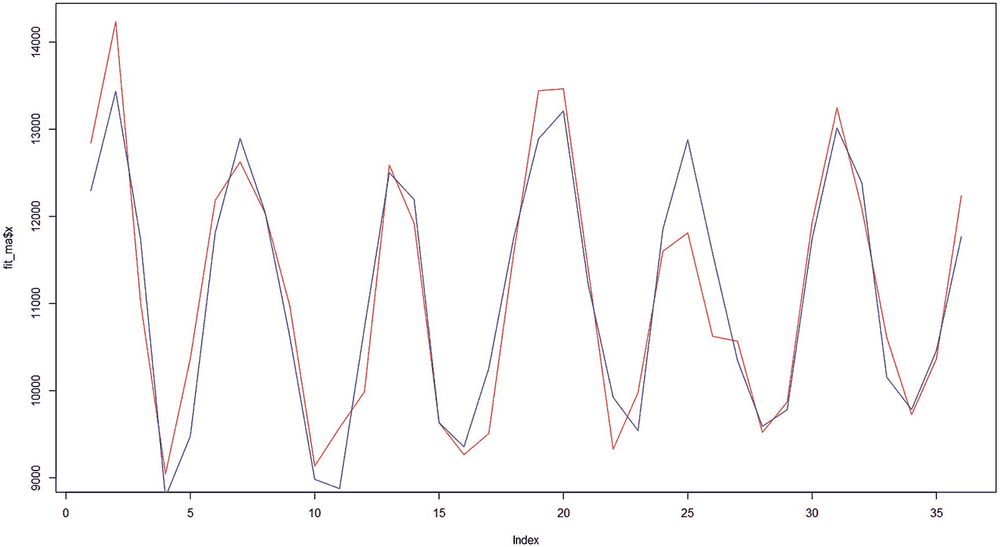

**图 9-9**

**拟合 12 阶 MA 模型**

在图 9-9 所示的模型中，我们将移动平均（MA）分量添加到了 AR(12) 模型中。现在，MA 分量也在对时间序列中的误差项进行修正。PACF 图现在处于统计限值之内（参见上下方的蓝色虚线）；不过，你可以尝试其他阶数，以获得相同模型的更多变体。

## 9.5 ARIMA 模型

ARIMA 代表自回归积分滑动平均模型。ARIMA 模型是应用于时间序列问题的一类模型。它们将三种关键类型的建模过程整合到一个建模框架中。

*   *差分*：差分序列是原始序列中连续观测值之间的变化，可以写成

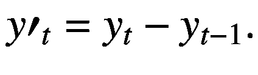

这里我们展示了一阶差分。二阶差分可以如下进行

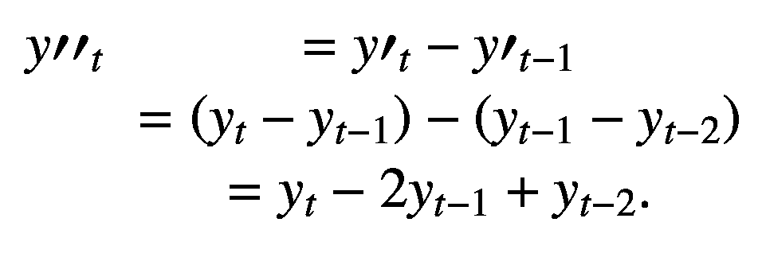

差分将非平稳序列转换为平稳序列。然后使用平稳序列来开发 ARIMA 模型。差分的阶数是序列的积分因子，在 ARIMA 模型中记为 `d`。

*   *AR*：自回归阶数用 `p` 表示，它告诉我们拟合一个 AR 过程到平稳序列所需的滞后项数量。ACF 和 PACF 帮助我们确定 AR 过程的最佳参数集。

*   *MA*：移动平均阶数用 `q` 表示，它告诉我们序列中需要回归以减少差分 AR 过程残差至白噪声的误差项数量。

### 9.5.1 Box-Jenkins 方法

Box-Jenkins 是一套用于时间序列分析以及找出 ARIMA 模型最佳拟合的方法。这包括一个逐步的方法和一套统计方法：

*   使用 ADF 检验测试并校正平稳性和季节性
*   使用 ACF、PACF 和方差分析（检验 ARCH 效应）进行模型拟合和测试
*   通过图表和 ACF/PACF 值，为 ARIMA 找到最佳的 `p`、d 和 `q` 参数
*   残差分析以确保残差是白噪声

ARCH 代表自回归条件异方差效应，如果存在，则意味着时间序列在平方序列中表现出自相关。这意味着误差项的方差随时间变化。

让我们在我们的数据集上运行这些步骤，我们已经单独测试了 ARIMA 的一些阶数。参见图 9-10 至 9-15。


**图 9-10**

**用于检查滞后项的 ACF 图**

```
library(tseries)
library(rugarch)
library(forecast)
#analysis
adf.test(Power_Consumption$Average_Consumption) #perform stationarity test

##
##  Augmented Dickey-Fuller Test

##
## data:  Power_Consumption$Average_Consumption

## Dickey-Fuller = -3.5612, Lag order = 3, p-value = 0.04991

## alternative hypothesis: stationary
#model identification
acf(Power_Consumption$Average_Consumption) # lag checking and model identification
```

```
pacf(Power_Consumption$Average_Consumption) # lag checking and model identification
```

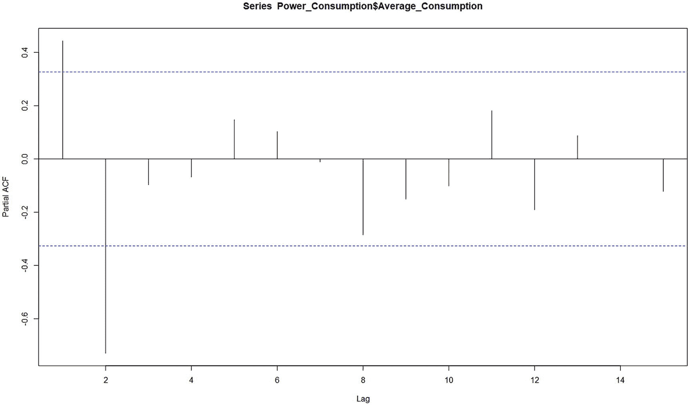

**图 9-11**

**用于检查滞后项的 PACF 图**

```
Box.test(Power_Consumption$Average_Consumption,lag=12,type="Ljung-Box") #check autocorrelation

##
##  Box-Ljung test

##
## data:  Power_Consumption$Average_Consumption

## X-squared = 108.68, df = 12, p-value < 2.2e-16
Box.test(Power_Consumption$Average_Consumption²,lag=12,type="Ljung-Box") # check arch effect

##
##  Box-Ljung test

##
## data:  Power_Consumption$Average_Consumption²

## X-squared = 101.4, df = 12, p-value = 3.331e-16
fit_arima <- arima(Power_Consumption$Average_Consumption,order=c(12,0,1),method="ML") #perform lot of preceding task automatically
fit_arima

##
## Call:

## arima(x = Power_Consumption$Average_Consumption, order = c(12, 0, 1), method = "ML")

##
## Coefficients:

##          ar1      ar2     ar3      ar4     ar5      ar6     ar7      ar8

##       1.1580  -0.6210  0.2081  -0.2377  0.1606  -0.1819  0.1244  -0.3554

## s.e.  0.1581   0.2559  0.2927   0.2965  0.2815   0.2981  0.2747   0.2711

##          ar9     ar10    ar11     ar12      ma1   intercept

##       0.0446  -0.2771  0.6703  -0.4458  -0.9888  11012.5211

## s.e.  0.2789   0.2704  0.2484   0.1828   0.1291     17.7354

##
## sigma² estimated as 226188:  log likelihood = -279.72,  aic = 589.44
###Residuals Analysis
rest<-residuals(fit_arima,standardize=TRUE)
acf(rest)
```

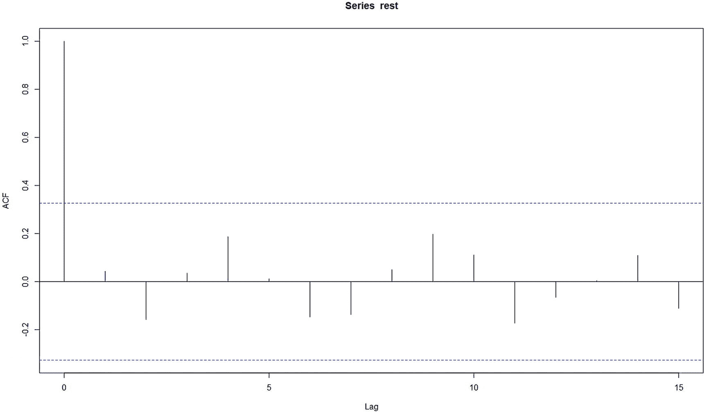

**图 9-12**

**用于残差分析的 ACF 图**

```
acf(rest²)
```

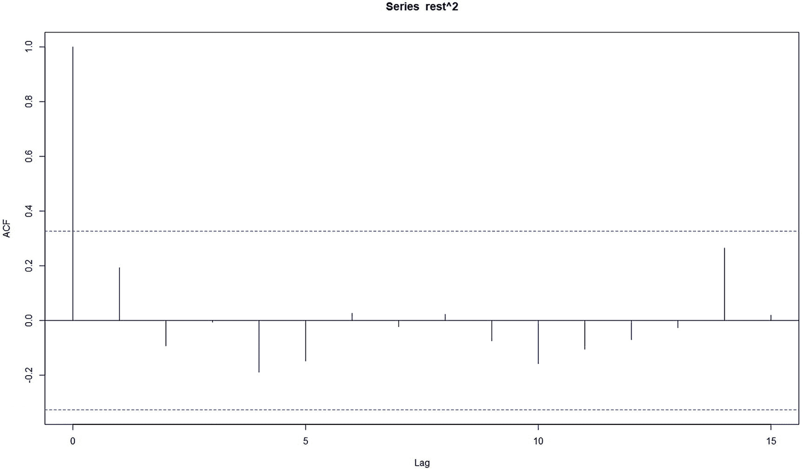

**图 9-13**

**残差平方的 ACF 图**

```
pacf(rest)
```

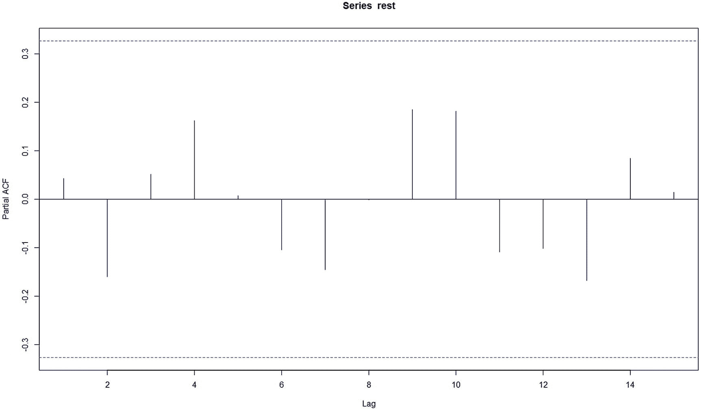

**图 9-14**

**显示人口前十国家人口（单位：十亿）的箱线图**

```
pacf(rest²)
```

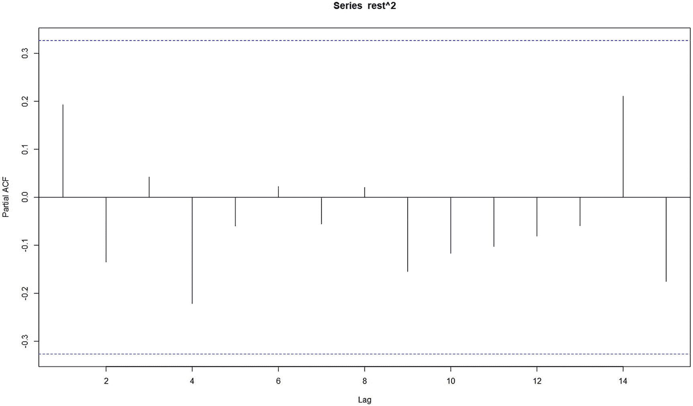

**图 9-15**

**用于残差分析的 PACF 图**

```
Box.test(rest,lag=12,type="Ljung-Box")

##
##  Box-Ljung test

##
## data:  rest

## X-squared = 9.1281, df = 12, p-value = 0.6919
Box.test(rest²,lag=12,type="Ljung-Box")

##
##  Box-Ljung test

##
## data:  rest²

## X-squared = 6.8569, df = 12, p-value = 0.8669
```

这些步骤可以应用于任何单变量时间序列，以分析并拟合一个良好的 ARIMA 模型。拟合 ARIMA 模型涉及找到正确的差分阶数 (d)、自回归阶数 (p) 和移动平均阶数 (q)。

现在，让我们使用拟合的 ARIMA 模型来预测接下来 12 个月的用电量，并将其与实际值进行比较。时间序列中的测试窗口始终是一个连续的、有序的实际值集合。这与机器学习的随机抽样方法相反。

对于我们的电力消耗数据集，让我们看看仅时间模型能为 2018 年 1 月至 2018 年 12 月的预测带来多少准确性。参见图 9-16。

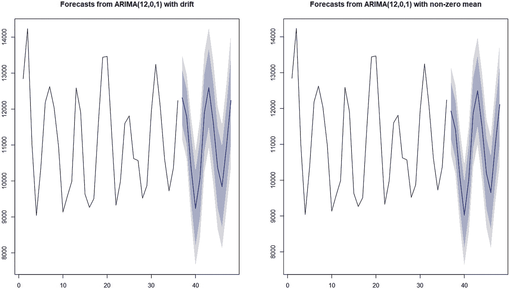

**图 9-16**

**2018 年 1 月至 2018 年 12 月期间的预测**

```
par(mfrow = c(1,2))
fit1 <-  Arima(Power_Consumption$Average_Consumption, order = c(12,0,1),
include.drift = T,method="ML")
future <-  forecast(fit1, h = 12)
plot(future)
fit2 <- Arima(Power_Consumption$Average_Consumption, order = c(12,0,1),
include.drift = F,method="ML")
future2 <- forecast(fit2, h = 12)
plot(future2)
```

这个对 2018 年的预测基于一个假设，即序列的时间依赖性是其方差的唯一原因，并且我们的模型通过建模自回归和移动平均分量已经捕捉到了这些方差。

然而，模型中的方差不仅仅包含时间分量。我们需要了解如何对自变量和时间方差的联合效应进行建模。结合这两种效应的方法之一是下一节讨论的自回归模型。

## 9.6 含自回归误差的线性回归

当我们尝试对具有时间序列结构的观测值拟合线性回归模型时，残差会表现出高度的自相关性。这导致残差不满足线性回归关于误差独立的基本假设。

对误差进行建模（称为误差过程）有助于我们调整估计的回归系数和标准误。更一般地，我们也可以将误差建模为 ARIMA 结构。

假设 *x*[*t*] 和 *y*[*t*] 是时间序列变量。一个带有自回归误差的简单线性回归模型可以写成：

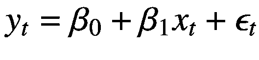

其中 *ϵ*[*t*] = *ϕ*[1]*ϵ*[*t* − 1]+*ϕ*[2]*ϵ*[*t* − 2]+⋯+*w*[*t*]，且 *w*[*t*] ∼ iid *N*(0, *σ*²)

如果我们令 *Φ*(*B*) = 1 − *ϕ*[1]*B* − *ϕ*[2]*B*² − ⋯，那么我们可以将误差的 AR 模型写为：

*Φ*(*B*)*t*=*w*[*t*]

如果我们假设存在逆算子 *Φ*^(−1)(*B*)，那么 *ϵ*[*t*] = *Φ*^(−1)(*B*)*w*[*t*]。

因此，该模型可以写成：

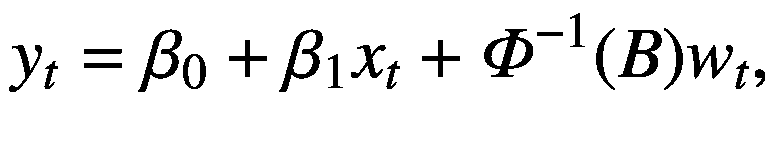

其中 *w*[*t*] 是通常的白噪声序列。

按照以下步骤拟合自回归模型：

1.  首先进行普通回归，并存储残差。
2.  分析残差的时间序列结构，以确定它们是否具有 AR 结构。
3.  如果普通回归的残差看起来具有 AR 结构，则估计该模型，并诊断该模型是否合适。

现在，我们将这些步骤应用于另一个模拟数据集，看看引入 AR 结构是否有助于改进模型。见图 9-17 至 9-19。

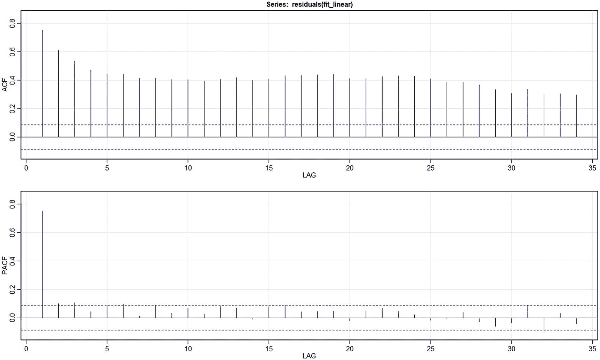

图 9-18
显示发达和发展中国家 GDP 与人口的直方图和密度图

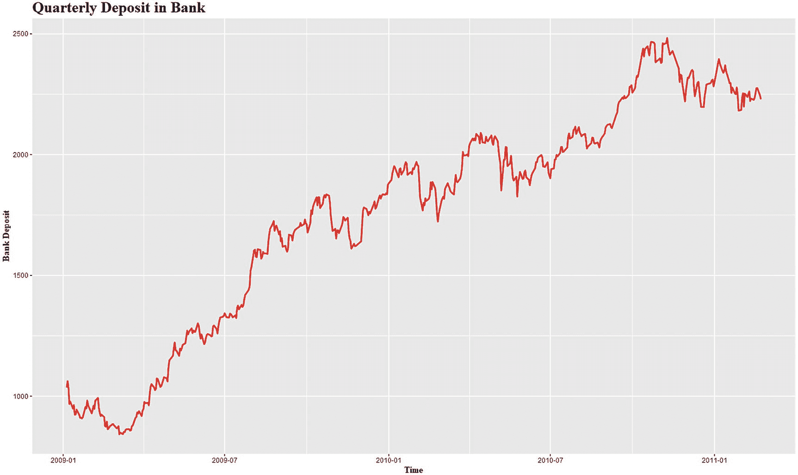

图 9-17
道琼斯数据集中银行的季度存款额

```
deposit_rate <- read.csv("Dataset/dow_jones_index.csv",header=TRUE)
deposit_rate <- na.omit(deposit_rate)
deposit_rate$time <- as.Date(deposit_rate$time,format="%d-%m-%Y")
#Let's plot the time series to too how the sales trend
library(ggplot2)
ggplot(data = deposit_rate, aes(x = time, y = y)) +
geom_line(color = 'red', size = 1) +
theme(legend.title=element_text(family="Times",size=20),
legend.text=element_text(family="Times",face = "italic",size=15),
plot.title=element_text(family="Times", face="bold", size=20),
axis.title.x=element_text(family="Times", face="bold", size=12),
axis.title.y=element_text(family="Times", face="bold", size=12)) +
xlab("Time") +
ylab("Bank Deposit") +
ggtitle("Quarterly Deposit in Bank")
```

```

# Fit a linear regression model and analyze the residuals for AR structure by acf plot test
library(astsa)
fit_linear |t|)

## (Intercept)  2691.40      38.79   69.39   <2e-16 ***

## x_prime      -193.88       7.52  -25.78   <2e-16 ***

## ---

## Signif. codes:  0 '***' 0.001 '**' 0.01 '*' 0.05 '.' 0.1 ' ' 1

##
## Residual standard error: 307.9 on 534 degrees of freedom

## Multiple R-squared:  0.5545, Adjusted R-squared:  0.5537

## F-statistic: 664.7 on 1 and 534 DF,  p-value: < 2.2e-16
acf2(residuals(fit_linear))
```

```

##        ACF  PACF

##  [1,] 0.75  0.75

##  [2,] 0.61  0.10

##  [3,] 0.53  0.11

##  [4,] 0.47  0.04

##  [5,] 0.44  0.09

##  [6,] 0.44  0.10

##  [7,] 0.41  0.01

##  [8,] 0.41  0.09

##  [9,] 0.40  0.03

## [10,] 0.40  0.07

## [11,] 0.40  0.03

## [12,] 0.41  0.08

## [13,] 0.42  0.07

## [14,] 0.40 -0.01

## [15,] 0.41  0.08

## [16,] 0.43  0.09

## [17,] 0.43  0.04

## [18,] 0.44  0.04

## [19,] 0.44  0.05

## [20,] 0.41 -0.02

## [21,] 0.41  0.05

## [22,] 0.43  0.07

## [23,] 0.43  0.04

## [24,] 0.43  0.02

## [25,] 0.41 -0.02

## [26,] 0.39 -0.01

## [27,] 0.38  0.04

## [28,] 0.37 -0.03

## [29,] 0.33 -0.06

## [30,] 0.31 -0.04

## [31,] 0.34  0.09

## [32,] 0.30 -0.11

## [33,] 0.30  0.03

## [34,] 0.30 -0.04
ar1res = sarima (residuals (fit_linear), 1,0,0, no.constant=T) #AR(1)

## initial  value 5.728871

## iter   2 value 5.307745

## iter   3 value 5.307727

## iter   4 value 5.307720

## iter   4 value 5.307720

## final  value 5.307720

## converged

## initial  value 5.307628

## iter   2 value 5.307627

## iter   3 value 5.307626

## iter   3 value 5.307626

## final  value 5.307626

## converged
```

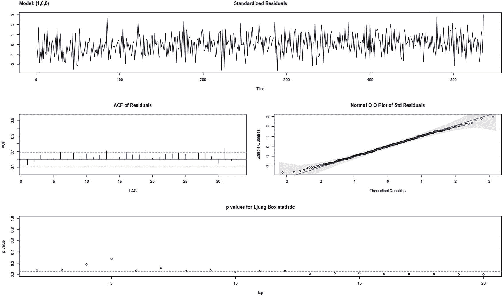

图 9-19
显示发达和发展中国家 GDP 与人口的直方图和密度图

残差被拟合为 AR(1)过程，残差的诊断结果显示，在拟合 AR(1)过程后，残差为白噪声。

## 9.7 总结

本章从较高层次介绍了时间序列建模的关键组成部分，并解释了 R 包如何帮助我们进行时间序列分析。我们首先观察了单变量时间序列的时序图。对时间序列的视觉检查可以告诉我们趋势、季节性、异常值以及其他特征。接着，我们还研究了自相关函数和偏自相关函数，它们帮助我们在应用任何建模技术之前检验时间序列的有效性。

我们还介绍了用于拟合模型的 AR 和 MA 过程。同时介绍了平稳时间序列的概念以及差分方法。我们讨论了用于对单变量时间序列拟合 ARIMA 模型的 Box-Jenkins 方法。在本章末尾，我们介绍了带有 AR 误差结构的线性回归概念。

