# 10. 可扩展机器学习及相关技术

几年前，你几乎不会在机器学习领域听到“可扩展”这个词。这主要归因于基础设施、数据和实际应用的匮乏。当时，机器学习更多是学术界研究团体或资金充裕的行业研究实验室的热门话题。任何使用机器学习的实际应用原型都被视为一项重大成就和突破性研究的证明。然而，随着廉价且强大的商用硬件变得普及，以及大数据技术的广泛采用，时代已经改变。其结果是，数据变得易于获取，软件开发也日益数据化。每一字节的数据都被捕获，即使其近期用途尚不明确。

正如你在第 6 章所见，机器学习算法具有深厚的统计和数学基础，但这并不足以使其具备可扩展性。这些统计技术的准确性仅足以处理完全驻留在单台机器上的小规模数据集。然而，当数据量增长到足以挑战单台机器的存储能力时，分布式计算和算法复杂性的世界便开始主导。在这个世界里，诸如以下的问题开始涌现：

*   算法是线性时间运行还是二次方时间运行？
*   我们是否有该算法的分布式（并行）版本？
*   我们是否有足够多具备所需存储和计算能力的机器？

如果这些问题的答案是肯定的，那么你就准备好进行宏大思考了。构建数据产品这一非常新颖的概念——我们在 `PEBE` 机器学习流程中强调过——源于我们扩展事物以迎合不断变化的技术、数据以及日益增长的产品用户需求的能力。我们持续从增量添加的新数据中学习。

在本章中，我们将带你踏上 `Apache Hadoop`、`Hive`、`Pig` 和 `Spark` 等大数据技术的激动人心之旅，并特别关注使用实际示例进行可扩展机器学习。我们将对这些技术进行介绍。

## 10.1 分布式处理与存储

想象一个程序，它使用了最优化算法，具有最佳运行时间（时间复杂度），并且也设计用于高效存储。然而，对于像谷歌这样的公司，最佳运行时间的概念是几微秒甚至更短（针对其搜索程序），而一家从事 DNA 测序的公司可能愿意花费几天甚至几周的时间来完成程序。在大数据革命开始之前，并行和分布式计算一直在解决执行时间的问题。同样的程序被移植到多台机器（服务器）上同时运行。换句话说，程序被分成许多子任务，并分配给多台机器同时执行。大数据带来的这种分布式计算方式的范式转变，是设计一种能够高效划分数据以及处理数据的程序的机制。人们在分布式计算时代和大数据时代所考虑的问题类型也发生了巨大变化。例如，像顶点图着色问题（找到一种为图的顶点着色的方法，使得没有两个相邻顶点共享相同颜色）这样的问题，即使对于只有几个顶点的小图来说，也被认为是一项计算上极具挑战性的任务。有大量文献可用于设计此类分布式程序，例如本章末尾参考文献中描述的那样。

另一方面，当涉及海量数据时，例如对包含十亿个数字的数组进行排序，大数据技术已经找到了解决方案。本章的重点是使用一个实际示例来突出该领域中的一些技术。

尽管分布式和并行计算的演进始于几十年前，但两项突破性工作使其得以广泛应用，并催生了整个应用程序开发以及更先进的技术。第一个突破来自 2003 年的谷歌，他们推出了“谷歌文件系统”，随后在 2004 年推出了“MapReduce：大型集群上的简化数据处理”。前者为大型分布式数据密集型应用提供了可扩展的分布式文件系统，后者则设计了一种编程模型及其相关实现，用于处理和生成大型数据集。它们提供了一种架构，用于将大量数据分割成较小的块，并存储在数千台机器（节点）上，然后将计算任务本地化到存储较小数据块的机器上执行，而不是在整个数据集上运行。

第二个突破发生在 2006 年，它将这项技术带给了大众，那就是 `Apache Hadoop`，一个用于分布式存储和处理的完整开源框架。`Hadoop` 成功证明，通过使用由商用硬件构建的大型计算机集群，可以实现减少计算时间并自动处理硬件故障。

### 10.1.1 谷歌文件系统 (GFS)

`GFS` 的设计原则是考虑到数据密集型应用的需求。`GFS` 为大型数据提供了可扩展的分布式文件系统（用于存储）。

使用数千台机器上的数千个磁盘来处理数 `TB` 的数据，体现了此类系统设计用于处理的艰巨任务。

如图 10-1 所示（该图最初发表于论文“谷歌文件系统”），`GFS` 主节点存储关于存储在 `GFS` 块服务器中的每个数据块的元数据。

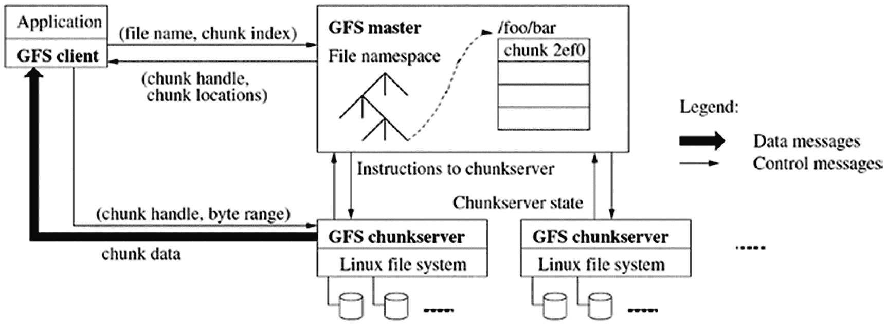

图 10-1

谷歌文件系统

元数据包含文件和块命名空间（一个包含唯一名称或标识符的抽象容器）、文件到块的映射，以及每个块副本的位置（用于容错）。在最初的设计中，只有一个主节点；然而，大多数当代分布式架构即使在主节点周围也有更复杂的设置。`GFS` 客户端与主节点交互以获取元数据请求，而所有数据请求则发送到块服务器。

### 10.1.2 MapReduce

使用 `MapReduce` 进行分布式处理，是根据分布式存储划分大数据集任务的核心。`MapReduce` 被设计为一种应用特定逻辑的编程模型，其应用范围从排序操作到在大量数据上运行机器学习算法。

简而言之，正如论文《MapReduce：大型集群上的简化数据处理》所解释的，用户指定一个 **map 函数**，该函数处理一个键值对以生成一组中间键值对，以及一个 **reduce 函数**，该函数合并所有与相同中间键关联的中间值。更简单地说，你将数据分解成更小的块，并编写一个 `map` 函数，在不同节点上同时处理每个小块中的键值对。这进而生成一个中间键值对，该键值对通过网络传输到中心节点，由 `reduce` 函数定义的特定逻辑进行合并。这两者的结合被称为 `MapReduce` 程序。我们将在 `Hadoop` 生态系统部分看到一个简单的例子。

来自经典论文《MapReduce：大型集群上的简化数据处理》的图 10-2 展示了被分割成更小块的输入文件如何放置在 `map` 程序执行的工作节点（块服务器）上。

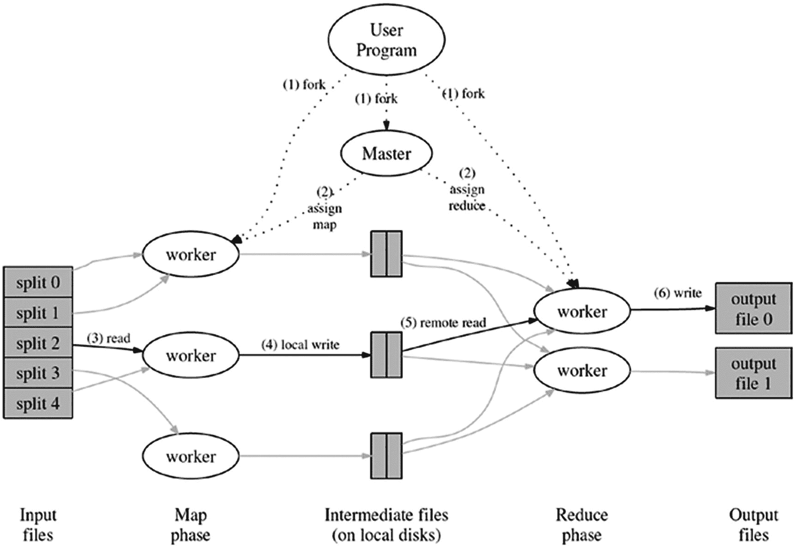

图 10-2

MapReduce 执行流程

一旦 `map` 阶段完成了其分配的任务，它会将数据写回块服务器的本地磁盘，然后由 `Reduce` 程序拾取这些数据，最终输出结果。即使出现硬件故障，整个处理过程也能无缝执行。我们将在下一节更详细地解释 `MapReduce`。

### 10.1.3 R 中的并行执行

在 `CRAN` 文档《doParallel 和 foreach 入门》中，`doParallel` 包的创建者 Steve Weston 和 Rich Callaway 解释道：“`doParallel` 包是 `foreach` 包的‘并行后端’。它提供了并行执行 `foreach` 循环所需的机制。必须将 `foreach` 包与 `doParallel` 等包结合使用，才能并行执行代码。”

`Foreach` 是一种允许遍历集合中元素而无需使用显式循环计数器的惯用语法。

在深入 `MapReduce` 的一些示例并讨论 `Hadoop` 生态系统之前，让我们先看看一些方法，通过单台机器多核 CPU 的并行执行来模拟随机森林算法（在第 6 章中解释）。我们使用信用评分数据集。

#### 10.1.3.1 设置核心数

使用 `R` 中的 `doParallel` 库，我们可以设置 CPU 的核心数，即你希望机器在运行模型时使用的核心数。如果有专用机器用于此类处理，有一些算法方法（超出本书范围）可以决定应该使用多少个核心。但是，如果是你的个人机器，不要使用太多核心导致系统过载。请记住，将所有核心分配给此进程可能会因资源不足而导致其他进程崩溃。为了更安全，我们使用了 `c-2` 个核心，其中 `c` 是机器可用的核心数。

```
library(doParallel)

# 找出有多少个核心可用（如果你还不知道）
c =detectCores()
c
[1] 4

# 找出当前正在使用多少个核心
getDoParWorkers()
[1] 1

# 创建包含 c-2 个核心的集群
cl <-makeCluster(c-2)

# 注册集群
registerDoParallel(cl)

# 找出正在使用多少个核心
getDoParWorkers()
[1] 2
```

#### 10.1.3.2 问题陈述

这里使用的数据用于构建一个模型，该模型可以使用随机森林预测客户是否会拖欠银行贷款（一个二元分类器）。在本演示中，我们只是观察以串行方式与并行方式执行时构建模型所需的时间。

问题：识别高风险银行贷款

```r
setwd("C:\\Users\\Karthik\\Dropbox\\Book Writing - Drafts\\Chapter Drafts\\Chapter 9 - Scalable Machine Learning and related technology\\Datasets")
credit  200 DM",..: 1 3 4 1 1 4 4 3 4 3 ...
$ months_loan_duration: int  6 48 12 42 24 36 24 36 12 30 ...
$ credit_history      : Factor w/ 5 levels "critical","good",..: 1 2 1 2 4 2 2 2 2 1 ...
$ purpose             : Factor w/ 6 levels "business","car",..: 5 5 4 5 2 4 5 2 5 2 ...
$ amount              : int  1169 5951 2096 7882 4870 9055 2835 6948 3059 5234 ...
$ savings_balance     : Factor w/ 5 levels " 1000 DM",..: 5 1 1 1 1 5 4 1 2 1 ...
$ employment_duration : Factor w/ 5 levels " 7 years",..: 2 3 4 4 3 3 2 3 4 5 ...
$ percent_of_income   : int  4 2 2 2 3 2 3 2 2 4 ...
$ years_at_residence  : int  4 2 3 4 4 4 4 2 4 2 ...
$ age                 : int  67 22 49 45 53 35 53 35 61 28 ...
$ other_credit        : Factor w/ 3 levels "bank","none",..: 2 2 2 2 2 2 2 2 2 2 ...
$ housing             : Factor w/ 3 levels "other","own",..: 2 2 2 1 1 1 2 3 2 2 ...
$ existing_loans_count: int  2 1 1 1 2 1 1 1 1 2 ...
$ job                 : Factor w/ 4 levels "management","skilled",..: 2 2 4 2 2 4 2 1 4 1 ...
$ dependents          : int  1 1 2 2 2 2 1 1 1 1 ...
$ phone               : Factor w/ 2 levels "no","yes": 2 1 1 1 1 2 1 2 1 1 ...
$ default             : Factor w/ 2 levels "no","yes": 1 2 1 1 2 1 1 1 1 2 ...
```

为训练和测试数据创建随机样本。

使用 `set.seed` 以使用与本教程相同的随机数序列。
```r
set.seed(123)
train_sample <-sample(1000, 900)
str(train_sample)
# int [1:900] 288 788 409 881 937 46 525 887 548 453 ...
```

分割数据框：
```r
credit_train <-credit[train_sample, ]
credit_test  <-credit[-train_sample, ]
```

### 10.1.3.3 构建模型：串行

注意在创建的训练数据上以串行方式执行随机森林模型所需的时间。

```r
# 在数据上训练模型
library(randomForest)

# 顺序执行
system.time(rf_credit_model <-randomForest(credit_train[-17],
credit_train$default,
ntree =1000))
# user  system elapsed
# 1.8     0.0     1.8
```

### 10.1.3.4 构建模型：并行

在代码的并行版本中，我们不直接使用 `ntree = 1000` 参数（意味着构建 1000 棵决策树）的随机森林模型，而是使用带有 `%dopar%` 的 `foreach` 函数，这样我们可以将构建 1000 棵决策树的过程拆分为四个进程。每个部分使用 `randomForest` 函数构建 250 棵决策树。

```r
# 并行执行
system.time(
rf_credit_model_parallel <-foreach(nt =rep(250,4),
.combine = combine ,
.packages ='randomForest')
%dopar%
randomForest(
credit_train[-17],
credit_train$default,
ntree = nt))
# user  system elapsed
# 0.33    0.09    1.73
```

### 10.1.3.5 停止集群

停止所有集群并恢复串行执行。

```r
# 关闭集群 - 完成后，请务必使用以下命令关闭并行后端
stopCluster(cl)
```

在这里观察，大约并行执行比顺序执行快 80%（可能因你的系统而异）。如果单台机器使用多核就能带来如此巨大的改进，想象一下使用大型计算集群时你将节省的时间和资源。

注意：

*   “用户时间”是调用进程执行用户指令所花费的 CPU 时间。
*   “系统时间”是系统代表调用进程执行所花费的 CPU 时间。

在下一节中，我们将更深入地探讨 Hadoop 生态系统，并演示使用 Hadoop 和 R 的第一个“hello world”示例。

## 10.2 Hadoop 生态系统

由于 Hadoop 的普及，相关资源非常丰富。从宏观角度来看，Hadoop 框架由以下三个模块组成（框架的技术细节不在本书讨论范围内）：

*   **Hadoop 分布式文件系统：** 这是 Hadoop 的存储部分，是数据块实际驻留的核心。将数据划分为更小的片段意味着需要一种细致的方法，以元数据的形式存储引用，并使所有需要它的进程都能访问这些引用。
*   **Hadoop YARN：** 另一种资源协调器，也被称为数据操作系统。从 Hadoop 2.0 开始，YARN 通过一个精密的资源管理框架，成为高效驱动进程的核心引擎。
*   **Hadoop MapReduce：** MapReduce 决定了需要对数据执行何种操作的执行逻辑。该逻辑的设计方式应使其能够与驻留在分布式机器集群中的较小数据块并行执行。

在此之上，还有许多专门为在 Hadoop 框架上运行而设计的附加软件包，例如 Apache Pig、Hive、HBase、Mahout、Spark、Sqoop、Flume、Oozie、Storm、Solr 等。所有这些软件都是必要的，因为 Hadoop 给传统的关系型和小规模数据处理模式带来了范式转变。本章我们将简要介绍 Apache Pig、Hive、HBase 和 Spark，它们是 Hadoop 生态系统的三大支柱。图 10-3 展示了这些工具在 Hadoop 生态系统中的组织方式。

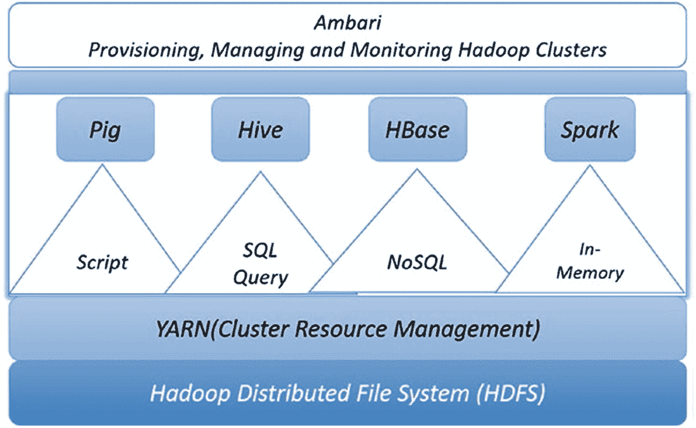

图 10-3 Hadoop 组件与工具

我们首先讨论位于 Hadoop YARN 层中的 MapReduce，即处理超级核心。

### 10.2.1 MapReduce

MapReduce 是一种用于在机器集群上设计并行和分布式算法的编程模型。从广义上讲，它包含两个过程。首先是 *Map*，它执行过滤和排序等操作。它处理键值对并生成中间键值对。然后是 *Reduce*，它将所有具有相同键的中间值合并。如果一个问题可以用这种方式表达，那么就有可能使用 MapReduce 将问题分解成更小的部分。多年来，该模型已成功应用于许多实际问题中。为了理解这个模型，让我们看一个简单的单词计数示例。

#### 10.2.1.1 MapReduce 示例：单词计数

假设有一个新闻聚合应用，试图为其网络上的所有文章构建一个自动主题生成器。主题生成器算法的第一步是构建一个包含词频的词袋，换句话说，就是统计文章中每个单词出现的次数。由于网络上的文章数量巨大，构建这个主题生成器无疑需要巨大的计算能力。

图 10-4 展示了 MapReduce 的执行流程：文章被分割成许多键值对，由 Map 函数处理，生成单词和值 1 的中间键值对。另一个称为 *shuffle* 的过程将 Map 的输出移动到 Reducer，在那里最终对每个关键字的值进行求和。

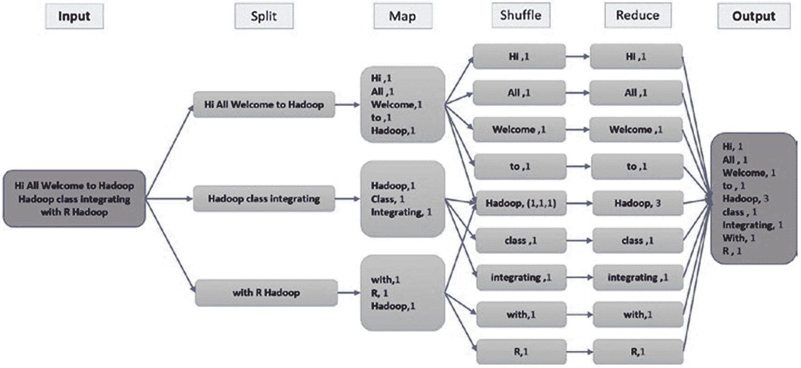

图 10-4

使用 MapReduce 的单词计数示例

### 注意：

*   运行代码需要合适的 Hadoop 版本。此代码在 Hadoop 版本 2.2.0（构建号 1529768）上运行。未检查此代码与最新版本 Hadoop 的兼容性。
*   该示例需要在 Linux/UNIX 机器上运行。
*   需要由管理员定义适当的系统路径。
*   以下是执行代码的系统信息。
    1.  `platform`: `i686-redhat-linux-gnu`
    2.  `arch`: i686
    3.  `os`: Linux-gnu
    4.  `system`: i686, Linux-gnu
    5.  `major`: 3
    6.  `minor`: 1.2
    7.  `year`: 2014
    8.  `month`: 10
    9.  `day`: 31
    10. `svn rev`: 66913
    11. `language`: R
    12. `version.string`: R version 3.1.2 (2014-10-31)

您必须使用 Hadoop `bin` 文件夹和 Hadoop streaming JAR 的位置设置环境变量。

```
Sys.setenv(HADOOP_CMD="/usr/lib/hadoop-2.2.0/bin/hadoop")
Sys.setenv(HADOOP_STREAMING="/usr/lib/hadoop-2.2.0/share/hadoop/tools/lib/hadoop-streaming-2.2.0.jar")
```

然后安装并调用 `rmr2` 和 `rhdfs` 库。成功后，初始化 HDFS 以从 HDFS 读取或写入数据。

```r
library(rmr2)
library(rhdfs)

# Hadoop 文件操作

# 初始化 HDFS 文件系统
hdfs.init()
```

然后，使用 `rhdfs` 库中的 `put()` 函数将一些示例数据放入 HDFS。

```r
# 将文件放入 HDFS
hdfs.put("/home/sample.txt","/hadoop_practice")
[1] TRUE
```

然后定义 Map 和 Reduce 函数。这段代码片段定义了 Map 和 Reduce 函数如何扫描文本文件，并将其分词（通常指按分隔符（如空格）拆分给定句子或文档的术语）为用于计数的键值对。

```r
# 一次读取多行

# Map 阶段
map <-function(k,lines) {
words.list <-strsplit(lines, '\\s+')
words <-unlist(words.list)
return( keyval(words, 1) )
}

# Reduce 阶段
reduce <-function(word, counts) {
keyval(word, sum(counts))
}

# MapReduce 函数
wordcount <-function (input, output=NULL) {
mapreduce(input=input, output=output, input.format="text", map=map, reduce=reduce)
}
```

然后运行单词计数。我们定义的 `wordcount` 函数现在可以在 Hadoop 上执行了。在调用该函数之前，请确保已设置输入文件所在的基目录以及希望放置 `wordcount` 函数生成输出的目录：

```r
# 从 HDFS 上的 input 文件夹读取文本文件
# 将结果保存到 HDFS 上的 output 文件夹
# 提交作业
basedir <- '/hadoop_practice'
infile  <-file.path(basedir, 'sample.txt')
outfile <-file.path(basedir, 'output')
ret <-wordcount(infile, outfile)
```

获取结果。`wordcount` 函数执行完成后，可以将结果取回 R 中，并将其转换为数据框并对结果进行排序，如下代码片段所示。

```r
# 从 HDFS 获取结果
result <-from.dfs(outfile)
results.df <-as.data.frame(result, stringsAsFactors=F)
colnames(results.df) <-c('word', 'count')
tail(results.df,100)
word count
1           R     1
2          Hi     1
3          to     1
4         All     1
5        with     1
6       class     1
7      hadoop     3
8     Welcome     1
9 integrating     1
head(results.df[order(results.df$count, decreasing =TRUE),])
word count
7 hadoop     3
1      R     1
2     Hi     1
3     to     1
4    All     1
5   with     1
```

由于全书使用 R 语言编写，我们展示了这个单词计数示例，其中 R 通过其 Hadoop streaming 库与 Hadoop 集成，该库内置于 `rhdfc` 和 `rmr2` 包中。出于演示目的，这种集成可能没问题，但在实际生产系统中，它可能不是一个健壮的解决方案。其他编程语言如 Java、Scala 和 Python 具有健壮的生产级代码完整性，并且与 Hadoop 框架紧密耦合。在接下来的章节中，我们将介绍 Hive、Pig 和 HBase 的基础知识，并以一个使用 Spark 的实际示例作为结束。

## 10.2.2 Hive

在适应像 Hadoop 这样的大数据技术时，所需的最关键的范式转变是能够像在关系型数据库管理系统（RDBMS）中使用 SQL（结构化查询语言）那样，熟练地读取、写入和转换数据。RDBMS 具有结构良好的表设计，这些表被分组到遵循预定义模式的数据库中。只要正确遵循 SQL 语法、逻辑和模式，查询任何表都很容易。这些数据库在数据仓库中得到了良好的管理。

现在，为了便于轻松查询存储在 HDFS 中的数据，需要一个与 HDFS 紧密耦合，同时又能提供与传统 RDBMS 相同查询能力的数据仓库工具。Apache Hive 的开发正是将这一思想置于其设计原则的核心。尽管底层存储是 HDFS，但数据可以按照定义良好的模式进行结构化。在 Hadoop 生态系统的所有其他工具中，Hive 是业界使用最广泛的组件。关于 Hive 架构和设计的高级技术讨论超出了本书的范围；然而，我们将在此处提供入门材料，以便您能够将大数据与更宏大的体系联系起来。

市场上有许多工具可以帮助处理公司内部来自各种来源的大规模数据，并将其放入一个通用的数据平台（Hive 是此类数据平台中必不可少的数据处理引擎），然后该平台可供公司内的分析师、产品经理、开发人员、运营分析师等使用。Qubole Data Service 就是提供此类处理服务的平台之一。它还提供了一个用于编写在 Hive 上运行的 SQL 查询的图形用户界面。

### 注意：

*   在以下演示中，我们使用了来自 Cloudera 的 Linux 虚拟机。但是，如果您在个人系统中安装了 Linux 操作系统实例，可以按照链接 [`https://cwiki.apache.org/confluence/display/Hive/GettingStarted`](https://cwiki.apache.org/confluence/display/Hive/GettingStarted) 来设置 Hive。
*   或者，您可以从 Cloudera、Hortonworks 或 MapR 下载虚拟机（也称为沙箱）。这些虚拟机预装了 Hadoop 的所有必要工具和组件，可帮助您快速上手。这里有几个选项：Horton VM：[`http://hortonworks.com/products/sandbox/`](http://hortonworks.com/products/sandbox/) 和 Cloudera VM：[`http://www.cloudera.com/downloads/quickstart_vms/5-8.html`](http://www.cloudera.com/downloads/quickstart_vms/5-8.html)。对于本章中关于 Pig、Hive、HBase 的演示，我们使用了来自 Cloudera 的虚拟机。
*   我们将使用原生命令行界面来展示 Hive 的一些基础知识。

### 10.2.2.1 创建表

该查询看起来与传统的 SQL 查询非常相似；然而，在后台发生的事情在 Hive 中却大不相同。成功执行此查询后，会在 HDFS 中 Hive 仓库的默认数据库里创建一个新文件（见图 10-5）。

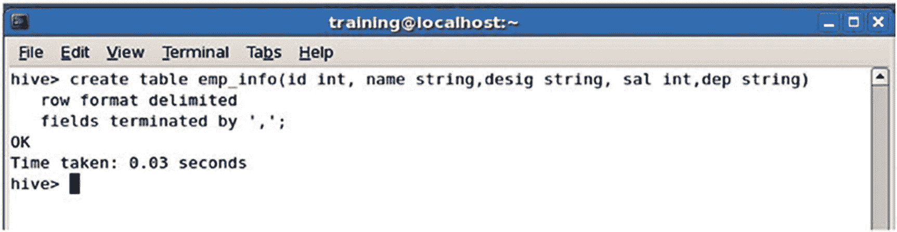
图 10-5 Hive 创建表命令

图 10-6 显示了 HDFS 中 `/user/hive/warehouse/` 文件夹结构下的 `emp_info` 表。

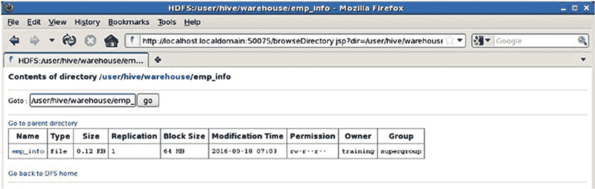
图 10-6 HDFS 中的 Hive 表

### 10.2.2.2 描述表
创建表后，您可以使用 `describe formatted emp_info;` 命令查看表的结构，该结构应与我们在创建时使用的结构匹配。除了列名，它还显示列的数据类型（见图 10-7）。

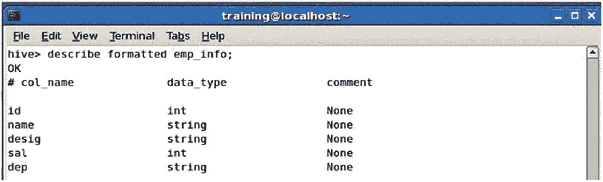
图 10-7 描述表命令

### 10.2.2.3 生成数据并存储在本地文件中
现在表已准备好加载一些数据。我们在图 10-8 中展示了生成一些虚拟数据并将其存储在本地目录中名为 `emp_info` 的文件中的过程。

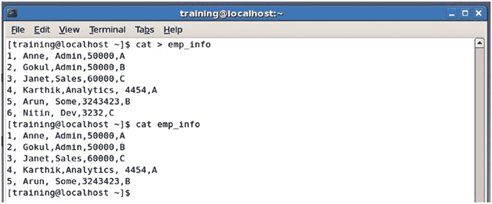
图 10-8 生成数据并存储在本地文件中

### 10.2.2.4 将数据加载到 Hive 表中
一旦我们在本地文件中有了数据，使用命令 `load data local inpath '/home/training/emp_info' into table emp_info`；我们将把数据加载到 HDFS 中的 Hive 表 `emp_info` 中（见图 10-9）。

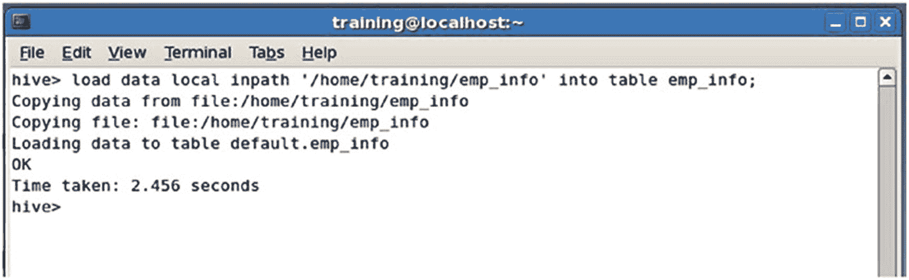
图 10-9 将数据加载到 Hive 表中

图 10-10 显示了我们从本地文件系统加载到 HDFS 文件中的数据。

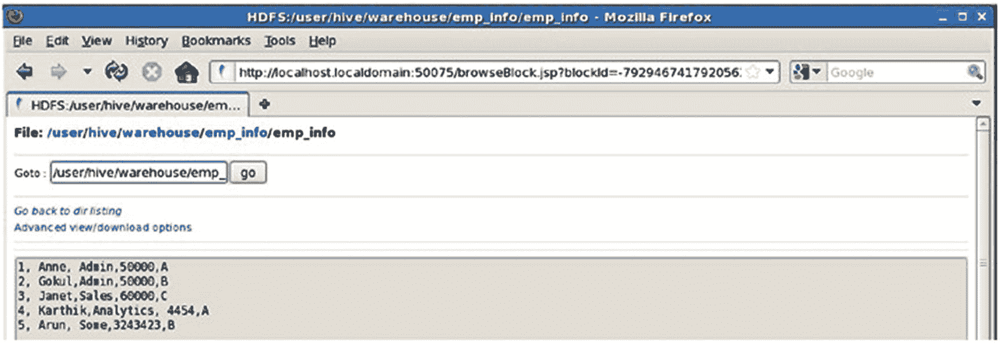
图 10-10 HDFS 文件中的数据

### 10.2.2.5 选择查询
图 10-11 展示了 `select` 查询的两种变体。第一种没有 `where` 子句，第二种使用了 `where dep = 'A'`。请注意 Hadoop 内置的 MapReduce 框架是如何在 Hive 查询中发挥作用的。这正是我们将 Hive 等工具与 Hadoop 生态系统关联起来的原因。与单词计数示例相比，这里唯一的区别是我们不需要显式定义任何 Map 或 Reduce 方法；相反，Hive 会自动为我们完成这些工作。

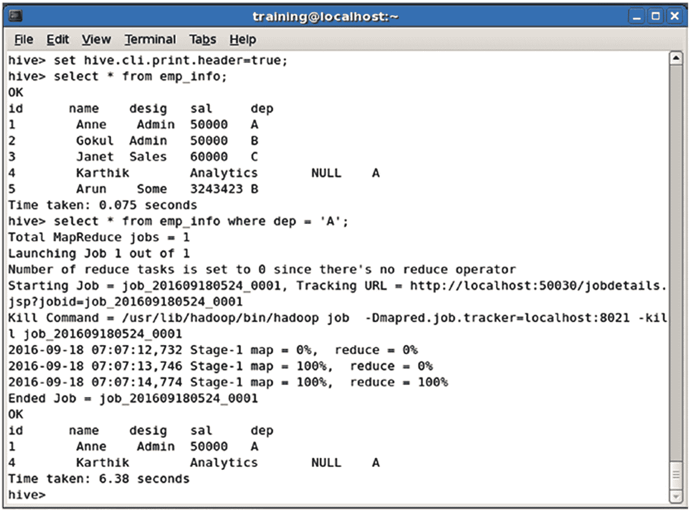
图 10-11 带和不带 where 子句的 Select 查询

除了这些基本命令，Hive 还支持数据分区、表连接、多重插入、用户定义函数和数据导出。这些功能足以支持将分析型数据库迁移到 Hive。

## 10.2.3 Apache Pig
Apache Pig 是一个用于处理大型数据集的分析平台。用 Pig Latin 编写的 Pig 程序，由 Pig 的基础设施层编译，生成一系列 MapReduce 程序，从而实现并行处理。它与 Hadoop 的强耦合提供了 HDFS 的存储结构和 YARN 的进程处理能力。

让我们回顾一下 MapReduce 部分中的单词计数示例，看看如何用一系列 Pig Latin 命令来编写相同的示例。有关 Pig 设置和使用的详细文档，请参考 [`http://pig.apache.org/docs/r0.16.0/start.html`](http://pig.apache.org/docs/r0.16.0/start.html)。

### 10.2.3.1 连接到 Pig
`pig -x local` 命令连接到本地文件系统。在终端中直接使用 `pig` 命令将连接到 HDFS。对于我们的单词计数示例，我们将使用本地文件系统，如图 10-12 所示。

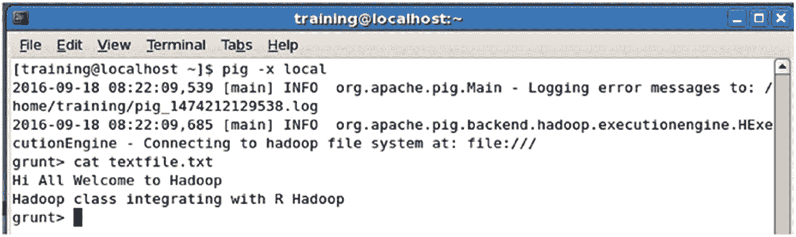
图 10-12 使用本地文件系统连接到 Pig

### 10.2.3.2 加载数据
命令 `A1 = load '/home/training/wc.txt' as (line:chararray);` 将扫描文件并将每一行和字符数组存储起来。`dump A1` 命令将输出以下内容（见图 10-13）：

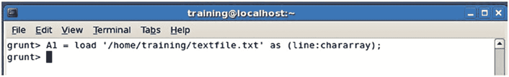
图 10-13 将数据加载到 A1
```
(Hi All Welcome to Hadoop )
(Hadoop class integrating with R Hadoop)
```

### 10.2.3.3 对每一行进行分词
将每一行分词并存储为列表。`dump A2` 命令将输出以下内容（见图 10-14）：


图 10-14 对每一行进行分词
```
({(Hi),(All),(Welcome),(to),(Hadoop)})
({(Hadoop),(class),(integrating),(with),(R),(Hadoop)})
```

### 10.2.3.4 扁平化处理分词结果
`A3 = foreach A2 generate flatten(tokens) as words;` 命令将进一步把每个已分词的列表拆分成单个词。`dump A3` 命令将输出以下内容（见图 10-15）：


图 10-15 扁平化处理分词结果
```
(Hi)
(All)
(Welcome)
(to)
(Hadoop)
(Hadoop)
(class)
(integrating)
(with)
(R)
(Hadoop)
```

### 10.2.3.5 对单词进行分组
使用命令 `A4 = group A3 by words;` 将创建一个键值对，其中键是单词，值是该单词在分词列表中出现的次数列表。`dump A4` 命令将输出以下内容（见图 10-16）：


图 10-16 对单词进行分组
```
(R,{(R)})
(Hi,{(Hi)})
(to,{(to)})
(All,{(All)})
(with,{(with)})
(class,{(class)})
(Hadoop,{(Hadoop),(Hadoop),(Hadoop)})
(Welcome,{(Welcome)})
(integrating,{(integrating)})
```

### 10.2.3.6 计数与排序
以下两个命令将生成单词及其在文档中出现次数的键值对，并随后按计数进行排序。

*   `A5 = foreach A4 generate group, COUNT(A3);`
*   `A6 = order A5 by $1 desc;`

`dump A6` 命令将输出以下内容：

```
(Hadoop,3)
(R,1)
(Hi,1)
(to,1)
(All,1)
(with,1)
(class,1)
(Welcome,1)
(integrating,1)
```

使用 Pig，可以轻松地在大型数据集上创建许多此类涉及选择、过滤、连接、联合、排序、分组和转换的分析工作流。

### 10.2.4 HBase

到目前为止，我们一直在讨论使用预定义模式的行和列的结构化格式来表示数据，这种模式一旦创建，就很难为不断变化的需求进行调整。换句话说，尽管 Hive 在大型数据集上提供了 RDBMS 的分布式版本，但它仍然要求你遵循固定的数据库模式，并基于该模式将数据存储在仓库中。然而，随着数据的快速变化，我们需要对大型分布式数据进行随机的、实时的读写。在这种情况下，数据库不能再是关系型的；它必须是大数据领域人们所说的 NoSQL。HBase 的模型源自 Google 的 Bigtable：一个用于在 Google 文件系统（GFS）上存储结构化数据的分布式存储系统。

与传统的 RDBMS 系统（即使存在许多空值以及因规范化导致的跨表冗余数据，也会存储每一行的所有列）相反，HBase 是一种列式存储。这意味着每一行数据都按列族存储。例如，如果你有一个包含名为 `details` 的列族的员工表，你可以在 `details` 列族下存储 `name`、`age` 和 `qualification` 等列。因此，如果有一个名为 `address` 的新列，它可以实时添加到 `details` 下。

#### 10.2.4.1 启动 HBase

使用 shell 脚本 `start-hbase.sh` 启动 HBase。运行以下三个命令（见图 10-17）：

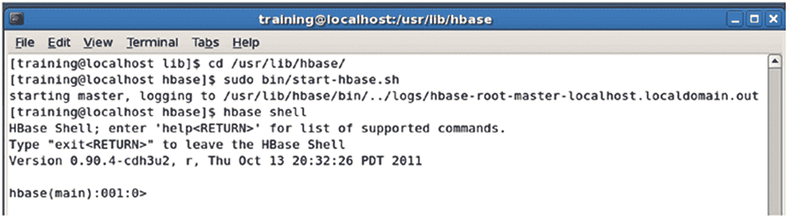

图 10-17

启动 HBase

1. `cd /usr/lib/hbase/`
2. `sudo bin/start-hbase.sh`
3. `hbase shell`

#### 10.2.4.2 创建表并插入数据

以下命令将创建一个名为 `employee` 的表，该表包含两个列族：`details` 和 `salary`。并且在 `details` 列族下，将数据插入到 `name` 和 `gender` 列中（见图 10-18）。

1. `create 'employee','details','salary'`
2. `put 'employee','e1','details:name','karthik'`
3. `put 'employee','e1','details:gender','m'`
4. `put 'employee','e1','salary:sal','20000'`

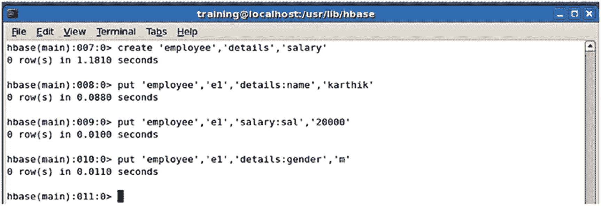

图 10-18

创建表并插入数据

#### 10.2.4.3 扫描数据

使用命令 `scan 'employee'`，你可以查看数据在 HBase 中的存储方式。每一行对应一个列族下的列值（见图 10-19）。

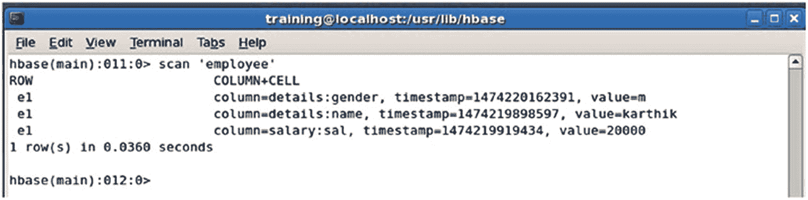

图 10-19

扫描数据

关于 HBase 的全面参考指南，请访问 [`http://hbase.apache.org/book.html#arch.overview`](http://hbase.apache.org/book.html%2523arch.overview) 。

### 10.2.5 Spark

Spark 提供了闪电般快速的集群计算（类似于多个节点协同工作的分布式计算）。Spark 拥有先进的基于有向无环图（DAG）的执行引擎，这使得它在内存中的运行速度比 Hadoop MapReduce 快 100 倍，在磁盘上快 10 倍。与仅支持 Java 的 Hadoop 相反，在 Spark 中，你可以使用 Java、Scala、Python 和 R 编写应用程序。如果这还不够，Spark 还提供了 SQL、流处理、机器学习和图库，这些可以以任何方式组合起来创建应用程序管道。除了从 HDFS 访问数据外，在 Spark 中，你还可以连接到 HBase、Cassandra、S3 以及更多其他数据源。

在本章中，我们使用 SparkR，这是一个轻量级的前端工具，用于从 R 中使用 Apache Spark。它轻量但功能非常丰富。简而言之，SparkR 提供以下功能：

*   你可以从本地数据框或 Hive 表创建 SparkDataFrame。
*   在 SparkDataFrame 上，可以进行 R 中 `dplyr` 包提供的选择、分组和聚合等操作。
*   你可以直接从 R 对 Hive 运行 SQL 查询。
*   它提供了来自 Spark 的 MLlib 库中的一些机器学习算法。

这个强大的工具无疑正在席卷整个行业。不过，我们将把重点放在 Spark 的机器学习库 MLlib 上。

对于感兴趣的读者，可以在 [`http://spark.apache.org/docs/latest/index.html`](http://spark.apache.org/docs/latest/index.html) 找到关于 Spark 的更多详细信息。

## 10.3 使用 Spark 在 R 中进行机器学习

MLlib 是 Spark 的机器学习（ML）库。其目标是让实用的机器学习变得可扩展且易于使用。从高层来看，它提供了以下工具：

*   *ML 算法：* 常见的机器学习算法，如分类、回归、聚类和协同过滤
*   *特征化：* 特征提取、转换、降维和选择
*   *流水线：* 用于构建、评估和调优 ML 流水线的工具
*   *持久化：* 保存和加载算法、模型和流水线
*   *工具：* 线性代数、统计、数据处理等

目前，SparkR 支持以下机器学习算法：

*   广义线性模型
*   加速失效时间（AFT）生存回归模型
*   朴素贝叶斯模型和 KMeans 模型

在底层，SparkR 使用 MLlib 来训练模型。以下 R 代码取自我们之前的房价预测示例，但这是使用 SparkR 的可扩展版本模型。

注意（针对 Windows 用户）：在运行代码之前，请遵循以下步骤：

1. 从 [`http://spark.apache.org/downloads.html`](http://spark.apache.org/downloads.html) 下载为 Hadoop 2.7 及更高版本预构建的 Spark 发行版。
2. 将文件解压到 `C:-2.0.0-bin-hadoop2.7` 文件夹（你可以选择自己的位置）。
3. 在 `cmd` 提示符中使用以下命令为 SparkR 库创建符号链接：`mklink /D "C:Files-3.2.2" "C:-2.0.0-bin-hadoop2.7"`。
4. 使用 RStudio 或 R 命令行，通过 `library(SparkR)` 进行测试。

让我们深入了解接下来的 R 代码，并理解 SparkR 如何帮助使用 Spark 引擎构建可扩展的机器学习模型。请记住，该代码是在只有一个节点的独立 Spark 集群上执行的。只有当相同的代码在拥有大量计算节点的大型企业级 Spark 集群上运行时，才能看到 Spark 的真正潜力。

### 10.3.1 设置环境变量

以下命令将让 R 知道 Spark 和 Hadoop 二进制文件在你机器上的安装位置。请记住，这两个环境变量与你可能在系统属性中设置的环境变量相同（针对 Windows 机器）。

```r
#设置环境变量
Sys.setenv(SPARK_HOME='C:/Spark/spark-2.0.0-bin-hadoop2.7',HADOOP_HOME='C:/Hadoop-2.3.0')
.libPaths(c(file.path(Sys.getenv('SPARK_HOME'), 'R', 'lib'),.libPaths()))
Sys.setenv('SPARKR_SUBMIT_ARGS'='"sparkr-shell"')
```

### 10.3.2 初始化 Spark 会话

设置好环境变量后，使用 `spark.driver.memory`、`spark.sql.warehouse.dir` 等参数初始化 SparkR 会话，如下面的代码片段所示。此初始化是必需的，以便 R 环境能够连接到本地机器上运行的 Spark。

## 初始化 SparkR 环境

```r
library(SparkR)
library(rJava)
#进入 SparkR 的入口点是 SparkSession，它将你的 R 程序连接到 Spark 集群
sparkR.session(enableHiveSupport =FALSE, appName ="SparkR-ML",master ="local[*]", sparkConfig =list(spark.driver.memory ="1g",spark.sql.warehouse.dir="C:/Hadoop-2.3.0"))
Launching java with spark-submit command C:/Spark/spark-2.0.0-bin-hadoop2.7/bin/spark-submit2.cmd   --driver-memory "1g" "sparkr-shell" C:\Users\Karthik\AppData\Local\Temp\Rtmpuoqh3M\backend_port1030727b704d
Java ref type org.apache.spark.sql.SparkSession id 1
```

### 10.3.3 加载数据并运行预处理

加载第 6 章介绍的房屋数据，并执行相同的一组预处理步骤，如下面的代码片段所示：

```r
library(data.table)
#读取房屋数据
Data_House_Price <- read.csv("house_prices.csv")
#提取相关列并在数据集中分配所需字段
Data_House_Price <-Data_House_Price[,.(HOUSE_ID,HousePrice,StoreArea,StreetHouseFront,BasementArea,LawnArea,Rating,SaleType)]
#省略任何缺失值
Data_House_Price <-na.omit(Data_House_Price)
Data_House_Price$HOUSE_ID <-as.character(Data_House_Price$HOUSE_ID)
```

### 10.3.4 创建 SparkDataFrame

现在，通过将原始数据集 `Data_House_Price` 分割为前三分之二和剩余部分（最后三分之一），分别创建训练和测试 SparkDataFrame。它类似于 R 中的数据框，有助于存储任何行列形式的表格数据，但在 Spark 中，其实现对于处理网络传输和处理数千个计算节点来说要高效得多。

```r
#Spark 数据框 - 训练
gaussianDF_train <-createDataFrame(Data_House_Price[1:floor(nrow(Data_House_Price)*(2/3)),])
#Spark 数据框 - 测试
gaussianDF_test <-createDataFrame(Data_House_Price[floor(nrow(Data_House_Price)*(2/3) +1):nrow(Data_House_Price),])
class(gaussianDF_train)
[1] "SparkDataFrame"
attr(,"package")
[1] "SparkR"
class(gaussianDF_test)
[1] "SparkDataFrame"
attr(,"package")
[1] "SparkR"
```

### 10.3.5 构建 ML 模型

这本质上是本章的核心。第一个机器学习模型被构建为可扩展以处理大型数据集。`spark.glm` 是 Spark 的 MLlib 库中的一个函数，它提供了广义线性模型（GLM）的可扩展实现。理想情况下，语法方面没有任何变化（除了函数名），但在底层，可能有大量的节点协同工作，自动运行 MapReduce 程序以及 Spark 支持的其他许多操作，以达到最终结果。

```r
# 使用 spark.glm 拟合一个 "gaussian" 族的广义线性模型
gaussianGLM <-spark.glm(gaussianDF_train, HousePrice ~ StoreArea + StreetHouseFront + BasementArea + LawnArea + Rating + SaleType, family = gaussian)
summary(gaussianGLM)
```

```
Call:
spark.glm(formula = HousePrice ~ StoreArea + StreetHouseFront + 
    BasementArea + LawnArea + Rating + SaleType, family = gaussian, 
    data = gaussianDF_train)

Deviance Residuals: 
    Min       1Q   Median       3Q      Max  
-643738   -61460    -5495    56897   642793  

Coefficients:
                   Estimate Std. Error t value Pr(>|t|)    
(Intercept)            -80034    32619       -2.4536   0.014387 *  
StoreArea              58.172    9.8507      5.9054    5.4833e-09 ***
StreetHouseFront       136.98    80.828      1.6947    0.090578 .  
BasementArea           23.623    3.7224      6.3461    3.9629e-10 ***
LawnArea               0.77459   0.19875     3.8973    0.0001066 ***
Rating                 35402     1519.4      23.3      0 ***
SaleType_NewHouse      -12979    31904       -0.40681  0.68427    
SaleType_FirstResale   10117     32497       0.31132   0.75565    
SaleType_SecondResale  -24563    32480       -0.75626  0.44975    
SaleType_ThirdResale   -22562    34847       -0.64748  0.51754    
SaleType_FourthResale  -32205    36778       -0.87567  0.38151    
---
Signif. codes:  0 ‘***’ 0.001 ‘**’ 0.01 ‘*’ 0.05 ‘.’ 0.1 ‘ ’ 1

(Dispersion parameter for gaussian family taken to be 2012650630)

    Null deviance: 4.9599e+12  on 711  degrees of freedom
Residual deviance: 1.4109e+12  on 701  degrees of freedom
AIC: 17286

Number of Fisher Scoring iterations: 1
```

### 10.3.6 预测测试数据

在最后一步，你现在可以使用上一步构建的 ML 模型来预测测试数据集上的房价。请参考第 6 章了解该模型的评估标准。

```r
#对 gaussianModel 进行预测
gaussianPredictions <-predict(gaussianGLM, gaussianDF_test)
names(gaussianPredictions) <-c('HOUSE_ID','HousePrice','StoreArea','StreetHouseFront','BasementArea','LawnArea','Rating','SaleType','ActualPrice','PredictedPrice')
gaussianPredictions$PredictedPrice <-round(gaussianPredictions$PredictedPrice,2.0)
showDF(gaussianPredictions[,9:10])
```

```
+-----------+--------------+
|ActualPrice|PredictedPrice|
+-----------+--------------+
|   139400.0|      128582.0|
|   157000.0|      202101.0|
|   178000.0|      164765.0|
|   120000.0|       50425.0|
|   130000.0|      155841.0|
|   582933.0|      333450.0|
|   309000.0|      255584.0|
|   176000.0|      192695.0|
|   125000.0|      132784.0|
|   130000.0|      140085.0|
|   169990.0|      183082.0|
|   213000.0|      222965.0|
|   144000.0|      122123.0|
|   118500.0|      158940.0|
|   138000.0|      116004.0|
|   437154.0|      346572.0|
|   230000.0|      261396.0|
|    82000.0|       61949.0|
|    85000.0|      119914.0|
|   214900.0|      218930.0|
+-----------+--------------+
only showing top 20 rows
```

### 10.3.7 停止 SparkR 会话

最后，当任务完成时，执行以下代码以释放为此进程持有的所有资源，例如 CPU 和内存。

```r
sparkR.stop()
```

在此代码运行期间，您可以在浏览器中打开 `http://localhost:4040/jobs/` 并查看 Spark 作业的进度。对于执行此代码时自动生成的每个作业，您可以查看 DAG 可视化，了解 Spark 引擎实际如何执行该作业。

为了理解如何通过可视化来了解您的应用程序在 Spark 集群上的实际运行情况，请阅读 databricks 的这篇博文：

[Understanding Your Spark Application Through Visualization](https://databricks.com/blog/2015/06/22/understanding-your-spark-application-through-visualization.html)

## 10.4 使用 H2O 在 R 中进行机器学习

在本书即将结束机器学习之旅之际，我们想为 R 用户介绍另一个强大的平台，名为 H2O。我们之前讨论了一些强大的机器学习技术，如深度学习、文本分析、集成方法等。这些技术无法在单台机器上执行，需要高性能计算。

R 是一种流行的语言，并且能够出色地适应不同平台，它提供了将自身集成到强大的高性能计算环境中的选项。在前面的章节中，我们展示了一些示例，例如 Microsoft Cognitive Services、Spark 和其他 Apache 产品。在最后一节中，我们将介绍 H2O，这是一个用于大数据分析的开源高性能集群。

H2O 由 H2O.ai（前身为 Oxdata）开发和维护，这是一家成立于 2011 年的初创公司。H2O 被宣传为“用于大数据科学的开源内存预测引擎”。它提供了令人印象深刻的一系列机器学习算法。H2O R 包提供了用于构建 GLM、GBM、K-means、朴素贝叶斯、主成分分析、随机森林和深度学习（多层神经网络模型）的函数。

H2O 是一个 Java 虚拟机，经过优化，可在集群上对分布式、并行的机器学习算法进行“内存中”处理。“集群”是一种软件结构，可以在您的笔记本电脑、服务器上启动，也可以在由真实机器（包括构成 Hadoop 集群的计算机）组成的集群的多个节点上启动。根据最新文档，H2O 软件可以在传统操作系统上运行，例如 Microsoft Windows（7 或更高版本）、MacOS X（10.9 或更高版本）和 Linux（Ubuntu 12.04；RHEL/CentOS 6 或更高版本）。它也可以在大型数据系统上运行，特别是 Apache Hadoop 分布式文件系统（`HDFS`），并且可以在几种流行的虚拟机上使用，例如 Cloudera（5.1 或更高版本）、MapR（3.0 或更高版本）和 Hortonworks（HDP 2.1 或更高版本）。它还可以在云计算环境中运行，例如使用 Amazon EC2、Google Compute Engine 和 Microsoft Azure。H2O Sparkling Water 软件在 Apache Spark 上获得了 databricks 认证。

对于 R，`h2o` 包可在 CRAN 上获取。在继续 H2O 的演示之前，我们建议您访问以下 URL，这些 URL 包含一些文档齐全的资料：

*   H2O 包的完整文档：[H2O Package Documentation](https://cran.r-project.org/web/packages/h2o/h2o.pdf)
*   另一份关于 H2O 的文档可在 h2o.ai 上找到：[H2O Documentation](http://docs.h2o.ai/h2o/latest-stable/h2o-docs/index.html)
*   更多针对 H2O 的机器学习算法实现：[H2O R Demos](https://github.com/h2oai/h2o-3/tree/master/h2o-r/demos)
*   H2O 的安装：此处提供了用户友好且易于遵循的安装说明：[H2O R Installation](http://h2o-release.s3.amazonaws.com/h2o/master/1735/docs-website/Ruser/Rinstall.html)
*   关于使用 H2O 在 R 中进行高性能机器学习的演示文稿：[H2O HPC Presentation](http://www.stat.berkeley.edu/~ledell/docs/h2o_hpccon_oct2015.pdf)

### 10.4.1 安装包

完成先决条件的安装后，以下代码将获取适用于 R 的最新 H2O 版本并将其安装在本地系统中。

注意：

*   在尝试此代码之前，建议具备良好的互联网连接。所有计算（在高度优化的 Java 代码中）都在 H2O 集群中执行，并由来自 R 的 REST 调用启动。
*   建议不要在本地机器上使用大量数据试验这些代码（在本地机器上运行以下代码中显示的演示是安全的）。

```r
# 以下两个命令会移除任何先前为 R 安装的 H2O 包。
if ("package:h2o" %in%search()) { detach("package:h2o", unload=TRUE) }
if ("h2o" %in%rownames(installed.packages())) { remove.packages("h2o") }

# 接下来，我们下载、安装并初始化适用于 R 的 H2O 包。
install.packages("h2o", repos=(c("http://s3.amazonaws.com/h2o-release/h2o/rel-kahan/5/R", getOption("repos"))))
#或者您可以按如下方式从 CRAN 安装 h2o 包
install.packages("h2o")
```

### 10.4.2 初始化 H2O 集群

安装完成后，您可以通过调用 `init()` 函数来启动一个集群实例进行计算。

```r
# 在 R 中加载 h2o 库
library(h2o);
#在您的机器中启动一个集群
localH2O =h2o.init()
```

上述函数将返回一个输出，显示连接成功，如下所示：

```
Starting H2O JVM and connecting: .... Connection successful!
R is connected to the H2O cluster:
H2O cluster uptime:         4 seconds 188 milliseconds
H2O cluster version:        3.10.0.6
H2O cluster version age:    1 month and 9 days
H2O cluster name:           H2O_started_from_R_abhisheksingh_zve484
H2O cluster total nodes:    1
H2O cluster total memory:   0.89 GB
H2O cluster total cores:    4
H2O cluster allowed cores:  2
H2O cluster healthy:        TRUE
H2O Connection ip:          localhost
H2O Connection port:        54321
H2O Connection proxy:       NA
R Version:                  R version 3.2.3 (2015-12-10)
```

注意：启动时，H2O 被限制为 CRAN 默认的 2 个 CPU。请按如下所示关闭并重新启动 H2O 以使用所有 CPU。

```r
> h2o.shutdown()
> h2o.init(nthreads = -1)
```

一旦您在本地机器上启动了集群，就可以准备好在 H2O 的高性能集群上运行您的计算了。还有许多其他示例可以帮助您开始使用梯度提升机（GBM）、广义线性模型（GLM）、集成树等等。

## 10.5 总结

在未来，随着基础设施成本下降和数据量增加，扩展规模的需求将成为机器学习流程中的首要任务。每一个基于机器学习构建的应用，都必须首先考虑可扩展的实现思路。随着数据规模开始爆炸式增长，大多数传统的 RDBMS 系统将很快过时。行业巨头们已经率先迈出第一步，转向支持大规模扩展且能灵活适应业务需求的系统。在不久的将来，当另一波颠覆性技术解决了日益增长的数据量问题时，对高效算法设计的重视以及对量子计算等领域的关注将开始显现。

我们通过借鉴快速发展的数据科学方法论和技术，全面深入地探索了机器学习的世界。尽管经典文献中已经存在并优雅地解释了绝大部分机器学习模型构建流程，但我们仍感到有必要将机器学习模型构建流程与现代数据科学领域涌现的新思维结合起来。

我们还尽可能简化了统计学和数学内容，以使机器学习的学习更加实用，并提供了大量额外资源供进一步阅读。诸如抽样、回归模型和深度学习等主题的深度和广度都非常大，每个主题都足以写出一本同等篇幅的书籍。然而，得益于 CRAN 上丰富的 R 包，这些算法的实际应用才成为可能。

由于 R 是初学者和高级用户围绕实际问题快速构建机器学习原型的首选编程语言，我们选择使用 R 来演示本书中的所有示例。如果你想将机器学习作为职业或研究工作，那么在计算机科学、统计学和领域知识之间取得良好的平衡将大有裨益。