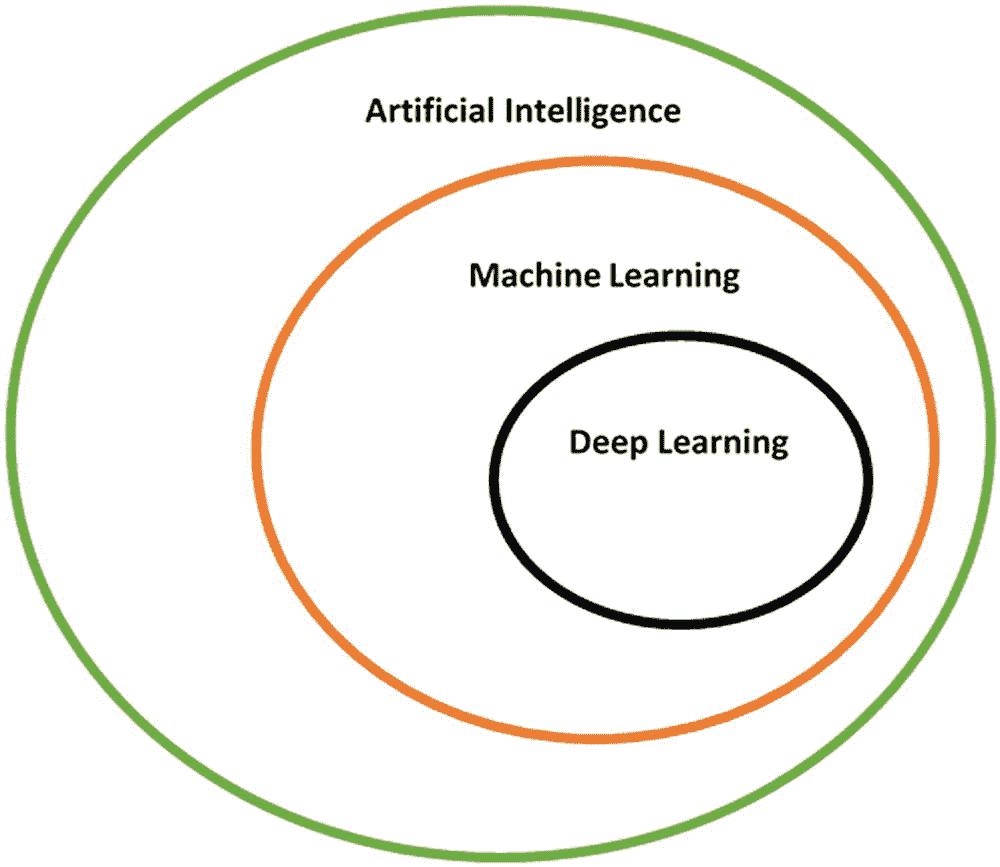
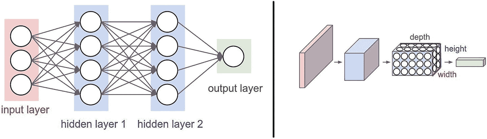
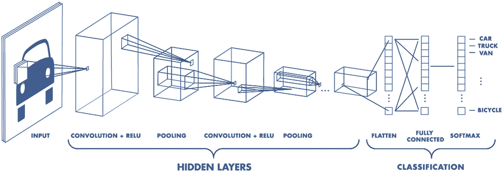
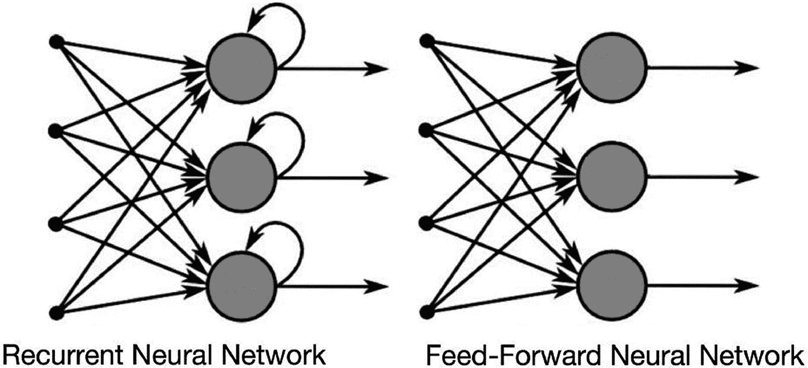
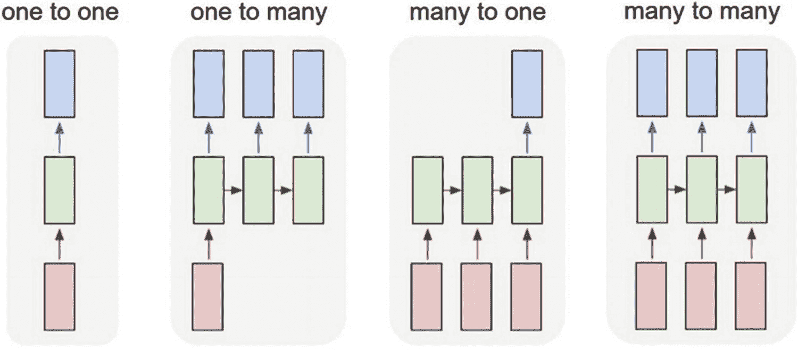
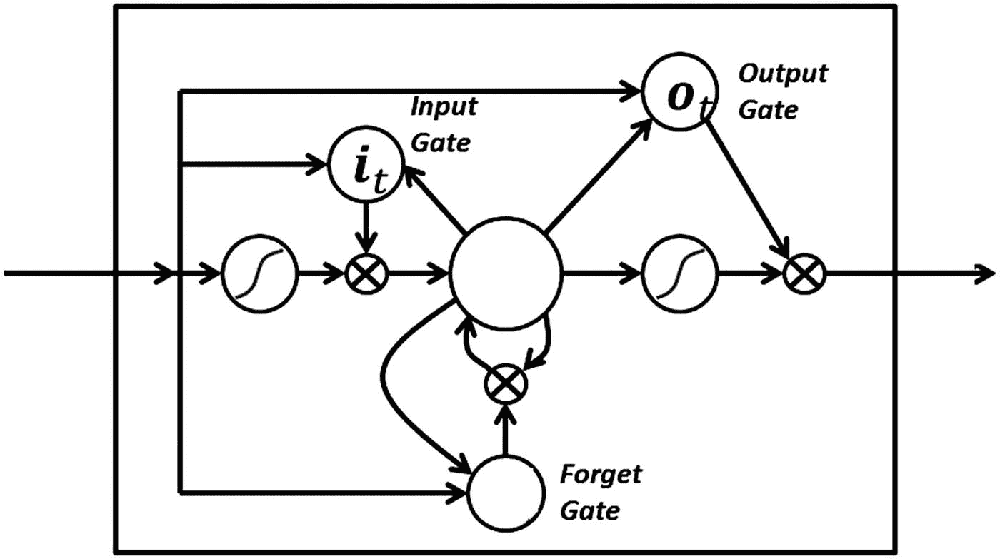
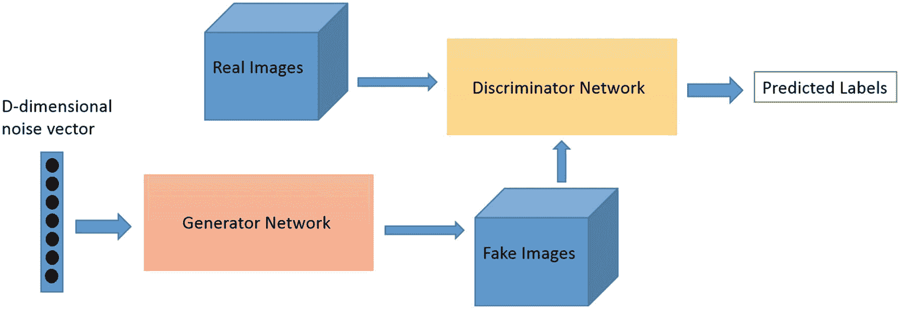
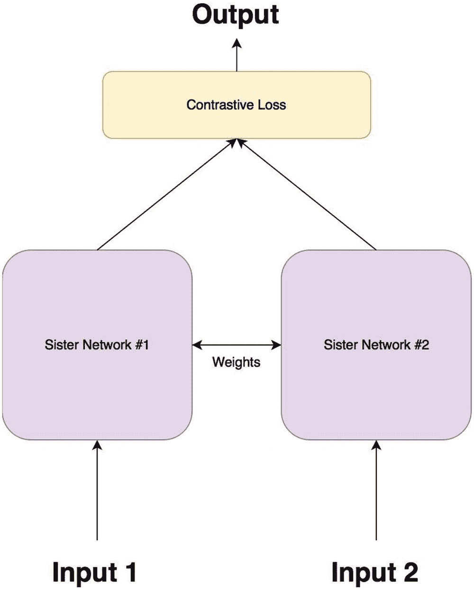
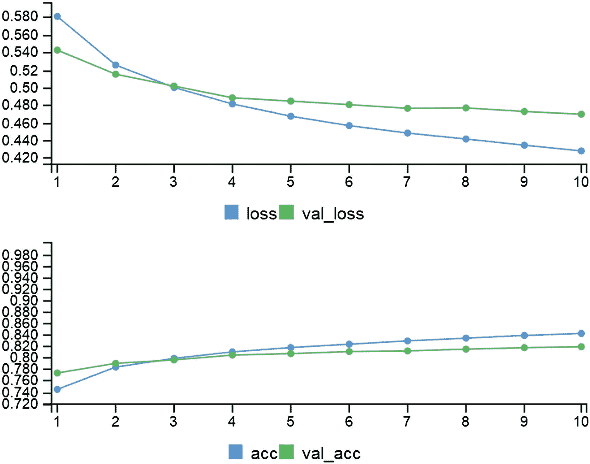

# 11. 使用 Keras 和 TensorFlow 进行深度学习

曾几何时，数据和计算资源非常稀缺，以至于业务应用或 IT 基础设施产生的每一个数据点都不会被存储，应用设计也缺乏数据驱动的思维。如今，时代确实变了，计算和存储资源丰富，我们拥有了“数据优先”的思维，并且每个业务应用都能提供越来越多的数据。大型企业现在的商业模式都建立在从数据推断中产生收入的基础上。在这场数据和计算能力的激增中，最有前景的进步在于我们看待解决复杂问题的方式发生了根本性的改变。

深度学习源于神经网络等传统机器学习算法，已经存在了几十年，然而，现在正是它回归的最佳时机。本章被收录为本书第二版的最后一章，因为很自然地，我们会将深度学习视为一种可扩展的机器学习算法，它能够处理海量数据。像 TensorFlow 这样的框架就是为运行这些算法而设计的。

更正式地说，深度学习算法受到人类认知系统的启发，能够学习复杂的数据表示。深度学习可以是监督式、半监督式和非监督式的。与神经网络类似，深度学习架构由多层神经元构建而成，以实现更好的特征提取。因此，它们创建了多个抽象层次，通常被称为概念层次结构。

在本章中，我们将重点理解各种深度学习架构——如 Keras 这样的库、TensorFlow 这样的框架，以及深度学习算法在哪些问题上引发了颠覆性的研究和跨越式发展。

## 11.1 深度学习简介

深度学习是机器学习的一个子领域，其根源在于神经网络模型。图 11-1 展示了人工智能（AI）、机器学习（ML）和深度学习（DL）之间的重叠关系。



图 11-1

AI、ML 和 DL 的重叠关系

对于图像分类，机器学习模型仅被设计用于在给定的特征集上使用线性分类器。然而，线性分类器只能创建简单的区域，比如被超平面分隔的空间。这类线性分类器不擅长检测位置、方向或光照的变化。对于视频、语音和音频，也存在类似的情况。另一方面，深度学习架构包含多层模块堆栈，这些模块通过计算非线性的输入-输出映射来学习。因此，这种架构能够从文本、视频、音频、语音和图像中的高级抽象表示中学习。第 11.2 节将带你了解流行的深度学习架构及其在各个领域的应用。

## 11.2 深度学习架构

在本节中，我们将讨论一些在实际应用中被广泛使用的流行深度学习架构。然而，考虑到本书的篇幅，我们将把细节限制在最低限度，并在必要时引用适当的资料。深度学习架构正随着来自各个领域的大量研究兴趣而迅速发展。

### 11.2.1 卷积神经网络（CNN）

与传统神经网络相比，卷积神经网络（CNN）将其神经元结构化为三维（宽度、高度和深度），如图 11-2 所示。CNN 的每一层都将三维输入转换为三维输出。在图 11-2 中，红色的输入层代表图像，因此其宽度和高度就是图像的尺寸，深度为三，分别对应红、绿、蓝三个通道。



图 11-2

神经网络与卷积神经网络对比。来源：[`http://cs231n.github.io/convolutional-networks/`](http://cs231n.github.io/convolutional-networks/)

图 11-3 展示了 CNN 的基本架构，该架构可扩展到更复杂的架构，如 LeNet、AlexNet、ZF Net、GoogLeNet、VGGNet 和 ResNet 等。通过使用输入层到输出 softmax 层之间的所有层，网络能够学习给定数据的各种特征，无论模式多么复杂。在许多方面，它确实模仿了人类思维。关于这些架构的更多细节，可参见“CS231n 卷积神经网络用于视觉识别” [7]。



图 11-3

卷积神经网络。来源：[`https://www.mathworks.com/videos/introduction-to-deep-learning-what-are-convolutional-neural-networks--1489512765771.html`](https://www.mathworks.com/videos/introduction-to-deep-learning-what-are-convolutional-neural-networks%252D%252D1489512765771.html)

CNN 的架构适用于图像或视频帧中的物体分类和检测。它在计算机视觉从业者中很受欢迎。CNN 架构被广泛应用于基于闭路电视监控的安全监控、MRI 和 CT 扫描中的异常检测、基于人脸识别的应用以及许多其他计算机视觉用例。

### 11.2.2 循环神经网络（RNN）

循环神经网络（RNN）因其基于神经网络的架构和内置的内部记忆功能而迅速流行起来。RNN 的历史可以追溯到 20 世纪 80 年代；然而，与其他深度学习架构一样，随着计算能力变得经济且充裕，其潜力在近年来才得以实现。

图 11-4 展示了 RNN 与前馈神经网络的区别。RNN 通常处理当前输入，并记住它从先前输入中学到的内容。



图 11-4

前馈神经网络与卷积神经网络。来源：[`https://towardsdatascience.com/recurrent-neural-networks-and-lstm-4b601dd822a5`](https://towardsdatascience.com/recurrent-neural-networks-and-lstm-4b601dd822a5)

另外需要注意的是，前馈神经网络将一个输入映射到一个输出，而 RNN 可以实现一对多、多对多（翻译）以及多对一（语音分类）的映射。图 11-5 展示了 RNN 中不同类型的映射。



图 11-5

RNN 映射。来源：[`https://towardsdatascience.com/recurrent-neural-networks-and-lstm-4b601dd822a5`](https://towardsdatascience.com/recurrent-neural-networks-and-lstm-4b601dd822a5)

RNN 能够记住输入中的重要部分，这使得它在处理语音、文本、时间序列、音频和视频等序列数据时表现出色。

RNN 的一个局限性是其短期记忆。为了解决这个局限，RNN 可以与长短期记忆（LSTM）单元结合，这有效地使其也能够存储长期记忆。这些通常被称为 LSTM 网络。LSTM 使 RNN 能够在较长时间内记住其输入。这种记忆被设计为一个门控单元（门可以打开或关闭），它可以根据信息的重要性决定存储（开门）或删除（关门）信息。图 11-6 展示了一个典型的 LSTM 单元。



图 11-6

LSTM 单元。来源：[`https://towardsdatascience.com/recurrent-neural-networks-and-lstm-4b601dd822a5`](https://towardsdatascience.com/recurrent-neural-networks-and-lstm-4b601dd822a5)

在本章后面，我们将展示一个使用 LSTM 网络解决实际问题的演示，即使用 Quora 重复问题数据集来识别重复文本。

### 11.2.3 生成对抗网络（GAN）

除了第 11.2.1 节中提到的流行的 AlexNet、VGG Net、GoogleNet、ResNet 和 SegNet 架构之外，我们将简要解释生成对抗网络（GAN），这是过去十年机器学习领域发展出的最有趣的想法之一。

正如文章《生成对抗网络（GAN）初学者指南》[8] 所述，GAN 的潜力巨大，因为它们可以学习模仿任何数据分布。也就是说，可以教会 GAN 在任何领域（图像、音乐、语音和散文）创造出与我们自己的世界惊人相似的世界。从某种意义上说，它们是机器人艺术家，其输出令人印象深刻——甚至令人感动。

GAN 基于生成算法。在第 6 章中，我们展示了多个判别算法的例子，这些算法试图根据输入特征对输入进行分类。例如，给定糖尿病数据集中的一条患者记录，判断该患者是否患有糖尿病。从数学上讲，这可以表示为 P(Y|X)，其中 Y 是类别（是或否），X 是输入特征向量。在生成算法中，我们反转这种关系并问：“我们能否生成一个糖尿病患者的所有特征？”换句话说，假设一个人患有糖尿病，我们观察到给定输入特征的可能性有多大？

因此，在 GAN 中，一个神经网络（我们称之为生成器）生成新的数据实例，而另一个神经网络（判别器）则决定它审查的每个数据实例是否属于实际的训练数据集。

判别器模型是一个分类器，用于确定给定的图像看起来像是数据集中的真实图像，还是像人工创建的图像。这基本上是一个二元分类器，将采用普通 CNN 的形式。生成器模型接收随机输入值，并通过反卷积神经网络将其转换为图像。图 11-7 展示了其架构。



图 11-7

GAN 架构。来源：[`https://www.oreilly.com/learning/generative-adversarial-networks-for-beginners`](https://www.oreilly.com/learning/generative-adversarial-networks-for-beginners)

GAN 在许多方面都是强大的概念，它们确实可以实现只有人类才能想到的能力。想象一下，一个 GAN 模型能够根据详细的文本描述生成逼真的鸟类和花卉图像。研究论文《生成对抗文本到图像合成》[10] 展示了这一想法。该网络在辅助残障人士、室内装饰、生成创意艺术形式等各个领域都有着巨大的潜力。

## 11.3 深度学习工具集

有许多工具和软件栈可用于在 CPU 或 GPU 硬件上构建深度学习模型。由于深度学习模型计算资源密集，近年来 GPU 的使用越来越多。为深度学习设计的各种软件都考虑到了算法的复杂性和计算需求。在本节中，我们将探讨可用于在真实世界的大规模数据集上构建深度学习模型的各种工具集。

### 11.3.1 高级库

Keras 是开源高级神经网络 API 无可争议的选择，最初用 Python 编写。Keras 很快成为在许多后端引擎（将在下一节讨论）之上构建深度学习架构的事实标准，这些引擎包括 TensorFlow、CNTK 和 Theano。它同时支持 CNN 和 RNN，并可在 CPU 和 GPU 机器上运行。

使用 Keras 的详细文档可在 [`https://keras.io/`](https://keras.io/) 找到。

除了 Keras，我们还有 Apache MXNet，这是一个为深度学习设计的库。尽管 MXNet 是一个全面且灵活的 Python API，但它并未获得开发者社区的足够兴趣以实现广泛使用。在本章的演示中，我们使用 Keras，因为它提供了与 R 的无缝集成。

### 11.3.2 后端引擎或框架

像 TensorFlow、Theano 和 CNTK 这样的后端引擎通常被称为用于数据流编程的软件库。某些参考资料也将这些引擎描述为机器学习框架。这些后端引擎为神经网络类架构对多维数据数组（如矩阵乘法）执行的操作提供了平台。在像 TensorFlow 这样的框架中，计算被表示为有状态的数据流图，这使得在处理大量数据时非常高效，并且易于将计算部署到各种平台，如 CPU、GPU 或 TPU。

在我们的演示中，我们将使用 TensorFlow 框架，它是这些引擎中最流行的。

### 11.3.3 硬件能力

随着各种深度学习库和框架的发展，对更强大、更专业的处理硬件的需求也开始增长。从通用 CPU 到谷歌最新的张量处理单元（TPU），这些专用硬件设计都是根据深度学习网络所涉及的操作类型精心构建的。谷歌的 TPU 专为高效、更快的输入输出而设计，以缩短模型训练所需的时间。

图形处理单元（GPU）广泛应用于高清动画渲染和游戏系统，后被重新用于执行高速计算。在当前深度学习工作中，GPU 因其更快的模型训练速度而成为最受青睐的处理单元选择。

### 11.3.4 编程语言选择

多年来，用于构建机器学习和深度学习模型的编程语言选择逐渐向 Python 靠拢。Python 的流行主要归功于其代码已为生产部署做好准备。它稳健可靠，被广泛认为与为速度和优雅而构建的传统编程语言（如 C/C++）不相上下。

为了保持全书的一致性，本章的所有演示均采用 R 语言。

### 11.3.5 云基础设施

由于深度学习模型需要大量计算能力，个人基础设施中的普通硬件（如笔记本电脑或台式机）并不具备所需的能力。公共云中有许多选择，例如 Amazon AWS、Google Cloud 和 Microsoft Azure。为了本书中的演示，读者可以在 rstudio 博客中选择其中一个选项：[`https://blog.rstudio.com/2018/09/12/getting-started-with-deep-learning-in-r/`](https://blog.rstudio.com/2018/09/12/getting-started-with-deep-learning-in-r/)。

不过，我们选择了一个示例数据集和问题，它们可以在中等配置的台式机或笔记本电脑系统上正常运行。请记住，所有云平台都涉及相关成本。在使用任何云平台之前，请仔细阅读定价结构。

## 11.4 用例：识别 Quora 上的重复问题

2017 年，Quora 在 Kaggle（一个面向众多数据科学项目的在线平台）竞赛中提供了一个庞大的 Quora 问题对数据集，包含 404,000 个问题对。该竞赛的目标是构建最准确的模型，用于预测哪些问题对是重复的。对于像 Quora 这样的平台，这将极大地帮助它们进行问题分类、分配等。这个问题对人类思维来说看似非常简单，但当涉及到机器理解一对问题的语义含义时，则涉及一个复杂的学习过程。那么，面对复杂问题，还有什么比深度学习更合适的呢？

在接下来的 R 语言演示中，我们将引导您实现一个名为“孪生循环架构”的模型。我们要感谢 Daniel Falbel 在[`https://blogs.rstudio.com/tensorflow/posts/2018-01-09-keras-duplicate-questions-quora/`](https://blogs.rstudio.com/tensorflow/posts/2018-01-09-keras-duplicate-questions-quora/) [6]上发表的帖子《使用 Keras 对 Quora 重复问题进行分类》。

### 11.4.1 环境设置

首先，我们需要安装 Keras 和 TensorFlow 作为后端。它们提供了数据预处理和模型构建所需的所有库：

```
#安装 Keras
install.packages("keras")
library(keras)
install_keras()
#安装 TensorFlow 作为 Keras 的后端。默认使用 CPU，但您也可以指定"tensorflow = "gpu"
install_keras(tensorflow)
```

### 11.4.2 数据预处理

为了运行我们的模型，我们需要将数据准备成合适的格式。以下代码使用`keras`库中的`text_tokenizer`和`fit_text_tokenizer`方法将单词标记化为整数：

```
#加载 keras
library(keras)
#数据可从以下地址下载
#https://www.kaggle.com/c/quora-question-pairs/data
quora_data <- read.csv("quora_duplicate_questions.tsv", sep = "\t", stringsAsFactors = FALSE)
#初始化文本分词器，词汇量上限为 50000
tokenizer <- text_tokenizer(num_words = 50000)
#将分词器适配到问题 1 和问题 2 的唯一值上
tokenizer %>% fit_text_tokenizer(unique(c(quora_data$question1, quora_data$question2)))
#文本分词器，将每个 question1 和 question2 转换为整数列表
question1 <- texts_to_sequences(tokenizer, quora_data$question1)
question2 <- texts_to_sequences(tokenizer, quora_data$question2)
```

在以下代码中，我们计算每个问题（单词数量）的长度。由于所有问题的长度并不相等，我们需要使用从 50001 开始的额外整数对单词列表进行填充（我们在分词过程中使用了整数 1 到 50000）。填充操作将序列归一化为相同大小，以便我们可以将它们输入模型。

```
library(purrr)
questions_length <- c(
map_int(question1, length),
map_int(question2, length)
)
```

从分位数可以看出，99%的问题长度最多为 31，因此我们可以选择 15 到 30 之间的填充长度。我们可以先选择 20（稍后也可以调整此参数）。

```
#80%、90%、95%和 99%分位数
quantile(questions_length, c(0.8, 0.9, 0.95, 0.99))
80%   90%   95%   99%
14.00 18.00 23.00 30.01

# 填充长度 = 20
question1_padded <- pad_sequences(question1, maxlen = 20, value = 50000 + 1)
question2_padded <- pad_sequences(question2, maxlen = 20, value = 50000 + 1)
```

### 11.4.3 基准模型

为了评估这个深度学习模型的优越性，让我们使用逻辑回归构建一个非常粗略的基准模型，并讨论其局限性。

我们将创建两个预测变量（输入变量）：问题 1 中的单词出现在问题 2 中的百分比，反之亦然。然后，我们将使用逻辑回归来预测问题是否为重复（是或否）。

```
percentage_words_question1 <- map2_dbl(question1, question2, ~ mean(.x %in% .y))
percentage_words_question2 <- map2_dbl(question2, question1, ~ mean(.x %in% .y))
#创建数据框
quora_logit_model <- data.frame(
  is_duplicate = quora_data$is_duplicate,
  percentage_words_question1 = percentage_words_question1,
  percentage_words_question2 = percentage_words_question2
) %>% na.omit()
#使用这些输入变量，我们将创建逻辑模型。我们将取 10%的数据作为验证样本。
val_sample <- sample.int(nrow(quora_logit_model), size = 0.1 * nrow(quora_logit_model))
quora_logit_model_train <- quora_logit_model[-val_sample, ]
quora_logit_model_test <- quora_logit_model[val_sample, ]
#训练逻辑回归模型
logit_model <- glm(is_duplicate ~ ., data = quora_logit_model_train, family = binomial())
#在测试集上进行预测
predictions <- predict(logit_model, quora_logit_model_test, type = "response")
predictions_class <- ifelse(predictions > 0.5, 1, 0)
#计算准确率
accuracy <- mean(predictions_class == quora_logit_model_test$is_duplicate)
accuracy

## [1] 0.65
#或者，使用以下代码计算准确率
accuracy <- table(quora_logit_model$is_duplicate[-val_sample], predict(logit_model, type = "response") > 0.5) %>%
  prop.table() %>%
  diag() %>%
  sum()
accuracy

## [1] 0.75
```

我们得到了大约 65%的准确率。这比随机猜测略好。现在让我们看看深度学习模型的表现如何。

### 11.4.4 孪生循环架构

我们将基于研究论文《用于学习句子相似度的孪生循环架构》使用孪生网络来预测问题对是否重复。这是一种特殊类型的神经网络，其中神经网络不是学习对其输入进行分类，而是学习区分两个输入。

#### 11.4.4.1 长短期记忆网络的孪生适配

针对由成对变长序列组成的标记数据，应用长短期记忆（LSTM）网络来评估问题之间的语义相似度（这与我们在上一节中看到的采用词对词相似度的逻辑回归不同）。

图 11-8 展示了由两个相似神经网络组成的孪生网络，每个网络分别处理两个输入问题中的一个。随后，这两个网络的最后一层被输入到一个对比损失函数中（这与分类问题中通常采用交叉熵损失函数不同）。这两个姊妹网络完全相同，且权重也完全一致。



图 11-8

孪生架构。来源：[`https://hackernoon.com/one-shot-learning-with-siamese-networks-in-pytorch-8ddaab10340e`](https://hackernoon.com/one-shot-learning-with-siamese-networks-in-pytorch-8ddaab10340e)

#### 11.4.4.2 构建孪生架构

以下代码将构建孪生架构的各个层。

##### 11.4.4.2.1 模型输入

```
input1 <- layer_input(shape = c(20), name = "input_question1")
input2 <- layer_input(shape = c(20), name = "input_question2")
```

##### 11.4.4.2.2 将问题嵌入向量

```
word_embedder <- layer_embedding(
input_dim = 50000 + 2, # 词汇表大小 + UNK 标记 + 填充值
output_dim = 128,      # 超参数 - 嵌入维度
input_length = 20,     # 填充长度,
embeddings_regularizer = regularizer_l2(0.0001) # 超参数 – 正则化
)
```

##### 11.4.4.2.3 LSTM 层

```
seq_embedder <- layer_lstm(
units = 128, # 超参数 -- 序列嵌入维度
kernel_regularizer = regularizer_l2(0.0001) # 超参数 - 正则化
)
```

##### 11.4.4.2.4 嵌入层

定义输入向量与嵌入层之间的关系。这里我们在两个输入上使用相同的层和权重——即孪生网络。即使我们交换 question1 和 question2，该架构也能确保我们不会得到两个不同的输出：

```
vector1 % word_embedder() %>% seq_embedder()
vector2 % word_embedder() %>% seq_embedder()
```

##### 11.4.4.2.5 余弦相似度

使用余弦相似度。语法表明这是两个向量的点积，未包含归一化部分。

```
cosine_similarity <- layer_dot(list(vector1, vector2), axes = 1)
```

##### 11.4.4.2.6 Sigmoid 层

最后的 sigmoid 层用于输出两个问题相同的概率：

```
output %
layer_dense(units = 1, activation = "sigmoid")
```

### 11.4.5 Keras 模型

Keras 模型根据其输入和输出进行定义。该模型最小化 *logloss*，这相当于使用 Adam 优化器最小化二元交叉熵。

```
model % compile(
optimizer = "adam",
metrics = list(acc = metric_binary_accuracy),
loss = "binary_crossentropy"
)
```

### 11.4.6 模型摘要

```
summary(model)
______________________________________________________________
Layer (type)        Output Shape  Param  Connected to
==============================================================
input_question1 (In (None, 20)    0
______________________________________________________________
input_question2 (In (None, 20)    0
______________________________________________________________
embedding_3 (Embedd (None, 20, 12 640025 input_question1[0][0]
input_question2[0][0]
______________________________________________________________
lstm_3 (LSTM)       (None, 128)   131584 embedding_3[0][0]
embedding_3[1][0]
______________________________________________________________
dot_3 (Dot)         (None, 1)     0      lstm_3[0][0]
lstm_3[1][0]
______________________________________________________________
dense_4 (Dense)     (None, 1)     2      dot_3[0][0]
==============================================================
Total params: 6,531,842
Trainable params: 6,531,842
Non-trainable params: 0
______________________________________________________________
```

### 11.4.7 验证样本

模型拟合前的验证样本：

```
set.seed(1817328)
val_sample <- sample.int(nrow(question1_padded), size = 0.1*nrow(question1_padded))
train_question1_padded <- question1_padded[-val_sample,]
train_question2_padded <- question2_padded[-val_sample,]
train_for_duplicate <- quora_data$is_duplicate[-val_sample]
val_question1_padded <- question1_padded[val_sample,]
val_question2_padded <- question2_padded[val_sample,]
val_is_duplicate <- quora_data$is_duplicate[val_sample]
```

### 11.4.8 训练模型

我们使用 `fit()` 函数来训练模型。该函数接收填充后的 question1 和 question2，以及批次大小、训练轮数和验证数据集等参数。

```
model %>% fit(
list(train_question1_padded, train_question2_padded),
train_for_duplicate,
batch_size = 64,
epochs = 10,
validation_data = list(
list(val_question1_padded, val_question2_padded),
val_is_duplicate
)
)
Train on 363861 samples, validate on 40429 samples
Epoch 1/10
363861/363861 [==============================] - 2010s 6ms/step - loss: 0.5807 - acc: 0.7447 - val_loss: 0.5424 - val_acc: 0.7732
Epoch 2/10
363861/363861 [==============================] - 1894s 5ms/step - loss: 0.5254 - acc: 0.7835 - val_loss: 0.5150 - val_acc: 0.7900
Epoch 3/10
363861/363861 [==============================] - 1845s 5ms/step - loss: 0.4999 - acc: 0.7986 - val_loss: 0.5015 - val_acc: 0.7960
Epoch 4/10
363861/363861 [==============================] - 1841s 5ms/step - loss: 0.4812 - acc: 0.8099 - val_loss: 0.4882 - val_acc: 0.8044
Epoch 5/10
363861/363861 [==============================] - 1838s 5ms/step - loss: 0.4672 - acc: 0.8175 - val_loss: 0.4844 - val_acc: 0.8069
Epoch 6/10
363861/363861 [==============================] - 1851s 5ms/step - loss: 0.4565 - acc: 0.8233 - val_loss: 0.4804 - val_acc: 0.8105
Epoch 7/10
363861/363861 [==============================] - 1859s 5ms/step - loss: 0.4481 - acc: 0.8291 - val_loss: 0.4762 - val_acc: 0.8116
Epoch 8/10
363861/363861 [==============================] - 1855s 5ms/step - loss: 0.4413 - acc: 0.8338 - val_loss: 0.4767 - val_acc: 0.8147
Epoch 9/10
363861/363861 [==============================] - 1840s 5ms/step - loss: 0.4343 - acc: 0.8385 - val_loss: 0.4726 - val_acc: 0.8173
Epoch 10/10
363861/363861 [==============================] - 1847s 5ms/step - loss: 0.4278 - acc: 0.8420 - val_loss: 0.4695 - val_acc: 0.8189
```

### 11.4.9 保存模型

我们可以使用 `save_model_hdf5()` 函数保存模型以供推理使用。

```
save_model_hdf5(model, "model-question-pairs.hdf5")
```

### 11.4.10 模型性能

我们可以观察到，基于 LSTM 的深度学习模型性能远优于我们的基准逻辑回归模型。尽管我们在 10 个 epoch 后停止了训练，但似乎如果再多运行 `fit()` 几个 epoch，准确率可能会随着损失下降而进一步提高。图 11-9 中训练数据损失和验证损失两条线的接近程度表明没有出现过拟合或欠拟合的迹象，这是一个好现象。通过观察图 11-9 下方的训练和验证准确率图，也可以得出同样的结论。



图 11-9

模型拟合过程中的模型性能

### 11.4.11 进行预测

模型训练完成后，我们可以用它来进行预测。在使用模型进行预测之前，我们需要执行与训练时相同的预处理步骤。评分（score）表示相似度的概率。

```
library(keras)
model <- load_model_hdf5("model-question-pairs.hdf5", compile = FALSE)
tokenizer <- load_text_tokenizer("tokenizer-question-pairs")
predict_question_pairs <- function(model, tokenizer, question1, question2) {
question1 <- texts_to_sequences(tokenizer, list(question1))
question2 <- texts_to_sequences(tokenizer, list(question2))
question1 <- pad_sequences(question1, 20)
question2 <- pad_sequences(question2, 20)
as.numeric(predict(model, list(question1, question2)))
}
```

### 11.4.12 预测示例

我们可以传入不同的问句对来观察模型的表现：

```
predict_question_pairs(
model,
tokenizer,
"什么是机器学习？",
"什么是深度学习？"
)
[1] 0.475016
#示例 2
predict_question_pairs(
model,
tokenizer,
"什么是机器学习",
"什么是机器学习算法"
)
[1] 0.499557
#示例 2
predict_question_pairs(
model,
tokenizer,
"什么是机器学习",
"什么是机器学习算法"
)
[1] 0.5062091
```

我们可以观察到，随着问句之间文本相似度的提高，评分也随之提升。该算法甚至能很好地处理问句的语义含义。然而，为了进一步提高模型的准确率，我们需要增加训练轮数或调整超参数。正如我们在 PEBE 模型构建流程中讨论的那样，整个模型优化的过程需要反复试错，才能最终确定最佳模型。

我们也鼓励读者探索模型超参数调优，这将进一步提升模型准确率。你可以进一步参考 Daniel Falbel [11] 关于超参数调优的代码。请记住，超参数调优可能需要大量的计算资源。可以考虑使用本章前面提到的一些云平台。

## 11.5 总结

在本书的最后一章中，我们简要介绍了各种深度学习架构，并展示了一个基于自定义 LSTM 深度学习架构的真实世界用例。这种模块化的深度学习架构实验方式使得深度学习领域变得有趣，并引领了解决复杂问题的新浪潮。世界各地的研究人员不断提出众多创新的架构，其数量与日俱增。我们也希望在未来的几年里，各种深度学习模型的实现能够同样适用于 R 和 Python。

### 索引

### A

Akaike 信息准则 (AIC) 美国统计协会 (ASA) Apache Pig IBM 架构 深度学习架构 CNN GAN RNN 曲线下面积 (AUC) 人工智能 (AI) 人工神经网络 (ANN) 算法 进化方法 期望最小化 GEP 非参数方法 粒子群优化 模拟退火 架构 组件 特征 前馈反向传播 购买预测 人类认知学习 感知器 Sigmoid 神经元 监督 *vs.* 非监督神经网络 关联规则挖掘 (ARM) Apriori 函数 置信度 Eclat 算法 提升度 市场购物篮数据 推荐算法 IBCF UBCF 支持度 事务数据 自相关函数 (ACF) 自动网格搜索优化 自回归 (AR) 模型 自回归条件异方差 (ARCH) 模型 自回归积分滑动平均 (ARIMA) 模型

### B

后端引擎 反向传播学习 误差反向传播 Bagging 过程 CART 集成学习 随机森林 贝叶斯模型 优化 黑箱函数 比较 高斯过程 初始网格参数 径向基函数核 RMSE 概率 贝叶斯定理 基准模型 偏差与方差权衡 靶心 组件 ggplot 函数 真实模型 原型 测试数据，误差 大数据技术 二元变量 二项逻辑回归 Boosting，集成学习 Bootstrap 聚合 抽样 Box-Jenkins 方法 ACF 图，滞后检查 ACF 图，残差分析 ARCH ARIMA 模型 自回归模型 箱线图 预测期 方法 PACF 图，滞后检查 PACF 图，残差分析 箱线图 Breush-Pagan 检验 气泡图 生育率 *vs.* 预期寿命 人均 GDP *vs.* 预期寿命 Trendalyzer 构建模块，R 计算 函数 包 统计 商业智能 (BI)

### C

C5.0 算法 决策树模型 Caret 包 Git 页面 train()函数 trainControl()函数 层叠样式表 (CSS) 中心极限定理 (CLT) 基于质心的聚类 卡方自动交互检测 (CHAID) 分类与回归树 (CART) 分类矩阵 类别不平衡 数据清洗 DST 因子变量 缺失值 时区 云基础设施 聚类分析 算法 基于质心的聚类 基于密度的聚类 基于分布的聚类 层次聚类 应用 数据 Dunn 指数 Jaccard 指数 模型 Rand 指数 轮廓系数 类型 整群抽样 变异系数 (CoV) Cohen's Kappa 系数 队列图 逗号分隔值 (CSV) 组成元素 连续输出 卷积神经网络 (CNN) Cook 距离 相关分析 特征 广义线性模型 HousePrice 和 StoreArea 线性回归 (*参见* 线性回归) 逻辑回归 Logit 变换 多项逻辑回归 优势比 二项逻辑回归模型 Pearson 相关 多项式回归 相关矩阵图 协方差矩阵 信用卡欺诈，案例研究 数据转换 探索数据 频率表 导入数据 变量 信用风险数据 假设 连续和分类变量 数据汇总 因变量 损失分布 LGD 损失变量 建模 自定义搜索算法

### D

数据格式 CSV HTML JSON Microsoft Excel 文件 (.xls 或 .xlsx) XML 数据收集计划 BI 分类变量 连续变量 数据格式 (*参见* 数据格式) 数据挖掘 数据预处理 fit_text_tokenizer 方法 text_tokenizer 方法 数据科学 数据科学家 数据集 房屋销售价格 购买行为 数据源 半结构化数据 结构化数据 非结构化数据 数据结构，R 数据框 列表 矩阵 向量 数据可视化，元素 数据整理 夏令时 (DST) dcast 函数 决策树 属性和类别 分类树 集成模型 Bagging Boosting 随机森林 学习方法 C5.0 算法 CART CHAID ID3 算法 真实世界数据集 度量 熵 基尼指数 信息增益 节点 回归树 深度学习架构 (*参见* 架构，深度学习) 重叠工具集 用例 树状图 基于密度的聚类 密度图 Dickey-Fuller 检验 差分 离散输出 判别式算法 分布式处理 基于分布的聚类 分布元素 Dunn 指数 Durbin Watson 检验

### E

椭圆 嵌入方法 偏差分数 LASSO 逻辑回归 误分类误差 正则化因子 搜索问题 经验累积分布函数 (ECDF) 经验分布，定义 集成技术 Bagging 算法 GBM KNN 和 Rpart，混合 Stacking，KNN 和 Rpart 误差 偏差 方差 事件率 期望最小化 探索性数据分析 (EDA) 矩 (*参见* 矩) 统计 (*参见* 统计) 违约风险敞口 (EAD) 可扩展标记语言 (XML)

### F

因子，R 变量 假阳性率（FPR） 特征工程 受益于业务/领域知识 数据（*参见* 信用风险数据） 选择方法 变量选择 特征排序 前馈神经网络（FFNN）*对比* 卷积神经网络 过滤法 二项逻辑回归模型 分类问题 相关矩阵 变异系数 方差阈值 费希尔-皮尔逊偏度系数 `fit()` 函数 飞行砖图或马里奥图 `force_tz()` 函数 频率图 频率学派概率 模糊 C 均值聚类

### G

梯度提升机（GBM） 基因表达式编程（GEP） 广义线性模型（GLM） 生成对抗网络（GAN） 架构 判别器模型 生成算法 `ggplot2` 包 基尼系数 `Gini()` 函数 基尼指数 `glmnet()` 拟合模型 谷歌文件系统（GFS） 谷歌动态图表 `googleVis()` 谷歌可视化接口 图形处理单元（GPU） 国内生产总值（GDP）

### H

Hadoop Apache Pig HBase Hive MapReduce 模块 Spark 硬聚类 硬件能力 热力图 层次聚类 高级库 铰链损失函数 直方图 方差齐性 同方差性 休斯现象 人类认知系统 超参数 架构 贝叶斯方法 模型参数 模型类型 优化 随机森林算法 训练参数 超文本标记语言（HTML） 假设检验

### I

插补技术 初始数据分析（IDA） 派生变量 `dplyr` 连接 合并 连接 n 日平均值 重塑 四分位距 基于物品的协同过滤（IBCF）算法 迭代二分器 3（ID3）算法

### J

杰卡德指数

### K

Keras 模型 K 折交叉验证 知识发现与数据挖掘（KDD） 科尔莫戈罗夫-斯米尔诺夫检验（KS 检验） 克维亚特科夫斯基-菲利普斯-施密特-辛（KPSS）检验

### L

大数定律（LLN） 基于学习类型的分组 最小绝对收缩与选择算子（LASSO） 线性回归 系数，估计 条件 最小化问题 模型诊断 同方差性 影响点分析 多重共线性 残差正态性 残差自相关 多元 目标 简单 折线图 国内生产总值 农业 工业 服务业 `ggplot()` 函数 `melt()` 函数 连接函数 逻辑回归 二项 双变量图 一致与不一致比率 累积增益与提升图 模型诊断 双变量图 偏差 逻辑输出 伪 R 方 Wald 检验 多项 有序 logit 函数 长短期记忆（LSTM） 违约损失率（LGD） `lubridate` 包

### M

机器学习（ML） 算法 构建 数据产品 数据科学团队 R 语言演示 演进 探索 反馈循环 分组 人工神经网络 关联规则挖掘 贝叶斯算法 聚类算法 深度学习 集成学习 基于回归的方法 文本挖掘 基于树的算法 指标 模型构建 检查清单 计划 流程 实际用例 强化学习 半监督学习 统计背景 监督学习 类型 无监督学习 `make.names()` 函数 手动网格搜索优化 准确率图 模型 重复交叉验证 手动搜索优化 映射与归约函数 标记 标记语言 平均绝对百分比误差（MAPE） 平均绝对缩放误差（MASE） 均方误差 指标 兆瓦（MW） `melt()` 函数 基于记忆的学习 基于距离的算法 正则化方法 `merge()` 函数 模型诊断 线性回归 同方差性 影响点分析 多重共线性 残差正态性 残差自相关 逻辑回归 双变量图 一致与不一致比率 累积增益与提升图 偏差 逻辑输出 伪 R 方 Wald 检验 模型评估 离散输出 分类矩阵 ROC 曲线（*参见* 接收者操作特征（ROC）） 敏感性与特异性 平均绝对误差 RMSE（*参见* 均方根误差（RMSE）） R 方 摘要 模型输出，类型 模型性能 数据类型 目标 模型欠拟合，偏差 模型过拟合，方差 矩 峰度 偏度 方差 蒙特卡洛方法 移动平均（MA） ACF 图 AR(12)模型 可逆性 PACF 图 多重共线性 检测阈值 定义问题 方差膨胀因子（VIF） 多层感知器（MLP） 多项逻辑回归 多元线性回归

### N

朴素贝叶斯方法 贝叶斯定理 条件概率 似然与边际似然 后验概率 先验概率 购买偏好数据集 国家抽样调查组织（NNSO） 自然语言处理（NLP） 神经网络模型 *对比* 卷积神经网络 新 S 语言 名义变量 非参数乘法回归（NPMR） 非参数统计 非概率抽样 传统 目的性 配额

### O

在线机器学习算法 优势与挑战 模糊 C 均值聚类 应对可能性 最优搜索 优化 有序逻辑回归 有序变量 异常值

### P, Q

并行执行 偏自相关函数（PACF） 粒子群优化算法 词性标注（POS） 皮尔逊积矩相关系数 菲利普斯-佩龙检验 饼图 计划、探索、构建与评估（PEBE）模型 多项式回归 合并均值与方差 总体相关系数 总体均值与方差 总体稳定性指数（PSI） 划分 主成分分析（PCA） 优势 协方差矩阵 正交性 `prcomp()` 函数 步骤 方差 概率技术 自助抽样 交叉验证 工具 概率与统计 贝叶斯定理 条件独立性 置信区间 计数 组合 排列 样本空间 分布 假设检验（*参见* 显著性检验） 独立事件 随机性 概率密度函数 概率分布 违约概率（PD） 概率抽样技术 自助法 聚类 *对比* 非概率 总体统计 简单随机 过程 分层 过程 系统抽样 问题类型分组 `ProductChoice` 编程语言 Project Oxford 剪枝技术

### R

径向基函数（RBF） 兰德指数 `randomForest` 包 随机森林算法 随机搜索优化 真实世界数据集 Amazon 美食评论 威斯康星州乳腺癌 房价 市场购物篮 购买偏好 Twitter 动态与文章 接收者操作特征（ROC） 推荐算法 循环神经网络（RNN） 前馈神经网络 LSTM 细胞 映射 递归划分与回归树 区域输电组织（RTO） 回归分析 因果关系 非参数方法 参数方法 变量 正则化过程 强化学习 关系型数据库管理系统（RDBMS） 关系元素 R，H2O 包 河流图 稳健统计 均方根误差（RMSE） RWeka，R 包

### S

样本统计量 抽样偏差 商业影响 信用卡欺诈数据集分布 大数定律 误差分数 目标 样本 样本点 无放回抽样 有放回抽样 桑基图 save_model_hdf5() 函数 可扩展机器学习算法 散点图 半监督学习 序列相关性 孪生循环架构 自适应构建 Sigmoid 神经元 简单线性回归 简单随机抽样过程 模拟退火 软聚类 SparkR 数据框 创建 预处理步骤 会话 停止 会话 测试数据 工具 空间地图 应用 中心坐标 数据框 地理定位 Ggmap() 包 ggplot() 函数 经纬度对 抢劫计数 专用神经网络 平方欧氏距离 堆叠柱状图 柱状图 折线图 堆叠方法 标准差 统计学习 统计学 箱线图 频率图 均值 分位数 str() 函数 子集选择，R 数据框 列表 矩阵 向量 summary 函数 平方和公式 监督学习 支持向量机 二元分类器 分类 类别分离 线性 硬间隔 软间隔 多类别 重叠类别 系统抽样

### T

table() 函数 张量处理单元 词频-逆文档频率 显著性检验 置信水平 假设生成 假设检验框架 p 值 平稳性检验 文本挖掘方法 Amazon 美食评论数据集 词性标注 文本分析 文本摘要 TF_IDF 词云 tidyr 包 时间序列 ACF 模型 AR 模型 成分 数据建模 方法论 功耗 可视化 误差 过程 图 线性回归 MA 模型 PACF 模型 train() 函数 trainControl() 函数 真阳性率 trycatch() 函数 tuneGrid 参数

### U

单变量时间序列 无监督学习 用例 数据预处理 环境设置 预测 保存模型 孪生循环架构 总结模型 训练模型 基于用户的协同过滤算法

### V

验证样本 变量排序方法 变量子集选择 定义 嵌入法 过滤法 包装法 方差膨胀因子 韦恩图，定义 投票集成学习

### W, X, Y, Z

沃尔德检验 瀑布图 须线 词云 世界发展指标 包装法 AIC 前向选择 前向变量选择算法 全模型 空模型 搜索算法
