# 1. 机器学习与 R 语言简介

机器学习初学者常常会被统计学习、数据挖掘、人工智能、软计算和数据科学等学科中教授的大量算法和技术所困扰。人们自然会好奇这些学科之间有何不同，以及哪一门最适合解决现实世界的问题。这些学科之间存在大量重叠，很难画出一个清晰的维恩图来解释它们的差异。从根本上说，这些学科的基础都源于概率论和统计学。然而，许多统计学家可能不会认同机器学习赋予了统计学新的生命力，这引发了类似“先有鸡还是先有蛋”的无休止争论。从根本上说，无需花费太多精力去理解这场争论的利弊，明智的做法是相信：统计学的能力需要一个管道，能够跨越不同行业，解决一些具有挑战性的问题，而机器学习恰恰建立了这条高速且无摩擦的管道。从统计学和机器学习演变而来的其他学科，只是试图拓宽这两门学科的范围，并将其置于一个更大的旗帜之下。

除了统计学习通常由全球大多数大学的数学系或统计学系提供外，其余学科——如机器学习、数据挖掘、人工智能和软计算——均由计算机科学系教授。

近年来，这种分离正在消失，但两个系之间的合作仍不完善。程序员被复杂的定理和证明所吓倒，而统计学家则讨厌一直与机器“*交谈*”（读作*编码*）。但随着越来越多的行业变得以数据和产品为驱动，让这两个系使用共同语言的必要性被强烈强调。行业中的角色也进行了适当的调整，创造了诸如机器学习工程师、数据工程师和数据科学家等职位，并将它们归入一个广泛的群体，称为“*数据科学团队*”。

本章的目的是退一步，在我们回顾机器学习历史的过程中，揭开这些术语的神秘面纱，并强调通过拓宽范围将统计学和机器学习的理念付诸实践至关重要。

同时，我们详细阐述了以数据科学当代技术为灵感，学习机器学习基础的重要性。我们在不牺牲学科基础和核心部分的前提下，尽可能简化了所有数学内容。理解机器学习始终需要统计学和计算机科学之间的恰当平衡，我们已尽一切努力让读者欣赏数学的优雅，而数学有时被许多人认为是困难且充满复杂定义、理论和公式的。

## 1.1 理解演变过程

任何人在开始学习如何构建智能机器时遇到的第一个挑战，就是如何以多种方式模仿人类行为，或者更恰当地说，如何比人类做得更好、更高效。机器执行这些任务的一些例子包括：识别垃圾邮件、预测客户流失、将文档分类到相应类别、下棋、参加《危险边缘》节目、打扫房屋、踢足球等等。仔细审视这些例子会发现，人类至今尚未完善这些任务，并且严重依赖机器来帮助他们。那么，问题来了：你从哪里开始学习构建这样的智能机器？通常，根据你想要处理的任务，专家会指引你学习机器学习、人工智能（AI）或许多其他学科，这些学科名称听起来不同，但内在是相互关联的。

在本章中，我们承担了梳理这一演变过程的任务，并最终提出一个观点：机器学习是这一演变过程中的第一个模块，你应该从根本上从这里开始，之后再深入钻研其他学科。

### 1.1.1 统计学习

美国统计协会（ASA）[1] 于 2014 年 7 月发布的白皮书《用数据发现：利用统计学与计算机科学改变科学与社会》将*统计学*定义为“从数据中学习，以及测量、控制和传达不确定性的科学，是数据科学中最成熟的学科”。这门学科一直是社会科学、自然科学、生物医学、物理科学、工程学以及商业分析等领域的重要组成部分。统计思维不仅有助于做出科学发现，还能量化与这些发现相关的可靠性、可重复性和普遍不确定性。白皮书中的这段摘录在描述统计学在数据分析中的重要性方面非常精确且有力。

Tom Mitchell 在他的文章《机器学习学科 [2]》中恰当地指出：“在过去的 50 年里，机器学习的研究已经从少数计算机工程师探索计算机能否学习玩游戏的努力，以及一个很大程度上忽略计算因素的统计学领域，发展成为一个广泛的学科，产生了关于学习过程的基本统计计算理论。”

这一学习过程已在各种任务中找到应用，用于商业和盈利系统，如计算机视觉、机器人技术、语音识别等等。总的来说，正是当统计学和计算理论融合在一起时，机器学习才作为一门新学科出现。

### 1.1.2 机器学习

*塞缪尔跳棋程序*被认为是第一个能够学习的计算机程序，由机器学习之父之一 Arthur Lee Samuel 于 1959 年开发。继 Samuel 之后，同样被视为机器学习之父的 *Ryszard S. Michalski* 与 Jacek Karpinski 在 1962-1970 年间合作，开发了一个用于识别手写字母数字字符的系统。从那时起，这门学科便以多面性发展，并为各种应用铺平了道路，对商业和社会产生了积极影响。

Tom Mitchell 将机器学习试图回答的基本问题定义为：“我们如何构建能够随着经验自动改进的计算机系统，以及支配所有学习过程的基本规律是什么？”他进一步解释说，计算机科学的定义性问题是：“我们如何构建能够解决问题的机器，以及哪些问题本质上是可解/不可解的？”，而统计学则侧重于回答：“从数据加上一组建模假设中，能以何种可靠性推断出什么？”

这一系列问题清晰地显示了统计学和机器学习之间的区别。正如本章前面提到的，我们甚至可能没有必要处理“先有鸡还是先有蛋”的难题，因为我们清楚地看到，两者只是相互补充，并为未来铺平道路。当我们深入探讨统计学和机器学习的概念时，你会看到这些区别清晰地显现出来，有时又完全消失。另一种思路，在 Leo Breiman 于 2001 年发表的论文《统计建模：两种文化》[3] 中，他认为统计学家过于依赖数据建模，而机器学习技术则更侧重于模型的预测准确性。


### 1.1.3 人工智能（AI）

人工智能领域从一开始就对游戏着迷。无论是*跳棋*、*国际象棋*、*危险边缘*，还是最近非常流行的*围棋*，AI 领域都致力于制造能够与人类对弈并击败人类的机器，并因此获得了许多赞誉。IBM 的沃森（Watson）击败了《危险边缘》这款益智问答游戏节目的两位最佳选手。在该节目中，参赛者需要以问题的形式，用短语回答一些以答案形式呈现的通识知识线索。考虑到分析这些答案中的自然语言短语的复杂性，人们认为机器很难与人类竞争。沃森所使用的 IBM DeepQA 的高层架构如图 1-1 所示。

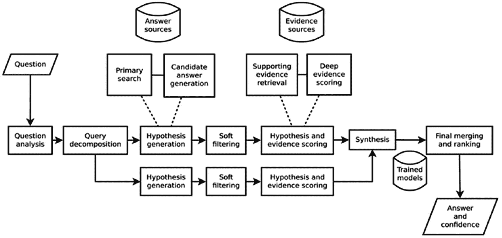

图 1-1

IBM DeepQA 的架构

AI 也是机器人技术的核心。1971 年图灵奖得主、著名的美国计算机科学家约翰·麦卡锡（John McCarthy）被认为是这个术语的创造者。在他题为《什么是人工智能？》的文章中，他将其定义为“制造智能机器的科学与工程 [4]”。因此，如果你联系到我们之前关于机器学习的讨论，我们立刻能感受到两者之间的联系，但 AI 更进一步，汇集了众多科学和专业领域，包括语言学、哲学、心理学、神经科学、数学和计算机科学，以及其他专业领域，如人工心理学。还应该指出的是，机器学习通常被认为是 AI 的一个子集。

### 1.1.4 数据挖掘

知识发现与数据挖掘（KDD）是数据挖掘领域的重要论坛，其目标被表述为促进、教育和采纳知识发现与数据挖掘的“科学”。与 ML 和 AI 一样，数据挖掘已成为计算机科学的一个跨学科子领域，正因如此，KDD 通常将数据挖掘方法视为 AI、ML、统计学和数据库系统的交叉点。当分析服务在许多行业开始爆发式增长时，数据挖掘技术被集成到许多数据库系统和商业智能工具中。

发表在《机器学习研究杂志》上的研究论文《WEKA 与 Java 开源项目的经验》[5]（WEKA 是使用数据挖掘进行研究和项目的广泛采用的工具之一）谈到，经典著作《数据挖掘：使用 Java 的实用机器学习工具与技术》[6] 最初仅命名为《实用机器学习》，而“数据挖掘”这个术语只是为了营销目的才添加的。撰写这篇研究论文的 Eibe Frank 和 Mark A. Hall 是该书的两位合著者，因此我们有充分的理由相信这个更名原因。我们再次看到，从根本上说，ML 是数据挖掘的核心。

### 1.1.5 数据科学

将数据科学称为一个巨大的保护伞，它囊括了所有能够从数据中揭示洞察并构建智能系统的事物，这并没有错。在《数据科学商业应用》[7] 一书中，Foster Provost 和 Tom Fawcett 引入了将数据和数据科学能力视为战略资产的概念，这将帮助企业明确思考应该在其中投入多少。从某种意义上说，数据科学更强调数据的重要性，而非学习算法。

它建立了一个定义明确的流程，即首先考虑进行描述性数据分析，然后再开始考虑建模。因此，企业开始采用这种新方法，因为它们能够与之产生共鸣。数据科学带来的另一个令人难以置信的变化是，它在公司内部各个部门之间创造了协同效应。每个部门都有自己的主题专家，而数据科学团队已经开始建立自己的专业知识，将数据作为一种通用语言进行沟通。这种范式转变见证了数据驱动增长和众多数据产品的出现。数据科学为我们提供了一个框架，旨在整合各种技能、工具和技术。以维恩图定义数据科学而闻名的美国著名数据科学家 Drew Conway（如图 1-2 所示）非常准确地将机器学习置于黑客技能与数学及统计学知识的交叉点上。

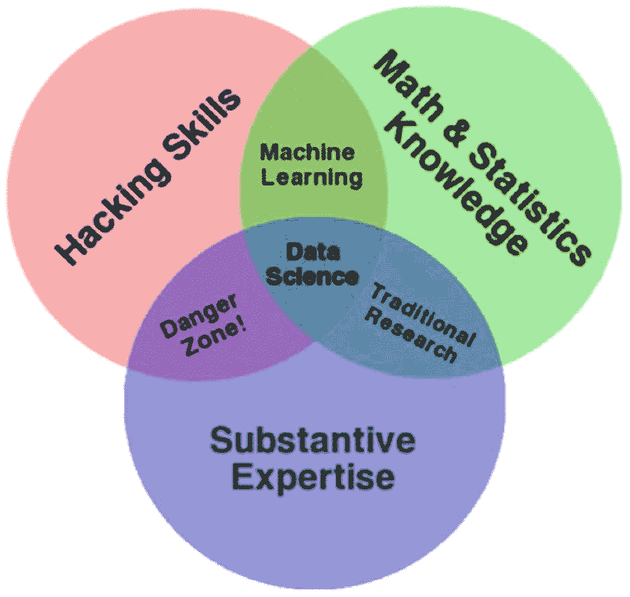

图 1-2

数据科学的维恩图定义

我们坚信，这些不同研究领域的基础都源于统计学和机器学习，但出于各自背景下的合理原因，它们被赋予了不同的特色，这有助于该学科被塑造成各种系统和研究领域。本书将有助于减少用于描述同一组算法和工具的不同术语数量。它将呈现一种易于理解且连贯的方法，介绍机器学习算法及其在 R 语言中的实际应用。在适当的地方，我们将强调需要超出本书范围，并为读者提供相关材料进行指导。通过这样做，我们再次强调了掌握机器学习传统方法的必要性，同时也要紧跟该领域工具和技术的最新发展。

本书主题的设计深受数据科学框架的影响，但我们没有在数据科学世界中浩瀚的工具和技术海洋中徘徊，而是将重点严格放在教授使用 R 语言应用机器学习算法的实用方法上。

本章的其余部分旨在帮助读者理解概率与统计的要素以及 R 语言的编程技能。这两者将为理解和将机器学习付诸实践奠定基础。本章最后讨论了将 ML 应用于现实世界问题的技术。此外，还将介绍一个通用的机器学习流程，展示如何从给定的问题陈述开始，到将 ML 模型部署到现实世界系统中，从而将各个环节连接起来。


## 1.2 概率与统计

常识和直觉在政策制定者、领导者和企业家建设国家与大型企业的过程中扮演着关键角色。问题在于，我们如何将一些棘手的定性决策转变为可客观理解的定量决策？这正是概率与统计的用武之地。统计学的大部分内容侧重于分析现有数据，并利用概率模型得出恰当的结论。尽管在许多统计建模中经常使用概率，但我们认为，明确概率与统计各自帮助我们回答的不同问题至关重要。阿德莱德大学的丹尼尔·纳瓦罗（Daniel Navarro）[8] 在其著作《用 R 学习统计学：心理学学生及其他初学者的教程》中举了一个例子，能帮助我们更好地理解这一点。请思考以下两组问题：

1.  一枚公平的硬币连续抛出 10 次正面的概率是多少？

2.  如果我的朋友抛了 10 次硬币，结果全是正面，她是不是在耍我？

以及

1.  从一副洗好的牌中抽出五张牌，它们全是红心的可能性有多大？

2.  如果从牌堆顶部抽出的五张牌全是红心，那么这副牌被洗过的可能性有多大？

以抛硬币为例，如果我们知道硬币是公平的，那么每次抛掷出现正面的概率是 50%，用概率符号表示就是 P(正面) = 0.5。因此，概率为 `P(连续 10 次正面) = 0.0009765625`（由于 10 次抛掷相互独立，我们只需计算 (0.5)¹⁰ 即可得出此值）。概率值 0.0009765625 量化了公平硬币连续抛出 10 次正面的可能性。

另一方面，如此小的概率意味着该事件（连续 10 次正面）的发生非常罕见，这有助于我们*推断*：当我的朋友抛出全部正面时，她很可能在耍花招。想想看——抛 10 次硬币就足以让你对朋友产生怀疑吗？也许还不够；你可能需要让她重复这个过程几次。我们生成的数据越多，推断就越可靠。第二组问题遵循相同的思路，但应用于不同的问题。我们鼓励你自己进行计算来回答这些问题。

因此，从根本上说，概率可以作为统计学中的一种工具，帮助我们利用模型回答许多此类现实世界的问题。我们将探索这两个领域的一些基础知识，并且会明显发现，两者在某个点上会交汇，以至于很难观察到它们之间的许多差异。

### 1.2.1 计数与概率定义

假设我们正在进行一个抛硬币实验，每次抛三枚硬币，共抛八次。每次抛掷中正面和反面的组合构成一个唯一的结果。例如，HHH 就是一个唯一的结果。可能的结果如下：(HHH, HHT, HTH, HTT, THH, THT, TTH, TTT)。图 1-3 展示了这个实验的基本示意图，三枚硬币共有八种可能的结果（HHH, HHT, HTH, HTT, THH, THT, TTH, TTT）。这个集合被称为*样本空间*。

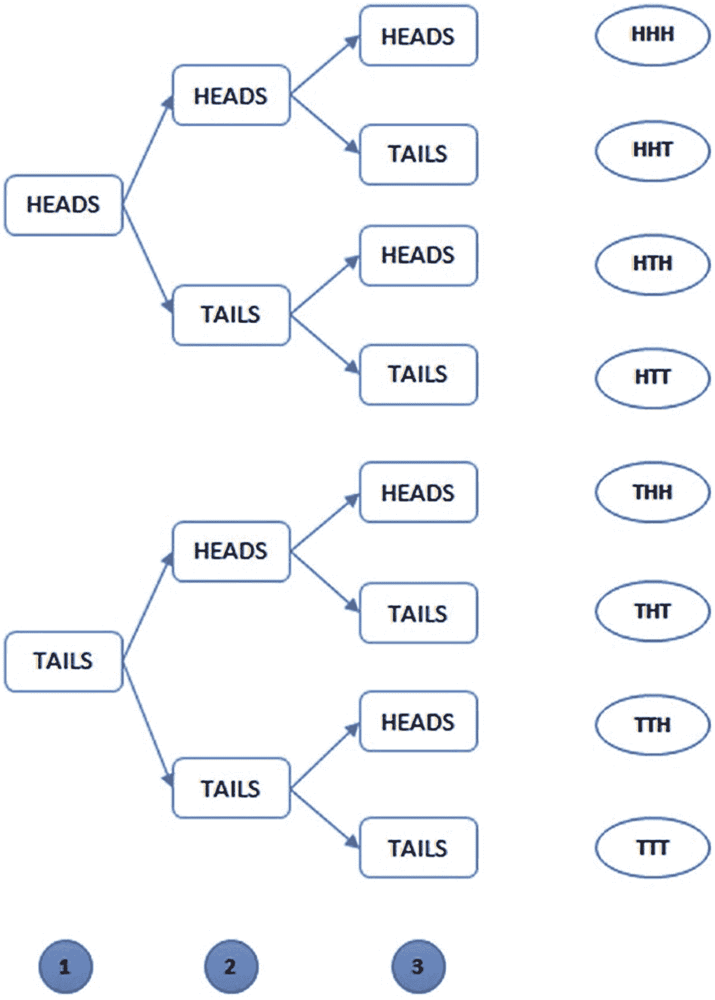

图 1-3

三枚硬币抛掷实验的样本空间

在这样一个只有三枚硬币的简单例子中，计算可能结果的总数很容易，但随着问题规模和复杂性的增加，手动计数就不可行了。更正式的方法是使用组合与排列。如果顺序重要，我们称之为*排列*；否则，通常使用*组合*这一术语。例如，如果我们说在三枚硬币中，哪枚硬币是正面或反面并不重要，我们只关心正面的数量，这相当于说顺序无关紧要，那么可能的组合总数将是 {HHH, HHT, HTT, TTT}。这意味着 HHT 和 HTH 是相同的，因为这两种结果都有两个正面。表 1-1 展示了一种更正式的计算可能结果数量的方法。很容易看出，对于 n = 2（正面和反面）和 k = 3（三枚硬币），我们得到八种可能的排列和四种组合。

***表 1-1.*** *排列与组合*

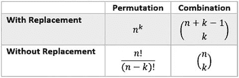

回到最初阐述的例子，假设我们关注事件 E，即抛出的三枚硬币中有两枚是正面。在这种情况下顺序无关紧要，因此这是一个有放回的组合。由此，得出以下概率：


这种利用计数或发生频率来计算概率的方法也被称为*频率学派概率*。还有另一类称为*贝叶斯概率*或条件概率，我们将在本章后面探讨。

### 1.2.2 事件与关系

在上一节中，我们看到了一个事件的例子。让我们更进一步，围绕各种事件及其相互关系建立一个正式的概念。


#### 1.2.2.1 独立事件

如果事件 A 的发生与否不提供关于事件 B 是否发生的额外信息，则称 A 和 B 相互独立。想象一下，Facebook 增强了其“附近的朋友”功能，它会告诉你，你的朋友在周末去你常去的电影院看电影的概率。如果没有这个功能，你经常光顾这家电影院这一信息，并不会真正增加或减少你在电影院遇到朋友的概率。这是因为事件 A（你去电影院看电影）和事件 B（你的朋友去电影院看电影）是相互独立的。

另一方面，如果存在这样的功能，我们无法否认你会根据朋友与你的亲近程度，尽力增加或减少遇到朋友的概率。而这之所以成为可能，正是因为这两个事件现在通过 Facebook 的一个功能联系在了一起。

我们再举一个依赖事件的例子。在阳光明媚的欢乐镇，从不下雨；然而，如果不出太阳，则必定下雨。农夫约翰无法在雨天收割庄稼。因此，任何一次收割都依赖于天气不下雨。

在常用的集合论符号中，A 和 B（两者概率均非零）相互独立，当且仅当以下等价表述之一成立：

1.  事件 A 和事件 B 同时发生的概率等于事件 A 的概率乘以事件 B 的概率。

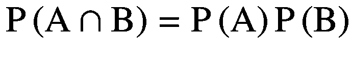

其中，∩ 表示两个事件的交集，以及给定 B 条件下 A 的概率。

1.  在事件 B 已发生的条件下，事件 A 发生的概率等于事件 A 本身的概率。

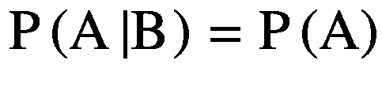

1.  类似地，在事件 A 已发生的条件下，事件 B 发生的概率等于事件 B 本身的概率。

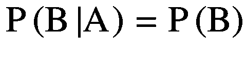

对于事件 A = 抛两次硬币均得到正面，以及事件 B = 第一次抛硬币得到正面，那么 P(A∩B) = 3/8 = 0.375，而 P(A)P(B) = 4/8 * 4/8 = 0.25，并不等于 P(A∩B)。类似地，另外两个条件也可以得到验证。

#### 1.2.2.2 条件独立性

在 Facebook“附近的朋友”的例子中，我们能够确定，你和你的朋友同时去电影院看电影的概率与你们的位置和意图有关。虽然意图很难量化，但位置并非如此。因此，如果我们定义事件 C 为“位于电影院附近”，那么计算概率并不困难。但即使你们都在附近，你和你的朋友也未必会去电影院。更正式地说，这就是我们定义条件独立性的地方：如果 P(A∩B | C) = P(A | C)P(B | C)，则称 A 和 B 在给定 C 的条件下相互独立。

请注意，独立性并不意味着条件独立性，条件独立性也不意味着独立性。这在一定程度上是说，A 和 B 共同与另一个事件 C 相互独立。

#### 1.2.2.3 贝叶斯定理

相反，如果 A 和 B 并非独立，而是关于 A 的信息揭示了 B 的某些细节，反之亦然，那么我们将有兴趣计算 P(A | B)，即给定 B 条件下 A 的概率。这在建模许多现实世界问题中有着深远应用。这种条件概率的广泛使用形式被称为*贝叶斯定理*（或*贝叶斯法则*）。正式地，对于事件 A 和 B，贝叶斯定理表示为：

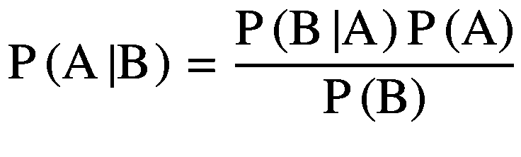

其中，P(B)≠0，P(A) 被称为先验概率，P(A | B) 被称为后验概率，即我们在获知额外信息 B 后得到的度量。让我们看一下表 1-2，这是一个关于我们 Facebook“附近的朋友”示例的二维列联表，以便更好地解释这一点。

***表 1-2.*** *Facebook“附近的朋友”示例的二维列联表*

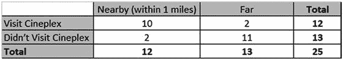

因此，如果我们想知道 P(去电影院 | 在附近)，换句话说，就是你的朋友在电影院附近（一英里范围内）时去电影院看电影的概率。需要提醒的是，我们说的是你的朋友去电影院看电影的概率，而不是你遇到朋友的概率。后者建模起来会更复杂一些，我们在此略过，以便专注于贝叶斯定理。现在，假设我们了解表 1-2 中所示的朋友的历史数据（比如上个月的数据），我们知道：

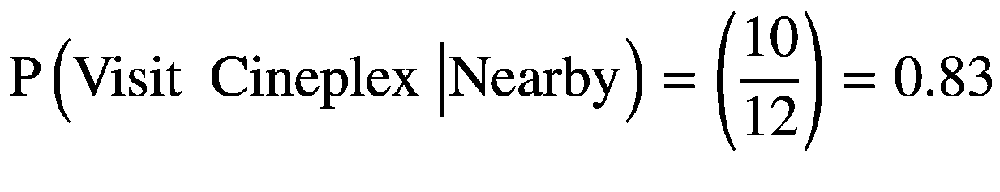

这意味着在上个月，你的朋友有 10 次在电影院一英里范围内（附近）并去了电影院。此外，还有两次他在附近但没去电影院。或者，我们也可以这样计算概率：


这个例子基于二维列联表，为理解条件概率提供了良好的直观感受。我们将在后面的第 [6](http://dx.doi.org/10.1007/978-1-4842-4215-5_6) 章中，深入探讨一种应用于现实世界问题的机器学习算法——*朴素贝叶斯*，该算法正是基于贝叶斯定理。


### 1.2.3 随机性、概率与分布

David S. Moore 等人的著作 *《统计学的实践导论 [9]》* 是一本易于理解的书，数学内容简单，但统计学概念丰富。书中非常恰当地指出：*“随机”在统计学中并非“偶然”的同义词，而是描述一种长期呈现的秩序。* 他们进一步解释道，我们在日常生活中经常处理一些通常被称为“随机”的不可预测事件，例如 Facebook 的“附近的朋友”功能，但我们很少能观察到足够多次重复的相同随机现象，从而看到概率所描述的长期规律性。

在这段节选中，他们非常简洁地阐述了随机性、概率和分布的本质。

*   “如果单个结果是不确定的，但在大量重复中结果却呈现出一种规律性的分布，我们就称这种现象为随机现象。随机现象中任何结果的概率，就是该结果在极长序列的重复中出现的比例。”

这引导我们定义一个随机变量，以数值形式存储这种随机现象。在任何涉及随机事件的实验中，基于事件结果，会为某个随机变量（例如 X）赋予一个数值。而 X 的概率分布有助于找出某个值被赋予 X 的概率。

例如，如果我们定义 X = {抛三次硬币中正面朝上的次数}，那么 X 可以取值为 0、1、2 和 3。这里我们称 X 为离散随机变量。然而，如果我们定义 X = {0 到 2 之间的所有值}，则可能存在无限多个可能的值，因此 X 被称为连续随机变量。

```
par(mfrow=c(1,2))
X_Values <-c(0,1,2,3)
X_Props <-c(1/8,3/8,3/8,1/8)
barplot(X_Props, names.arg=X_Values, ylim=c(0,1), xlab ="离散随机变量 X 的值", ylab ="概率")
x   <-seq(0,2,length=1000)
y   <-dnorm(x,mean=1, sd=0.5)
plot(x,y, type="l", lwd=1, ylim=c(0,1),xlab ="连续随机变量 X 的值", ylab ="概率")
```

这段代码将绘制 X 的分布，即一个典型的概率分布函数，其效果将如图 1-4 所示。第二个显示连续分布的图是一个均值为 1、标准差为 0.5 的正态分布。它也被称为*概率密度函数*。如果你不熟悉这些统计术语，不必担心；我们将在本书后面更详细地探讨它们。目前，理解随机变量及其分布的含义就足够了。

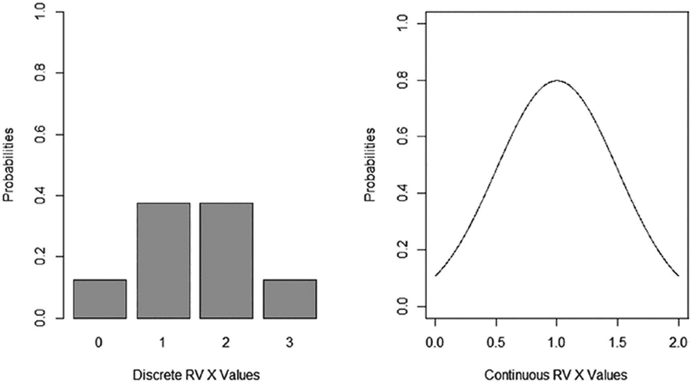

图 1-4

包含离散和连续随机变量的概率分布

### 1.2.4 置信区间与假设检验

假设你正在从整个州的人口中选取一个样本（假设是完全随机选取的）进行社会经济调查。随着数据开始涌入，你感到兴奋，同时对于如何分析数据也有些困惑。数据中可能蕴含许多见解，但每个见解可能并非完全有效，因为调查仅基于一个随机选取的小样本。

统计学中的*大数定律*（关于此主题的更多讨论见第 [3](http://dx.doi.org/10.1007/978-1-4842-4215-5_3) 章）告诉我们，随着样本量的增加，样本均值必须趋近于总体均值。换句话说，我们并不需要调查州内的每一个个体，而是选择一个足够大的样本，使其能够很好地代表整个总体。尽管衡量不确定性赋予我们做出更好决策的能力，但为了使我们的见解具有统计显著性，我们需要提出一个假设并执行某些检验。

#### 1.2.4.1 置信区间

让我们从理解置信区间开始。假设一份十年一次的人口普查问卷包含收入水平信息。假设在 2005 年，我们发现对于从总体中重复选取的样本量为 1000 的样本，样本均值  服从均值为总体均值 μ、标准误为 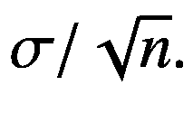 的正态分布。如果我们知道标准差 σ 为 1500 美元，那么

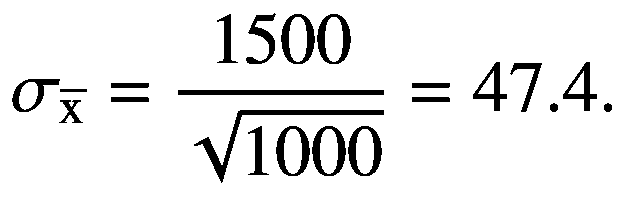

现在，为了定义置信区间，它通常采用如下形式：

`估计值 ± 误差范围`

一个 95% 的置信区间 (CI) 是均值加减两倍的标准误（也称为误差范围）。在我们的例子中，假设 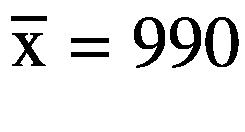 美元，计算出的标准差为 47.4 美元，那么我们将得到一个置信区间 (895.2, 1084.8)，即 990 ± 2 * 47.4。如果我们重复选取许多样本，每个样本都会有不同的置信区间，但统计学告诉我们，在 95% 的情况下，CI 会包含真实的总体均值 μ。还有其他更严格的 CI，例如 99.7%，但 95% 是所有实际应用中的黄金标准。图 1-5 显示了 25 个样本及其 CI。总体的正态分布有助于可视化那些估计值 μ 未被包含在 CI 中的 CI 数量；在此图中，只有一个这样的 CI。

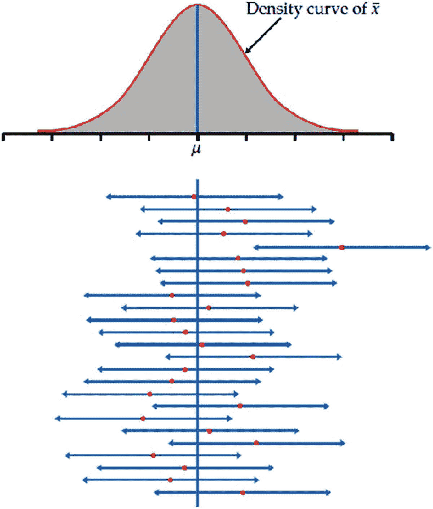

图 1-5

置信区间


#### 1.2.4.2 假设检验

*假设检验*有时也被称为*显著性检验*。虽然置信区间是总体估计的有力代表，但我们还需要一种更稳健、更正式的程序来检验和比较关于观测数据总体参数的假设。假设检验的应用非常广泛，从评估民意调查中样本的可靠性，到确定新药相对于现有药物治疗疾病的疗效。总的来说，假设检验是用于检验与实验设计相关的某些统计量陈述有效性的工具。如果你还记得，IBM 的 DeepQA 高级架构中有一个重要步骤叫做*假设生成*，用于得出给定问题的最相关答案。

假设检验包含两个关于总体参数的陈述，我们希望拒绝其中一个。正如我们在讨论置信区间时所见，样本均值 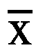 的抽样分布遵循正态分布 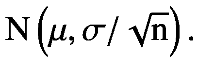 其中最重要的概念之一是*中心极限定理*（关于此主题的更详细讨论见第 [3](http://dx.doi.org/10.1007/978-1-4842-4215-5_3) 章），它告诉我们，对于大样本，抽样分布近似正态。由于正态分布是研究最充分、性质最广为人知的分布之一，这种近似对于我们想要进行的每一个假设检验都至关重要。

在执行假设检验之前，我们需要根据研究或实验的设计，构建一个 90%、95% 或 99% 的置信水平。为此，我们需要一个数字 z*，也称为临界值，使得正态分布在其均值 ±z* 个标准差范围内具有 0.90、0.95 或 0.99 的定义概率。图 1-6 显示了不同置信区间对应的 z* 值。请注意，在第 1.2.4.1 节的示例中，我们将 95% 置信区间的 z* = 1.960 近似为 2。

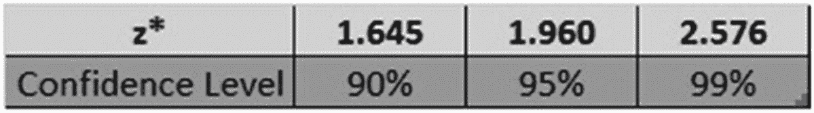

图 1-6

z* 分数与置信水平

通常，我们可以选择任意 z* 值来选取合适的置信水平。基于此解释，让我们以 2015 年人口普查数据中的收入为例。我们需要找出过去 10 年（即从 2005 年到 2015 年）收入的变化情况。在 2015 年，我们估计收入的平均值为 2300 美元。这里要问的问题是，既然 900 美元（2005 年）和 2300 美元都是真实总体均值的估计值（换句话说，我们抽取了代表性样本而非整个总体来计算这个均值），而非实际均值，那么这些从样本中观测到的均值是否能提供证据，证明收入有所增长？我们可能对计算某个概率来回答这个问题感兴趣。让我们看看如何在假设检验框架中构建这个问题。一个假设检验从设计如下两个陈述开始：

*   H[o]：平均收入或真实平均收入没有差异
*   H[a]：真实平均收入不相同

在此抽象掉细节，这两个陈述的结果将简单地导向接受 H[o] 或拒绝它。通常，零假设总是一个“无差异”的陈述，而备择假设则挑战这个零假设。用更简洁的数字方式书写这两个陈述如下：

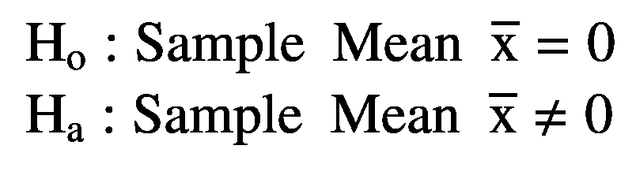

如果我们拒绝 H[o]，我们有两个选择：是检验  > 0、 < 0，还是简单地检验  ≠ 0，而不必过多考虑方向，这被称为*双侧*检验。如果你对方向明确，则首选*单侧*检验。

现在，为了执行显著性检验，我们需要理解标准化检验统计量 z，其定义如下：

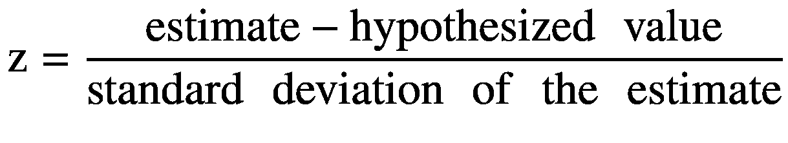

或者：

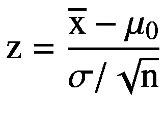

将 2005 年和 2015 年收入差异的估计值 1400 代入，并将估计值的标准差（该标准差是根据从总体中抽取的所有样本的均值计算得出的）设为 1500，我们得到：

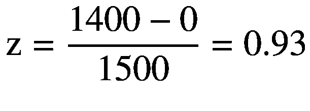

根据我们的样本，2005 年和 2015 年之间的收入差异为 1400 美元，这对应于距离零 0.93 个标准差（z = 0.93）。由于我们对此问题使用双侧检验，反对零假设 H[o] 的证据是通过我们观察到 Z 值等于或大于 0.93 的概率来衡量的。更正式地说，这个概率是：

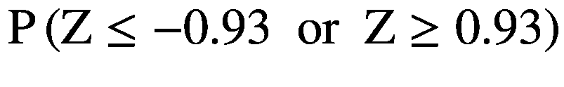

其中 Z 服从标准正态分布 N(0, 1)。这个概率被称为 *p 值*。我们将在回归模型中经常使用这个值。

根据标准 z 分数表（标准正态概率），我们发现：

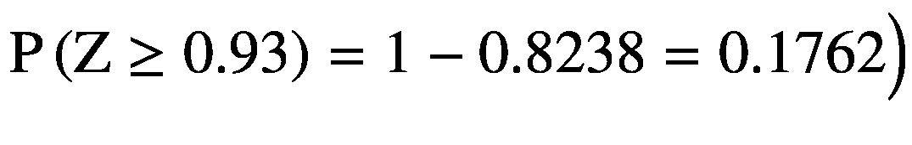

同样，在负方向上出现极端情况的概率相同：

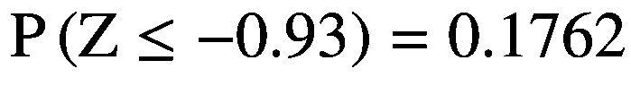

那么，p 值变为：

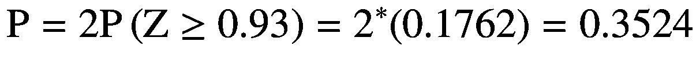

由于这个概率足够大，我们别无选择，只能坚持我们的零假设。换句话说，我们没有足够的证据拒绝零假设。也可以表述为：如果真实的总体差异为零，那么在我们的样本中观察到像 1400 美元这样极端差异的概率为 35%。这里需要说明一点：虽然可能还有其他多种方式来陈述我们的结果，但所有方式都表达相同的意思。


最后，在许多实际情况下，仅说明概率是大是小是不够的，还需要将其与显著性水平或置信水平进行比较。因此，如果我们有一个 95%的置信区间（换句话说，就是以 0.95 的概率包含μ真实值的区间），那么不包含在该区间内的μ值将与数据不兼容。现在，使用这个阈值 *α* = 0.05（95%置信度），我们观察到 P 值大于 0.05（或 5%），这意味着我们仍然没有足够的证据拒绝 H[o]。因此，我们得出结论，2005 年和 2015 年之间的平均收入没有差异。

还有许多其他方法可以进行假设检验，我们留给感兴趣的读者去查阅关于该主题的详细文本。在接下来的章节中，我们的主要重点是使用 R 对抽样和回归中的各种应用进行假设检验。

我们介绍概率论和统计学领域，这两者构成了数据探索的基础，也是我们理解使用机器学习进行预测建模这一更广泛目标的基石。

## 1.3 R 语言入门

R 是*GNU S*，一种用于统计计算和图形的免费语言和环境，提供了各种各样的统计和图形技术：线性和非线性建模、统计检验、时间序列分析、分类、聚类，以及比你想象的更多。

虽然涵盖 R 的完整主题超出了本书的范围，但我们将通过关注本书的最终目标来保持重点。这里的入门材料只是为了向那些之前没有接触过编程或脚本语言的读者提供熟悉感。我们强烈建议读者遵循 R 的官方网站获取安装说明，并参考一些标准教科书以获取关于主题的更技术性讨论。

### 1.3.1 基本构建块

本节快速概述了 R 的构建块，这些构建块使 R 成为统计学家、分析师和科学家最追捧的编程语言。R 是一种易于学习且非常适合快速开发原型模型的优秀工具。

#### 1.3.1.1 计算

正如你所期望的，R 提供了你在科学计算器上能找到的所有算术运算，甚至更多。所有类型的比较，如>、>=、<和<=，以及诸如`acos`、`asin`、`atan`、`ceiling`、`floor`、`min`、`max`、`cumsum`、`mean`和`median`等函数，都可用于所有可能的计算。

#### 1.3.1.2 使用 R 进行统计

R 是一种对学者和编程背景较少的人非常友好的语言。计算数据统计属性的便捷性也使其在数据分析师和统计学家中广受欢迎。R 提供了用于计算分位数、排名、数据排序以及矩阵操作（如`crossprod`、`eigen`和`svd`）的函数。还有一些非常易于使用的函数，可以快速构建线性模型。关于此类模型的详细讨论将在后续章节中进行。

#### 1.3.1.3 包

R 的优势在于其来自各个领域的贡献者社区。开发者将所有内容捆绑成一个称为“包”的单一单元。一个简单的包可以包含几个用于实现算法的函数，也可以像基础包本身一样庞大，后者随 R 安装程序一起提供。在本书中，随着我们介绍新主题，我们将使用许多包。

### 1.3.2 R 中的数据结构

从根本上说，R 中只有五种数据类型的数据结构，并且它们是最常用的。几乎所有其他数据结构都建立在这五种之上。Hadley Wickham 在他的书 *Advanced R [10]* 中，对这五种数据结构进行了易于理解的分类，如表 1-3 所示。

***表 1-3.*** *R 中的数据结构*

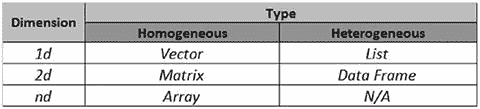

其他一些从这五种派生出来且最常用的数据结构列举如下：

*   *因子*：由向量派生而来
*   *数据表*：由数据框派生而来

同质类型只允许在向量、矩阵或数组中存储单一数据类型，而异质类型则允许存储混合类型。

#### 1.3.2.1 向量

向量是 R 中最简单的数据结构，但却非常有用。每个向量存储所有相同类型的元素。这可以被认为是一维数组，类似于 C/C++等编程语言中的数组。

```
car_name <-c("Honda","BMW","Ferrari")
car_color =c("Black","Blue","Red")
car_cc =c(2000,3400,4000)
```

#### 1.3.2.2 列表

R 中的列表在内部是通用向量的集合。例如，一个包含名称、颜色和排量的汽车列表可以定义为一个名为`cars`的列表，其中包含名为 name、color 和 cc 的向量集合。

```
cars <-list(name =c("Honda","BMW","Ferrari"),
color =c("Black","Blue","Red"),
cc =c(2000,3400,4000))
cars
$name
[1] "Honda"     "BMW"      "Ferrari"
$color
[1] "Black"   "Blue"   "Red"
$cc
[1] 2000 3400  4000
```

#### 1.3.2.3 矩阵

矩阵是存储具有多行和多列的多维数组的数据结构。出于所有实际目的，其数据结构有助于以每行代表特定列集合的格式存储数据。列保存定义观测值（行）的信息。

```
mdat <-matrix(c(1,2,3, 11,12,13), nrow =2, ncol =3, byrow =TRUE,
dimnames =list(c("row1", "row2"),
c("C.1", "C.2", "C.3")))
mdat
C.1 C.2 C.3
row1    1   2   3
row2   11  12  13
```

#### 1.3.2.4 数据框

数据框扩展了矩阵，增加了存储异质类型数据的能力。在数据框中，你可以在同一数据框的不同列中存储字符、数值和因子变量。在几乎所有的数据分析任务中，对于包含行和列的数据，数据框是存储数据的自然选择。以下示例显示了数值列和因子列如何存储在同一数据框中。

```
L3 <-LETTERS[1:3]
fac <-sample(L3, 10, replace =TRUE)
df <-data.frame(x =1, y =1:10, fac = fac)
class(df$x)
[1]  "numeric"
class(df$y)
[1]  "integer"
class(df$fac)
[1]  "factor"
```

### 1.3.3 子集选取

与任何其他编程语言相比，R 拥有最先进、最强大、最快速的子集选取运算符。它强大到如此程度，以至于除了少数情况（我们将在下一节讨论）外，不需要像`for`或`while`这样的循环结构，尽管 R 在需要时也明确提供了它们。虽然它非常强大，但在语法上，如果不注意放置所需数量的*圆括号*、*方括号*和*逗号*，有时可能会变成一场噩梦或出现严重错误。运算符`[`、`[[`和`$`用于子集选取，具体取决于数据存储在哪种数据结构中。还可以将子集选取与赋值结合使用，以用很少的代码行执行一些非常复杂的函数。

#### 1.3.3.1 向量

对于向量，可以通过引用存储在向量中的元素的相应索引来进行子集选取。例如，`car_name[c(1,2)]`将返回存储在索引 1 和 2 中的元素，而`car_name[-2]`返回除第二个之外的所有元素。也可以使用二元运算符来指示向量检索或不检索某个元素。

```
car_name <-c("Honda","BMW","Ferrari")
#从向量中选择第 1 和第 2 个索引
car_name[c(1,2)]
[1] "Honda" "BMW"
#选择除第 2 个索引外的所有元素
car_name[-2]
[1] "Honda"    "Ferrari"
#选择第 2 个索引
car_name[c(FALSE,TRUE,FALSE)]
[1] "BMW"
```


#### 1.3.3.2 列表

列表的子集选取与向量的子集选取类似；然而，由于列表是多个向量的集合，你必须使用双方括号来从列表中检索元素。例如，`cars[2]` 检索列表中的整个第二个向量，而 `cars[[c(2,1)]]` 检索第二个向量的第一个元素。

```
cars <-list(name =c("Honda","BMW","Ferrari"),
color =c("Black","Blue","Red"),
cc =c(2000,3400,4000))
#选择列表中的第二个列表
cars[2]
$color
[1] "Black" "Blue" "Red"
#选择第二个列表中的第一个元素
cars[[c(2,1)]]
[1] "Black"
```

#### 1.3.3.3 矩阵

矩阵的子集选取与向量类似。然而，我们这里需要两个索引来检索数据，而不是指定一个索引——一个表示行，另一个表示列。例如，`mdat[1:2,]` 检索前两行的所有列，而 `mdat[1:2,"C.1"]` 检索前两行和 `C.1` 列。

```
mdat <-matrix(c(1,2,3, 11,12,13), nrow =2, ncol =3, byrow =TRUE,
dimnames =list(c("row1", "row2"),
c("C.1", "C.2", "C.3")))
#选择前两行和所有列
mdat[1:2,]
C.1 C.2 C.3
row1   1   2   3
row2  11  12  13
#选择第一列和所有行
mdat[,1:2]
C.1 C.2
row1   1   2
row2  11  12
#选择前两行和第一列
mdat[1:2,"C.1"]
row1 row2
1   11
#选择第一行和前两列
mdat[1,1:2]
C.1 C.2
1   2
```

#### 1.3.3.4 数据框

数据框的工作方式与矩阵类似，但它们拥有更高级的子集选取操作。例如，可以提供条件语句，如 `df$fac == "A"`，这将只检索列 `fac` 的值为 `A` 的行。运算符 `$` 用于引用列。

```
L3 <-LETTERS[1:3]
fac <-sample(L3, 10, replace =TRUE)
df <-data.frame(x =1, y =1:10, fac = fac)
#选择所有 fac 列值为 "A" 的行
df[df$fac=="A",]
x  y fac
2  1  2   A
5  1  5   A
6  1  6   A
7  1  7   A
8  1  8   A
10 1 10   A
#选择前两行和所有列
df[c(1,2),]
x y fac
1 1 1   B
2 1 2   A
#选择第一列作为向量
df$x
[1] 1 1 1 1 1 1 1 1 1 1
```

### 1.3.4 函数与 Apply 家族

按照标准定义，函数是任何编程语言的基本构建块，R 也不例外。R 中的每一个库都包含丰富的函数集，用于完成特定任务，而无需重复编写相同的代码。相反，只需调用函数即可。以下是一个简单的函数示例，它返回一个数的 n 次方根，带有两个参数 `num` 和 `nroot`，并包含一个用于计算正实数 n 次方根的函数体。

```
nthroot <-function(num, nroot) {
return (num ^(1/nroot))
}
nthroot(8,3)
[1] 2
```

这个例子是一个用户自定义函数，但在全球 R 社区贡献的大量包中，有非常多的此类函数。接下来，我们将讨论 R 基础包中一个非常有用的函数家族，它在众多场景中都有应用。

以下描述和示例摘自 Becker, R. A. 等人的 *The New S Language* [11]

*   `lapply` 返回一个与输入 X 长度相同的列表，其每个元素都是将函数应用于 X 的对应元素的结果。

*   `sapply` 是 `lapply` 的用户友好版本和包装器，默认情况下返回一个向量、矩阵，或者如果使用 `simplify = "array"`，则在适当时返回一个数组。`simplify2array(). sapply(x, f, simplify = FALSE, USE.NAMES = FALSE)` 等同于 `lapply(x, f)`。

*   `vapply` 类似于 `sapply`，但预先指定了返回值的类型，因此使用起来可能更安全（有时也更快）。

*   `tapply` 将函数应用于不规则数组的每个单元格，即应用于由某些因子水平的唯一组合所给出的每个（非空）值组。

```
#生成一些数据到变量 x 中
x <-list(a =1:10, beta =exp(-3:3), logic =c(TRUE,FALSE,FALSE,TRUE))
#使用 lapply 计算每个列表元素的均值
lapply(x, mean)
$a
[1] 5.5
$beta
[1] 4.535125
$logic
[1] 0.5
#计算 x 中三个元素的分位数（0%、25%、50%、75% 和 100%）
sapply(x, quantile)
a        beta logic
0%     1.00  0.04978707   0.0
25%    3.25  0.25160736   0.0
50%    5.50  1.00000000   0.5
75%    7.75  5.05366896   1.0
100%  10.00 20.08553692   1.0
#使用 sapply 在整数序列上生成一些列表元素
i39 <-sapply(3:9, seq) # 向量列表
#使用 sapply 和 vapply 配合函数 fivenum 计算五数汇总统计量
sapply(i39, fivenum)
[,1] [,2] [,3] [,4] [,5] [,6] [,7]
[1,]   1.0  1.0    1  1.0  1.0  1.0    1
[2,]   1.5  1.5    2  2.0  2.5  2.5    3
[3,]   2.0  2.5    3  3.5  4.0  4.5    5
[4,]   2.5  3.5    4  5.0  5.5  6.5    7
[5,]   3.0  4.0    5  6.0  7.0  8.0    9
vapply(i39, fivenum,c(Min. =0, "1st Qu." =0, Median =0, "3rd Qu." =0, Max. =0))
[,1] [,2] [,3] [,4] [,5] [,6] [,7]
Min.     1.0  1.0    1  1.0  1.0  1.0    1
1st Qu.  1.5  1.5    2  2.0  2.5  2.5    3
Median   2.0  2.5    3  3.5  4.0  4.5    5
3rd Qu.  2.5  3.5    4  5.0  5.5  6.5    7
Max.     3.0  4.0    5  6.0  7.0  8.0    9
#从二项分布中生成 5 个允许重复的随机数
groups <-as.factor(rbinom(32, n =5, prob =0.4))
#计算每个数字重复的次数
tapply(groups, groups, length) #- 几乎等同于
7 11 12 13
1  1  1  2
#输出类似于函数 table 的结果
table(groups)
groups
7 11 12 13
1  1  1  2
```

如你所见，列表中的每个操作都涉及某种逻辑，这需要像遍历数据一样的循环（for 或 while 循环）。然而，通过使用 apply 家族的函数，我们可以将编程代码的编写量减少到最低限度，转而调用一个带有适当参数的单行函数。正是像这样的函数，使得 R 成为即使是经验较少的程序员也最青睐的编程语言。

## 1.4 机器学习流程

在现实世界中，每个用例都有不同的建模需求，因此很难提出一个非常通用的流程来解释你应该如何构建机器学习模型或数据产品。然而，为数据科学工作流程提出最佳实践是可能的。图 1-7 详细说明了我们为解决数据科学问题而建议的工作流程。

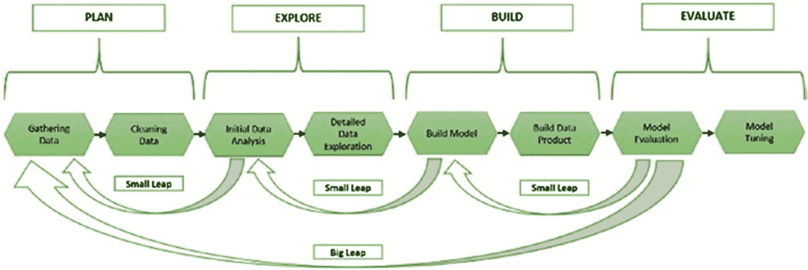

图 1-7

机器学习流程

该流程包含四个主要阶段，我们在此将其称为 *PEBE*——*计划、探索、构建*和*评估*，如图 1-7 所示。让我们深入了解每一个阶段。

### 1.4.1 计划

这个阶段构成了整个流程的关键组成部分。需要投入大量精力和努力来理解需求，识别我们可用的每一个数据源，并制定解决从需求中识别出的问题的方法。虽然数据收集是整个流程的核心，但还需要花费大量精力来清理数据，以维护分析和模型构建最终输出的完整性和真实性。我们将在第 [2](http://dx.doi.org/10.1007/978-1-4842-4215-5_2) 章中讨论收集各种类型数据和清理数据的多种方法。


### 1.4.2 探索

探索阶段为分析项目的腾飞奠定了基础。在此阶段，首先会详细分析数据中的可能性、洞察、范围、隐藏模式、挑战和错误。大量统计和可视化工具被用于执行此阶段。为了在项目后期需要修改时能有更大的灵活性，此阶段分为两部分。第一部分是快速初始分析，用于评估数据结构，包括检查命名约定、识别重复项、合并数据，以及在必要时进一步清理数据。初始数据分析有助于识别任何额外的数据需求，这就是为什么你会在流程中看到一个*小跳跃*的反馈循环。

在第二部分中，会进行更严格的分析，包括创建假设、使用各种技术对数据进行抽样、检查样本的统计属性，以及执行统计检验以拒绝或接受假设。第[2](http://dx.doi.org/10.1007/978-1-4842-4215-5_2)、[3](http://dx.doi.org/10.1007/978-1-4842-4215-5_3)和[4](http://dx.doi.org/10.1007/978-1-4842-4215-5_4)章将详细讨论这些主题。

### 1.4.3 构建

大多数分析项目要么在第一阶段或第二阶段就夭折了；然而，能够进入此阶段的项目具有转化为数据产品的巨大潜力。此阶段需要仔细研究是需要机器学习模型，还是前两个阶段完成的简单描述性分析就已足够。在行业中，除非你能证明构建机器学习模型所需投入的努力、时间和金钱能带来投资回报率，否则很难获得管理层的批准。而且，由于许多机器学习算法有点像黑箱，其输出难以解释，业务方从一开始就会直接拒绝它们。

因此，如果你通过了所有这些标准，并且仍然决定构建机器学习模型，那么接下来就需要了解每种算法的技术细节以及它如何在特定数据集上工作，我们将在第[6](http://dx.doi.org/10.1007/978-1-4842-4215-5_6)章中讨论这些内容。模型构建完成后，最好问问自己，该模型是否满足你在初始数据分析中的发现。如果不满足，那么建议采取一个*小跳跃*的反馈循环。

在流程图中，你会在评估阶段之前看到“构建数据产品”的一个原因是，为了有一个面向构建数据产品的最小可行输出（不一定是完整的产品，甚至可以是一个展示到目前为止所有分析的小型 Excel 表格）。我们本质上并不是建议你总是构建一个机器学习模型，它甚至可以是一个描述性模型，阐述你解决问题的方法并展示分析结果。这种方法有助于评估阶段，判断该模型是否足够好，可以考虑用于构建更具前瞻性的预测模型（或数据产品），或者是否仍有改进空间，或者是否应该完全放弃。

### 1.4.4 评估

此阶段决定了要么是传统模式中又一次革命性颠覆的兴起，要么是再次从头开始的失望。在许多现实世界的项目中，*大跳跃*的反馈循环有时是不可避免的，因为项目本身具有复杂性，或者数据无法回答某些问题。如果你已经勤勉地遵循了流程中的所有步骤，那么你可能只想在调整模型上再花些功夫，而不是采取大跳跃，一切从头开始。

仅通过一次迭代就构建出一个强大的机器学习模型是极不可能的。我们将在第[7](http://dx.doi.org/10.1007/978-1-4842-4215-5_7)章中详细探讨评估模型优劣的所有标准，并在第[8](http://dx.doi.org/10.1007/978-1-4842-4215-5_8)章中进一步微调模型。

## 1.5 其他技术

虽然我们非常强调像 R 这样的编程语言和技术在简化许多原本复杂且耗时的机器学习流程任务中所起的关键作用，但忽视同一领域中的其他竞争技术也是不明智的。Python 是另一种备受青睐的编程语言，在行业中，它在构建可用于生产的机器学习流程方面获得了相当好的发展势头。对于能够将机器学习模型或分析任务扩展到更大数据集并以实时速度执行它们的算法和技术的需求正在增加。后一部分需要对大数据和相关技术进行更详细的讨论，这超出了本书的范围。

简而言之，第[9](http://dx.doi.org/10.1007/978-1-4842-4215-5_9)章将讨论此类可扩展的方法和其他技术，这些技术可以帮助你使用行业标准构建同样健壮的机器学习流程。但是，请记住，每种方法/技术都有其自身的优缺点，因此在任何分析项目开始之前明智地做出正确选择对于成功完成至关重要。

## 1.6 总结

在本章中，你了解了机器学习从统计学到当代数据科学的演变。我们还研究了概率和统计学等基础学科，它们构成了机器学习的基础。你初步了解了 R 编程语言，并在 R 中进行了一些基本演示。我们以机器学习流程——PEBE 框架——结束了本章。

在接下来的章节中，我们将深入探讨数据探索的细节，以便更好地理解，并深入研究一些真实世界的数据集。


