# 4. R 语言数据可视化

*数据可视化*是创建和研究数据的视觉表示以获取有意义见解的过程。

数据可视化专门处理对给定数据中信息的可视化。这可以包括多种类型的图表、图形、颜色和线图。数据可视化是呈现数据的有效方式，因为它改变了感知与认知之间的平衡，从而更充分地利用大脑的能力。我们编码信息的方式对于建立通往大脑认知的直接通路至关重要。可视化中用于编码信息的核心工具是颜色、大小、形状和数字。

数据科学的第一步是理解数据；只有在此之后，我们才开始考虑模型和算法。将数据可视化作为数据科学过程不可或缺的一部分有许多好处。数据可视化的一些直接好处包括：

*   识别数据中的风险点，启动诊断
*   追踪和识别不同属性之间的关系
*   观察趋势和异常以理解原因
*   将复杂冗长的电子表格和数据库总结为视觉艺术
*   拥有一种易于使用且极具影响力的方式来存储和呈现信息等

市场上有许多付费的可视化软件套件和按需云应用程序，只需点击一下按钮即可创建有意义的可视化。然而，我们将探索用于在 R 中创建可视化的开源包和工具的强大功能。

任何类型的数据可视化从根本上都依赖于数据呈现的四个关键要素，即**比较、关系、分布**和**构成**。*比较*用于查看多个项目在某个时间点的差异，或查看变量在一段时间内的相对变化。*关系*要素有助于发现两个或多个变量在数值增减时的相关性。散点图和气泡图是此类中的一些示例。*分布*图表（如柱状图和线形直方图）显示数据的分布情况。例如，可以轻松发现向左或向右偏斜的数据。*构成*指的是具有多个组件的堆叠图表，例如饼图或堆叠柱状图/面积图。在我们的 PEBE 机器学习流程中，可视化在探索阶段起着关键作用。

可视化通过利用数据的力量，成为讲述故事的辅助工具。有大量示例表明，简单的图表就能呈现出即使使用复杂的统计学也难以发现的模式。在本章中，我们将通过合适的示例探讨数据呈现的四个要素，并强调可视化在更好地理解数据直至最细微细节方面所发挥的重要作用。


## 4.1 ggplot2 包简介

R 语言开发者在可视化工具库中创建了一个丰富的集合。由于是开源的，这些包会随着新功能的加入而快速更新。R 语言可视化工具的另一个显著发展是，开发者已经能够创建出可以复制某些高计算量 3D 图和模型输出的函数。

`ggplot2` 是由 Hadley Wickham 于 2005 年创建的数据可视化包。它实现了 Leland Wilkinson 的图形语法——一种将图表分解为语义组件（如标度和图层）的通用数据可视化方案。同样重要的是，我们多次使用过的另一个强大的绘图函数是 `plot()`。

本章还会用到其他一些包，你可以进一步探索它们。其中一些包括 `googleVis()`、`ggmap()`、`ggrepel()`、`waterfall()` 和 `rCharts()`。这些包都强烈推荐使用。

## 4.2 世界发展指标

优秀的数据可视化是用数字讲述故事。

在本章中，我们将通过一些示例讨论图表类型。本章有一半的内容讨论用于构建可视化的经济指标。具体的图表和图形将结合世界银行的发展指标数据进行讨论。世界银行收集数据以监测全球的经济指标。有关数据和经济学原理的详细信息，请访问 [`http://www.worldbank.org/`](http://www.worldbank.org/)。

以下部分是对核心指标的简要介绍。后续章节将展示用于理解其含义和影响的合适可视化方法。社会科学家在各个领域利用世界银行的许多数据进行了大量优秀的研究。我们精选了其中一些非常有影响力的研究成果，并将数据的真正精髓呈现出来。当我们从一个示例过渡到另一个示例时，将重点强调正确的可视化类型以及如何从数据中提取含义，而无需查看 CSV 或 Excel 文件中成百上千的行和列。世界银行网站上也提供了许多此类可视化图表；然而，在本书中，你将学习如何使用 R 语言中的 ggplot 包来生成不同的图形、图表和绘图。本书没有采用传统的先学习图形语法再讨论大量可视化理论的方法，而是选择了一个主题（世界银行的发展指标），并通过讲故事的方式带你开启一段旅程。

## 4.3 折线图

*折线图*是一种基本的可视化图表类型，其中信息通过一系列称为*标记*的数据点显示，这些数据点由线段连接。折线图用于显示变量多个类别中的趋势。例如，图 4-1 显示了根据最近报告的 GDP 数据排名前 10 的国家多年来的国内生产总值（GDP）增长情况。它有助于在单个图表中可视化所有这些国家的 GDP 增长趋势。

```
library(reshape)
library(ggplot2)
GDP <-read.csv("Dataset/Total GDP 2015 Top 10.csv")
names(GDP) <-c("Country", "2010","2011","2012","2013","2014","2015")
```

以下代码使用了一个非常重要的函数 `melt()`，该函数在后续章节中也会重复使用。

`melt` 函数接收宽格式的数据，并将一组列堆叠到单个数据列中。你可以将其理解为熔化当前维度以获得更简单的维度。`Melt()` 在 `reshape2()` 包中可用。在以下代码中，重新整理数据集后，你将把它缩减为三列。这些列是相同信息沿多列的堆叠版本。`melt()` 函数只能熔化分类属性；数值属性会被聚合。

```
GDP_Long_Format <-melt(GDP, id="Country")
names(GDP_Long_Format) <-c("Country", "Year","GDP_USD_Trillion")
```

以下代码在 `ggplot()` 函数的输出上堆叠了可视化的各个图层（见图 4-1）。建议你参考 ggplot 文档以获取更多选项。

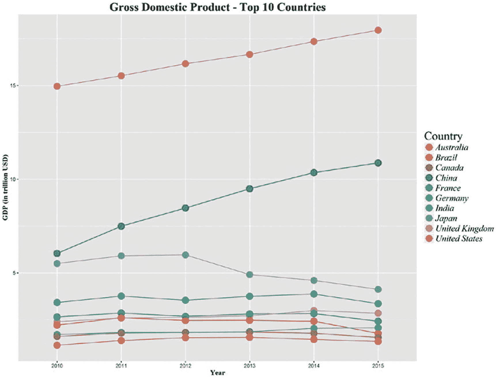

图 4-1

基于 GDP 排名前 10 的国家的折线图

```
ggplot(GDP_Long_Format, aes(x=Year, y=GDP_USD_Trillion, group=Country)) +
geom_line(aes(colour=Country)) +
geom_point(aes(colour=Country),size =5) +
theme(legend.title=element_text(family="Times",size=20),
legend.text=element_text(family="Times",face ="italic",size=15),
plot.title=element_text(family="Times", face="bold", size=20),
axis.title.x=element_text(family="Times", face="bold", size=12),
axis.title.y=element_text(family="Times", face="bold", size=12)) +
xlab("Year") +
ylab("GDP (in trillion USD)") +
ggtitle("Gross Domestic Product - Top 10 Countries")
```

显然，在前 10 名中，美国处于领先地位，其次是中国和日本。因此，无需查看数据，我们就能从该可视化中看到丰富的信息。现在，你脑海中浮现的下一个问题是，是什么导致一个国家的 GDP 上升或下降？让我们尝试了解这些国家的 GDP 中有多少百分比来自农业（见图 4-2）、服务业（见图 4-3）和工业（见图 4-4）。

```
# Agriculture
Agri_GDP <-read.csv("Dataset/Agriculture - Top 10 Country.csv")
```

同样，我们将数据熔化为更少的列数以便于绘图。

```
Agri_GDP_Long_Format <-melt(Agri_GDP, id ="Country")
names(Agri_GDP_Long_Format) <-c("Country", "Year", "Agri_Perc")
Agri_GDP_Long_Format$Year <-substr(Agri_GDP_Long_Format$Year, 2,length(Agri_GDP_Long_Format$Year))
```

应用 `ggplot2()` 选项创建图表如下：

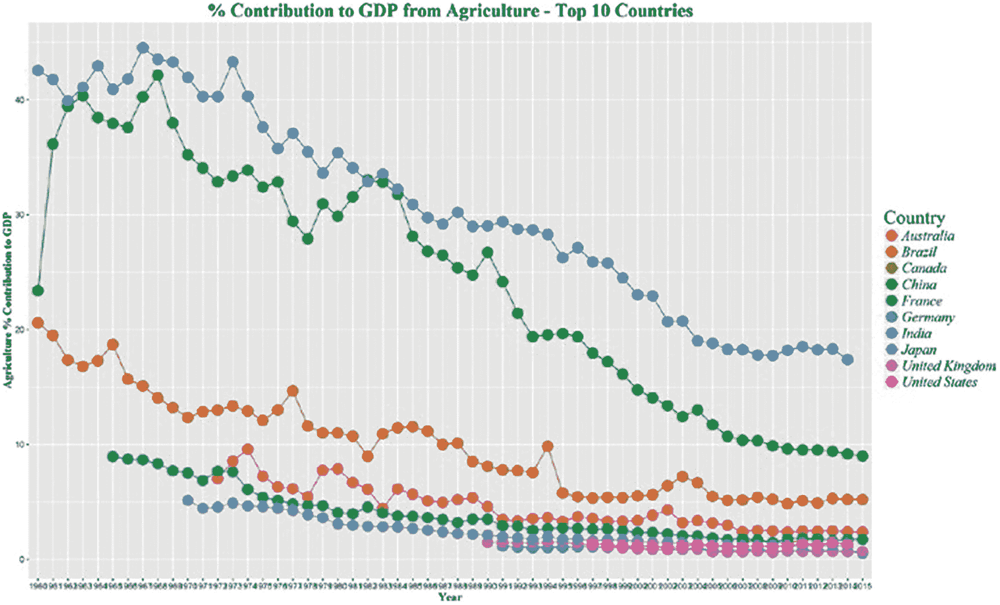

图 4-2

基于农业对 GDP 贡献百分比排名前 10 的国家的折线图


```
ggplot(Agri_GDP_Long_Format, aes(x=Year, y=Agri_Perc, group=Country)) +
geom_line(aes(colour=Country)) +
geom_point(aes(colour=Country),size =5) +
theme(legend.title=element_text(family="Times",size=20),
legend.text=element_text(family="Times",face ="italic",size=15),
plot.title=element_text(family="Times", face="bold", size=20),
axis.title.x=element_text(family="Times", face="bold", size=12),
axis.title.y=element_text(family="Times", face="bold", size=12)) +
xlab("Year") +
ylab("Agriculture % Contribution to GDP") +
ggtitle("Agriculture % Contribution to GDP - Top 10 Countries")
```

虽然像印度和巴西这样的国家，在考察 GDP 总量时并未跻身前三，但在农业领域却名列前茅（中国也位列前三）。这表明这些国家的经济对农业的依赖程度。

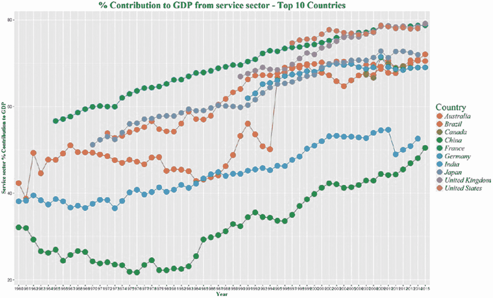

图 4-3

一张折线图，展示了服务业对 GDP 贡献占比排名前十的国家

```
# Service
Service_GDP <-read.csv("Services - Top 10 Country.csv")
Service_GDP_Long_Format <-melt(Service_GDP, id ="Country")
names(Service_GDP_Long_Format) <-c("Country", "Year", "Service_Perc")
Service_GDP_Long_Format$Year <-substr(Service_GDP_Long_Format$Year,
2,length(Service_GDP_Long_Format$Year))
ggplot(Service_GDP_Long_Format, aes(x=Year, y=Service_Perc, group=Country)) +
geom_line(aes(colour=Country)) +
geom_point(aes(colour=Country),size =5) +
theme(legend.title=element_text(family="Times",size=20),
legend.text=element_text(family="Times",face ="italic",size=15),
plot.title=element_text(family="Times", face="bold", size=20),
axis.title.x=element_text(family="Times", face="bold", size=12),
axis.title.y=element_text(family="Times", face="bold", size=12)) +
xlab("Year") +
ylab("Service sector % Contribution to GDP") +
ggtitle("Service sector % Contribution to GDP - Top 10 Countries")
```

现在，与农业相反，观察服务业，你就会理解美国、中国和英国 GDP 庞大的原因。这些国家通常依靠服务业构建了强大的经济体。因此，当你听到美国的硅谷和伦敦作为世界最大金融中心时，这实际上正是它们经济增长的最大驱动力。

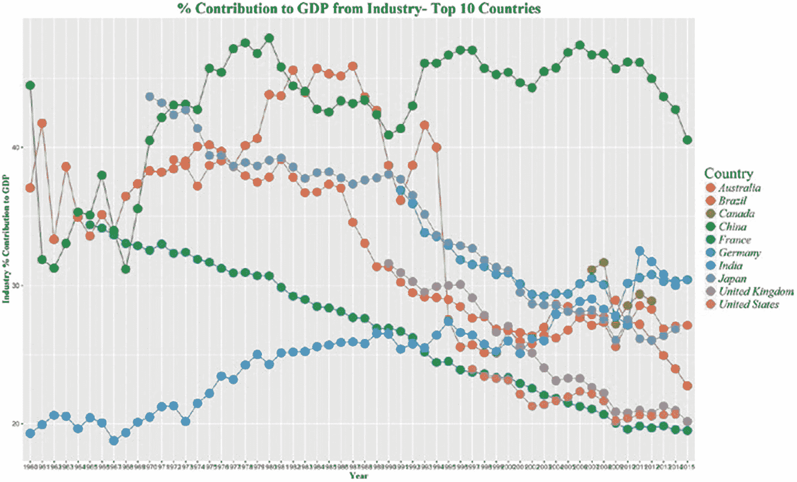

图 4-4

一张折线图，展示了工业对 GDP 贡献占比排名前十的国家

```
# Industry
Industry_GDP <-read.csv("Industry - Top 10 Country.csv")
Industry_GDP_Long_Format <-melt(Industry_GDP, id ="Country")
names(Industry_GDP_Long_Format) <-c("Country", "Year", "Industry_Perc")
Industry_GDP_Long_Format$Year <-substr(Industry_GDP_Long_Format$Year,
2,length(Industry_GDP_Long_Format$Year))
ggplot(Industry_GDP_Long_Format, aes(x=Year, y=Industry_Perc,
group=Country)) +
geom_line(aes(colour=Country)) +
geom_point(aes(colour=Country),size =5) +
theme(legend.title=element_text(family="Times",size=20),
legend.text=element_text(family="Times",face ="italic",size=15),
plot.title=element_text(family="Times", face="bold", size=20),
axis.title.x=element_text(family="Times", face="bold", size=12),
axis.title.y=element_text(family="Times", face="bold", size=12)) +
xlab("Year") +
ylab("Industry % Contribution to GDP") +
ggtitle("Industry % Contribution to GDP - Top 10 Countries")
```

在考察了农业和服务业之后，工业是 GDP 蛋糕中的第三大组成部分。而这一部分目前由中国及其制造业遥遥领先。这就是为什么你会看到许多像苹果这样的大品牌在其产品上贴有标签，写着“加州苹果设计，中国组装”。这不仅仅是手机或苹果公司，中国还是许多产品领域的制造中心，例如服装和配饰、汽车零部件、摩托车零部件、家具等等，不胜枚举。

因此，总体趋势表明，虽然工业和第三产业对 GDP 的贡献持续增加，但农业的贡献多年来却稳步下降。这是增长的信号，还是以更赚钱的部门为名对我们食物来源的妥协？或许我们将把这个问题的答案留给经济专家。然而，我们确实看到了这种可视化方式如何揭示出那些仅从原始数据中难以解读的洞见。

总而言之，在这些大型经济体中，许多国家（如中国、法国、澳大利亚和日本）的工业产出正在急剧下降。在这 10 个国家中，印度是唯一一个多年来工业产出稳步增长的国家，这是发展的标志。话虽如此，农业和服务业如何与工业前所未有的增长保持平衡，仍有待观察。即使在发达国家和发展中国家经济失衡的情况下，真正有助于保持平衡的是，世界在贸易方面变得更加自由。如果你有强大的农业产出，你可以自由地将产品出口到其他短缺的国家，其他部门也是如此。

在我们通过可视化开启另一个故事之前，下一节将展示一个堆叠柱状图，显示每个部门对世界 GDP 总量的百分比贡献。


## 4.4 堆叠柱状图

*堆叠柱状图*是一种展示构成特定变量的各类别组成情况的优雅方式。在图 4-5 的示例中，可以轻松看出每个部门对全球 GDP 的贡献百分比。

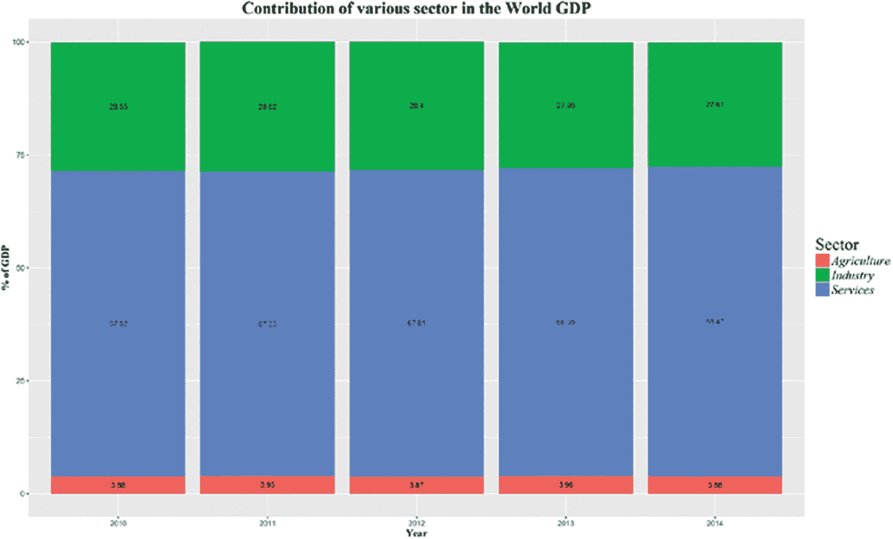

图 4-5

一个展示各部门对全球 GDP 贡献的堆叠柱状图

```
library(plyr)
World_Comp_GDP <-read.csv("World GDP and Sector.csv")
World_Comp_GDP_Long_Format <-melt(World_Comp_GDP, id ="Sector")
names(World_Comp_GDP_Long_Format) <-c("Sector", "Year", "USD")
World_Comp_GDP_Long_Format$Year <-substr(World_Comp_GDP_Long_Format$Year,
2,length(World_Comp_GDP_Long_Format$Year))
# calculate midpoints of bars
World_Comp_GDP_Long_Format_Label <-ddply(World_Comp_GDP_Long_Format, .(Year),
transform, pos =cumsum(USD) -(0.5 *USD))
ggplot(World_Comp_GDP_Long_Format_Label, aes(x = Year, y = USD, fill =
Sector)) +
geom_bar(stat ="identity") +
geom_text(aes(label = USD, y = pos), size =3) +
theme(legend.title=element_text(family="Times",size=20),
legend.text=element_text(family="Times",face ="italic",size=15),
plot.title=element_text(family="Times", face="bold", size=20),
axis.title.x=element_text(family="Times", face="bold", size=12),
axis.title.y=element_text(family="Times", face="bold", size=12)) +
xlab("Year") +
ylab("% of GDP") +
ggtitle("Contribution of various sector in the World GDP")
```

从图 4-5 的堆叠柱状图可以清晰地看出，服务业在所有年份中贡献最大，其次是工业，最后是农业。由于每个色块的大小含义不变，GDP 在这些部门之间的增长比例保持相似。

接下来，让我们在堆叠图中查看年龄抚养比指标。

年龄抚养比是一个很好的衡量指标，可以展示折线图如何绘制，而堆叠柱状图则有助于探究该指标。根据世界银行的定义，*年龄抚养比*是指受抚养人（15 岁以下或 64 岁以上人口）与劳动年龄人口（15-64 岁人口）的比率。

如果一个国家的年龄抚养比非常高，政府的医疗、社会保障和教育支出就会增加，这些支出主要用于 14 岁以下或 64 岁以上的人口（分子），因为支撑这些支出的人口（15-64 岁人口）较少（分母）。这也意味着劳动力中的个人必须承担比推荐水平更多的负担来抚养受抚养人。有时，这会导致童工（14 岁以下人口进入成年劳动力市场）等社会问题。因此，许多年龄抚养比高的发展中经济体必须应对这些问题。图 4-6 中的堆叠折线图显示了前 10 个国家的劳动年龄比率多年来如何持续下降。

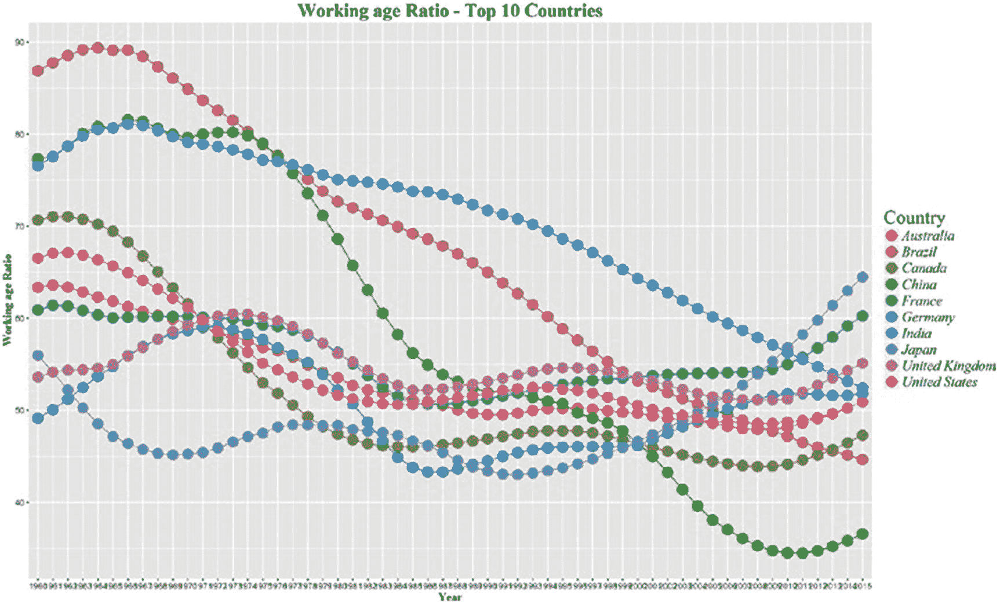

图 4-6

一个展示前 10 个国家劳动年龄比率的堆叠折线图

```
library(reshape2)
library(ggplot2)
Population_Working_Age <-read.csv("Age dependency ratio - Top 10 Country.csv")
Population_Working_Age_Long_Format <-melt(Population_Working_Age, id ="Country") names(Population_Working_Age_Long_Format) <-c("Country", "Year", "Wrk_Age_Ratio")
Population_Working_Age_Long_Format$Year <-substr(Population_Working_Age_
Long_Format$Year, 2,length(Population_Working_Age_Long_Format$Year))
ggplot(Population_Working_Age_Long_Format, aes(x=Year, y=Wrk_Age_Ratio,
group=Country)) +
geom_line(aes(colour=Country)) +
geom_point(aes(colour=Country),size =5) +
theme(legend.title=element_text(family="Times",size=20),
legend.text=element_text(family="Times",face ="italic",size=15),
plot.title=element_text(family="Times", face="bold", size=20),
axis.title.x=element_text(family="Times", face="bold", size=12),
axis.title.y=element_text(family="Times", face="bold", size=12)) +
xlab("Year") +
ylab("Working age Ratio") +
ggtitle("Working age Ratio - Top 10 Countries")
```

如果你查看图 4-6 和图 4-7 中的折线图，你会注意到，近年来，日本和法国等国家的老龄化人口最多，因此年龄抚养比较高；而印度和中国等国家拥有庞大且强劲的年轻人口，因此该比率多年来稳步下降。例如，在 2015 年，印度和中国分别报告其 65.6%和 73.22%的人口年龄在 15 至 64 岁之间（分别有 34.41%和 26.78%的人口年龄在 14 岁以下和 65 岁以上）。日本和法国的相同百分比分别为 60.8 和 62.4（分别有 33.19%和 37.57%的人口年龄在 14 岁以下和 65 岁以上）。

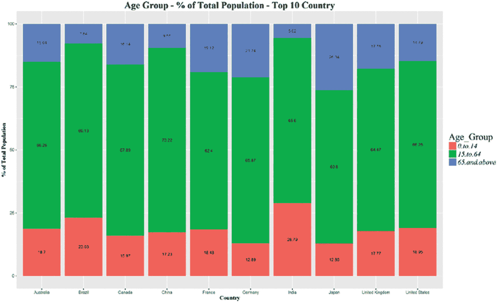

图 4-7

一个展示不同年龄组占总人口百分比的堆叠条形图

```
library(reshape2)
library(ggplot2)
library(plyr)
Population_Age <-read.csv("Population Ages - All Age - Top 10 Country.csv")
Population_Age_Long_Format <-melt(Population_Age, id ="Country")
names(Population_Age_Long_Format) <-c("Country", "Age_Group", "Age_Perc")
Population_Age_Long_Format$Age_Group <-substr(Population_Age_Long_
Format$Age_Group, 2,length(Population_Age_Long_Format$Age_Group))
# calculate midpoints of bars
Population_Age_Long_Format_Label <-ddply(Population_Age_Long_Format, .(Country),
transform, pos =cumsum(Age_Perc) -(0.5 *Age_Perc))
ggplot(Population_Age_Long_Format_Label, aes(x = Country, y = Age_Perc, fill
= Age_Group)) +
geom_bar(stat ="identity") +
geom_text(aes(label = Age_Perc, y = pos), size =3) +
theme(legend.title=element_text(family="Times",size=20),
legend.text=element_text(family="Times",face ="italic",size=15),
plot.title=element_text(family="Times", face="bold", size=20),
axis.title.x=element_text(family="Times", face="bold", size=12),
axis.title.y=element_text(family="Times", face="bold", size=12)) +
xlab("Country") +
ylab("% of Total Population") +
ggtitle("Age Group - % of Total Population - Top 10 Country")
```

从某种意义上说，如果你观察一下，许多经济因素——如收入平等、通货膨胀、进出口、GDP 等等——都会对人口增长和老龄化产生直接或间接的影响。如图 4-8 所示，随着大多数国家人口增长放缓，政府需要制定良好的公共政策和开展宣传活动，以便在未来几年平衡老龄化和年轻人口。

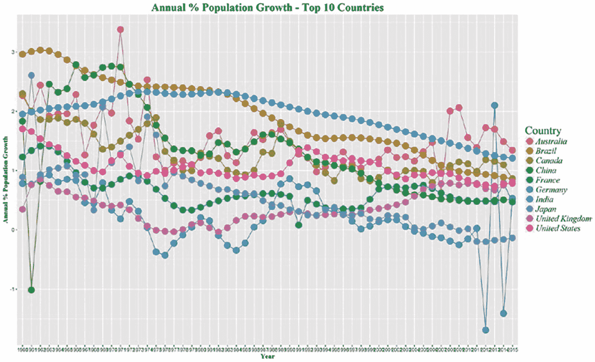

图 4-8

一个展示前 10 个国家及其年度人口增长百分比的折线图


```
library(reshape2)
library(ggplot2)
Population_Growth <-read.csv("Population growth (annual %) - Top 10 Country.csv")
Population_Growth_Long_Format <-melt(Population_Growth, id ="Country")
names(Population_Growth_Long_Format) <-c("Country", "Year", "Annual_Pop_Growth")
Population_Growth_Long_Format$Year <-substr(Population_Growth_Long_
Format$Year, 2,length(Population_Growth_Long_Format$Year))
ggplot(Population_Growth_Long_Format, aes(x=Year, y=Annual_Pop_Growth,
group=Country)) +
geom_line(aes(colour=Country)) +
geom_point(aes(colour=Country),size =5) +
theme(legend.title=element_text(family="Times",size=20),
legend.text=element_text(family="Times",face ="italic",size=15),
plot.title=element_text(family="Times", face="bold", size=20),
axis.title.x=element_text(family="Times", face="bold", size=12),
axis.title.y=element_text(family="Times", face="bold", size=12)) + xlab("Year") +
ylab("Annual % Population Growth") +
ggtitle("Annual % Population Growth - Top 10 Countries")
```

仔细研读这些图表会非常有趣。少数几个国家的人口增长极不稳定，而其他国家则呈现稳定且下降的趋势。例如，印度的人口增长一直在稳步下降，而美国的人口增长则先趋于稳定，后又有所上升。

## 4.5 散点图

*散点图*是一种有助于判断两个变量之间是否存在关系的图表。散点图使用笛卡尔坐标，在 x 轴和 y 轴上展示两个变量。虽然也存在更高维度的散点图，但它们难以可视化，因此二维散点图非常流行。如果增加颜色、形状或大小等维度，我们也可以在二维散点图上呈现两个以上的变量。在本例中，我们将研究世界银行发展指标中的一个人口增长指标。

任何经济体的实力都源于其人民，而衡量公民在财务、健康、教育以及所有基本生活必需品方面是否安好，是至关重要的。一个强健的经济体，只有在其设计和规划始终将公民置于核心位置时才能建立起来。因此，虽然 GDP 作为指标象征着国家的增长，但还有许多指标衡量人民如何随着 GDP 的增长而发展。所以，在查看这些指标之前，让我们先尝试使用一些广泛使用的可视化工具（如散点图、箱线图和直方图）来探索数据的基本特征。让我们看看人口增长数据和前十名国家的 GDP 数据中是否出现了一些模式。

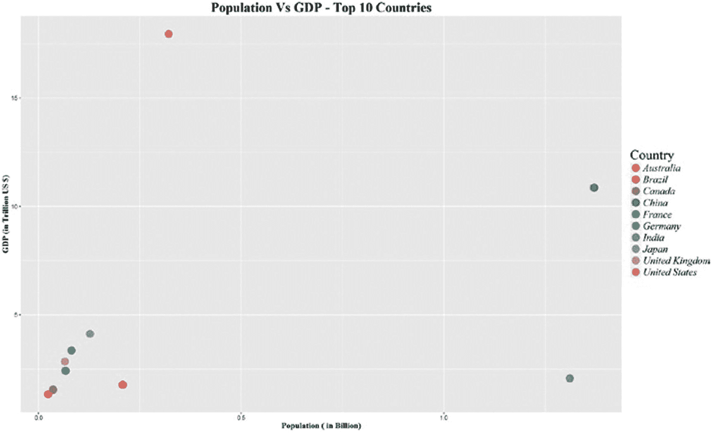

图 4-9

展示前十名国家人口与 GDP 关系的散点图

```
library(reshape2)
library(ggplot2)
GDP_Pop <-read.csv("GDP and Population 2015.csv")
ggplot(GDP_Pop, aes(x=Population_Billion, y=GDP_Trilion_USD))+
geom_point(aes(color=Country),size =5) +
theme(legend.title=element_text(family="Times",size=20),
legend.text=element_text(family="Times",face ="italic",size=15),
plot.title=element_text(family="Times", face="bold", size=20),
axis.title.x=element_text(family="Times", face="bold", size=12),
axis.title.y=element_text(family="Times", face="bold", size=12)) +
xlab("Population ( in Billion)") +
ylab("GDP (in Trillion US $)") +
ggtitle("Population Vs GDP - Top 10 Countries")
```

图 4-9 中的散点图显示，对于美国等国家而言，自 2009 年以来，其人口相对于前十名中的其他国家一直较低；然而，作为世界最大经济体的美国，其 GDP 非常庞大，使得该数据点在散点图的 y 轴上位置很高。类似地，如果你看中国，其拥有世界最多的人口（13.7 亿）和 10.8 万亿美元的 GDP，在图中则表现为 x 轴最右侧的一个点。


## 4.6 箱线图

箱线图是一种紧凑的表示方式，用于展示第 [1](http://dx.doi.org/10.1007/978-1-4842-4215-5_1) 章中描述的五数概括法，即中位数、第一和第三四分位数（第 25 和第 75 百分位数）以及最小值和最大值。垂直矩形框的上边代表第三四分位数，下边代表第一四分位数。这两点之间的差值称为*四分位距*，它包含了 50%的数据。将矩形分割开的一条线代表中位数。矩形两侧还各有一条延伸线（称为须线），表示第一和第三四分位数之外的变异性。最后，绘制在图中作为线条延伸的点被称为*异常值*。从数值上看，这些点的值超过了变量标准差的两倍。

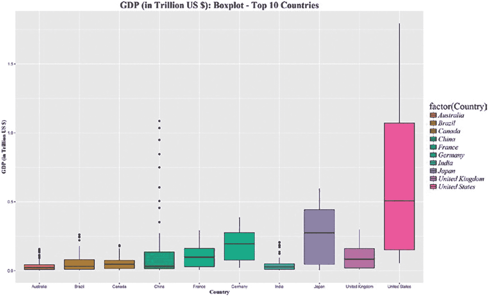

图 4-10

一个展示前 10 名国家 GDP（万亿美元）的箱线图

```
# GDP
GDP_all <-read.csv("Dataset/WDi/GDP All Year.csv")
GDP_all_Long_Format <-melt(GDP_all, id ="Country")
names(GDP_all_Long_Format) <-c("Country", "Year", "GDP_USD_Trillion")
GDP_all_Long_Format$Year <-substr(GDP_all_Long_Format$Year, 2,length(GDP_
all_Long_Format$Year))
ggplot(GDP_all_Long_Format, aes(factor(Country), GDP_USD_Trillion)) +
geom_boxplot(aes(fill =factor(Country)))+
theme(legend.title=element_text(family="Times",size=20),
legend.text=element_text(family="Times",face ="italic",size=15),
plot.title=element_text(family="Times", face="bold", size=20),
axis.title.x=element_text(family="Times", face="bold", size=12),
axis.title.y=element_text(family="Times", face="bold", size=12)) +
xlab("Country") +
ylab("GDP (in Trillion US $)") +
ggtitle("GDP (in Trillion US $): Boxplot - Top 10 Countries")
```

箱线图是在单个图表中展示离散程度（散布度）、偏度和异常值的绝佳方式。使用 ggplot，可以将变量的不同类别并排堆叠在一起进行比较。例如，查看图 4-10，你会看到一个按国家划分的 GDP 箱线图。它包含了从 1962 年到 2015 年的 GDP 数据。你可以看到，美国显示出最高的增长水平（离散程度），且没有异常值，这表明其增长持续稳定，没有极端的高点或低点；而中国则显示出大量异常值，这大致表明该国在 1962 年至 2015 年间经历了许多不可预测的增长。这种解读容易出错，因为我们尚未探究数据中这些异常值出现的原因。一位经济学家或许仅凭一瞥此图就能凭直觉产生一些见解；然而，一位天真的分析师如果不关注细节，最终可能会得出一些错误的结论。因此，在看到漂亮的图表时，请先按捺住兴奋之情，在得出结论之前，仔细分析数据的其他统计属性。

```
# Population
Population_all <-read.csv("Population All Year.csv")
Population_all_Long_Format <-melt(Population_all, id ="Country")
names(Population_all_Long_Format) <-c("Country", "Year", "Pop_Billion")
Population_all_Long_Format$Year <-substr(Population_all_Long_Format$Year,
2,length(Population_all_Long_Format$Year))
ggplot(Population_all_Long_Format, aes(factor(Country), Pop_Billion)) +
geom_boxplot(aes(fill =factor(Country))) +
theme(legend.title=element_text(family="Times",size=20),
legend.text=element_text(family="Times",face ="italic",size=15),
plot.title=element_text(family="Times", face="bold", size=20),
axis.title.x=element_text(family="Times", face="bold", size=12),
axis.title.y=element_text(family="Times", face="bold", size=12)) +
xlab("Country") +
ylab("Population (in Billion)") +
ggtitle("Population (in Billion): Boxplot - Top 10 Countries")
```

这 10 个国家的人口箱线图（图 4-11）显示了类似的趋势，但没有异常值。印度和中国显然正在成为人口最多的国家。

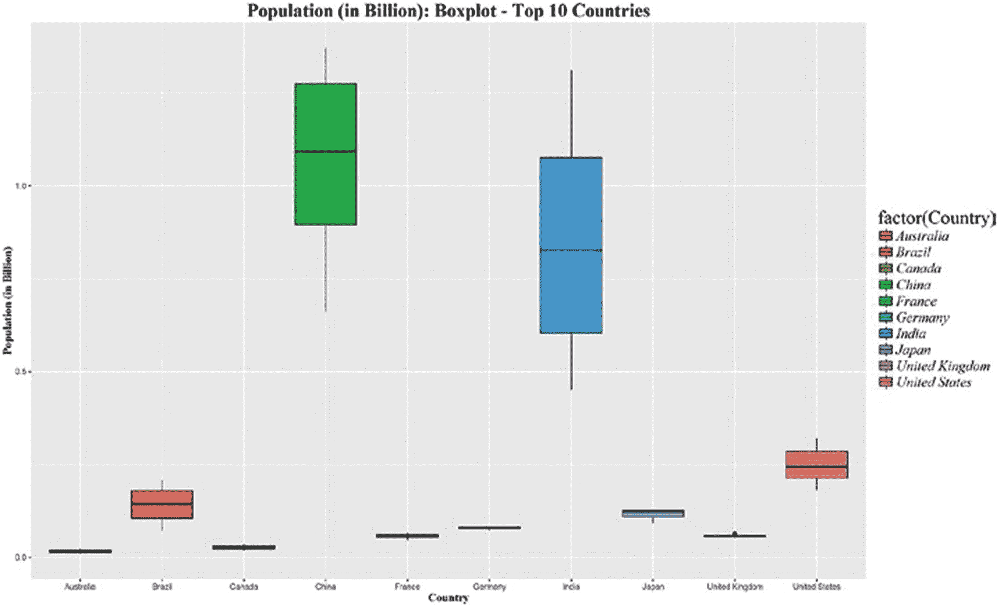

图 4-11

一个展示前 10 名国家人口（十亿）的箱线图

## 4.7 直方图和密度图

*直方图*是数值数据最基本且易于理解的图形表示之一。它由矩形框组成。每个矩形的宽度代表一个特定范围，高度表示该范围内的数据点数量。构建直方图首先需要将整个值域划分为不重叠且大小相等的较小区间（即矩形）。直方图展示了连续变量概率分布的估计。

现在想象一下，如果你将直方图中的区间数量增加到很大。结果你会得到一个平滑的表面，矩形似乎逐渐消失，变成一个具有一定密度的区域。或者，你也可以使用密度图。这里我们将分别展示直方图和密度图。

```
# Population
Population_all <-read.csv("Population All Year.csv")
Population_all_Long_Format <-melt(Population_all, id ="Country")
names(Population_all_Long_Format) <-c("Country", "Year", "Pop_Billion")
Population_all_Long_Format$Year <-substr(Population_all_Long_Format$Year,
2,length(Population_all_Long_Format$Year))
#Developed Country
Population_Developed <-Population_all_Long_Format[!(Population_all_Long_
Format$Country %in%c('India','China','Australia','Brazil','Canada','France',
'United States')),]
ggplot(Population_Developed, aes(Pop_Billion, fill = Country)) +
geom_histogram(alpha =0.5, aes(y = ..density..),col="black") +
theme(legend.title=element_text(family="Times",size=20),
legend.text=element_text(family="Times",face ="italic",size=15),
plot.title=element_text(family="Times", face="bold", size=20),
axis.title.x=element_text(family="Times", face="bold", size=12),
axis.title.y=element_text(family="Times", face="bold", size=12)) +
xlab("Population (in Billion)") +
ylab("Frequency") +
ggtitle("Population (in Billion): Histogram")
```

图 4-12 展示了三个国家——德国、日本和英国的人口分布。

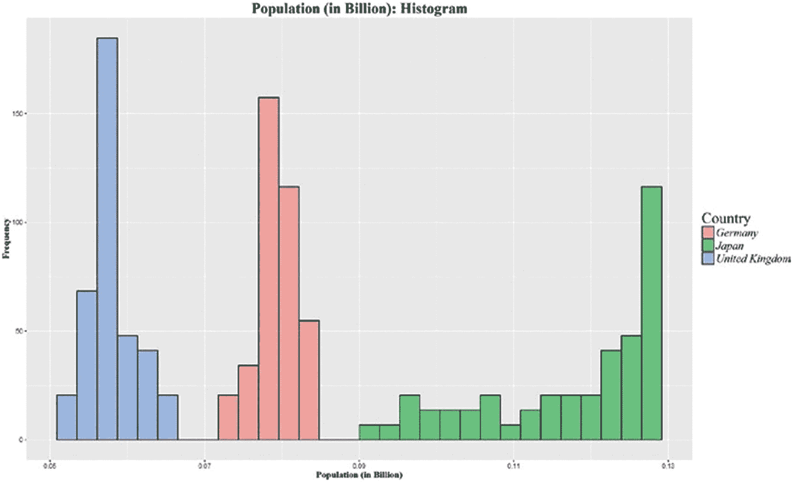

图 4-12

一个展示三个发达国家 GDP 和人口的直方图

这种分布也可以用密度标度来展示；图 4-13 至 4-15 是展示密度标度的图表。

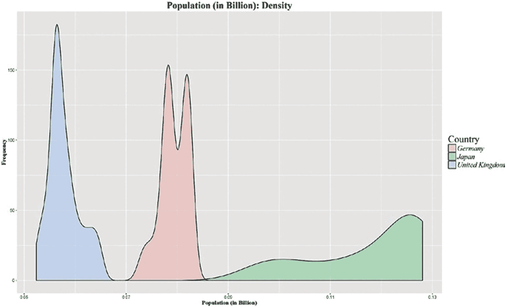

图 4-13

一个展示三个发达国家 GDP 和人口的密度图

```
ggplot(Population_Developed, aes(Pop_Billion, fill = Country)) +
geom_density(alpha =0.2, col="black") +
theme(legend.title=element_text(family="Times",size=20),
legend.text=element_text(family="Times",face ="italic",size=15),
plot.title=element_text(family="Times", face="bold", size=20),
axis.title.x=element_text(family="Times", face="bold", size=12),
axis.title.y=element_text(family="Times", face="bold", size=12)) +
xlab("Population (in Billion)") +
ylab("Frequency") +
ggtitle("Population (in Billion): Density")
#Developing Country
```

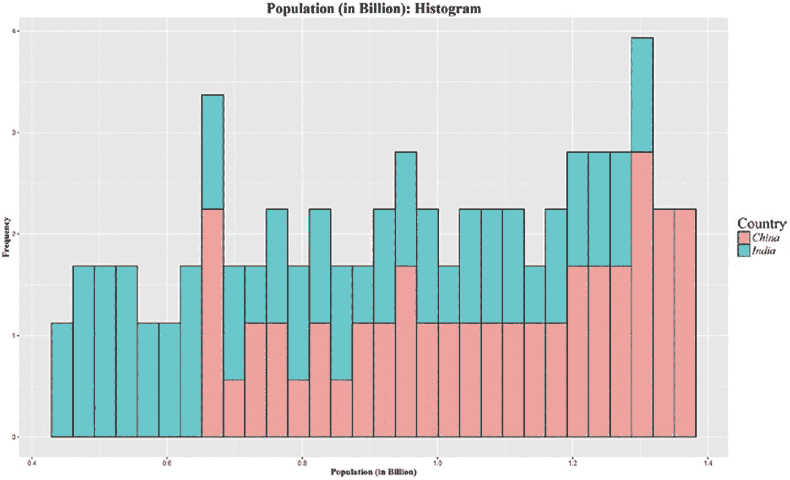

图 4-14

一个展示两个发展中国家 GDP 和人口的直方图


```
Population_Developing <-Population_all_Long_Format[Population_all_Long_
Format$Country %in%c('India','China'),]
#Histogram
ggplot(Population_Developing, aes(Pop_Billion, fill = Country)) +
geom_histogram(alpha =0.5, aes(y = ..density..),col="black") +
theme(legend.title=element_text(family="Times",size=20),
legend.text=element_text(family="Times",face ="italic",size=15),
plot.title=element_text(family="Times", face="bold", size=20),
axis.title.x=element_text(family="Times", face="bold", size=12),
axis.title.y=element_text(family="Times", face="bold", size=12)) +
xlab("Population (in Billion)") +
ylab("Frequency") +
ggtitle("Population (in Billion): Histogram")
```

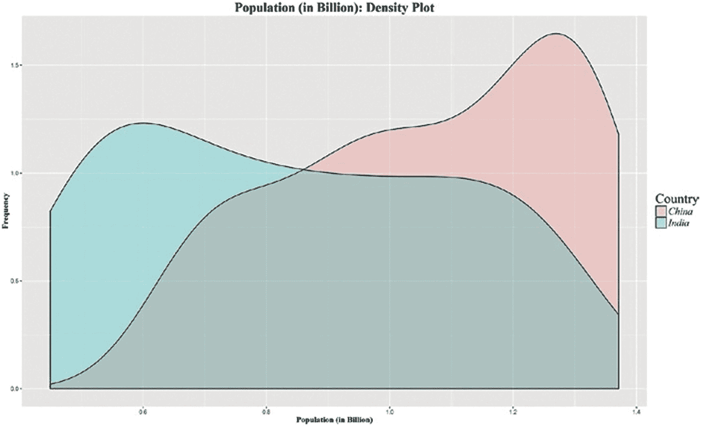

**图 4-15**

展示两个发展中国家 GDP 与人口分布的密度图

```
#Density
ggplot(Population_Developing, aes(Pop_Billion, fill = Country)) +
geom_density(alpha =0.2, col="black") +
theme(legend.title=element_text(family="Times",size=20),
legend.text=element_text(family="Times",face ="italic",size=15),
plot.title=element_text(family="Times", face="bold", size=20),
axis.title.x=element_text(family="Times", face="bold", size=12),
axis.title.y=element_text(family="Times", face="bold", size=12)) +
xlab("Population (in Billion)") +
ylab("Frequency") +
ggtitle("Population (in Billion): Density Plot")
```

观察图 4-12 至 4-15 中的直方图和密度图，你可以看到这些发达国家和发展中国家的人口数据在多年间的分布情况。现在，既然我们已经详细探索了数据，让我们更具体地关注基于人口但按不同群体（如国家和年龄）划分的指标。

## 4.8 饼图

在印度，最低消费群体几乎将其近 53%的钱花在食品和饮料上，而最高消费群体在这方面的支出比例远低于其他群体，仅为 12%。另一方面，他们在住房上的支出占 39%。这明确表明——可支配收入最低的消费群体将大量资金用于食品等基本生存需求，而高收入群体则倾向于购买优质住宅。中等收入群体与高收入群体的情况非常相似，但他们在食品上的支出比例也更大，达到 21%。

因此，在印度，房地产和食品行业的企业近年来蓬勃发展，达到了历史新高。凭借 13.1 亿的人口基数，且其中大部分属于最低、低收入或中等收入群体，印度已成为食品行业的机遇之地。

另一个有趣的领域是交通，其贡献份额最高的是高收入群体，他们通常全年都有旅行计划。这里的交通包括日常通勤以及假日旅行。随着像 Uber 这样的全球性企业解决了世界各地的通勤问题，并且其技术已覆盖印度超过 28 个城市，这向我们展示了该领域的潜力。见图 4-16。

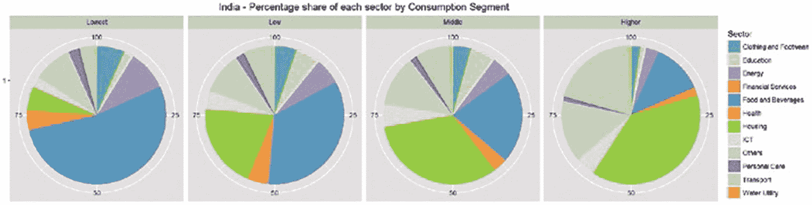

**图 4-16**

展示印度各消费群体在各行业支出占比的饼图

```
# India
library(reshape2)
library(ggplot2)
GCD_India <-read.csv("India - USD - Percentage.csv")
GCD_India_Long_Format <-melt(GCD_India, id ="Sector")
names(GCD_India_Long_Format) <-c("Sector", "Income_Group","Perc_Cont")
ggplot(data=GCD_India_Long_Format, aes(x=factor(1), fill =factor(Sector))) +
geom_bar(aes(weight = Perc_Cont), width=1) +
coord_polar(theta="y", start =0) +
facet_grid(facets=. ~Income_Group) +
scale_fill_brewer(palette="Set3") +
xlab(“) +
ylab(“) +
labs(fill='Sector') +
ggtitle("India - Percentage share of each sector by Consumption Segment")
```

与印度相比，如果你看看中国，不同收入群体在食品和住房上的需求分布更为均衡，而中国非常突出的特点是高收入群体在信息和通信技术（ICT）上的支出，占其总支出的 14%（见图 4-17）。这使得中国更接近发达国家行列，因为在这些国家中，对 ICT 如此高的适应性和投入是常见的。

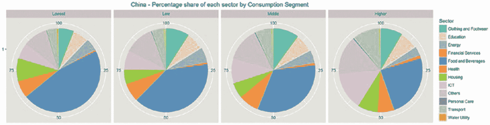

**图 4-17**

展示中国各消费群体在各行业支出占比的饼图

```
# China
library(reshape2)
library(ggplot2)
GCD_China <-read.csv("China - USD - Percentage.csv")
GCD_China_Long_Format <-melt(GCD_China, id ="Sector")
names(GCD_China_Long_Format) <-c("Sector", "Income_Group","Perc_Cont")
ggplot(data=GCD_China_Long_Format, aes(x=factor(1), fill =factor(Sector))) +
geom_bar(aes(weight = Perc_Cont), width=1) +
coord_polar(theta="y", start =0) +
facet_grid(facets=. ~Income_Group) +
scale_fill_brewer(palette="Set3") +
xlab(“) +
ylab(“) +
labs(fill='Sector') +
ggtitle("China - Percentage share of each sector by Consumption Segment")
```

图 4-17 中的饼图非常直观。看最左侧的最低消费群体饼图，几乎一半的消费用于食品和饮料，因为对于贫困人群来说，首要需求是食物。随着你向更高消费群体移动，优先事项发生转变，教育和 ICT（计算设备）等方面的支出大幅增加。


## 4.9 相关性图

展示一个指标与另一个指标关联程度的最佳方式是计算相关性。虽然我们不会深入探讨相关性背后的数学细节，但那些认为相关性只能通过 n×n 矩阵来观察的人将会感到惊喜。接下来，我们将使用 R 语言中的 `corrplot` 库来呈现相关性的可视化表示。相关性作为一种统计度量，将在第 [6](http://dx.doi.org/10.1007/978-1-4842-4215-5_6) 章中讨论。

`Corrplot()` 是一个 R 包，可用于相关矩阵的图形化展示。它还包含一些用于矩阵重排序的算法。此外，`corrplot` 在细节处理上表现出色，包括颜色选择、文本标签、颜色标签以及布局。

在本章的最后一节中，我们希望将前几节讨论的一些发展指标（如 GDP 和人口）与一些促进其增长的指标联系起来。这里使用的是 1961 年至 2014 年全球层面的世界银行数据。例如，生育率（每位妇女生育数）与人口增长率高度相关。见图 4-18。

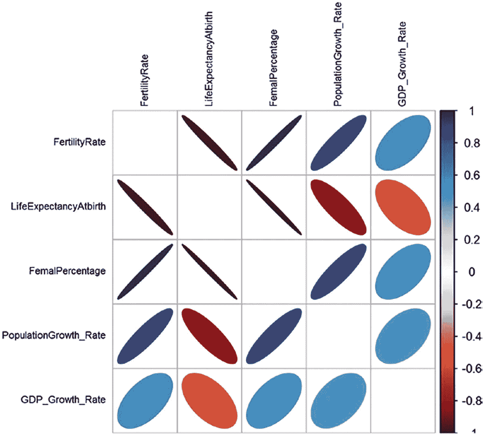

图 4-18

展示各种世界发展指标之间相关性的图

```
library(corrplot)
library(reshape2)
library(ggplot2)
correlation_world <-read.csv("Correlation Data.csv")
corrplot(cor(correlation_world[,2:6],method ="pearson"),diag =FALSE,
title ="Correlation Plot", method ="ellipse",
tl.cex =0.7, tl.col ="black", cl.ratio =0.2
)
```

`corrplot` 函数有许多方法（`cor` 函数中使用的方法定义了采用哪种相关性度量；这里我们使用的是皮尔逊相关性），你可以尝试这些方法，以观察图中不同的形状。我们更倾向于使用“椭圆”，原因有二。椭圆可以为我们提供大小和方向元素，以捕捉更多信息。颜色、大小和位置的组合将数值封装为可视化表示。例如，生育率与人口增长率之间的相关性值大于 0（反映在蓝色阴影中），而椭圆的方向则表示正相关或负相关。大小代表数值；细长的椭圆意味着低相关或负相关，反之亦然。

这种利用颜色、形状和位置的方式为我们提供了更多维度，能够在二维空间中呈现可视化效果，否则这些信息将难以可视化。即使不看相关矩阵，我们也能从这张图中获得一些见解，如下所示：

*   随着生育率下降，我们可以看到预期寿命增加。

*   随着预期寿命增加，人们开始活得更久，经济上满足其医疗保健需求的负担也随之加重。因此，我们看到它与 GDP 增长率呈负相关。虽然如果说仅仅是预期寿命增加导致 GDP 增长率下降将是一个严重的错误，但指出这两个变量之间存在负相关是合理的。

*   女性数量的增加也与 GDP 增长率呈正相关（尽管不是很高）。这可能意味着女性对家庭收入增长的贡献，进而带来的支出增加，对国家的 GDP 有一定影响。

## 4.10 热图

延续上一节中的指标及其相关性，热图是一种数据可视化方式，其中数值以不同深浅的颜色表示。颜色越深，数值越高。例如，热图可以帮助我们可视化世界不同地区对发展指标的反应情况。

图 4-19 中的热图展示了六个发展指标及其缩放值（介于 0 到 1 之间）在不同地区的比较情况。我们可以从这张热图中得出的一些见解如下：

*   东亚和太平洋地区拥有世界上最高的人口（主要来自中国），其次是南亚（来自印度的贡献）。

*   北美地区人口非常少，但人均 GDP（GDP/人口）最高。它的生育率也最低，预期寿命最高，这是因为这两个指标高度相关。撒哈拉以南非洲地区的 GDP 和人均 GDP 最低。

*   有趣的是，从缩放值来看，现在全世界的预期寿命看起来都很健康。这或许是因为医疗保健服务的改善和生育率的降低。因此，世界上大多数国家似乎都能够使用避孕药具，并享受小家庭带来的经济好处。

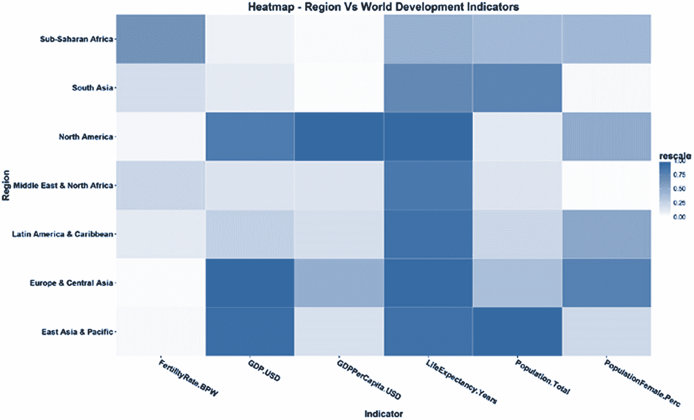

图 4-19

各地区及其各种世界发展指标之间的热图

```
library(corrplot)
library(reshape2)
library(ggplot2)
library("scales")
#Heatmaps
bc <-read.csv("Region Wise Data.csv")
bc_long_form <-melt(bc, id =c("Region","Indicator"))
names(bc_long_form) <-c("Region","Indicator","Year", "Inc_Value")
bc_long_form$Year <-substr(bc_long_form$Year, 2,length(bc_long_form$Year))
bc_long_form_rs <-ddply(bc_long_form, .(Indicator), transform ,rescale
=rescale(Inc_Value))
ggplot(bc_long_form_rs, aes(Indicator,  Region)) +geom_tile(aes(fill
= rescale),colour ="white") +scale_fill_gradient(low ="white",high
="steelblue") +
theme_grey(base_size =11) +scale_x_discrete(expand =c(0, 0)) +
scale_y_discrete(expand =c(0, 0)) +
theme(
axis.text.x =element_text(size =15 *0.8, angle =330, hjust =0, colour
="black",face="bold"),
axis.text.y =element_text(size =15 *0.8, colour ="black",face="bold"))+
ggtitle("Heatmap - Region Vs World Development Indicators") +
theme(text=element_text(size=12),
title=element_text(size=14,face="bold"))
```


## 4.11 气泡图

要理解气泡图，你首先需要观看汉斯·罗斯林（Hans Rosling）在 TED 上的演讲，名为“你见过的最棒的统计数据”。他是一位瑞典医学博士、学者、统计学家和公共演说家。汉斯共同创立了 Gapminder 基金会，这是一个非营利组织，致力于推广使用数据来探索发展问题。他们开发了一款名为 Trendalyzer 的软件，该软件后来被谷歌收购，并更名为 googleViz，也称为谷歌动态气泡图。谷歌并未将这款产品商业化，而是将其免费向公众开放。

在本节中，我们使用 Gapminder 提供的一个数据集，其中包含 1995 年至 2007 年间关于大洲、国家、预期寿命和人均 GDP 的数据。尽管它在二维静态图表中看起来不错，但看到这些气泡在动态图表中移动更是一种视觉享受（见图 4-20）。

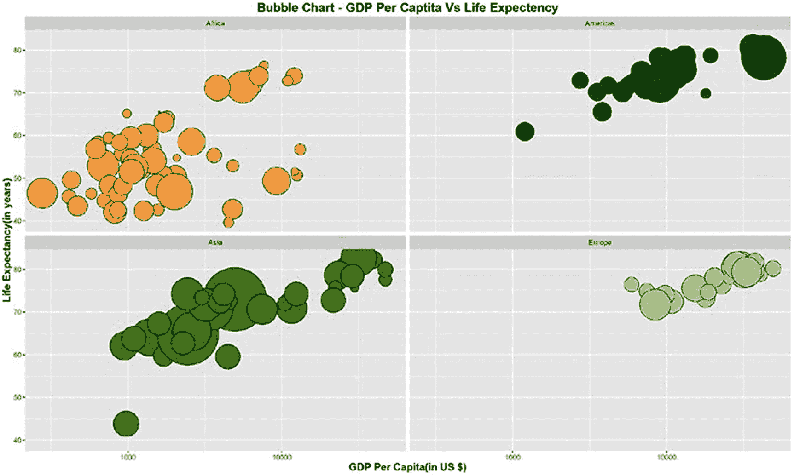

图 4-20

展示人均 GDP 与预期寿命关系的气泡图

```
library(corrplot)
library(reshape2)
library(ggplot2)
library("scales")
#Bubble chart
bc <-read.delim("BubbleChart_GapMInderData.txt")
bc_clean <-droplevels(subset(bc, continent != "Oceania"))
str(bc_clean)
'data.frame':     1680 obs. of 6 variables:
$ country  : Factor w/ 140 levels "Afghanistan",..: 1 1 1 1 1 1 1 1 1 1
...
$ year     : int 1952 1957 1962 1967 1972 1977 1982 1987 1992 1997 ...
$ pop      : num 8425333 9240934 10267083 11537966 13079460 ...
$ continent: Factor w/ 4 levels "Africa","Americas",..: 3 3 3 3 3 3 3 3 3
3 ...
$ lifeExp  : num 28.8 30.3 32 34 36.1 ...
$ gdpPercap: num 779 821 853 836 740 ...
bc_clean_subset <-subset(bc_clean, year ==2007)
bc_clean_subset$year =as.factor(bc_clean_subset$year)
ggplot(bc_clean_subset, aes(x = gdpPercap, y = lifeExp)) +scale_x_log10() +
geom_point(aes(size =sqrt(pop/pi)), pch =21, show.legend =FALSE) +
scale_size_continuous(range=c(1,40)) +
facet_wrap(~continent) +
aes(fill  =  continent)  +
scale_fill_manual(values =c("#FAB25B", "#276419", "#529624", "#C6E79C")) +
xlab("GDP Per Capita(in US $)")+
ylab("Life Expectancy(in years)")+
ggtitle("Bubble Chart - GDP Per Capita Vs Life Expectancy") +
theme(text=element_text(size=12),
title=element_text(size=14,face="bold"))
```

由 Deepayan Sarkar 撰写、Springer（2008）出版的《*Lattice: 使用 R 进行多元数据可视化*》（可通过 SpringerLink 获取）一书，对气泡图进行了全面分析。如果你想更深入地理解这种可视化方式，请参考此书。

图 4-20 中的气泡图展示了 2007 年预期寿命与人均 GDP 之间的关系。气泡的大小表示该大洲各国的人口数量。气泡越大，人口越多。你可以看到，由于印度和中国的存在，亚洲包含多个大型气泡；而欧洲则主要由人口较少的国家组成，且人均 GDP 和预期寿命都很高。美洲既有一些人口稠密的地区，同时这两项指标的值也都很高。

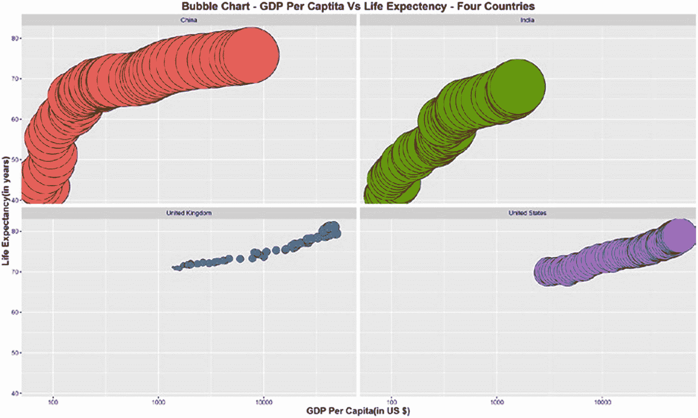

图 4-21

展示四个国家人均 GDP 与预期寿命关系的气泡图

```
library(corrplot)
library(reshape2)
library(ggplot2)
library("scales")
bc <-read.csv("Bubble Chart.csv")
ggplot(bc, aes(x = GDPPerCapita, y = LifeExpectancy)) +scale_x_log10() +
geom_point(aes(size =sqrt(Population/pi)), pch =21, show.legend =FALSE) +
scale_size_continuous(range=c(1,40)) +
facet_wrap(~Country) +
aes(fill  =  Country)  +
xlab("GDP Per Capita(in US $)")+
ylab("Life Expectancy(in years)")+
ggtitle("Bubble Chart - GDP Per Capita Vs Life Expectancy - Four Countries")
+
theme(text=element_text(size=12),
title=element_text(size=14,face="bold"))
```

图 4-21 中的气泡图针对的是两个最发达国家和两个发展最快的国家。请注意，发展中国家中国和印度，尽管人口众多，但多年来在 GDP 和预期寿命方面正迅速赶上发达国家。

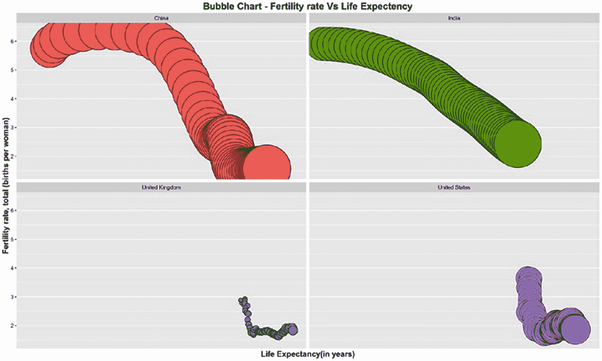

图 4-22

展示生育率与预期寿命关系的气泡图

```
library(corrplot)
library(reshape2)
library(ggplot2)
library("scales")
bc <-read.csv("Bubble Chart.csv")
ggplot(bc, aes(y = FertilityRate, x = LifeExpectancy)) +scale_x_log10() +
geom_point(aes(size =sqrt(Population/pi)), pch =21, show.legend =FALSE) +
scale_size_continuous(range=c(1,40)) +
facet_wrap(~Country) +
aes(fill = Country) +
ylab("Fertility rate, total (births per woman)")+
xlab("Life Expectancy(in years)")+
ggtitle("Bubble Chart - Fertility rate Vs Life Expectancy") +
theme(text=element_text(size=12),
title=element_text(size=14,face="bold"))
```

从图 4-22 的图表中可以明显看出，随着生育率的下降，这四个国家的预期寿命都在延长。印度在预期寿命方面稳步缩小了与中国的差距。两国最初相差 14 年，后来缩小到了 6 或 7 年。


## 4.12 瀑布图

*瀑布图*有助于直观展示数值序列变化（增加和减少）的累积效应。如同瀑布一般，它展示了数值流入和流出主要数值的过程。由于柱状图（砖块）看起来悬浮在半空中，瀑布图也被称为*飞砖图*或*马里奥图*。在会计和库存管理可视化中非常流行，因为数量会按顺序持续变化。我们将使用`waterfall`包，基于假设的边境管控数据创建一个示例。

`Waterfall()`是一个 R 包，支持使用传统的 base 图形和 lattice 图形在 R 中创建瀑布图。该包的详细信息可参见[`https://cran.r-project.org/web/packages/waterfall/waterfall.pdf`](https://cran.r-project.org/web/packages/waterfall/waterfall.pdf)。

我们拥有的数据是关于边境管控的，记录了每月的人流量。出境人数多于入境人数意味着净迁移为负，而当入境人数多于出境人数时，迁移为正。如果我们记录 12 个月内边境的出入境交换情况，就可以看到净迁移。瀑布图将展示这些月份中净迁移的变化（见图 4-23）。

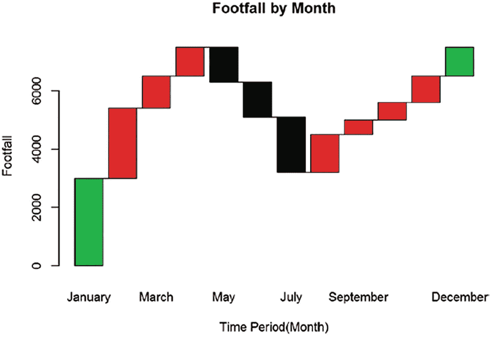

图 4-23

边境人流量瀑布图

```
#读取人流量数据
footfall <-read.csv("Dataset/Waterfall Shop Footfall Data.csv",header = T)
#显示数据以便阅读
footfall
#将月份转换为因子以保留图表中的顺序
footfall$Month <-factor(footfall$Month)
footfall$Time_Period <-factor(footfall$Time_Period)
#加载瀑布图库
library(waterfall)
library(lattice)
#使用 waterfall 绘图
waterfallplot(footfall$Net,names.arg=footfall$Month, xlab ="时间周期(月)",ylab="人流量",col = footfall$Type,main="每月人流量")
```

绿色块是起始或结束块，分别对应一月和十二月。红色块表示入境人数，而黑色块表示出境人数。当你观察一整年的数据时，可以看到大部分月份都出现了正向迁移，除了三个月有更多人出境（黑色块）。

下图是同一瀑布图的另一种视图（见图 4-24）。

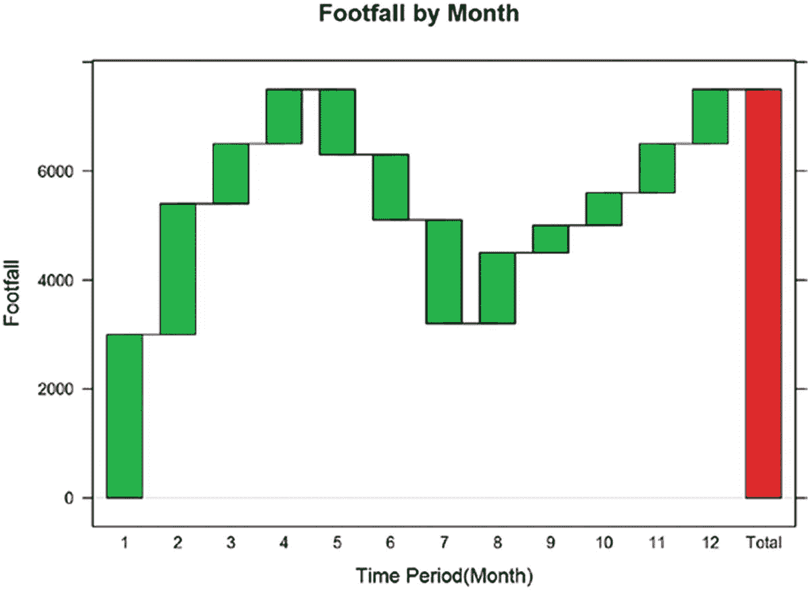

图 4-24

显示净效果的瀑布图

```
waterfallchart(Net~Time_Period, data=footfall,col = footfall$Type,xlab
="时间周期(月)",ylab="人流量",main="每月人流量")
```

图 4-24 中的图表与之前的类似，唯一的区别在于末尾的总计列。总计列展示了年底后人流量计数器的最终净值。

同样的图表也可以用来显示每月人流量贡献的百分比。这将展示每月末的人流量计数如何与总年末人流量成比例。这些百分比之和应为 100，并分配到 12 个月中。

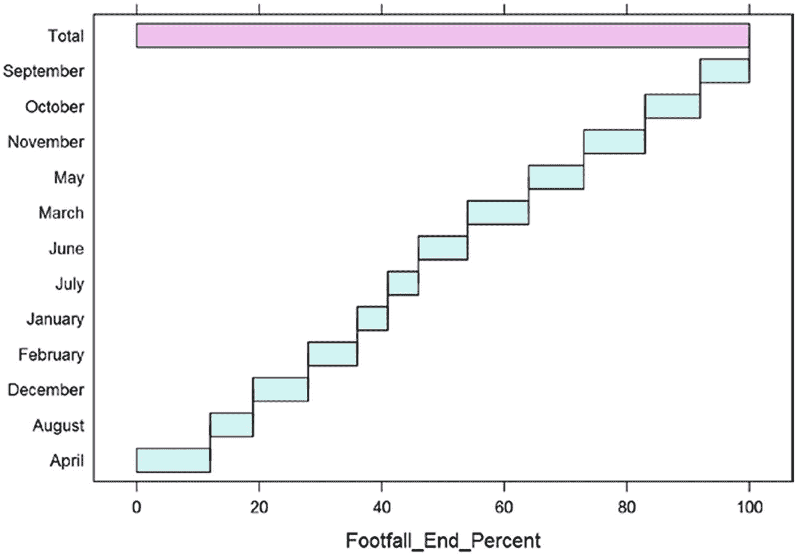

图 4-25

月末人流量占总末人流量的百分比

```
waterfallchart(Month~Footfall_End_Percent, data=footfall)
```

请注意，四月末的人流量出现了波动，其次是三月和十一月。根据你对图 4-24 和图 4-25 中图表的关注点不同，解读也会有所差异。

## 4.13 树状图

*树状图*是一种在聚类分析中特别有用的可视化表示。它们是树形图，常用于说明聚类的形成过程，正如层次聚类中所做的那样。第[6](http://dx.doi.org/10.1007/978-1-4842-4215-5_6)章解释了层次聚类的工作原理。树状图在计算生物学中很流行，其中物种间的相似性可以通过直方图来呈现以进行分类。

树状图是基础`plot()`命令的原生功能。还有一些其他包可用于创建更详细的树状图，例如`ggdendro()`和`dendextend()`。

树状图中的 y 轴衡量单个数据点或聚类的接近程度（或相似性）。

x 轴列出数据集中的元素（因此它们在叶节点上看起来可能比较杂乱）。

树状图通过显示树如何随 y 轴上的距离矩阵（或高度）生长，帮助选择正确的聚类数量。在树状图上你认为可以看到明显分离的聚类的位置进行切割。切割意味着一条线 y=c，其中 c 是 1、2 或 3...n，c 代表聚类的数量。

这里，我们使用鸢尾花数据创建一个示例，并在最后展示聚类与实际数据的拟合程度。

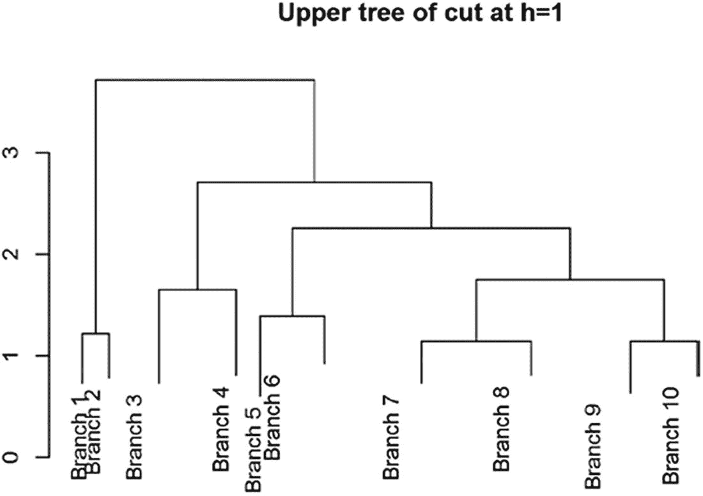

图 4-26

距离/高度截止到 h=1 的树状图

```
library(ggplot2)
data(iris)
# 对鸢尾花数据准备层次聚类
hc <-hclust(dist(iris[,1:2]))
# 使用树状图对象
hcd <-as.dendrogram(hc)
# 在高度 1 处放大查看
plot(cut(hcd, h =1)$upper, main ="在 h=1 处切割的上部树")
```

观察图 4-26 中的树状图，最佳切割点似乎介于 2 和 3 之间，因为聚类必须是完整的。我们将继续使用三个聚类，并查看它们与我们已有的聚类先验知识的匹配程度。

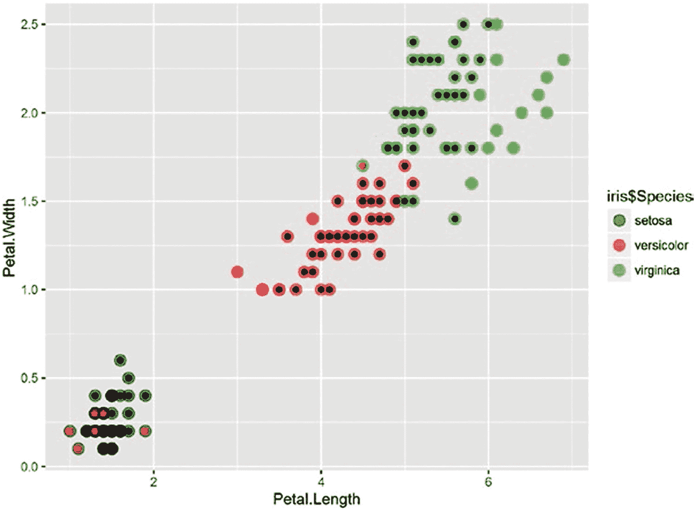

图 4-27

基于鸢尾花数据中物种实际分类的聚类

```
# 让我们展示如果在 y=3 处切割树，聚类看起来如何
clusterCut <-cutree(hc, 3)
iris$clusterCut <-as.factor(clusterCut)
ggplot(iris, aes(Petal.Length, Petal.Width, color = iris$Species)) +
geom_point(alpha =0.4, size =3.5) +geom_point(col = clusterCut) +
scale_color_manual(values =c('black', 'red', 'green'))
```

在图 4-27 的图表中，我们可以看到我们预测的大部分聚类与已有的物种分类相匹配。这也意味着我们用于聚类的变量——花瓣宽度和花瓣长度——是决定它们所属物种类型的重要特征。


## 4.14 词云

词云是一种词频图，其中单词的大小与其出现频率成正比。单词出现得越频繁，其显示尺寸就越大。通过观察文本数据，你可以快速识别出讨论最突出的主题。英文关键词加权列表的最早例子是道格拉斯·库普兰（Douglas Coupland）的《微型奴隶》（*Microserfs*，1995）中的“潜意识文件”。此后，这便成为快速感知最频繁出现的术语、以及按字母顺序定位单词以确定其相对重要性的一种重要方式。

在 R 语言中，我们使用 `wordcloud()` 包来创建词云。该包的详细信息可在 [`https://cran.r-project.org/web/packages/wordcloud/wordcloud.pdf`](https://cran.r-project.org/web/packages/wordcloud/wordcloud.pdf) 找到。

在本节中，我们将展示一个很好的例子来说明词云的实用性。我们从互联网上复制了多份数据科学职位的职位描述。现在，基于这些文档生成的词云将告诉我们哪些单词在职位描述中出现频率最高，从而让我们了解市场上热门技能是什么，以及雇主对其他素质的需求（见图 4-28）。


图 4-28

职位描述词云

```
#加载文本文件
job_desc <-readLines("Dataset/wordcloud.txt")
library(tm)
library(SnowballC)
library(wordcloud)
Loading required package: RColorBrewer
jeopCorpus <-Corpus(VectorSource(job_desc))
jeopCorpus <-tm_map(jeopCorpus, PlainTextDocument)
#jeopCorpus <- tm_map(jeopCorpus, content_transformer(tolower))
#移除标点符号
jeopCorpus <-tm_map(jeopCorpus, removePunctuation)
#移除英文停用词和一些自定义词
jeopCorpus <-tm_map(jeopCorpus, removeWords,(c("Data","data","Experi","work"
,"develop","use","will","can","you","busi", stopwords('english'))))
#创建文档矩阵
jeopCorpus <-tm_map(jeopCorpus, stemDocument)
#为词云图像创建调色板
pal <-brewer.pal(9,"YlGnBu")
pal <-pal[-(1:4)]
set.seed(146)
#创建词云
wordcloud(words = jeopCorpus, scale=c(3,0.5), max.words=100, random.
order=FALSE,
rot.per=0.10, use.r.layout=FALSE, colors=pal)
```

词云显示，数据科学职位的关键趋势是经验丰富的人员、分析师职位、Hadoop、统计学、Python 等。这样，即使不浏览所有数据，我们也能提取出数据科学职位的主要要求。

## 4.15 桑基图

*桑基图*也被称为河流图。它们用于展示数据的不同元素是如何连接的，连接线的密度表示连接的强度。它们有助于展示连接项从一个因素到另一个因素的流动。

强烈建议用户探索一个强大的可视化包 `Rcharts()`，它可以在 R 语言中制作大量漂亮的图表。该包的源代码以及大量示例可以在 [`https://github.com/ramnathv/rCharts`](https://github.com/ramnathv/rCharts) 找到。

在下面的例子中，我们将使用另一个强大的可视化工具，名为 `googleVis()`。`GoogleVis` 是 R 语言与 Google Charts API 的接口，允许用户基于数据框创建交互式图表。图表通过 R HTTP 帮助服务器在本地显示。需要一个连接互联网的现代浏览器，某些图表还需要 Flash 播放器。数据保留在本地，不会上传到 Google。（来源：[`https://cran.r-project.org/web/packages/googleVis/googleVis.pdf`](https://cran.r-project.org/web/packages/googleVis/googleVis.pdf)）

在我们的例子中，我们将展示 `HousePrice` 如何在不同的属性之间流动；我们选择了三个图层：房屋类型、地产类型和销售类型。

```
#从 sankey.csv 加载数据
sankey_data <-read.csv("Dataset/sankey2.csv",header=T)
library(googleVis)
plot(
gvisSankey(sankey_data, from="Start",
to="End", weight="Weight",
options=list(
height=250,
sankey="{link:{color:{fill:'lightblue'}}}"
))
)
```

### 注意

可视化内容会在网页浏览器中加载，因此你不需要连接互联网来加载此示例。

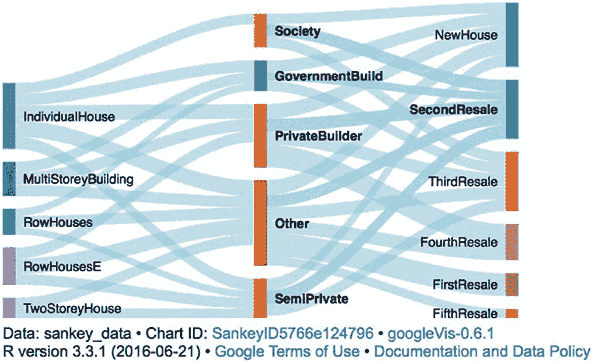

图 4-29

房屋销售数据的桑基图

```
starting httpd help server ...
done
```

图 4-29 所示的桑基图为我们提供了一些重要信息，例如最受欢迎的房屋类型是独立屋。这些房屋在所有类型的地产状态中都有供应。此外，社区只有独立屋，并且它们只经历了新房销售、第二次转售和第三次转售。你可以使用这些图表来解释许多其他见解。

## 4.16 时间序列图

我们在本章前面的章节中已经展示过时间序列图。本质上，当数据是按时间索引的（例如 GDP 数据），我们将时间放在 x 轴上，并绘制数据以观察其随时间的变化情况。我们可以使用时间序列图来评估数据随时间变化的模式和特征。

R 语言拥有强大的库来绘制多种类型的时间序列图。你可以在 [`https://cran.r-project.org/web/packages/timeSeries/vignettes/timeSeriesPlot.pdf`](https://cran.r-project.org/web/packages/timeSeries/vignettes/timeSeriesPlot.pdf) 找到一份不错的参考资料。

在我们的例子中，我们将尝试展示两个时间图来理解一些显著的行为：

*   将八个国家的 GDP 叠加在单个图上，以显示过去 25 年中这些国家的 GDP 增长如何变化。

*   追踪三个国家在 2008 年经济衰退期间的 GDP 增长。

第一个例子绘制了八个国家/地区（阿拉伯世界、阿联酋（阿拉伯联合酋长国）、澳大利亚、孟加拉国、西班牙、英国、印度和美国）25 年间的 GDP 增长情况。

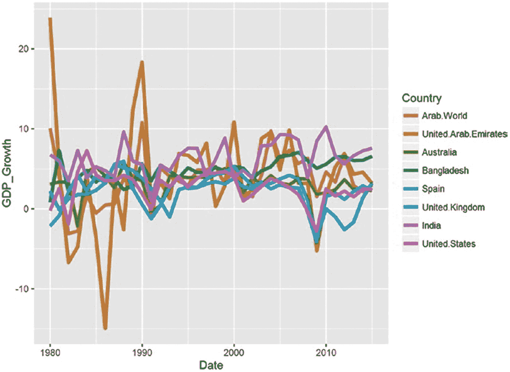

图 4-30

八个国家的 GDP 增长

```
library(reshape2)
library(ggplot2)
library(ggrepel)
time_series <-read.csv("Dataset/timeseries.csv",header=TRUE);
mdf <-melt(time_series,id.vars="Year");
mdf$Date <-as.Date(mdf$Year,format="%d/%m/%Y");
names(mdf)=c("Year","Country","GDP_Growth","Date");
ggplot(data=mdf,aes(x=Date,y=GDP_Growth)) +geom_line(aes(color=Country),size=1.5)
```

图 4-30 中的图显示，在这八个国家中，经济波动最大的是阿联酋。它们在 20 世纪 90 年代后表现出惊人的增长。你还可以看到，在 2007-2009 年期间，由于全球性经济衰退，所有经济体的 GDP 增长都放缓了。

在下面的图中，我们将看到经济衰退如何影响三个主要经济体以及影响程度（美国、英国和印度）。

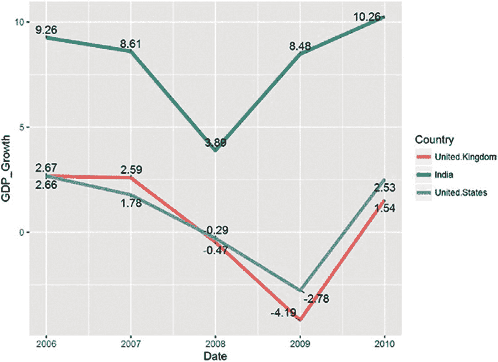

图 4-31

经济衰退期间的 GDP 增长

```
#现在让我们看看印度、美国和英国在经济衰退年份（2006,2007,2008,2009,2010）的增长率
mdf_2 <-subset(mdf, mdf$Date >as.Date("2005-01-01") &mdf$Date <as.Date("2011-01-01"))
mdf_2$GDP_Growth <-round(mdf_2$GDP_Growth,2)
tp <-ggplot(data=mdf_2,aes(x=Date,y=GDP_Growth)) +geom_line(aes(color=Country),size=1.5)
tp +geom_text_repel(aes(label=GDP_Growth))
```

你可以在图 4-31 中看到，2008 年，美国和英国出现了负增长，而印度的增长虽然放缓但并未转为负值。美国和英国在 2009 年仍处于深度衰退之中，而印度则开始复苏。2009 年之后，所有经济体都走上了复苏之路。


## 4.17 群组图

*群组图*是一种二维图表，用于展示属于不同群组的一组观测对象（个体）所发生的事件。它们在信用分析、市场分析及其他人口统计学研究中非常流行。群组图有时也被称为*列克西斯图*。

群组是指一组人群，基于人口统计学特征，其行为被认为与其他人群不同。在我们的信用示例中，我们将群组定义为信用发放的年份。这意味着每年申请者将被视为一个群组，然后我们追踪他们在后续年份中仍未还款的人数。在群组图中，时间通常用水平轴表示，而关注的数值则用垂直轴表示。

让我们为信用示例创建群组图。

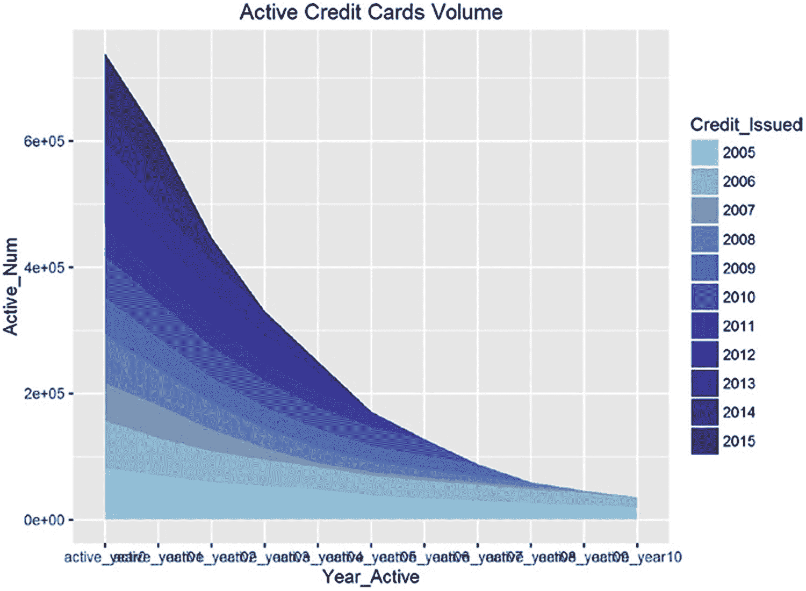

图 4-32

按发行年份统计的信用卡活跃群组图

```
library(ggplot2)
require(plyr)
cohort <-read.csv("Dataset/cohort.csv",header=TRUE)
#we need to melt data
cohort.chart <-melt(cohort, id.vars ="Credit_Issued")
colnames(cohort.chart) <-c('Credit_Issued', 'Year_Active', 'Active_Num')
cohort.chart$Credit_Issued <-factor(cohort.chart$Credit_Issued)
#define palette
blues <-colorRampPalette(c('lightblue', 'darkblue'))
#plot data
p <-ggplot(cohort.chart, aes(x=Year_Active, y=Active_Num, group=Credit_Issued))
p +geom_area(aes(fill = Credit_Issued)) +
scale_fill_manual(values =blues(nrow(cohort))) +
ggtitle('Active Credit Cards Volume')
```

图 4-32 中的图表展示了每个群组的数量如何随活跃年份变化。你可以看到活跃卡数量逐年下降。下降率可以通过每个群组的斜率来估算，并可以与其他群组进行比较，以观察是否有特定群组表现出不同的行为。

## 4.18 空间地图

*空间地图*近年来变得非常流行。它们是带有地图位置标签的数据的强大展示方式。如果信息带有地理标签，我们可以创建出极具视觉冲击力的数据展示。你可以看到它们的许多应用——天气预报、人口统计、犯罪监控、轨迹追踪，以及一些非常有趣的利用 Twitter 数据、Flikr 数据和其他带地理标签的个人数据进行的人群行为追踪。

我们推荐一篇好文章，可在 [`https://journal.r-project.org/archive/2013-1/kahle-wickham.pdf`](https://journal.r-project.org/archive/2013-1/kahle-wickham.pdf) 获取。

为了展示一个示例，我们选择了印度国家犯罪记录局的犯罪记录数据。我们将展示如何将各邦的抢劫案件显示在印度地图上。这将帮助我们无需深入数据本身即可进行相对比较。

数据来源：[`https://data.gov.in/catalog/cases-reported-and-value-property-stolen-place-occurrence`](https://data.gov.in/catalog/cases-reported-and-value-property-stolen-place-occurrence) 。

`Ggmap()` 包与 `ggplot2` 一起用于空间可视化。它是一个函数集合，用于在来自各种在线来源（例如 Google Maps 和 Stamen Maps）的静态地图之上可视化空间数据和模型。它包含了这些任务中常用的工具，包括用于地理定位和路径规划的函数。（来源：[`https://cran.r-project.org/web/packages/ggmap/ggmap.pdf`](https://cran.r-project.org/web/packages/ggmap/ggmap.pdf) 。）

让我们详细地逐步操作：

1.  将犯罪数据加载到 `crime_data` 中：

1.  拉取一张示例地图，检查 `ggplot()` 函数是否正常工作：

```
crime_data <-read.csv("Dataset/Case_reported_and_value_of_property_taken_
away.csv",header=T)
#install.packages("ggmap")
library(ggmap)
```


图 4-33

使用 ggplot() 拉取的示例地图——印度新德里

```
#Example map to test if ggmap is able to pull graphs or not
qmap(location ="New Delhi, India")
Map from URL : http://maps.googleapis.com/maps/api/staticmap?center=New
+Delhi,+India&zoom=10&size=640x640&scale=2&maptype=terrain&language=en- EN&sensor=false
Information from URL : http://maps.googleapis.com/maps/api/geocode/ json?address=New%20Delhi,%20India&sensor=false
```

图 4-33 中的图表证实了 `ggmap()` 可以通过将位置传递给函数来拉取地图。

1.  获取犯罪数据中所有印度邦的地理位置：

1.  在这里你可以看到每个邦都已通过中心坐标（经度和纬度对）进行了地理标记。

```
crime_data$geo_location <-as.character(crime_data$geo_location)
crime_data$robbery =as.numeric(crime_data$robbery)
#lets just see the stats fpr 2010
mydata <-crime_data[crime_data$year == '2010',]
#Summarize the data by state
library(dplyr)
mydata <-summarise(group_by(mydata, geo_location),robbery_
count=sum(robbery))
#get Geop code for all the cities
for (i in 1:nrow(mydata)) {
latlon =geocode(mydata$geo_location[i])
mydata$lon[i] =as.numeric(latlon[1])
mydata$lat[i] =as.numeric(latlon[2])
}
Information from URL : http://maps.googleapis.com/maps/api/geocode/
json?address=A&N%20Islands,%20India&sensor=false
.....
Information from URL : http://maps.googleapis.com/maps/api/geocode/
json?address=West%20Bengal,%20India&sensor=false
```

1.  创建一个数据框，包含各邦的抢劫案件总数、经度和纬度。

```
head(mydata)
# A tibble: 6 × 4
geo_location robbery_count      lon      lat

1       A&N Islands, India            14 10.89779 48.37054
2    Andhra Pradesh, India          1120 79.73999 15.91290
3 Arunachal Pradesh, India           138 94.72775 28.21800
4             Assam, India          1330 92.93757 26.20060
5             Bihar, India          3106 85.31312 25.09607
6        Chandigarh, India           134 76.77942 30.73331
#write the data with geocode for future reference
mydata <-mydata[-8,]
row.names(mydata) <-NULL
write.csv(mydata,"Dataset/Crime Data for 2010 from NCRB with geocodes.
csv",row.names =FALSE)
```

1.  在地图上找到印度的中心，然后拉取印度地图并存储到 `IndiaMap` 中。

```
Robbery_By_State =data.frame(mydata$robbery_count, mydata$lon, mydata$lat)
colnames(Robbery_By_State) <-c('robbery','lon','lat')
```

1.  绘制印度地图，并叠加橙色圆圈显示各邦的抢劫案件数量。圆圈越大，抢劫率越高：

```
india_center =as.numeric(geocode("India"))
Information from URL : http://maps.googleapis.com/maps/api/geocode/json?add
ress=India&sensor=false
IndiaMap <-ggmap(get_googlemap(center=india_center, scale=2, zoom=5,maptype
='terrain'));
Map from URL : http://maps.googleapis.com/maps/api/staticmap?center=20.5936
84,78.96288&zoom=5&size=640x640&scale=2&maptype=terrain&sensor=false
```

```
circle_scale_amt <-0.005
IndiaMap +geom_point(data=Robbery_By_State,aes(x=lon,y=lat), col="orange",
alpha=0.4, size=Robbery_By_State$robbery*circle_scale_amt) +scale_size_
continuous(range=range(mv_num_collisions$robbery))
```

通过观察空间可视化结果，很容易看出印度抢劫案件的分布情况。我们也可以快速按邦进行对比分析。在图 4-34 的图表中，马哈拉施特拉邦、北方邦和比哈尔邦位列 2010 年登记抢劫案件数量的前三名。

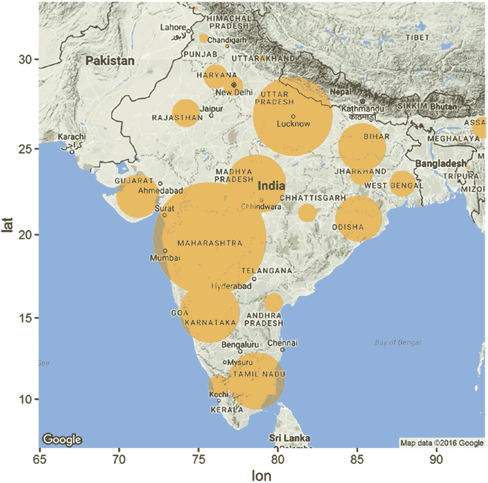

图 4-34

2010 年印度抢劫案件数量地图


## 4.19 小结

数据可视化同时是一门艺术和科学。展示什么信息源于科学推理，而如何展示则取决于大脑的认知能力。事实证明，大脑处理图像的速度快于处理数字，因此，对于专业人士而言，将信息压缩成有意义的可视化图形而非冗长的数据流变得至关重要。

在本章中，我们讨论了许多类型的可视化图表，它们可以用来围绕数据所传达的信息构建故事。我们从世界银行的数据开始，展示了如何使用折线图和柱状图追踪关键指标的变化。我们还了解了直方图和密度图如何通过观察整体水平，避免我们做出以偏概全的推断，因为直方图展示了数据内部的分布情况。饼图是展示各个组成部分贡献度的好方法。箱线图则用于展示数据集中的极端值。总的来说，相关性图、热力图以及最后的气泡图，在它们相对紧凑的图表空间内所展示的丰富信息方面，有许多共同之处。尽管存在相似性，你仍需谨慎选择正确的图表来呈现你的数据。

瀑布图用于展示如何以更直观的方式捕捉信息的顺序流动。与瀑布图类似的是桑基图，但绘制目的不同。桑基图在流程可视化中展示了不同组成部分之间的连接属性。树状图在聚类分析和分析对象间的相似性方面有特定用途。时间序列图对于时间索引数据非常重要；使用时间序列图，你可以看到在经济衰退年份，三个国家的 GDP 增长如何变为负值。

另一种流行的图表是同期群分析图。这类图表在分析特定人群随时间推移的关键特征变化方面非常流行。我们使用了一个信用卡的例子，其中展示了从信用卡发放之日起，不同时期的不同同期群。最后，也是功能最强大的图表之一，是空间地图。它们是在地图上呈现信息的方式。任何带有地理标签的数据都可以使用空间地图来呈现。总的来说，R 语言拥有可扩展的库来创建强大的可视化效果。

在选择合适的可视化技术之前，理解你的演示受众是至关重要的。如前所述，数据可视化范围广泛，我们将在本书中持续使用许多此类图表和图形。

在下一章中，我们将探讨数据探索的另一个方面：特征工程。如果我们有成百上千个变量或特征，我们如何决定哪个特定特征对于构建机器学习模型是有用的？这些问题将在第[6](http://dx.doi.org/10.1007/978-1-4842-4215-5_6)章中得到解答，为开始构建我们的机器学习模型奠定基础。

