# 6. 机器学习理论与实践

世界正在迅速适应机器学习（ML）的应用。无论是无人驾驶汽车、智能个人助理，还是像围棋和《危险边缘》这样与人类对弈的机器，机器学习无处不在。数据采集的便捷性和易得性，加上强大的计算能力，使得这一领域更有利于研究人员和企业为一些最具挑战性的问题探索数据驱动的解决方案。这引发了一场革命，催生了大量利用机器学习解决医疗、IT、人力资源、汽车、制造业等领域问题的新兴初创公司和工具，并且这个列表还在不断扩展。

在机器学习研究人员、工程师和开发者的共同努力下，复杂机器学习算法与其实现之间的抽象层已达到前所未有的高度。如今，你无需理解机器学习算法背后的统计学知识就能将其应用于真实世界的数据集，只需知道如何使用某个工具就足够了（这有其利弊），这需要你探索和清洗数据，并将其整理成合适的格式。许多大型企业已经推出了某些 API，提供分析即服务，具备使用机器学习构建预测模型的能力。这并未止步——像谷歌、Facebook 和 IBM 这样的公司已经率先将其部分系统完全开源，这意味着，就像安卓系统彻底改变了移动行业一样，这些机器学习系统也将为下一代全自动机器带来同样的变革。

因此，现在有待观察的是，下一个突破性的、价值数十亿美元的颠覆性创意将从何而来。尽管这一切听起来可能像是一个遥远的梦想，但它正在迅速逼近。过去的二十年里，我们在技术领域见证了谷歌、Twitter、WhatsApp、Facebook 以及众多其他公司的崛起。所有这些价值数十亿美元的企业都拥有数据，并利用数据创造出我们几年前还无法想象的种种可能。从计算机视觉到在线地图，已经改变了我们在这个世纪的工作方式。谁能想到，坐在一个地方，你就能找到从一个地方到另一个地方的最佳路线，或者一架无人机就能执行搜索并协助救援行动？这些可能性在几十年前并不存在，但现在它们已成为现实。这一切都是由数据以及我们从数据中学习到的知识所驱动的。未来属于那些拥抱数据力量的企业和个人。

在本章中，我们将深入探讨机器学习这个迷人且令人兴奋的世界，我们力求在理论知识和以工具为中心的实践方面之间保持一个良好的平衡。由于本章是整本书的核心，我们将采用一些真实的行业数据来阐述算法，同时让你理解前几章学到的概念与本章是如何关联的。这意味着，你将开始看到我们在第 1 章中提出的机器学习流程 PEBE 将如何发挥关键作用。第 2 章到第 5 章是有效且高效运行机器学习算法的基础和先决条件。我们学习了数据的属性、数据类型、通过可视化发现的隐藏模式、抽样以及创建最佳特征集来应用机器学习算法。本章之后的章节则更多地关注如何衡量模型性能、改进模型，以及哪些技术可以帮助你将机器学习部署到实际的可扩展环境中。

在本章中，我们将简要介绍每个算法的数学背景，然后向你展示如何运行 R 语言并解释结果。以下三种方式将使你能够快速入门机器学习，并以理论与实践的正确结合来学习：

*   **统计学背景：** 我们介绍机器学习概念/算法背后的核心公式/统计概念。由于统计概念会使讨论变得深入，对初学者和中级读者来说相当复杂，我们设计了这些概念的简化版本，并期望感兴趣的读者参考更详细的文献（我们在可能的地方提供了足够的参考资料）。

*   **R 语言演示：** 搭建 R 环境并编写 R 脚本，以处理针对真实世界问题提供的数据集。这种在问题理论和机器学习算法基础之后快速上手 R 编程的方法，是考虑到那些寻求快速原型开发的行业专业人士，以及希望开始机器学习算法实际实现的研究人员。行业专业人士可能倾向于识别其工作领域中的问题陈述，并采用蛮力方法尝试所有可能的机器学习算法，而研究人员则倾向于掌握基础要素，然后再进行实现方面的工作。本章对两者都适用。

*   **真实世界用例：** 我们选择用于解释的数据集。机器学习算法来自为解释概念而策划的真实场景。这意味着我们的示例建立在真实数据之上，确保我们模拟一个真实世界的场景，其中模型结果并不总是很好。有时你会得到好的结果，有时则非常差。一些算法效果最好，一些则在相同数据上不起作用。这种方法将帮助你以相同的基准比较所有同类型的算法，并根据手头的实际问题做出明智的决策。我们不鼓励使用那些在理想情况下解释概念、并制造关于性能的虚假印象的例子，例如，与其选择一个 R 平方（一种性能指标）为 90%的基于线性回归的例子，我们展示了一个真实案例，其中 R 平方可能低至 30%，并进一步讨论如何改进。这为如何在现实世界中构建机器学习模型提供了一个强有力的案例。然而，在必要之处，我们也从一些流行的数据集中选取了几个标准数据集，以便于解释某些概念。

我们在第 6.2 节中将机器学习算法非常宽泛地划分为不同的类别，并在本章及后续章节中讨论每个组中的一些精选算法。其中一些模块在前面的章节中也有提及，我们认为那些地方更相关。通常，关于该主题的其他书籍会用整本书来专门讨论这些组别；然而，基于我们为机器学习流程提出的 PEBE 框架，我们将所有机器学习算法整合到一章中，为你提供一份非常必要的机器学习综合指南。


## 6.1 机器学习类型

在机器学习文献中，有多种方式可以将算法分组以便进行集体研究。以下是两种分组方式：

*   **基于学习类型的分组**：这与训练数据中响应变量（或标签）的类型有关。主要的学习类型包括监督学习、无监督学习、半监督学习和强化学习。

*   **基于问题类型的分组**：这种分组由模型试图“达成”的目标驱动。每组都有相似的算法方法和原理。我们展示了这种分组及其中的一些流行技术。

机器学习算法应用于特定问题的方式多种多样。因此，对于同一个问题，可能存在许多不同的机器学习模型。第 7 章和第 8 章讨论了几种从中选择最佳模型的方法，以及组合多个模型以创建新集成模型的方法。因此，得出最佳的机器学习模型是一门需要大量耐心和反复试验的艺术。图 6-1 展示了不同类型的学习及其示例用例。

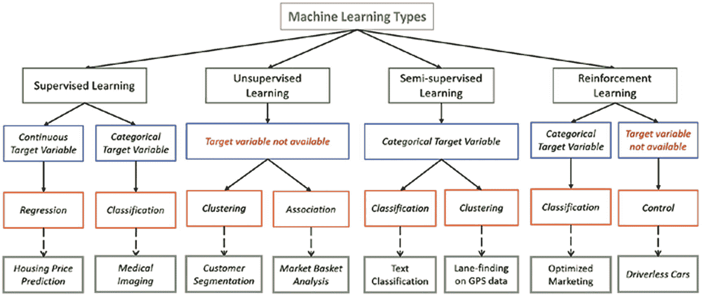

图 6-1

机器学习类型

### 6.1.1 监督学习

监督学习适用于具有响应变量（也称为标签）的数据集。响应变量可以是连续的，也可以是分类的。算法根据提供的预测变量集学习响应变量。例如，如果数据集属于一组患者，每个实例都会有一个响应变量来标识患者是否患有癌症（分类）。或者，在某个州或国家的房价数据集中，响应变量可能是房屋价格。

请记住，清晰地定义问题（当我们稍后在本章讨论实际用例时，定义问题会更清晰）对于我们从正确的方向开始至关重要。此外，如果响应变量是分类的，则问题是分类任务；如果是连续的，则是回归任务。尽管这条规则在大多数情况下基本成立，但某些问题同时包含分类和回归。在银行业，一个重要的模型是预测客户是否会拖欠贷款。使用客户过去的示例进行监督学习，将学习到违约客户与非违约客户的模式。我们将在解释*逻辑回归*（一种监督学习算法）时讨论这个例子。

### 6.1.2 无监督学习

对于没有响应变量的数据集，无法从预测变量中进行学习，换句话说，学习必须是无监督的。学习基于数据集中每行之间的某种相似性或距离度量进行。无监督学习中最常用的技术是*聚类*。其他方法，如关联规则挖掘（ARM），则基于事件的频率，例如市场购物篮中的购买、日志挖掘中的服务器崩溃等。无监督学习的一些应用包括市场营销中的客户细分、社交网络分析、图像分割、气候学等。在本书中，我们使用店铺面积、草坪面积等变量来解释房屋的价值（或价格）。这些数据将与 k-means 和层次聚类等算法一起使用。

### 6.1.3 半监督学习

在前两种类型中，数据集中要么所有观测值都没有标签，要么所有观测值都有标签。半监督学习处理的是响应变量部分填充的数据集。在许多实际情况下，标记成本相当高，因为这需要熟练的人类专家来完成。因此，当大多数观测值缺少标签而少数观测值有标签时，半监督算法是构建模型的最佳候选。这些方法利用了这样一个想法：即使未标记数据的组成员身份未知，这些数据也携带了关于组参数的重要信息。关于这个主题最广泛的文献由 Chapelle, O. 等人在《半监督学习》一书中提供（MIT Press, Cambridge, MA）^(¹)。

### 6.1.4 强化学习

监督学习和无监督学习算法都需要干净、准确的数据才能产生最佳结果。此外，数据需要全面，以便处理未见过的实例。例如，如果基于患者病史预测癌症的问题没有包含特定类型癌症的数据，那么该算法在实时部署时会产生许多误报。强化学习是理想的选择，适用于仅提供数据的初始状态作为输入，并且没有单一可能响应，而是有多种可能结果的情况。机器人技术和无人驾驶汽车的创新都源于这类机器学习算法。强化学习算法以迭代方式从环境中持续学习。在此过程中，它从与环境的交互经验中学习，直到探索完所有可能的状态范围。强化学习算法的一些应用包括计算机对弈棋盘游戏（国际象棋、围棋）、机械手和自动驾驶汽车。

对半监督学习和强化学习算法的详细讨论超出了本书的范围；但是，我们会在必要时引用它们。


## 6.2 机器学习算法分组

机器学习算法可根据方法相似性和算法输出进行分组。这将有助于你在同一组内为更多样化的问题创建用例。以这种方式组织算法的另一个好处是便于使用 R 语言库，这些库被设计为将所有相关/相似的函数包含在单个库中。这有助于用户使用单个库探索某个问题的所有选项/诊断方法。随着学术界和工业界不断涌现新的用例，这个列表也在不断扩展。我们指出了本书涵盖了其中哪些算法，并鼓励你从其他来源探索更多内容。


图 6-12

文本挖掘算法

*   *文本挖掘：* 也称为文本分析，是自然语言处理的一个子领域，而自然语言处理又是机器学习的一个子领域。它提供了某些算法和方法来处理非结构化的文本数据，这些数据通常来自呼叫中心日志、客户评论等。该组中的算法可以处理高度非结构化的文本数据，以提取洞察和/或创建用于应用机器学习算法的特征。我们将讨论文本摘要、情感分析、词云和主题识别。见图 6-12。

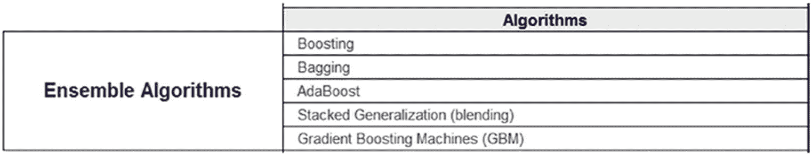

图 6-11

集成学习

*   *集成学习：* 这是一组通过组合多个机器学习算法的结果而构建的算法。这些方法因其能够提供优越的结果以及可以分解为独立模型在分布式网络上进行训练的可能性而变得非常流行。我们将在第 8 章讨论装袋、提升、堆叠和混合集成。见图 6-11。

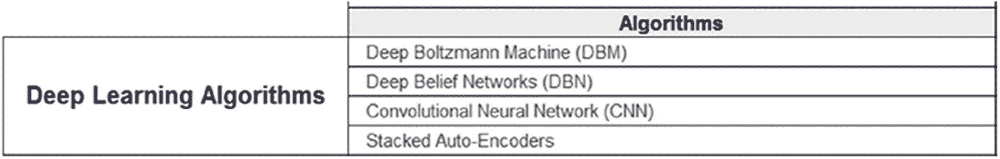

图 6-10

深度学习算法

*   *深度学习：* 这些算法基于复杂的神经结构，可以从海量数据集中抽象出更高级别的信息。它们计算量大且难以训练。简单来说，你可以将它们视为具有多个隐藏层的非常大的神经网络。我们专门用第 11 章来介绍深度学习。见图 6-10。

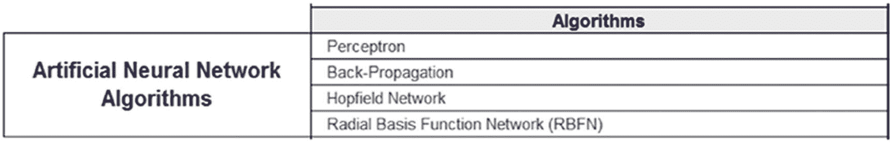

图 6-9

人工神经网络

*   *人工神经网络（ANN）：* 受生物神经网络启发，它们足够强大，可以学习非线性关系并识别变量之间的高阶关系。它们可以实现监督和无监督学习过程。传统神经网络与深度学习神经网络（本章稍后讨论）的复杂性之间存在显著差异。本章我们将讨论感知器和反向传播。见图 6-9。


图 6-8

关联规则挖掘

*   *关联规则挖掘：* 在这些算法中，观察变量之间的关系，并用于量化这种关系，以实现预测和探索性目标。这些方法已被证明对于构建和挖掘大型多维数据集之间的关系非常有用。流行的推荐系统基于关联规则挖掘算法的某些变体。本章我们将讨论 Apriori 和 Eclet 算法。见图 6-8。

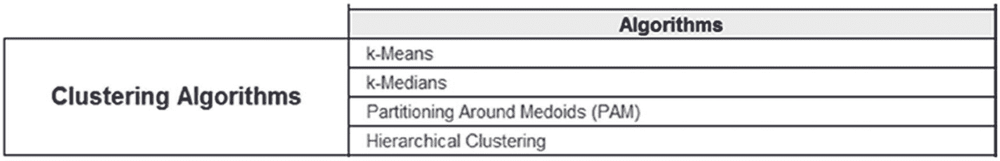

图 6-7

聚类算法

*   *聚类算法：* 这些算法通常基于最大化簇内相似性和最小化簇间相似性的简单原理。相似性的度量决定了簇的形成方式。它们在市场营销和人口统计学研究中非常有用。大多数情况下，这些是无监督算法，它们将数据分组以实现最大共性。我们将讨论 k-means、期望最大化算法和层次聚类。我们还将讨论分布式聚类。见图 6-7。

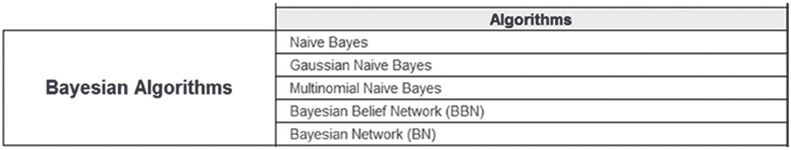

图 6-6

贝叶斯算法

*   *贝叶斯算法：* 这些算法可能不被称为学习算法，因为它们基于贝叶斯定理的先验和后验分布。机器本质上不是通过迭代过程学习，而是利用变量分布的推断。这些方法非常流行且易于解释，主要用于分类和推断测试。本章我们将介绍朴素贝叶斯模型，并引入概率的基本概念来解释它们。见图 6-6。

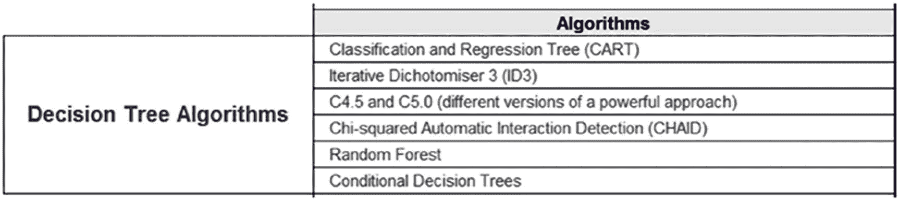

图 6-5

决策树算法

*   *基于树的算法：* 这些算法基于应用于实际数据的顺序条件规则。这些规则通常是串行应用的，当满足所有条件时，做出分类决策。这些方法在决策引擎和分类问题中非常流行。它们是快速且分布式的算法。本章我们将讨论 CART、迭代二分器、CHAID 和 C5.0 等算法，并在第 8 章中使用它们来训练我们的集成模型。见图 6-5。

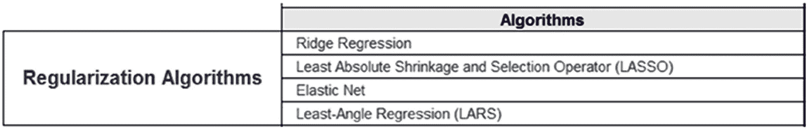

图 6-4

正则化算法

*   *正则化方法：* 正则化方法本质上是回归方法的扩展。正则化算法向损失函数（如第 5 章所述）引入一个惩罚项，以平衡模型的复杂度和结果的改进。在处理具有大量特征和大数据量的数据时，它们是非常强大且有用的技术。我们在第 5 章中介绍了 L1 正则化，作为变量子集选择的一种嵌入方法。见图 6-4。

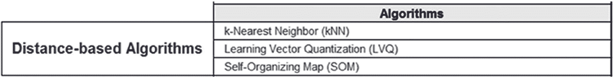

图 6-3

基于距离的算法


*   *基于距离的算法：* 基于距离或基于事件的算法用于学习数据的表示，并创建一种度量标准，以识别对象是否属于目标类别。它们有时被称为基于记忆的学习，因为它们从数据中捕获的一组实例/事件中学习。在第 8 章中，我们使用 K 近邻和学习向量量化来创建集成模型。见图 6-3。

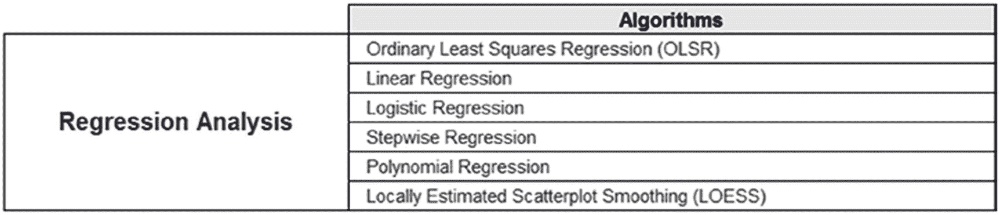

图 6-2

回归算法

*   *基于回归的方法：* 基于回归的方法在学术界和研究中最为流行且应用广泛。它们易于解释，也易于部署到实际生产环境中。在这类方法中，因变量与一组自变量之间的关系通过概率方法或误差函数最小化来估计。本章将涵盖线性回归、多项式回归和逻辑回归。见图 6-2。

所讨论的算法列表在 R、Python 和其他统计软件包中有多种实现。并非所有方法都有现成的 R 包可供实现。某些算法在 R 环境中未得到完全支持，必须通过调用 API 来使用，例如文本挖掘和深度神经网络。研究界正致力于通过软件包或 API 将所有最新算法引入 R。

Torsten Hothorn 维护了一份详尽的 R 语言中可用于实现机器学习算法的软件包列表。（参考：CRAN 任务视图：机器学习与统计学习，网址为[`https://cran.r-project.org/web/views/MachineLearning.html`](https://cran.r-project.org/web/views/MachineLearning.html) 。）

我们建议您密切关注此列表，并持续跟进最新的软件包发布。在下一节中，我们将简要分类介绍本章及后续章节中用于 R 演示的所有真实世界数据集。

## 6.3 真实世界数据集

在本章中，我们将使用许多真实世界数据集并构建用例，以演示各种机器学习算法。在开始使用 R 进行演示之前，本节将简要介绍与每个用例相关的数据集分类。

### 6.3.1 房屋销售价格

房屋的售价取决于许多变量；该数据集提供了一系列因素来预测售价。表 6-1 展示了该房屋销售价格数据集的元数据。

**表 6-1** *房屋销售价格数据集* 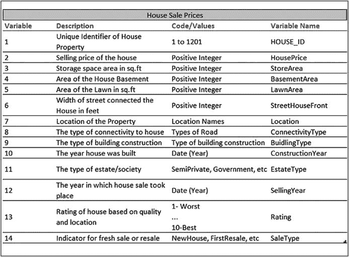

### 6.3.2 购买偏好

该数据包含购买了特定产品的客户的交易历史。对于每个`customer_ID`，模拟了多个数据点以捕捉购买行为。该数据最初用于解决多类模型问题，涉及保险行业的四种可能产品。这些特征具有足够的通用性，因此可以适用于其他行业，如汽车或零售业，在这些行业中，您可能拥有关于汽车购买、消费品等数据。见表 6-2。

**表 6-2** *购买偏好* 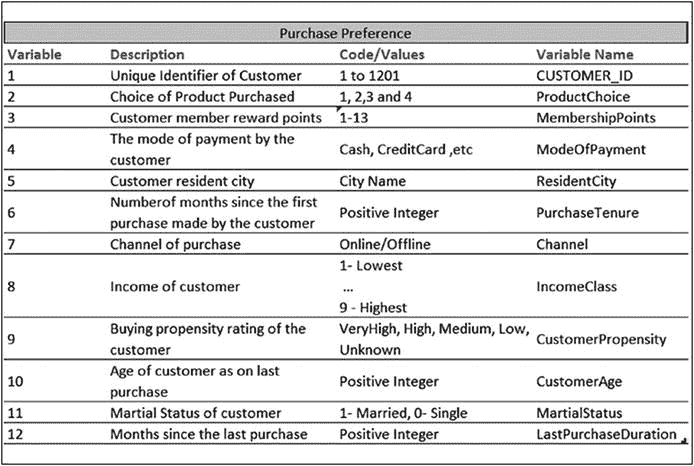

### 6.3.3 Twitter 推送与文章

我们收集了一些 Twitter 推送，以便为应用文本挖掘算法生成结果。这些推送取自截至 2016 年 9 月 30 日的国家新闻频道 Twitter 账户。使用的账户是`@TimesNow`和`@CNN`。互联网上的一篇文章被用于摘要生成。原文可在[`http://www.yourarticlelibrary.com/essay/essay-on-india-after-independence/41354/`](http://www.yourarticlelibrary.com/essay/essay-on-india-after-independence/41354/)找到。

### 6.3.4 乳腺癌

我们将使用来自 UCI 机器学习库的威斯康星州乳腺癌（诊断）数据集。该数据集中的特征是根据乳腺肿块细针穿刺（FNA）的数字化图像计算得出的。除第一个和最后一个变量外，每个变量都被转换为 11 个原始数值属性，其值范围从 0 到 10。它们描述了图像中存在的细胞核的特征。表 6-3 列出了可用的特征。

**表 6-3** *威斯康星州乳腺癌* 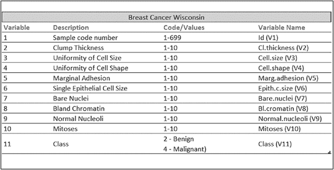

### 6.3.5 购物篮

我们将使用来自一家小超市的真实世界数据。该数据的每一行都包含一个客户交易，以及他们购买的产品列表（从现在起，我们将使用术语*物品*）。由于典型超市中的物品种类过多，我们已将其汇总到类别级别。例如，“烘焙用品”涵盖了多种不同的产品，如面团、小苏打、黄油等。为了便于说明，让我们取数据的一个小子集，该子集包含五笔交易和九种物品，如表 6-4 所示。

**表 6-4** *购物篮数据* 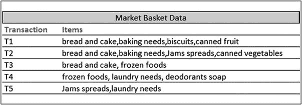

### 6.3.6 亚马逊食品评论

亚马逊美食评论数据集包含截至 2012 年 10 月亚马逊用户留下的 568,454 条食品评论。本章将使用该数据的一个子集进行文本挖掘方法，以展示文本摘要、分类和词性提取。表 6-5 包含了亚马逊美食评论数据集的元数据。

**表 6-5** *亚马逊食品评论* 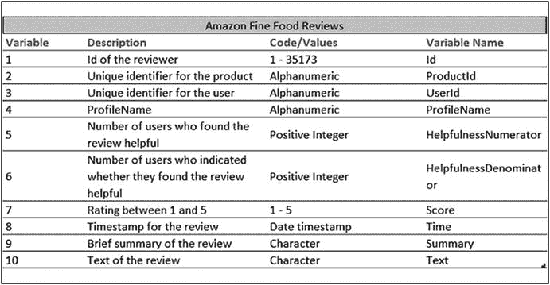

本章的其余部分将根据前面讨论的分组，讨论每一种机器学习算法，并通过讨论统计背景、在 R 中进行演示以及使用真实世界用例，对每种算法进行一致的阐述。


## 6.4 回归分析

在前面的章节中，我们一直在为建模技术能够服务于我们的预期目标奠定基础。本章将涉及统计学习和机器学习领域中一些开箱即用的技术。在这个阶段，你可能希望专注于算法方法，而不必过多担心统计假设在机器学习算法中扮演的角色。为了完整性，我们将在第 8 章讨论统计学习与机器学习的区别。

回归分析部分将侧重于构建一个思维过程，探讨建模技术如何建立并量化响应变量与预测变量之间的关系。我们将首先识别它们之间关系的强度和类型，并尝试判断这种关系是否可以用某种分布假设（如正态分布）来建模。我们还将讨论一些流行技术的重要诊断特征，并解释它们在模型选择中的意义。

这些技术的核心在于寻找具有统计显著性且不依赖于任何分布假设的关系。这些技术并不建立因果关系（最好用“强关联并非因果关系的证明”这一概念来理解），但能为数据科学家提供指示，说明在给定某些参数假设下数据序列是如何关联的。因果关系的建立取决于对过程的审慎判断和业务理解。

牢记因果关系的概念很重要，因为大多数时候我们的思维过程会偏离模型所量化关系的解释方式。例如，一个统计模型能够量化完全无关的度量之间的关系，比如发电量和啤酒消费量。线性模型能够量化它们之间的关系。但啤酒消费量与发电量有关吗？或者发电量增加意味着啤酒消费量增加吗？除非你非常努力地去证明，否则很难证实。因此，对讨论中的过程有清晰的理解以及具备领域知识至关重要。你必须质疑假设，才能从数据中获取真正的价值。在讨论回归中的相关性及其他概念时，必须牢记这种因果关系的“诅咒”。

任何回归分析都涉及三个关键变量集：

*   **因变量或响应变量 (Y)**：输入序列
*   **自变量或预测变量 (X)**：输入序列
*   **模型参数**：需要由回归模型估计的未知参数

对于多个自变量和一个因变量的情况，这些量可以被视为一个矩阵。

回归关系可以表示为一个函数，该函数从自变量空间映射到因变量空间。这种关系是预测/预报的基础：

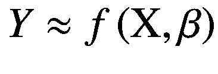

这种表示法看起来更像数学建模，而统计建模学者对同一关系使用略有不同的表示法：

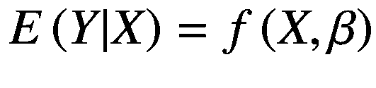

在统计建模中，回归分析估计的是在已知自变量值条件下因变量的条件期望，这本质上就是给定自变量值时因变量的平均值。在扩展回归概念之前，需要理解的另一个重要概念是参数方法和非参数方法。本节的讨论将基于参数方法，而还存在其他一系列非参数技术。

*   ***参数方法*** 假设样本数据是基于一组固定参数从已知的概率分布中抽取的。例如，线性回归假设正态分布，而逻辑回归假设二项分布等。这一假设使得这些方法也能应用于小数据集。
*   ***非参数方法*** 不预先假设任何概率分布，而是从底层数据中构建经验分布。这些方法需要大量数据来进行模型估计。存在一个单独的非参数回归分支，这超出了本书的范围，例如核回归、非参数乘法回归（NPMR）等。关于此主题的更多阅读资料，推荐 Stuart Russell 和 Peter Norvig 所著的《人工智能：一种现代方法》^(²)。

此外，使用参数方法可以让你轻松地围绕估计参数构建置信区间；我们将在模型诊断度量中使用这一点。在本书中，我们将处理两种类型的输入数据——具有正态性假设的连续输入和具有二项分布假设的逻辑回归。此外，还将提供一个关于广义框架的简要入门介绍，供进一步阅读。


## 6.5 相关分析

> *统计科学的目标在于发现一些方法，将关于大量相关事实的信息浓缩成简洁且便于讨论的表达形式。*
> 
> ——弗朗西斯·高尔顿爵士（1822-1911）

相关性可被视为一个更广义的术语，用于表示两个变量之间的统计关系。原则上，相关性提供了变量间关系的单一度量。由于关系量化的方式有多种，因此统计学中存在着多种类型的相关系数。

对于测量线性关系，皮尔逊相关系数是最佳度量。皮尔逊相关系数，也称为皮尔逊*积矩相关系数*，对线性关系敏感。它同样存在于非线性关系中，但在这种情况下无法提供任何有用信息。

假设有两个随机变量 X 和 Y，其均值分别为 μ[*X*] 和 μ[*Y*]，标准差分别为 *σ*[*X*] 和 *σ*[*Y*]。总体相关系数定义为：

![$$ \rho X,Y=\frac{\mathrm{E}\left[\left(X-{\mu}_X\right)\left(Y-{\mu}_Y\right)\right]}{\sigma_X{\sigma}_Y} $$](images/416805_2_En_6_Chapter/416805_2_En_6_Chapter_TeX_Equc.png)

由此我们可以推断出该度量的两个重要特征：

*   其取值范围在 -1（负相关）到 +1（正相关）之间，这可由柯西-施瓦茨不等式推导得出。
*   该度量仅在标准差有限且非零时才有定义。

类似地，对于来自总体的样本，该度量定义如下：


让我们用房价数据创建一些散点图，看看能使用皮尔逊相关系数量化出什么样的关系。

*因变量：* `HousePrice`

*自变量：* `StoreArea`

```
Data_HousePrice <-read.csv("Dataset/House Sale Price Dataset.csv",header=TRUE);
#Create a vectors with Y-Dependent, X-Independent
y <-Data_HousePrice$HousePrice;
x<-Data_HousePrice$StoreArea;
#Scatter Plot
plot(x,y, main="Scatterplot HousePrice vs StoreArea", xlab="StoreArea(sqft)", ylab="HousePrice($)", pch=19,cex=0.3,col="red")
#Add a fit line to show the relationship direction
abline(lm(y~x)) # regression line (y~x)
lines(lowess(x,y), col="green") # lowess line (x,y)
```

图 6-13 展示了 `HousePrice` 与 `StoreArea` 之间的散点图。曲线是局部平滑拟合线。可以看出变量之间存在线性关系。

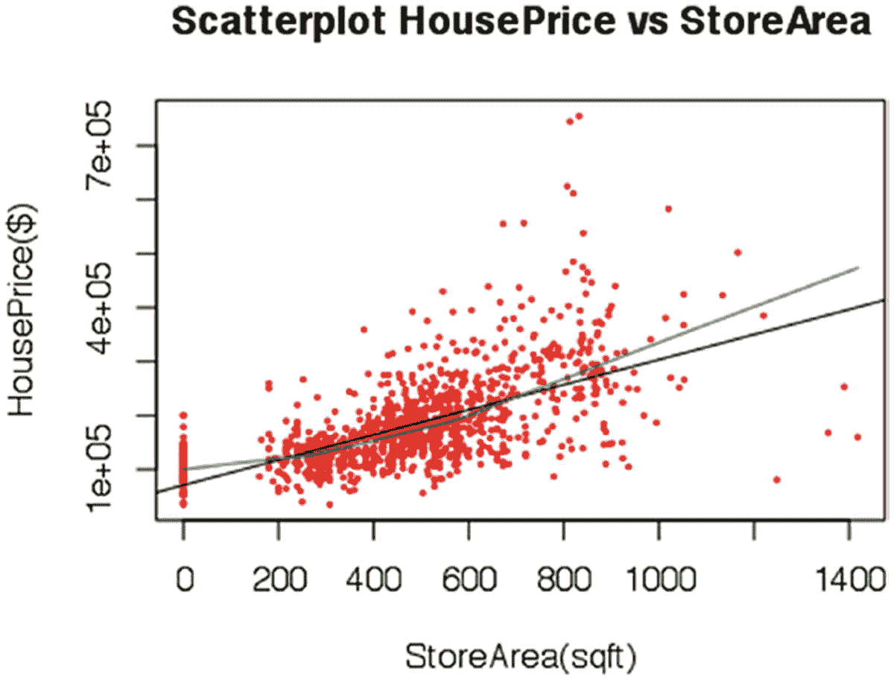

图 6-13

HousePrice 与 StoreArea 之间的散点图

```
#Report the correlation coefficient of this relation
cat("The correlation among HousePrice and StoreArea is  ",cor(x,y));
The correlation among HousePrice and StoreArea is   0.6212766
```

从这些图中，我们可以得出以下观察结果：

*   关系呈正方向，因此平均而言，房价随商店面积的增加而上涨。这是一种直观的关系，因此我们可以推断出因果关系。商店空间越大，房屋品质越好，这意味着价格更高。
*   相关系数为 0.62。在线性尺度上，这是一个中等强度的关系。
*   曲线是 LOWESS（局部加权散点图平滑）图，显示其与线性回归线差异不大。因此，线性关系值得在模型中进一步探索。
*   如果仔细观察，在 `StoreArea` = 0 处有一条垂直线。这条垂直线表明，对于没有商店面积的房屋，价格存在差异。我们需要考察驱动房价的其他因素。

我们已经详细讨论了如何找到最适合数据的变量集。因此，在接下来的章节中，我们将不再关注如何得到该模型，而是更多地展示如何在 R 中运行和解释它们。


### 6.5.1 线性回归

线性回归是一种拟合线性预测函数的过程，用于从基础数据中估计未知参数。通常，该模型预测给定 X 条件下 Y 的条件均值，该均值被假定为 X 的仿射函数。

> *仿射函数：由于线性回归估计模型包含截距项，因此它不仅仅是 X 的线性函数，而是仿射函数。*

本质上，线性回归模型将帮助你实现以下目标：

*   预测或预报
*   量化变量之间的关系

前者涉及如果存在某些未知的 X，那么 Y 的期望值是多少；后者则处理历史数据，以可量化的术语（例如参数和 p 值）说明这些变量之间的关系。

在数学上，简单的线性关系如下所示：

对于一组 *n* 个二元组 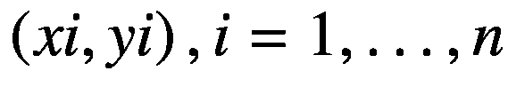，关系函数描述为：

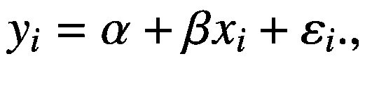

线性回归的目标是估计这条直线：

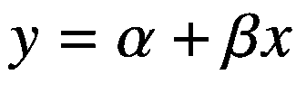

其中 *y* 是预测响应（或拟合值），α 是截距，即当自变量为零时的平均响应值，β 是 x 的参数，即 *x* 每变化一个单位时 *y* 的变化量。

有多种方法可以用给定的数据集拟合这条直线。这取决于我们想要最小化的损失函数类型，例如普通最小二乘法、最小绝对偏差法、岭回归等。让我们看看最常用的方法——普通最小二乘法（OLS）。

在 OLS 中，算法最小化平方误差。该最小化问题可以定义如下：

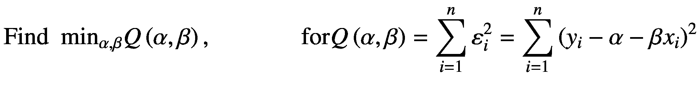

作为一种参数化方法，我们可以得到这个优化问题的闭式解。估计系数（或参数）的闭式解使用以下公式：

![$$ \overline{\beta}=\frac{\sum {x}_i{y}_i-\frac{1}{n}\sum {x}_i\sum {y}_i}{\sum {x}_i²-\frac{1}{n}{\left(\sum {x}_i\right)}²}=\frac{\mathrm{Cov}\left[x,y\right]}{\sigma_x²},\kern1.75em \overset{\frown }{\alpha }=\overline{y}-\overline{\beta}\overline{x}. $$](images/416805_2_En_6_Chapter/416805_2_En_6_Chapter_TeX_Equh.png)

其中，*σ*²[*x*] 是 x 的方差。该解的推导过程可在以下网址找到：

[`https://onlinecourses.science.psu.edu/stat414/node/278`](https://onlinecourses.science.psu.edu/stat414/node/278) 。

在对残差满足某些假设的条件下，OLS 对线性回归模型具有特殊性质。卡尔·弗里德里希·高斯和安德雷·马尔可夫共同提出了高斯-马尔可夫定理，该定理指出，如果满足以下条件：

*   残差的期望（均值）为零（残差正态性）
*   残差不相关（无自相关）
*   残差具有相等方差（同方差性）

那么普通最小二乘估计能给出系数（或参数估计）的最佳线性无偏估计。我们现在解释构成最佳估计量的关键术语，即无偏性、一致性和有效性。

### 6.5.2 简单线性回归

现在我们可以继续使用 OLS 技术来估计线性模型。R 中的 `lm()` 包为我们提供了对线性回归运行 OLS 的能力。`lm()` 函数可用于执行回归、单层方差分析和协方差分析。它是 R 基础 `stats()` 包的一部分。

现在，我们将创建一个简单线性回归，并理解如何解释这个简单案例中 `lm()` 的输出。这里我们使用 OLS 技术对以下内容拟合线性回归模型。

*因变量：* `HousePrice`

*自变量：* `StoreArea`

此外，我们的相关性分析表明这两个变量具有正线性关系，因此我们预期 `StoreArea` 的参数估计值为正。让我们运行并解释结果。

```
# 拟合模型
fitted_Model |t|)
(Intercept) 70677.227   4261.027   16.59   <2e-16 ***
x             232.723      8.147   28.57   <2e-16 ***

Signif. codes:  0 '***' 0.001 '**' 0.01 '*' 0.05 '.' 0.1 ' ' 1
Residual standard error: 63490 on 1298 degrees of freedom
Multiple R-squared:  0.386,  Adjusted R-squared:  0.3855
F-statistic:   816 on 1 and 1298 DF,  p-value: < 2.2e-16
```

我们示例的估计方程为：

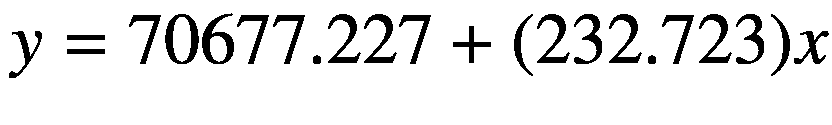

其中 *y* 是 `HousePrice`，*x* 是 `StoreArea`。这意味着 *x*（`StoreArea`）每增加一个单位，*y*（`HousePrice`）将增加 232.72 美元。截距是常数，告诉我们当 `StoreArea` 为零时的 `HousePrice`，可以将其视为注册费。

让我们讨论一下 `lm()` 的摘要输出，以便更好地理解模型。同样的解释可以扩展到下一节中的多元线性回归。

*   *Call*：输出在 `lm()` 函数中拟合的模型方程。
*   *Residuals*：给出残差的四分位距，以及残差的最小值、最大值和中位数。中位数为负意味着至少一半的残差为负，即在超过 50% 的预测中，预测值大于实际值。
*   *Coefficients*：这是一个表格，给出模型参数估计值（或系数）、标准误差、t 值和学生 t 检验的 p 值。
*   *Diagnostics*：残差标准误差、多重 R 方、调整 R 方以及用于方差检验的 F 统计量。

扩展 `lm()` 摘要输出中的系数部分非常重要。该输出提供了关于模型预测变量及其系数的重要信息：

*   *Estimate*：该参数的拟合值。该值直接用于模型方程进行预测，并理解与因变量的关系。例如，在我们的模型中，预测变量 x（商店面积）的系数为 232.7。
*   *Standard Error (std. Error)*：参数估计分布的标准差。换句话说，估计值是系数的均值，其标准差就是标准误差。标准误差可以计算为：

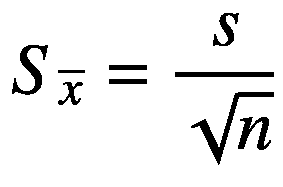

其中 *s* 是样本标准差，*n* 是样本大小。

相对于估计值，标准误差越小，模型估计越好。

*   *t-value and p-value*：学生 t 检验是一种假设检验，用于检验检验统计量是否服从 t 分布。从统计学上讲，针对每个参数报告的 p 值是单样本 t 检验的 p 值。

我们检验该参数的值在统计上是否显著不为零。如果我们无法拒绝原假设，那么我们可以说相应的参数在我们的模型中不显著。

*   单样本 t 检验的 t 统计量如下：

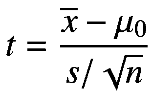


其中  是样本均值，*s* 是样本的标准差，*n* 是样本量。对于我们的线性模型，*x* 的 t 值为 28.57，p 值约为 0。这意味着 *x* 的估计值不为 0，因此它在模型中具有显著性。

一旦我们理解了模型的形式以及每个预测变量的显著性，我们就会继续查看模型对实际值的拟合情况。这通过绘制实际值与预测值的对比图来完成：

```
res <-stack(data.frame(Observed = y, Predicted =fitted(fitted_Model)))
res <-cbind(res, x =rep(x, 2))
#使用 lattice 的 xyplot 函数绘图
library("lattice")
xyplot(values ~x, data = res, group = ind, auto.key =TRUE)
```

图 6-14 展示了拟合值与实际值的对比。你可以看到，该图显示了模型预测的线性关系，并与原始数据的散点图叠加在一起。

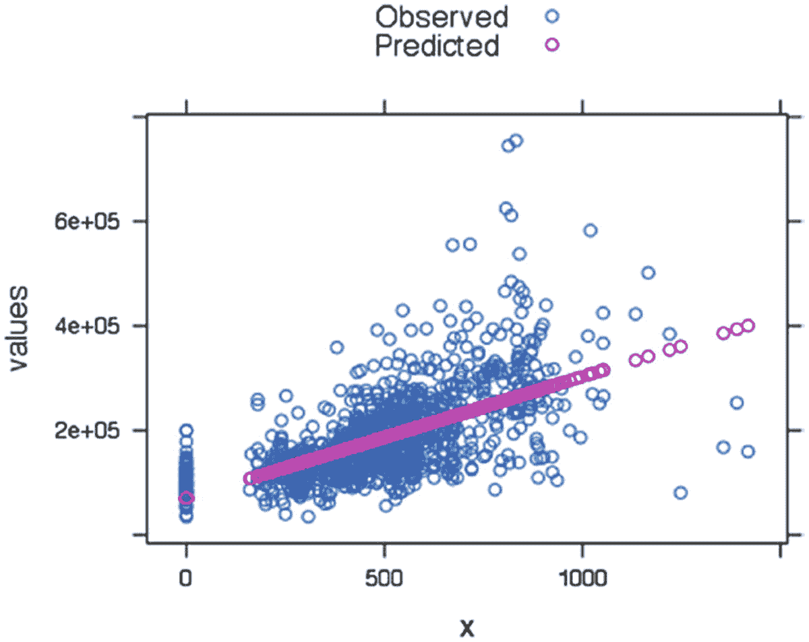

图 6-14

实际值与预测值的散点图

现在，这是一个仅包含一个解释变量（`StoreArea`）的模型，但还有其他可用变量与 `HousePrices` 显示出显著关系。回归框架允许我们在回归分析中添加多个解释变量或自变量。我们将在下一节介绍多元线性回归。

### 6.5.3 多元线性回归

简单线性回归的思想可以扩展到多个自变量。多元线性回归中的线性关系变为：

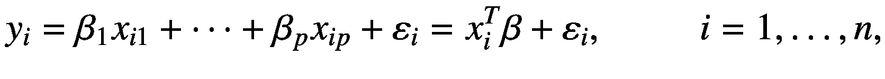

对于多元回归，矩阵表示法非常流行，因为它使得矩阵计算的概念易于解释。

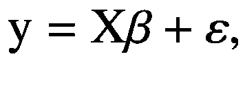

在我们之前的示例中，我们只使用了一个变量 `StoreArea` 来解释因变量。在多元线性回归中，我们将使用 `StoreArea`、`StreetHouseFront`、`BasementArea`、`LawnArea`、Rating 和 `SaleType` 作为自变量，来估计与 `HousePrice` 的线性关系。

最小二乘估计函数保持不变，只是会有新的变量作为预测变量。为了对多个变量进行分析，我们引入了一个额外的数据清洗步骤：缺失值识别。我们要么对缺失值进行插补，要么将其排除在分析之外。我们选择使用 R 中的 `na.omit()` 函数将其排除。以下代码首先查找缺失的案例，然后将其删除。

```
# 使用 lm 创建多元线性回归
Data_lm_Model <-Data_HousePrice[,c("HOUSE_ID","HousePrice","StoreArea","StreetHouseFront","BasementArea","LawnArea","Rating","SaleType")];
# 下面的函数显示数据中每个变量的缺失值数量
sapply(Data_lm_Model, function(x) sum(is.na(x)))
HOUSE_ID       HousePrice        StoreArea StreetHouseFront
0                0                0              231
BasementArea         LawnArea           Rating         SaleType
0                0                0                0
# 我们选择删除 StreetHouseFront 中对应缺失值的 231 个案例。Na.omit 函数将删除这些缺失案例。
Data_lm_Model <-na.omit(Data_lm_Model)
rownames(Data_lm_Model) <-NULL
# 分类变量需要设置为因子
Data_lm_Model$Rating <-factor(Data_lm_Model$Rating)
Data_lm_Model$SaleType <-factor(Data_lm_Model$SaleType)
```

现在我们已经清理了数据中的缺失值，可以运行 `lm()` 函数来拟合我们的多元线性回归模型。

```
fitted_Model_multiple <-lm(HousePrice ~StoreArea +StreetHouseFront +BasementArea +LawnArea +Rating +SaleType, data =Data_lm_Model)
summary(fitted_Model_multiple)
Call:
lm(formula = HousePrice ~StoreArea +StreetHouseFront +BasementArea +LawnArea +Rating +SaleType, data =Data_lm_Model)
Residuals:
Min       1Q   Median       3Q      Max
-155003   -24744    -3166    20789   199636
Coefficients:
Estimate Std. Error t value Pr(>|t|)
(Intercept)           2.507e+04  4.827e+04   0.519  0.60352
StoreArea             5.462e+01  7.550e+00   7.234 9.06e-13 ***
StreetHouseFront      1.353e+02  6.042e+01   2.240  0.02529 *
BasementArea          2.145e+01  3.004e+00   7.140 1.74e-12 ***
LawnArea              1.026e+00  1.721e-01   5.963 3.39e-09 ***
Rating2              -8.385e+02  4.816e+04  -0.017  0.98611
Rating3               2.495e+04  4.302e+04   0.580  0.56198
Rating4               3.948e+04  4.197e+04   0.940  0.34718
Rating5               5.576e+04  4.183e+04   1.333  0.18286
Rating6               7.911e+04  4.186e+04   1.890  0.05905 .
Rating7               1.187e+05  4.193e+04   2.830  0.00474 **
Rating8               1.750e+05  4.214e+04   4.153 3.54e-05 ***
Rating9               2.482e+05  4.261e+04   5.825 7.61e-09 ***
Rating10              2.930e+05  4.369e+04   6.708 3.23e-11 ***
SaleTypeFirstResale   2.146e+04  2.470e+04   0.869  0.38512
SaleTypeFourthResale  6.725e+03  2.791e+04   0.241  0.80964
SaleTypeNewHouse      2.329e+03  2.424e+04   0.096  0.92347
SaleTypeSecondResale -5.524e+03  2.465e+04  -0.224  0.82273
SaleTypeThirdResale  -1.479e+04  2.613e+04  -0.566  0.57160

Signif. codes:  0 '***' 0.001 '**' 0.01 '*' 0.05 '.' 0.1 ' ' 1
Residual standard error: 41660 on 1050 degrees of freedom
Multiple R-squared:  0.7644, Adjusted R-squared:  0.7604
F-statistic: 189.3 on 18 and 1050 DF,  p-value: < 2.2e-16
```

估计的模型有六个自变量，包括四个连续变量（`StoreArea`、`StreetHouseFront`、`BasementArea` 和 `LawnArea`）和两个分类变量（`Rating` 和 `SaleType`）。从 `lm()` 函数的结果可以看出，`StoreArea`、`StreetHouseFront`、`BasementArea` 和 `LawnArea` 在 95% 的置信水平下是显著的，即统计上显著不为零。而 `SaleType` 的所有水平都不显著，因此统计上它们等于零。较高的评级是显著的，但较低的评级不显著。该模型应剔除 `SaleType` 并重新估计，以仅保留显著的变量。

现在，我们将通过按房价排序后的序列绘制实际值与预测值的对比图，来查看该模型的拟合效果。

```
# 获取拟合值并创建一个包含实际值和预测值的数据框
actual_predicted <-as.data.frame(cbind(as.numeric(Data_lm_Model$HOUSE_ID),as.numeric(Data_lm_Model$HousePrice),as.numeric(fitted(fitted_Model_multiple))))
names(actual_predicted) <-c("HOUSE_ID","Actual","Predicted")
# 按实际房价升序排列房屋
actual_predicted <-actual_predicted[order(actual_predicted$Actual),]
# 计算绝对残差，然后求其均值
library(ggplot2)
# 绘制测试案例的实际值与预测值对比图
ggplot(actual_predicted,aes(x =1:nrow(Data_lm_Model),color=Series)) +
geom_line(data = actual_predicted, aes(x =1:nrow(Data_lm_Model), y = Actual, color ="Actual")) +
geom_line(data = actual_predicted, aes(x =1:nrow(Data_lm_Model), y = Predicted, color ="Predicted"))  +xlab('房屋编号') +ylab('房屋销售价格')
```

图 6-15 展示了按 `HousePrice` 排序后的实际值和预测值。

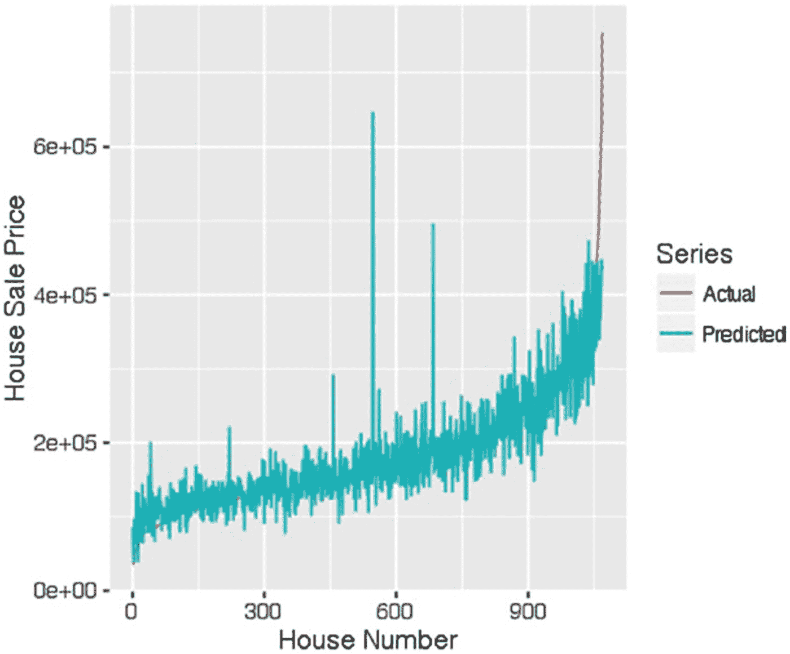

图 6-15

实际值与预测值对比图

我们按升序排列了房价，以便看到更清晰的实际值与预测值对比图。该图显示我们的模型紧密跟随实际价格。存在少数实际值中的异常值/高值情况，模型无法预测，但这没关系，因为我们的模型不受异常值影响。


### 6.5.4 模型诊断：线性回归

模型诊断是模型选择过程中的一个重要步骤。第 7 章讨论的模型性能评估与模型选择过程之间存在差异。在模型评估中，我们检查模型在未见数据（测试数据）上的表现；而在模型诊断/选择中，我们观察模型拟合本身在数据上的表现。这包括检查参数估计的 p 值显著性、正态性、自相关性、同方差性、影响点/异常点以及多重共线性。还有其他一些检验方法，用于检查模型在多大程度上符合统计假设、严格外生性、方差分析表等，但在接下来的章节中，我们只关注其中几个。

#### 6.5.4.1 影响点分析

在线性回归中，极端值可能会在估计过程中引发问题。少数高杠杆值会在估计量中引入偏差，并在残差中产生其他异常。因此，识别数据中的影响点非常重要。如果影响点看起来过于极端，我们必须将其作为*异常值*从分析中剔除。

我们将展示的一个特定统计量（以及其他统计量）是库克距离。该方法用于在进行 OLS 估计时，找出数据点影响力的估计值。

库克距离定义如下：

![$$ {D}_i=\frac{e_i²}{s²p}\left[\frac{h_i}{{\left(1-{h}_i\right)}²}\right], $$](images/416805_2_En_6_Chapter/416805_2_En_6_Chapter_TeX_Equn.png)

其中 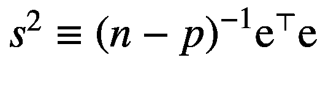 是回归模型的均方误差，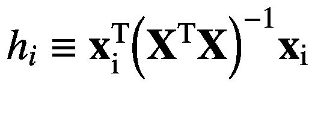，并且 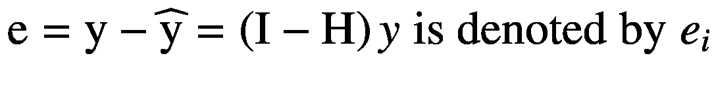

简单来说，库克距离衡量的是删除某个给定观测值所带来的影响。这样，如果删除某个观测值导致显著变化，就意味着这些点正在影响回归模型。这些点会被赋予一个较大的库克距离值，并被视为需要进一步调查的对象。

该统计量的临界值可以取为 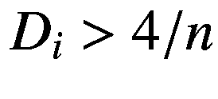，其中 *n* 是观测值的数量。如果根据模型中的参数数量进行调整，则临界值可以取为 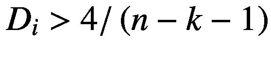，其中 *k* 是模型中的变量数量。

```
library(car);
Influential Observations
# Cook's D plot
# identify D values > 4/(n-k-1)
cutoff <-4/((nrow(Data_lm_Model)-length(fitted_Model_multiple$coefficients)-2))
plot(fitted_Model_multiple, which=4, cook.levels=cutoff)
```

图 6-16 中的图表显示了数据集中每个观测值的库克距离。

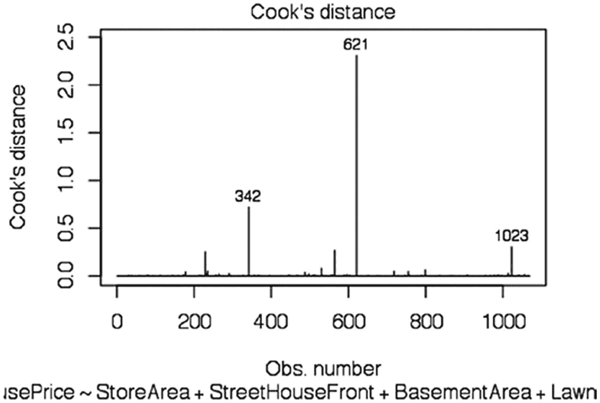

图 6-16

每个观测值的库克距离

您可以在图 6-16 的图表中看到，库克距离较高的观测值编号已被突出显示。这些观测值需要进一步调查。

```
# Influence Plot
influencePlot(fitted_Model_multiple,    id.method="identify", main="Influence Plot", sub="Circle size is proportional to Cook's Distance",id.location =FALSE)
```

图 6-17 中的图表展示了库克距离的另一种视图。圆圈大小与库克距离成正比。

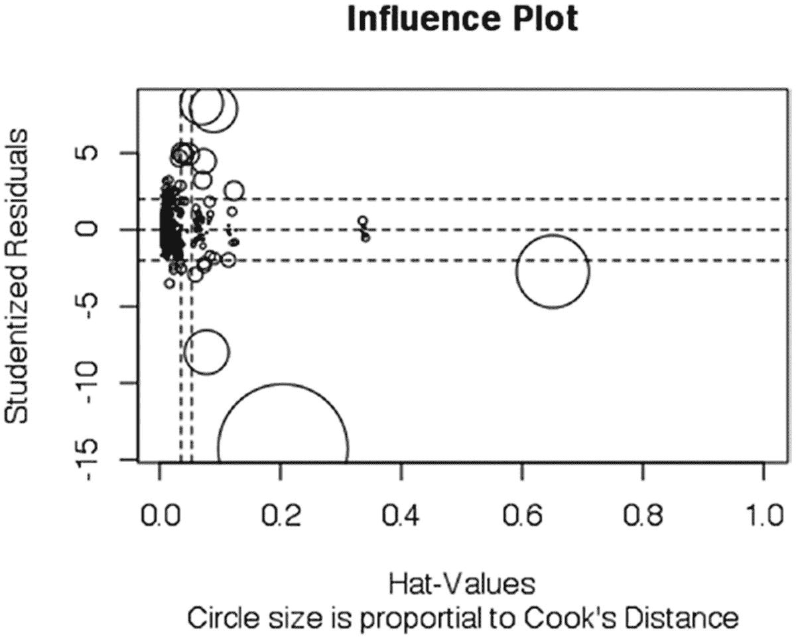

图 6-17

影响图

此外，异常值检验结果如下所示：

```
#Outlier Plot
outlier.test(fitted_Model_multiple)
rstudent unadjusted p-value Bonferonni p
621  -14.285067         1.9651e-42   2.0987e-39
229    8.259067         4.3857e-16   4.6839e-13
564   -7.985171         3.6674e-15   3.9168e-12
1023   7.902970         6.8545e-15   7.3206e-12
718    5.040489         5.4665e-07   5.8382e-04
799    4.925227         9.7837e-07   1.0449e-03
235    4.916172         1.0236e-06   1.0932e-03
487    4.673321         3.3491e-06   3.5768e-03
530    4.479709         8.2943e-06   8.8583e-03
```

如图 6-17 所示，观测值编号 342、621 和 1023（对应于 `HOUSE_ID` 412、759 和 1242）是三个主要的影响点。让我们提取这些记录，看看它们具有哪些值。

```
#Pull the records with highest leverage
Debug <-Data_lm_Model[c(342,621,1023),]
print(" The observed values for three high leverage points");
[1] " The observed values for three high leverage points"
Debug
HOUSE_ID HousePrice StoreArea StreetHouseFront BasementArea LawnArea
342       412     375000       513              150         1236   215245
621       759     160000      1418              313         5644    63887
1023     1242     745000       813              160         2096    15623
Rating     SaleType
342       7     NewHouse
621      10  FirstResale
1023     10 SecondResale
print("Model fitted values for these high leverage points");
[1] "Model fitted values for these high leverage points"
fitted_Model_multiple$fitted.values[c(342,621,1023)]
342      621     1023
441743.2 645975.9 439634.3
print("Summary of Observed values");
[1] "Summary of Observed values"
summary(Debug)
HOUSE_ID        HousePrice       StoreArea      StreetHouseFront
Min.   : 412.0   Min.   :160000   Min.   : 513.0   Min.   :150.0
1st Qu.: 585.5   1st Qu.:267500   1st Qu.: 663.0   1st Qu.:155.0
Median : 759.0   Median :375000   Median : 813.0   Median :160.0
Mean   : 804.3   Mean   :426667   Mean   : 914.7   Mean   :207.7
3rd Qu.:1000.5   3rd Qu.:560000   3rd Qu.:1115.5   3rd Qu.:236.5
Max.   :1242.0   Max.   :745000   Max.   :1418.0   Max.   :313.0
BasementArea     LawnArea          Rating          SaleType
Min.   :1236   Min.   : 15623   10     :2   FifthResale :0
1st Qu.:1666   1st Qu.: 39755   7      :1   FirstResale :1
Median :2096   Median : 63887   1      :0   FourthResale:0
Mean   :2992   Mean   : 98252   2      :0   NewHouse    :1
3rd Qu.:3870   3rd Qu.:139566   3      :0   SecondResale:1
Max.   :5644   Max.   :215245   4      :0   ThirdResale :0
(Other):0
```

请注意，这三个杠杆点的房价远高于平均值或高密度区域。其中两个观测值的房价分别对应数据集中的最高值和最低值。另一个有趣的现象是，第三个对应于房价中位数的观测值拥有非常高的草坪面积，这无疑是一个影响点。基于此分析，我们可以返回去检查这些是否为数据错误，或者选择在分析中忽略它们。


#### 6.5.4.2 残差的正态性

*残差*是回归模型诊断的核心。残差的正态性是模型成为有效线性回归模型的重要条件。简单来说，正态性意味着误差/残差是随机噪声，并且我们的模型已经捕获了数据中的所有信号。

线性回归模型给出了在给定 X 值下函数 Y 的条件期望。然而，拟合方程会存在一些残差。我们需要残差的期望服从均值为 0 或可缩减为 0 的正态分布。正态残差意味着模型推断（置信区间、模型预测变量的显著性）是有效的。

学生化残差（可视为归一化值）的分布是判断正态性假设是否成立的一个好方法。但我们可能仍然希望通过正态性检验（如 KS 检验、Shapiro-Wilk 检验、Anderson Darling 检验等）来正式检验残差。

此处，我们展示了正态分布的学生化残差图，该图应呈钟形曲线。

```
library(stats)
library(IDPmisc)
Loading required package: grid
library(MASS)
sresid <-studres(fitted_Model_multiple)
#Remove irregular values (NAN/Inf/NAs)
sresid <-NaRV.omit(sresid)
hist(sresid, freq=FALSE,
main="Distribution of Studentized Residuals",breaks=25)
xfit<-seq(min(sresid),max(sresid),length=40)
yfit<-dnorm(xfit)
lines(xfit, yfit)
```

图 6-18 中的图是使用学生化残差创建的。在上述代码中，残差通过 R 中的 `studres()` 函数进行学生化处理。

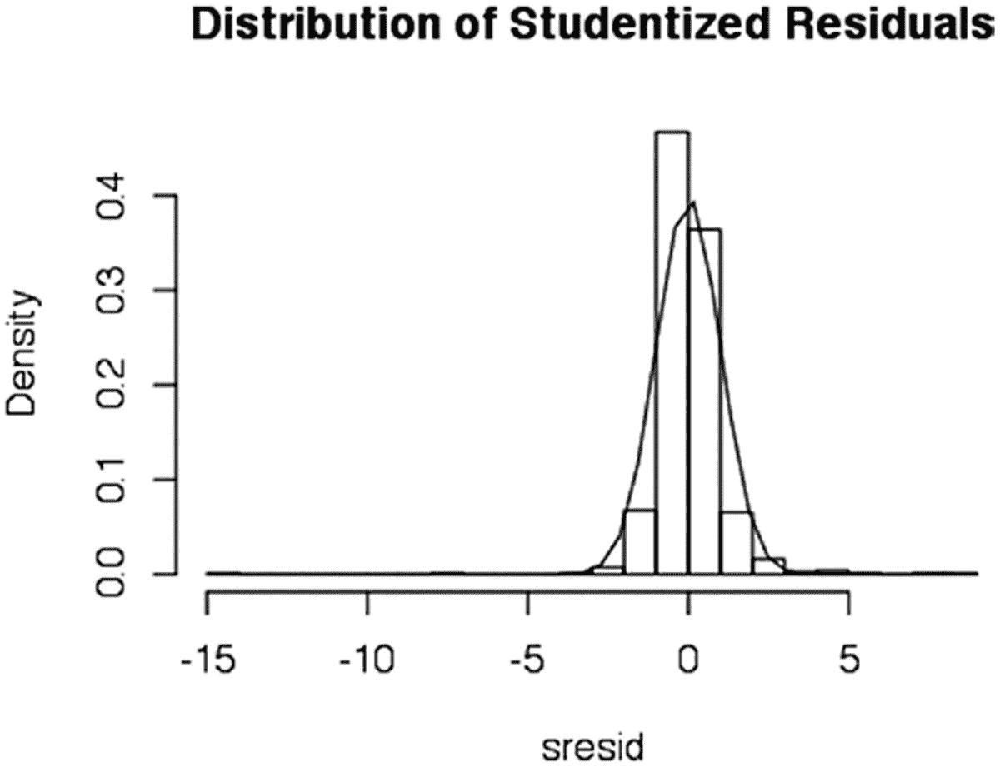

图 6-18

学生化残差的分布

残差图接近正态图，因为其分布呈钟形曲线。然而，我们仍然希望进行正态性的正式检验。我们将展示所有三种正态性检验的结果，但会正式介绍最流行的正态性检验——单样本 Kolmogorov-Smirnov 检验（KS 检验）的检验统计量。对于其余检验，我们鼓励您查阅此处所用函数的 R 小插图。它指向该主题最合适的参考资料。

现在，让我们正式介绍 KS 检验。对于给定的累积分布函数 F(x)，Kolmogorov–Smirnov 统计量定义为：

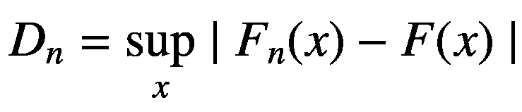

其中 *sup x* 是距离集合的最大值。

KS 统计量返回残差的经验分布与正态分布之间的最大差异。如果该最大值（`supremum`）大于某个临界值，则我们称该分布不是正态分布（使用检验统计量的 p 值）。这里我们进行了三个检验以验证结果的一致性：

```
# test on normality
#K-S one sample test
ks.test(fitted_Model_multiple$residuals,pnorm,alternative="two.sided")
One-sample Kolmogorov-Smirnov test
data:  fitted_Model_multiple$residuals
D = 0.54443, p-value < 2.2e-16
alternative hypothesis: two-sided
#Shapiro Wilk Test
shapiro.test(fitted_Model_multiple$residuals)
Shapiro-Wilk normality test
data:  fitted_Model_multiple$residuals
W = 0.80444, p-value < 2.2e-16
#Anderson Darling Test
library(nortest)
ad.test(fitted_Model_multiple$residuals)
Anderson-Darling normality test
data:  fitted_Model_multiple$residuals
A = 29.325, p-value < 2.2e-16
```

这三个检验均认为残差不服从正态分布。p 值均小于 0.05，因此我们可以拒绝分布为正态的原假设。这意味着我们必须回到模型中，看看是什么导致了非正态行为，例如删除或添加某些变量、存在影响点以及其他问题。

#### 6.5.4.3 多重共线性

*多重共线性*本质上是一对自变量中信息过多的问题。当两个或多个变量高度相关时，就会出现这种现象，从而导致模型拟合中的标准误膨胀。为了检验这种现象，我们可以使用相关矩阵，看看它们之间是否存在精度尚可的关系。如果存在，则添加一个变量就足以提供解释因变量所需的信息。

在本节中，我们将使用方差膨胀因子来确定自变量中多重共线性的程度。另一种流行的方法是使用 Colin 指数（条件指数）来检测多重共线性。

用于检测多重共线性的方差膨胀因子（VIF）定义如下：


其中 *R*[*j*]² 是解释变量 *j* 对所有其他解释变量进行回归的判定系数。

通常，基于这些指标检测多重共线性存在的阈值如下：

*   容差小于 0.20
*   VIF 大于等于 5 表示存在多重共线性问题

解决此问题的简单方法是在模型构建过程中从这些阈值中删除该变量。

```
library(car)
# calculate the vif factor
# Evaluate Collinearity
print(" Variance inflation factors are ");
[1] " Variance inflation factors are "
vif(fitted_Model_multiple);
# variance inflation factors
GVIF Df GVIF^(1/(2*Df))
StoreArea        1.767064  1        1.329309
StreetHouseFront 1.359812  1        1.166110
BasementArea     1.245537  1        1.116036
LawnArea         1.254520  1        1.120054
Rating           1.931826  9        1.037259
SaleType         1.259122  5        1.023309
print("Tolerance factors are ");
[1] "Tolerance factors are "
1/vif(fitted_Model_multiple)
GVIF        Df GVIF^(1/(2*Df))
StoreArea        0.5659106 1.0000000       0.7522703
StreetHouseFront 0.7353955 1.0000000       0.8575521
BasementArea     0.8028664 1.0000000       0.8960281
LawnArea         0.7971175 1.0000000       0.8928143
Rating           0.5176450 0.1111111       0.9640796
SaleType         0.7942043 0.2000000       0.9772220
```

现在我们在前面的表格中得到了 VIF 值和容差值。我们将按照讨论的 VIF 和容差阈值进行判断。

```
# Apply the cut-off to Vif
print("Apply the cut-off of 4 for vif")
[1] "Apply the cut-off of 4 for vif"
vif(fitted_Model_multiple) >4
GVIF    Df GVIF^(1/(2*Df))
StoreArea        FALSE FALSE           FALSE
StreetHouseFront FALSE FALSE           FALSE
BasementArea     FALSE FALSE           FALSE
LawnArea         FALSE FALSE           FALSE
Rating           FALSE  TRUE           FALSE
SaleType         FALSE  TRUE           FALSE
# Apply the cut-off to Tolerance
print("Apply the cut-off of 0.2 for vif")
[1] "Apply the cut-off of 0.2 for vif"
(1/vif(fitted_Model_multiple)) <0.2
GVIF    Df GVIF^(1/(2*Df))
StoreArea        FALSE FALSE           FALSE
StreetHouseFront FALSE FALSE           FALSE
BasementArea     FALSE FALSE           FALSE
LawnArea         FALSE FALSE           FALSE
Rating           FALSE  TRUE           FALSE
SaleType         FALSE FALSE           FALSE
```

您可以观察到，对于我们为多重共线性设置的阈值，GVIF 列均为 FALSE。因此，我们可以有把握地说，我们的模型不存在多重共线性问题。因此，标准误没有膨胀，我们可以进行假设检验。


#### 6.5.4.4 残差自相关

相关性定义于两个不同变量之间，而自相关（也称为序列相关）是指一个变量在不同时间点或序列中与自身的相关性。这种关系非常重要，在时间序列建模中相当常用。当观测值具有内在顺序时（例如，按时间、键等索引），自相关就更有意义。如果残差显示其与先前的残差存在确定的关系，即存在自相关，那么噪声并非纯粹随机，这意味着我们仍有更多信息可以提取并纳入模型。

为了检验自相关，我们将使用最流行的方法：德宾-沃森检验。

假设过程已定义均值和方差，德宾-沃森检验的自相关统计量可定义如下：

![$$ R\left(s,t\right)=\frac{\mathrm{E}\left[\left({X}_t-{\mu}_t\right)\left({X}_s-{\mu}_s\right)\right]}{\sigma_t{\sigma}_s} $$](images/416805_2_En_6_Chapter/416805_2_En_6_Chapter_TeX_Equq.png)

这可以针对我们的残差自相关重写为 d-德宾-沃森检验统计量：

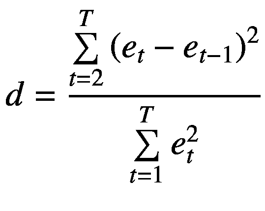

其中，`et` 是与时间 t 处的观测值相关的残差。

要解释该统计量，您可以遵循图 6-19 中概述的规则。

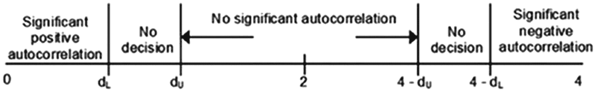

图 6-19

德宾-沃森统计量界限

正自相关意味着一个观测值的正误差会增加另一个观测值出现正误差的可能性。而负自相关则相反。在线性回归模型中，正自相关和负自相关都是不期望出现的。在图 6-20 中，很明显，如果 d 统计量的值接近 2，我们可以推断残差项中不存在自相关。

检测自相关的另一种方法是绘制 ACF 图并寻找尖峰。

```
# 检验自相关误差
durbinWatsonTest(fitted_Model_multiple)
lag Autocorrelation D-W Statistic p-value
1     -0.03814535      2.076011   0.192
Alternative hypothesis: rho != 0
# ACF 图
plot(acf(fitted_Model_multiple$residuals))
```

图 6-20 中的图称为针对不同滞后的自相关函数（ACF）图。该图在时间序列分析中很流行，因为数据是按时间索引的，所以我们在此使用该图作为自相关解释的代理。

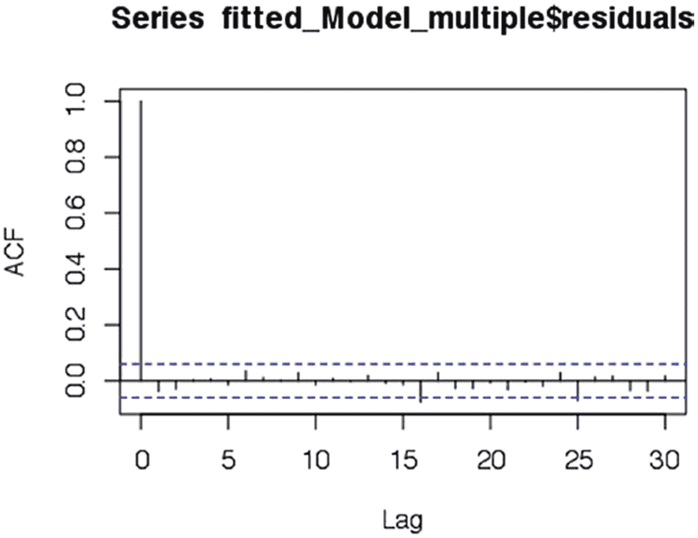

图 6-20

自相关函数（ACF）图

德宾-沃森统计量显示残差之间无自相关，d 等于 2.07。同时，ACF 图也未显示尖峰。因此，我们可以说残差不存在自相关。

#### 6.5.4.5 同方差性

*同方差性* 意味着序列或向量中的所有随机变量具有有限且恒定的方差。这也称为方差齐性。在线性回归框架中，同方差误差/残差意味着误差的方差与 *x* 的值无关。这意味着无论 *x* 如何，*y* 的概率分布都具有相同的标准差。

有多种统计检验可用于检查同方差性假设，例如，布罗施-帕甘检验、ARCH 检验、巴特利特检验等。在本节中，我们重点关注由 Snedecor 和 Cochran 于 1989 年提出的巴特利特检验。

要执行巴特利特检验，首先我们在总体数据中创建子组。为了说明，我们创建了三个总体数据组，每组分别有 400、400 和 269 个观测值。

```
我们可以在数据中创建三个组，以查看方差是否在这三组之间变化
gp<-numeric()
for( i in 1:1069)
{
if(i<=400){
gp[i] <-1;
}else if(i<=800){
gp[i] <-2;
}else{
gp[i] <-3;
}
}
```

现在我们定义将在巴特利特检验中检验的假设：

`Ho`：所有三个总体方差相同。

`Ha`：至少有两个不同。

这里，我们使用函数 `Bartlett.test()` 执行巴特利特检验：

```
Data_lm_Model$gp <-factor(gp)
bartlett.test(fitted_Model_multiple$fitted.values,Data_lm_Model$gp)
Bartlett test of homogeneity of variances
data:  fitted_Model_multiple$fitted.values and Data_lm_Model$gp
Bartlett's K-squared = 1.3052, df = 2, p-value = 0.5207
```

巴特利特检验的 p 值大于 0.05，这意味着我们无法拒绝原假设。各子组具有相同的方差，因此方差是同方差的。

这里，我们展示更多用于检验方差的测试。这些仅供参考，以便您可以在需要时复制其他检验。

1.  布罗施-帕甘检验

```
# 非常数误差方差检验 - 布罗施-帕甘检验
ncvTest(fitted_Model_multiple)
Non-constant Variance Score Test
Variance formula: ~ fitted.values
Chisquare = 2322.866    Df = 1     p = 0
```

这些结果是一种流行的异方差性检验（称为布罗施-帕甘检验）的结果。p 值为 0，因此您可以拒绝方差是异方差的原假设。

1.  ARCH 检验

```
# 也展示 ARCH 检验 - 更适用于时间序列模型
library(FinTS)
ArchTest(fitted_Model_multiple$residuals)
ARCH LM-test; Null hypothesis: no ARCH effects
data:  fitted_Model_multiple$residuals
Chi-squared = 4.2168, df = 12, p-value = 0.9792
```

巴特利特检验和 ARCH 检验的结果清楚地表明残差是同方差的。图 6-21 中的图是残差与拟合值图。它是一个散点图，x 轴为残差，y 轴为拟合值（估计响应值）。该图用于检测非线性、不等误差方差和异常值。

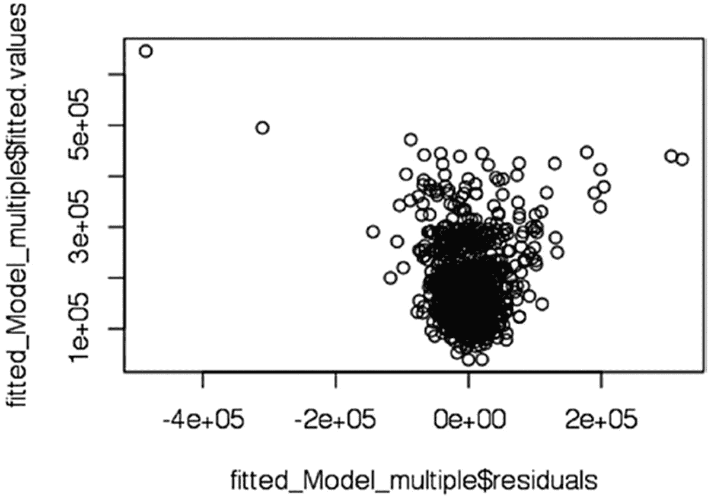

图 6-21

残差与拟合值图

```
# 绘制残差与拟合值图
plot(fitted_Model_multiple$residuals,fitted_Model_multiple$fitted.values)
```

拟合值与残差的图也未显示任何增加或减少的行为。这意味着残差是同方差的，因为它们不随 x 的值而变化。


在本节关于模型诊断的内容中，我们探讨了识别回归问题的重要检验和流程。影响点可能会给模型估计带来偏差，并降低模型的性能。我们可以探索几种方法来减轻这个问题，例如对数值进行封顶、创建分箱，或者可能只是将其从分析中移除。残差的正态性很重要，因为我们期望一个好的模型能够捕获数据中的所有信号，并将残差减少到仅为白噪声。自相关是索引数据的一个特征，在这种情况下，如果残差彼此不独立且存在自相关，那么模型性能将会下降。同方差性是另一个重要的诊断指标，它告诉我们因变量的方差是否与预测变量/自变量无关。所有这些诊断都需要在拟合回归模型后进行，以确保模型可靠且在统计上有效，能够应用于实际场景。

现在我们已经测试了线性回归的主要检验，可以继续学习多项式回归了。到目前为止，我们假设因变量和自变量之间的关系是线性的，但在现实生活中可能并非如此。线性关系在所有水平上都表现出相同的比例变化行为。例如，当店铺面积从 10 平方英尺变为 20 平方英尺时，`HousePrice` 的增加，与从 2000 平方英尺变为 2010 平方英尺这同样的 10 平方英尺变化所带来的增加并不相同。但线性回归忽略了这一事实，并假设在所有水平上变化相同。

下一节将把线性回归的思想扩展到更高次多项式的关系。

### 6.5.5 多项式回归

线性回归框架可以扩展到变量之间的多项式关系。在多项式回归中，自变量 *x* 和因变量 *y* 之间的关系被建模为 n 次多项式。

多项式回归模型可以表示如下：

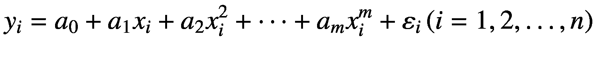

有许多例子表明数据并非遵循线性依赖关系，而是更高次的关系。一般来说，现实生活中的关系在真正意义上并非线性。线性回归假设因变量只能朝一个方向变化，且每单位自变量的边际变化相同。

例如，`HousePrice` 与 `StoreArea` 呈正相关。这意味着如果 `StoreArea` 增加，`HousePrice` 也会增加。因此，如果 `StoreArea` 持续增加，`HousePrice` 将以相同的速率（系数）上涨。但是，您是否相信如果 `StoreArea` 太大，`HousePrice` 能涨到 100 万？不会的，`StoreArea` 的效用会随着其增加而递减，最终您将看不到 `HousePrice` 有同样的增长。

经济学提供了许多这种二次行为的良好例子，例如价格弹性、收益递减等。同样，在常规规划中，我们也会用到二次及其他高次多项式关系，例如折扣生成、产品定价等。我们将展示一个例子，说明多项式回归如何帮助建模某些多项式关系。

*因变量：* 商品价格

*自变量：* 销售量

一般原则是，如果价格太便宜，人们会认为商品质量不好而不购买；但如果价格太高，人们会因成本考虑而不购买。让我们尝试使用线性和二次回归来量化这种关系。

```
#因变量：商品价格
y |t|)
(Intercept) 2.232652   0.445995   5.006  0.00024 ***
x           0.007546   0.005463   1.381  0.19046

Signif. codes:  0 '***' 0.001 '**' 0.01 '*' 0.05 '.' 0.1 ' ' 1
Residual standard error: 0.3836 on 13 degrees of freedom
Multiple R-squared:  0.128,  Adjusted R-squared:  0.06091
F-statistic: 1.908 on 1 and 13 DF,  p-value: 0.1905
```

模型摘要显示，多重 R 方仅为 12%，且变量 *x* 在模型中不显著。此外，*x* 的系数也不显著，因为 p 值为 0.19。图 6-22 显示了实际值与预测值的散点图，以查看数值是否拟合良好。

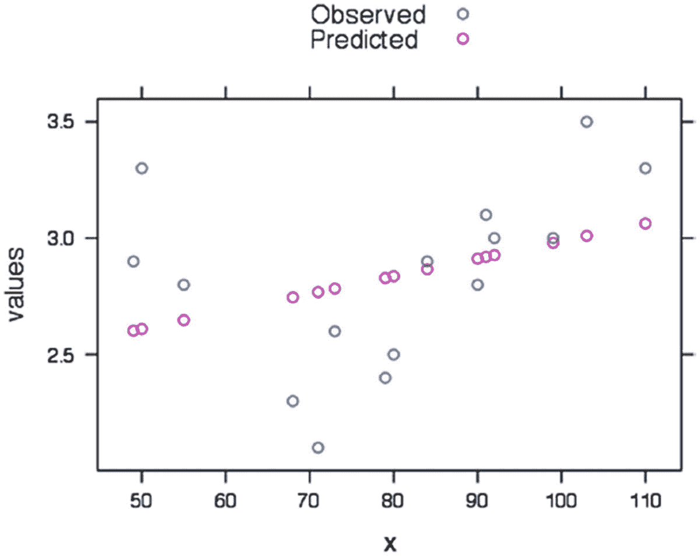

图 6-22

线性模型的实际值与预测值图

```
res <-stack(data.frame(Observed =as.numeric(y), Predicted =fitted(linear_reg)))
res <-cbind(res, x =rep(x, 2))
#使用 lattice 的 xyplot 函数绘图
library("lattice")
xyplot(values ~x, data = res, group = ind, auto.key =TRUE)
```

该图提供了额外的证据，表明从图中看不出线性关系。这些数值并不适合模型预测的线性直线。

现在，我们继续为数据拟合一条二次曲线，看看这是否有助于我们捕捉价格对数量的曲线行为。

```
#绘制二次关系图
linear_reg |t|)
(Intercept)  6.8737010  1.1648621   5.901 7.24e-05 ***
x           -0.1189525  0.0309061  -3.849  0.00232 **
I(x²)       0.0008145  0.0001976   4.122  0.00142 **

Signif. codes:  0 '***' 0.001 '**' 0.01 '*' 0.05 '.' 0.1 ' ' 1
Residual standard error: 0.2569 on 12 degrees of freedom
Multiple R-squared:  0.6391, Adjusted R-squared:  0.5789
F-statistic: 10.62 on 2 and 12 DF,  p-value: 0.002211
```

模型摘要显示，在我们为 *x* 引入二次项后，多重 R 方提高到了 63%，并且变量 *x* 和 *x* 平方在统计上均显著。让我们绘制散点图，看看这些值是否很好地拟合了数据。见图 6-23。

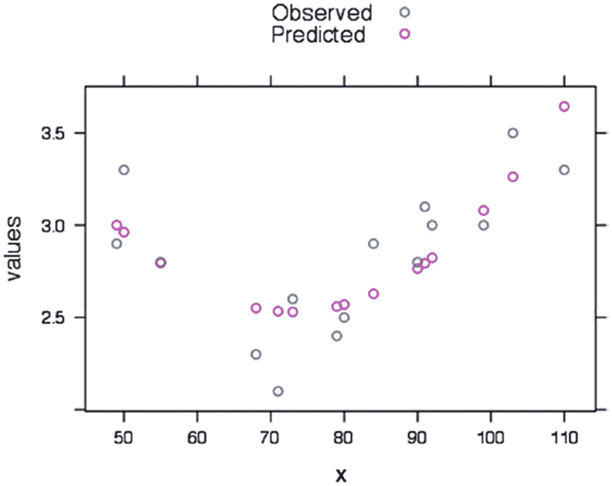

图 6-23

二次多项式模型的实际值与预测值图

```
res <-stack(data.frame(Observed =as.numeric(y), Predicted =
fitted(linear_reg)))
res <-cbind(res, x =rep(x, 2))
#使用 lattice 的 xyplot 函数绘图
library("lattice")
xyplot(values ~x, data = res, group = ind, auto.key =TRUE)
```

该模型显示 R 方有所改善，且二次项在模型中显著。该图还显示，二次情况下的拟合效果优于线性情况。这个想法可以扩展到更高次的多项式，但这会导致过拟合。此外，许多过程通常不能用非常高次的多项式很好地表示。如果您计划使用次数超过四的多项式，在解释结果时要非常小心。


### 6.5.6 逻辑回归

在线性回归中，我们看到因变量是一个具有实数值的连续变量。同时，我们确定误差项需要服从正态分布，回归方程才有效。现在，假设因变量只有两个可能的值（0 和 1），换句话说，它服从二项分布，会发生什么？那么误差项就不能服从正态分布，如下所示：

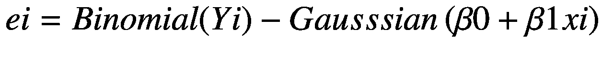

因此，我们需要转向不同的框架，以适应因变量不服从高斯分布而服从指数族分布的情况。在逻辑回归之后，我们将简要介绍指数分布，并展示如何通过链接函数将其简化为线性形式。逻辑回归对预测变量与分类响应/因变量之间的关系进行建模。例如，我们在第 5 章中看到的信用风险问题。预测变量被用来对“违约/未违约”这一二项结果进行建模。

根据分类（响应）变量的类型，逻辑回归可以分为三种类型：

*   ***二项逻辑回归***：响应变量只有两个可能的值（0/1）。通常，我们估计其为 1 的概率，并根据某个阈值来预测响应变量的状态。

    二项分布的概率质量函数如下：

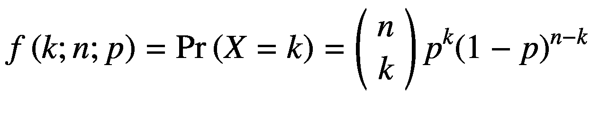

其中 *k* 是成功次数，*n* 是总试验次数，*p* 是单次成功的概率。

*   ***多项逻辑回归***：分类响应变量有三个或更多个值/水平。通常，我们计算每个水平的概率，然后基于某种分类规则（例如，最大概率）来分配响应变量的状态。

    多项分布的概率质量函数如下：

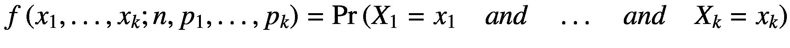

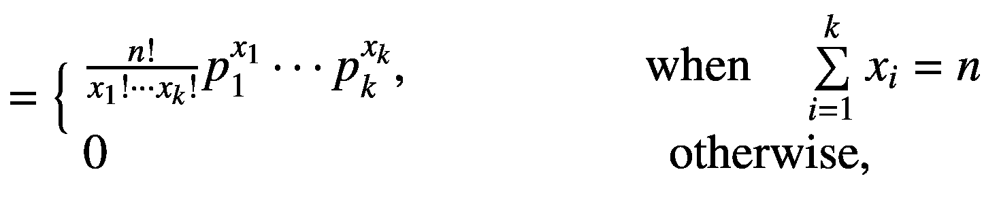

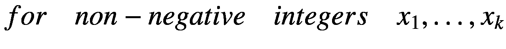

其中 *xi* 是预测变量集，*pk* 是每个类别的概率（比例），*n* 是试验次数（样本量）。

*   ***有序逻辑回归***：响应变量是一个具有内在顺序的分类变量。该方法与多项逻辑回归相同，主要区别在于其具有内在的顺序。例如，一个介于 1 到 5 之间的评级变量。

让我们来看两个在解释逻辑回归时要用到的重要术语。

### 6.5.7 Logit 变换

对于逻辑回归，我们使用一个变换函数，也称为链接函数，它从自变量中的二项分布创建一个线性函数。用于二项分布的链接函数称为 `logit` 函数（见图 6-24）。

`logit` 函数 *σ* (*t*) 定义如下：


`logit` 函数曲线如下所示：


图 6-24

Logit 函数

```
curve((1/(1+exp(-x))),-10,10,col ="violet")
```

你可以观察到，`logit` 函数的上限为 1，下限为 0。极高的 x 值对函数值影响很小，极低的 x 值也是如此。这样，我们可以看到边界在 0 到 1 的概率尺度之间，以便拟合模型。

在逻辑回归中，我们使用最大似然估计（MLE），而对于多项逻辑回归，我们使用迭代方法来优化 `logLoss` 函数。

然后，`logit` 函数将这种关系转换为优势比的 `logit`，作为自变量的线性组合。逻辑函数 *g* 的逆函数，即 `logit`（对数优势比），将这种关系映射为线性关系：


在本节中，我们讨论具有二项分类变量的逻辑回归，在后面的部分中，我们将从高层次上探讨如何将此方法扩展到多项分类。


### 6.5.8 优势比

在第一章中，我们讨论了概率度量，它表示事件发生的可能性。概率值始终介于 0 和 1 之间，其中 0 表示事件绝对不会发生，1 表示事件绝对会发生。

我们将概率优势（或简称为优势）定义为事件发生概率与不发生概率的比值。

```
事件 A 的优势比 = P(A)/1-P(A)
事件 A 的劣势比 = (1-P(A))/P(A) = 1/事件 A 的优势比
```

因此，事件 A 的优势比为 2 意味着事件 A 发生的可能性是不发生的 2 倍。该比值可以推广到任意数量的类别，此时其解释变为事件相对于所有可能事件发生的可能性。

优势比是一种表示事件“A”存在/不存在与事件“B”存在/不存在之间关系的方式。对于二元情况，我们可以创建一个示例如下所示：


例如，假设有两种事件结果，A 和 B。事件 A 发生的概率为 0.4 (P(A))，事件 B 发生的概率为 0.6 (P(B))。那么事件 A 的优势比为 0.66 (P(A)/1-P(A))，类似地，事件 B 的优势比为 1.5 (P(B)/1-P(B))。这意味着事件 B 发生的可能性是不发生的 1.5 倍。

现在，优势比被定义为这些优势的比值，即 B 的优势除以 A 的优势 = 1.5/0.66 = 2.27 ~ 2。这表示事件 B 发生的可能性是事件 A 发生的两倍。我们可以观察到这个量是一个相对度量，因此我们在逻辑回归中使用了基准水平的概念。模型中的优势比是相对于基准水平/类别的。

现在，我们可以介绍 `logit` 与优势比之间的关系。逻辑回归本质上对以下方程进行建模，该方程是对事件优势进行 `logit` 变换，然后将我们的问题转换为其线性形式，如下所示：

![$$ \mathrm{logit}\left(\mathrm{E}\left[{Y}_i|{x}_{1,i},\dots, {x}_{m,i}\right]\right)=\mathrm{logit}\left({p}_i\right)=\ln \left(\frac{p_i}{1-{p}_i}\right)={\beta}_0+{\beta}_1{x}_{1,i}+\cdots +{\beta}_m{x}_{m,i} $$](images/416805_2_En_6_Chapter/416805_2_En_6_Chapter_TeX_Equab.png)

因此，在逻辑回归中，优势比是变量的指数化系数，表示事件相对于参考类别/事件的相对可能性。在这里，你可以看到优势比如何转化为逻辑回归的指数化系数。


#### 6.5.8.1 二项逻辑模型

让我们使用我们的购买预测数据来构建一个逻辑回归模型并查看其诊断结果。在我们的分析中，我们将对数据进行子集划分，仅将 `ProductChoice` 1 和 3 分别设为 1 和 0。

```
#加载数据并准备用于逻辑回归的数据集
Data_Purchase_Prediction 
143893 106603      0
Data_Logistic$MembershipPoints <-factor(Data_Logistic$MembershipPoints)
Data_Logistic$IncomeClass <-factor(Data_Logistic$IncomeClass)
Data_Logistic$CustomerPropensity <-factor(Data_Logistic$CustomerPropensity)
Data_Logistic$LastPurchaseDuration <-as.numeric(Data_Logistic$LastPurchaseDuration)
```

在开始建模之前，让我们先看看分类变量在因变量上的分布情况。

```
table(Data_Logistic$MembershipPoints,Data_Logistic$choice)
0     1
1  15516 13649
2  19486 15424
3  20919 15661
4  20198 14944
5  18868 13728
6  16710 11883
7  13635  9381
8   9632  6432
9   5566  3512
10  2427  1446
11   754   441
12   165    95
13    17     7
```

该分布表明，随着 `MemberShipPoints` 的增加，选择 0 和 1 的数量都减少了。

```
table(Data_Logistic$IncomeClass,Data_Logistic$choice)
0     1
1   145   156
2   203   209
3  3996  3535
4 23894 18952
5 47025 36781
6 38905 27804
7 21784 14715
8  6922  3958
9  1019   493
```

该分布表明，大多数客户属于收入等级 4、5 和 6。在各个收入等级区间内，选择 0 和 1 的分布是均衡的。

```
table(Data_Logistic$CustomerPropensity,Data_Logistic$choice)
0     1
High     26604 10047
Low      20291 19962
Medium   27659 17185
Unknown  36633 52926
VeryHigh 32706  6483
```

该分布很有趣，因为它表明具有非常高倾向的客户极不可能购买由类别 1 代表的产品。分布是初步了解数据的好方法。这个探索性任务也有助于为模型进行特征选择。

现在，我们已经加载了所有相关的库和函数，我们将逐步展示如何开发逻辑回归，并选择其中一个模型用于下一章的评估。我们将在完整数据上开发模型，下一章将详细讨论性能评估指标。

```
library(dplyr)
#获取按评分分组的平均购买率并绘图
summarise(group_by(Data_Logistic,IncomeClass),Average_Rate=mean(choice))
print("按收入等级划分的平均购买率汇总")
[1] "按收入等级划分的平均购买率汇总"
summary_Rating
# A tibble: 9 × 2
IncomeClass Average_Rate

1           1    0.5182724
2           2    0.5072816
3           3    0.4693932
4           4    0.4423283
5           5    0.4388827
6           6    0.4167953
7           7    0.4031617
8           8    0.3637868
9           9    0.3260582
plot(summary_Rating$IncomeClass,summary_Rating$Average_Rate,type="b", xlab="收入等级", ylab="观察到的平均购买率", main="购买率与收入等级")
```

现在我们想看看产品 1 的平均购买率如何随收入等级变化。我们绘制了每个收入等级的平均购买率（选择 1 的比例），如图 6-25 所示。


图 6-25

购买率与收入等级

图 6-25 中的图表显示，随着收入等级的提高，购买产品 1 的倾向下降。可以为其他变量创建类似的图表，以查看拟合模型后模型概率的预期行为。


现在我们将清理数据中的缺失值（NA，即缺失值 0），并使用`glm()`函数拟合二元逻辑回归。GLM 代表广义线性回归，能够处理指数族分布。该函数要求用户指明因变量所属的分布族以及要使用的链接函数。我们使用了二项分布族，并以`logit`作为链接函数。

```
#移除缺失值 - NAs
Data_Logistic <- na.omit(Data_Logistic)
#拟合模型
Model_logistic <- glm(choice ~ MembershipPoints + IncomeClass + CustomerPropensity + LastPurchaseDuration, 
                      family = binomial(link = "logit"), data = train)
summary(Model_logistic)
```

```
调用:
glm(formula = choice ~ MembershipPoints + IncomeClass + CustomerPropensity + 
    LastPurchaseDuration, family = binomial(link = "logit"), 
    data = train)

偏差残差:
    最小值       1Q   中位数       3Q      最大值  
-2.57590  -1.10881  -0.00003   1.10881   2.57590  

系数:
                          估计值   标准误差  z 值  Pr(>|z|)    
(Intercept)                 0.066989   0.145543   0.460 0.645323    
MembershipPoints2          -0.123408   0.020577  -5.997 2.01e-09 ***
MembershipPoints3          -0.185540   0.020359  -9.113  < 2e-16 ***
MembershipPoints4          -0.204938   0.020542  -9.977  < 2e-16 ***
MembershipPoints5          -0.237311   0.020942 -11.332  < 2e-16 ***
MembershipPoints6          -0.258884   0.021597 -11.987  < 2e-16 ***
MembershipPoints7          -0.291123   0.022894 -12.716  < 2e-16 ***
MembershipPoints8          -0.326029   0.025526 -12.773  < 2e-16 ***
MembershipPoints9          -0.387113   0.031572 -12.261  < 2e-16 ***
MembershipPoints10         -0.439228   0.044839  -9.796  < 2e-16 ***
MembershipPoints11         -0.357339   0.078493  -4.553 5.30e-06 ***
MembershipPoints12         -0.447326   0.164172  -2.725 0.006435 ** 
MembershipPoints13         -1.349163   0.583320  -2.313 0.020728 *  
IncomeClass2               -0.412020   0.190461  -2.163 0.030520 *  
IncomeClass3               -0.342854   0.146938  -2.333 0.019631 *  
IncomeClass4               -0.389236   0.144433  -2.695 0.007040 ** 
IncomeClass5               -0.373493   0.144169  -2.591 0.009579 ** 
IncomeClass6               -0.442134   0.144244  -3.065 0.002175 ** 
IncomeClass7               -0.455158   0.144548  -3.149 0.001639 ** 
IncomeClass8               -0.509290   0.146126  -3.485 0.000492 ***
IncomeClass9               -0.569825   0.160174  -3.558 0.000374 ***
CustomerPropensityLow       0.877850   0.018709  46.921  < 2e-16 ***
CustomerPropensityMedium    0.427725   0.018491  23.131  < 2e-16 ***
CustomerPropensityUnknown   1.208693   0.016616  72.744  < 2e-16 ***
CustomerPropensityVeryHigh -0.601513   0.021652 -27.781  < 2e-16 ***
LastPurchaseDuration       -0.063463   0.001211 -52.393  < 2e-16 ***
---
显著性标记:  0 '***' 0.001 '**' 0.01 '*' 0.05 '.' 0.1 ' ' 1

(二项分布族的离散参数取为 1)

    零偏差: 235658  on 172985  degrees of freedom
残差偏差: 213864  on 172960  degrees of freedom
AIC: 213916

Fisher 评分迭代次数: 4
```

所有变量及其水平的 p 值都是显著的。这意味着我们拟合的模型中，变量与因变量之间存在显著关系。现在我们来计算该模型的分类矩阵。这是通过平衡特异性和敏感度的方法实现的。这些指标的详细信息在第 6 章中给出，我们在此进行简要说明，并利用这些指标为从概率到类别的分类找到一个良好的截断点。

```
#安装并加载包
library(pROC)
#应用 roc 函数
cut_off <-roc(response=train$choice, predictor=Model_logistic$fitted.values)
#找到使误差最小化的阈值
e <-cbind(cut_off$thresholds,cut_off$sensitivities+cut_off$specificities)
best_t <-subset(e,e[,2]==max(e[,2]))[,1]
#绘制 ROC 曲线
plot(1-cut_off$specificities,cut_off$sensitivities,type="l",
ylab="敏感度",xlab="1-特异性",col="green",lwd=2,
main ="训练数据的 ROC 曲线")
abline(a=0,b=1)
abline(v = best_t) #在 ROC 曲线上添加最优 t 值
```

图 6-26 中的图形展示了特异性和敏感度之间的关系。该图也称为 ROC 图。最优截断点是曲线上使敏感度最大化、特异性最小化的值。


图 6-26

训练数据的 ROC 曲线

```
cat(" 分类器的最优截断值为 ", best_t)
分类器的最优截断值为 0.4202652
```

观察图形，我们可以看到我们选择的截断点将在训练数据上提供最佳分类。我们需要在测试数据上检验这个假设，并使用 0.42 这个截断点记录分类率。

```
# 预测测试数据的概率并应用截断点
predict_prob <- predict(Model_logistic, test, type = "response")
class_pred <- ifelse(predict_prob > 0.41,1,0)
#分类表
table(test$choice,class_pred)
class_pred
     0     1
0 24605 18034
1  8364 23134
#分类率
sum(diag(table(test$choice,class_pred))/nrow(test))
[1] 0.6439295
```

该模型在测试数据上显示出 64%的良好分类率。这表明模型能够很好地捕捉数据中的信号，以区分 0 和 1。

逻辑模型的诊断方法与线性回归模型不同。在以下小节中，我们将探讨逻辑回归的一些常见诊断指标。

### 6.5.9 模型诊断：逻辑回归

一旦我们拟合了模型，就需要对逻辑回归输出进行两步分析：

1.  如果我们对最终的类别分配感兴趣，则应关注分类器，并比较通过分类器对预测概率进行分配后得到的实际类别。

2.  如果我们对概率感兴趣，则应关注那些事件发生几率高且获得高概率的案例。

除此之外，我们还需要查看系数、R 平方等价指标以及其他检验，以验证我们的模型在统计上是否有效。在查看系数时，另一个需要牢记的重要事项是：逻辑回归系数表示预测变量每变化一个单位时`logit`的变化量，这与线性回归不同。

我们将展示如何执行三种诊断检验——沃尔德检验、似然比检验以及偏差/伪 R 平方——以及三种分离度量方法：双变量图、增益/提升图和一致性比率。

#### 6.5.9.1 沃尔德检验

沃尔德检验类似于线性回归中的 t 检验。它用于评估给定模型中各个预测变量的贡献。

在逻辑回归中，沃尔德统计量为


其中β是系数，SE 是系数β的标准误差。

沃尔德统计量是回归系数平方与系数标准误差平方的比值，它服从卡方分布。显著的沃尔德统计量意味着该预测变量/自变量在模型中显著。

让我们对`MembershipPoints`执行沃尔德检验，看看它在模型中是否显著。

```
#沃尔德检验
library(survey)
regTermTest(Model_logistic,"MembershipPoints", method ="Wald")
MembershipPoints 的沃尔德检验
在 glm(formula = choice ~ MembershipPoints + IncomeClass + CustomerPropensity +
LastPurchaseDuration, family = binomial(link = "logit"),
data = train)中
F =  31.64653  on  12  and  172960  df: p= < 2.22e-16
```

p 值小于 0.05，因此在 95%的置信水平下，我们可以拒绝系数值为零的原假设。因此，`MembershipPoints`是模型中一个统计上显著的变量。


#### 6.5.9.2 偏差

偏差是通过比较零模型和饱和模型计算得出的。零模型是不包含任何预测变量、仅含截距项的模型，而饱和模型则是包含若干预测变量的拟合模型。在逻辑回归中，偏差用于替代平方和计算。检验统计量（通常记为 D）是似然比对数的两倍，即两个对数似然值之差的两倍：

偏差


偏差统计量 (D) 服从卡方分布。数值越小表示拟合效果越好，因为拟合模型与饱和模型的偏差越小。

以下是偏差分析表。

```
#Anova table of significance
anova(Model_logistic, test="Chisq")
Analysis of Deviance Table
Model: binomial, link: logit
Response: choice
Terms added sequentially (first to last)
Df Deviance Resid. Df Resid. Dev  Pr(>Chi)
NULL                                172985     235658
MembershipPoints     12    330.6    172973     235328 < 2.2e-16 ***
IncomeClass           8    339.1    172965     234989 < 2.2e-16 ***
CustomerPropensity    4  18297.4    172961     216691 < 2.2e-16 ***
LastPurchaseDuration  1   2826.9    172960     213864 < 2.2e-16 ***

Signif. codes:  0 '***' 0.001 '**' 0.01 '*' 0.05 '.' 0.1 ' ' 1
```

所有变量的卡方检验均显著，因为 p 值小于 0.05。所有预测变量对模型的贡献都是显著的。

#### 6.5.9.3 伪 R 方

在线性回归中，我们有 R 方度量（详见第 7 章），它衡量模型独立解释的方差比例。逻辑回归中类似的度量称为伪 R 方。其中最流行的一种使用了似然比，表示如下：


它是零模型偏差与拟合模型偏差之差除以零模型偏差的比值。该度量值越高，模型的解释力越强。本章不讨论其他类似的度量，如 Cox 和 Snell R 方、Nagelkerke R 方、McFadden R 方以及 Tjur R 方。这里我们计算模型的伪 R 方。

```
# R square equivalent for logistic regression
library(pscl)
pR2(Model_logistic)
llh       llhNull            G2      McFadden          r2ML
-1.069321e+05 -1.178291e+05  2.179399e+04  9.248135e-02  1.183737e-01
r2CU
1.591199e-01
```

该函数输出的最后三个值分别是 McFadden 伪 R 方、最大似然伪 R 方（Cox & Snell）以及 Cragg 和 Uhler 或 Nagelkerke 伪 R 方。R 方值非常低，表明该模型的性能可能并不优于零模型。

#### 6.5.9.4 双变量图

逻辑回归最重要的诊断方法是观察每个单一自变量各水平下实际概率与预测概率的表现。这些图被称为*双变量*图，因为有两个变量——实际值和预测值——针对单一自变量的各个水平进行绘制。该图包含三个重要输入：

*   *实际概率：* 自变量每个类别中目标水平的先验比例。
*   *预测概率：* 模型给出的概率。
*   *频数：* 分类变量的频数（观测数量）。

该图本质上告诉我们模型在分类变量不同水平上的表现如何。你也可以通过对连续变量进行分箱处理，将此思路扩展到连续变量。

这些图的另一个优点是，你可以确定数据集中模型在哪个群组上表现更好，以及哪个群组需要进一步研究。这种群组级别的诊断无法通过查看聚合图来实现。

```
#The function code is provided separately in the appendix
source("actual_pred_plot.R")
MODEL_PREDICTION <-predict(Model_logistic, Data_Logistic, type ='response');
Data_Logistic$MODEL_PREDICTION <-MODEL_PREDICTION
#Print the plots MembershipPoints
actual_pred_plot  (var.by=as.character("MembershipPoints"),
var.response='choice',
data=Data_Logistic,
var.predict.current='MODEL_PREDICTION',
var.predict.reference=NULL,
var.split=NULL,
var.by.buckets=NULL,
sort.factor=FALSE,
errorbars=FALSE,
subset.to=FALSE,
barline.ratio=1,
title="Actual vs. Predicted Purchase Rates",
make.plot=TRUE
)
```

图 6-27 展示了实际值与预测值相对于 `MembershipPoints` 频数图的对比。


图 6-27

实际值与预测值相对于 MembershipPoints 的对比图

对于 `MembershipPoints`，实际概率和预测概率相互吻合。这意味着模型预测的概率接近实际值。此外，你可以看到，在这两种情况下，拥有较高 `MembershipPoints` 的客户选择产品 = 1 的可能性较低，这与实际和预测结果一致。

```
#Print the plots IncomeClass
actual_pred_plot  (var.by=as.character("IncomeClass"),
var.response='choice',
data=Data_Logistic,
var.predict.current='MODEL_PREDICTION',
var.predict.reference=NULL,
var.split=NULL,
var.by.buckets=NULL,
sort.factor=FALSE,
errorbars=FALSE,
subset.to=FALSE,
barline.ratio=1,
title="Actual vs. Predicted Purchase Rates",
make.plot=TRUE
)
```

图 6-28 展示了实际值与预测值相对于 `IncomeClass` 频数图的对比。


图 6-28

实际值与预测值相对于 IncomeClass 的对比图

同样，模型在 `IncomeClass` 上的表现符合预期。该模型能够像实际观测到的比率一样，预测不同收入阶层下的概率。

```
#Print the plots CustomerPropensity
actual_pred_plot  (var.by=as.character("CustomerPropensity"),
var.response='choice',
data=Data_Logistic,
var.predict.current='MODEL_PREDICTION',
var.predict.reference=NULL,
var.split=NULL,
var.by.buckets=NULL,
sort.factor=FALSE,
errorbars=FALSE,
subset.to=FALSE,
barline.ratio=1,
title="Actual vs. Predicted Purchase Rates",
make.plot=TRUE
)
```

图 6-29 展示了实际值与预测值相对于 `CustomerPropensity` 频数图的对比。


图 6-29

实际值与预测值相对于 CustomerPropensity 的对比图

模型在 `CustomerPropensity` 上也与观测概率表现出良好的一致性。在对模型中的连续变量进行适当分箱后，也可以绘制类似的图。至少在分类变量上，模型表现良好。

该模型在不同分类变量水平上均显示出良好的预测值与实际值匹配度。从概率尺度来看，这是一个好模型！


#### 6.5.9.5 累积增益图与提升图

累积增益图和提升图是衡量预测模型有效性的可视化方法。它们包含一条基线以及由预测模型生成的提升曲线。基线与预测（提升）曲线之间的分离程度越大，模型效果越好。

在增益图中：

X 轴：客户百分比

Y 轴：正向预测百分比

基线：随机线（x%的客户产生 x%的正向预测）

增益：对应客户百分比的正向响应百分比

在提升图中：

X 轴：客户百分比

Y 轴：实际提升度（模型预测结果与无模型结果之比）

```
library(gains)
library(ROCR)
library(calibrate)
MODEL_PREDICTION <-predict(Model_logistic, Data_Logistic, type ='response');
Data_Logistic$MODEL_PREDICTION <-MODEL_PREDICTION;
lift =with(Data_Logistic, gains(actual = Data_Logistic$choice, predicted = Data_Logistic$MODEL_PREDICTION , optimal =TRUE));
pred =prediction(MODEL_PREDICTION,as.numeric(Data_Logistic$choice));
# 用于创建性能对象的函数。所有类型的预测器评估均通过此函数执行。
gains =performance(pred, 'tpr', 'rpp');
# tpr: 真正率
# rpp: 正向预测率
auc =performance(pred, 'auc');
auc =unlist(slot(auc, 'y.values')); # 等同于：auc@y.values[[1]]
auct =paste(c('AUC = '), round(auc, 2), sep =")
#par(mfrow=c(1,2), mar=c(6,5,4,2));
plot(gains, col="red", lwd=2, xaxs="i", yaxs="i", main =paste('Gains Chart ', sep ="),ylab='% of Positive Response', xlab='% of customers/population');
axis(side =1, pos =0, at =seq(0, 1, by =0.10));
axis(side =2, pos =0, at =seq(0, 1, by =0.10));
lines(x=c(0,1), y=c(0,1), type="l", col="black", lwd=2,
ylab='% of Positive Response', xlab='% of customers/population');
legend(0.6, 0.4, auct, cex =1.1, box.col ='white')
gains =lift$cume.pct.of.total
deciles =length(gains);
for (j in 1:deciles)
{
x =0.1;
y =as.numeric(as.character(gains[[j]]));
lines(x =c(x*j, x*j),
y =c(0, y),
type ='l', col ='blue', lwd =1);
lines(x =c(0, 0.1*j),
y =c(y, y),
type ='l', col ='blue', lwd =1);
# 在指定十分位处添加真正率的精确数值以标注图表。
textxy(0, y, paste(round(y,2)*100, '%',sep="), cex=0.9);
}
```

图 6-30 是我们模型的增益图。该图以正向响应百分比为 Y 轴，以总体百分比为 X 轴绘制。


图 6-30

含 AUC 的增益图

```
plot(lift,
xlab ='% of customers/population',
ylab ='Actual Lift',
main =paste('Lift Chart \n', sep =' '),
xaxt ='n');
axis(side =1, at =seq(0, 100, by =10), las =1, hadj =0.4);
```

图 6-31 是我们模型的提升图。该图以实际提升度为 Y 轴，以总体百分比为 X 轴绘制。


图 6-31

提升图

增益图显示模型线与基线之间存在良好的分离。这表明模型具有良好的区分能力。此外，AUC 值为 0.7 意味着该模型能够大致区分 70%的案例。

提升图显示，对于前 10%的总体，提升度接近 70%。该值应与我们在增益图中观察到的结果一致，只是呈现方式不同。

#### 6.5.9.6 一致性与不一致性比率

在任何基于原始概率的分类模型中，都需要一种分类方法来区分这些概率案例。在二元逻辑回归中，这通常通过选择一个临界值，然后创建一个不等式将对象分类为 0 或 1 来实现。

为了确保存在这样的临界值且具有良好的区分能力，我们必须检查数据中实际状态为 1 的对象是否比实际状态为 0 的对象具有更高的概率。例如，一对(Yi,Yj)为(0,1)，则预测值(Pi,Pj)应满足 Pj>Pi，这样我们就可以在 Pj 和 Pi 之间选择一个数值，从而正确地将 1 分类为 1，0 分类为 0。基于此理解，我们可以将数据中所有可能的配对分为三类：

*   *一致对：* 对于(0,1)或(1,0)，对应的概率中 1 的概率大于 0 的概率
*   *不一致对：* 对于(0,1)或(1,0)，对应的概率中 0 的概率大于 1 的概率
*   **结：** (0,0)和(1,0)配对

一致性比率定义为一致对数量与总配对数的比值。如果我们的模型产生较高的一致性比率，那么它将能够更准确地将对象分类到各个类别中。

```
# 函数代码单独提供在第六章的 R 代码中
source("concordance.R")
# 调用一致性函数获取这些比率
concordance(Model_logistic)
$Concordance
[1] 0.7002884
$Discordance
[1] 0.2991384
$Tied
[1] 0.0005731122
$Pairs
[1] 7302228665
```

一致性为 69.9%，表明模型概率在约 70%的案例上具有良好的区分度。这是一个用于创建 0 和 1 分类器的良好模型。

在本节关于逻辑回归模型诊断的内容中，我们大致从两个维度讨论了诊断方法：模型拟合统计量和模型分类能力。模型拟合统计量讨论了 Wald 检验（参数估计的显著性检验）、偏差（类似于线性回归中的残差）以及伪 R 平方（相当于线性回归中的 R 平方）。另一组诊断方法用于识别模型是否可用于创建强大的分类器。所包含的检验包括：双变量图（实际概率与预测概率的图）、累积增益图和提升图（展示模型区分两个类别的能力），以及一致性比率（告诉我们是否为分类器找到了良好的临界值）。这些诊断方法为我们提供了模型的重要属性，并帮助建模者改进或重新估计模型。

在下一节中，我们将转向多类分类问题。多类问题是最难解决的问题之一，因为类别数量越多，模糊性越强。在许多情况下，很难创建良好的分类器。我们将讨论使用机器学习进行多类分类的多种方法。多项逻辑回归是进行多类分类的流行方法之一。


### 6.5.10 多项逻辑回归

当分类问题涉及多个类别时，我们使用多项逻辑回归。在这种情况下，因变量服从多项分布。在后台，我们为每个类别创建一个逻辑模型，然后通过将所有概率之和约束为 1 的概率条件，将这些模型合并成一个单一的方程。多项逻辑回归的方程设置如下所示：


估计过程对单个`logit`变换有额外的约束，所有`logit`函数的概率之和必须为 1。由于估计必须考虑这个约束，因此估计方法是一个迭代过程。模型的最佳系数是通过对`logLoss`函数进行迭代优化来找到的。

对于我们的购买预测问题，首先我们将在数据上拟合一个逻辑模型。`nnet`包中的`multinom()`函数将用于为我们的多类问题（`ProductChoice`有四个可能的选项）估计逻辑方程。一旦我们得到每个类别的概率，我们将创建一个分类器来为各个案例分配类别。

这里将演示两种分类器方法：

*   *选取最高概率：* 在所有可能的类别中选取概率最高的那个。然而，这种技术存在类别不平衡问题。当高比例类别的先验分布驱动预测概率时，就会出现类别不平衡，从而导致低比例类别永远无法通过预测概率的最大值被分配到该类别。

*   *概率比率：* 我们可以计算预测概率与先验分布的比率，然后根据最高比率选择一个类别。最高比率意味着模型捕捉到了最强的信号，因为概率已经通过先验比例进行了归一化。

让我们拟合一个模型并应用这两种分类器。

```
#移除包含 NA 的数据。NA 在建模算法中被忽略
Data_Purchase<-na.omit(Data_Purchase_Prediction)
rownames(Data_Purchase)<-NULL
#为简化计算进行随机抽样
Data_Purchase_Model <-Data_Purchase[sample(nrow(Data_Purchase),10000),]
print("产品的分布如下")
[1] "产品的分布如下"
table(Data_Purchase_Model$ProductChoice)
1    2    3    4
2192 3883 2860 1065
#拟合一个多项逻辑回归模型
library(nnet)
mnl_model <-multinom (ProductChoice ~MembershipPoints +IncomeClass +CustomerPropensity +LastPurchaseDuration +CustomerAge +MartialStatus, data = Data_Purchase)
# weights:  44 (30 variable)
initial  value 672765.880864
iter  10 value 615285.850873
iter  20 value 607471.781374
iter  30 value 607231.472034
final  value 604217.503433
converged
#显示模型统计摘要
mnl_model
Call:
multinom(formula = ProductChoice ~ MembershipPoints + IncomeClass +
CustomerPropensity + LastPurchaseDuration + CustomerAge +
MartialStatus, data = Data_Purchase)
Coefficients:
(Intercept) MembershipPoints IncomeClass CustomerPropensityLow
2  0.77137077      -0.02940732  0.00127305            -0.3960318
3  0.01775506       0.03340207  0.03540194            -0.8573716
4 -1.15109893      -0.12366367  0.09016678            -0.6427954
CustomerPropensityMedium CustomerPropensityUnknown
2               -0.2745419                -0.5715016
3               -0.4038433                -1.1824810
4               -0.4035627                -0.9769569
CustomerPropensityVeryHigh LastPurchaseDuration CustomerAge
2                  0.2553831           0.04117902 0.001638976
3                  0.5645137           0.05539173 0.005042405
4                  0.5897717           0.07047770 0.009664668
MartialStatus
2  -0.033879645
3  -0.007461956
4   0.122011042
Residual Deviance: 1208435
AIC: 1208495
```

模型结果显示它在 30 次迭代后收敛。现在让我们查看模型分配的一组样本概率，然后应用第一个分类器，即选取最高概率。

这里，我们应用最高概率分类器，并观察它如何对案例进行分类。

```
#预测概率
predicted_test <-as.data.frame(predict(mnl_model, newdata = Data_Purchase, type="probs"))
head(predicted_test)
1         2         3          4
1 0.21331014 0.3811085 0.3361570 0.06942438
2 0.05060546 0.2818905 0.4157159 0.25178812
3 0.21017415 0.4503171 0.2437507 0.09575798
4 0.24667443 0.4545797 0.2085789 0.09016690
5 0.09921814 0.3085913 0.4660605 0.12613007
6 0.11730147 0.3624635 0.4184053 0.10182971
#基于最高概率进行预测
test_result <-apply(predicted_test,1,which.max)
result <-as.data.frame(cbind(Data_Purchase$ProductChoice,test_result))
colnames(result) <-c("实际类别", "预测类别")
table(result$`实际类别`,result$`预测类别`)
1      2      3
1    302  91952  12365
2    248 150429  38028
3    170  90944  51390
4     27  32645  16798
```

模型对类别 1、2 和 3 的分类效果良好，但对于类别 4，模型甚至没有正确分类一个案例。这是因为分类器（选取最高概率）对绝对概率非常敏感。这被称为*类别不平衡*，在本节开头已讨论过。

现在让我们应用本节开头讨论的第二种方法——概率比率——来进行分类。我们将根据预测概率与先验概率/比例的比率来选择类别。通过这种方式，我们将确保分类器分配的是能提供最大概率提升的类别。换句话说，该比率将通过先验几率对概率进行归一化，从而减少由于先验分布造成的偏差。

```
prior <-table(Data_Purchase_Model$ProductChoice)/nrow(Data_Purchase_Model)
prior_mat <-rep(prior,nrow(Data_Purchase_Model))
pred_ratio <-predicted_test/prior_mat
#基于最高比率进行预测
test_result <-apply(pred_ratio,1,which.max)
result <-as.data.frame(cbind(Data_Purchase$ProductChoice,test_result))
colnames(result) <-c("实际类别", "预测类别")
table(result$`实际类别`,result$`预测类别`)
1      2      3      4
1  21251  64410  18935     23
2  28087 112480  48078     60
3  13887  77090  51476     51
4   4620  27848  16958     44
```

现在你可以看到类别不平衡问题在一定程度上得到了缓解。我们鼓励你尝试其他采样方法来进一步减少这个问题。多项模型在多类分类问题中非常流行；其他用于多类分类的替代算法往往比多项模型更复杂。与朴素贝叶斯分类器相比，多项逻辑回归分类器更常用于自然语言处理和多类问题。


### 6.5.11 广义线性模型

广义线性模型将普通线性回归的思想扩展到指数族中响应变量的其他分布。

在 GLM 框架中，我们假设因变量由指数族分布生成。指数族包括正态分布、二项分布、泊松分布和伽马分布等。在这种情况下，期望值定义为：


其中 *E(Y)* 是 *Y* 的期望值；*X*β 是线性预测器，是未知参数 β 的线性组合；*g* 是链接函数。

模型参数 β 通常使用最大似然估计、最大拟似然估计或贝叶斯技术进行估计。

`glm` 函数是一个非常通用的函数，可以容纳响应变量中的多种分布类型：

**glm(formula, family=familytype(link=linkfunction), data=)**

*   `binomial, (link = "logit")`

    二项分布在现实世界中非常常见。任何具有两种可能结果的问题都可以视为二项分布。一个简单的例子是今天是否会下雨（=1）或不会下雨（=0）。

*   `gaussian, (link= "identity")`

    高斯分布是一种连续分布，即正态分布。线性回归中的所有问题都假设因变量服从高斯分布。

*   `Gamma, (link= "inverse")`

    一个例子是：“N 个人在等待外卖。服务完他们需要多长时间？”或者工业中机器的故障时间。

*   `poisson, (link = "log")`

    这是排队问题中的常见分布。一个例子是“呼叫中心今天会接到多少个电话？”

R 中的 `glm()` 函数也支持以下指数族分布。然而，这些分布在日常活动中并不常见。

```
inverse.gaussian, (link = "1/mu²")
quasi, (link = "identity", variance = "constant")
quasibinomial, (link = "logit")
quasipoisson, (link = "log")
```

### 6.5.12 结论

回归是最早的学习算法之一，深受统计学影响，但设计却非常简洁优雅。多年来，随着新应用的出现，回归技术的复杂性和多样性成倍增加。在本书中，我们用了大量篇幅介绍回归，以充分展示广泛使用的回归技术。我们从最基本的简单回归讨论到高级的多项式回归，并重点在 R 中进行了演示。建议有兴趣的读者进一步参考该主题的一些高级文献，以便更深入地研究回归理论。

我们还详细讨论了回归的模型诊断，这是在实际开发模型时最容易被忽视的主题，但如果处理不当，可能会对应用它的行业造成巨大损害。

在下一节中，我们将介绍一种基于距离的算法——支持向量机，它在高维数据集上可以成为一个非常好的二分类模型。

## 6.6 支持向量机 SVM

在 R 函数 `libsvm` 的文档（标题为“支持向量机”，作者 David Meyer）中，对 SVM 进行了简洁清晰的描述，涵盖了类别分离、处理重叠类别、处理非线性以及问题解决方案的建模。以下是该文档的摘录：

1.  类别分离

    SVM 寻找分离两个类别的最优超平面。（在二维空间中，超平面是一条直线；在 p 维空间中，超平面是一个维度为 p-1 的平坦仿射子空间。）它通过最大化两个类别最近点之间的间隔来找到最优超平面（见图 6-57）。在二维空间中，如图 6-32 所示，位于间隔边界上的点称为支持向量，穿过间隔中点的直线就是最优超平面。

    对于线性可分的数据，一个简单的二维超平面由以下两个方程表示：


和


并满足以下约束条件，以确保每个观测值都位于间隔的正确一侧：


2.  重叠类别

    如果数据点位于判别间隔的错误一侧，可以降低其权重以减少其影响（在这种情况下，该间隔称为软间隔）。

    可以引入以下称为铰链损失函数的函数来处理这种情况：


    如果  位于间隔的正确一侧，则该函数值为 0；否则，函数值与到间隔的距离成正比。

3.  非线性

    如果找不到线性分类器，通常使用核函数将观测值投影到更高维的空间，在该空间中观测值变得线性可分。

    一种流行的高斯族核函数是径向基函数。径向基函数（RBF）是一个实值函数，其值仅取决于到原点的距离。该函数可以定义如下：


    其中  称为观测值 x 和 y 之间的欧几里得距离的平方。根据数据的不同，还可以使用其他线性、多项式和 sigmoid 核函数。

能够执行所有这些任务的程序称为*支持向量机*。参见图 6-32。


图 6-32

使用支持向量机进行分类

### 6.6.1 线性 SVM

该问题可以表述为一个二次优化问题，可以通过许多已知技术求解。以下表达式可以转换为二次函数（此主题的讨论超出了本书的范围）。

#### 6.6.1.1 硬间隔

对于硬间隔

最小化 ，满足约束条件 


#### 6.6.1.2 软间隔

对于软间隔

最小化 ![$$ \left[\frac{1}{n}\sum \limits_{i=1}^n\max \left(0,1-{y}_i\left(\overrightarrow{w}\cdot \overrightarrow{x_i}+b\right)\right)\right]+\lambda {\overrightarrow{w}}², $$](images/416805_2_En_6_Chapter/416805_2_En_6_Chapter_TeX_IEq12.png)

其中

参数 • 决定了在增大间隔与确保  位于间隔正确一侧之间的权衡。

### 6.6.2 二分类 SVM 分类器

让我们来看一下乳腺癌数据集中良性和恶性细胞的分类。我们要创建一个二分类器，将细胞分为良性和恶性。

1.  数据摘要

```
    library(e1071)
    library(rpart)
    breast_cancer_data <-read.table("Dataset/breast-cancer-wisconsin.data.txt",sep=",")
    breast_cancer_data$V11 =as.factor(breast_cancer_data$V11)
    summary(breast_cancer_data)
    V1               V2              V3              V4
    Min.   :  61634  Min.   : 1.000  Min.   : 1.000  Min.   : 1.000
    1st Qu.: 870688  1st Qu.: 2.000  1st Qu.: 1.000  1st Qu.: 1.000
    Median :1171710  Median : 4.000  Median : 1.000  Median : 1.000
    Mean   :1071704  Mean   : 4.418  Mean   : 3.134  Mean   : 3.207
    3rd Qu.: 1238298 3rd Qu.: 6.000  3rd Qu.: 5.000  3rd Qu.: 5.000
    Max.   :13454352 Max.   :10.000  Max.   :10.000  Max.   :10.000
    V5               V6               V7            V8
    Min.   : 1.000   Min.   : 1.000   1      :402   Min.   : 1.000
    1st Qu.: 1.000   1st Qu.: 2.000   10     :132   1st Qu.: 2.000
    Median : 1.000   Median : 2.000   2      : 30   Median : 3.000
    Mean   : 2.807   Mean   : 3.216   5      : 30   Mean   : 3.438
    3rd Qu.: 4.000   3rd Qu.: 4.000   3      : 28   3rd Qu.: 5.000
    Max.   :10.000   Max.   :10.000   8      : 21   Max.   :10.000
    (Other): 56
    V9              V10         V11
    Min.   : 1.000   Min.   : 1.000   2:458
    1st Qu.: 1.000   1st Qu.: 1.000   4:241
    Median : 1.000   Median : 1.000
    Mean   : 2.867   Mean   : 1.589
    3rd Qu.: 4.000   3rd Qu.: 1.000
    Max.   :10.000   Max.   :10.000
    ```

2.  数据准备

1.  模型构建

```
split data into a train and test set
index <-1:nrow(breast_cancer_data)
test_data_index <-sample(index, trunc(length(index)/3))
test_data <-breast_cancer_data[test_data_index,]
train_data <-breast_cancer_data[-test_data_index,]
```

1.  模型评估

通常，只有当所使用的特征和数据与真实世界非常匹配时，才有可能达到如此高的准确率。在实际场景中，构建这样的数据集很困难，然而，在医疗诊断领域，对准确率的期望总是非常高，因为错误会对人的生命带来重大风险。

训练集准确率 = 100%

```
    library(gmodels)
    svm_pred_train <-predict(svm.model, train_data[,-11])
    CrossTable(train_data$V11, svm_pred_train,
    prop.chisq =FALSE, prop.c =FALSE, prop.r =FALSE,
    dnn =c('actual default', 'predicted default'))
    Cell Contents
    |-------------------------|
    |                       N |
    |         N / Table Total |
    |-------------------------|
    Total Observations in Table:  466
    | predicted default
    actual default |         2 |         4 | Row Total |
    ---------------|-----------|-----------|-----------|
    2 |       303 |         0 |       303 |
    |     0.650 |     0.000 |           |
    ---------------|-----------|-----------|-----------|
    4 |         0 |       163 |       163 |
    |     0.000 |     0.350 |           |
    ---------------|-----------|-----------|-----------|
    Column Total |       303 |       163 |       466 |
    ---------------|-----------|-----------|-----------|
    ```

```
svm.model <-svm(V11 ~., data = train_data, cost =100, gamma =1)
```

测试集准确率 = 95%

```
svm_pred_test <-predict(svm.model, test_data[,-11])
CrossTable(test_data$V11, svm_pred_test,
prop.chisq =FALSE, prop.c =FALSE, prop.r =FALSE,
dnn =c('actual default', 'predicted default'))
Cell Contents
|-------------------------|
|                       N |
|         N / Table Total |
|-------------------------|
Total Observations in Table:  233
| predicted default
actual default |         2 |         4 | Row Total |
---------------|-----------|-----------|-----------|
2 |       142 |        13 |       155 |
|     0.609 |     0.056 |           |
---------------|-----------|-----------|-----------|
4 |         0 |        78 |        78 |
|     0.000 |     0.335 |           |
---------------|-----------|-----------|-----------|
Column Total |       142 |        91 |       233 |
---------------|-----------|-----------|-----------|
```

二分类 SVM 在乳腺癌数据集上表现异常出色，这是 UCI 机器学习库中对该数据集描述的黄金标准。分类矩阵显示正确分类率为 95%（正确识别了 58.4% 的恶性细胞和 36.9% 的良性细胞）。

### 6.6.3 多分类 SVM

我们介绍了 SVM 作为二分类器。然而，SVM 的思想也可以扩展到多分类问题。多分类 SVM 可以通过创建多个二分类器来用作多分类器。这种方法的工作原理类似于多项逻辑回归的思想，即我们为每一对类别构建一个带有基函数的逻辑模型。

按照同样的思路，我们可以创建一组二分类 SVM 来进行多分类。实现该方法的步骤如下：

1.  创建二分类器：
    *   在一个类别与其余类别之间

    *   在每一对类别之间（所有可能的配对）

2.  对于任何新案例，SVM 分类器采用“胜者全得”策略，即分配输出最高的类别。

要实现这种方法，重要的是输出函数经过校准以生成可比较的分数，否则分类会产生偏差。

还有其他用于多分类 SVM 的方法。Crammer 和 Singer 提出了其中一种。他们提出了一种多分类 SVM 方法，该方法将多分类问题转化为一个单一的优化问题，而不是将其分解为多个二分类问题。

我们用房屋价值数据来展示一个简单的例子。房屋净值被分为三类——高、中、低。多分类 SVM 必须将房屋分类到这些类别中。以下是 SVM 多分类器的 R 实现：

```
# Read the house Worth Data
Data_House_Worth <-read.csv("Dataset/House Worth Data.csv",header=TRUE);
library( 'e1071' )
#Fit a multiclass SVM
svm_multi_model <-svm( HouseNetWorth ~StoreArea +LawnArea, Data_House_Worth )
#Display the model
svm_multi_model
Call:
svm(formula = HouseNetWorth ~ StoreArea + LawnArea, data = Data_House_Worth)
Parameters:
SVM-Type:  C-classification
SVM-Kernel:  radial
cost:  1
gamma:  0.5
Number of Support Vectors:  120
#get the predicted value for all the set
res <-predict( svm_multi_model, newdata=Data_House_Worth )
#Classification Matrix
table(Data_House_Worth$HouseNetWorth,res)
res
High Low Medium
High    122   1      7
Low       6 122      7
Medium    1   7     43
#Classification Rate
sum(diag(table(Data_House_Worth$HouseNetWorth,res)))/nrow(Data_House_Worth)
[1] 0.9082278
```

多分类 SVM 在房屋价值数据上给出了 90% 的良好分类率。所有类别的预测效果都很好。


### 6.6.4 结论

支持向量机最初是一种非概率二元分类器，后来经过变体也能解决多类问题，已被证明是机器学习中最成功的算法之一。多年来，SVM 涌现出大量应用，其中一些值得关注的应用包括超文本分类、图像分类、字符识别，以及在生物科学领域的众多应用。

本节简要介绍了 SVM，包括其在乳腺癌和房屋价值数据上的二元及多类版本。下一节，我们将讨论决策树算法，这是另一种分类与回归模型，也是许多研究领域中非常流行的方法。

## 6.7 决策树

与基于统计技术的其他机器学习算法不同，决策树是一种非参数模型，对模型没有潜在假设。然而，我们应当谨慎识别哪些问题适合使用决策树，哪些不适合。决策树易于解释和理解的特点使其在众多应用中得以使用，从农业（可根据各种环境变量预测降雨概率）到软件开发（可根据模块细节估算开发工作量）。多年来，基于树的方法在适用性和复杂性方面都发展到了更广泛的范畴。它们既适用于离散响应变量，也适用于连续响应变量，这使其成为分类和回归问题的合适解决方案。

更正式地说，决策树 D 由两种类型的节点组成：

*   **叶节点**，表示由响应变量定义的类别/区域。
*   **决策节点**，指定对单个属性（预测变量）的某种测试，每个可能的测试结果对应一个分支和子树。

构建好的决策树可用于对观测值进行分类：从顶部的决策节点（称为根节点）开始，采用递归分治方法向下经过其他决策节点，直到遇到叶节点。在深入探讨算法工作原理的细节之前，让我们先熟悉一些度量标准及其在决策树构建过程中的重要性（见图 6-33）。


图 6-33

包含两个属性和一个类别的决策树

### 6.7.1 决策树的类型

决策树提供两种实现方式，一种用于回归问题，另一种用于分类问题。这意味着你可以将决策树用于分类响应变量和连续响应变量，这使其在机器学习世界中成为一种广受欢迎的方法。接下来，我们简要描述如何使用决策树对这两种问题进行建模。

#### 6.7.1.1 回归树

在响应变量为连续值的问题中，回归树非常有用。它们提供了与线性回归同等的可解释性，除此之外，它们对最终输出具有非常直观的理解，这与问题的领域紧密相关。在图 6-33 的先前示例中，构建回归树是为了基于各种阈值递归地将两个特征向量空间分割成不同区域。我们在每次迭代中分割区域的目标是最小化由以下方程定义的残差平方和（RSS）：


总体而言，回归树构建和对新测试数据进行预测涉及以下两个步骤：

*   递归地将特征向量空间（X[1], X[2], …, X[p]）分割成不同且不重叠的区域。
*   对于落入同一区域的新观测值，其预测值等于该区域中所有训练观测值的平均值。

在 n 维特征向量中，可以使用基尼指数或熵（衡量节点分类能力的指标）来选择正确的特征，以将空间分割成不同区域。方差缩减（本书未涉及）是另一种流行方法，它适当地离散化连续响应变量的范围，以便选择正确的分割阈值。见图 6-34。


图 6-34

二维特征空间的递归二元分割及其对应的树

我们将在本章后面，使用一种称为分类与回归树（CART）的回归树算法，对本章前面描述的房屋数据集进行演示。

#### 6.7.1.2 分类树

分类树更适用于分类或离散响应变量。以下是分类树与回归树之间的主要区别：

*   在分类树中，我们使用分类错误率来进行分割。
*   在预测时，我们不使用特定区域中响应变量的平均值，而是使用训练观测值中出现频率最高的类别作为预测方法。

同样，我们可以使用基尼指数或熵作为衡量标准，来选择将观测值分割成不同类别的最佳特征或属性。

在接下来的章节中，我们将讨论一些流行的分类决策树算法，如 ID3 和 C5.0。

### 6.7.2 决策度量

某些度量标准对于构建决策树至关重要。在本节中，我们讨论与节点纯度（随机性或异质性的度量）相关的几个度量标准。在决策树的上下文中，较小的值表示该节点包含来自单个类别的大部分观测值。有两种广泛使用的节点纯度度量标准，以及另一种称为信息增益的度量标准，它使用基尼指数或熵来做出节点分割的决策。

#### 6.7.2.1 基尼指数

基尼指数的计算公式为：


其中，**p**[**mk**] 是第 m 个区域中来自第 k 个类别的训练观测值的比例。

为了演示，请看图 6-35。假设你有两个类别，其中 P1 比例的所有训练观测值属于类别 C[1]（三角形），那么 P2 = 1-P1 属于类别 C[2]（圆形）。基尼指数呈现一条曲线，如图 6-35 所示。


图 6-35

基尼指数函数

```
curve(x *(1-x) +(1 -x) *x, xlab ="P", ylab ="Gini-Index", lwd =5)
```


#### 6.7.2.2 熵

熵的计算公式如下：


熵的曲线大致如下：


图 6-36

熵函数

```
curve(-x *log2(x) -(1 -x) *log2(1 -x), xlab ="x", ylab ="Entropy", lwd =5)
```

请注意，这两种度量非常相似，但也存在一些差异：

*   **基尼指数**更适合连续属性，而**熵**则更适用于离散数据。
*   **基尼指数**在最小化误分类方面表现良好。
*   **熵**的计算速度略慢于基尼指数，因为它涉及对数运算（尽管在当今计算速度很快的机器上，这一点影响不大）。

#### 6.7.2.3 信息增益

信息增益是一种衡量分裂前后熵变化的指标。它是一种简洁优雅的度量方式，用于判断某个属性的相关性。通常，我们可以将信息增益表示为：

![$$ \mathrm{IG}=\left[\mathrm{G}\left(\mathrm{Parent}\right)-\mathrm{Average}\left(\mathrm{G}\left(\mathrm{Children}\right)\right)\right], $$](images/416805_2_En_6_Chapter/416805_2_En_6_Chapter_TeX_Equaq.png)

其中，G(Parent) 是分裂前由某个属性表示的父节点的基尼指数（我们也可以使用熵），G(Children) 是分裂后将生成的子节点的基尼指数。例如，在图 6-33 中，所有满足父节点条件 x<0.43 的观测值都是其左子节点，其余的是右子节点。

### 6.7.3 决策树学习方法

在本节中，我们将讨论四种广泛应用于实际数据集的决策树算法。

1.  数据概览

    ```
    library(C50)
    library(splitstackshape)
    library(rattle)
    library(rpart.plot)
    library(data.table)
    Data_Purchase 
    #Check the distribution of data before grouping
    table(Data_Purchase$ProductChoice)
    1      2      3      4
    106603 199286 143893  50218
    ```

2.  数据准备

    ```
    #Pulling out only the relevant data to this chapter
    Data_Purchase <-Data_Purchase[,.(CUSTOMER_ID,ProductChoice,MembershipPoints,IncomeClass,CustomerPropensity,LastPurchaseDuration)]
    #Delete NA from subset
    Data_Purchase <-na.omit(Data_Purchase)
    Data_Purchase$CUSTOMER_ID <-as.character(Data_Purchase$CUSTOMER_ID)
    #Stratified Sampling
    Data_Purchase_Model<-stratified(Data_Purchase, group=c("ProductChoice"),size=10000,replace=FALSE)
    print("The Distribution of equal classes is as below")
    [1] "The Distribution of equal classes is as below"
    table(Data_Purchase_Model$ProductChoice)
    1     2     3     4
    10000 10000 10000 10000
    Data_Purchase_Model$ProductChoice <-as.factor(Data_Purchase_Model$ProductChoice)
    Data_Purchase_Model$IncomeClass <-as.factor(Data_Purchase_Model$IncomeClass)
    Data_Purchase_Model$CustomerPropensity <-as.factor(Data_Purchase_Model$CustomerPropensity)
    #Build the decision tree on Train Data (Set_1) and then test data (Set_2) will be used for performance testing
    set.seed(917);
    train <-Data_Purchase_Model[sample(nrow(Data_Purchase_Model),size=nrow(Data_Purchase_Model)*(0.7), replace =TRUE, prob =NULL),]
    train <-as.data.frame(train)
    test <-Data_Purchase_Model[!(Data_Purchase_Model$CUSTOMER_ID %in%train$CUSTOMER_ID),]
    ```

#### 6.7.3.1 迭代二分器 3

数据挖掘和决策理论领域的计算机科学研究人员 J. Ross Quinlan 发明了最流行的决策树算法 C4.5 和 ID3。以下是 ID3 算法工作原理的简要说明：

1.  使用训练观测值计算每个属性的熵。
2.  使用熵最小或信息增益最大的属性将观测值分割成子集。
3.  选定的属性成为决策节点。
4.  对子集上的剩余属性重复此过程。

为了演示，我们将使用一个名为 RWeka 的 R 包，它是基于 Weka 工具构建的封装器。Weka 是一个用 Java 编写的、用于数据挖掘任务的机器学习算法集合，包含数据预处理、分类、回归、聚类、关联规则和可视化等工具。`RWeka` 包包含接口代码，而 Weka 的 jar 文件则位于一个名为 `RWekajars` 的独立包中。有关 Weka 的更多信息，请参阅 [`http://www.cs.waikato.ac.nz/ml/weka/`](http://www.cs.waikato.ac.nz/ml/weka/) 。

在使用 RWeka 包中的 ID3 函数之前，请遵循以下说明。

1.  安装 `RWeka` 包。
2.  将环境变量 `WEKA_HOME` 设置为驱动器上您具有足够访问权限的文件夹位置（例如 `D:\home`）。
3.  在 R 控制台中，运行以下两个命令：
    1.  模型构建

```
        library(RWeka)
        WPM("refresh-cache")
        WPM("install-package", "simpleEducationalLearningSchemes")
        make classifier
        ID3 <-make_Weka_classifier("weka/classifiers/trees/Id3")
        ID3Model <-ID3(ProductChoice ~CustomerPropensity +IncomeClass ,
        data = train)
        summary(ID3Model)
        === Summary ===
        Correctly Classified Instances       9423           33.6536 %
        Incorrectly Classified Instances    18577           66.3464 %
        Kappa statistic                          0.1148
        Mean absolute error                      0.3634
        Root mean squared error                  0.4263
        Relative absolute error                 96.9041 %
        Root relative squared error             98.4399 %
        Total Number of Instances            28000
        === Confusion Matrix ===
        a    b    c    d   <-- classified as
        4061  987  929 1078 |    a = 1
        3142 1054 1217 1603 |    b = 2
        2127  727 1761 2290 |    c = 3
        2206  859 1412 2547 |    d = 4
        ```

2.  模型评估

```
    WPM("refresh-cache")
    #looks for a package providing id3
    WPM("install-package", "simpleEducationalLearningSchemes")
    #load the package
    ```

训练集准确率已作为 ID3 模型输出的一部分给出（33% 的实例被正确分类），因此我们在此无需重复。让我们来看看测试集的准确率。

测试集准确率 = 32%。如您所见，准确率并非特别出色。此外，由于数据有四个类别，准确率甚至可能更低。训练集和测试集准确率几乎相等这一事实告诉我们，不存在过拟合的情况。


```
library(gmodels)
purchase_pred_test <-predict(ID3Model, test)
CrossTable(test$ProductChoice, purchase_pred_test,
prop.chisq =FALSE, prop.c =FALSE, prop.r =FALSE,
dnn =c('actual default', 'predicted default'))
Cell Contents
|-------------------------|
|                       N |
|         N / Table Total |
|-------------------------|
Total Observations in Table:  20002
| predicted default
actual default |      1 |         2 |         3 |         4 | Row Total |
---------------|--------|-----------|-----------|-----------|-----------|
1 |   2849 |       758 |       625 |       766 |      4998 |
|  0.142 |     0.038 |     0.031 |     0.038 |           |
---------------|--------|-----------|-----------|-----------|-----------|
2 |   2291 |       681 |       872 |      1151 |      4995 |
|  0.115 |     0.034 |     0.044 |     0.058 |           |
---------------|--------|-----------|-----------|-----------|-----------|
3 |   1580 |       545 |      1151 |      1759 |      5035 |
|  0.079 |     0.027 |     0.058 |     0.088 |           |
---------------|--------|-----------|-----------|-----------|-----------|
4 |   1594 |       590 |      1066 |      1724 |      4974 |
|  0.080 |     0.029 |     0.053 |     0.086 |           |
---------------|--------|-----------|-----------|-----------|-----------|
Column Total |   8314 |      2574 |      3714 |      5400 |     20002 |
---------------|--------|-----------|-----------|-----------|-----------|
```

ID3 算法的准确率并不理想。一个可能的原因是响应变量中存在多个类别。通常，ID3 算法在处理多类别问题时表现并不出色。

#### 6.7.3.2 C5.0 算法

J. Ross Quinlan[3] 在其著作 *C4.5: Programs for Machine Learning* 中，为使用这些算法进行分类任务提出了一系列关键要求，具体如下：

*   *属性-值描述*：一个案例的所有信息都应能通过一组固定的属性（特征）来表达，并且这些属性在不同案例之间不应发生变化。

*   *预定义类别*：与任何监督学习方法一样，案例所属的类别必须预先定义。

*   *离散类别*：类别必须界限分明；一个案例要么属于某个特定类别，要么不属于，并且案例数量必须远多于类别数量。因此，显然，具有连续响应变量的问题并不适合此算法。

*   *充足的数据*：所需数据量受属性数量和类别数量等因素影响。随着这些数量的增加，需要更多数据来构建可靠的模型。

*   *逻辑分类模型*：类别的描述应为逻辑表达式，其基本元素是关于特定属性值的陈述。例如，`IF Outlook = "sunny" AND Windy = "false" THEN class = "Play"`。

这里，我们将在购买预测数据集上使用 C5.0 算法，该算法是 C4.5 的扩展，用于构建决策树。C4.5 是一组用于构建分类模型的计算机程序的统称。以下是 C5.0 的一些新特性，这些特性在 Ross Quinlan 的网页（[`http://www.rulequest.com/see5-comparison.html`](http://www.rulequest.com/see5-comparison.html)）中有说明。

在经典著作 *Experiments in Induction* 中，Hunt 等人[4] 描述了概念学习系统的多种实现方式。以下是 Hunt 方法的工作原理。

给定一组包含 C[1]、C[2]、…、C[k] 类别的 T 个训练观测值，从宏观层面看，构建决策树涉及以下三种可能性：

1.  T 中的所有观测值都属于单个类别 C[i]，则 T 的决策树 D 是一个标识类别 C[i] 的叶节点。

2.  T 中不包含任何类别。C5.0 使用该节点父节点中出现频率最高的类别。

3.  T 包含混合类别的观测值。基于单个属性（该属性根据信息增益选择）选择一个节点条件（测试），该条件生成一个划分后的集合 T[1]、T[2]、…、T[n]。

第三种可能性中的分裂在算法中是递归的，重复进行直到所有观测值都被正确分类，或者算法没有更多属性可用于分裂。由于这种分治策略是一种贪心方法，仅根据当前步骤决定分裂，因此可能导致过拟合等情况。为了避免这种情况，采用了一种称为*剪枝*的技术，它可以减少过拟合，并更好地泛化到未见过的数据。幸运的是，您无需担心剪枝问题，因为 C5.0 算法在构建决策树后，会进行反向迭代，并替换那些不能增加信息增益的分支。

这里，我们将使用购买偏好数据集，基于 `ProductChoice` 响应变量，构建一个 C5.0 决策树模型，用于产品选择预测。

1.  模型构建

```
    model_c50 <-C5.0(train[,c("CustomerPropensity","LastPurchaseDuration", "MembershipPoints")],
    train[,"ProductChoice"],
    control =C5.0Control(CF =0.001, minCases =2))
    ```

2.  模型摘要


图 6-37

购买预测数据集上的 C5.0 决策树

```
summary(model_c50)
Call:
C5.0.default(x = train[, c("CustomerPropensity",
"LastPurchaseDuration", "MembershipPoints")], y =
train[, "ProductChoice"], control = C5.0Control(CF = 0.001,
minCases = 2))
C5.0 [Release 2.07 GPL Edition]      Sun Oct 02 16:09:05 2016
```


由属性 `outcome` 指定的类别
从 undefined.data 读取了 28000 个案例（4 个属性）
决策树：
CustomerPropensity 在 {High,VeryHigh} 中：
:...MembershipPoints  1：
:   :...LastPurchaseDuration  6：
:       :...CustomerPropensity = High：3 (1665/1083)
:           CustomerPropensity = VeryHigh：4 (2140/1259)
CustomerPropensity 在 {Low,Medium,Unknown} 中：
:...MembershipPoints  1：
:...CustomerPropensity = Unknown：1 (8004/4891)
CustomerPropensity 在 {Low,Medium} 中：
:...LastPurchaseDuration  2：
:...LastPurchaseDuration > 13：2 (1083/773)
LastPurchaseDuration  3：1 (1575/1124)
对训练数据（28000 个案例）的评估：
决策树

大小      错误数
11 17576(62.8%)   <<
(a)   (b)   (c)   (d)    <-分类为
----  ----  ----  ----
4304   374  1345  1032    (a): 类别 1
3374   577  1759  1306    (b): 类别 2
2336   484  2691  1394    (c): 类别 3
1722   498  1952  2852    (d): 类别 4
属性使用情况：
100.00% CustomerPropensity
100.00% MembershipPoints
55.54% LastPurchaseDuration
时间：0.1 秒
plot(model_c50)
```

你可以尝试调整 C5.0 的参数，观察决策树如何变化。如图 6-37 所示，如果你沿着任意路径遍历，就会形成一条决策规则。例如，`规则：CustomerPropensity 在 {High,VeryHigh} 中 且 MembershipPoints <= 1` 就是一条终止于决策节点的路径，如图 6-37 所示。

1.  评估

训练集准确率 = 37%

```
library(gmodels)
purchase_pred_train <-predict(model_c50, train,type ="class")
CrossTable(train$ProductChoice, purchase_pred_train,
prop.chisq =FALSE, prop.c =FALSE, prop.r =FALSE,
dnn =c('actual default', 'predicted default'))
Cell Contents
|-------------------------|
|                       N |
|         N / Table Total |
|-------------------------|
Total Observations in Table:  28000
| predicted default
actual default |      1 |         2 |         3 |         4 | Row Total |
---------------|--------|-----------|-----------|-----------|-----------|
1 |   4304 |       374 |      1345 |      1032 |      7055 |
|  0.154 |     0.013 |     0.048 |     0.037 |           |
---------------|--------|-----------|-----------|-----------|-----------|
2 |   3374 |       577 |      1759 |      1306 |      7016 |
|  0.120 |     0.021 |     0.063 |     0.047 |           |
---------------|--------|-----------|-----------|-----------|-----------|
3 |   2336 |       484 |      2691 |      1394 |      6905 |
|  0.083 |     0.017 |     0.096 |     0.050 |           |
---------------|--------|-----------|-----------|-----------|-----------|
4 |   1722 |       498 |      1952 |      2852 |      7024 |
|  0.061 |     0.018 |     0.070 |     0.102 |           |
---------------|--------|-----------|-----------|-----------|-----------|
Column Total |  11736 |      1933 |      7747 |      6584 |     28000 |
---------------|--------|-----------|-----------|-----------|-----------|
```

测试集准确率 = 36%

```
purchase_pred_test <-predict(model_c50, test)
CrossTable(test$ProductChoice, purchase_pred_test,
prop.chisq =FALSE, prop.c =FALSE, prop.r =FALSE,
dnn =c('actual default', 'predicted default'))
purchase_pred_test <-predict(model_c50, test)
CrossTable(test$ProductChoice, purchase_pred_test,
prop.chisq =FALSE, prop.c =FALSE, prop.r =FALSE,
dnn =c('actual default', 'predicted default'))
Cell Contents
|-------------------------|
|                       N |
|         N / Table Total |
|-------------------------|
Total Observations in Table:  20002
| predicted default
actual default |      1 |         2 |         3 |         4 | Row Total |
---------------|--------|-----------|-----------|-----------|-----------|
1 |   3081 |       279 |       895 |       743 |      4998 |
|  0.154 |     0.014 |     0.045 |     0.037 |           |
---------------|--------|-----------|-----------|-----------|-----------|
2 |   2454 |       321 |      1317 |       903 |      4995 |
|  0.123 |     0.016 |     0.066 |     0.045 |           |
---------------|--------|-----------|-----------|-----------|-----------|
3 |   1730 |       344 |      1843 |      1118 |      5035 |
|  0.086 |     0.017 |     0.092 |     0.056 |           |
---------------|--------|-----------|-----------|-----------|-----------|
4 |   1176 |       349 |      1382 |      2067 |      4974 |
|  0.059 |     0.017 |     0.069 |     0.103 |           |
---------------|--------|-----------|-----------|-----------|-----------|
Column Total |   8441 |      1293 |      5437 |      4831 |     20002 |
---------------|--------|-----------|-----------|-----------|-----------|
```

如你所见，准确率并非特别高。此外，由于数据有四个类别，准确率往往会更低。训练集和测试集准确率几乎相等，这一事实告诉我们，不存在过拟合的情况。


#### 6.7.3.3 分类与回归树：CART

CART 是一种基于回归树的方法，如第 6.8.1.1 节所述，它使用离均差平方和（残差平方和）作为节点不纯度的度量指标。请记住，CART 也可用于分类问题，在这种情况下（见图 6-38），基尼指数是更合适的不纯度度量选择。大致上，该算法的简短伪代码如下：

1.  从根节点开始算法。
2.  对于每个属性 X，找到能够最小化两个子节点残差平方和（RSS）的子集 S，并选择能带来最大信息增益的分裂点。
3.  检查不纯度的相对下降是否低于预设阈值。
4.  如果是，则停止分裂；否则重复步骤 2。

让我们通过 `rpart` 函数来演示 CART，该函数可在最常用的 `rpart` 包中找到。它还提供了构建决策树（如随机森林）的方法，我们将在本章后面介绍这些内容。

我们还会在函数调用中使用一个额外的参数 `cp`（复杂度参数），这意味着任何不能将整体拟合不足降低 `cp` 倍的分裂，模型都不会尝试。

1.  模型评估

```
    Training set Accuracy = 27%
    library(gmodels)
    purchase_pred_train <-predict(CARTModel, train,type ="class")
    CrossTable(train$ProductChoice, purchase_pred_train,
    prop.chisq =FALSE, prop.c =FALSE, prop.r =FALSE,
    dnn =c('actual default', 'predicted default'))
    Cell Contents
    |-------------------------|
    |                       N |
    |         N / Table Total |
    |-------------------------|
    Total Observations in Table:  28000
    | predicted default
    actual default |         1 |         3 |         4 | Row Total |
    ---------------|-----------|-----------|-----------|-----------|
    1 |      4253 |      1943 |       859 |      7055 |
    |     0.152 |     0.069 |     0.031 |           |
    ---------------|-----------|-----------|-----------|-----------|
    2 |      3452 |      2629 |       935 |      7016 |
    |     0.123 |     0.094 |     0.033 |           |
    ---------------|-----------|-----------|-----------|-----------|
    3 |      2384 |      3842 |       679 |      6905 |
    |     0.085 |     0.137 |     0.024 |           |
    ---------------|-----------|-----------|-----------|-----------|
    4 |      1901 |      3152 |      1971 |      7024 |
    |     0.068 |     0.113 |     0.070 |           |
    ---------------|-----------|-----------|-----------|-----------|
    Column Total |     11990 |     11566 |      4444 |     28000 |
    ---------------|-----------|-----------|-----------|-----------|
    ```


图 6-38

CART 模型

1.  构建模型

```
    CARTModel <-rpart(ProductChoice ~IncomeClass +CustomerPropensity +LastPurchaseDuration +MembershipPoints, data=train)
    summary(CARTModel)
    Call:
    rpart(formula = ProductChoice ~ IncomeClass + CustomerPropensity +
    LastPurchaseDuration + MembershipPoints, data = train)
    n= 28000
    CP nsplit rel error    xerror        xstd
    1 0.09649081      0 1.0000000 1.0034376 0.003456583
    2 0.02582955      1 0.9035092 0.9035092 0.003739335
    3 0.02143710      2 0.8776796 0.8776796 0.003793749
    4 0.01000000      3 0.8562425 0.8562425 0.003833608
    Variable importance
    CustomerPropensity     MembershipPoints LastPurchaseDuration
    53                   37                    8
    IncomeClass

Node number 1: 28000 observations,    complexity param=0.09649081
    predicted class=1  expected loss=0.7480357  P(node) =1
    class counts:  7055  7016  6905  7024
    probabilities: 0.252 0.251 0.247 0.251
    left son=2 (14368 obs) right son=3 (13632 obs)
    Primary splits:
    CustomerPropensity   splits as  RLRLR,     improve=408.0354, (0 missing)
    MembershipPoints     < 1.5 to the right,   improve=269.2781, (0 missing)
    LastPurchaseDuration < 5.5 to the left,    improve=194.7965, (0 missing)
    IncomeClass         splits as  LRLLLLRRRL, improve= 24.2665, (0 missing)
    Surrogate splits:
    LastPurchaseDuration    < 5.5 to the left, agree=0.590, adj=0.159, (0 split)
    IncomeClass        splits as  LLLLLLLRRR, agree=0.529, adj=0.032, (0 split)
    MembershipPoints     < 9.5 to the left, agree=0.514, adj=0.002, (0 split)
    ....
    Node number 7: 2066 observations
    predicted class=4  expected loss=0.5382381  P(node) =0.07378571
    class counts:   291   408   413   954
    probabilities: 0.141 0.197 0.200 0.462
    library(rpart.plot)
    library(rattle)
    fancyRpartPlot(CARTModel)
    ```

对于这个数据集来说，这似乎是一个表现不佳的模型。如果你观察一下，训练模型甚至没有预测出任何类别 3 的实例。我们将跳过测试集的评估。建议你尝试在线性回归中使用的房价数据集，以便更好地理解 CART 算法。


#### 6.7.3.4 卡方自动交互检测：CHAID

在此方法中，用于演示的 R 代码仅接受名义型或有序型分类预测变量。对于每个预测变量，该算法通过合并不显著的类别来工作，其中如果算法选择 X（基于调整后的 p 值）来分割节点，则 X 的每个最终类别将产生一个子节点。

以下算法借鉴自 R 语言中 CHAID 包的文档以及 G. V. Kass（1980）的经典论文《一种用于调查大量分类数据的探索性技术》。

1.  如果 X 只有一个类别，则停止并将调整后的 p 值设为 1。
2.  如果 X 有两个类别，则转到步骤 8。
3.  否则，找到 X 的允许类别对（对于有序型预测变量，允许的类别对是两个相邻类别；对于名义型预测变量，则是任意两个类别），该对在统计上差异最小（即最相似）。最相似的一对是指其检验统计量相对于因变量 Y 给出最大 p 值的类别对。如何在各种情况下计算 p 值将在后续章节中描述。
4.  对于具有最大 p 值的类别对，检查其 p 值是否大于用户指定的 alpha 水平 `alpha2`。如果是，则将该对合并为一个复合类别，从而形成一组新的 X 类别。如果不是，则转到步骤 7。
5.  （可选）如果新形成的复合类别包含三个或更多原始类别，则在该复合类别内找到 p 值最小的最佳二元分割。如果其 p 值不大于 alpha 水平 `alpha3`，则执行此二元分割。
6.  转到步骤 2。
7.  （可选）任何观测值过少（与用户指定的最小分段大小相比）的类别，将与根据最大 p 值衡量的最相似的其他类别合并。
8.  通过应用将在后面讨论的 Bonferroni 调整，为合并后的类别计算调整后的 p 值。

**分割**：在合并步骤中为每个预测变量找到最佳分割。分割步骤选择使用哪个预测变量来最佳地分割节点。通过比较与每个预测变量相关的调整后 p 值来完成选择。调整后的 p 值在合并步骤中获得。

1.  选择具有最小调整后 p 值（即最显著）的预测变量。
2.  如果此调整后的 p 值小于或等于用户指定的 alpha 水平 `alpha4`，则使用此预测变量分割节点。否则，不进行分割，该节点被视为终端节点。

**停止**：停止步骤检查是否应根据以下停止规则停止树生长过程。

1.  如果节点变得纯净，即节点中的所有案例都具有相同的因变量值，则该节点将不再分割。
2.  如果节点中的所有案例对于每个预测变量都具有相同的值，则该节点将不再分割。
3.  如果当前树的深度达到用户指定的最大树深度限制值，则树生长过程将停止。
4.  如果节点的大小小于用户指定的最小节点大小值，则该节点将不再分割。
5.  如果分割一个节点导致其子节点的大小小于用户指定的最小子节点大小值，则案例过少（与此最小值相比）的子节点将与根据最大 p 值衡量的最相似子节点合并。但是，如果由此产生的子节点数量为 1，则该节点将不再分割。
6.  如果树的高度为正值且等于最大高度。

现在，让我们在我们的购买预测数据集上进行演示。

### 注意

要使用本节中的代码，请执行以下步骤：

1.  根据您的机器从 [`https://r-forge.r-project.org/R/?group_id=343`](https://r-forge.r-project.org/R/%253Fgroup_id%253D343) 下载 `zip` 或 `.tar.gz` 文件。
2.  将压缩文件的内容解压到一个名为 `CHAID` 的文件夹中，并将其放置在 R 的安装文件夹中。安装文件夹可能类似于 `C:\Program Files\R-3.2.2\library`。
3.  完成。您现在可以在 R 脚本中调用该库（CHAID）。

1.  **构建模型**

由于 CHAID 接受所有分类输入，我们使用属性 `CustomerPropensity` 和 `IncomeClass` 作为预测变量。

```
    library("CHAID")
    Loading required package: partykit
    Loading required package: grid
    ctrl <-chaid:control(minsplit =200, minprob =0.1)
    CHAIDModel <-chaid(ProductChoice ~CustomerPropensity +IncomeClass, data = train, control = ctrl)
    print(CHAIDModel)
    Model formula :
    ProductChoice ~ CustomerPropensity + IncomeClass
    Fitted party:
    [1] root
    |   [2] CustomerPropensity in High
    |   |   [3] IncomeClass in , 1, 2, 3, 9: 2 (n = 169, err = 68.6%)
    |   |   [4] IncomeClass in 4: 3 (n = 628, err = 65.0%)
    |   |   [5] IncomeClass in 5: 4 (n = 1286, err = 70.2%)
    |   |   [6] IncomeClass in 6: 3 (n = 1192, err = 67.0%)
    |   |   [7] IncomeClass in 7: 3 (n = 662, err = 63.4%)
    |   |   [8] IncomeClass in 8: 4 (n = 222, err = 59.9%)
    |   [9] CustomerPropensity in Low: 2 (n = 4778, err = 72.0%)
    |   [10] CustomerPropensity in Medium
    |   |   [11] IncomeClass in , 1, 2, 3, 4, 5, 7: 3 (n = 3349, err = 73.5%)
    |   |   [12] IncomeClass in 6, 8: 4 (n = 1585, err = 71.0%)
    |   |   [13] IncomeClass in 9: 3 (n = 36, err = 44.4%)
    |   [14] CustomerPropensity in Unknown
    |   |   [15] IncomeClass in : 2 (n = 18, err = 0.0%)
    |   |   [16] IncomeClass in 1: 4 (n = 15, err = 53.3%)
    |   |   [17] IncomeClass in 2, 3, 4, 5, 6, 7, 8: 1 (n = 9524, err = 63.6%)
    |   |   [18] IncomeClass in 9: 1 (n = 33, err = 39.4%)
    |   [19] CustomerPropensity in VeryHigh
    |   |   [20] IncomeClass in , 1, 3, 4, 5, 6, 9: 3 (n = 3484, err = 64.5%)
    |   |   [21] IncomeClass in 2, 8: 4 (n = 268, err = 48.5%)
    |   |   [22] IncomeClass in 7: 4 (n = 751, err = 58.2%)
    Number of inner nodes:     5
    Number of terminal nodes: 17
    #plot(CHAIDModel)
    ```

2.  **模型评估**

与 C5.0 或 ID3 相比，准确率没有显著提升。然而，有趣的是，尽管只使用了两个属性，其准确率却接近 C5.0 算法。

训练集准确率：32%


```
library(gmodels)
purchase_pred_train <-predict(CHAIDModel, train)
CrossTable(train$ProductChoice, purchase_pred_train,
prop.chisq =FALSE, prop.c =FALSE, prop.r =FALSE,
dnn =c('实际默认值', '预测默认值'))
单元格内容
|-------------------------|
|                       N |
|         N / 表格总计 |
|-------------------------|
表格总观测数：28000
| 预测默认值
实际默认值 |      1 |         2 |         3 |         4 | 行总计 |
---------------|--------|-----------|-----------|-----------|-----------|
1 |   3487 |      1367 |      1610 |       591 |      7055 |
|  0.125 |     0.049 |     0.058 |     0.021 |           |
---------------|--------|-----------|-----------|-----------|-----------|
2 |   2617 |      1410 |      2047 |       942 |      7016 |
|  0.093 |     0.050 |     0.073 |     0.034 |           |
---------------|--------|-----------|-----------|-----------|-----------|
3 |   1669 |      1031 |      3001 |      1204 |      6905 |
|  0.060 |     0.037 |     0.107 |     0.043 |           |
---------------|--------|-----------|-----------|-----------|-----------|
4 |   1784 |      1157 |      2693 |      1390 |      7024 |
|  0.064 |     0.041 |     0.096 |     0.050 |           |
---------------|--------|-----------|-----------|-----------|-----------|
列总计 |   9557 |      4965 |      9351 |      4127 |     28000 |
---------------|--------|-----------|-----------|-----------|-----------|
```

测试集准确率：32%


图 6-39

CHAID 决策树

```
purchase_pred_test <-predict(CHAIDModel, test)
CrossTable(test$ProductChoice, purchase_pred_test,
prop.chisq =FALSE, prop.c =FALSE, prop.r =FALSE,
dnn =c('实际默认值', '预测默认值'))
单元格内容
|-------------------------|
|                       N |
|         N / 表格总计 |
|-------------------------|
表格总观测数：20002
| 预测默认值
实际默认值 |      1 |         2 |         3 |         4 | 行总计 |
---------------|--------|-----------|-----------|-----------|-----------|
1 |   2493 |      1003 |      1048 |       454 |      4998 |
|  0.125 |     0.050 |     0.052 |     0.023 |           |
---------------|--------|-----------|-----------|-----------|-----------|
2 |   1929 |       901 |      1502 |       663 |      4995 |
|  0.096 |     0.045 |     0.075 |     0.033 |           |
---------------|--------|-----------|-----------|-----------|-----------|
3 |   1263 |       747 |      2034 |       991 |      5035 |
|  0.063 |     0.037 |     0.102 |     0.050 |           |
---------------|--------|-----------|-----------|-----------|-----------|
4 |   1318 |       776 |      2008 |       872 |      4974 |
|  0.066 |     0.039 |     0.100 |     0.044 |           |
---------------|--------|-----------|-----------|-----------|-----------|
列总计 |   7003 |      3427 |      6592 |      2980 |     20002 |
---------------|--------|-----------|-----------|-----------|-----------|
```

与 C5.0 或 ID3 相比，准确率没有显著提升。不过，有趣的是，尽管只使用了两个属性，其准确率却与 C5.0 算法非常接近。

C5.0 算法的训练集和测试集准确率分别为 37% 和 36%，在所有算法中表现最佳。虽然这个准确率可能不足以用于任何实际应用，但本示例足以让你充分理解决策树算法的工作原理。我们鼓励你从给定数据集中创建一个仅包含两个类别的子集，然后观察每种算法的表现。

### 6.7.4 集成树

机器学习中的集成模型是大幅提升模型准确率的绝佳方法。在 Kaggle 竞赛中获胜的最佳机器学习算法大多采用了集成方法。其思路很简单：不是在一组观测数据上训练一个模型，而是结合多个模型（或同一模型在训练数据的不同子集上的多次迭代）的力量，共同对同一组观测数据进行训练。第 8 章将详细介绍如何使用集成方法提升模型性能；不过，本节我们将重点放在基于决策树的集成模型上。


#### 6.7.4.1 提升法

提升法是一种机器学习中的集成元算法，有助于减少偏差和方差，并在不同加权训练观测值上拟合一系列弱学习器（更多内容请参见第 8 章）。

我们将使用 C5.0 集成模型来演示此技术，该模型是本章前面讨论内容的扩展，通过在 C50 函数调用中添加参数 `trials = 10` 实现。这会在模型构建过程中执行 10 次提升迭代。

```
library(gmodels)
purchase_pred_train <-predict(ModelC50_boostcv10, train)
CrossTable(train$ProductChoice, purchase_pred_train,
prop.chisq =FALSE, prop.c =FALSE, prop.r =FALSE,
dnn =c('actual default', 'predicted default'))
Cell Contents
|-------------------------|
|                       N |
|         N / Table Total |
|-------------------------|
Total Observations in Table:  28000
| predicted default
actual default |      1 |         2 |         3 |         4 | Row Total |
---------------|--------|-----------|-----------|-----------|-----------|
1 |   3835 |       903 |      1117 |      1200 |      7055 |
|  0.137 |     0.032 |     0.040 |     0.043 |           |
---------------|--------|-----------|-----------|-----------|-----------|
2 |   2622 |      1438 |      1409 |      1547 |      7016 |
|  0.094 |     0.051 |     0.050 |     0.055 |           |
---------------|--------|-----------|-----------|-----------|-----------|
3 |   1819 |       812 |      2677 |      1597 |      6905 |
|  0.065 |     0.029 |     0.096 |     0.057 |           |
---------------|--------|-----------|-----------|-----------|-----------|
4 |   1387 |       686 |      1577 |      3374 |      7024 |
|  0.050 |     0.024 |     0.056 |     0.120 |           |
---------------|--------|-----------|-----------|-----------|-----------|
Column Total |   9663 |      3839 |      6780 |      7718 |     28000 |
---------------|--------|-----------|-----------|-----------|-----------|
```

测试集准确率：

```
purchase_pred_test <-predict(ModelC50_boostcv10, test)
CrossTable(test$ProductChoice, purchase_pred_test,
prop.chisq =FALSE, prop.c =FALSE, prop.r =FALSE,
dnn =c('actual default', 'predicted default'))
Cell Contents
|-------------------------|
|                       N |
|         N / Table Total |
|-------------------------|
Total Observations in Table:  20002
| predicted default
actual default |      1 |         2 |         3 |         4 | Row Total |
---------------|--------|-----------|-----------|-----------|-----------|
1 |   2556 |       769 |       770 |       903 |      4998 |
|  0.128 |     0.038 |     0.038 |     0.045 |           |
---------------|--------|-----------|-----------|-----------|-----------|
2 |   2022 |       748 |      1108 |      1117 |      4995 |
|  0.101 |     0.037 |     0.055 |     0.056 |           |
---------------|--------|-----------|-----------|-----------|-----------|
3 |   1406 |       701 |      1540 |      1388 |      5035 |
|  0.070 |     0.035 |     0.077 |     0.069 |           |
---------------|--------|-----------|-----------|-----------|-----------|
4 |    970 |       548 |      1201 |      2255 |      4974 |
|  0.048 |     0.027 |     0.060 |     0.113 |           |
---------------|--------|-----------|-----------|-----------|-----------|
Column Total |   6954 |      2766 |      4619 |      5663 |     20002 |
---------------|--------|-----------|-----------|-----------|-----------|
```

尽管训练集准确率提升至 40%，但测试集准确率有所下降，表明该模型存在轻微过拟合。

#### 6.7.4.2 装袋法

这是另一类机器学习元算法，也称为*自助聚合*。它同样有助于减少训练观测值上的方差和过拟合。接下来解释装袋法的过程：

1.  给定一组 N 个训练观测值，通过有放回的均匀采样生成 m 个新的训练集 D[i]，每个训练集大小为 n（其中 n << N）。这种采样称为自助采样。（更多详情请参见第 3 章。）

2.  使用这 m 个训练集，拟合 m 个模型，并通过平均输出（回归）或多数投票（分类）来合并输出结果。

某些版本的算法可能使用比原始数据集更少的属性样本集，例如随机森林。下面我们使用装袋 CART 和随机森林算法进行演示。

### 注意

以下代码可能会消耗大量时间和内存。如果需要，您可以减小训练集的大小以加快执行速度。


##### 6.7.4.2.1 Bagging CART

```
control <-trainControl(method="repeatedcv", number=5, repeats=2)
