# Random Forest
set.seed(100)
rfModel <-train(ProductChoice ~CustomerPropensity +LastPurchaseDuration +MembershipPoints, data=train, method="rf", trControl=control)
Loading required package: randomForest
randomForest 4.6-10
Type rfNews() to see new features/changes/bug fixes.
Attaching package: 'randomForest'
The following object is masked from 'package:ggplot2':
margin
```

训练集准确率 = 41%

测试集准确率 = 36%

在我们所有其他模型的试验中，该模型似乎拥有迄今为止最好的训练集和测试集准确率。可以观察到，与 CART 相比，随机森林在解决过拟合问题上表现稍好。

训练集准确率：

```
library(gmodels)
purchase_pred_train <-predict(rfModel, train)
CrossTable(train$ProductChoice, purchase_pred_train,
prop.chisq =FALSE, prop.c =FALSE, prop.r =FALSE,
dnn =c('actual default', 'predicted default'))
Cell Contents
|-------------------------|
|                       N |
|         N / Table Total |
|-------------------------|
Total Observations in Table:  28000
| predicted default
actual default |      1 |         2 |         3 |         4 | Row Total |
---------------|--------|-----------|-----------|-----------|-----------|
1 |   4174 |       710 |      1162 |      1009 |      7055 |
|  0.149 |     0.025 |     0.042 |     0.036 |           |
---------------|--------|-----------|-----------|-----------|-----------|
2 |   2900 |      1271 |      1507 |      1338 |      7016 |
|  0.104 |     0.045 |     0.054 |     0.048 |           |
---------------|--------|-----------|-----------|-----------|-----------|
3 |   1970 |       701 |      2987 |      1247 |      6905 |
|  0.070 |     0.025 |     0.107 |     0.045 |           |
---------------|--------|-----------|-----------|-----------|-----------|
4 |   1564 |       608 |      1835 |      3017 |      7024 |
|  0.056 |     0.022 |     0.066 |     0.108 |           |
---------------|--------|-----------|-----------|-----------|-----------|
Column Total |  10608 |      3290 |      7491 |      6611 |     28000 |
---------------|--------|-----------|-----------|-----------|-----------|
```

测试集准确率：


```
purchase_pred_test <-predict(rfModel, test)
CrossTable(test$ProductChoice, purchase_pred_test,
prop.chisq =FALSE, prop.c =FALSE, prop.r =FALSE,
dnn =c('actual default', 'predicted default'))
Cell Contents
|-------------------------|
|                       N |
|         N / Table Total |
|-------------------------|
Total Observations in Table:  20002
| predicted default
actual default |      1 |         2 |         3 |         4 | Row Total |
---------------|--------|-----------|-----------|-----------|-----------|
1 |   2774 |       611 |       845 |       768 |      4998 |
|  0.139 |     0.031 |     0.042 |     0.038 |           |
---------------|--------|-----------|-----------|-----------|-----------|
2 |   2210 |       639 |      1194 |       952 |      4995 |
|  0.110 |     0.032 |     0.060 |     0.048 |           |
---------------|--------|-----------|-----------|-----------|-----------|
3 |   1531 |       602 |      1774 |      1128 |      5035 |
|  0.077 |     0.030 |     0.089 |     0.056 |           |
---------------|--------|-----------|-----------|-----------|-----------|
4 |   1100 |       462 |      1389 |      2023 |      4974 |
|  0.055 |     0.023 |     0.069 |     0.101 |           |
---------------|--------|-----------|-----------|-----------|-----------|
Column Total |   7615 |      2314 |      5202 |      4871 |     20002 |
---------------|--------|-----------|-----------|-----------|-----------|
```

还有一种称为*堆叠*的方法，我们将在第 8 章中更详细地介绍。

在我们尝试的所有其他模型中，该模型似乎具有迄今为止最好的训练和测试准确率。可以观察到，与 CART 相比，随机森林在解决过拟合问题上表现稍好。

总体而言，在决策树方法下，集成方法似乎在预测产品偏好方面表现最佳。

### 6.7.5 结论

这些监督学习算法在工业界和许多研究工作中具有广泛的适应性。决策树的底层设计使其易于解释，并且该模型非常直观地与现实世界问题相关联。像 Boosting 和 Bagging 这样的方法催生了基于决策树的高精度模型。特别是，随机森林现在是许多分类问题中使用最广泛的模型之一。

我们详细讨论了决策树，从最早的决策树模型（如 ID3）开始，然后介绍了当前的 Bagging CART 和随机森林算法。

在下一节中，我们将讨论本书中的第一个概率模型。贝叶斯模型易于实现，并且足够强大，能够从给定的观测集及其类别标签中捕获大量信息。

## 6.8 朴素贝叶斯方法

朴素贝叶斯是一种基于概率模型的机器学习算法，在其早期用例中用于文本分类。这些方法属于机器学习中贝叶斯算法的广泛类别。文档分类和电子邮件垃圾邮件过滤器等应用是朴素贝叶斯作为分类器算法证明其非常有效的首批领域。该算法的名称源于它依赖于概率论中最强大的概念之一——*贝叶斯定理*、贝叶斯规则或贝叶斯公式。在接下来的章节中，我们将正式介绍理解朴素贝叶斯所需的背景知识，并演示其在我们的购买预测数据集上的应用。

### 6.8.1 条件概率

条件概率在确定一个事件对另一个事件的影响方面起着重要作用。如果已知另一个事件对所研究的事件有影响，它可能会增加或减少该事件的概率。回想一下我们在第 1 章中关于 Facebook 附近功能的讨论，我们计算了这个概率：

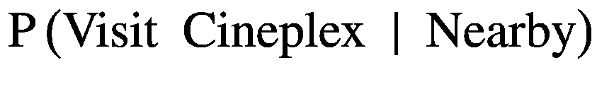

换句话说，“你的朋友在电影院附近”这一信息如何影响你去电影院的可能性。

### 6.8.2 贝叶斯定理

贝叶斯定理（或贝叶斯规则、贝叶斯公式）将两个事件之间的条件概率定义为

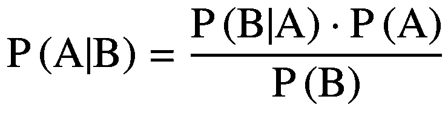

其中

P(A) 是先验概率，

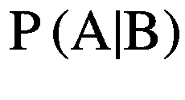 是后验概率，读作在事件 B 发生的条件下事件 A 发生的概率。

P(B) 是边际似然

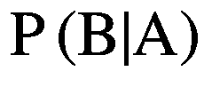 是似然

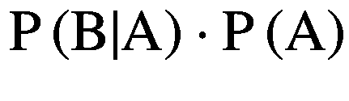 也可以看作是联合概率，表示事件 A 与事件 B 的交集概率；换句话说，就是事件 A 和事件 B 同时发生的概率。

重新排列贝叶斯定理，我们可以将其写为

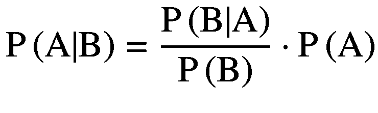

其中项 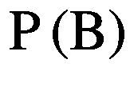 表示事件 B 对事件 A 发生概率的影响。

这将构成我们朴素贝叶斯算法的核心。因此，在进入该算法之前，让我们简要理解贝叶斯定理中讨论的三个术语。

### 6.8.3 先验概率

先验概率或*先验*表示在考虑某些证据之前，某个事件发生的确定性。以同样的 Facebook 附近功能为例，如果你对朋友当前的位置一无所知，他去电影院的可能性有多大？

### 6.8.4 后验概率

以另一个事件为条件的事件 A 发生的概率给出了后验概率。因此，在 Facebook 附近功能中，如果我们知道你的朋友在电影院一英里范围内（定义为附近），他去电影院的可能性如何变化。这种额外的证据有助于提高特定事件的确定性。我们将利用这一基本原理来设计朴素贝叶斯算法。

### 6.8.5 似然与边际似然

如果我们稍微修改第 1 章中的表 1-2，其中你看到了一个关于 Facebook 附近示例的二维列联表（也称为频率表），并将其转换为一个似然表，如表 6-6 所示，其中每个单元格中的条目现在是一个条件概率。

**表 6-6** *一个似然表* 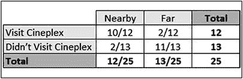

查看表 6-6，现在很容易计算出边际似然 P(Nearby)为 12/25 = 0.48。以及似然 P(Nearby | Visit Cineplex)为 10/12 = 0.83。正如你所观察到的，边际似然不依赖于另一个事件。


### 6.8.6 朴素贝叶斯方法

综上所述，我们得到了朴素贝叶斯的最终形式：


进一步推广，假设我们有一个数据集，由向量 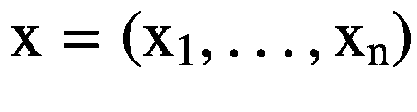 表示，包含 n 个相互独立的特征（这是朴素贝叶斯中的一个强假设，任何违反此性质的数据集在朴素贝叶斯中表现都会很差），那么一个给定的观测值可以以概率 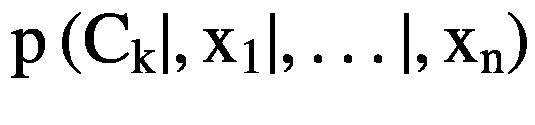 被分类到 K 个类别 C[k] 中的某一个。

现在，使用贝叶斯定理，我们可以将条件概率写为：

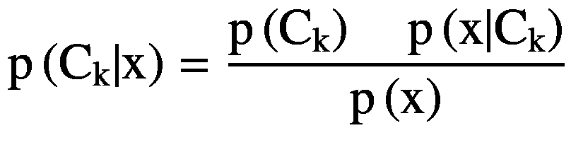

分子 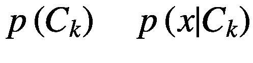 表示联合概率，可以使用链式法则展开。不过，我们将把这个讨论留给更高级的专题文本。

至此，我们已经讨论了贝叶斯定理如何作为建模现实世界问题的强大工具。此外，可以证明，如果预先计算好似然表，那么实时实现只需进行表查找即可快速计算，朴素贝叶斯会非常有效。朴素贝叶斯简洁优雅，但在建模问题时若能认真考虑其假设，则功能强大。

现在，让我们将此技术应用于我们的购买偏好数据集，看看结果如何。

1.  数据准备

```
    library(data.table)
    library(splitstackshape)
    library(e1071)
    str(Data_Purchase)
    Classes 'data.table' and 'data.frame':   500000 obs. of  12 variables:
    $ CUSTOMER_ID         : chr  "000001" "000002" "000003" "000004" ...
    $ ProductChoice       : int  2 3 2 3 2 3 2 2 2 3 ...
    $ MembershipPoints    : int  6 2 4 2 6 6 5 9 5 3 ...
    $ ModeOfPayment       : chr  "MoneyWallet" "CreditCard" "MoneyWallet" "MoneyWallet" ...
    $ ResidentCity        : chr  "Madurai" "Kolkata" "Vijayawada" "Meerut" ...
    $ PurchaseTenure      : int  4 4 10 6 3 3 13 1 9 8 ...
    $ Channel             : chr  "Online" "Online" "Online" "Online" ...
    $ IncomeClass         : chr  "4" "7" "5" "4" ...
    $ CustomerPropensity  : chr  "Medium" "VeryHigh" "Unknown" "Low" ...
    $ CustomerAge         : int  55 75 34 26 38 71 72 27 33 29 ...
    $ MartialStatus       : int  0 0 0 0 1 0 0 0 0 1 ...
    $ LastPurchaseDuration: int  4 15 15 6 6 10 5 4 15 6 ...
    - attr(*, ".internal.selfref")=
    #Check the distribution of data before grouping
    table(Data_Purchase$ProductChoice)
    1      2      3      4
    106603 199286 143893  50218
    #Pulling out only the relevant data to this chapter
    Data_Purchase <-Data_Purchase[,.(CUSTOMER_ID,ProductChoice,MembershipPoints,IncomeClass,CustomerPropensity,LastPurchaseDuration)]
    #Delete NA from subset
    Data_Purchase <-na.omit(Data_Purchase)
    Data_Purchase$CUSTOMER_ID <-as.character(Data_Purchase$CUSTOMER_ID)
    #Stratified Sampling
    Data_Purchase_Model<-stratified(Data_Purchase, group=c("ProductChoice"),size=10000,replace=FALSE)
    print("The Distribution of equal classes is as below")
    [1] "The Distribution of equal classes is as below"
    table(Data_Purchase_Model$ProductChoice)
    1     2     3     4
    10000 10000 10000 10000
    Data_Purchase_Model$ProductChoice <-as.factor(Data_Purchase_Model$ProductChoice)
    Data_Purchase_Model$IncomeClass <-as.factor(Data_Purchase_Model$IncomeClass)
    Data_Purchase_Model$CustomerPropensity <-as.factor(Data_Purchase_Model$CustomerPropensity)
    set.seed(917);
    train <-Data_Purchase_Model[sample(nrow(Data_Purchase_Model),size=nrow(Data_Purchase_Model)*(0.7), replace =TRUE, prob =NULL),]
    train <-as.data.frame(train)
    test <-as.data.frame(Data_Purchase_Model[!(Data_Purchase_Model$CUSTOMER_ID %in%train$CUSTOMER_ID),])
    ```

2.  朴素贝叶斯模型

```
    model_naiveBayes <-naiveBayes(train[,c(3,4,5)], train[,2])
    model_naiveBayes
    Naive Bayes Classifier for Discrete Predictors
    Call:
    naiveBayes.default(x = train[, c(3, 4, 5)], y = train[, 2])
    A-priori probabilities:
    train[, 2]
    1         2         3         4
    0.2519643 0.2505714 0.2466071 0.2508571
    Conditional probabilities:
    MembershipPoints
    train[, 2]     [,1]     [,2]
    1 4.366832 2.385888
    2 4.212087 2.354063
    3 4.518320 2.391260
    4 3.659596 2.520176
    IncomeClass
    train[, 2]                       1           2           3          4
    1 0.000000000 0.001417434 0.001842665 0.033451453 0.171651311
    2 0.002993158 0.001710376 0.002423033 0.032354618 0.173175599
    3 0.000000000 0.001158581 0.001737871 0.029543809 0.166980449
    4 0.000000000 0.001566059 0.001850797 0.019219818 0.151480638
    IncomeClass
    train[, 2]           5           6           7           8          9
    1 0.337774628 0.265910702 0.142735648 0.040113395 0.005102764
    2 0.328962372 0.265250855 0.143529076 0.046465222 0.003135690
    3 0.325416365 0.275452571 0.148153512 0.046777697 0.004779146
    4 0.318479499 0.280466970 0.161161731 0.060791572 0.004982916
    CustomerPropensity
    train[, 2]       High        Low     Medium    Unknown   VeryHigh
    1 0.09992913 0.17987243 0.16328845 0.49666903 0.06024096
    2 0.14438426 0.18258267 0.17901938 0.36944128 0.12457241
    3 0.18580739 0.13714699 0.19608979 0.25561188 0.22534395
    4 0.17283599 0.14635535 0.18180524 0.26153189 0.23747153
    ```

3.  模型评估


训练集准确率：41%

```
model_naiveBayes_pred <-predict(model_naiveBayes, train)
library(gmodels)
CrossTable(model_naiveBayes_pred, train[,2],
prop.chisq =FALSE, prop.t =FALSE,
dnn =c('predicted', 'actual'))
Cell Contents
|-------------------------|
|                       N |
|           N / Row Total |
|           N / Col Total |
|-------------------------|
Total Observations in Table:  28000
| actual
predicted |       1 |         2 |         3 |         4 | Row Total |
-------------|---------|-----------|-----------|-----------|-----------|
1 |    4016 |      3077 |      2187 |      2098 |     11378 |
|   0.353 |     0.270 |     0.192 |     0.184 |     0.406 |
|   0.569 |     0.439 |     0.317 |     0.299 |           |
-------------|---------|-----------|-----------|-----------|-----------|
2 |     622 |       702 |       500 |       489 |      2313 |
|   0.269 |     0.304 |     0.216 |     0.211 |     0.083 |
|   0.088 |     0.100 |     0.072 |     0.070 |           |
-------------|---------|-----------|-----------|-----------|-----------|
3 |    1263 |      1635 |      2336 |      1890 |      7124 |
|   0.177 |     0.230 |     0.328 |     0.265 |     0.254 |
|   0.179 |     0.233 |     0.338 |     0.269 |           |
-------------|---------|-----------|-----------|-----------|-----------|
4 |    1154 |      1602 |      1882 |      2547 |      7185 |
|   0.161 |     0.223 |     0.262 |     0.354 |     0.257 |
|   0.164 |     0.228 |     0.273 |     0.363 |           |
-------------|---------|-----------|-----------|-----------|-----------|
Column Total |    7055 |      7016 |      6905 |      7024 |     28000 |
|   0.252 |     0.251 |     0.247 |     0.251 |           |
-------------|---------|-----------|-----------|-----------|-----------|
```

测试集准确率：34%

```
model_naiveBayes_pred <-predict(model_naiveBayes, test)
library(gmodels)
CrossTable(model_naiveBayes_pred, test[,2],
prop.chisq =FALSE, prop.t =FALSE,
dnn =c('predicted', 'actual'))
Cell Contents
|-------------------------|
|                       N |
|           N / Row Total |
|           N / Col Total |
|-------------------------|
Total Observations in Table:  20002
| actual
predicted |       1 |         2 |         3 |         4 | Row Total |
-------------|---------|-----------|-----------|-----------|-----------|
1 |    2823 |      2155 |      1537 |      1493 |      8008 |
|   0.353 |     0.269 |     0.192 |     0.186 |     0.400 |
|   0.565 |     0.431 |     0.305 |     0.300 |           |
-------------|---------|-----------|-----------|-----------|-----------|
2 |     496 |       548 |       388 |       407 |      1839 |
|   0.270 |     0.298 |     0.211 |     0.221 |     0.092 |
|   0.099 |     0.110 |     0.077 |     0.082 |           |
-------------|---------|-----------|-----------|-----------|-----------|
3 |     885 |      1164 |      1746 |      1358 |      5153 |
|   0.172 |     0.226 |     0.339 |     0.264 |     0.258 |
|   0.177 |     0.233 |     0.347 |     0.273 |           |
-------------|---------|-----------|-----------|-----------|-----------|
4 |     794 |      1128 |      1364 |      1716 |      5002 |
|   0.159 |     0.226 |     0.273 |     0.343 |     0.250 |
|   0.159 |     0.226 |     0.271 |     0.345 |           |
-------------|---------|-----------|-----------|-----------|-----------|
Column Total |    4998 |      4995 |      5035 |      4974 |     20002 |
|   0.250 |     0.250 |     0.252 |     0.249 |           |
-------------|---------|-----------|-----------|-----------|-----------|
```

训练集和测试集的准确率存在显著差异，表明可能存在过拟合现象。

### 6.8.7 结论

本节讨论的技术基于概率模型，通常称为贝叶斯模型。这些模型易于解释，并且在垃圾邮件过滤和文本分类等应用中非常流行。贝叶斯模型提供了增量添加数据的灵活性，使得当新的观测数据到达时可以轻松更新模型。因此，像贝叶斯这样的概率方法已在许多实际应用场景中得到应用。模型对数据变化的适应能力远比其他模型简单。

在下一节中，我们将讨论无监督学习算法，这类算法在标记数据较少或完全没有标记数据的许多实际应用中非常有用。这些算法最著名的身份是模式识别算法，它们基于某种相似性或距离方法进行工作。

## 6.9 聚类分析

聚类分析涉及将一组对象分组为有意义且有用的簇，使得簇内的对象具有同质性，而不同簇的对象之间具有异质性。聚类分析的指导原则在不同算法中保持一致，即通过某种度量（例如距离连通性、均值方差等）最小化组内变异并最大化组间变异。

聚类并非指特定的算法，而是基于相似性度量创建分组的过程。聚类分析使用无监督学习算法来创建簇。聚类分析有时被呈现为更广泛的数据特征分析的一部分。一些研究人员将特征发现工作分解为数据的聚类分析：

*   *因子分析*：首先降低数据的维度
*   *聚类*：在数据中创建簇
*   *判别分析*：衡量数据属性被捕获的程度

聚类分析将作为独立过程包含全部或部分上述三个步骤。这将提供对数据分布的洞察，可用于制定更好的数据决策，或者其结果可用于输入到进一步的算法中。

在机器学习中，我们并不总是针对某个预定义的目标变量进行求解，探索性数据挖掘为我们提供了大量关于数据本身的信息。聚类在工业中有许多应用，以下列举其中一些：

1.  *市场营销*：聚类算法可以提供关于客户中不同群体存在的有用见解。它有助于回答诸如“这个群体是否共享某些共同的人口统计特征？”或“在创建有针对性的营销活动时，应关注哪些特征？”等问题。
    *   *保险*：识别具有最高平均索赔成本的群体特征。该簇是否由特定人群组成？是否有某些特定特征导致了高索赔成本？
    *   *地震学*：地震震中显示沿大陆断层呈簇状分布。聚类有助于识别那些发生更大地震概率高于其他断层的断层簇。
    *   *政府规划*：聚类可以帮助识别特定家庭群体以实施社会计划，并且可以根据多个属性（如规模、收入、类型等）对家庭进行分组。
    *   *分类学*：生物学家非常流行使用聚类来创建相似物种的群体和子群体的分类树。

还有其他方法可以识别和创建相似群体，例如 Q 分析、多维尺度分析和潜在类别分析。建议你在任何市场营销研究方法教科书中进一步阅读相关内容。


### 6.9.1 聚类分析简介

本章我们将讨论并演示一些常见的聚类算法。聚类的定义较为宽泛，主要取决于我们用来衡量聚类质量的指标。聚类算法在很大程度上取决于我们为底层数据假定的“聚类模型”类型。

聚类模型是一个概念，用于表示我们试图识别的是哪种类型的簇。以下是一些常见的聚类模型及其基础上构建的流行算法。

*   *连通性模型*：以观测值之间的距离连通性为衡量指标，例如层次聚类。

*   *质心模型*：以每个观测值/簇与均值之间的距离为衡量指标，例如 K 均值聚类。

*   *分布模型*：以数据集中变量统计分布的显著性为衡量指标，例如期望最大化算法。

*   *密度模型*：以数据空间中的密度为衡量指标，例如 DBSCAN 模型。

此外，聚类可分为两种类型：

*   *硬聚类*：每个对象恰好属于一个簇。

*   *软聚类*：每个对象有一定概率属于不同的簇。

在下一节中，我们将通过 R 语言演示这些算法，以帮助理解其输出结果。

### 6.9.2 聚类算法

聚类算法无法区分相关变量与无关变量。研究人员需要仔细选择变量，算法将基于这些变量开始识别数据中的模式/分组。这一点非常重要，因为形成的簇可能在很大程度上依赖于所包含的变量。

一个好的聚类算法可以根据两个主要目标进行评估：

*   高类内相似性

*   低类间相似性

聚类算法中另一个常见概念是聚类的*质量度量*。所使用的相似性度量及其实现方式成为决定聚类质量的重要因素。衡量聚类质量的另一个重要因素是其发现隐藏模式的能力。

首先，我们加载房价数据集并查看其数据描述。为了进行后续分析（构建模型后），我们在数据中附加了 `HouseNetWorth` 列。该房屋净值是 `StoreArea(sq.mt)` 和 `LawnArea(sq.mt)` 的函数。

通过市场调研，我们将获得原始格式的数据，其中不包含任何目标变量。聚类算法将向我们展示，我们是否可以通过不同的聚类算法，根据价值尺度对数据进行划分。

```
