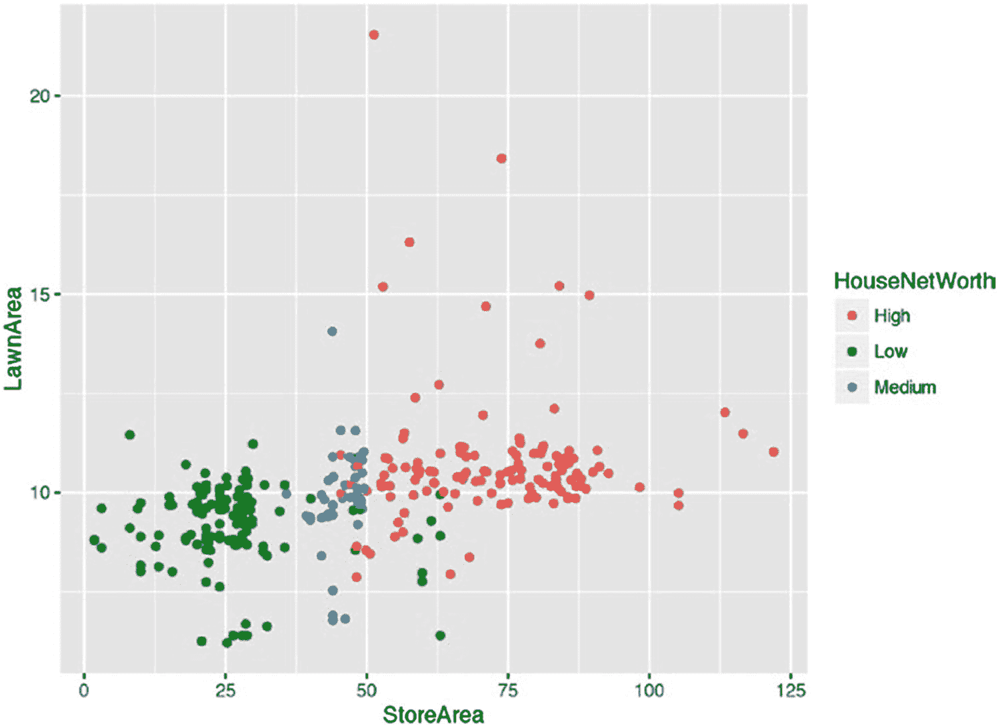
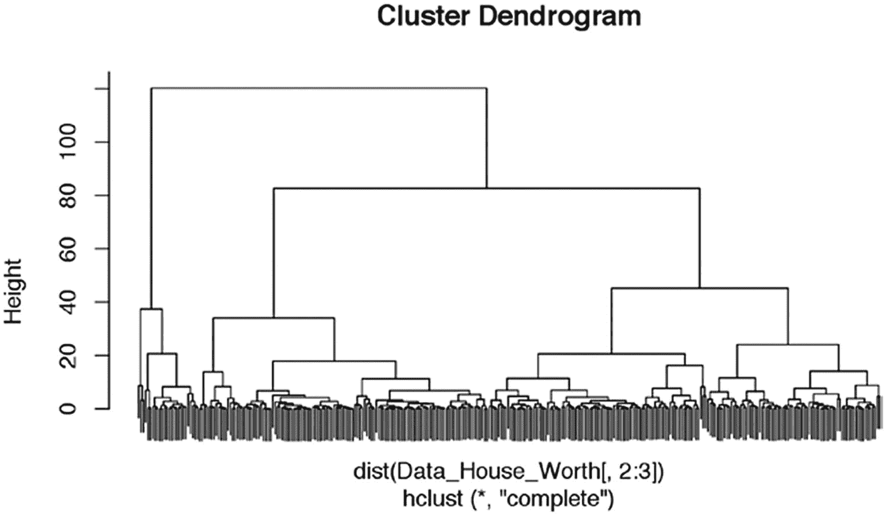

# 移除我们不会使用的额外列
Data_House_Worth$BasementArea <-NULL
```

对图 6-40 中的散点图进行快速分析表明，`LawnArea` 和 `StoreArea` 之间存在某种关系。由于这是一个小型数据集且校准良好，我们可以观察并解释这些簇（如果手动进行聚类，这也是一个过程）。然而，我们假设事先没有这些信息，让聚类算法告诉我们这些簇的存在。



图 6-40

每个 HouseNetWorth 组的 StoreArea 与 LawnArea 散点图

```
library(ggplot2)
ggplot(Data_House_Worth, aes(StoreArea, LawnArea, color = HouseNetWorth)) +geom_point()
```

让我们使用这些数据来演示不同的聚类算法。

#### 6.9.2.1 层次聚类

层次聚类基于簇的连通性模型。聚类过程涉及的步骤如下：

1.  从 N 个簇开始，N 是元素的数量（即，将每个元素分配给它自己的簇）。换句话说，簇之间的距离（相似度）等于它们所包含项之间的距离（相似度）。

2.  现在，合并距离最近（最相似）的簇对（例如，第一次迭代会将簇的数量减少到 N - 1）。

3.  再次计算距离（相似度），并与最近的簇合并。

4.  重复步骤 2 和 3，直到所有数据点都归入一个簇。

现在，你将获得所有层次的聚类树状图。通过在适当的位置停止迭代，选择你想要拥有的簇数量作为截止点。

在 R 语言中，我们使用 `hclust()` 函数。该函数用于对一组不相似性进行层次聚类分析，并提供分析方法。它是 `stats` 包的一部分。

这里使用的另一个重要函数是 `dist()`；该函数计算并返回距离矩阵，该矩阵通过使用指定的距离度量来计算数据矩阵各行之间的距离。默认情况下，它使用欧几里得距离。

在笛卡尔坐标系中，欧几里得空间中的两个向量 p = (p1, p2,…, pn) 和 q = (q1, q2,…, qn) 是两个点。数学上，n 维空间中的欧几里得距离由下式给出：


让我们应用 `hclust` 函数并创建我们的簇。



图 6-41

簇树状图

```
