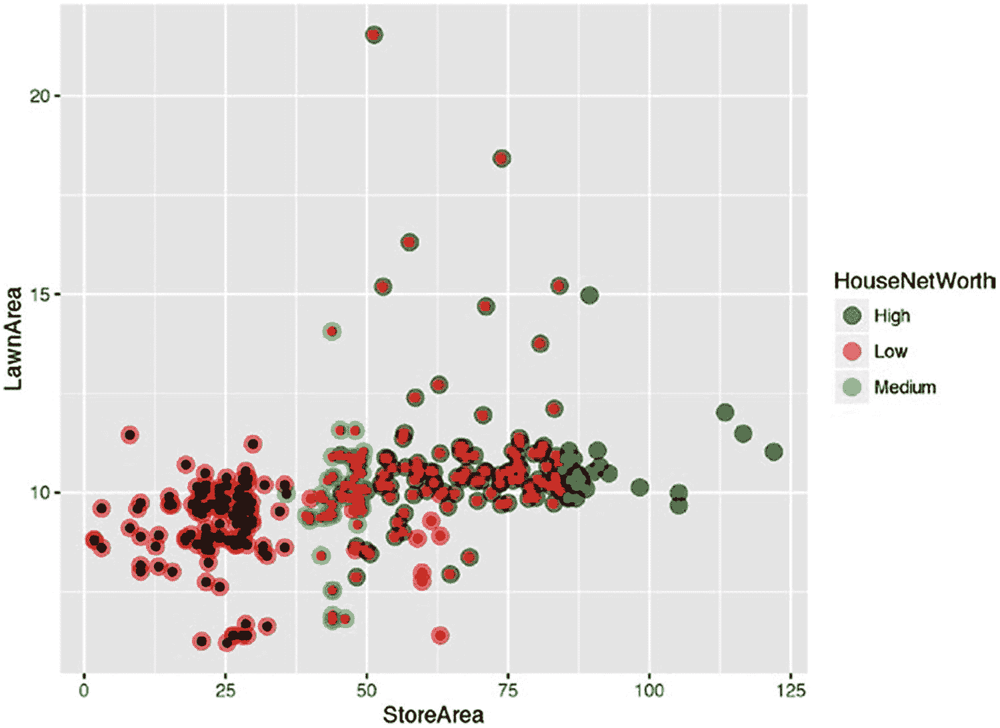
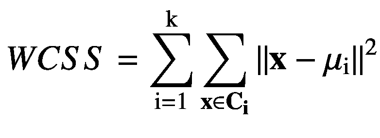
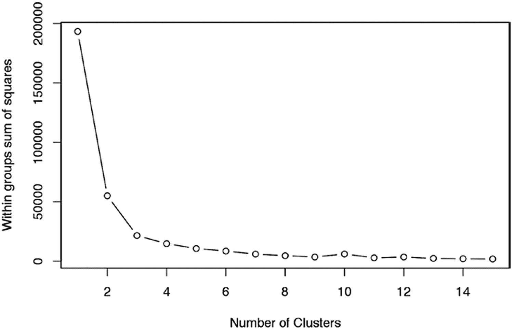

# 将聚类分布与实际净值制成表格
table(clusterCut_4,Data_House_Worth$HouseNetWorth)
clusterCut_4 High Low Medium
1    0 122      1
2   34   9     50
3   70   4      0
4   26   0      0
```

这三个独立的表格显示了簇能够捕捉净值特征的程度。我们将自己限制在三个簇，因为我们从额外信息中知道，房屋按净值可分为三组。用统计术语来说，最佳簇数可以通过肘部法和/或半偏 R 方、有效性指数伪 F 统计量来选择。更多细节可参考 Timm, Neil H. 所著的《*应用多元分析*》，Springer, 2002。



图 6-42

LawnArea 和 StoreArea 的簇图


```
ggplot(Data_House_Worth, aes(StoreArea, LawnArea, color = HouseNetWorth)) +
geom_point(alpha =0.4, size =3.5) +geom_point(col = clusterCut_3) +
scale_color_manual(values =c('black', 'red', 'green'))
```

你可以看到，我们的大部分“高”、“中”和“低”`NetHouseworth`数据点与`hclust`生成的三个聚类存在重叠。事后看来，如果我们不知道实际的净值规模，我们本可以从这个聚类分析中获取这些信息。

在下一节中，我们将对同一数据应用另一种聚类算法，并观察结果如何。

#### 6.9.2.2 基于质心的聚类

以下文字摘自 Hartigan 等人的原始论文《A K-Means Clustering Algorithm》[6]，该文对 k-means 算法的工作原理给出了最精炼和准确的描述：

*   *K-means 算法的目标是将 N 维空间中的 M 个点划分为 K 个聚类，使得聚类内平方和最小化。要求解在所有划分中具有最小平方和的方案是不切实际的，除非 M、N 很小且 K = 2。我们转而寻求“局部”最优解，即满足以下条件的解：将任何一个点从一个聚类移动到另一个聚类都不会减少聚类内平方和。*

其中，聚类内平方和（WCSS）是每个聚类中每个观测值到其质心的距离之和。更技术性地讲，对于一组观测值 (x[1], x[2], …, x[n]) 和一组 k 个聚类 C = {C[1], C[2], …, C[k]}：



μ[i] 是 C[i] 中点的均值。

算法：

在该算法的最简形式中，包含两个步骤：

*   **分配**：将每个观测值分配到能使其聚类内平方和（WCSS）最小的聚类。

*   **更新**：通过计算聚类中所有观测值的均值来更新质心。

这两个步骤会迭代执行，直到连续两次迭代中的分配不再发生变化，这意味着达到了局部或全局最优点（但并不总是保证）。

### 注意

对于感兴趣的读者，Hartigan 等人在其原始论文中描述了一个七步流程。

让我们使用 `HouseNetWorth` 数据来展示 k-means 聚类。与层次聚类不同，为了找到 k（聚类数量）的最优值，我们将使用肘部曲线。该曲线展示了作为聚类数量函数的方差解释百分比。



图 6-43

x 轴上为不同 k 值（聚类数量）的肘部曲线

```
