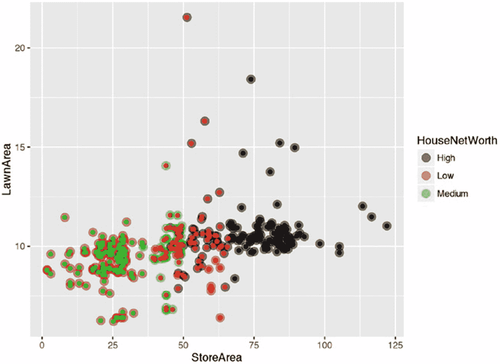
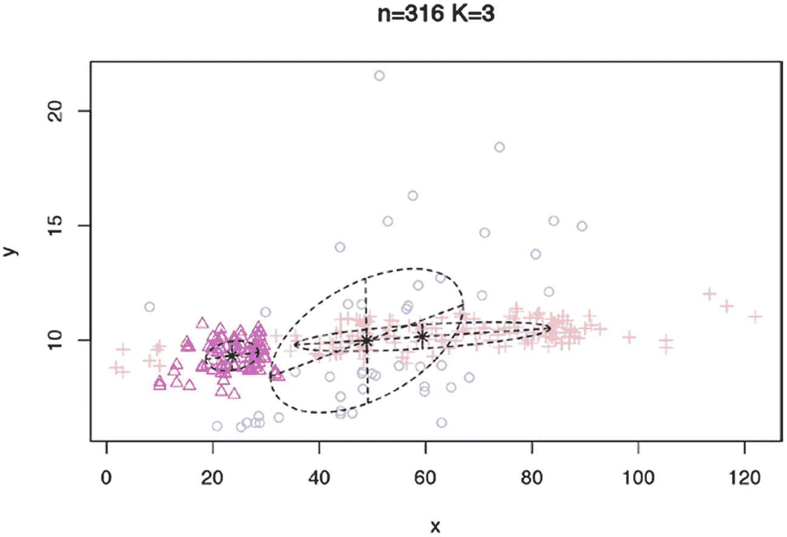

# 肘部曲线
wss <-(nrow(Data_House_Worth)-1)*sum(apply(Data_House_Worth[,2:3],2,var))
for (i in 2:15) {
wss[i] <-sum(kmeans(Data_House_Worth[,2:3],centers=i)$withinss)
}
plot(1:15, wss, type="b", xlab="聚类数量",ylab="组内平方和")
```

肘部曲线表明，使用三个聚类时，我们能够解释数据中的大部分方差。超过四个聚类后，增加更多聚类对解释分组没有帮助（如图 6-43 所示，WCSS 在三个聚类后趋于饱和）。因此，我们将再次选择 k=3 个聚类。

```
set.seed(917)
#对数据集运行 k-means 聚类
Cluster_kmean <-kmeans(Data_House_Worth[,2:3], 3, nstart =20)
#制成交叉分布表
table(Cluster_kmean$cluster,Data_House_Worth$HouseNetWorth)
High Low Medium
1   84   0      0
2   46  13     50
3    0 122      1
```

该表显示，聚类 1 仅包含“高”净值点，而聚类 2 和 3 则包含了所有类型。同时，聚类 3 除了一个点之外，仅代表低净值点。以下是聚类与实际净值的对比图。



图 6-44

使用 k-means 的聚类图

```
Cluster_kmean$cluster <-factor(Cluster_kmean$cluster)
ggplot(Data_House_Worth, aes(StoreArea, LawnArea, color = HouseNetWorth)) +
geom_point(alpha =0.4, size =3.5) +geom_point(col = Cluster_kmean$cluster) +
scale_color_manual(values =c('black', 'red', 'green'))
```

在图 6-44 中，我们可以看到 k-means 很好地捕捉到了聚类。

#### 6.9.2.3 基于分布的聚类

分布方法是迭代方法，用于优化数据集中聚类的分布。高斯分布就是正态分布。该方法分三步进行：

1.  首先随机选择高斯参数并将其拟合到一组数据点。

2.  迭代优化分布参数，以尽可能多地拟合数据点。

3.  一旦收敛到局部最小值，就可以将数据点分配到更接近该聚类分布的位置。

尽管该算法会创建复杂的模型，但它确实能捕捉属性之间的相关性和依赖性。其缺点是这些方法通常存在过拟合问题。这里，我们在房屋净值数据上展示一个算法示例。



图 6-45

基于 EM 算法的聚类图

```
library(EMCluster, quietly =TRUE)
ret <-init.EM(Data_House_Worth[,2:3], nclass =3)
ret
Method: em.EMRnd.EM
n = 316, p = 2, nclass = 3, flag = 0, logL = -1871.0336.
nc:
[1]  48 100 168
pi:
[1] 0.2001 0.2508 0.5492
ret.new <-assign.class(Data_House_Worth[,2:3], ret, return.all =FALSE)
#这为每个案例分配了一个类别
str(ret.new)
List of 2
$ nc   : int [1:3] 48 100 168
$ class: num [1:316] 1 3 3 1 3 3 3 3 3 3 ...
