# 绘制结果
plotem(ret,Data_House_Worth[,2:3])
```

该算法很好地捕捉到了低净值和高净值点，而中等净值点则分散得多，在聚类中未能得到很好的体现。现在让我们看看使用此方法进行聚类后散点图的效果。

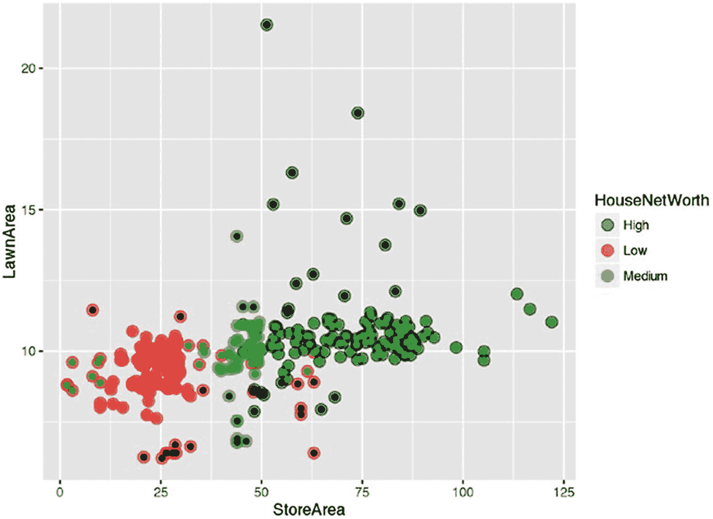

图 6-46

EM 算法的聚类图

```
ggplot(Data_House_Worth, aes(StoreArea, LawnArea, color = HouseNetWorth)) +
geom_point(alpha =0.4, size =3.5) +geom_point(col = ret.new$class) +
scale_color_manual(values =c('black', 'red', 'green'))
```

同样，该图对高和低类别效果良好，但对中等类别表现不佳。在 `LawnArea` 值较高的区域也有一些散落的点，但相比之下，这些点在高聚类中仍然被更好地捕捉到了。如果你观察一下，这种方法不如我们在 `hclust` 或 k-means 中看到的那样好，因为两个聚类之间的点重叠要多得多。


#### 6.9.2.4 基于密度的聚类

具有噪声的基于密度的空间聚类应用（DBSCAN）是一种数据聚类算法，由 Martin Ester、Hans-Peter Kriegel、Jörg Sander 和徐晓伟于 1996 年提出。

该算法采用参数化方法。其涉及的两个参数如下：

*   `e`：数据点 *p* 邻域的半径。

*   `minPts`：定义一个簇时，邻域内所需的最小数据点数量。

一旦定义了这些参数，算法会将数据点分为三类：

*   **核心点**：如果距离点 *p* 的 · 范围内（包括 *p* 本身）至少有 `minPts` 个点，则点 *p* 为核心点。

*   **边界点**：如果存在一条路径 p1, …, pn，其中 p1 = p 且 pn = q，并且每个 pi+1 都可以从 *pi* 直接到达（路径上的所有点（*q* 可能除外）都必须是核心点），则点 *q* 是点 *p* 的边界点。

*   **离群点**：所有无法从任何其他点到达的点都是离群点。

在定义了上述步骤之后，DBSCAN 的步骤很简单：

1.  随机选择一个未分配到任何簇的点，并计算其邻域。如果该点的邻域内包含 `minPts` 个点，则围绕该点创建一个簇；否则，将其标记为离群点。

2.  找到所有核心点后，开始扩展簇以包含边界点。

3.  重复这些步骤，直到所有点都被分配到某个簇或被标记为离群点。

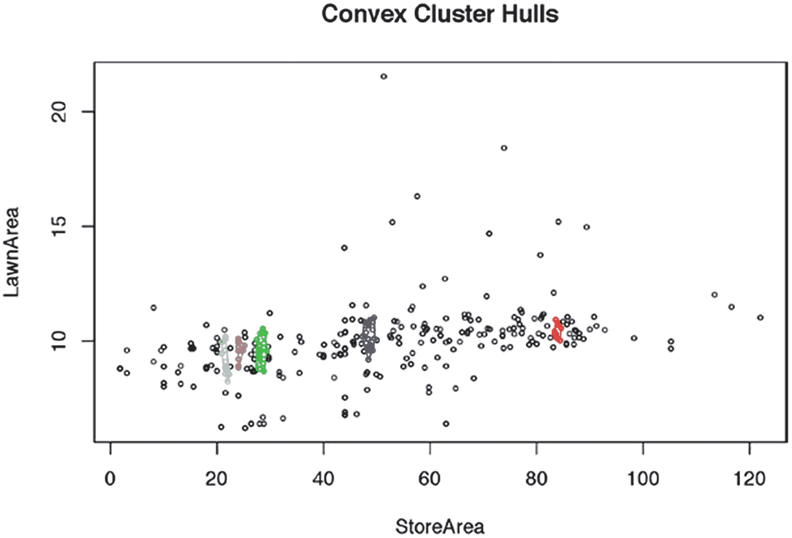

图 6-47

EM 算法的凸簇壳图

```
library(dbscan)
Warning: package 'dbscan' was built under R version 3.2.5
cluster_dbscan <-dbscan(Data_House_Worth[,2:3],eps=0.8,minPts =10)
cluster_dbscan
DBSCAN clustering for 316 objects.
Parameters: eps = 0.8, minPts = 10
The clustering contains 5 cluster(s) and 226 noise points.
0   1   2   3   4   5
226  10  25  24  15  16
Available fields: cluster, eps, minPts
#Display the hull plot
hullplot(Data_House_Worth[,2:3],cluster_dbscan$cluster)
```

结果显示，DBSCAN 找到了五个簇，并将 226 个案例分配为噪声/离群点。壳图显示分离效果良好，因此我们可以调整参数以获得更泛化或更特化的簇。

### 6.9.3 内部评估

当基于被聚类的数据来评估聚类结果时，这被称为内部评估。这些方法通常将最高评分分配给能够生成簇内相似度高、簇间相似度低的聚类算法。

#### 6.9.3.1 邓恩指数

J. Dunn 于 1974 年在其发表于《控制论杂志》的论文《良好分离的簇与最优模糊划分》中提出了该指数。[7]

邓恩指数旨在识别密集且分离良好的簇。它被定义为最小簇间距离与最大簇内距离之比。对于每个簇划分，可以使用以下公式计算邓恩指数。

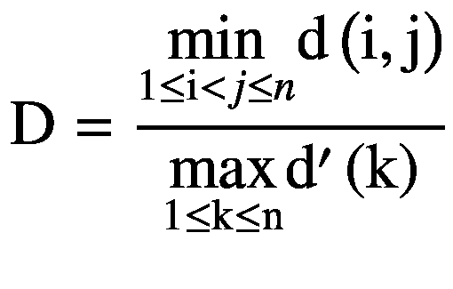

其中 *d(i,j)* 表示簇 *i* 和 *j* 之间的距离，*d’(k)* 衡量簇 *k* 的簇内距离。

```
library(clValid)
#Showing for hierarchical cluster with clusters = 3
dunn(dist(Data_House_Worth[,2:3]), clusterCut_3)
[1] 0.009965404
```

邓恩指数的取值范围在 0 到无穷大之间，且应最大化。高值的邓恩分数更理想；此处该值过低，表明这不是一个好的聚类。

#### 6.9.3.2 轮廓系数

轮廓系数将同一簇内元素之间的平均距离与其他簇内元素之间的平均距离进行对比。轮廓值高的对象被认为是良好聚类的；轮廓值低的对象可能是离群点。

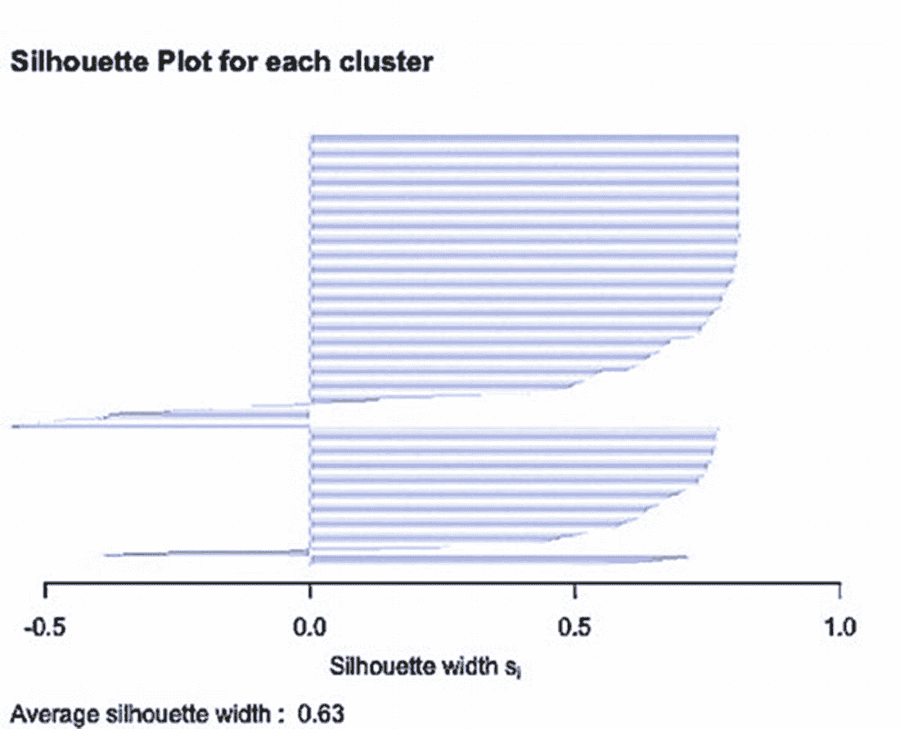

图 6-48

轮廓图

```
library(cluster)
#Showing for k-means cluster with clusters = 3
sk <-silhouette(clusterCut_3,dist(Data_House_Worth[,2:3]))
plot(sk)
```

图 6-48 中的轮廓图展示了三个簇在轮廓宽度上的表现。

### 6.9.4 外部评估

外部评估类似于对测试数据进行的评估。用于测试的数据不用于训练模型。然后，由专家或某些第三方基准对测试数据进行评估并分配标签。接着，对这些已标记项进行聚类的结果为我们提供了衡量聚类效果优劣的指标。由于该指标依赖于外部输入，因此被称为外部评估。

如果我们知道实际簇的样子，那么该方法很简单。然后我们就可以进行这些评估。在我们的案例中，我们已经知道房屋价值指标，因此可以计算这些评估指标。实际上，我们的数据在聚类之前已经标记好了，因此我们可以对用于聚类的同一数据进行外部评估。

#### 6.9.4.1 兰德指数

兰德指数类似于多类分类问题中的分类率。它衡量的是聚类返回的项与专家（标记）项有多少是共同的，有多少是不同的。如果我们假设专家标签（或外部标签）是正确的，那么该指标衡量的是正确分类率。可以使用以下公式计算[8]：

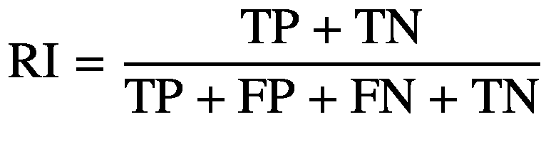

其中 *TP* 是真阳性数量，*TN* 是真阴性数量，*FP* 是假阳性数量，*FN* 是假阴性数量。

```
#Unsign result from EM Algo
library(EMCluster)
clust <-ret.new$class
orig <-ifelse(Data_House_Worth$HouseNetWorth == "High",2,
ifelse(Data_House_Worth$HouseNetWorth == "Low",1,2))
RRand(orig, clust)
Rand adjRand  Eindex
0.7653  0.5321  0.4099
```

兰德指数值较高，为 0.76，表明我们的 EM 方法聚类拟合效果良好。

#### 6.9.4.2 杰卡德指数

杰卡德指数与兰德指数类似。杰卡德指数衡量的是外部标签与聚类算法生成的标签之间的重叠程度。杰卡德指数值在 0 到 1 之间变化，0 表示无重叠，1 表示数据集完全相同。杰卡德指数由以下公式定义：

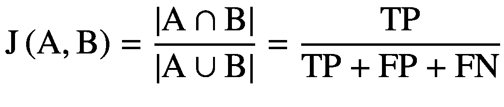

其中 *TP* 是真阳性数量，*FP* 是假阳性数量，*FN* 是假阴性数量。

```
#Unsign result from EM Algo
#Unsign result from EM Algo
library(EMCluster)
clust <-ret.new$class
orig <-ifelse(Data_House_Worth$HouseNetWorth == "High",2,
ifelse(Data_House_Worth$HouseNetWorth == "Low",1,2))
Jaccard.Index(orig, clust)
[1] 0.1024096
```

该指数值较低，表明只有 10% 的值是共同的。这意味着原始标签与聚类标签的重叠程度较低。这不是一个好的聚类形成。


### 6.9.5 结论

这些监督学习算法在工业界和研究中具有广泛的适应性。决策树的基础设计使其易于解释，并且该模型非常直观，易于与现实世界问题建立联系。像提升法和装袋法这类方法，催生了基于决策树的高精度模型。特别是，随机森林如今已成为许多分类问题中广泛使用的模型之一。

我们详细讨论了决策树，从最初的决策树模型（如 ID3）开始，接着介绍了当代的装袋 CART 和随机森林算法。

在下一节中，我们将看到关联规则挖掘，它处理事务数据，已在市场购物篮分析中得到应用，并催生了许多强大的推荐算法。

## 6.10 关联规则挖掘

关联规则学习是一种用于发现大型数据库中变量之间有趣关系的方法。它旨在通过使用某些兴趣度度量来识别在数据库中发现的有力规则。基于强规则的概念，Rakesh Agrawal 等人引入了关联规则，用于发现超市销售点（POS）系统记录的大规模交易数据中产品之间的规律性。

例如，在超市销售数据中发现的规则  表明，如果顾客同时购买洋葱和土豆，他们很可能也会购买汉堡肉。图书馆是另一个很好的例子，其中规则挖掘在图书管理和库存补充方面发挥着重要作用。Hossain 和 Rashedur 的论文《基于关联规则挖掘的图书馆资料采购》是一篇很好的读物，可以扩展关联规则挖掘在实际场景中应用的理念。

### 6.10.1 关联概念介绍

事务数据通常是企业丰富的信息来源。在传统模式下，企业从报告和生成仪表盘的角度审视这些数据，以便高管了解其业务健康状况。在 Agrawal 等人的开创性研究论文《挖掘大型数据库中项集之间的关联规则》中，他们提出了使用这些数据的替代方案：

*   提升商店中某个产品（商品）的销量
*   停产某个产品的影响
*   将多个产品捆绑在一起进行促销
*   在实体超市中更好地规划货架
*   基于购买模式的客户细分

考虑市场购物篮数据，其中项集 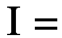 {面包和蛋糕、烘焙用品、饼干、罐装水果、罐装蔬菜、冷冻食品、洗衣用品、除臭皂、果酱涂抹酱}

数据库 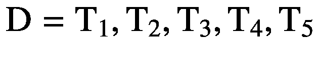

并且 {面包和蛋糕、烘焙用品、果酱涂抹酱} 是项集 I 的一个子集，而  是一个典型的规则。

以下部分描述了一些有用的度量，可以帮助我们迭代算法。

#### 6.10.1.1 支持度

支持度是一个项集出现在事务中的比例。我们将其表示为 *supp(X)*，其中 *X* 是一个项集。例如，

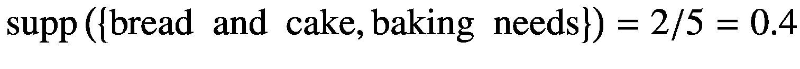 且 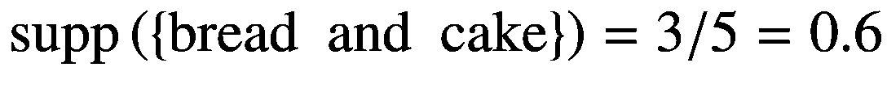。

#### 6.10.1.2 置信度

支持度有助于理解项集的强度，而置信度则指示规则的强度。例如，在规则  中，置信度是在事务同时包含 {面包和蛋糕、烘焙用品}（左侧）的条件下，找到项集 {果酱涂抹酱}（右侧）的条件概率。

更技术性地讲，置信度定义为

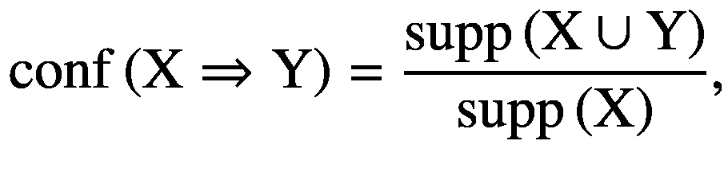

规则 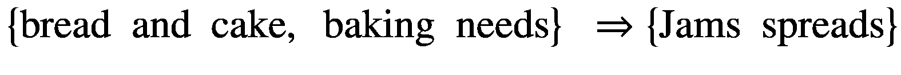 的置信度为 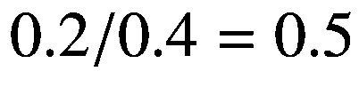，这意味着当顾客购买 {面包和蛋糕、烘焙用品} 时，有 50% 的概率他们也会购买 {果酱涂抹酱}。


#### 6.10.1.3 提升度

如果一条规则的左侧（LHS）和右侧（RHS）相互独立，即购买一个商品不依赖于另一个商品，那么提升度就是观察到的支持度与预期支持度之间的比值。因此，如果提升度 = 1，则 LHS 和 RHS 相互独立，这样的规则毫无意义；而如果提升度 > 1，则表明这两个事件相互依赖的程度。

更技术性的表述如下：

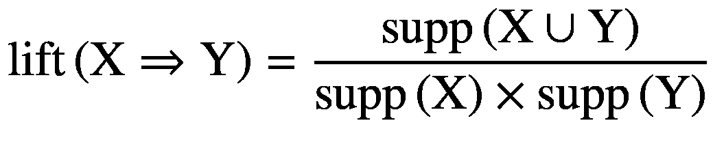

规则  的提升度为 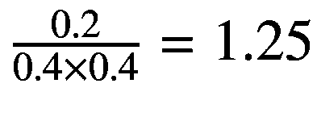，这意味着购买{面包和蛋糕、烘焙用品}的顾客购买{果酱涂抹酱}的可能性是普通顾客的 1.25 倍。

还有其他一些度量指标，如确信度、杠杆率和集体强度；然而，这三个指标在所有文献中被广泛使用，并且足以理解 Apriori 算法。

对于像这样的小例子，事情可能进展顺利，但在实际应用中，典型的交易数据库非常庞大。Agrawal 等人提出了一种简单而快速的算法来处理大型数据库。

1.  第一步，生成所有可能的候选项集。
2.  然后，使用这些候选项集形成规则。
3.  通常，提升度最高的规则是首选。

后来，Apriori 算法衍生出许多变体，但其原始形式如下。以下是 Apriori 算法生成候选项集的步骤：

1.  确定单元素项集（即单个项）的支持度，并丢弃不频繁的项/项集。
2.  形成包含两个项的候选项集（两个项都必须频繁），确定它们的支持度，并丢弃不频繁的项集。
3.  形成包含三个项的候选项集（所有包含的项对都必须频繁），确定它们的支持度，并丢弃不频繁的项集。
4.  继续形成包含四个、五个等项的候选项集，直到没有频繁的候选项集为止。

### 6.10.2 规则挖掘算法

我们将使用市场购物篮数据在 R 中演示此算法。

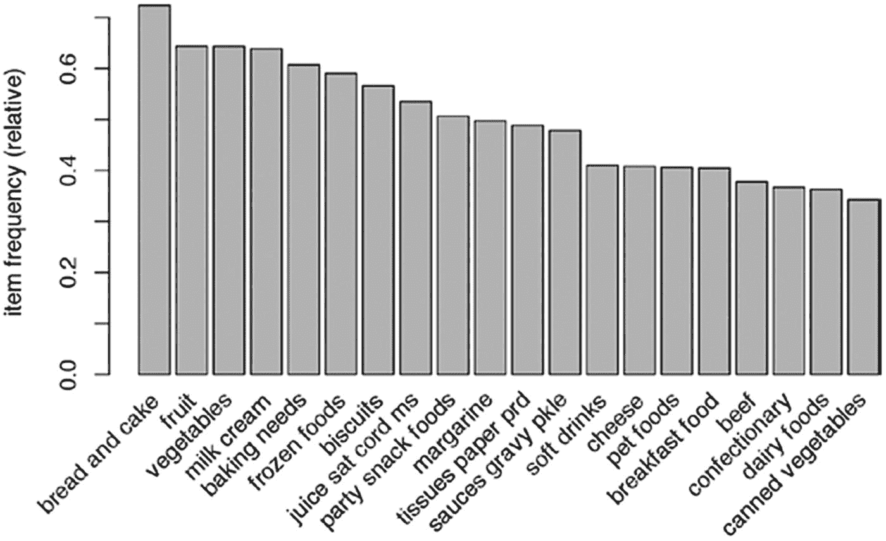

图 6-49

市场购物篮数据中的商品频率图

```
library(arules)
MarketBasket <-read.transactions("Dataset/MarketBasketProcessed.csv", sep =",")
summary(MarketBasket)
transactions as itemMatrix in sparse format with
4601 rows (elements/itemsets/transactions) and
100 columns (items) and a density of 0.1728711
most frequent items:
bread and cake          fruit     vegetables     milk cream   baking needs
3330           2962           2961           2939           2795
(Other)

element (itemset/transaction) length distribution:
sizes
1   2   3   4   5   6   7   8   9  10  11  12  13  14  15  16  17  18
30  15  14  36  44  75  72 111 144 177 227 227 290 277 286 302 239 247
19  20  21  22  23  24  25  26  27  28  29  30  31  32  33  34  35  36
193 191 170 199 160 153 108 125  90  94  59  43  45  35  36  27  16  11
37  38  39  40  41  42  43  47
11   6   4   5   4   1   1   1
Min. 1st Qu.  Median    Mean 3rd Qu.    Max.
1.00   12.00   16.00   17.29   22.00   47.00
includes extended item information - examples :
labels
1  canned vegetables
2      750ml red imp
3       750ml red nz
#Transactions - First two
inspect(MarketBasket[1:2])
items
1 {baking needs,
beef,
biscuits,
bread and cake,
canned fruit,
dairy foods,
fruit,
health food other,
juice sat cord ms,
lamb,
puddings deserts,
sauces gravy pkle,
small goods,
stationary,
vegetables,
wrapping}
2 {750ml white nz,
baby needs,
baking needs,
biscuits,
bread and cake,
canned vegetables,
cheese,
cleaners polishers,
coffee,
confectionary,
dishcloths scour,
frozen foods,
fruit,
juice sat cord ms,
margarine,
mens toiletries,
milk cream,
party snack foods,
razor blades,
sauces gravy pkle,
small goods,
tissues paper prd,
vegetables,
wrapping}
