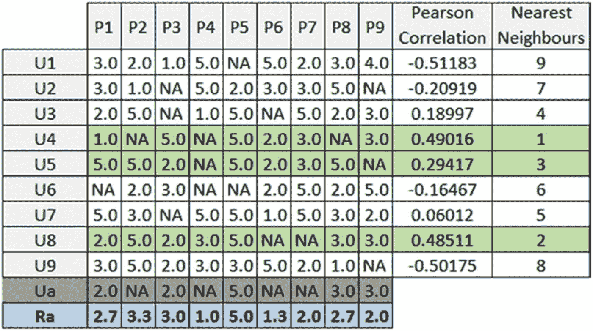
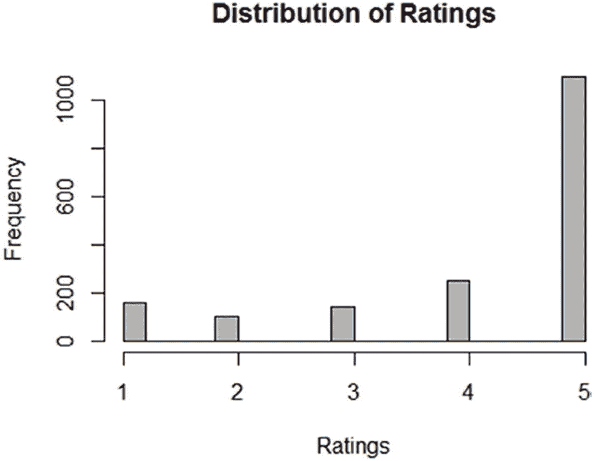
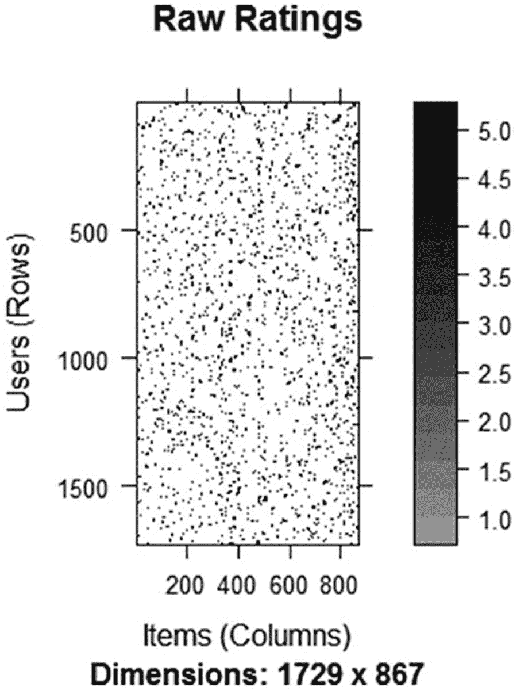

# store as  data frame
groceryrules_df <-as(groceryrules, "data.frame")
str(groceryrules_df)
'data.frame':    531 obs. of  2 variables:
$ items  : Factor w/ 531 levels "{baking needs,beef,bread and cake}",..: 338 250 239 358 357 302 96 334 426 341 ...
$ support: num  0.203 0.213 0.226 0.203 0.2 ...
```

结果基于项集的支持度而非提升度（lift）进行展示。这是因为 Eclat 仅挖掘频繁项集，不输出提升度指标，而 Apriori 算法更适合输出提升度。尽管如此，该输出显示了支持度最高的前五个项集，这些项集可进一步用于生成规则。

### 6.10.3 推荐算法

在前一节中，我们了解了关联规则挖掘，它可用于根据客户的购买历史生成产品推荐。对于 n 种产品，每个客户将由一个 n 维的 0-1 向量表示，其中 1 表示客户已购买该产品，0 表示未购买。基于提升度最高的规则，我们可以向所有购买了规则左侧（LHS）产品的客户推荐规则右侧（RHS）的产品。

如果数据稀疏性不高，这种方法可能有效；然而，还有更稳健、更高效的算法，统称为*推荐算法*。最初，这些算法的应用场景因亚马逊的产品推荐和 Netflix 的电影推荐系统而流行起来。在过去几年中，该领域已有大量研究。一个最优雅的推荐算法实现可以在 R 语言的 `recommenderlab` 包中找到，该包由 Michael Hahsler 开发。CRAN 上有一篇题为“recommenderlab: A Framework for Developing and Testing Recommendation Algorithms”的文章对其进行了详细说明（[`https://cran.r-project.org/web/packages/recommenderlab/vignettes/recommenderlab.pdf`](https://cran.r-project.org/web/packages/recommenderlab/vignettes/recommenderlab.pdf)）。这篇文章不仅详细阐述了该包的用法，还对各种推荐算法进行了很好的介绍。

在本书中，我们将讨论基于协同过滤的方法，使用亚马逊美食评论数据集进行食品推荐。如前文文本挖掘部分所述，该数据集中每一行对应一个用户及其 1 到 5 分（最低到最高）的评分。本书将介绍两种最流行的推荐算法：基于用户的协同过滤和基于物品的协同过滤。我们鼓励您参考 CRAN 上的 recommenderlab 文章，以获取更详细的讨论。


#### 6.10.3.1 基于用户的协同过滤（UBCF）

UBCF 算法基于一个假设：具有相似偏好的用户会给出相似的评分。例如，如果用户 A 给意大利面条的评分为 4，而用户 B 与用户 A 口味相似，那么他给意大利面条的评分也会接近 4。如果只考虑两个用户，这种方法可能效果不佳；然而，如果我们找到与用户 A 最相似的三个用户，并以协同方式（可以简单到取平均值）考虑他们对意大利面条的评分，我们就能更准确地预测用户 B 对意大利面条的评分。对于给定的用户-产品（项目）评分矩阵，如图 6-51 所示，该算法的工作流程如下：

1.  我们使用余弦相似度或皮尔逊相关系数（两种最常用的向量比较方法）来计算两个用户之间的相似度。

![$$ {\displaystyle \begin{array}{l}\kern8em {\mathrm{sim}}_{\mathrm{Pearson}}\left(\overrightarrow{x},\overrightarrow{y}\right)=\frac{\sum \limits_{i\in I}\left({\overrightarrow{x}}_i\overline{\overrightarrow{x}}\right)\left({\overrightarrow{y}}_i\overline{\overrightarrow{y}}\right)}{\left(|I|-1\right)\kern1em \mathrm{sd}\left(\overrightarrow{x}\right)\kern1em \mathrm{sd}\left(\overrightarrow{y}\right)}\\ {}\mathrm{and}\\ {}\kern12em {\mathrm{sim}}_{\mathrm{Cosine}}\left(\overrightarrow{x},\overrightarrow{y}\right)=\frac{\overrightarrow{x}\cdot \overrightarrow{y}}{\left|\left|\overrightarrow{x}\left\Vert \kern0.5em \cdot \kern0.5em \right\Vert \overrightarrow{y}\right|\right|},\end{array}} $$](img/416805_2_En_6_Chapter_TeX_Equbd.png)

1.  基于相似度度量，选择与待推荐用户最相似的 k 个近邻。

2.  计算这 k 个近邻评分的平均值。

3.  根据评分向量推荐评分最高的 N 个产品。

关于上述算法的一些补充说明：



图 6-51

UBCF 示意图

*   我们可以对评分矩阵进行归一化处理，以消除用户偏差。

*   在这种方法中，我们在相似度方面平等对待每个用户；然而，邻域中的某些用户可能与 U[a] 的相似度高于其他用户。在这种情况下，我们可以分配一定的权重以提供一些灵活性。

### 注意

NA 评分被视为 0。

如图 6-51 所示，对于新用户 U[a]，其评分向量为 <2.0,NA,2.0,NA,5.0,NA,NA,3.0,3.0>，我们希望找出缺失的评分。基于皮尔逊相关系数，当 k = 3 时，用户 U[4]、U[8] 和 U[5] 是 U[a] 的最近邻。取这些用户评分的平均值，你将得到 <2.7,3.3,3.0,1.0,5.0,1.3,2.0,2.7,2.0>。根据这些评分向量，我们可能会向 U[a] 推荐产品 P5 和 P2。

#### 6.10.3.2 基于项目的协同过滤（IBCF）

IBCF 与 UBCF 类似，但这里是将项目与项目进行比较，这种比较基于从评分矩阵推断出的项目间关系。因此，再次使用余弦相似度或皮尔逊相关系数来获得相似度矩阵。

由于 IBCF 消除了用户偏差并且可以预先计算，通常认为它更高效，但已知其产生的结果略逊于 UBCF。

现在，让我们使用亚马逊美食评论数据集，并应用 R 语言中 `recommenderlab` 包提供的 UBCF 和 IBCF 算法。



图 6-52

评分分布

1.  加载数据

```
    library(data.table)
    fine_food_data <-read.csv("Food_Reviews.csv",stringsAsFactors =FALSE)
    fine_food_data$Score <-as.factor(fine_food_data$Score)
    str(fine_food_data[-10])
    'data.frame':    35173 obs. of  9 variables:
    $ Id                    : int  1 2 3 4 5 6 7 8 9 10 ...
    $ ProductId             : chr  "B001E4KFG0" "B00813GRG4" "B000LQOCH0" "B000UA0QIQ" ...
    $ UserId                : chr  "A3SGXH7AUHU8GW" "A1D87F6ZCVE5NK" "ABXLMWJIXXAIN" "A395BORC6FGVXV" ...
    $ ProfileName           : chr  "delmartian" "dll pa" "Natalia Corres \"Natalia Corres\"" "Karl" ...
    $ HelpfulnessNumerator  : int  1 0 1 3 0 0 0 0 1 0 ...
    $ HelpfulnessDenominator: int  1 0 1 3 0 0 0 0 1 0 ...
    $ Score                 : Factor w/ 5 levels "1","2","3","4",..: 5 1 4 2 5 4 5 5 5 5 ...
    $ Time                  : int  1303862400 1346976000 1219017600 1307923200 1350777600 1342051200 1340150400 1336003200 1322006400 1351209600 ...
    $ Summary               : chr  "Good Quality Dog Food" "Not as Advertised" "\"Delight\" says it all" "Cough Medicine" ...
    ```

2.  数据准备

```
    library(caTools)
    # 随机分割数据，仅使用数据集的 10%
    set.seed(90)
    split =sample.split(fine_food_data$Score, SplitRatio =0.05)
    fine_food_data =subset(fine_food_data, split ==TRUE)
    select_col <-c("UserId","ProductId","Score")
    fine_food_data_selected <-fine_food_data[,select_col]
    rownames(fine_food_data_selected) <-NULL
    fine_food_data_selected$Score =as.numeric(fine_food_data_selected$Score)
    # 移除重复项
    fine_food_data_selected <-unique(fine_food_data_selected)
    ```

3.  创建评分矩阵

我们将使用一个名为 `dcast` 的函数，根据亚马逊美食评论数据集中的评论评分来创建评分矩阵：

```
    library(recommenderlab)
    # 评分矩阵
    RatingMat <-dcast(fine_food_data_selected,UserId ~ProductId, value.var ="Score")
    User=RatingMat[,1]
    Product=colnames(RatingMat)[2:ncol(RatingMat)]
    RatingMat[,1] <-NULL
    RatingMat <-as.matrix(RatingMat)
    dimnames(RatingMat) =list(user = User , product = Product)
    realM <-as(RatingMat, "realRatingMatrix")
    ```

4.  探索评分矩阵

```
    # 评分分布
    hist(getRatings(realM), breaks=15, main ="评分分布", xlab ="评分", col ="grey")
    ```



图 6-53

用户的原始评分

```
